# 飞书真实租户端到端登录：生产 worker 接线计划（2026-11-17）

## 文档职责

本文解决 megaui 企业登录（`AUTH_MODE=enterprise`）在真实飞书 App 上无法走通的问题，并确立**推送验证码**为企业登录的标准模式。

**标准登录模式（推送验证码，ADR-FSL-06、ADR-FSL-07）：** 用户在登录页输入**邮箱或手机号** → 服务端按飞书通讯录中的邮箱 / 手机号定位到唯一成员 → 通过飞书机器人私聊把 8 位动态验证码发给该成员 → 用户进入验证码页面输入验证码 → 取得 session。整个流程只需要服务端**主动访问**飞书开放平台（`https://open.feishu.cn`），不需要飞书回调我方服务，因此**不需要公网 HTTPS 回调入口**，飞书后台也不需要配置事件订阅。

现有代码实现的是另一种「私聊配对」模式：页面给出 `/login <token>` 指令，用户先私聊发给机器人，经事件回调确认后才发码；并且明确约定匿名的页面请求不发私聊（megaui `docs/implementation/enterprise-auth.md:863`）。该模式的生产接线也不完整：发码、投递、通讯录同步的 handler 只在 E2E fixture 中组装，标准 `enterprise:worker` 没有注册，真实部署里相关 durable job 永远停在 `pending`。本计划把推送模式作为标准模式补齐，全链路只经由仓库内的标准进程（Web、worker、admin CLI）完成；配对模式的底层代码（bot-command、bot-login、事件回调路由与 inbox）保留不删，但 FSL-45 删除配对服务的 `"pairing"` 分支、FSL-27 删除 verify 的旧形状、FSL-24 起 request 不再返回 `pairingToken`，因此保留代码在本计划完成后**不构成可用的端到端配对模式**，重新启用需要 `DEFER-FSL-04` 的新计划（`DEFER-FSL-04`）。

同时新增一项部署配置 `AUTH_USER_SOURCE`，显式声明用户来源（`local` 或 `feishu`）。用户来源为 `feishu` 时，所有自助注册入口完全关闭：邮箱注册、社交登录隐式建号、管理员接口建号、注册页面与入口链接，账号只能经飞书目录准入后由审批过的 `provision` 开通。

本文只规划任务，不宣称实现完成。落地时每个任务都必须先刷新源码锚点，再按任务卡验收。

**计划文件的提交与状态维护：** 初始提交已完成：megaui `cebb25f`（2026-11-18，Codex R147 `PASS` 之后；只含 `AGENTS.md`（「计划维护」条款修订：收录日期计划及其状态记录，用户 2026-11-18 确认）、`docs/plan/plan-20261117.md` 与 `docs/plan/README.md`；DCO 与 `gpgsig` 已以 `libra log -1 --pretty=raw` 核对；已推送 `main`）。该次 push 的 megaui `ci.yml` / `quality` 首次运行（run 44220296411）因与本提交无关的 `apps/web/tests/unit/enterprise-runtime-fixture.test.ts`「FS88 SMTP probe timed out」失败，已发起重跑，其结论不在此追认。此后对计划与索引的每次修订（含本次修订）都以只含 `docs/plan/plan-20261117.md` 与 `docs/plan/README.md` 的精确签名提交推送 megaui `main`（仅文档、无版本），各自须经 Codex 评审 `PASS`，该次 push 的 megaui `ci.yml` / `quality` 为其远端门；因此开工（ER-01）时两文件已被跟踪；ER-01 开工检查以 `libra status --short` 记录工作区基线，基线中与本计划无关的已有改动或未跟踪文件保留不动、不纳入任何提交，各卡的 allowlist 门比较的是相对该基线的新增变更（2026-11-18 计划提交前核对：除本计划两文件外工作区无其它改动）。此后的状态收敛规则：① 卡 N 的精确提交把自身记为 `Lifecycle=in-progress`、`Acceptance=locally-accepted`（提交前已完成本地 A/B 与 ER-05 `PASS`；C 组尚未执行，因此不记 `remote-pending`），no-release 卡与 G-08 家族子卡（REL-01 的 FSL-22、FSL-29、FSL-71、FSL-72、FSL-43）同样记为 `in-progress` / `locally-accepted` 并注明承载其 C/D 的卡；`remote-pending` 只是 C 完成到 D 成功之间的过渡状态，不要求落盘；② 卡 N 的 D 门成功后，全序中下一张产生提交的卡（不论其类型；各卡的写集与 allowlist 都包含本计划的状态字段）在自己的精确提交里把卡 N 以及由卡 N 覆盖 C/D 的 no-release 卡与家族子卡（FSL-38、FSL-22、FSL-29、FSL-71、FSL-72、FSL-43 由 REL-01 唯一发布点 FSL-66 覆盖、FSL-01、FSL-98、FSL-99 由 FSL-02 覆盖）记为 `done/complete` 并登记 D 证据链接（本计划文件属于每张卡的随附同步集，不单独提交）；③ Phase 1 全序最后一张独立发布卡 FSL-114 由其后的 FSL-06 提交记录（FSL-21 与其后的 FSL-105、FSL-107、FSL-104、FSL-106、FSL-110、FSL-111、FSL-112、FSL-108、FSL-109、FSL-113 按通用规则由全序下一张卡记录），FSL-06、FSL-07、FSL-52、FSL-53 的承载点是 FSL-08 的证据提交 E（C = E 的精确提交与推送，D = megaui `quality` 对 E；E 的被测树包含这四张卡的提交），该 D 门成功后由状态提交 S 记为 `done/complete`；FSL-08 自身在 S 中记为 `in-progress` / `remote-pending`，其 D 门（`quality` 对 S）成功后由 FSL-08 的终态记录提交 F 记为 `done/complete`（见 FSL-08）；④ FSL-38 的提交只含 `AGENTS.md`，其 `in-progress` / `locally-accepted` 状态由 FSL-22 的 megaui 提交记录；FSL-38、FSL-22、FSL-29、FSL-71、FSL-72、FSL-43 的 `done/complete` 只在 FSL-66 的 D 门实际成功之后，由全序中下一张产生提交的卡 FSL-39 按②记录（FSL-66 之前的任何提交都不得把它们记为 `done/complete`）。**依赖与阶段门的判定：** 对独立发布的前置卡，以其 D 门实际成功为准（证据链接可查），不要求其状态字段已落盘；对 C/D 由后继具名承载卡覆盖的 no-release 前置卡与 G-08 家族子卡（FSL-38、FSL-22、FSL-29、FSL-71、FSL-72、FSL-43 由 FSL-66、FSL-01、FSL-98、FSL-99 由 FSL-02、FSL-06、FSL-07、FSL-52 与 FSL-53 由 FSL-08 的证据提交 E 覆盖），在其完成本地 A/B、ER-05 `PASS` 与精确本地提交后，后继即可消费其产物开工，其 `done/complete` 仍须等待承载卡的 D 门；状态字段按上述规则在下一次提交中补记。

**模板版本:** `v2.5`

**任务前缀:** `FSL`（Feishu live）。`ADR-FSL`、`DEFER-FSL`、`DEP-FSL` 同前缀。不占用 megaui 文档中既有的 `FS-*` / `FSM-*` / `DEFER-FS-*` / `LIVE-FS-*` 编号。

**仓库位置与适配（[适配]）：** 本计划及索引位于 `megaui` 仓库 `docs/plan/plan-20261117.md` 与 `docs/plan/README.md`（按 `megaui/AGENTS.md`「计划维护」：日期计划及其索引收录于 `docs/plan/`，执行期间各卡在本卡提交中更新计划状态字段；该条款由用户 2026-11-18 确认修订，并随本计划的初始提交一并提交），主体代码写集也在 `megaui`（pnpm monorepo，Libra 管理），沿用 `megaui/AGENTS.md` 与 `../mega2/docs/plan/plan-template.md` v2.5 的 `ER-*` / `GC-*` / `G-*` 条款。模板中 cargo 口径的门按下文「[适配] megaui 验收门映射」替换；`../mega2` 侧写集只有：FSL-38 的 `AGENTS.md`（ER-08 段落）、FSL-22 的 `.github/workflows/repository-gates.yml` 与 `.github/workflows/docker.yml`、FSL-29、FSL-71、FSL-72 的 `.github/scripts/release-gate.mjs`（含测试）、FSL-43 的 `.github/workflows/docker.yml`、FSL-39 的 `.github/scripts/release-gate.mjs`（含测试），以及每次双仓协同发版按 ER-08 递增的 `Cargo.toml` / `Cargo.lock`。

### 适用范围

- megaui `packages/engine/src/workers/`（标准 worker 入口与配置）
- megaui `packages/engine/src/services/enterprise/`（推送发码服务、配对请求入队、状态投影统一、challenge 事务内入队、provider 配置共享）
- megaui `packages/engine/src/services/enterprise/feishu/`（IM 发送响应校验与推送模式消息文案）
- megaui `packages/auth/src/enterprise-otp/`（OTP 密钥解析单一事实源；request / verify 改为推送模式合同）
- megaui `packages/database/src/` 与 `packages/database/drizzle/`（按配对句柄定位 challenge 的只读查询；新增联系方式查找键表及迁移）
- 登录标识：邮箱或手机号，经规范化与 HMAC 后与通讯录同步写入的查找键精确匹配；新增配置 `ENTERPRISE_CONTACT_LOOKUP_KEY`（secret）与 `ENTERPRISE_DEFAULT_PHONE_COUNTRY_CODE`
- megaui `apps/web/lib/`（改为复用共享 OTP 密钥解析，行为不变）
- megaui `apps/web/components/`、`packages/i18n/src/locales/`（企业登录页改为推送模式交互与双语文案）
- megaui `apps/feishu-mock/src/`（IM 发送响应形状与真实飞书对齐）
- 新增 worker 环境变量要求（enterprise/maintenance 模式）：`FEISHU_*`（不含事件回调的 token / encrypt key）、`ENTERPRISE_OTP_HMAC_KEY`、`ENTERPRISE_DELIVERY_KEY`
- megaui `docs/implementation/`（契约核对、运维 runbook、真实租户验收记录、企业登录页章节改写）、`README.md` / `README.zh.md` 企业登录描述、`env.example` 注释
- 新增配置项 `AUTH_USER_SOURCE`（`@megaui/core` 解析、`apps/web/lib/env.ts` 构建期校验）及其对 Better Auth 注册能力、注册页面与入口链接的约束
- megaui `packages/auth/src/`（Better Auth 注册开关）、`apps/web/middlewares/`、`apps/web/components/`、`apps/web/app/[lang]/(auth)/`（注册页面与入口）

### 非目标

- production / canary 部署角色的激活与上线（megaui 文档中的 `DEFER-FS-03` 仍保持；本计划只把其中「development/test 角色、真实测试租户」这一段收口）
- Contact 事件提示（`enterprise.contact-event-hint`）的消费、登录通知邮件（`enterprise.login-notification`）、collab 撤销（`enterprise.collab-revoke`）的 worker 接线（见 `DEFER-FSL-01`）
- 除 FSL-25、FSL-68、FSL-69、FSL-80（`enterprise_contact_keys` 新表及其格式约束与 `enterprise_pairings` 三个可空查找键列）、FSL-96（`enterprise_directory_sync_blocks` 新表）、FSL-101（`enterprise_challenges.send_not_before` 可空列）与 FSL-102（`enterprise_directory_watermarks.generation` 索引）之外的 DB schema 或 migration（status 端点由 FSL-40 删除，不需迁移）
- 以登录名（`login_name`）登录：登录框只接受邮箱或手机号；`login_name` 保留为站内用户名与公开展示名，不再作为登录标识
- `provision` 清单改为按邮箱 / 手机号开通（仍按 open_id，见 `DEFER-FSL-05`）
- 修改 mega2 业务代码（mega2 侧写集只有：FSL-38 的 `AGENTS.md`（ER-08 段落）、FSL-22 的 `.github/workflows/repository-gates.yml` 与 `.github/workflows/docker.yml`、FSL-29、FSL-71、FSL-72 的 `.github/scripts/release-gate.mjs`（含测试）、FSL-43 的 `.github/workflows/docker.yml`、FSL-39 的 `.github/scripts/release-gate.mjs`（含测试），以及每次双仓协同发版按 ER-08 递增的 `Cargo.toml` / `Cargo.lock`）
- 飞书事件回调与「长连接」在标准模式中都不需要；回调路由（`POST /api/integrations/feishu/events`）、事件 inbox 与配对模式的 bot-command / bot-login 代码保留原状，不接入标准 worker，也不删除（`DEFER-FSL-04`）
- 离职/停用的实时感知：标准模式不订阅 Contact 事件，依赖每 5 分钟的通讯录轮询（资格判定要求 15 分钟内的快照）
- mega2 侧的注册关闭：mega2 没有建号接口（`/user` 路由只有 SSH key、token 与通知偏好），用户全部来自 megaui，因此无需改动（证据：mega2 `src/api/router/user_router.rs:27-41`）
- `local` 用户来源下的既有注册行为（保持不变）；`feishu` 来源下既有本地账号的登录、找回密码在 `AUTH_MODE=legacy` 期间保持不变（它们不是注册）

### 成功定义

- 在 Mock 与真实测试租户两种 provider 下，用户输入邮箱或手机号后由标准 worker 完成：资格与预算检查 → 生成验证码 → 飞书私聊投递 → 密文清理；用户进入验证码页面输入验证码取得 session。不再需要测试 fixture 手工组装服务
- 部署不需要任何飞书 → 我方的入站网络路径；worker 只需出站访问 `https://open.feishu.cn`
- 用户可用飞书通讯录中的邮箱（`enterprise_email` 或 `email`）或手机号登录；同一邮箱 / 手机号在授权通讯录范围内对应多个成员时不发码
- **不可区分合同：** 在请求格式相同、客户端匿名 IP 限流状态相同、同一 flow 条件相同的前提下，账号是否存在、是否有资格、是否触发身份发码预算、是否对应多个成员，都不改变 request 的响应（同形 202）与 verify 认证失败的响应（统一 `invalid`），页面表现相同；status 端点已由 FSL-40 删除。成功的 verify 必然可观察（返回成功并设置 session Cookie），不在不可区分范围内。以下是与账号无关、只取决于请求本身或基础设施的独立响应合同：输入格式错误返回 400 `INVALID_INPUT`，匿名 IP 限流返回 429，基础设施不可用返回 503。request 与 verify 认证失败的耗时在受控条件下满足 ADR-FSL-07 的有界统计目标（固定下限 + p50 / p95 差上限），超过下限的长尾不被遮蔽（ADR-FSL-07 威胁模型①–⑤，自 FSL-28 发布起对所有输入成立）；数据库整体负载等全局资源侧信道不在保证范围内，登记为残余风险；同一身份的发码频率受既有预算约束
- 数据库中不保存邮箱或手机号明文作为查找键，只保存带密钥的 HMAC
- enterprise/maintenance 模式的 worker 在缺少 provider 或 OTP 配置时 fail-closed 拒绝启动；legacy 模式 worker 行为与配置要求不变
- 真实飞书 IM 发送成功响应被识别为 `accepted`，不再因 Mock 专有字段被判 `invalid_response`
- 有一份可照做的 dev/test 真实租户 runbook，以及一次脱敏的真实租户端到端验收记录
- `AUTH_USER_SOURCE=feishu`（显式设置，或由 `AUTH_MODE=enterprise/maintenance` 推导）时，任何 HTTP 或 `auth.api` 路径都不能新建用户行，注册页返回 404，登录页不再出现注册入口；与 `AUTH_MODE` 冲突的组合拒绝启动
- FSL-01..FSL-03、FSL-05..FSL-07、FSL-09..FSL-53、FSL-55、FSL-57..FSL-114 在仓库中全部记录为 `Lifecycle=done` 且 `Acceptance=complete`（FSL-04 已废弃）；FSL-08 的 D 门成功后由终态记录提交 F 记为 `done/complete`，F 的内容、推送与 `quality` 由完成判据的外部收口证据门核验

## 事实基线

> 所有行号和源码锚点必须在开工当天刷新。以下核对日 2026-11-17，megaui checkout tip `2312612`。

| 类别 | 当前事实 | 证据 |
|---|---|---|
| 代码入口 | 标准 worker 只注册 verified-event、inbox 清理、retention 三个 handler（scoped 时另有 pairing 清理 lane） | megaui `packages/engine/src/workers/enterprise.ts:72-81`、`:329-389` |
| 代码入口 | worker 配置只读 `DATABASE_URL`、`AUTH_MODE`、四个 scope 键与 `ENTERPRISE_APPROVED_TARGETS`，不读任何 `FEISHU_*` 或 OTP 密钥；`ENTERPRISE_APPROVED_TARGETS` 一旦出现即使配置进入 scoped 判定，且只要有值（不论内容）配置即被拒绝、worker 不启动（fail-closed；该变量只属于 admin CLI） | megaui `packages/engine/src/workers/enterprise-config.ts:19-35`（`:26`、`:28`）；回归测试 `packages/engine/src/workers/enterprise-pairing.test.ts` |
| 数据/状态 | 私聊事件入库后只写 `enterprise.private-message-event-hint` follow-up job，无人消费 | megaui `packages/engine/src/services/enterprise/events.ts:236-258`；`packages/engine/src/services/enterprise/jobs.ts:14` |
| 数据/状态 | bot-login 在事务内插入 `enterprise_challenges` 与 `enterprise_dm_deliveries`，但不入队 `enterprise.dm-delivery` job；`scheduleEnterpriseDmDeliveryJob` 无生产调用方 | megaui `packages/engine/src/services/enterprise/challenge.ts:141`、`:165`；`packages/engine/src/services/enterprise/jobs.ts:161` |
| 数据/状态 | `createDirectorySyncJobHandler`、`scheduleDirectorySyncJob` 无生产调用方；资格判定要求 15 分钟内的完整目录快照 | megaui `packages/engine/src/services/enterprise/jobs.ts:267`、`:300`；`packages/engine/src/services/enterprise/directory-sync.ts:26` |
| 生产接线 | `createEnterpriseBotCommandService` / `createEnterpriseBotLoginService` 只在 E2E helper 中被组装 | megaui `apps/web/tests/e2e/helpers/enterprise-auth-flow.ts:4-5`、`:153-180` |
| 生产接线 | `createEnterpriseDmDeliveryJobHandler`、`createEnterpriseDmCleanupJobHandler` 已实现但未注册 | megaui `packages/engine/src/services/enterprise/delivery.ts:289`、`:418` |
| HTTP API | 飞书回调路由已在生产路径：验签、解密、`url_verification`、写 inbox | megaui `apps/web/app/api/integrations/feishu/events/route.ts:36`；`apps/web/lib/feishu-events.ts` |
| provider 契约 | IM 发送成功判定要求 `data.receive_id` 与扁平 `data.content`，这是 Mock 的形状；真实飞书响应把内容放在 `data.body.content` 且不返回 `receive_id` | megaui `packages/engine/src/services/enterprise/feishu/message.ts:173-180`、`:201-222`；`apps/feishu-mock/src/provider.ts:386-455`；飞书开放平台「发送消息」响应示例（2026-11-17 检索） |
| 配置项 | provider 准入（官方源固定、simulator 限 dev/test）只被 admin CLI 使用，读 `trustedAdminEnv()`，错误为 `INVALID_CONFIG` | megaui `packages/engine/src/services/enterprise/admin-provider.ts:8-38` |
| 配置项 | OTP 密钥解析只在 Web 配置里：`ENTERPRISE_OTP_HMAC_KEY` / `ENTERPRISE_DELIVERY_KEY` base64url 32 字节，keyId 常量写在 Web runtime | megaui `apps/web/lib/enterprise-config.ts:150-160`；`apps/web/lib/enterprise-runtime.ts:233-238` |
| 依赖方向 | `@megaui/engine` 当前不依赖 `@megaui/auth`；ADR-ARCH-01 允许 engine → auth | megaui `packages/engine/package.json:22-31`；megaui `AGENTS.md`「包依赖方向」 |
| 激活前置 | `activate` 的 worker 就绪门来自操作员显式设置 `ENTERPRISE_WORKER_READY=1` | megaui `packages/engine/src/cli/enterprise-admin.ts:249` |
| 文档 | 文档自述 follow-up job「后续 owner handler 尚未激活时保持 pending」；真实飞书 / 真实租户为 `DEFER-FS-03` | megaui `docs/implementation/enterprise-auth.md:741-750`、`:1031`、`:1320` |
| CI | megaui `github/workflows/ci.yml` / `quality`：push 与 PR 到 `main`；两仓 `github/workflows/docker.yml` / `release-gate`→`build`→`docker`：`v*` tag。但 mega2 `.github/workflows/docker.yml:38-44` 的 `release-gate` 查自身 `.github/workflows/docker.yml`（只由 tag 触发），megaui `.github/workflows/docker.yml:16`、`:38-44` 的 `release-gate` 查 mega2 `../mega2/.github/workflows/repository-gates.yml`（当前仅 PR / dispatch 触发），两者查询 `branch=main&event=push` 恒为 0 条；mega2 在 `main` push 上当前唯一触发的 `../mega2/.github/workflows/mono-engine-deploy.yml` 仅是路径过滤的镜像部署 workflow，并非质量门 | megaui `.github/workflows/ci.yml:1-17`、`.github/workflows/docker.yml:14-54`；mega2 `.github/workflows/docker.yml:14-54`、`.github/workflows/mono-engine-deploy.yml:1-16`、`.github/workflows/repository-gates.yml:3-5` |
| 版本面 | megaui 无源码版本面（根 `package.json` 固定 `0.1.0`，镜像版本取自 tag），当前无任何 tag；mega2 最新 tag `v0.43.0` | `libra tag -l`（两仓，2026-11-17） |
| 工作区前置 | megaui 集成测试经 `isolated-pg` 自建一次性 PG 容器，需要 docker | megaui `packages/database/src/test-support/isolated-pg.ts` |
| 配置项 | 没有「用户来源」配置；`AUTH_MODE` 只有 `legacy` / `enterprise` / `maintenance`，缺省 `legacy` | megaui `packages/core/src/enterprise/config.ts:11-15`、`:73-85`；`apps/web/lib/env.ts:15` |
| 注册能力 | Better Auth `emailAndPassword.enabled=true`，未设置 `disableSignUp`；社交登录未设置 `disableImplicitSignUp`；admin 插件常开 | megaui `packages/auth/src/create-auth.ts:208-211`、`:265`、`:286-289` |
| 注册能力 | enterprise/maintenance 下 `/api/auth/*` 只放行六个 operation，注册与 admin 接口已被拒绝；legacy 下无任何限制 | megaui `apps/web/middlewares/auth.ts:60-80`；`docs/implementation/enterprise-auth.md:1184-1199` |
| 注册页面 | 注册、找回、重置页面只在 `AUTH_MODE=enterprise` 时 404，`maintenance` 下仍渲染 | megaui `apps/web/middlewares/auth.ts:83-94` |
| 注册入口 | 登录表单无条件渲染「注册」链接；登录页社交区块在 legacy 下展示全部已配置 provider | megaui `apps/web/components/login-form.tsx:205-212`；`apps/web/app/[lang]/(auth)/signin/page.tsx:26-37` |
| mega2 | 无建号接口；`/user` 路由只有 key、token、通知偏好 | mega2 `src/api/router/user_router.rs:27-41` |
| 登录模式 | 现有配对模式：匿名请求只建 pending 配对，「不发送 DM、不访问资格 provider、不消耗身份发码预算」；未知登录名返回同形 202 | megaui `docs/implementation/enterprise-auth.md:863` |
| HTTP API | `POST /api/auth/enterprise/request` 返回 `{pairingId, pairingToken, expiresIn:120, resendAfter:60}` | megaui `packages/auth/src/enterprise-otp/request.ts:31-33` |
| HTTP API | `status` 在确认后返回 `{status:"confirmed", challengeId}`，状态投影 SQL 在 Web | megaui `packages/auth/src/enterprise-otp/status.ts:13-31`；`packages/auth/src/enterprise-otp/plugin.ts:202`；`apps/web/lib/auth.ts:128` |
| HTTP API | `verify` 请求体严格为 `{challengeId, code}` | megaui `packages/auth/src/enterprise-otp/plugin.ts:24`、`:99-102`、`:221-227` |
| 数据/状态 | `enterprise_challenges.pairing_id` 有唯一索引，配对与 challenge 一对一 | megaui `packages/database/src/schema/auth/enterprise-login.ts:71`、`:85` |
| 登录页 | 企业登录表单展示 `/login <pairingToken>` 指令、轮询 status、确认后才出现验证码输入框 | megaui `apps/web/components/login-form.tsx:228-249`、`:276`、`:330-345` |
| 消息文案 | 私聊文本含应用名、用途、验证码、可信站点与「请勿转发」，没有「非本人操作请忽略」 | megaui `packages/engine/src/services/enterprise/feishu/message.ts:156` |
| 发码预算 | 已有身份发码预算：10 分钟窗口每身份 ≤5 次、每身份最多 3 条已确认 flow、间隔 ≥60 秒 | megaui `packages/engine/src/services/enterprise/sender-budget.ts:6-11`、`:163-169` |
| 登录标识 | 登录请求按 `enterprise_profile.login_name` 精确查找目标身份；`login_name` 由管理员清单分配，文档要求禁止从邮箱推导 | megaui `packages/engine/src/services/enterprise/pairing-store.ts:35-43`；`docs/implementation/enterprise-auth.md:81` |
| 通讯录字段 | 目录 reader 只把 `enterprise_email ?? email` 合成单个 `notificationEmail`，不分别保留两个邮箱字段，也不读 `mobile`；Mock 通讯录已返回 `mobile` | megaui `packages/engine/src/services/enterprise/feishu/directory.ts:74-75`、`:168`；`apps/feishu-mock/src/state.ts:64`、`:114` |
| 通讯录存储 | 目录快照的成员只在内存中，不落库（「本期明确不新增逐快照成员投影」） | megaui `docs/implementation/enterprise-auth.md:401` |
| 通知地址 | `enterprise_profile.notification_email` 可空、不参与任何唯一约束，「绝不合并账号」 | megaui `docs/implementation/enterprise-auth.md:78-81` |
| 飞书接口 | 推送模式调用的飞书接口都不需要 `tenant_key`：自建应用 token 接口（`POST /open-apis/auth/v3/tenant_access_token/internal`）的请求只有 `app_id`、`app_secret`，响应不含 `tenant_key`；发送消息（`POST /open-apis/im/v1/messages`）与获取单个用户（`GET /open-apis/contact/v3/users/:user_id`）的请求中没有 `tenant_key`；只有商店应用的 token 接口要求 `tenant_key`；企业信息查询（`GET /open-apis/tenant/v2/tenant/query`）可返回 `tenant_key`，但需另开 `tenant:tenant:readonly` 权限（`find_by_department` 由 FSL-98 实测核对） | 飞书开放平台文档 `server-docs/authentication-management/access-token/tenant_access_token_internal`、`server-docs/authentication-management/access-token/tenant_access_token`、`server-docs/im-v1/message/create`、`server-docs/contact-v3/user/get`、`server-docs/tenant-v2/query`（2026-11-18 核对） |
| 租户标识的用途 | 现有代码只把 `FEISHU_TENANT_KEY` 用作内部命名空间（Web 配对配置、admin 写入身份与核对 provision 清单、目录范围哈希、token 缓存键）与配对模式回调头核对，从不发送给飞书；Web、admin 与回调路由都把它作为必填键 | megaui `apps/web/lib/enterprise-config.ts:8`、`:147`；`packages/engine/src/services/enterprise/admin-provider.ts:18`；`identity.ts:26`；`packages/engine/src/services/enterprise/feishu/directory.ts:96-101`；`feishu/token.ts:42-44`；`apps/web/lib/feishu-events.ts:92-97`（2026-11-18 核对，megaui `91dfa28`） |
| CI | megaui quality 作业自 `91dfa28` 起不运行 Playwright E2E（Mock API、企业认证、legacy fixture 与 legacy auth-page 五步已删除），E2E 按 CMD-07 本地运行；`91dfa28` 的 quality 为 `success` | megaui `.github/workflows/ci.yml`（`Unit tests (CMD-05)` 之后即 `Live provider status (FS-26)`）；`docs/implementation/enterprise-auth.md`「企业认证与双模式 E2E」（2026-11-18 核对） |

### 当前缺口

| ID | 缺口 | 影响 | 证据 | 计划动作 |
|---|---|---|---|---|
| GAP-01 | 没有推送模式：页面请求不会触发发码；配对模式的 `/login` 提示 job 也无消费方 | 用户输入登录名后永远收不到验证码 | `docs/implementation/enterprise-auth.md:863`；`packages/engine/src/services/enterprise/events.ts:236-258`；`packages/engine/src/workers/enterprise.ts:72-81` | FSL-11 |
| GAP-02 | dm-delivery job 不入队，handler 也未注册 | 即使创建了 challenge，验证码也不会发到飞书；到期密文无 cleanup root | `packages/engine/src/services/enterprise/challenge.ts:165`；`packages/engine/src/services/enterprise/jobs.ts:161`；`packages/engine/src/services/enterprise/delivery.ts:289`、`:418` | FSL-05 |
| GAP-03 | 目录同步无调度、无 handler | 资格判定因无新鲜快照恒为 `stale`，任何人都无法登录或激活 | `packages/engine/src/services/enterprise/jobs.ts:267`、`:300`；`packages/engine/src/services/enterprise/directory-sync.ts:26` | FSL-03 |
| GAP-04 | IM 发送响应按 Mock 形状校验；文案缺「非本人操作请忽略」 | 真实发送成功被记为 `rejected/invalid_response`；推送模式下收到非本人触发的验证码时缺少提示 | `packages/engine/src/services/enterprise/feishu/message.ts:156`、`:201-222`；`apps/feishu-mock/src/provider.ts:386-455` | FSL-02 |
| GAP-05 | 其它真实飞书 wire 形状（token、Contact v3）只对 Mock 验证过 | 真实租户可能在别处 fail-closed | `docs/implementation/enterprise-auth.md:1320` | FSL-01、FSL-98、FSL-99 |
| GAP-06 | 没有真实租户 dev/test 演练 runbook | 操作员不知道飞书后台权限、网络要求、各进程 env 与激活顺序 | megaui `docs/implementation/` 无此文档 | FSL-06 |
| GAP-07 | 没有显式的用户来源配置；legacy 期间无法预先冻结注册 | 准备切换到飞书时，迁移窗口内仍可能产生新的本地账号 | `packages/core/src/enterprise/config.ts:11-15`；`packages/auth/src/create-auth.ts:208-211` | FSL-09 |
| GAP-08 | 服务端注册能力不随用户来源关闭（邮箱注册、社交隐式建号、admin 建号） | legacy + 飞书来源下仍能建号 | `packages/auth/src/create-auth.ts:208-211`、`:265`、`:286-289` | FSL-09 |
| GAP-09 | 注册页面在 maintenance 下仍渲染，登录页总是显示注册链接 | 用户看到无法使用的入口 | `apps/web/middlewares/auth.ts:83-94`；`apps/web/components/login-form.tsx:205-212` | FSL-10 |
| GAP-10 | `status` 确认后返回 challengeId，`verify` 依赖它 | 推送模式下若照搬，status 会暴露登录名是否存在 | `packages/auth/src/enterprise-otp/status.ts:13-31`；`packages/auth/src/enterprise-otp/plugin.ts:24`、`:202` | FSL-12（verify 改用配对句柄）、FSL-40（删除 status 端点） |
| GAP-11 | 企业登录页是配对模式交互，且与 legacy 登录共用同一页面 | 推送模式下用户看不到验证码输入框；没有独立的飞书登录入口 | `apps/web/components/login-form.tsx:221-380`；`apps/web/app/[lang]/(auth)/signin/page.tsx:26-39` | FSL-30（现有表单适配）、FSL-13、FSL-19、FSL-20、FSL-79、FSL-21 |
| GAP-12 | 无法按邮箱或手机号定位成员：本地没有用于登录查找的联系方式 HMAC 键或对应表（只有通知用的 `enterprise_profile.notification_email`，不唯一、不参与查找），reader 不读手机号，请求只认 `login_name` | 用户无法用邮箱 / 手机号登录 | `packages/engine/src/services/enterprise/pairing-store.ts:35-43`；`packages/engine/src/services/enterprise/feishu/directory.ts:74-75`；`docs/implementation/enterprise-auth.md:401` | FSL-15、FSL-59、FSL-77、FSL-25、FSL-68、FSL-69、FSL-80、FSL-16、FSL-17、FSL-18 |
| GAP-13 | 双仓 `github/workflows/docker.yml` `release-gate` 存在三处阻断：① `.github/workflows/repository-gates.yml` 仅在 `pull_request`/`workflow_dispatch` 触发，不在 `main` push 触发；② `.github/workflows/docker.yml:39` 查询自身 `github/workflows/docker.yml`（仅 tag 触发，`main` push 恒为 0）；③ 两仓 `github/workflows/docker.yml` 未校验 `head_sha == main HEAD`、`status == completed`，且对全新同名 tag 无等待轮询、与两仓 `AGENTS.md` ER-08「另一仓已存在同名 tag」存在循环前置依赖 | 任何双仓新版本发布在规范与机器门禁层面均会死锁或读取到过时/非质量门运行 | mega2 `.github/workflows/docker.yml:32-54`、`.github/workflows/repository-gates.yml:3-5`；megaui `.github/workflows/docker.yml:16`、`:32-54`；两仓 `AGENTS.md` ER-08 | FSL-22、FSL-29、ADR-FSL-04 |

## 与其它计划的关系

| 计划/文档 | 关系 | 本计划处理 |
|---|---|---|
| `plan-long.md` | 无对应 PT/SB 项 | 不触碰 |
| `plan-20261107.md` | 无依赖；同为 mega2 托管、涉及 megaui 的计划 | 不触碰 |
| megaui `docs/implementation/enterprise-auth.md` | 企业身份的事实源与 `DEFER-FS-03` 登记处 | 各卡同步对应章节；FSL-07 收窄 `DEFER-FS-03` 的描述 |
| megaui `docs/implementation/feishu-simulator.md` | Mock 合同 | FSL-02 同步 IM 响应形状 |
| megaui `AGENTS.md` | megaui 工程基线（CMD-*、DIR-*、VCS-01、ER-08 双仓同版本）；本计划按其「计划维护」条款（2026-11-18 修订，随本计划初始提交）存放在 `megaui/docs/plan/` | 遵守；FSL-38 修订两仓 ER-08 协同细则，其治理提交在 REL-01 不推送窗口内由发布点 FSL-66 的 C 组 branch 推送进入远端 |
| mega2 `AGENTS.md` | 协同发布规则（ER-08 双仓同版本） | 遵守；mega2 侧写集只有：FSL-38 的 `AGENTS.md`（ER-08 段落）、FSL-22 的 `.github/workflows/repository-gates.yml` 与 `.github/workflows/docker.yml`、FSL-29、FSL-71、FSL-72 的 `.github/scripts/release-gate.mjs`（含测试）、FSL-43 的 `.github/workflows/docker.yml`、FSL-39 的 `.github/scripts/release-gate.mjs`（含测试），以及每次双仓协同发版按 ER-08 递增的 `Cargo.toml` / `Cargo.lock` |

## 评审结论与修订记录

| 维度 | 结论 | 修订动作 |
|---|---|---|
| 合理性 | 现有服务层已实现且有测试，缺的是生产组装；补接线就能让真实租户可用，投入产出比高 | 无 |
| 可行性 | 每段接线复用既有 service（challenge 创建、发码预算、资格判定、投递）；推送模式不需要入站网络；外部前置为测试租户凭据（DEP-FSL-01）、离线审批 authority 密钥（DEP-FSL-04）与用户对 ER-08 修订文本的确认（DEP-FSL-05） | 登记 DEP-FSL-01、DEP-FSL-04、DEP-FSL-05；DEP-FSL-02 撤销 |
| 任务卡粒度 | 用户原始请求为「一张卡」；按 G-01/G-03/G-04 拆为双仓质量门触发与协同细则（FSL-22）、release-gate 判定脚本（FSL-29）、provider 契约（FSL-02）、目录同步（FSL-03）、OTP 密钥（FSL-14）、请求侧入队（FSL-11）、worker 推送发码（FSL-23）、投递接线（FSL-05）、投递顺序协调（FSL-26）、verify 加法（FSL-12）与统一失败路径（FSL-34）、客户端前向兼容（FSL-30）、服务端推送切换（FSL-24）、旧表面退场（FSL-27）、查找键函数（FSL-15）、查找键 schema 迁移（FSL-25）、reader 联系方式与运行期配置（FSL-16）、查找键写入（FSL-31）、worker 解析（FSL-18）、请求标识（FSL-17）、飞书登录页各卡（FSL-62/13/35/19/41/42/63/20/21）、用户来源各卡（FSL-57/64/09/10）及 spike/docs/audit/收口；后续评审按 G-03 继续拆分（见修订历史） | 当前活跃卡为 FSL-01..FSL-03、FSL-05..FSL-53、FSL-55、FSL-57..FSL-114（FSL-04 废弃、FSL-54 已并入 FSL-40、FSL-56 已并回 FSL-33），完整清单以「实施顺序」与粒度审计表为准 |
| 依赖与顺序 | 全部代码卡与发布点因共享 `docs/implementation/enterprise-auth.md`、`env.example`、`docs/configuration.md`、worker / Web 配置、登录表单、i18n 词典与企业 E2E 而存在 I–I 相交（G-10），且均依赖 FSL-22 修复双仓 `release-gate`，必须形成单一全序链，不声明任何卡并发 | 全序串行：FSL-38→FSL-22→FSL-29→FSL-71→FSL-72→FSL-43→FSL-66→FSL-39→FSL-57→FSL-64→FSL-09→FSL-10→FSL-01→FSL-98→FSL-99→FSL-02→FSL-102→FSL-67→FSL-81→FSL-70→FSL-82→FSL-73→FSL-74→FSL-75→FSL-95→FSL-96→FSL-83→FSL-84→FSL-87→FSL-92→FSL-93→FSL-85→FSL-89→FSL-90→FSL-91→FSL-86→FSL-97→FSL-03→FSL-14→FSL-37→FSL-11→FSL-23→FSL-47→FSL-44→FSL-50→FSL-32→FSL-48→FSL-05→FSL-36→FSL-26→FSL-101→FSL-94→FSL-103→FSL-61→FSL-12→FSL-34→FSL-49→FSL-58→FSL-30→FSL-76→FSL-40→FSL-65→FSL-24→FSL-27→FSL-45→FSL-46→FSL-88→FSL-15→FSL-59→FSL-77→FSL-25→FSL-68→FSL-69→FSL-80→FSL-16→FSL-60→FSL-31→FSL-55→FSL-78→FSL-18→FSL-51→FSL-17→FSL-100→FSL-33→FSL-28→FSL-62→FSL-13→FSL-35→FSL-19→FSL-41→FSL-42→FSL-63→FSL-20→FSL-79→FSL-21→FSL-105→FSL-107→FSL-104→FSL-106→FSL-110→FSL-111→FSL-112→FSL-108→FSL-109→FSL-113→FSL-114→FSL-06→FSL-07→FSL-52→FSL-53→FSL-08 |
| 完整性 | 每张代码卡自带测试与文档同步；runbook 与真实验收单独成卡 | 无 |
| 安全性 | 新增 worker 持有 app secret 与 OTP 密钥；推送模式推翻「匿名请求不发私聊」约定，需防账号探测、私聊轰炸与钓鱼转述 | 写入 Security 字段与 ADR-FSL-02/03/06 |
| 功能正确性 | 投递入队必须与 challenge 同事务，否则崩溃窗口会丢码 | ADR-FSL-01 |
| 接口兼容 | worker 在 enterprise/maintenance 模式新增必填 env；legacy 不变 | 写入各卡 AC 与 runbook |
| 数据流与控制流 | 全部走既有 durable job、dedupe key、租约与退避 | 无 |
| 性能与容量 | 目录同步每 5 分钟一次，按部门分页 100；投递每码最多 3 次 | 继承既有预算 |
| 可靠性与容错 | provider `unknown` 沿用同 UUID 重试；worker 崩溃由租约接管 | 无 |
| 可维护性 | provider 配置与 OTP 密钥各有单一解析器（GC-02） | ADR-FSL-02/03 |
| 兼容与版本 | 删除企业登录 HTTP 已发布字段与请求形状属于破坏兼容的协议变更 | ADR-FSL-09：FSL-64、FSL-09、FSL-10、FSL-74、FSL-37、FSL-58、FSL-60、FSL-40、FSL-65、FSL-24、FSL-27、FSL-46、FSL-88、FSL-28 为 `minor`，其余 `patch`；G-12 不适用 |

### 修订历史

| 日期 | 触发 | 变更内容 | 原卡 → 新卡 | 受影响的引用 |
|---|---|---|---|---|
| 2026-11-17 | 自审 | 初稿；用户请求的单卡按 G-01/G-04 拆为 8 张 | N/A → FSL-01..FSL-08 | 全文 |
| 2026-11-17 | 用户新增需求 | 新增「配置确定用户来源；飞书来源完全关闭注册」。按 G-04（合计 5 个落点超过 M）拆为服务端与界面两张卡；新增 ADR-FSL-05、GAP-07..09；FSL-06/07/08 增加对应 AC 与依赖 | N/A → FSL-09, FSL-10 | 文档职责、适用范围、非目标、成功定义、事实基线、当前缺口、实施顺序、发布窗口、粒度审计表、FSL-06/07/08、测试矩阵、追溯表、里程碑、风险表、完成判据 |
| 2026-11-17 | 用户决策 | 标准登录模式改为「推送验证码」：页面输入登录名 → 飞书私聊发码 → 页面输入。不再需要公网回调与事件订阅。FSL-04（`/login` 私聊确认接线）废弃；推送模式按 G-03/G-04 拆为 FSL-14（Web 与 worker 共用 OTP 密钥配置）、FSL-11（请求入队与 worker 发码、status 统一）、FSL-12（verify 改用配对句柄、request 不再返回指令 token）、FSL-13（登录页交互与双语文案）。FSL-02 增加「非本人操作请忽略」文案；DEP-FSL-02 撤销；新增 ADR-FSL-06、GAP-10/11、DEFER-FSL-04；FSL-01/05/06/07/08 同步 | FSL-04 → FSL-11, FSL-12, FSL-13, FSL-14 | 文档职责、适用范围、非目标、成功定义、事实基线、当前缺口、评审结论、ADR-FSL-01/03、实施顺序、依赖登记表、发布窗口、Phase 1/2、粒度审计表、FSL-01/02/03/05/06/07/08、测试矩阵、追溯表、里程碑、故障恢复矩阵、风险表、延后项、完成判据 |
| 2026-11-17 | 用户决策 | 登录标识改为邮箱或手机号：按飞书通讯录中的邮箱 / 手机号定位唯一成员后发码。新增 ADR-FSL-07、GAP-12、DEFER-FSL-05；新增 FSL-15（查找键合同与表迁移）、FSL-16（目录同步写入查找键）、FSL-17（请求按邮箱 / 手机号定位）；`login_name` 不再作为登录标识；FSL-01/06/07/13 同步；非目标中的「不新增 schema」收窄 | N/A → FSL-15, FSL-16, FSL-17 | 文档职责、适用范围、非目标、成功定义、事实基线、当前缺口、实施顺序、发布窗口、Phase 1、粒度审计表、FSL-01/06/07/08/13、测试矩阵、追溯表、里程碑、故障恢复矩阵、风险表、延后项、完成判据 |
| 2026-11-17 | 用户决策 | 飞书登录改为两张独立页面：`/[lang]/signin/feishu` 输入邮箱或手机号，`/[lang]/signin/feishu/verify` 输入 8 位验证码；`AUTH_MODE=enterprise` 时 `/[lang]/signin` 自动转到飞书页。新增 ADR-FSL-08；FSL-13 改写（规模 S → M，写集增加路由页面、组件与中间件）；GAP-11、FSL-06、FSL-07 同步 | FSL-13 → FSL-13（改写） | GAP-11、ADR-FSL-08、粒度审计表、FSL-06/07/13、测试矩阵、追溯表 |
| 2026-11-17 | 用户决策 | 确认路由 `/[lang]/signin/feishu`、`/[lang]/signin/feishu/verify`；验证码填满 8 位自动提交并保留「登录」按钮；验证码为数字与大写字母（服务端字符集），小写自动转大写；企业模式下每个部署只有一种登录方式（飞书、GitHub、Google、微信等择一），`/[lang]/signin` 转到 `/[lang]/signin/<用户来源>`。新增 DEFER-FSL-06；ADR-FSL-05/08、FSL-13 同步 | FSL-13 → FSL-13（细化） | ADR-FSL-05、ADR-FSL-08、FSL-13、延后项 |
| 2026-11-17 | 评审 R1 | Codex R1 `FAIL` 修复：FSL-13 拆出 FSL-19、FSL-20、FSL-21；新增 FSL-18（worker 按查找键解析目标）；FSL-11 不再改变 status，FSL-12 改为「HTTP 合同切换与现有表单适配」并承接 status 与企业 E2E；FSL-17 改为请求路径只写查找键；FSL-15 增加配对查找键列；ADR-FSL-07 增加威胁模型，ADR-FSL-08 增加期限关系；VER 逐目标重算；链接门、FSL-10 E2E 配置、FSL-08 mega2 检查具体化 | FSL-13 → FSL-13、FSL-19、FSL-20、FSL-21；N/A → FSL-18 | ADR-FSL-07/08、GAP-10/11/12、实施顺序、依赖图、发布窗口、并发声明、Phase 1、成功定义、粒度审计表、FSL-03/04/06/07/08/10/11/12/13/14/15/16/17、测试矩阵、追溯表、里程碑、故障恢复矩阵、风险、完成判据、Review log |
| 2026-11-17 | 评审 R2 | Codex R2 与 Claude R2 `FAIL` 修复：① 全部 16 张代码卡因共享文档或配置文件改为全序串行（G-10），取消代码卡并发声明；② 同 flow 新请求无条件将旧 `pending` 配对置为 `expired`，worker 在未命中/拒绝时也将 `pending` 置为 `expired`，消除连续请求 202/429 探测面；③ 明确推送发码确认配对合同（`confirmed_message_id = push:<pairingId>`、`senderOpenId = 目标 open_id`、回填 `intended_identity_id`）及同 flow 既有 `active` challenge 的 `superseded` 合同（ADR-FSL-06）；④ `status` 按未过期 challenge 或未过期 pending 配对判定；⑤ `enterprise-auth-fixture.spec.ts` 纳入 FSL-12、FSL-17；⑥ FSL-16 按 `(identity_id, kind, key_hmac)` 去重并承接 Web 查找键配置校验；⑦ FSL-18 保留在途无查找键配对的只读兼容分支并移除已存在的 Mock `mobile` 落点；⑧ FSL-13 同时交付 `/signin/feishu/verify` 壳页使跳转目标返回 200；⑨ 全卡复合 AC 重构到 ≤8 个独立谓词；⑩ 性能表与非目标口径对齐 | FSL-11..FSL-21 细化 | 非目标、事实基线、评审结论、ADR-FSL-06/07、ER-04、实施顺序、依赖登记表、并发声明、粒度审计表、FSL-01/02/03/05/06/07/08/09/10/11/12/13/14/15/16/17/18/19/20/21、测试矩阵、追溯表、风险、性能表、Review log |
| 2026-11-17 | 评审 R5 | Codex R5 `FAIL` 修复：① FSL-12 改为只做加法（verify 新增 `{pairingId, code}` 与统一失败路径），FSL-24 承接 request / verify / status 与客户端、E2E 的原子切换，消除 ADR、卡与依赖图之间的切换顺序矛盾；② status 窗口改为与 `expires_at` 一致的 120 秒，依赖既有保留期约束而无需新迁移，FSL-25 回归为纯查找键迁移；③ 新增 FSL-26 协调同 flow 投递顺序并修订用户可见合同与恢复提示（FSL-20）；④ FSL-22 补齐 `release-gate.mjs` 与 fail-closed 确定性测试；⑤ verify 统一失败路径与 400 ms 下限取代「微秒级差异」论证；⑥ 新增 ADR-FSL-09 兼容审计，FSL-24、FSL-17 改为 `minor`；⑦ Phase 1 退出条件显式列出 21 张代码卡；顺带修正粒度审计表 FSL-05 生产文件数 | N/A → FSL-26；FSL-12、FSL-24 改写 | ADR-FSL-04/06/07/09、实施顺序、依赖图、发布分组、Phase 1、粒度审计表、FSL-05/11/12/17/20/22/23/24/26、测试矩阵、追溯表、里程碑、故障恢复矩阵、风险、性能表、完成判据、Review log |
| 2026-11-17 | 评审 R6 | Codex R6 `FAIL` 修复：FSL-24 拆为 FSL-24（推送切换）与 FSL-27（旧表面退场，`removal`，`minor`）；FSL-22 `release-gate` 增加 checkout 与 workflow 结构门；FSL-07 拆分一次性 / 周期任务条件、限定同 flow 60 秒验收、明确每次请求一条私聊；FSL-23 进程级用例改为测试内 push 组装；FSL-01 no-go 后改为独立受控计划修订 | FSL-24 → FSL-24、FSL-27 | ADR-FSL-04/06/09、实施顺序、依赖图、发布分组、Phase 0/1、粒度审计表、FSL-01/07/11/12/15/17/22/23/24/27、测试矩阵、追溯表、里程碑、完成判据、Review log |
| 2026-11-17 | 评审 R7 | Codex R7 `FAIL` 修复：FSL-17 拆为 FSL-17（服务端 `{identifier}` 加法、request 耗时下限与并发受控统计）与 FSL-28（客户端切换并删除 `{alias}`，`minor`）；FSL-22 增加 tag 解引用核对与 404 轮询合同；FSL-27 补 `types.ts` 并修正零残留检查；ADR-FSL-07 增加威胁模型⑤并发与资源竞争边界，FSL-23 改为最后以 `FOR UPDATE NOWAIT` 取配对行锁；成功定义收窄为可观测表面并登记全局负载残余风险；ADR-FSL-08 与依赖图更正 FSL-13 / FSL-19 分工 | FSL-17 → FSL-17、FSL-28 | 成功定义、ADR-FSL-04/06/07/08/09、实施顺序、依赖图、发布分组、Phase 1、粒度审计表、FSL-13/17/22/23/24/27/28、测试矩阵、追溯表、里程碑、风险、性能表、Review log |
| 2026-11-17 | 评审 R8 | Codex R8 `FAIL` 修复：新增 FSL-29（自 FSL-22 拆出 release-gate 判定脚本）与 FSL-30（自 FSL-24 拆出客户端前向兼容），FSL-24 改为服务端推送切换并承接删除 `pairingToken`，FSL-27 收窄为删除 `{challengeId, code}` 与 `"pairing"` 分支；FSL-26 增加预占与 supersede 的锁串行化；FSL-25 外键表名更正；FSL-11 push 验证改为服务层；FSL-15 规模改为 M；非目标迁移归属更正 | FSL-22 → FSL-22、FSL-29；FSL-24 → FSL-30、FSL-24 | 非目标、ADR-FSL-04/06/09、实施顺序、依赖图、发布分组、Phase 0/1、粒度审计表、FSL-09/11/12/15/22/24/25/26/27/29/30、追溯表、里程碑、风险、Review log |
| 2026-11-17 | 评审 R9 | Codex R9 `FAIL` 修复：新增 FSL-31..FSL-35（自 FSL-16、FSL-23、FSL-17、FSL-12、FSL-19 拆出）；全部代码卡 AC 改为原子谓词；FSL-24 / FSL-27 零残留检查与写集修正；FSL-08 两步证据收敛；共用联系方式按整个通讯录排除；FSL-22 期间人工核对 tag 指向 | FSL-16 → FSL-16、FSL-60、FSL-31；FSL-23 → FSL-23、FSL-32；FSL-17 → FSL-17、FSL-33；FSL-12 → FSL-12、FSL-34；FSL-19 → FSL-35、FSL-19 | ADR-FSL-06/07/09、实施顺序、依赖图、发布分组、Phase 1、粒度审计表、FSL-03/05/08/09/11/12/13/14/16/17/19/20/22/23/24/26/27/31/32/33/34/35、追溯表、里程碑、风险、性能表、Review log |
| 2026-11-17 | 评审 R10 | Codex R10 `FAIL` 修复：新增 FSL-36（飞书调用外部取消与绝对截止）、FSL-37（自 FSL-14 拆出 worker OTP 配置）；FSL-22 tag 核对分推送前本地 / 推送后远端两步；FSL-23 / FSL-24 谓词原子化；FSL-05 / FSL-28 / FSL-30 补齐直接依赖；ADR-FSL-07 增加中间版本激活边界 | FSL-14 → FSL-14、FSL-37；N/A → FSL-36 | ADR-FSL-03/07、实施顺序、依赖图、发布分组、Phase 1、粒度审计表、FSL-05/11/14/22/23/24/26/28/30/36/37、追溯表、里程碑、Review log |
| 2026-11-17 | 评审 R11 | Codex R11 `FAIL` 修复：FSL-22 / FSL-29 门禁引导例外；FSL-08 E / S 状态与 FSL-06 / FSL-07 单独提交；FSL-16 国家码可缺省；成功定义的 verify 不可区分范围限定为失败；FSL-01 `uuid` 幂等探测 | 无 | 成功定义、ADR-FSL-04、发布分组、FSL-01/06/07/08/16、粒度审计表、Review log |
| 2026-11-17 | 评审 R12 | Codex R12 `FAIL` 修复：新增 FSL-38（ER-08 治理修订，无版本）、FSL-39（自 FSL-29 拆出 tag 核对）、FSL-40（自 FSL-24 拆出 status 时间窗口）；投递顺序保证收窄；FSL-08 D 门归属；耗时目标改为有界统计 | FSL-22 → FSL-38、FSL-22；FSL-29 → FSL-29、FSL-39；FSL-24 → FSL-40、FSL-65、FSL-24 | 文档职责、成功定义、ADR-FSL-04/06/07/09、实施顺序、依赖图、发布分组、Phase 0/1、粒度审计表、FSL-08/09/22/24/29/33/34/38/39/40、追溯表、里程碑、风险、Review log |
| 2026-11-17 | 评审 R13 | Codex R13 `FAIL` 修复：FSL-29 保留 tag 存在性检查；FSL-38 随 FSL-22 推送并由其覆盖 C/D；FSL-31 明文约束限定为登录查找数据；FSL-11 规模 M；FSL-34 区分认证失败与无效输入；FSL-29 落点数 | 无 | ADR-FSL-04/07、发布分组、默认覆盖表、粒度审计表、FSL-11/22/29/31/34/38/39、测试矩阵、里程碑、Review log |
| 2026-11-17 | 评审 R14 | Codex R14 `FAIL` 修复：FSL-40 改为删除 status 端点（`removal`）；投递顺序保证收窄；查找密钥维护窗口轮换；配置兼容审计（FSL-03 / FSL-37 / FSL-16 改为 `minor`）；FSL-38 确认记录位置；FSL-34 用例映射 | FSL-40 改写 | 成功定义、非目标、GAP-10、ADR-FSL-06/07/09、依赖图、默认覆盖表、粒度审计表、FSL-03/06/16/18/24/26/34/37/38/40、测试矩阵、追溯表、风险、兼容收口、Review log |
| 2026-11-17 | 评审 R15 | Codex R15 `FAIL` 修复：FSL-40 写集补 `policy.ts` / `create-auth.ts` 与测试；FSL-26 描述统一为截止时间保证；60 秒冷却以请求时刻为基准；测试矩阵改指现存用例；里程碑 minor 标注 | 无 | ADR-FSL-06、FSL-26/32/40、测试矩阵、里程碑、Review log |
| 2026-11-17 | 评审 R16 | Codex R16 `FAIL` 修复：计划初始提交与状态维护规则；E 中合法状态字段；mega2 写集归属；DEP-FSL-01 可继续范围 | 无 | 文档职责、非目标、与其它计划的关系、DEP-FSL-01、Phase 0、FSL-01/06/07/08、Review log |
| 2026-11-17 | 评审 R17 | Codex R17 `FAIL` 修复：不可区分合同范围；worker 对任一新配对先 supersede 旧 challenge；状态收敛规则；发布分组显式列表 | 无 | 文档职责、成功定义、ADR-FSL-06/07、发布分组、FSL-23/32、Review log |
| 2026-11-17 | 评审 R18 | Codex R18 `FAIL` 修复：新增 FSL-41（请求编号）；阶段门以 D 门为准；推送事务三阶段顺序；身份预算以扣费时刻为基准；FSL-06 / 07 / 38 状态记录归属；FSL-05 描述 | N/A → FSL-41 | 文档职责、ADR-FSL-06、实施顺序、依赖图、发布分组、Phase 1/2、粒度审计表、FSL-05/06/07/20/23/32/38/41、追溯表、里程碑、Review log |
| 2026-11-17 | 评审 R19 | Codex R19 `FAIL` 修复：请求编号 8 位与同 flow 唯一性，新增 FSL-42（页面显示）；推送事务持锁复核资格依据；状态收敛改用 `locally-accepted`；FSL-08 验收与 S 的 CI 解耦 | FSL-41 → FSL-41、FSL-42 | 文档职责、ADR-FSL-06、实施顺序、依赖图、发布分组、Phase 1、粒度审计表、FSL-08/18/20/23/41/42、追溯表、里程碑、完成判据、Review log |
| 2026-11-17 | 评审 R20 | Codex R20 `FAIL` 修复：no-release 前置卡的消费规则；阶段 C 只用持锁复核结论；FSL-32 / FSL-26 谓词原子化；请求编号唯一性范围 | 无 | 文档职责、ADR-FSL-06、FSL-18/23/26/32/41/42、粒度审计表、Review log |
| 2026-11-17 | 评审 R21 | Codex R21 `FAIL` 修复：`AUTH_USER_SOURCE` 缺省推导逐项审计与 FSL-09 / FSL-10 改为 `minor`；请求编号改为 48 位纯函数派生、删除碰撞检查；FSL-25 落点；依赖图补边 | 无 | ADR-FSL-05/06/09、实施顺序、依赖图、FSL-09/10/25/41/42、粒度审计表、里程碑、Review log |
| 2026-11-17 | 评审 R22 | Codex R22 `FAIL` 修复：FSL-01 allowlist 与写集包含补记的前置卡状态；目录串行化行锚点 | 无 | 文档职责、ADR-FSL-06、FSL-01、Review log |
| 2026-11-17 | 评审 R23 | Codex R23 `FAIL` 修复：阶段 B 目标集合复核；FSL-11 原子化；新增 FSL-43（自 FSL-29 拆出 workflow 接入）；E 的活跃卡范围；测试矩阵配置口径 | FSL-29 → FSL-29、FSL-43 | ADR-FSL-04/06、实施顺序、依赖图、发布分组、Phase 0/1、粒度审计表、FSL-08/11/18/29/39/43、测试矩阵、追溯表、里程碑、Review log |
| 2026-11-17 | 评审 R24 | Codex R24 `FAIL` 修复：共用联系方式判定范围；verify 三层预算；新增 FSL-44（自 FSL-23 拆出并发控制）；降级与兼容窗口总表；配对模式保留代码说明 | FSL-23 → FSL-23、FSL-44 | 文档职责、成功定义、ADR-FSL-07、字段全局默认、实施顺序、依赖图、发布分组、粒度审计表、FSL-01/12/23/31/32/34/44、追溯表、里程碑、风险、Review log |
| 2026-11-17 | 评审 R25 | Codex R25 `FAIL` 修复：查找密钥错配改为操作前置条件与残余风险；FSL-07 验收 SQL；FSL-39 落点 | 无 | ADR-FSL-07、风险、FSL-07/18/39、粒度审计表、Review log |
| 2026-11-17 | 评审 R26 | Codex R26 `FAIL` 修复：查找键 `scope_hash` 隔离；计划状态文件的写集默认；FSL-09 兼容影响 | 无 | ADR-FSL-07、字段全局默认、FSL-09/18/25/31、测试矩阵、粒度审计表、Review log |
| 2026-11-17 | 评审 R27 | Codex R27 `FAIL` 修复：FSL-27 拆为 FSL-27 / FSL-45 / FSL-46；FSL-24 接管 `pairingToken` 测试迁移；Verification 区分本地与推送后证据 | FSL-27 → FSL-27、FSL-45、FSL-46 | ER-04 映射、ADR-FSL-06/09、实施顺序、依赖图、发布分组、粒度审计表、降级总表、FSL-15/24/27/45/46、追溯表、里程碑、Review log |
| 2026-11-17 | 评审 R28 | Codex R28 `FAIL` 修复：新增 FSL-47（tenant/app 级串行化锁，取代水位行锁）；E2E 测试目录同步；中间版本说明；FSL-33 覆盖 503 | N/A → FSL-47 | ADR-FSL-06、实施顺序、依赖图、发布分组、粒度审计表、降级总表、FSL-24/28/30/31/32/33/40/44/47、追溯表、里程碑、Review log |
| 2026-11-17 | 评审 R29 | Codex R29 `FAIL` 修复：投递延后覆盖已发送行；FSL-47 先于 FSL-44；授权范围变更维护顺序；FSL-24 证据 | 无 | ADR-FSL-06/07、实施顺序、依赖图、发布分组、粒度审计表、FSL-06/24/26/32/44/47、风险、Review log |
| 2026-11-17 | 评审 R30 | Codex R30 `FAIL` 修复：投递协调记录的 cleanup 保留；FSL-07 依赖 DEP-FSL-04；DEP-FSL-01 两名测试成员与默认国家码 | 无 | ADR-FSL-06、依赖登记表、FSL-07/26、粒度审计表、Review log |
| 2026-11-17 | 评审 R31 | Codex R31 `FAIL` 修复：FSL-47 / FSL-18 验收归属；投递顺序保证的级联删除前提；ADR-FSL-09 分模式升级说明 | 无 | ADR-FSL-06/09、降级总表、FSL-18/26/47、Review log |
| 2026-11-17 | 评审 R32 | Codex R32 `FAIL` 修复：验证项三类时序；FSL-38 / FSL-08 验证顺序；FSL-26 删除身份用例拆分；FSL-45 归属 | 无 | 文档职责、ER-04 映射、ADR-FSL-06、FSL-08/26/38、粒度审计表、Review log |
| 2026-11-17 | 评审 R33 | Codex R33 `FAIL` 修复：删除后重新 provision 的不支持场景与 runbook 限制；风险表恢复指引 | 无 | ADR-FSL-06、FSL-06、风险、Review log |
| 2026-11-17 | 评审 R34 | Codex R34 `FAIL` 修复：推送事务锁顺序（配对行最后、持锁不等待）；FSL-33 / FSL-34 统计样本隔离 | 无 | ADR-FSL-06/07、FSL-33/34/44/47、粒度审计表、Review log |
| 2026-11-17 | 评审 R35 | Codex R35 `FAIL` 修复：tenant/app 锁取锁时点在 FSL-47 / FSL-44 的演进；tag 轮询时间表 | 无 | ADR-FSL-04、FSL-39/44/47、Review log |
| 2026-11-17 | 评审 R36 | Codex R36 `FAIL` 修复：冷却隔离保证收窄；新增 FSL-48、FSL-49；真实租户三名测试成员；FSL-38 一致性检查加固 | FSL-32 → FSL-32、FSL-48；FSL-34 → FSL-34、FSL-49 | ADR-FSL-06、依赖登记表、实施顺序、依赖图、发布分组、粒度审计表、降级总表、FSL-05/07/30/32/34/38/48/49、测试矩阵、追溯表、里程碑、Review log |
| 2026-11-17 | 评审 R37 | Codex R37 `FAIL` 修复：阶段 B 完整目标集合复核；新增 FSL-50、FSL-51；FSL-32 安全字段 | FSL-44 → FSL-44、FSL-50；FSL-18 → FSL-18、FSL-51 | ADR-FSL-06、实施顺序、依赖图、发布分组、粒度审计表、降级总表、FSL-17/18/32/44/50/51、追溯表、里程碑、Review log |
| 2026-11-17 | 评审 R38 | Codex R38 `FAIL` 修复：FSL-38 子句级替换与保留条款门；FSL-01 修订后准入判定；承接卡引用 | 无 | Phase 0、依赖登记表、FSL-01/18/38/44、Review log |
| 2026-11-17 | 评审 R39 | Codex R39 `FAIL` 修复：FSL-07 重发验收顺序；句子 S 的 tag 核对口径；secret 守卫改用 POSIX 类并加自检；FSL-06 依赖 | 无 | Phase 2、ADR-FSL-04、FSL-01/06/07/22/38、Review log |
| 2026-11-17 | 评审 R40 | Codex R40 `FAIL` 修复：FSL-07 拆为 FSL-07 / FSL-52 / FSL-53；FSL-40 拆为 FSL-40 / FSL-54；注册关闭证据方法 | FSL-07 → FSL-07、FSL-52、FSL-53；FSL-40 → FSL-40、FSL-54 | 文档职责、实施顺序、依赖图、发布分组、Phase 2、默认覆盖表、粒度审计表、降级总表、FSL-08/24/40/52/53/54、追溯表、里程碑、Review log |
| 2026-11-17 | 评审 R41 | Codex R41 `FAIL` 修复：FSL-52 自建会话；注册入口检查退出码；FSL-24 测试残留谓词；新增 FSL-55（自 FSL-31 拆出失效）；ADR 与汇总表 | FSL-31 → FSL-31、FSL-55 | ADR-FSL-06、实施顺序、依赖图、发布分组、粒度审计表、降级总表、FSL-18/24/31/52/55、测试矩阵、追溯表、里程碑、Review log |
| 2026-11-17 | 评审 R42 | Codex R42 `FAIL` 修复：FSL-31 / FSL-55 重新划分；注册入口检查跟随重定向并断言状态 | 无 | FSL-31/52/55、粒度审计表、Review log |
| 2026-11-17 | 评审 R43 | Codex R43 `FAIL` 修复：verify 入口地址级限流；FSL-24 / FSL-46 测试残留门分工；推送发码事务冻结隔离状态 | 无 | ADR-FSL-06/07、性能表、依赖图、FSL-24/34/46/49/50、粒度审计表、Review log |
| 2026-11-17 | 评审 R44 | Codex R44 `FAIL` 修复：FSL-08 最终树门与收尾门；新增 FSL-56（自 FSL-33 拆出并发受控统计验证）；投递预占与 supersede 的锁等待语义统一 | FSL-33 → FSL-33、FSL-56 | ADR-FSL-06/07/09、实施顺序、依赖图、发布分组、粒度审计表、降级总表、FSL-08/26/28/33/56、追溯表、里程碑、风险、性能表、完成判据、Review log |
| 2026-11-17 | 评审 R45 | Codex R45 `FAIL` 修复：FSL-56 交付测试阶段钩子并改为进程内统计；FSL-52 / FSL-53 追溯行归位 | 无 | ADR-FSL-07、ADR-FSL-09 兼容表、粒度审计表、FSL-56、追溯表、Review log |
| 2026-11-17 | 评审 R46 | Codex R46 `FAIL` 修复：FSL-49 入口限流移到 Better Auth 之前、规模 M、版本 `minor`；兼容审计与窗口措辞；索引摘要 | 无 | ADR-FSL-04/09、成功定义、发布分组、粒度审计表、降级总表、FSL-49、里程碑、Review log、README |
| 2026-11-18 | 评审 R47 | Codex R47 `FAIL` 修复：FSL-49 改经可信 Node 入口并复用全局预算锁；FSL-05 进程级用例触发路径；关系表 ER-08 归属 | 无 | 与其它计划的关系、ADR-FSL-09 兼容表、粒度审计表、FSL-05/49、Review log |
| 2026-11-18 | 评审 R48 | Codex R48 `FAIL` 修复：FSL-56 并回 FSL-33（编号 FSL-56 不再使用），request 下限移到可信 Node 入口；FSL-49 扣减先于请求体读取 | FSL-33、FSL-56 → FSL-33 | ADR-FSL-04/07/09、实施顺序、依赖图、发布分组、粒度审计表、降级总表、FSL-28/33/49、追溯表、里程碑、风险、性能表、完成判据、Review log、README |
| 2026-11-18 | 评审 R49 | Codex R49 `FAIL` 修复：新增 FSL-57（自 FSL-09 拆出配置解析）；FSL-09 / FSL-03 安全断言；DEP-FSL-05；证据卫生门；GAP-11 | FSL-09 → FSL-57、FSL-64、FSL-09 | 当前缺口、ADR-FSL-04/09、实施顺序、依赖图、依赖登记表、发布分组、粒度审计表、降级总表、FSL-01/03/07/09/10/38/52/53/57、追溯表、里程碑、完成判据、Review log、README |
| 2026-11-18 | 评审 R50 | Codex R50 `FAIL` 与 G-03 专项审计修复：计数口径；17 张卡原子化；新增 FSL-58..FSL-63；FSL-33 入口计时；FSL-37 规模 | FSL-05 → FSL-05、FSL-61；FSL-15 → FSL-15、FSL-59；FSL-16 → FSL-16、FSL-60；FSL-49 → FSL-49、FSL-58；FSL-13 → FSL-62、FSL-13；FSL-20 → FSL-63、FSL-20 | ADR-FSL-04/07/09、实施顺序、依赖图、发布分组、粒度审计表、降级总表、多张任务卡、追溯表、里程碑、性能表、完成判据、Review log、README |
| 2026-11-18 | 评审 R51 | Codex R51 `FAIL` 修复：FSL-22 结构门与自检；FSL-09 比较范围；ER-08 协同窗口 | 无 | ADR-FSL-04、FSL-09/22/38、Review log |
| 2026-11-18 | 评审 R52 | Codex R52 `FAIL` 修复：ER-08 修订句 S 的放行条件分期与超时作废规则 | 无 | ADR-FSL-04、FSL-38、Review log |
| 2026-11-18 | 评审 R53 | Codex R53 `FAIL` 修复：ER-08 修订句 S 取消时间窗口并改为推送前放行核对；FSL-09 计数；依赖边；性能表 | 无 | ADR-FSL-04、实施顺序、依赖图、FSL-08/09/10/15/18/22/38、粒度审计表、性能表、Review log |
| 2026-11-18 | 评审 R54 | Codex R54 `FAIL` 修复：FSL-38 句子替换门退出码；工作区基线；摘要白名单归属 | 无 | 计划文件的提交与状态维护、发布分组、FSL-38、Review log |
| 2026-11-18 | 评审 R55 | Codex R55 `FAIL` 修复：FSL-22 推送前核对拆分；FSL-08 验证门重组；FSL-34 引用 | 无 | ADR-FSL-04、FSL-08/22/34、粒度审计表、完成判据、Review log |
| 2026-11-18 | 评审 R56 | Codex R56 `FAIL` 修复：确定性暂停改用 Pool 测试替身；FSL-01 基线门；多目标命令分列；FSL-26 安全说明 | 无 | ADR-FSL-07/09、FSL-01/26/33/44/46/47/49/50/51、粒度审计表、追溯表、Review log |
| 2026-11-18 | 评审 R57 | Codex R57 `FAIL` 修复：FSL-58 并发不变量；源码锚点完整路径 | 无 | 事实基线、FSL-58、多张任务卡证据、Review log |
| 2026-11-18 | 评审 R58 | Codex R58 `FAIL` 修复：FSL-40 写集与导出清理；`/login` 流程残留移到 FSL-46 | 无 | FSL-24/40/46、粒度审计表、追溯表、Review log |
| 2026-11-18 | 评审 R59 | Codex R59 `FAIL` 修复：Phase 0 进入条件按开工基线；FSL-01 修订后判定的受控步骤 | 无 | 实施顺序、Phase 0、FSL-01、Review log |
| 2026-11-18 | 评审 R60 | Codex R60 `FAIL` 修复：预占后发送与 supersede 的合同；FSL-08 证据表述 | 无 | ADR-FSL-06、FSL-08/26、Review log |
| 2026-11-18 | 评审 R61 | Codex R61 `FAIL` 修复：脱敏边界；S 的计划文件凭据扫描；ADR-FSL-08 分工 | 无 | ADR-FSL-08、FSL-08/63、完成判据、Review log |
| 2026-11-18 | 评审 R62 | Codex R62 `FAIL` 修复：计时测试移到 apps/web 契约目录；FSL-41 概率表述 | 无 | FSL-33/41、测试矩阵、追溯表、Review log |
| 2026-11-18 | 评审 R63 | Codex R63 `FAIL` 修复：凭据扫描改为只输出计数；FSL-17 拆分谓词；新增 FSL-64（自 FSL-57 拆出冲突检测） | FSL-57 → FSL-57、FSL-64 | ADR-FSL-04/09、实施顺序、依赖图、发布分组、粒度审计表、降级总表、FSL-01/07/08/09/17/52/53/57/64、追溯表、里程碑、完成判据、Review log、README |
| 2026-11-18 | 评审 R64 | Codex R64 `FAIL` 修复：FSL-08 最终树全局门与自身状态；证据事实与锚点路径 | 无 | 文档职责、成功定义、事实基线、当前缺口、多张任务卡证据、FSL-08、完成判据、Review log |
| 2026-11-18 | 评审 R65 | Codex R65 `FAIL` 修复：FSL-08 状态补记规则；引导版本发布协议 BP-1..BP-5 | 无 | 文档职责、成功定义、ADR-FSL-04、FSL-08/22、完成判据、Review log |
| 2026-11-18 | 评审 R66 | Codex R66 `FAIL` 修复：FSL-08 终态记录提交 F；FSL-61 排空机制与容量边界；FSL-39 成功路径；BP-5 分段 | 无 | 文档职责、成功定义、ADR-FSL-04、FSL-08/39/61、性能表、完成判据、Review log |
| 2026-11-18 | 评审 R67 | Codex R67 `FAIL` 修复：F 只记录创建前已成立的完成项 | 无 | FSL-08、完成判据、Review log |
| 2026-11-18 | 评审 R68 | Codex R68 `FAIL` 修复：引导协议放行论证；清理时限前提；FSL-12 谓词；外部收口证据门 | 无 | ADR-FSL-04、FSL-08/12/61、性能表、完成判据、Review log |
| 2026-11-18 | 评审 R69 | Codex R69 `FAIL` 修复：终态记录提交 F 移入完成判据；FSL-05 预占合同；完整锁序；FSL-57 运行期接线 | 无 | ADR-FSL-06、FSL-05/08/32/57、完成判据、Review log |
| 2026-11-18 | 评审 R70 | Codex R70 `FAIL` 修复：verify 地址级限流的适用模式与入口顺序 | 无 | ADR-FSL-07、FSL-58、Review log |
| 2026-11-18 | 评审 R71 | Codex R71 `FAIL` 修复：完成判据与 F 的时序；FSL-22 结构门；FSL-12 回归；评审结论表 | 无 | 成功定义、评审结论、FSL-12/22、完成判据、Review log |
| 2026-11-18 | 评审 R72 | Codex R72 `FAIL` 修复：完成判据拆项；FSL-40 追溯；测试矩阵命令 | 无 | 完成判据、追溯表、测试矩阵、Review log |
| 2026-11-18 | 评审 R73 | Codex R73 `FAIL` 修复：显式 `feishu` 在注册关闭前拒绝启动；FSL-54 并入 FSL-40；运行期配置归属 | FSL-40、FSL-54 → FSL-40 | ADR-FSL-04/06/09、实施顺序、依赖图、发布分组、粒度审计表、降级总表、FSL-09/24/27/31/40/57、追溯表、里程碑、完成判据、Review log、README |
| 2026-11-18 | 评审 R74 | Codex R74 `FAIL` 修复：FSL-32 写集补测试文件 | 无 | FSL-32、Review log |
| 2026-11-18 | 评审 R75 | Codex R75 `FAIL` 修复：FSL-40 删除对象分列与客户端部分移到 FSL-46；文件删除门与残留符号；时序前缀规则 | 无 | [适配] 验收门映射、FSL-40/46、粒度审计表、追溯表、Review log |
| 2026-11-18 | 评审 R76 | Codex R76 `FAIL` 修复：清理容量前提；FSL-64 启动条件；根部门覆盖核对 | 无 | ADR-FSL-07、FSL-01/61/64、性能表、风险登记、Review log |
| 2026-11-18 | 评审 R77 | Codex R77 `FAIL` 修复：清理稳态前提；四张 no-release 卡的承载点 E；ADR-FSL-07 Context | 无 | 文档职责、ADR-FSL-07、发布分组、FSL-06/07/08/52/53/61、性能表、Review log |
| 2026-11-18 | 评审 R78 | Codex R78 `FAIL` 修复：旧标签页表现；残留门扫描范围 | 无 | ADR-FSL-09、FSL-24/46、Review log |
| 2026-11-18 | 评审 R79 | Codex R79 `FAIL` 修复：FSL-01 探测范围与测试数据；FSL-40 旧标签页表现；ADR-FSL-01 归属 | 无 | ADR-FSL-01/09、依赖登记表、FSL-01/40、Review log |
| 2026-11-18 | 评审 R80 | Codex R80 `FAIL` 修复：F 的门禁顺序与最终树定义 | 无 | FSL-08、完成判据、Review log |
| 2026-11-18 | 评审 R81 | Codex R81 `FAIL` 修复：统计用例分位数断言与 verify 入口统计回归；全局证据卫生门与验证门逐项计数 | 无 | [适配] 验收门映射、FSL-01/07/08/33/34/52/53/58、粒度审计表、Review log |
| 2026-11-18 | 评审 R82 | Codex R82 `FAIL` 修复：新增 FSL-65（自 FSL-40 拆出 status 公开 API 退场）；FSL-01 首次单聊实测 | FSL-40 → FSL-40、FSL-65 | ADR-FSL-06/09、实施顺序、依赖图、依赖登记表、发布分组、粒度审计表、降级总表、FSL-01/24/40/65、追溯表、里程碑、完成判据、Review log、README |
| 2026-11-18 | 评审 R83 | Codex R83 `FAIL` 修复：旧调用截止语义；FSL-24 条目；FSL-40 / FSL-65 分工引用 | 无 | ADR-FSL-06、字段全局默认、FSL-24/26、Review log |
| 2026-11-18 | 评审 R84 | Codex R84 `FAIL` 修复：默认国家码校验与查找键 ID 派生 | 无 | ADR-FSL-07、FSL-17/18/31/40/59、风险登记、Review log |
| 2026-11-18 | 评审 R85 | Codex R85 `FAIL` 修复：FSL-01 AC 逐问分列；ADR-FSL-06 中 FSL-40 / FSL-65 分工；FSL-40 映射 | 无 | ADR-FSL-06、FSL-01/40、粒度审计表、Review log |
| 2026-11-18 | 评审 R86 | Codex R86 `FAIL` 修复：HMAC 基础 ID 与配置 ID 区分及测试向量；FSL-59 映射 | 无 | ADR-FSL-07、FSL-15/17/18/31/59、风险登记、Review log |
| 2026-11-18 | 评审 R87 | Codex R87 `FAIL` 修复：FSL-40 条目分列；FSL-08 前置条件 | 无 | FSL-08/40、粒度审计表、Review log |
| 2026-11-18 | 评审 R88 | Codex R88 `FAIL` 修复：FSL-01 改判条件；全局文档同步门 DS；FSL-30 / FSL-08 条目分列 | 无 | [适配] 验收门映射、Phase 0、依赖登记表、全部代码卡的 AC 与 DS 行、FSL-01/08/30、粒度审计表、Review log |
| 2026-11-18 | 评审 R89 | Codex R89 `FAIL` 修复：FSL-01 产物结构门；FSL-43 结构化核对；FSL-53 有界重查 | 无 | FSL-01/43/53、粒度审计表、Review log |
| 2026-11-18 | 评审 R90 | Codex R90 `FAIL` 修复：FSL-15 条目；FSL-52 临时文件 | 无 | FSL-15/52、粒度审计表、Review log |
| 2026-11-18 | 评审 R91 | Codex R91 `FAIL` 修复：supersede 的 `secret_expires_at` 取值；测试矩阵命令 | 无 | ADR-FSL-06、FSL-23、测试矩阵、Review log |
| 2026-11-18 | 评审 R92 | Codex R92 `PASS` 的 2 条 minor 修复：ADR-FSL-06 约束锚点；ADR-FSL-04 发布节奏表述 | 无 | ADR-FSL-04、ADR-FSL-06、发布分组与并发窗口、Review log |
| 2026-11-18 | 评审 R93 | Codex R93 `FAIL` 修复：结构门自检改为可原样执行的脚本并按样本逐条计数；文件删除门拆分 | 无 | FSL-01、FSL-22、FSL-43、FSL-65、粒度审计表、Review log |
| 2026-11-18 | 评审 R94 | Codex R94 `FAIL` 修复：FSL-08 状态核对脚本与 AC→VER 映射；同 flow 两次请求的 E2E 由 FSL-42 移入 FSL-20；DS 与追溯表的文档集合对齐 | 无 | FSL-08、FSL-42、FSL-20、FSL-10、FSL-24、FSL-28、FSL-21、追溯表、粒度审计表、Review log |
| 2026-11-18 | 评审 R95 | Codex R95 `FAIL` 修复：FSL-64 改为 `minor`（配置兼容）与 M；FSL-03、FSL-25 补 DS；FSL-26 安全字段与 AC 对齐；FSL-57、FSL-25 写集明确导出文件 | 无 | ADR-FSL-04/09、FSL-64、FSL-03、FSL-25、FSL-26、FSL-57、发布分组、降级表、里程碑、粒度审计表、索引、Review log |
| 2026-11-18 | 评审 R96 | Codex R96 `FAIL` 修复：FSL-22 删除两仓旧内联 `release-gate` 的 workflow 回退并以替身 `gh` 行为门验证；FSL-61 清理时限按可删除时间重算并统一进入 / 恢复阈值 | 无 | ADR-FSL-04、FSL-22、FSL-61、追溯表、性能预算、粒度审计表、Review log |
| 2026-11-18 | 评审 R97 | Codex R97 `FAIL` 修复：查找键配置 ID 加入密钥指纹（fail-closed）；FSL-22、FSL-29 改为 no-release、随首个引导版本 FSL-43 推送；FSL-01 内容摘要 allowlist；FSL-59 AC 引用 | FSL-22、FSL-29：independent → no-release | ADR-FSL-04、ADR-FSL-07、FSL-01、FSL-17、FSL-18、FSL-22、FSL-25、FSL-29、FSL-38、FSL-43、FSL-59、发布分组、默认覆盖、里程碑、风险表、粒度审计表、索引、Review log |
| 2026-11-18 | 评审 R98 | Codex R98 `FAIL` 修复：门禁引导改为 G-08 家族 REL-01（FSL-22、FSL-29、FSL-43 为 `family child`）并新增唯一发布点 FSL-66（`Task type=release`）；状态收敛规则与 FSL-38 承载卡统一为 FSL-66 | FSL-43 → FSL-43、FSL-66；FSL-22、FSL-29：no-release → family child | ADR-FSL-04、状态维护规则、发布分组（新增 REL-01 登记表）、实施顺序、依赖登记与依赖图、默认覆盖、降级表、完成判据、FSL-08 状态核对（64 张卡）、FSL-22、FSL-29、FSL-38、FSL-39、FSL-43、追溯表、里程碑、粒度审计表、索引、Review log |
| 2026-11-18 | 评审 R99 | Codex R99 `FAIL` 修复：FSL-66 增加最终接入形态的 B 组聚合守卫（替身 API 端到端）；FSL-29 规定脚本的 API 与环境变量接口；FSL-43 接线全部环境变量；FSL-66 先 Release 后 D 门；活跃卡范围补 FSL-66 | 无 | FSL-29、FSL-43、FSL-66、评审结论表、追溯表、粒度审计表、Review log |
| 2026-11-18 | 评审 R100 | Codex R100 `FAIL` 修复：FSL-61 积压上限按滑动窗口突发重算为 4,500 行并引入清理判定时刻 `t0`；`overdue` / `cap` 两类告警独立触发 | 无 | FSL-61、性能预算、粒度审计表、Review log |
| 2026-11-18 | 评审 R101 | Codex R101 `FAIL` 修复：FSL-66 删除无同步保证的「Release 创建早于 D 门运行结束」比较，改为核对 Release 的 tag、非草稿与人工正文 | 无 | FSL-66、Review log |
| 2026-11-18 | 评审 R102 | Codex R102 `FAIL` 修复：新增 FSL-67（自 FSL-03 拆出目录快照 generation 的持久分配与排序协议），FSL-03 改依赖 FSL-67 并加入重启后水位继续推进的进程级回归 | FSL-03 → FSL-67、FSL-03 | 实施顺序、发布清单（54 个发布切片）、依赖登记与依赖图、降级表、追溯表、里程碑 M1、完成判据、FSL-08 状态核对（65 张卡）、粒度审计表、索引、Review log |
| 2026-11-18 | 评审 R103 | Codex R103 `FAIL` 修复：FSL-65 改为 `minor`；FSL-25 按独立谓词拆为 FSL-25（表结构）、FSL-68（表格式约束）、FSL-69（配对查找键列） | FSL-25 → FSL-25、FSL-68、FSL-69 | ADR-FSL-09、实施顺序、发布清单（56 个发布切片）、依赖登记与依赖图、默认覆盖、降级表、追溯表、里程碑 M1c / M1d、完成判据、FSL-08 状态核对（67 张卡）、FSL-16、粒度审计表、索引、Review log |
| 2026-11-18 | 评审 R104 | Codex R104 `FAIL` 修复：FSL-67 以会话级运行锁完整串行化分配、读取与应用；ADR-FSL-07 区分基础 ID 与配置 ID；全部内嵌脚本在任一 `not ok` 时以非 0 退出 | 无 | ADR-FSL-07、FSL-01、FSL-08、FSL-22、FSL-43、FSL-66、FSL-67、粒度审计表、Review log |
| 2026-11-18 | 评审 R105 | Codex R105 `FAIL` 修复：FSL-67 运行锁加写入防护（同连接应用与事务内持锁核验）；FSL-65 Description 与 `minor` 一致；测试矩阵迁移行补 `enterprise-login.test.ts` | 无 | FSL-65、FSL-67、测试矩阵、Review log |
| 2026-11-18 | 评审 R106 | Codex R106 `FAIL` 修复：FSL-67 写集纳入既有调用方的测试替身与调用适配并加回归门；当前证据区分源码事实与 FSL-47 后续约定；测试矩阵增加目录同步 generation 一行 | 无 | FSL-67、测试矩阵、追溯表、粒度审计表、Review log |
| 2026-11-18 | 评审 R107 | Codex R107 `FAIL` 修复：按独立谓词重计并拆分——FSL-67 拆出 FSL-70（运行锁与写入防护）；FSL-29 拆为判定函数（FSL-29）、API 客户端（FSL-71）与运行入口（FSL-72），均为 REL-01 家族子卡；FSL-66 的 C / D 强制门移入 ER-04 段落、其余 AC 逐项拆分；FSL-67 保证范围改为「成功应用的 generation 严格递增、未提交值可复用」 | FSL-67 → FSL-67、FSL-70；FSL-29 → FSL-29、FSL-71、FSL-72 | ADR-FSL-04、REL-01 登记、实施顺序、发布清单（57 个发布切片）、依赖登记与依赖图、默认覆盖、降级表、追溯表、测试矩阵、里程碑、完成判据、FSL-03、FSL-08 状态核对（70 张卡）、FSL-22、FSL-43、FSL-66、粒度审计表、索引、Review log |
| 2026-11-18 | 评审 R108 | Codex R108 `FAIL` 修复：FSL-67 / FSL-70 的包接口改为只做加法并补兼容审计；FSL-70 按独立谓词拆出 FSL-73（写入防护）；ADR-FSL-04 的 REL-01 定义改为五张子卡；多目标验证命令逐目标拆行 | FSL-70 → FSL-70、FSL-73 | ADR-FSL-04、ADR-FSL-09、实施顺序、发布清单（58 个发布切片）、依赖登记与依赖图、降级表、追溯表、测试矩阵、里程碑 M1、完成判据、FSL-03、FSL-08 状态核对（71 张卡）、粒度审计表、索引、Review log |
| 2026-11-18 | 评审 R109 | Codex R109 `FAIL` 修复：ADR-FSL-06 中 FSL-65 改为 `minor`；FSL-03 拆出 FSL-74（provider 配置校验，承接配置兼容 `minor`），FSL-03 增加周期链与失败后恢复的进程级验收 | FSL-03 → FSL-74、FSL-03 | ADR-FSL-06、ADR-FSL-09、实施顺序、发布清单（59 个发布切片）、依赖登记与依赖图、降级表、追溯表、里程碑 M1、完成判据、FSL-08 状态核对（72 张卡）、粒度审计表、索引、Review log |
| 2026-11-18 | 评审 R110 | Codex R110 `FAIL` 修复：新增 FSL-75（自 FSL-03 拆出周期链延续与失败恢复，handler 在 `finally` 中登记下一槽）；engine 包内函数不作公开导出并修订兼容审计；REL-01 理由改为五者 | FSL-03 → FSL-03、FSL-75 | ADR-FSL-09、REL-01 登记、实施顺序、发布清单（60 个发布切片）、依赖登记与依赖图、降级表、追溯表、里程碑 M1、完成判据、FSL-08 状态核对（73 张卡）、FSL-14、FSL-70、粒度审计表、索引、Review log |
| 2026-11-18 | 评审 R111 | Codex R111 / R112 `FAIL` 修复：FSL-66 的 megaui 提交清单补 FSL-38；补全序断边 FSL-75 → FSL-14；重跑证据改为 run ID 与 attempt；验证项时序分类覆盖全部前缀；DS 不计数的依据引用模板 G-03「随附同步集」 | 无 | ER-04 映射、ADR-FSL-04、FSL-14、FSL-39、FSL-66、FSL-75、依赖登记与依赖图、粒度审计口径、粒度审计表、Review log |
| 2026-11-18 | 评审 R113 | Codex R113 `FAIL` 修复：FSL-61 突发边界用例的三批时刻改到 S1 之前；FSL-66 按模板 `release` 卡口径重排 AC / VER，ER-04 C / D 门逐仓列出 | 无 | FSL-61、FSL-66、Review log |
| 2026-11-18 | 评审 R114 | Codex R114 `FAIL` 修复：故障恢复矩阵按 FSL-25 / FSL-68 / FSL-69 三次迁移分别列出；风险表区分「规范化结果可能不同」与「错配后不发码」 | 无 | 故障恢复矩阵、风险登记、Review log |
| 2026-11-18 | 评审 R115 | Codex R115 `FAIL` 修复：目录 store 的新方法放入扩展接口 `EnterpriseDirectorySyncStore`、原接口不变并加类型兼容测试；FSL-08 按 `release` 卡口径拆分索引判据并把 C / D / EH 门移入不计数段落 | 无 | ADR-FSL-09、FSL-08、FSL-67、FSL-70、FSL-73、粒度审计表、Review log |
| 2026-11-18 | 评审 R116 | Codex R116 `FAIL` 修复：FSL-75 按 ER-10 区分确定性与暂时性错误并设连续次数与总时间预算、超预算转 blocked；FSL-75 移到 FSL-03 之前发布，FSL-03 增加真实 worker 的 token 失败后恢复验收 | 无 | 实施顺序、发布清单、依赖登记与依赖图、FSL-03、FSL-14、FSL-74、FSL-75、风险登记、降级表、追溯表、粒度审计表、Review log |
| 2026-11-18 | 评审 R117 | Codex R117 `FAIL` 修复：FSL-01 内容 allowlist 守卫改为 `pipefail` 并逐一检查 `libra` 调用，自检加入替身 `libra` 失败场景；FSL-11 Out of scope 的承接卡更正 | 无 | FSL-01、FSL-11、Review log |
| 2026-11-18 | 评审 R118 | Codex R118 `FAIL` 修复：文档同步按 G-03 计为每卡一条 AC；超限卡按行为轴拆分（FSL-30 → FSL-76，FSL-59 → FSL-77，FSL-18 → FSL-78，FSL-20 → FSL-79，FSL-69 → FSL-80，FSL-67 → FSL-81，FSL-70 → FSL-82，FSL-75 → FSL-83）；新增 FSL-84（分页失败原因的类型化传递） | FSL-30 → FSL-30、FSL-76；FSL-59 → FSL-59、FSL-77；FSL-18 → FSL-78、FSL-18；FSL-20 → FSL-20、FSL-79；FSL-69 → FSL-69、FSL-80；FSL-67 → FSL-67、FSL-81；FSL-70 → FSL-70、FSL-82；FSL-75 → FSL-75、FSL-83 | 粒度审计口径、ER-04 映射、ADR-FSL-09、实施顺序、发布清单（69 个发布切片）、依赖登记与依赖图、默认覆盖、降级表、故障恢复矩阵、追溯表、里程碑、风险登记、完成判据、FSL-08 状态核对（82 张卡）、全部带 DS 的卡、粒度审计表、索引、Review log |
| 2026-11-18 | 评审 R119 | Codex R119 `FAIL` 修复：新增 FSL-85（运行级截止时间）与 FSL-86（周期链唯一性与恢复登记）；FSL-03 改用二者并新增 blocked 后恢复验收；FSL-67 / FSL-70 规模改为 M；FSL-81 / FSL-84 落点改为 2 | 无 | 实施顺序、发布清单（71 个发布切片）、依赖登记与依赖图、降级表、追溯表、里程碑、完成判据、FSL-03、FSL-83、FSL-08 状态核对（84 张卡）、粒度审计表、索引、Review log |
| 2026-11-18 | 评审 R120 | Codex R120 `FAIL` 修复：新增 FSL-87（租约续期与失权防护，FSL-85 以续期时刻为截止基准）；FSL-85 规定共享 token 刷新中每个等待者独立遵守截止时间；FSL-03 删除不存在的 `last_error` 列 | 无 | 实施顺序、发布清单（72 个发布切片）、依赖登记与依赖图、降级表、追溯表、里程碑、完成判据、FSL-03、FSL-85、FSL-08 状态核对（85 张卡）、粒度审计表、索引、Review log |
| 2026-11-18 | 评审 R121 | Codex R121 `FAIL` 修复：FSL-87 定义 `lost_lease` 结果合同与 worker 释放语义；FSL-85 改为读取截止（T + 15 秒）与收尾预算（T + 27 秒） | 无 | FSL-03、FSL-85、FSL-87、粒度审计表、Review log |
| 2026-11-18 | 评审 R122 | Codex R122 `FAIL` 修复：FSL-30 改为只做加法的客户端能力（新增 `verifyPairing`，既有 `verify` / `status` 不变，本卡最终树上两个企业 E2E 不修改即通过）；FSL-76 承接表单切换并构成 deprecation 窗口；FSL-46 同时删除旧 `verify` 与 status 客户端方法并改为 `minor` | 无 | ADR-FSL-06、ADR-FSL-09、FSL-24、FSL-27、FSL-30、FSL-40、FSL-46、FSL-76、minor 清单（13 张）、里程碑 M1c、索引、Review log |
| 2026-11-18 | 评审 R123 | Codex R123 `FAIL` 修复：FSL-30 改为新增 `requestPairing`（既有 `request` 返回类型不变）；FSL-46 拆出 FSL-88（客户端旧方法退场）且两者均为 `minor`；新增 FSL-89（快照应用事务的租约 fencing 与逐语句绝对截止），FSL-85 只保留读取截止 | FSL-46 → FSL-46、FSL-88 | ADR-FSL-06、ADR-FSL-09、实施顺序、发布清单（74 个发布切片）、minor 清单（14 张）、依赖登记与依赖图、降级表、追溯表、里程碑、完成判据、FSL-03、FSL-30、FSL-46、FSL-76、FSL-85、FSL-87、FSL-08 状态核对（87 张卡）、粒度审计表、索引、Review log |
| 2026-11-18 | 评审 R124 | Codex R124 `FAIL` 修复：FSL-89 拆为 FSL-89（租约 fencing，`clock_timestamp()` 核验，正确性依据为行锁）、FSL-90（逐语句截止，先设超时再锁定，提交结果不确定的语义）与 FSL-91（engine 接线）；FSL-87 的登记事务同样先设超时、以 `clock_timestamp()` 核验 | FSL-89 → FSL-89、FSL-90、FSL-91 | ADR-FSL-09、实施顺序、发布清单（76 个发布切片）、依赖登记与依赖图、降级表、追溯表、里程碑、完成判据、FSL-03、FSL-85、FSL-87、FSL-08 状态核对（89 张卡）、粒度审计表、索引、Review log |
| 2026-11-18 | 评审 R125 | Codex R125 `FAIL` 修复：FSL-87 收窄为租约续期（先取行锁、以 `clock_timestamp()` 判定、返回实际 `lease_until` 并换算本地到期时刻 L），拆出 FSL-92（登记下一槽的租约防护）与 FSL-93（worker 对 `lost_lease` 的处理）；读取截止与收尾预算改以 L 为基准；中间版本说明按最终任务卡更新 | FSL-87 → FSL-87、FSL-92、FSL-93 | 实施顺序、发布清单（78 个发布切片）、依赖登记与依赖图、降级表、追溯表、里程碑、完成判据、FSL-03、FSL-85、FSL-89、FSL-91、中间版本说明、FSL-08 状态核对（91 张卡）、粒度审计表、索引、Review log |
| 2026-11-18 | 评审 R126 | Codex R126 `FAIL` 修复：性能与容量表的目录同步预算改为与 FSL-85 一致的整次读取截止，并区分单次 HTTP 请求上限与收尾预算 | 无 | 性能与容量摘要、FSL-26、Review log |
| 2026-11-18 | 评审 R127 | Codex R127 `FAIL` 修复：FSL-26 拆出 FSL-94（新投递延后与发送截止）；DS 门增加「无文档影响」的可核对例外并为 8 张代码卡补 DS 行；FSL-61 边界用例按 `eligible_at` 断言 | FSL-26 → FSL-26、FSL-94 | ER-04 映射、实施顺序、发布清单（79 个发布切片）、依赖登记与依赖图、降级表、追溯表、里程碑、完成判据、FSL-14、FSL-22、FSL-29、FSL-35、FSL-39、FSL-43、FSL-61、FSL-71、FSL-72、FSL-08 状态核对（92 张卡）、粒度审计表、索引、Review log |
| 2026-11-18 | 评审 R128 | Codex R128 `FAIL` 修复：FSL-89 / FSL-92 先只按 job ID 取锁、取得锁后以独立语句判定租约；FSL-87 改以发出续期前的本地单调时钟 t0 计算保守下界 L = t0 + remaining | 无 | FSL-03、FSL-85、FSL-87、FSL-89、FSL-91、FSL-92、Review log |
| 2026-11-18 | 评审 R129 | Codex R129 `FAIL` 修复：FSL-87 区分「续期可能已提交」与「不得继续工作」；FSL-30 规模改为 M；拆卡后的追溯行按当前写集与验证重建；FSL-01 守卫递归列出未跟踪文件并加入未跟踪目录自检 | 无 | FSL-01、FSL-30、FSL-87、追溯表、粒度审计表、Review log |
| 2026-11-18 | 评审 R130 | Codex R130 `FAIL` 修复：FSL-82 的排序保证限定为持锁连接未断开，并写明本卡发布后无生产调用方（唯一调用方 FSL-03 位于 FSL-73 之后）；FSL-66 与 FSL-38 的签名核验统一按 ER-07 的实际配置判定 | 无 | FSL-82、FSL-66、FSL-38、Review log |
| 2026-11-18 | 评审 R131 | Codex R131 `FAIL` 修复：兼容标签页的分界改为 FSL-76（FSL-30 版本表单仍轮询 status 并要求 `pairingToken`），跨版本用例加入 FSL-30 版本表单；兼容审计表 FSL-45 单列为 `patch`，FSL-46 只保留 `minor` 行；配置 ID 派生归属改为 FSL-77 | 无 | ADR-FSL-07、ADR-FSL-09、FSL-24、FSL-40、FSL-46、Review log |
| 2026-11-18 | 评审 R132 | Codex R132 `FAIL` 修复：目录同步停止状态持久化——新增 FSL-96（`enterprise_directory_sync_blocks` 表迁移）与 FSL-97（以 `block_id` 解除的人工命令），FSL-83 停止时写入 blocked 行，FSL-86 启动时遵守 blocked，FSL-03 改为验收重启不解除；FSL-75 拆出 FSL-95（失败计数与失败日志）；FSL-40 / FSL-31 的承接卡引用改为 FSL-88 / FSL-77 | FSL-75 → FSL-75、FSL-95；新增 FSL-96、FSL-97 | 非目标、ADR-FSL-09 兼容审计、ER-04 映射、实施顺序、发布清单（82 个发布切片）、依赖登记与依赖图、降级表、追溯表、里程碑 M1、风险表、完成判据、FSL-03、FSL-31、FSL-40、FSL-65、FSL-75、FSL-83、FSL-86、FSL-08 状态核对（95 张卡）、粒度审计表、索引、Review log |
| 2026-11-18 | 评审 R133 | Codex R133 `FAIL` 修复：FSL-96 的 blocked 表收窄为三列并逐列计 AC（8 条）；测试矩阵的迁移行区分 FSL-69 与 FSL-80 并加入 FSL-96 | 无 | FSL-83、FSL-96、测试矩阵、粒度审计表、Review log |
| 2026-11-18 | 评审 R134 | Codex R134 `FAIL` 修复：FSL-01 按独立谓词拆为三张 spike——FSL-01（token、IM 与首次单聊，Q1 / Q3 / Q4）、FSL-98（Contact v3 字段与应用权限，Q2 / Q5）、FSL-99（部门覆盖、联系方式字段与唯一性，Q6–Q8），各 8 条 AC；产物结构门与内容 allowlist 门脚本改为以 `IDS` / `ALLOW` 参数化并由三卡共用 | FSL-01 → FSL-01、FSL-98、FSL-99 | ADR-FSL-07、配置说明、ER-04 映射与证据卫生门、ER-11、实施顺序、依赖登记与依赖图、DEP-FSL-01、发布清单、Phase 0 退出条件、完成判据、FSL-02、FSL-03、FSL-06、FSL-15、测试矩阵、追溯表、里程碑 M0、风险表、FSL-08 状态核对（97 张卡）、粒度审计表、索引、Review log |
| 2026-11-18 | 评审 R135 | Codex R135 `FAIL` 修复：三张 spike 的规模改为 M（≤1 人日）；Phase 1 进入条件接受 `go（差异已承接）`；FSL-76 改为 M | 无 | FSL-01、FSL-98、FSL-99、FSL-76、Phase 1 进入条件、粒度审计表、Review log |
| 2026-11-18 | 评审 R136 | Codex R136 `FAIL` 修复：FSL-28 的客户端改动针对 `requestPairing`；「客户端不再调用 status」与 deprecation 窗口统一归属 FSL-76 | 无 | ADR-FSL-06、依赖登记、FSL-24、FSL-28、FSL-40、Review log |
| 2026-11-18 | 评审 R137 | Codex R137 `FAIL` 修复：FSL-17 的查找键三列分别验收，读集与 `intended_identity_id` 判据移入 FSL-33；FSL-39 的准入改为 D 门成功；FSL-94 的 `available_at` 改为只看前一代的有界计算并加入历史规模的查询计划验收 | 无 | 发布分组、FSL-17、FSL-33、FSL-94、粒度审计表、Review log |
| 2026-11-18 | 评审 R138 | Codex R138 `FAIL` 部分修复：FSL-40 / FSL-24 的跨版本用例收为一份旧表单逻辑的单一判定；ADR-FSL-06 的客户端兼容归属改为 FSL-76 | 无 | ADR-FSL-06、FSL-24、FSL-40、Review log |
| 2026-11-18 | 评审 R138（续） | 按用户 2026-11-18 的决定修订 megaui `AGENTS.md`「计划维护」与开头说明、DIR-07：仓库在 `docs/plan/` 收录日期计划与索引，执行期间各卡在本卡提交中更新计划状态字段（状态记录不属于产品文档同步）；计划的初始提交同时包含该 `AGENTS.md` 修订；DS「无文档影响」例外的写集判定排除本计划的状态字段 | 无 | 计划文件的提交与状态维护、仓库位置与适配、参照源表、DS 门、Review log |
| 2026-11-18 | 评审 R139 | Codex R139 `FAIL` 修复：FSL-67 的 generation 在同一 tenant/app 内按身份水位单调分配并加入范围切换 / 切回的资格验收；FSL-66 以冻结的远端 `main` SHA 与 `--range` 列出未推送提交 | 无 | ADR-FSL-07、FSL-66、FSL-67、FSL-81、粒度审计表、Review log |
| 2026-11-18 | 评审 R140 | Codex R140 `FAIL` 修复：事实基线补记 worker 配置对 `ENTERPRISE_APPROVED_TARGETS` 的既有拒绝，FSL-74 增加保持该约束的 AC，其余改动 worker 配置的卡加入回归；新增 ER-14 [适配] 测试资源清理全局门 | 无 | 事实基线、执行检查必备需求、FSL-05、FSL-14、FSL-37、FSL-60、FSL-74、粒度审计表、Review log |
| 2026-11-18 | 评审 R141 | Codex R141 `FAIL` 修复：FSL-17 收回读集与 `intended_identity_id` 判据并拆出 FSL-100（配对查找键写入与端到端发码），FSL-33 恢复为耗时不可区分；FSL-94 以写入 job payload 的顺序截止 `notBefore` 替代前一代 job 的 `available_at`，重试退避与连续 supersede 不再累积；FSL-17 Out of scope 承接卡更正；FSL-08 状态核对脚本支持三位编号 | FSL-17 → FSL-17、FSL-100 | ADR-FSL-09 兼容审计、实施顺序、发布清单（83 个发布切片）、依赖登记与依赖图、降级表、追溯表、里程碑 M1d、完成判据、FSL-08（98 张卡）、FSL-17、FSL-33、FSL-69、FSL-80、FSL-94、粒度审计表、索引、Review log |
| 2026-11-18 | 评审 R142 | Codex R142 `FAIL` 修复：新增 FSL-101（`enterprise_challenges.send_not_before` 可空列迁移），FSL-94 的顺序截止改存于 challenge 行并以「前一代 challenge 的截止 + 其已预占 delivery 的发送截止」计算；ADR-FSL-06 ② 与 FSL-94 统一为同一算法 | 新增 FSL-101 | 非目标、ADR-FSL-06、ADR-FSL-09 兼容审计、ER-04 映射、实施顺序、发布清单（84 个发布切片）、依赖登记与依赖图、降级表、测试矩阵、追溯表、里程碑 M1、完成判据、FSL-08（99 张卡）、FSL-94、粒度审计表、索引、Review log |
| 2026-11-18 | 评审 R143 | Codex R143 `FAIL` 修复：FSL-17 改为配对服务的查找键内部入口（HTTP 不暴露），FSL-100 改为一次性暴露 `{identifier}` HTTP 合同并端到端发码；FSL-33、FSL-28 的依赖与 deprecation 窗口改指 FSL-100；FSL-94、FSL-67 按独立谓词重计 AC | 无 | ADR-FSL-06、ADR-FSL-09、实施顺序说明、依赖登记与依赖图、追溯表、风险与性能表、FSL-17、FSL-100、FSL-33、FSL-28、FSL-67、FSL-94、粒度审计表、Review log |
| 2026-11-18 | 评审 R144 | Codex R144 `FAIL` 修复：顺序截止明确在 supersede 之后、同一事务内计算并说明其安全性；每次发送的绝对截止接线移入 FSL-26；FSL-94 的延迟上界限定为顺序协调额外施加的延迟，删除「至少 280 秒可用」 | 无 | ADR-FSL-06、FSL-26、FSL-94、粒度审计表、Review log |
| 2026-11-18 | 评审 R145 | Codex R145 `FAIL` 修复：阶段 C 以取锁后采样的数据库墙钟 `t_c` 作为 supersede 时刻、新 challenge 的 `created_at` 与顺序截止的基准（FSL-26、FSL-94 各增一条并发验收）；ER-14 改为本次运行前后对比的新增资源核验并声明归属边界；ADR 用户可见合同把新投递延后保证归给 FSL-94 | 无 | ADR-FSL-06、执行检查必备需求、FSL-26、FSL-94、粒度审计表、Review log |
| 2026-11-18 | 评审 R146 | Codex R146 `FAIL` 修复：FSL-67 的 generation 改按部署内全部 scope 水位的最大值分配（有界聚合、不读身份水位表），加入性能预算门；ER-14 核对后只有一份 | 无 | ADR-FSL-07、FSL-67、粒度审计表、Review log |
| 2026-11-18 | 评审 R147 | Codex R147 `PASS`；3×minor 未改动正文，登记为后续修订项（见 Review log R147） | 无 | Review log |
| 2026-11-18 | 评审 R147 后续修订 | 按用户 2026-11-18 的要求关闭 Codex R147 的 3×minor：降级总表补 FSL-94 与 FSL-88 两行；统一失败路径归属改为 FSL-34；FSL-61 过渡期改为「FSL-05 起至 FSL-61 发布前」 | 无 | 降级与兼容窗口总表、发布分组与并发窗口、事实与差距对照、FSL-61、Review log |
| 2026-11-18 | 评审 R148 | Codex R148 `FAIL` 修复：ADR-FSL-06 时钟基准改为同一事务内两次取锁后采样（supersede 用 `t_s`，`createEnterpriseChallenge` 用 `t_c ≥ t_s`），FSL-26 的采样更名为 `t_s`，FSL-94 增加 `t_c ≥ t_s` 断言 | 无 | ADR-FSL-06、FSL-26、FSL-94、Review log |
| 2026-11-18 | 评审 R149 | Codex R149 `FAIL` 修复：新增 FSL-102（`enterprise_directory_watermarks.generation` 索引迁移），FSL-67 的分配改为经该索引倒序 `limit 1` 读取至多一行，性能预算门加入 100,000 行规模 | 新增 FSL-102 | 非目标、ADR-FSL-09 兼容审计、ER-04 映射、实施顺序、发布清单（85 个发布切片）、依赖登记与依赖图、降级表、测试矩阵、追溯表、里程碑 M1、完成判据、FSL-08（100 张卡）、FSL-67、粒度审计表、索引、Review log |
| 2026-11-18 | 评审 R150 | Codex R150 `FAIL` 修复：产物结构门与内容 allowlist 门脚本提升为计划级全局门 SG-1 / SG-2（带首行标记与提取命令），三张 spike 给出完整调用；开工快照保存到持久目录并保留到 go 产物提交，no-go 复验沿用原快照，allowlist 加入索引；修订后准入判定的步骤②按各卡产物命名 | 无 | 执行检查必备需求、FSL-01、FSL-98、FSL-99、依赖登记、Review log |
| 2026-11-18 | 评审 R151 | Codex R151 `FAIL` 修复：FSL-67 把「至多读取一行、代价与行数无关」收窄为「至多返回一行、倒序索引扫描」并说明扫描工作量的来源与上界，性能门改为三种死元组 / 回滚积压状态下的 BUFFERS 与 p95 验收；测试矩阵迁移行加入 `enterprise-directory.test.ts`；降级总表为 FSL-102 单列 | 无 | FSL-67、FSL-102、降级与兼容窗口总表、测试矩阵、Review log |
| 2026-11-18 | 评审 R152 | Codex R152 `FAIL` 修复：「计划文件的提交与状态维护」与 Phase 0 进入条件按已发生的初始提交 `cebb25f` 改写，后续修订为只含计划与索引的精确提交，远端门须取得 `success`；FSL-66 的 Cargo 版本核对改以本卡 mega2 提交的父提交为基线；三处 mega2 写集清单补入 FSL-71、FSL-72 | 无 | 计划文件的提交与状态维护、仓库位置与适配、非目标、与其它计划的关系、Phase 0 进入条件、FSL-66、Review log |
| 2026-11-18 | 评审 R153 | Codex R153 `FAIL` 修复：SG-2 冻结开工提交 SHA 并核对开工以来已提交的变更路径（`committed-only-allowlist`），自检加入「提交 allowlist 外文件必须失败」；FSL-66 的版本 diff 改用 `--old` / `--new` | 无 | 执行检查必备需求 SG-2、FSL-01、FSL-98、FSL-99、FSL-66、Review log |
| 2026-11-18 | 评审 R154 | Codex R154 `FAIL` 修复：SG-2 逐个枚举开工以来的提交并核对每个提交相对其父提交的变更路径，自检加入「提交后又恢复」场景；补齐 R147–R154 的修订历史 | 无 | 执行检查必备需求 SG-2、修订历史、Review log |
| 2026-11-18 | 评审 R155 | Codex R155 `FAIL` 修复：FSL-94 去掉 `least(…, t_c + 20s)` 截短，墙钟回拨时以可重试错误回滚、不创建 challenge（fail-closed），加入回拨与恢复的验收；ADR-FSL-06 同步 | 无 | ADR-FSL-06、FSL-94、修订历史、Review log |
| 2026-11-18 | 评审 R156 | Codex R156 `FAIL` 修复：FSL-94 的时钟回拨检查加入 `t_c` 不早于前一代 `secret_cleared_at`（即 `t_c ≥ t_s`），覆盖两次采样之间的回拨，测试以时钟替身注入；ADR-FSL-06 把 `t_c ≥ t_s` 改为被核对的条件 | 无 | ADR-FSL-06、FSL-94、修订历史、Review log |
| 2026-11-18 | 评审 R157 | Codex R157 `FAIL` 修复：FSL-67 的 AC4 改为单一的查询计划形态判据；FSL-94 拆出 FSL-103（顺序截止的时钟回拨防护），FSL-94 回拨时由 FSL-101 的 CHECK 拒绝写入 | FSL-94 → FSL-94、FSL-103 | ADR-FSL-06、ADR-FSL-09 兼容审计、实施顺序、发布清单（86 个发布切片）、依赖登记与依赖图、降级表、追溯表、里程碑、完成判据、FSL-08（101 张卡）、FSL-67、FSL-94、粒度审计表、修订历史、索引、Review log |
| 2026-11-18 | 评审 R158 | Codex R158 `FAIL` 修复：FSL-94 对回拨的保证收窄为「不早于旧截止」（时间戳不一致由 FSL-103 检测）并加入反例回归；FSL-67 AC4 改为数据访问路径判据（允许外层 `Result` 与 InitPlan） | 无 | ADR-FSL-06、FSL-67、FSL-94、FSL-103、降级表、修订历史、Review log |
| 2026-11-18 | 评审 R159 | Codex R159 `FAIL` 修复：FSL-94 的时钟基准把 `t_c ≥ t_s` 限定为「墙钟不回拨时」，回拨时允许时间戳不一致、由 FSL-103 检测 | 无 | FSL-94、修订历史、Review log |
| 2026-11-18 | 评审 R160 | Codex R160 `FAIL` 修复：故障恢复矩阵与风险登记把新投递延后归属 FSL-94，并登记 FSL-26 至 FSL-94 之间的过渡风险；凭据扫描正则核对后无需修改 | 无 | 故障恢复矩阵、风险登记、修订历史、Review log |
| 2026-11-18 | 评审 R161 | Codex R161 `FAIL` 修复：FSL-103 的验收拆为三个相互独立且满足既有约束的场景（顺序截止超上界、`created_at` 防护、两次采样之间回拨）；ADR-FSL-06 的时钟推导限定为墙钟不回拨并写明回拨时的各道防护 | 无 | ADR-FSL-06、FSL-103、修订历史、Review log |
| 2026-11-18 | 评审 R162 | Codex R162 `FAIL` 修复：FSL-67 与 FSL-102 补记拆分关系（FSL-102 `split-from=FSL-67`），与修订历史 R149 一致 | 无 | FSL-67、FSL-102、粒度审计表、Review log |
| 2026-11-18 | 评审 R163 | Codex R163 `FAIL` 修复：Phase 2 进入条件区分「FSL-06 不直接使用测试租户」与 DEP-FSL-04；FSL-08 状态核对脚本在 E 与 S 都核对完成判据未勾选，并补 E 的 AC 与验证项 | 无 | Phase 2 进入条件、FSL-08、粒度审计表、Review log |
| 2026-11-18 | 评审 R164 | Codex R164 `FAIL` 修复：降级总表把 FSL-26、FSL-101、FSL-41 分列并更正存量 job 的领取时序，FSL-26 的降级指引同步；FSL-51 验证加入集合不变的三种数量场景 | 无 | 降级与兼容窗口总表、FSL-26、FSL-51、Review log |
| 2026-11-18 | 评审 R165 | Codex R165 `FAIL` 修复：ER-14 为 SG-2 开工快照增加生命周期例外（review 前核验存在与内容、产物提交后删除并核验）；FSL-70 的类型兼容拆为两条（AC 6/8） | 无 | 执行检查必备需求 ER-14、SG-2、FSL-70、粒度审计表、Review log |
| 2026-11-18 | 评审 R166 | Codex R166 `PASS`；1×minor 未改动正文，登记为后续修订项（见 Review log R166） | 无 | Review log |
| 2026-11-18 | 用户决策 | 标准模式以 app_id 为企业命名空间（ADR-FSL-10，用户 2026-11-18 确认「只用 app_id 做命名空间」「保留列，取消配置」）：查找键 HMAC 输入（含重算的固定测试向量）、`enterprise_contact_keys`（8 列）、FSL-47 / FSL-70 的锁键去掉 `tenant_key`；FSL-06 runbook 改为说明标准模式不配置该键。megaui quality 作业自 `91dfa28` 起不运行 Playwright E2E（用户 2026-11-18 要求），相关描述改为本地 CMD-07。顺带修复 R166 遗留的 FSL-30 minor | 无 | 事实基线、ADR-FSL-07、ADR-FSL-10（新）、实施顺序、FSL-06、FSL-10、FSL-15、FSL-18、FSL-25、FSL-30、FSL-31、FSL-32、FSL-44、FSL-47、FSL-51、FSL-55、FSL-70、FSL-82、测试矩阵、风险表 |
| 2026-11-18 | 评审 R167–R178 | Codex R167 / R168 / R169 `FAIL`：初版「强制取消该键、既有列改写为 `app:<app_id>`」带来换库升级、激活前置、旧数据检测与零写入证明等问题（R167、R168）→ 改为「`FEISHU_TENANT_KEY` 可选、缺省派生为 `app:<app_id>`、已配置部署不变」；R169 指出 Web 与 worker 不一致时缺少机器保证、合并计数超限、S 规模含公开变化、缺 E2E 回归 → 新增 FSL-107（worker 发码前核对配对命名空间，先于 FSL-104 上线），按进程与入口拆为 FSL-105（解析函数）、FSL-104（Web）、FSL-106（worker）、FSL-108（admin 写入）、FSL-109（admin 检查入口与配置样例），各卡加入企业 E2E 本地回归，FSL-06 增加不配置该键的 Mock 演练；R170 修正 FSL-15 测试向量、FSL-107 的错配写入序列与两阶段处理、FSL-106 的逐键缺失用例；R171 把 provision 验收移入 FSL-106（共用 `provider-config.ts`）、FSL-108 只承接 conversion，并为 FSL-108、FSL-109 补企业 E2E 回归；R172 修正 FSL-104 的 Web 逐键用例说明与状态收敛规则（FSL-109 由 FSL-06 补记），Phase 2 进入条件改述 FSL-06 的 Mock 演练；R173 把解析函数改为不足以派生时返回 `undefined` 以保持各入口原错误契约并补入口级负例，FSL-108 改为核对 authority，FSL-74 写集补 `enterprise-pairing.test.ts`；R174 统一 no-go 计划修订的推送时机（独立推送并以该次 `quality` 为门）；R175 为共用 provider 配置加按调用方选择的派生开关，provision、迁移 apply、admin-repair、ready-check 与 preview 各拆卡接入（FSL-110..FSL-113）；R176 删除 admin 错配会被唯一约束拒绝的保证（改为 runbook 约束与残余风险），区分环境变量可选与清单字段必填；R177 恢复 FSL-25 的列集合写法，preview 拆为 FSL-114；R178 为风险登记所列合同 / 页面卡补本地企业 E2E 并明确适用范围，修正 FSL-06 两处表述 | N/A → FSL-105、FSL-107、FSL-104、FSL-106、FSL-110、FSL-111、FSL-112、FSL-108、FSL-109、FSL-113、FSL-114 | ADR-FSL-10、实施顺序、依赖图、发布分组、Phase 1 / Phase 2、降级总表、粒度审计表、FSL-06、追溯表、里程碑、风险表、索引、Review log |
| 2026-11-18 | 评审 R179 | Codex R179 `PASS`；1×minor 未改动正文，登记为后续修订项（见 Review log R179） | 无 | Review log |

## 已决议设计决策

### ADR-FSL-01: 投递 job 在 challenge 同一事务内入队

- **Status:** Accepted
- **Context:** 发码服务（标准模式下为 FSL-23 的推送发码事务，请求侧入队由 FSL-11 交付；保留的配对模式为 bot-login）在单事务中写 pairing、预算、challenge 与密文 delivery。若改为事务提交后再入队，进程在两步之间崩溃会留下有 challenge 无投递的状态，而重放不会重新给出 deliveryId。
- **Decision:** 在插入 `enterprise_dm_deliveries` 的同一连接、同一事务内调用 `scheduleEnterpriseDmDeliveryJob(client, deliveryId)`；dedupe key `enterprise-dm-delivery:<deliveryId>` 保证幂等。入队点放在共用的 challenge 创建函数里，两种发码服务都自动获得。
- **Alternatives considered:** 发码 handler 根据结果在事务外入队（有崩溃窗口，拒绝）；投递 worker 轮询 delivery 表（新增无界扫描，拒绝）。
- **Consequences:** `challenge.ts` 的事务内多一条写入；事务失败时 job 与 challenge 一起回滚。
- **Revisit when:** delivery 表引入独立 outbox 状态列时。

### ADR-FSL-02: provider 配置由一个纯函数解析，admin 与 worker 共用

- **Status:** Accepted
- **Context:** provider 准入（官方源固定、simulator 限 dev/test、部门 ID 校验、tenant/app 校验）现在只写在 admin 专用的 `trustedAdminProviderConfiguration()` 里，绑定 `trustedAdminEnv()` 与 `ApprovedMutationRejection`。
- **Decision:** 抽出一个接收 env 对象、返回冻结配置或抛稳定错误的纯函数（放在 `services/enterprise/`）。admin 包装层继续读 `trustedAdminEnv()` 并把错误映射为原来的 `INVALID_CONFIG`；worker 把错误映射为 `INVALID_ENTERPRISE_WORKER_CONFIG`。
- **Alternatives considered:** worker 复制一份解析（违反 GC-02，拒绝）；worker 直接调用 admin 函数（引入 CLI 依赖与错误类型，拒绝）。
- **Consequences:** admin CLI 的行为与错误键不变，由既有 `identity.integration.test.ts` 回归。
- **Revisit when:** 出现第三个 provider 消费进程时。

### ADR-FSL-03: OTP 密钥解析与 keyId 常量放在 `@megaui/auth`

- **Status:** Accepted
- **Context:** Web 校验 challenge HMAC，worker 封装与打开投递密文，两边必须用相同的密钥与 keyId；现在解析与 keyId 只在 `apps/web/lib`。
- **Decision:** `@megaui/auth` 导出 OTP 密钥配置解析函数与两个 keyId 常量；Web（FSL-14）与 worker（FSL-37）都调用它。`@megaui/engine` 新增 `@megaui/auth` workspace 依赖（ADR-ARCH-01 允许），lockfile 经 CMD-10 刷新。
- **Alternatives considered:** 放在 `@megaui/core`（core 不应承载密钥材料处理，拒绝）；worker 自己解析（违反 GC-02，拒绝）。
- **Consequences:** Web 配置的错误行为不变（仍为 `invalidWebConfig`），由既有 Web 契约测试回归。
- **Revisit when:** 引入密钥轮换（多 keyId 并存）时。

### ADR-FSL-04: 双仓同版本协同发布与 release-gate 修复

- **Status:** Accepted（现行默认方案即每张代码卡独立双仓同版本发布，开工不需要额外确认；若用户日后要求减少发布次数，属于新的版本决策，按「发布分组与并发窗口」的说明修订后生效；版本级别见 ADR-FSL-09）
- **Context:** 两仓 `AGENTS.md` 的 ER-08 要求 `gitmono-dev/mega2` 与 `gitmono-dev/megaui` 使用同一稳定版本号发布，且 `.github/workflows/docker.yml` 的 `release-gate` 必须先于任何镜像构建成功。核对两仓现状发现三处阻断：① `mega2/.github/workflows/repository-gates.yml` 是运行 `fmt`/`clippy`/`build`/`test` 的真正质量门，但它只配置了 `pull_request`/`workflow_dispatch`，不在 `main` push 时触发（`mono-engine-deploy.yml` 只是部分路径触发的镜像部署 workflow，不是质量门）；② `mega2/.github/workflows/docker.yml:39` 查询自身 `docker.yml`（仅 tag 触发，计数恒为 0），且两仓 `docker.yml` 只查最近一次运行而未核对 `head_sha == main HEAD` 与 `status == completed`；③ 两仓 `AGENTS.md` ER-08 要求「一仓发版前另一仓必须已经存在同名 tag」，对全新版本号形成循环前置依赖，且 `docker.yml` 在先推 tag 后立即查对方 tag 无等待窗口；④ 两仓 `docker.yml:43` 在查询指定质量门 workflow 的 `gh api` 失败（API 错误或该 workflow 不存在）时回退查询 `ci.yml`，若该回退 workflow 有成功记录，门禁会以非指定 workflow 的结果放行，不满足 ER-08「不得用其它 workflow 冒充最新质量门」与 fail-closed。
- **Decision:**
  - **前置修复（FSL-38 ER-08 细则；FSL-22 质量门输入；FSL-29 质量门运行核对；FSL-39 tag 核对）：** 在任何产品代码卡（FSL-57 起）发布前完成。FSL-38 是不发布版本的治理卡：执行前取得用户对修订文本的明确确认，在两仓各做只修改 `AGENTS.md` 的精确本地提交，随 FSL-66 的 C 组 branch 推送进入 `main`，在任何 tag 推送之前生效；其 C/D 由 FSL-66 覆盖。FSL-22、FSL-29、FSL-71、FSL-72、FSL-43、FSL-39 是**门禁引导卡**：FSL-22（质量门触发与自检对象）、FSL-29（判定函数）、FSL-71（GitHub API 客户端）、FSL-72（命令行入口与运行接口）、FSL-43（workflow 接入）组成 G-08 不可分割家族 **REL-01**——五者各自 review、各自通过适用 ER-04 门、各自精确本地提交（`family child`），不 bump、不推送 branch / tag，由唯一发布点 **FSL-66**（`Task type=release`，不引入新行为，只做版本、最终树门、推送、tag 与发布证据）一次推送并发布首个引导版本；FSL-38 是 no-release 的 docs 卡，C/D 同样由 FSL-66 覆盖。**不可分割理由：** 若任一子卡单独发布，其 tag 将由旧内联门禁放行，而旧门禁不核对质量门运行的 `head_sha` 与 `status`（人工核对后 `main` 再有提交时可能借用旧提交的绿灯）；只有五者同时进入 `main` 后（缺少任一张，`release-gate` 都不能以脚本运行或不能完成核对），第一枚 tag 才由 FSL-29、FSL-71、FSL-72 组成的脚本机器核对两仓同名 tag 存在、两仓最新 `main` push 质量门运行的 `head_sha` 等于该仓当前 `main` HEAD 且 `status == completed`、`conclusion == success`。FSL-22 另删除旧内联门禁的 workflow 回退，作为纵深防御；旧内联门禁不在任何 tag 上运行。FSL-66 的 tag 指向仍按 FSL-38 细则人工核对；FSL-39 起 tag 指向核对与等待后推一方由脚本自动完成。**协同推送与放行：** 依次推送两仓同名 tag 时，一仓暂缺该 tag 的过程状态不属于 ER-08 的「版本不一致」；构建、镜像推送与 GitHub Release 只在两枚 tag 均存在并分别指向已核验 HEAD 后进行：tag 存在性始终由 `release-gate` 机器核对，tag 指向自 FSL-39 起由机器核对；FSL-66 这一引导版本以下述引导协议 BP-1、BP-2 的推送前核对作为放行执行点（推送前确认远端不存在该 tag、本地解引用与已核验 HEAD 一致，只推送该 tag 对象），BP-3 的推送后远端核对为证据记录，BP-4 规定其不一致时取消运行并前滚；对方 tag 未出现时 `release-gate` 超时失败，推送对方 tag 后重跑（FSL-38 句子 S）。
  - **引导版本发布协议（FSL-66 的 C 组执行，`v<version>` 为该卡版本）：**
    - **BP-1：** 推送任何 tag 之前，以 `gh api repos/<repo>/git/ref/tags/v<version>` 确认两仓远端均返回 404，任一仓已存在该 tag 时不推送任何 tag；tag 推送命令不使用任何强制选项，远端已存在同名 tag 时推送被拒绝并停止本协议
    - **BP-2：** 推送任何 tag 之前，以 `libra log -1 --format=%H v<version>` 在两仓本地核对已创建的标注 tag 解引用后的提交分别等于该仓已通过质量门的 `main` HEAD（记录两仓 SHA 摘要），不一致时不推送任何 tag
    - **BP-3：** 两仓 tag 都推送之后，以 `gh api repos/<repo>/git/ref/tags/v<version>`（标注 tag 再经 `git/tags/<sha>`）核对两仓远端 tag 解引用后的提交分别等于上一条记录的 SHA（证据记录，不是放行条件，见下）
    - **BP-4：** 上条远端核对不一致时，立即以 `gh run cancel` 取消两仓该 tag 触发的 `docker.yml` 运行、不创建 GitHub Release，并按 ER-10 以新版本号前滚
    - **BP-5：** 先推 tag 一方的 `release-gate`（FSL-29 脚本对对方 tag 的 404 立即失败，等待由 FSL-39 加入）若仅因对方 tag 尚未出现而失败，在对方 tag 推送后以 `gh run rerun <run-id> --failed` 重跑该 job 直至 `success`，记录该 run 的 run ID、重跑前后的 attempt 编号，以及各 attempt 的结论与日志链接（`gh run view <run-id> --attempt <n>`）；不得跳过、删除或修改门禁判定。
    - **放行条件在推送前成立：** 引导版本（FSL-66）的 `release-gate` 机器核对两仓 tag 存在与当前 `main` HEAD 的质量门运行，但不核对 tag 指向，第二枚 tag 推送后可能立即放行构建，因此放行条件必须在推送前已经成立，而不是依赖推送后的核对或取消。BP-1 确认推送前远端不存在该 tag、BP-2 确认本地 tag 对象指向已核验 HEAD；推送不使用强制选项，远端出现同名 tag 时推送会被拒绝，所以推送成功即证明远端 tag 由本次推送创建、就是 BP-2 核对过的对象，单一发布者串行发布（ER-12）保证此后到构建开始前不会被替换。由此，第二枚 tag 推送成功的时刻「两枚 tag 均存在并分别指向已核验 HEAD」已经成立，`release-gate` 此时放行不违反 FSL-38 句子 S。BP-3 是对该结论的事后证据；BP-4 只处理违反上述前提的异常（例如有人违反 ER-12 并发推送），属于事故处置而不是常规放行路径。
  - **修复内容（由 FSL-22、FSL-29、FSL-71、FSL-72、FSL-43、FSL-39 交付）：** ① 在 `mega2/.github/workflows/repository-gates.yml` 的 `on:` 增加 `push: branches: [main]`；② 将 `mega2/.github/workflows/docker.yml:39` 自检 workflow 改为 `repository-gates.yml`（`megaui/.github/workflows/docker.yml:16` 保持 `PARTNER_CI_WORKFLOW: repository-gates.yml`）；③ 将门禁判定逻辑抽为可测试脚本 `.github/scripts/release-gate.mjs`（两仓逐字节相同，可注入 GitHub API 客户端与轮询时钟，配套 `release-gate.test.mjs` 覆盖成功与全部 fail-closed 分支；`release-gate` job 先以 `actions/checkout@v4` 检出触发 tag 对应的提交，再以环境变量调用它；现有 `release-gate` job 没有 checkout 步骤，只有后续 `build` / `docker` job 才检出），通过 `repos/$repository/git/ref/heads/main` 取当前 `main` HEAD SHA，校验最新 `main` push 运行满足 `head_sha == main_sha`、`status == completed` 且 `conclusion == success`，并把两仓同名 tag 解引用到提交、要求其分别等于对应的已核验 `main` HEAD（防止旧提交上的同名 tag 借用当前绿灯）；对 `PARTNER_REPOSITORY` 的 `git/ref/tags/$REF_NAME` 只把 HTTP 404 视为尚未出现：首次查询立即执行，之后每 15 秒重试一次，绝对截止时间为首次查询后 120 秒（共最多 9 次查询，最后一次在第 120 秒），截止时仍为 404 则失败；其它错误与超时一律 fail-closed；④ 同步更新两仓 `AGENTS.md` 的 ER-08 协同细则，消除循环前置条件。
  - **单卡双仓协同发布协议（C/D 顺序）：** 每张独立发布卡由同一发布者按固定顺序执行 C 组：① 在 megaui 完成代码提交、运行完成契约、推送 `origin main`，等待 megaui `ci.yml` 对当前 `main` HEAD `success`；② 在 mega2 将 `Cargo.toml` 的 `version` 按该卡 `Version increment` 递增（`patch`：`x.y.z → x.y.(z+1)`；`minor`：`x.y.z → x.(y+1).0`；级别由 ADR-FSL-09 的兼容审计决定，工具链刷新 `Cargo.lock`），运行 mega2 三门与构建，提交并推送 `origin main`，等待 mega2 `repository-gates.yml` 对当前 `main` HEAD `success`；③ 两仓当前 `main` HEAD 质量门均 `success` 后，紧接着依次在两仓 `main` HEAD 上创建并推送同名标注 tag `v<version>`（先推 megaui，紧接着推 mega2；对方 tag 出现前 `release-gate` 不放行，超时即失败并在对方 tag 推送后重跑）；④ 在两仓分别以人工编写的 release note 创建 GitHub Release `v<version>`；⑤ 跟踪两仓 `docker.yml`（`release-gate` → `build` → `docker`）全部 `success` 后，该卡才进入 `Lifecycle=done`、`Acceptance=complete`。
- **Alternatives considered:** 只在单仓打 tag（违反 ER-08，且 `release-gate` 必然失败，拒绝）；以 `mono-engine-deploy.yml` 冒充质量门（违反 ER-08，拒绝）；删除或跳过 `release-gate`（违反 `AGENTS.md`「禁止绕过该门禁」，拒绝）；G-12 计划级单次发布（只有用户明确给出指令后才可启用，本稿不擅自登记）。
- **Consequences:** 每次独立代码卡发布都会同步推进两仓版本号与 Docker 镜像（共 97 次协同发布：FSL-66、FSL-39、FSL-57、FSL-64、FSL-09、FSL-10、FSL-02、FSL-102、FSL-67、FSL-81、FSL-70、FSL-82、FSL-73、FSL-74、FSL-75、FSL-95、FSL-96、FSL-83、FSL-84、FSL-87、FSL-92、FSL-93、FSL-85、FSL-89、FSL-90、FSL-91、FSL-86、FSL-97、FSL-03、FSL-14、FSL-37、FSL-11、FSL-23、FSL-47、FSL-44、FSL-50、FSL-32、FSL-48、FSL-05、FSL-36、FSL-26、FSL-101、FSL-94、FSL-103、FSL-61、FSL-12、FSL-34、FSL-49、FSL-58、FSL-30、FSL-76、FSL-40、FSL-65、FSL-24、FSL-27、FSL-45、FSL-46、FSL-88、FSL-15、FSL-59、FSL-77、FSL-25、FSL-68、FSL-69、FSL-80、FSL-16、FSL-60、FSL-31、FSL-55、FSL-78、FSL-18、FSL-51、FSL-17、FSL-100、FSL-33、FSL-28、FSL-62、FSL-13、FSL-35、FSL-19、FSL-41、FSL-42、FSL-63、FSL-20、FSL-79、FSL-21、FSL-105、FSL-107、FSL-104、FSL-106、FSL-110、FSL-111、FSL-112、FSL-108、FSL-109、FSL-113、FSL-114；其中 FSL-64、FSL-09、FSL-10、FSL-74、FSL-37、FSL-58、FSL-60、FSL-40、FSL-65、FSL-24、FSL-27、FSL-46、FSL-88、FSL-28 为 `minor`，其余为 `patch`，见 ADR-FSL-09；FSL-22、FSL-29、FSL-71、FSL-72、FSL-43 为 REL-01 家族子卡，由发布点 FSL-66 一次发布）。
- **Revisit when:** 用户给出 G-12 指令。

### ADR-FSL-05: `AUTH_USER_SOURCE` 决定用户来源，`feishu` 来源完全关闭注册

- **Status:** Accepted
- **Context:** 用户要求在配置中确定用户来源，使用飞书时完全关闭注册。现有 `AUTH_MODE` 描述的是认证切换阶段（含 `maintenance` 过渡态），不等于用户来源；而且 legacy 阶段没有办法预先冻结注册。
- **Decision:**
  - 新增 Web 进程配置 `AUTH_USER_SOURCE`，取值只允许 `local` / `feishu`，前后空白归一，其它值构建失败、运行时拒绝启动。该配置是单值：企业模式下部署只有一种登录方式，即用户来源本身；将来的 `github`、`google`、`wechat` 等企业来源作为新的取值加入（`DEFER-FSL-06`），而不是与飞书并存。
  - 缺省或空白时由 `AUTH_MODE` 推导：`legacy` → `local`，`enterprise` / `maintenance` → `feishu`。`legacy` 存量部署不设置也不改变行为；`enterprise` / `maintenance` 缺省推导为 `feishu` 带来的可观察变化见 ADR-FSL-09 逐项审计。
  - 显式 `local` 与 `AUTH_MODE=enterprise/maintenance` 冲突，拒绝启动；持久企业激活标记存在时同样拒绝 `local`。显式 `feishu` 与 `legacy` 合法：既有本地账号照常登录，但注册关闭（用于切换前冻结账号）。
  - 解析由 `@megaui/core` 的纯函数完成（与 `resolveEnterpriseConfig` 同一位置、同样只报缺失或冲突的键名），Web 构建期 schema 与运行时都调用它。该值是 server-only，不进入客户端 bundle；界面是否显示注册入口由服务端组件以 prop 传入。
  - `feishu` 来源下关闭：`/sign-up/email`（Better Auth `disableSignUp`）、社交登录隐式建号（每个 provider 的 `disableImplicitSignUp`）、admin 插件的 `create-user`；注册页 404；登录页不渲染注册链接与社交注册文案。账号只能经 `provision` 审批开通。
- **Alternatives considered:** 只用 `AUTH_MODE` 判断（无法在 legacy 期间冻结注册，也不满足「在配置中确定用户来源」，拒绝）；新键缺省为 `local` 且不推导（存量 enterprise 部署会因冲突无法启动，拒绝）；放进 `CLIENT_SAFE_KEYS` 供客户端读取（扩大客户端可见面，拒绝）。
- **Consequences:** Web 新增一个可选配置；`feishu` + `legacy` 下 admin 后台不能再新建用户，需要新账号时走飞书开通流程。
- **Revisit when:** 需要第三种用户来源（例如其它 IdP）时。

### ADR-FSL-06: 推送验证码为企业登录标准模式

- **Status:** Accepted（用户决策，2026-11-17：「把我当前说的模式作为标准模式」）
- **Context:** 现有配对模式要求用户先私聊机器人发送 `/login <token>`，依赖飞书事件回调（公网 HTTPS 入站），并约定匿名页面请求不发私聊（megaui `enterprise-auth.md:863`）。用户要求的模式是页面输入登录标识（FSL-100 起为 `{identifier}`，即邮箱或手机号）后由服务端直接通过飞书私聊发码，部署只需出站访问飞书。
- **Decision:**
  - **请求与过渡隔离（FSL-11）：** `POST /api/auth/enterprise/request` 仍走既有匿名 IP 预算与同形 202；`pairing` 写入支持 `dispatchMode?: "pairing" | "push"`（FSL-11 默认保持 `"pairing"`，不入队 `enterprise.login-dispatch`，保证在客户端切换前与保留的 `bot-login` 无竞争）。当启用 `"push"` 模式（FSL-24 起 Web 默认使用，FSL-45 移除 `"pairing"` 过渡分支后成为唯一模式）时：`expireAnonymousFlow` 在锁定同 `(scope, deployment_role, purpose, flow_hash)` 的 `state='pending'` 配对后无条件置为 `state='expired'`，同一事务内为**每一个**请求（含未知标识）入队一条 `enterprise.login-dispatch` job（payload 只有 `{pairingId}`），请求路径不做资格判定。
  - **发码与配对确认合同（FSL-23；步骤③的发码预算由 FSL-32 接入）：** `push-login.ts` 自行从 pool 开启单事务（复用 `sender-budget.ts` 导出的同一 advisory lock 键与 `enterprise_policy` 作用域预检辅助函数，不经过预先要求 `senderOpenId` 的 `senderBudget.run` 包装）：**完整且唯一的锁顺序：** app 级共享 advisory lock（FSL-47）→ `enterprise_quarantine` 表级 SHARE 锁（冻结隔离状态，含无记录情形；FSL-50）→ 目标身份行 → 本地用户行 → 发码预算 advisory lock（与 `sender-budget.ts` 相同的部署级键，以 `pg_try_advisory_xact_lock` 尝试获取；FSL-32）→ 配对行 → 同 flow challenge 行；阶段 A 不取任何锁，全部锁都在阶段 B / C 按此顺序获取；资格依据的复核全部在取得配对行锁之前完成，配对行锁之后只执行固定的最终写入，所有行锁都以 `NOWAIT` 获取（威胁模型⑤，ADR-FSL-07）。① 配对行若不存在、已不是 `pending`（已被同 flow 新请求置为 `expired`、或已由保留的 bot-login 确认）或 `expires_at <= now`，直接提交并完成 job；**唯一事务顺序：** 阶段 A（只读）——无锁读取配对，完成目标解析、DB 资格判定与预算的无锁预判（预判结论不用于写入）；阶段 B（锁定资格依据并复核，此时尚不持有配对行锁）——**无论阶段 A 是否得到唯一目标**，都以 `pg_try_advisory_xact_lock_shared` 取得按 `app_id` 计算键的共享事务级 advisory lock（FSL-47；目录同步——含快照应用、授权范围切换与查找键重建——在 generation CAS 之前以排他方式取得同一锁，该锁不依赖目录水位行是否存在，因此覆盖首次同步与范围切换；目录水位行按 `scope_hash` 区分，不能作为跨范围的串行化点，megaui `packages/database/src/enterprise-directory-store.ts:93-100`）；取锁后**无论阶段 A 得到零个、唯一还是多个目标，都重新查询完整目标集合**（FSL-51；FSL-18 之前目标来自配对的 `intended_identity_id`），阶段 A 得到唯一目标且集合未变时先以 `LOCK TABLE enterprise_quarantine IN SHARE MODE NOWAIT` 冻结隔离状态（任何隔离写入都需要与之冲突的 ROW EXCLUSIVE 锁，因此「无未释放隔离记录」在本事务提交前保持成立），再以 `FOR SHARE NOWAIT` 锁定该目标的 `enterprise_identity` 行与其本地 `user` 行，并在持锁状态下重新执行 DB 资格判定（目录新鲜度、四状态、本地 ban、epoch、未释放隔离；FSL-50）；资格复核通过后以 `pg_try_advisory_xact_lock` 取得发码预算 advisory lock 并在持锁下执行权威的预算检查（FSL-32；取不到即整个事务回滚、job 以可重试错误结束）。保留的 `bot-login` 以阻塞方式获取同一预算锁：它可能等待本事务，但本事务从不等待它（预算锁与其后的配对行锁、challenge 行锁都不等待），因此二者不会死锁；目录同步只取 app 级排他锁，与本事务在该锁上串行。**复核得到的目标集合（无目标 / 唯一目标 X / 多个目标）与阶段 A 不同时**——包括无目标变为唯一目标、唯一目标消失或变为他人、多人集合变化——整个事务回滚、job 以可重试错误结束，下次重领时重新执行三阶段，从而在新目标上取得身份锁与预算锁；集合相同时按复核结论继续——目录同步、身份停用、本地封禁与隔离写入都需要与上述锁冲突的写锁，因此与本事务串行化；任一锁获取失败则整个事务回滚、job 以可重试错误结束，阶段 C 只使用持锁复核后的最终目标、资格与预算结论（阶段 A 只是无锁预判）；阶段 C（写入）——先以 `FOR UPDATE NOWAIT` 获取配对行锁并复核配对仍为 `pending` 且未过期（否则提交空事务并完成 job），再以 `FOR UPDATE NOWAIT` 锁定同 flow 既有 `active` challenge（任一锁取不到即整个事务回滚、job 以可重试错误结束，**持配对行锁期间不等待任何锁**）；然后无论复核结论如何，都在同一事务内把同 `(scope, deployment_role, purpose, flow_hash)` 下既有的 `state='active'` challenge 置为 `state='superseded'`（时钟基准：阶段 C 在取得配对行锁与 challenge 行锁之后才以 `select clock_timestamp()` 采样数据库墙钟，不使用事务开始时固定的 `now()`，也不使用调用方传入的应用时钟；同一事务内有两次采样——supersede 使用 `t_s`（FSL-26），随后 `createEnterpriseChallenge` 再采样 `t_c` 作为新 challenge 的 `created_at` 与顺序截止的基准（FSL-94）；`t_c ≥ t_s` 不是假定而是被核对的条件：FSL-103 在创建前核对 `t_c` 不早于前一代的 `secret_cleared_at`，墙钟在两次采样之间回拨时事务以可重试错误回滚。在数据库墙钟不回拨时，各处的时间上下界只依赖「采样发生在取得行锁之后、因而不早于任何已提交的旧 challenge 创建时刻与预占时刻」，不要求两次采样相等；墙钟回拨时这些前提不必然成立，分别由 supersede 写入的 `greatest(created_at, …)`（FSL-26，保证下界约束）、FSL-101 的 CHECK（拒绝超出上界的顺序截止）与 FSL-103 的显式校验（`t_c` 不早于前一代的 `created_at` / `secret_cleared_at`、顺序截止不晚于 `t_c + 20s`）处理；FSL-26 起 supersede 写入 `secret_expires_at = greatest(created_at, least(t_s, expires_at))`、`secret_cleared_at = greatest(created_at, t_s)`，即使旧 challenge 在本事务开始之后才创建也不违反约束；`code_hmac = null`、`hmac_key_id = null`——取 `least` 是为满足既有约束 `secret_expires_at >= created_at`、`secret_expires_at <= coalesce(recover_until, expires_at)`（`enterprise_challenges_lifetime_check`，megaui `packages/database/src/schema/auth/enterprise-login.ts:94-98`）与 `secret_cleared_at >= secret_expires_at`（`enterprise_challenges_secret_check`，同文件 `:107-111`）；墙钟不回拨时 `now >= created_at`，`least(now, expires_at)` 同时满足下界与上界（墙钟回拨时由 FSL-26 起的外层 `greatest(created_at, …)` 保证下界），使「已过期但仍为 `active`、尚未被清理」的旧 challenge 也能被同一事务 supersede 而不触发约束回滚；并删除其未发出的 `enterprise_dm_deliveries` 行；FSL-26 起收窄为只删除 `first_attempt_at IS NULL` 的行，已开始尝试的行保留到其 20 秒发送窗口结束，用于投递顺序协调）——随后按阶段 B 持锁复核后的结论执行下列写入步骤；任一写入失败则整个事务回滚、不留下部分写入。同一浏览器 flow 的每个新请求一经处理就使该 flow 的旧验证码失效，与页面用新请求的 pairingId 覆盖状态键一致；该写入只发生在 worker 事务内，请求路径不触及 challenge，因此不产生可被请求者观测的差异。② 解析目标身份（FSL-18 起对带查找键的配对按 `enterprise_contact_keys` 精确匹配唯一身份，零个或多个匹配视为无目标），若无目标身份或 DB 资格判定（含目录新鲜度、本地 ban、epoch）不通过，在同一事务内将 `state='pending'` 的配对置为 `state='expired'` 后提交并完成 job（此时尚未扣减发码预算）；③ 执行发码预算检查与扣费：为避免第三方用其他浏览器频繁请求同一邮箱而延长目标本人的冷却（注意：这只隔离 60 秒冷却，第三方仍可用多个 flow 耗尽共享的每身份 10 分钟 5 次总预算，使本人在该窗口剩余时间内收不到新码，见 Consequences 与风险登记），**60 秒最小重发间隔按 `(identity_id, flow_hash)` 组合键检查与记录**（基准统一为请求时刻：比较新配对的 `created_at` 与该 `(identity_id, flow_hash)` 上一次被接受发码的配对的 `created_at`，而不是 worker 的实际发送时刻；前端「重新发送」也从本页请求时刻起算 60 秒，因此 worker 延迟或重排不会让页面允许重发而服务端拒绝），而 **每身份 10 分钟 ≤5 次**的总发码上限仍按 `identity_id` 全局检查与记录（推送模式不再检查跨 flow 的 `flowLimit`）；若预算拒绝，在同一事务内将 `state='pending'` 的配对置为 `state='expired'` 后提交并完成 job；④ 若预算通过，更新配对为 `state='confirmed'`、`intended_identity_id = 目标 identity.id`、`confirmed_identity_version = 目标 identity_version`、`confirmed_message_id = 'push:' || pairing.id`、`confirmed_at = now`、`retain_until = now + interval '390 seconds'`，再以 `messageId = 'push:' || pairing.id` 调用 `createEnterpriseChallenge` 写 challenge 与密文 delivery，并按 ADR-FSL-01 入队投递。保留的 `bot-login` 继续使用原 `senderBudget.run`，行为不变。
  - **在途投递与覆盖的线性化合同（FSL-05）：** `delivery.ts` 的每次发送尝试（首次与每次重试）都先执行预占步骤：确认 `delivery.sent_at IS NULL AND delivery.expires_at > clock_timestamp() AND challenge.state = 'active'` 并写入 `first_attempt_at`（FSL-05 为单条原子 SQL，FSL-26 起改为「先 `FOR SHARE` 锁 challenge、再预占」的短事务）；预占时若 challenge 已被 `push-login.ts` 置为 `superseded`，放弃本次尝试而不调用飞书 API。本合同只约束预占时刻：预占已提交、`send` 尚未发起时发生的 supersede 不由本合同阻止，其规则见下条 FSL-26（该首次调用允许在发送截止前发出；supersede 之后的重试在预占时即被放弃）。若 `push-login.ts` 在飞书 HTTP 请求已发出（in-flight）期间提交了 `superseded` 并删除了未发送的 delivery 行，且 `send()` 随后返回 `accepted`，`delivery.ts` 在 `UPDATE ... WHERE id = $1 AND sent_at IS NULL` 命中 0 行时不再抛 `unavailableFailure()` 重试，而是核对行已被清理后静默完成 job。
  - **同 flow 投递顺序协调（FSL-26）：** 飞书不保证两次独立发送请求的到达顺序与发起顺序一致，我方也无法让「最后收到的就是有效码」成立；本节只协调我方发起时机，有效码的辨认依靠请求编号（FSL-41）：① supersede 只删除旧 challenge 中 `first_attempt_at IS NULL`（从未调用飞书）的 delivery 行，已开始尝试的行保留到 `first_attempt_at + 20s`（`ENTERPRISE_DM_RETRY_WINDOW_MS`）；密文 cleanup 也改为只删除 `expires_at` 与发送截止时间都已过去的行，确保协调记录不会被提前删除；② `createEnterpriseChallenge` 在同一事务内、`push-login.ts` 完成 supersede 与「删除未尝试 delivery」之后（仍持有旧 challenge 行锁）以 `createEnterpriseChallenge` 在取锁后（supersede 之后）采样的数据库时钟 `t_c` 为当前时刻，计算新 challenge 的顺序截止 `send_not_before = max(t_c, P 的 delivery 的 first_attempt_at + 20s, P.send_not_before)`（P 为同 flow 紧邻的前一 generation；已预占的 delivery 不论是否已 `accepted` 并写入 `sent_at` 都计入），写入 challenge 行（FSL-101 的列）并作为新投递 job 的 `available_at`；在 supersede 之后计算是安全的：supersede 只改旧 challenge 的状态、只删除从未预占的 delivery（它们不再发送，也不参与该公式），公式所用的 `P.send_not_before` 与 P 的已预占 delivery 都不受影响，因此唯一事务顺序保持「锁定并 supersede 旧 challenge → 删除未尝试 delivery → `createEnterpriseChallenge` 计算截止、创建新 challenge 与 job」不变；顺序截止随 challenge 行保存，不受 delivery 被拒绝请求删除或 job 重试退避的影响，经两次唯一索引点查即可得到，且在数据库墙钟不回拨时不晚于 `t_c + 20s`；墙钟回拨使继承的截止超过 `t_c + 20s`、`t_c` 早于前一代的创建时刻或早于其刚写入的 `secret_cleared_at`（即 `t_c < t_s`）时，事务以可重试错误回滚、不截短截止也不创建新 challenge（fail-closed，宁可延后不可提前；算法与归纳证明见 FSL-94，回拨防护与验收见 FSL-103；FSL-103 之前，公式取最大值且不截短，回拨不会使新投递早于旧截止，超出上界的写入由 FSL-101 的 CHECK 拒绝，时间戳不一致不被检测）；③ 每次 `messageClient.send` 以 `first_attempt_at + 20s` 为硬截止（AbortSignal），截止时中止 HTTP 请求并按 `unknown` 处理且不再重试；④ **预占与 supersede 的串行化：** 投递 handler 的首次预占在单独短事务内执行——先以 `SELECT … FROM enterprise_challenges WHERE id = <delivery.challenge_id> FOR SHARE` 锁定所属 challenge 并确认 `state = 'active'`，再 `UPDATE enterprise_dm_deliveries SET first_attempt_at = clock_timestamp() WHERE id = $1 AND sent_at IS NULL AND first_attempt_at IS NULL`，提交后才调用飞书；`push-login.ts` 的 supersede 以 `UPDATE enterprise_challenges … SET state = 'superseded'`（隐含 `FOR UPDATE` 行锁）开始，之后才执行「删除未尝试 delivery」与 `createEnterpriseChallenge` 的在途查询。两者在同一 challenge 行上互斥，锁顺序都是 challenge → delivery，且发码事务一侧从不等待：supersede 在阶段 C 以 `FOR UPDATE NOWAIT` 获取该 challenge 行锁（见「发码与配对确认合同」）。① 预占事务先持有 `FOR SHARE` 锁时，supersede 的 `NOWAIT` 取锁失败，整个发码事务回滚、零写入、job 以可重试错误结束；重领时预占已提交，新事务在新快照中看到 `first_attempt_at`，新投递被延后；② 预占已提交、supersede 后取锁时，同样在快照中看到 `first_attempt_at` 并延后新投递；③ supersede 先取得锁时，预占的 `FOR SHARE` 等待其提交（投递 handler 一侧允许等待，等待上界是发码事务的固定最终写入），随后看到 `superseded` 而放弃发送。**预占已提交、首次 `send` 尚未发起时发生 supersede：** 锁只串行化预占与 supersede，不覆盖预占提交到发起 HTTP 请求之间；本计划不在该区间加锁（持锁跨越外部 HTTP 调用会违反「发码事务从不等待」与事务时长约束），而是明确允许这次已预占的首次调用在 supersede 之后发出，但它只能在 `first_attempt_at + 20s` 之前发起、截止时被取消并按 `unknown` 处理（FSL-36；调用在客户端的返回与飞书侧投递可能晚于截止），且 supersede 之后不再发起任何重试；该调用送达的旧验证码在 supersede 时已清除 `code_hmac`，verify 必为 `invalid`，用户以请求编号辨认有效码（FSL-41、FSL-42）。由此，新验证码的第一次飞书调用不早于同 flow 旧投递的发送截止时间 `first_attempt_at + 20s`，旧调用最迟在该截止时被中止。**适用前提：** 协调记录随 challenge 存续，challenge 的用户与身份外键为 `ON DELETE CASCADE`；若旧投递在途期间其目标身份或用户被删除，协调记录随之消失，但同一目标已不存在、不会再收到新码，同 flow 后续请求即使立即发送也只会发给另一目标。**不支持的并发场景：** 在旧投递的 20 秒发送窗口内删除身份后又把同一飞书 `open_id` 重新 provision 为新身份并立即发起同 flow 请求——此时新旧验证码可能发往同一收件人而不受顺序协调约束；本计划不为该场景提供机器保证，以 runbook 的可执行限制规避：删除（或停用后重建）一个身份后，至少等待 60 秒再对同一 `open_id` 执行 provision（离线审批与 provision 流程本身通常远超 20 秒）；即使发生，迟到的旧码只会得到 `invalid`，用户仍可按请求编号辨认有效码（FSL-41、FSL-42）；截止时刻旧调用会被触发中止，但触发中止与旧 `send()` 实际返回并非同一原子事件，跨 worker 也没有持久化的「发送已结束」标记，因此**只保证新调用不早于旧调用的截止时间**，不保证旧调用此时已在客户端返回，更不推及飞书侧接收顺序（见下条）。
  - **用户可见合同：** 同一浏览器 flow 的新请求一经 worker 处理，该 flow 的旧验证码在服务端立即失效（`verify` 返回 `invalid`），无论新请求最终是否发码；只有最近一次请求在成功发码时产生的验证码有效。新请求因 60 秒冷却、身份发码预算或资格被拒时，用户收不到新码且旧码已失效，需要在冷却后重新请求（页面的「重新发送」与服务端冷却同以请求时刻为基准，正常操作不会触发冷却拒绝）。FSL-26 负责保留已尝试的旧投递并为每次发送施加绝对截止 `first_attempt_at + 20s`；FSL-94 发布后才保证**新验证码的第一次飞书调用不早于同 flow 旧投递的发送截止时间**；本计划**不保证旧调用已在客户端返回，也不保证飞书侧的接收或展示顺序**——被我方中止的旧请求仍可能已被飞书处理并晚于新消息展示。恢复路径：每条私聊（FSL-41）与验证码页（FSL-42）都显示同一请求编号（由 `pairingId` 纯函数派生的 12 位十六进制、48 位随机位，同 flow 内碰撞概率可忽略且不随时间失效，覆盖任意迟到的旧消息；请求路径不为编号做任何读取），用户凭编号而不是消息先后辨认有效码；验证码页在 `invalid` 时统一提示「验证码无效、已过期或已被新的请求替换：请使用请求编号与本页显示一致的那条飞书消息中的验证码；仍失败时点击重新发送」（FSL-20），用户可在 `resendAt` 后重新发送，新请求再次 supersede 并按同一协调投递；任何迟到的旧码只会得到 `invalid`，不会误登录。该残余登记在风险表。
  - **HTTP 合同分步切换（FSL-12 加法 → FSL-30 客户端新增方法 → FSL-76 表单切换 → FSL-40 删除 status 端点 → FSL-24 request 推送切换 → FSL-27 旧表面退场）：**
    - **FSL-12（只做加法，`patch`）：** `verify` 在保留现有 `{challengeId, code}` 的同时新增 `{pairingId, code}`（经 `enterprise_challenges.pairing_id` 定位，配对模式的 bot-login 同样写入该列，因此两种模式都可用），统一失败路径（ADR-FSL-07 威胁模型④）由紧随其后的 FSL-34 交付，同为加法。`request` 仍为 `"pairing"`、`status` 与现有客户端、两个企业 E2E 不变，因此该版本对现有登录流程零影响。
    - **FSL-30（客户端能力加法，`patch`）与 FSL-76（表单切换，`patch`）：** 服务端不变；FSL-30 让 `authClient` 新增不要求 `pairingToken` 的 `requestPairing` 与提交 `{pairingId, code}` 的 `verifyPairing`，既有 `request`、`verify` 与 `status` 保持原样，现有表单与 E2E 不修改即通过；FSL-76 再把表单切换为以 `requestPairing` 发起、不轮询 `status`、以 `verifyPairing` 提交；现有表单在 request 202 后立即显示验证码输入框，仅当响应携带 `pairingToken` 时额外展示 `/login` 指令。该客户端在配对模式下仍可完成登录（用户照常私聊 `/login`，验证码到达后直接输入），因此企业 E2E 保持绿色。
    - **FSL-40（删除 status 端点，`minor`，`Task type=removal`）：** FSL-76 起已发布客户端不再调用 `status`，本卡删除该 HTTP 端点（插件不再注册路由）以及中间件白名单、auth operation 白名单与限流配置中的该路径，配对模式下 E2E 不受影响；Web 状态投影与 `@megaui/auth` 的 status 公开 API（`status.ts`、导出、`statusPort` 选项）由其后的 FSL-65（`minor`，`removal`）删除。
    - **FSL-24（request 推送切换，`minor`）：** Web `request` 以 `dispatchMode = "push"` 调用配对服务（每个请求入队 dispatch），202 响应移除 `pairingToken`；两个企业 E2E 改为从 Mock 收件箱读取推送的验证码。由于 FSL-40 已先发布，推送模式生效的第一个版本中 status 已不区分账号；FSL-76 及之后发布的客户端（表单已切换到 `requestPairing` / `verifyPairing`）无需再改动即可工作；FSL-76 之前打开的标签页的表现见 ADR-FSL-09「兼容窗口」。
    - **FSL-27 / FSL-45 / FSL-46（旧表面退场）：** FSL-27（`minor`，`removal`）以 FSL-30、FSL-76、FSL-40、FSL-65、FSL-24 发布版本为 deprecation 窗口删除 verify 的 `{challengeId, code}`；FSL-45（`patch`）删除配对服务的 `dispatchMode` / `"pairing"` 分支；FSL-46（`minor`）删除客户端的 `pairingToken` 兼容代码；FSL-88（`minor`）删除客户端旧的 `request`、`verify(challengeId, code)` 与 status 方法（deprecation 窗口 = FSL-76 发布版本）。
    - **为何删除而非改造 status：** 任何以配对行是否存在为依据的投影都不安全——`enterprise_pairings.intended_identity_id` 外键 `ON DELETE CASCADE`，删除已绑定身份或其用户会提前删除已知输入的配对行，使已知与未知输入的 status 在窗口内出现差异（megaui `packages/database/src/schema/auth/enterprise-login.ts:32`；`enterprise-identity.ts:26`）。FSL-76 之后 status 已无调用方（FSL-30 只新增客户端方法，表单到 FSL-76 才停止轮询），删除它是消除该表面的最小改动；验证码有效期由页面状态 `expiresAt`（ADR-FSL-08）与 verify 结果表达。
    - `verify` 对未知标识、未发码、已超发码窗口、过期、被覆盖、已消费、错码一律返回统一的 `invalid`，并走同一失败路径。
  - **滥用防护：** 匿名 IP 10 分钟 ≤30 次预算；每 `(identity_id, flow_hash)` 间隔 ≥60 秒；每身份 10 分钟 ≤5 次私聊预算；验证码 300 秒有效、错误 5 次封顶；challenge 绑定发起请求的浏览器 flow，攻击者在自己浏览器上触发的验证码，受害者以外无人可见。
  - **私聊文案：** 增加「如非本人操作，请忽略本消息，不要把验证码告诉任何人」，并保留可信站点与勿转发提示。
  - **配对模式：** bot-command、bot-login、事件回调路由与 inbox 代码保留，不接入标准 worker（`DEFER-FSL-04`）。
- **Alternatives considered:** 保留配对模式并提供公网回调（用户拒绝）；配对模式改用飞书长连接收事件（需新增实现，且仍要求用户多一步操作，用户未选）；请求路径同步发码（已知/未知登录名耗时不同，可被计时探测，拒绝）；推送模式沿用按身份全局计的 60 秒间隔与 3-flow 上限（攻击者每 60 秒换 flow 请求即可无限期阻止目标本人发码，拒绝）。
- **Consequences:**
  - 任何人输入同事的登录标识（ADR-FSL-07 起为邮箱或手机号）都能让对方收到验证码，且若攻击者在 10 分钟内对同一成员耗尽 5 次身份配额，该成员在该 10 分钟窗口剩余时间内无法收到新码（窗口过后自动恢复）；这是无发起方证明的推送模式与短信验证码共有的固有代价，以匿名 IP 预算、文案提示和 10 分钟窗口控制，并在风险表登记。
  - 钓鱼转述风险（诱导受害者在仿冒站点输入验证码）依赖文案中的可信站点提示，与业界短信验证码同级。
  - 企业登录的 HTTP 合同变化（request 响应字段、status 端点、verify 请求体）删除了已发布的字段与请求形状，按 ADR-FSL-09 的兼容审计以 `minor` 发布（FSL-24），并在 release note 写明兼容与降级说明。
- **Revisit when:** 出现私聊轰炸投诉，或需要更强的发起方证明（届时可重新启用配对模式或长连接）。

### ADR-FSL-07: 以邮箱或手机号登录，按通讯录同步的 HMAC 查找键定位成员

- **Status:** Accepted（用户决策，2026-11-17：「登录是用户的邮箱，根据邮箱确定用户，然后发送消息，也可以使用手机号」）
- **Context:** 现有登录标识是管理员分配的 `login_name`；用户要求以邮箱或手机号登录。本地没有用于登录查找的邮箱或手机号键（目录快照成员只在内存；现有 `enterprise_profile.notification_email` 是可空、不唯一、不参与登录查找的通知地址），目录 reader 也不读手机号。
- **Decision:**
  - **登录标识：** 登录框只接受邮箱或手机号。含 `@` 按邮箱处理（去首尾空白、整体转小写、按既有邮箱语法校验）；否则按手机号处理（去掉空格、`-`、括号；`00` 前缀换成 `+`；无 `+` 时要求首字符为 `[1-9]` 并补 `ENTERPRISE_DEFAULT_PHONE_COUNTRY_CODE`——以 `0` 开头的本地长途前缀写法如 `0138...` 直接按非法输入拒绝；结果必须符合 E.164 `^\+[1-9]\d{6,14}$`）。未配置默认国家码时，只接受带 `+` 的号码。
  - **查找键：** `HMAC-SHA256(ENTERPRISE_CONTACT_LOOKUP_KEY, JSON.stringify(["megaui:enterprise-contact:v1", keyId, kind, app_id, 规范化值]))`，其中参与 HMAC 的 `keyId` **固定**为 `@megaui/auth` 导出的基础 ID `ENTERPRISE_CONTACT_KEY_ID = "enterprise-contact-v1"`（不随默认国家码变化），kind 为 `email` / `mobile`，`JSON.stringify` 为无空白的紧凑序列化。规范化与 HMAC 由 `@megaui/auth` 的单一函数实现，Web（请求计算）与 worker（目录写入）共用（GC-02）。固定测试向量（密钥为 32 个 `0x01` 字节，即 base64url `AQEBAQEBAQEBAQEBAQEBAQEBAQEBAQEBAQEBAQEBAQE`；`app_id = "cli_test"`）：邮箱 `alice@example.com` 的查找键为 `380a02683f635d469b3993928625b7bcdf90c05c32d3cf4b440099282bf0da35`，手机号 `+8613800000000` 的查找键为 `0fe0f4be4aec106517eab08ccb69f436c47fbd700be7b8d19e1403ebf3df842a`（2026-11-18 以 Node `JSON.stringify` 与 Python 紧凑 JSON 两种实现计算一致；HMAC 输入不含 `tenant_key`，见 ADR-FSL-10）。**两个 ID 的区分：** 参与 HMAC 的是上述固定基础 ID；数据库中 `enterprise_contact_keys.key_id` 与 `enterprise_pairings.contact_key_id` 保存的是**配置 ID**——由基础 ID、默认国家码与**查找密钥指纹**派生的 `enterprise-contact-v1+cc<国家码>+kf<指纹>`（未配置国家码时为 `enterprise-contact-v1+cc-+kf<指纹>`；指纹为 `HMAC-SHA256(ENTERPRISE_CONTACT_LOOKUP_KEY, "megaui:enterprise-contact-key-fingerprint:v1")` 十六进制的前 16 位，固定测试向量：32 个 `0x01` 字节密钥的指纹为 `b90767507d88f2a6`，见下方「新配置」），它不参与 HMAC，只用于 worker 比对两端的规范化配置与查找密钥是否一致。数据库只存 HMAC 与配置 ID，不存明文。
  - **写入：** 目录 reader 在 `DirectoryMember` 上分别保留原始可选的 `enterpriseEmail`、`email`、`mobile`（空串或全空白按缺省处理），同时保留既有 `notificationEmail` 供通知资料对账使用。目录同步在应用完整快照的同一事务内，为每个已绑定 `enterprise_identity` 且四状态 active 的成员收集 `enterpriseEmail`、`email`、`mobile` 中存在且合法的值，先按 `(identity_id, kind, key_hmac)` 去重（避免 `enterprise_email` 与 `email` 规范化后相同时触发唯一约束）再以本次目录范围的 `scope_hash` 写入查找键（同一 app 可因授权部门不同而有不同 `scope_hash`；范围变更时旧 `scope_hash` 的键在同一事务内删除，查找只读 worker 当前范围的 `scope_hash`）。**授权范围变更是维护操作：** 系统不持久化「当前有效范围」，也不对旧配置的 worker 做自动 fencing——app 级锁只串行化同步，不决定哪个范围有效；因此变更 `FEISHU_DIRECTORY_DEPARTMENT_IDS` 必须按 runbook 顺序进行：停止全部 worker → 修改配置 → 只以新配置启动 worker 并等待一次完整同步成功，回退同样按此顺序（generation 在部署内按全部 scope 水位的最大值单调分配，见 FSL-67，因此切换或回退后的首次完整同步即把重叠成员的身份水位切到当前范围）；不支持新旧范围的 worker 同时运行（滚动切换），违反时旧 worker 的同步可能删除新范围的查找键，登记为残余风险；同一规范化联系方式在完整通讯录快照中被两个及以上成员持有时（不论这些成员是否已绑定、是否 active），不为任何成员写入该键，从而「对应多个成员时不发码」按授权通讯录范围（`FEISHU_DIRECTORY_DEPARTMENT_IDS` 覆盖的全部成员，含未绑定与非 active 成员）而非仅合格身份判定。**判定范围的边界：** 目录 reader 只读取授权部门（megaui `packages/engine/src/services/enterprise/feishu/directory.ts:5`、`:317`），授权范围外的成员不可见；飞书要求同一租户内成员的手机号与企业邮箱唯一（由 FSL-99 Q8 核对，核对结论不成立时登记为新缺口并按 FSL-01 的 no-go 流程修订本计划），在该前提下授权范围内判定已足够；个人 `email` 字段若不保证租户内唯一，授权范围外共用者无法被发现，作为残余风险登记；当前 reader 只逐个查询配置中的部门 ID、不递归子部门（megaui `packages/engine/src/services/enterprise/feishu/directory.ts:317-324`），把授权范围设为根部门能否覆盖全部后代成员取决于 `find_by_department` 的语义，由 FSL-99 Q6 核对——核对证明根部门查询返回全部后代成员之前，该做法只作为降低风险的运维建议，不视为消除措施；若接口不递归，按 FSL-01 的 no-go 流程登记「完整部门枚举（失败即不完整快照、零写入）」承接卡；查找键表只保留本次快照 generation 的行，快照中消失、不再 active 或联系方式变更的成员的旧键随之删除。不完整快照零写入。（读取由 FSL-16，本范围写入与旧 generation 删除由 FSL-31，其它范围清理与失败零改动由 FSL-55 交付）
  - **查找（请求路径与 worker 分离）：** Web 在既有同形 202 事务内只做规范化与 HMAC，把 `(kind, key_hmac, key_id)` 写入新配对，不读取 `enterprise_profile`、`enterprise_identity` 或 `enterprise_contact_keys`；已知、未知、多人三类输入在请求路径执行相同的 SQL 语句序列，因此不存在按命中数量区分的耗时或锁差异。目标解析在 dispatch handler 的发码事务内完成：恰好匹配一个身份时作为目标，回填配对的 `intended_identity_id` 并继续 ADR-FSL-06 的确认与发码；零个或多个（例如共用邮箱）时将配对置为 `expired`，不发码。其后流程与 ADR-FSL-06 相同，发码前仍做完整资格判定。
  - **威胁模型：** 不可区分合同的范围是：请求格式、客户端匿名 IP 限流状态与 flow 条件相同时，账号存在性、资格、身份发码预算与多人命中不改变可观测结果；400 `INVALID_INPUT`、429 匿名 IP 限流与 503 不可用是与账号无关的独立合同。匿名请求者可观测三个表面（status 端点已由 FSL-40 删除）：① `request` 的响应体、状态码、Cookie 与耗时——三类输入完全同形，耗时差异由「请求路径不读身份数据」消除；② 同一浏览器 flow 的连续 `request`——由 ADR-FSL-06「同 flow 新请求无条件将旧 pending 配对置为 expired」加上「worker 在未命中/拒绝时也将 pending 置为 expired」共同消除，不会出现已知返 202、未知返 429 的差异；④ `verify`——攻击者可以用自己的 flow 和已知错误的验证码反复测量，因此不能以验证码空间论证不可区分，改为**统一失败路径合同**（FSL-34）：有效 flow 下的所有认证失败（请求体合法且携带规范 flow Cookie；配对不存在或不属于该 flow、无 challenge、已过期、被覆盖、已消费、错码、错误预算耗尽）都执行同一组可观察步骤（**入口限流：** 企业模式下（verify 端口已装配）每个 verify 请求——无论输入是否有效、结果是否成功——在读取任何配对、challenge 或 flow 预算之前，先按客户端地址扣减 verify 专用的 `anonymous-ip` 预算〔与 request 同种类同阈值、subject 按 verify 域分隔〕，超限返回 429、存储不可用返回 503，两者都不进入认证路径，因此攻击者自行构造的格式合法 flow Cookie 不能绕过地址级上限〔FSL-58〕；无效输入没有可信 flow，随后立即返回 400、不写 flow 预算，其结果与账号是否存在无关）——同一事务内锁定该 flow 的错误预算行并写入一次失败计数（未知标识同样计入 flow 维度）、对缺失 challenge 使用固定哑 HMAC 执行一次常量时间比较、返回相同的 `invalid` 状态码与响应体，并在返回前把总耗时补齐到固定下限 `ENTERPRISE_VERIFY_FAILURE_FLOOR_MS = 400`（从插件收到请求起算；实际处理已超过下限时不额外等待，并输出不含标识、pairingId 与验证码的稳定日志键 `ENTERPRISE_VERIFY_FLOOR_EXCEEDED` 供运维发现）。下限远大于各失败分支在隔离 PG 上的处理耗时差，使响应时间在受控条件下由下限主导。**预算键与顺序：** 认证失败沿用既有三层限额且阈值不变——challenge 级 `failed_attempts`（每个 challenge 错码 5 次后失效，同一 challenge 的正确码随后也返回 `invalid`）、`verify-failure` 预算（有身份时按既有的身份与 flow 维度，无身份或无 challenge 时只计 flow 维度）、入口匿名 IP 预算（所有 verify 请求，先于认证路径，FSL-58）；锁顺序为 challenge 行 → 预算行，与既有消费事务一致；任一限额耗尽后返回同一 `invalid`（认证失败）或既有 429（匿名 IP）。**可验证目标（有界统计）：** 在单 Web 进程、单 worker、隔离 PG、无其它负载的受控条件下，每类失败各 50 次时，所有失败响应耗时 ≥ 下限，各类 p50 两两之差 < 20 ms、p95 两两之差 < 50 ms；FSL-34 以注入时钟的单元用例断言每个失败分支都经过同一预算写入与下限等待，并以该受控统计用例验证上述目标。**不承诺：** 处理耗时超过下限的长尾（数据库负载、锁等待、GC 等）不再被下限遮蔽，以 `ENTERPRISE_VERIFY_FLOOR_EXCEEDED` 计数暴露并登记为残余风险；本计划不提供严格的常量时间保证。成功路径不补齐（成功本身即可观察）。worker 侧是否发码只体现在目标本人是否收到飞书私聊，不回传给请求者；⑤ **请求与 worker 的并发与资源竞争边界**——请求路径只触及匿名 IP 预算行、本 flow 的旧 pending 配对行（`enterprise_pairings_pending_flow_uidx` 要求同 flow 至多一条 pending，因此必须更新）、新配对行与新 job 行，不取任何以身份为键的锁、不读身份数据；verify 只锁本 flow 的错误预算行与（若存在）challenge 行。worker 与请求路径唯一共享的行是本 flow 的配对行：`push-login.ts` 先完成目标解析、资格依据加锁与持锁复核、身份预算 advisory lock 与预算检查（这些随结果变化的工作都不持有配对行锁），**最后**以 `FOR UPDATE NOWAIT` 获取配对行锁，再以 `FOR UPDATE NOWAIT` 锁定同 flow 的 `active` challenge（任一锁取不到即回滚重试，持配对行锁期间不等待），然后只执行固定的最终写入（所有结果：supersede 同 flow 旧 challenge；未命中 / 拒绝：再加一条配对 `UPDATE`；命中：再加确认配对、challenge、delivery、投递 job 的插入）。请求路径因此最多等待毫秒级、行数固定且有上界的最终写入，该等待被 request 的固定耗时下限 `ENTERPRISE_REQUEST_FLOOR_MS = 300` 覆盖（FSL-33；下限在可信 Node 入口从收到请求起计时，覆盖框架在 handler 之前产生的拒绝响应）；FSL-33 同时以并发受控统计用例验证有界统计目标：在与④相同的受控条件下，推送发码执行器在持锁前、持锁中、持锁后三个时点暂停时（测试替身包装执行器注入的 pg Pool、按 SQL 定位暂停点，生产代码不变；测试进程内运行真实 HTTP 入口与执行器；FSL-33），已知、未知、多人三类连续请求各 50 次的耗时均 ≥ 300 ms，p50 两两之差 < 20 ms、p95 两两之差 < 50 ms；超过下限的长尾以 `ENTERPRISE_REQUEST_FLOOR_EXCEEDED` 计数暴露并登记为残余风险。worker 对已知账号多执行的少量查询只表现为数据库整体负载，属于全局资源侧信道，受匿名 IP 预算与身份发码预算限制但不被消除，登记为残余风险。**适用范围与中间版本的激活边界：** FSL-28 之前的中间版本仍保留 `{alias}` 请求路径按 `login_name` 查找身份（既有行为），上述①与⑤的完整保证自 FSL-28 删除该分支后对所有输入成立。这些中间版本不可能在生产启用推送登录：既有 cutover 在 `activate` 时对 `ENTERPRISE_DEPLOYMENT_ROLE=production/canary` 前置拒绝、不写任何 policy 或 session（megaui `packages/engine/src/services/enterprise/cutover.integration.test.ts:224`；`docs/implementation/enterprise-auth.md:663`、`:700`），production/canary 激活仍由 `DEFER-FS-03` / `DEFER-FSL-02` 承接，且其重启以本计划完成（含 FSL-28）为前提；FSL-24 以该用例作为回归门。development/test 角色下的中间版本只用于 Mock 与测试租户验证，真实租户验收（FSL-07）排在 FSL-28 之后。
  - **新配置：** `ENTERPRISE_CONTACT_LOOKUP_KEY`（base64url 32 字节 secret，Web 与 worker 必须注入相同值，加入 `scripts/check-enterprise-secrets.sh` 清单）；`ENTERPRISE_DEFAULT_PHONE_COUNTRY_CODE`（可选，E.164 国家码：首位为 1–9 的 1–3 位数字，例如 `86`；`0` 或以 `0` 开头的值被拒绝）。**两端默认国家码与查找密钥的一致性由机器保证（fail-closed）：** 配置 ID（不参与 HMAC）由基础 ID `ENTERPRISE_CONTACT_KEY_ID = "enterprise-contact-v1"`、默认国家码与查找密钥指纹派生——`enterprise-contact-v1+cc<国家码>+kf<指纹>`，未配置国家码时为 `enterprise-contact-v1+cc-+kf<指纹>`（派生与写入归 FSL-77；FSL-59 只负责查找密钥 `ENTERPRISE_CONTACT_LOOKUP_KEY` 的解析）；Web 把自己派生的 ID 写入配对的 `contact_key_id`，worker 写入查找键表时在 `key_id` 保存自己派生的配置 ID；worker 解析目标时，配对的 `contact_key_id` 与自己派生的配置 ID 不同即按零匹配处理、不发码并输出稳定日志键 `ENTERPRISE_CONTACT_KEY_MISMATCH`，且只匹配 `key_id` 等于自己当前配置 ID 的查找键行（FSL-18）。因此只要 Web、worker 与查找键表中任一方的国家码或查找密钥与 worker 当前配置不一致——包括旧 generation 仍由旧密钥生成、新旧进程交错、轮换在完整同步前中断——一律零匹配不发码，不会错误匹配到其他成员；省略国家码的手机号也不会被规范化成另一个国家的号码并误发。
  - **`login_name`：** 保留为站内用户名与公开展示名，不再作为登录标识；`notification_email` 不参与查找。
- **Alternatives considered:**
  - 在请求路径同步匹配查找键（读取身份表的行数与锁随命中数量变化，可被计时探测，拒绝）。
  - 登录时调用飞书 `batch_get_id` 按邮箱 / 手机号实时换 open_id：请求路径或 job 中需要携带明文联系方式，且每次登录都调用 provider，与「请求路径不访问 provider」相悖，拒绝。
  - 以 `notification_email` 作为登录键：它是管理员填写的通知地址，允许为空和重复，且文档约定不参与身份合并，拒绝。
  - 明文存储邮箱 / 手机号：不必要的 PII 留存，拒绝。
- **Consequences:**
  - 新增一张表、`enterprise_pairings` 三个可空列与迁移（forward-only）；成员首次被目录同步看到之前（provision 后最多一个同步周期，5 分钟）无法用邮箱 / 手机号登录。
  - 手机号熵低，若 `ENTERPRISE_CONTACT_LOOKUP_KEY` 泄露，查找键可被穷举还原；该键按 secret 管理。
  - **不支持在线轮换：** 参与 HMAC 的**基础 ID** `ENTERPRISE_CONTACT_KEY_ID` 固定，而写入配对与查找键表的**配置 ID** 随查找密钥指纹变化；Web 与 worker 之间没有密钥版本协商，滚动更新期间新旧进程的基础 ID 相同、密钥不同，产生的 HMAC 不同且配置 ID 中的指纹不同（因此被识别为错配并零匹配，见「新配置」），目录同步还可能以旧密钥重写查找键表（新密钥 worker 不匹配这些行）。因此轮换只能在维护窗口内按固定顺序执行（FSL-06 runbook）：① 将部署切到 `AUTH_MODE=maintenance`（登录关闭）并停止 Web 与 worker；② 同时为 Web 与 worker 换入新密钥；③ 只启动 worker，等待一次完整目录同步成功（查找键表中只剩新 generation，旧键随之删除）；④ 启动 Web 并恢复 `AUTH_MODE=enterprise`；⑤ 以测试成员的邮箱与手机号各登录一次验证。失效范围：维护窗口期间无法登录；窗口前创建的在途配对带旧密钥 HMAC，worker 解析为零匹配并置为 `expired`（不发码，用户重新请求即可）。若第③步同步失败，保持维护模式重试同步，不得启动 Web。**顺序错误时的行为：** 配置 ID 含查找密钥指纹，配对、查找键表行与 worker 三方的指纹不一致时一律零匹配不发码（见「新配置」），因此维护窗口顺序只影响可用性（顺序错误时登录失败、日志出现 `ENTERPRISE_CONTACT_KEY_MISMATCH` 或零匹配），不会造成错误匹配；FSL-18 以旧 generation、新旧进程交错与轮换中断三种情形验证零匹配不发码。
  - 飞书后台需额外开通读取成员邮箱与手机号字段的权限（由 FSL-98 Q5 确认具体 scope）。
- **Revisit when:** 需要按邮箱 / 手机号开通成员（`DEFER-FSL-05`），或需要支持其它登录标识。

### ADR-FSL-08: 飞书登录使用两张独立页面

- **Status:** Accepted（用户决策，2026-11-17：「为飞书做一个单独的登录页面，在启用飞书登录后使用单独的页面输入邮箱或者手机号，然后是 8 位验证码的输入页面」）
- **Context:** 现有企业登录与 legacy 登录共用 `/[lang]/signin`，在同一个表单组件里按 `AUTH_MODE` 切换，登录名、配对指令与验证码挤在同一页面。
- **Decision:**
  - **路由：** `/[lang]/signin/feishu`（输入邮箱或手机号）与 `/[lang]/signin/feishu/verify`（输入 8 位验证码），两页都是公开页面。
  - **启用条件：** 企业模式下只有一种登录方式，就是部署的用户来源（ADR-FSL-05）。`AUTH_MODE=enterprise` 时 `/[lang]/signin` 由服务端 307 转到 `/[lang]/signin/<用户来源>` 并保留查询串（受保护页面的登录跳转因此也会落到该页）；本计划中唯一可用的企业用户来源是 `feishu`，即转到 `/[lang]/signin/feishu`。其它模式下飞书页面 404。不以 `FEISHU_*` 是否配置为判断依据。
  - **路由命名空间：** 每种企业登录方式独占 `/[lang]/signin/<provider>` 前缀（例如将来的 `github`、`google`、`wechat`），彼此不共用页面与组件；`/[lang]/signin` 本身只做转发，企业模式下不渲染登录表单，也不提供方式选择。
  - **页面间状态：** 只用 `sessionStorage` 单一键 `megaui.feishu-login` 保存 `{pairingId, identifier, resendAt, expiresAt}`，供第二页提交、脱敏展示与重新发送；不进入 URL、`localStorage` 或 Cookie。验证码与浏览器 flow 的绑定仍由服务端 flow Cookie 负责（ADR-FSL-06）。
  - **期限：** 三个期限各自独立。配对有效期 120 秒（request 响应的 `expiresIn`）只约束 worker 必须在此窗口内完成发码；验证码有效期 300 秒从发码时刻起算；页面状态的 `expiresAt = 请求时刻 + 300 秒`，`resendAt = 请求时刻 + resendAfter（60 秒）`。由于发码不早于请求，页面过期不晚于验证码过期，页面不会在服务端必然拒绝后仍长时间停留；超过 `expiresAt` 回到第一页。配对已过期而未发码时，页面在 `expiresAt` 前提交任何验证码都得到统一的 `invalid`。
  - **验证码输入：** 验证码由数字和大写英文字母组成，字符集与服务端 `ENTERPRISE_OTP_ALPHABET`（`23456789ABCDEFGHJKMNPQRSTUVWXYZ`，不含易混淆的 `0`、`1`、`I`、`L`、`O`）一致，且同时含字母与数字。8 个单字符格，输入小写自动转大写，不在字符集内的字符不进入输入格；粘贴整串自动分配；填满 8 位自动提交，同时保留「登录」按钮供手动提交。
- **Alternatives considered:** 同一页面内两步切换（用户要求独立页面，拒绝）；pairingId 放在第二页 URL 查询串（会进入浏览历史、日志与 Referer，拒绝）；顶层新路由 `/[lang]/feishu-login`（与既有 `(auth)` 布局和登录跳转割裂，拒绝）。
- **Consequences:** 新增两条公开页面路由并加入中间件白名单；刷新第二页仍可继续，关闭标签页后需要重新获取验证码。实现按 FSL-62（中间件白名单）、FSL-13（第一页组件与页面间状态，不挂载路由）、FSL-35（验证码输入组件）、FSL-19（一次挂载两页并交付验证码提交）、FSL-41 / FSL-42（请求编号）、FSL-63（输入脱敏提示）、FSL-20（重新发送与状态清理）、FSL-21（入口切换与旧表单移除）交付。
- **Revisit when:** 增加飞书以外的企业用户来源时（`DEFER-FSL-06`），按同一命名空间新增 `/[lang]/signin/<provider>`。

### ADR-FSL-09: 企业登录 HTTP 合同的兼容审计与版本级别

- **Status:** Accepted
- **Context:** 模板 ER-08 要求删除公开 surface 或破坏兼容的协议变更使用 `minor` / `major`，级别由 ADR 与兼容窗口证据决定，不得以 patch 夹带。本计划会删除 `/api/auth/enterprise/*` 已发布的字段与请求形状。
- **兼容审计（2026-11-17 核对）：**
  - **消费者：** `/api/auth/enterprise/{request,status,verify}` 由 megaui Better Auth 插件提供；仓内唯一调用方是同一 Web 镜像内的 `packages/auth/src/auth-client.ts`（经 `apps/web/components/login-form.tsx`），另有 `apps/web/middlewares/auth.ts` 的放行清单与企业 E2E。mega2 源码不调用这些路径（`rg -n 'enterprise/(request|status|verify)' ../mega2/src` 零命中），不在 mega2 OpenAPI 中。企业模式尚未在 production / canary 激活（`DEFER-FS-03`）。
  - **逐卡判定：**

    | 卡 | 表面变化 | 是否破坏兼容 | Version increment |
    |---|---|---|---|
    | FSL-67 | `@megaui/database` 新增扩展接口 `EnterpriseDirectorySyncStore`（含 `allocateSnapshotGeneration`），`createEnterpriseDirectoryStore` 改为返回该扩展接口，公开接口 `EnterpriseDirectoryStore` 不变 | 否：公开部分只做加法——原接口不新增必选成员，扩展接口的值仍可赋给原接口，既有外部实现与测试替身不受影响（类型兼容测试覆盖）；`nextGeneration()` 保留 | `patch` |
    | FSL-81 | engine 包内（不从 `@megaui/engine` 入口导出）的 `reconcileDirectory` 新增可选参数 `allocateGeneration`、`DirectoryReader.read` 新增可选参数 `generation` | 否：包内部分不属于公开 surface，且只做加法 | `patch` |
    | FSL-70 | `@megaui/database` 的扩展接口 `EnterpriseDirectorySyncStore` 新增方法 `withDirectorySyncRunLock`（公开接口 `EnterpriseDirectoryStore` 不变） | 否：公开部分只做加法，原接口不新增必选成员（类型兼容测试覆盖），未使用运行锁的既有调用方行为不变 | `patch` |
    | FSL-82 | engine 包内新增函数 `runDirectorySyncExclusive` 与跳过原因 `busy`（不从 `@megaui/engine` 入口导出） | 否：不属于公开 surface | `patch` |
    | FSL-89 | `@megaui/database` 公开的 `applyCompleteSnapshot` 第二参数新增可选字段 `fence` | 否：只做加法，不传新字段时行为不变（类型兼容测试覆盖） | `patch` |
    | FSL-90 | `applyCompleteSnapshot` 第二参数新增可选字段 `deadline` | 否：只做加法，不传新字段时行为不变 | `patch` |
    | FSL-73 | `@megaui/database` 公开的 `applyCompleteSnapshot` 新增可选第二参数 `{ client }`；engine 包内跳过原因新增 `lost_lock` | 否：只做加法，可选参数不影响只接受一个参数的既有实现的可赋值性（类型兼容测试覆盖），不传 `client` 时仍从连接池取连接、行为不变 | `patch` |
    | FSL-75 | engine 包内目录同步 handler 在运行失败时仍登记下一调度槽（不从 `@megaui/engine` 入口导出） | 否：无公开 surface 变化 | `patch` |
    | FSL-95 | engine 包内 handler 在下一槽 payload 中携带失败计数并输出失败日志 | 否：无公开 surface 变化 | `patch` |
    | FSL-96 | 新表 `enterprise_directory_sync_blocks` | 否：只追加，旧镜像忽略新表 | `patch` |
    | FSL-101 | `enterprise_challenges` 新增可空列 `send_not_before` | 否：只追加，旧镜像忽略新列 | `patch` |
    | FSL-102 | `enterprise_directory_watermarks.generation` 新增索引 | 否：只追加，旧镜像忽略新索引 | `patch` |
    | FSL-103 | engine 包内顺序截止的时钟回拨检查 | 否：无公开 surface 变化 | `patch` |
    | FSL-97 | engine 包新增运维脚本 `enterprise:directory-sync-unblock` | 否：只做加法，不改变既有 surface | `patch` |
    | FSL-57 | `AUTH_USER_SOURCE` 新增（解析与推导） | 否：未设置时行为不变 | `patch` |
    | FSL-64 | 显式 `AUTH_USER_SOURCE=local` 与企业模式或持久激活标记冲突时拒绝启动 | **是**（配置兼容：FSL-57 已发布版本接受的显式 `local` + 企业模式 / 持久激活标记组合，自本版本起拒绝启动） | `minor` |
    | FSL-09 | `feishu` 来源（含缺省推导）下关闭建号 | **是**（`maintenance` 缺省行为变化，见下方逐项审计） | `minor` |
    | FSL-10 | `feishu` 来源下注册页 404、隐藏入口 | **是**（`maintenance` 缺省下注册页由渲染变为 404） | `minor` |
    | FSL-12 | `verify` 新增 `{pairingId, code}` | 否：只做加法，旧形状仍被接受 | `patch` |
    | FSL-34 | verify 失败路径统一（预算写入、哑 HMAC、400 ms 下限） | 否：响应体与状态码不变 | `patch` |
    | FSL-49 | verify 改经可信 Node 入口（浏览器访问路径与结果不变）；绕过可信入口直接到达插件的 verify 返回 503 | 否：经公开路径的请求结果不变，只有内部直接调用受影响 | `patch` |
    | FSL-58 | verify 在 Better Auth 之前新增地址级 `anonymous-ip` 限流（每地址 10 分钟 30 次，与 request 分别计数），超限 429 `RATE_LIMITED`、存储不可用 503 | **是**：此前不受限的 verify 在超限后被拒绝，共享出口地址（NAT、企业代理）的用户在 10 分钟内合计超过 30 次 verify 时会被暂时拒绝；现有客户端透传 `error` 得到 `RATE_LIMITED`（`auth-client.ts:92-97`），不会误登录；正常登录每次只需 1 次 verify | `minor` |
    | FSL-30 | `authClient` 新增 `requestPairing` 与 `verifyPairing`；既有方法的签名、返回类型与行为不变 | 否：只做加法 | `patch` |
    | FSL-76 | 现有表单不再使用 status 与 `{challengeId, code}` | 否：服务端合同不变 | `patch` |
    | FSL-46 | 删除 `@megaui/auth` `requestPairing` 返回类型中的 `pairingToken` 字段 | **是**：删除公开类型字段（deprecation 窗口 = FSL-24 发布版本） | `minor` |
    | FSL-88 | 删除 `@megaui/auth` 客户端的旧 `request`、旧 `verify(challengeId, code)`、status 方法与 `EnterprisePairingStatusResult` 导出 | **是**：删除包的公开方法与导出类型（deprecation 窗口 = FSL-76 发布版本） | `minor` |
    | FSL-40 | 删除 status 端点（deprecation 窗口 = FSL-76 发布版本） | **是** | `minor` |
    | FSL-24 | Web request 切换为推送并删除 `pairingToken` | **是** | `minor` |
    | FSL-27 | 删除 verify 的 `{challengeId, code}`（deprecation 窗口 = FSL-30、FSL-76、FSL-40、FSL-65、FSL-24 发布版本） | **是** | `minor` |
    | FSL-65 | 删除 `@megaui/auth` 的 status 构造函数、端口类型与 `statusPort` 选项（HTTP 端点已由 FSL-40 删除） | **是**：删除包的公开导出与公开选项（ER-08 不按消费者范围豁免；deprecation 窗口 = FSL-30 发布版本） | `minor` |
    | FSL-45 | 删除包内服务参数 `dispatchMode` 与 `"pairing"` 分支 | 否：无公开接口变化 | `patch` |
    | FSL-17 | engine 包内配对服务新增以查找键创建配对的内部入口（HTTP 合同不变） | 否：包内加法 | `patch` |
    | FSL-100 | request 新增 `{identifier}` | 否：只做加法，`{alias}` 仍被接受 | `patch` |
    | FSL-33 | request 全部响应（含框架拒绝）在可信 Node 入口补齐到固定耗时下限 | 否：响应体与状态码不变 | `patch` |
    | FSL-28 | 删除 request 的 `{alias}`（deprecation 窗口 = FSL-100 发布版本） | **是** | `minor` |
    | FSL-25、FSL-68、FSL-69、FSL-80 | 新表、其格式约束与 `enterprise_pairings` 可空列 | 否：只追加，旧镜像忽略新表与新列 | `patch` |
    | FSL-21 | 企业模式下 `/[lang]/signin` 307 到飞书页 | 否：URL 仍可用，只是转发；不涉及 HTTP API | `patch` |
    | FSL-74 | scoped enterprise/maintenance worker 新增必填 `FEISHU_*` | **是**（配置兼容） | `minor` |
    | FSL-03 | 标准 worker 注册目录同步 handler 并登记首个调度槽（不新增必填配置） | 否：所需配置已由 FSL-74 强制 | `patch` |
    | FSL-37 | scoped enterprise/maintenance worker 新增必填 OTP 密钥 | **是**（配置兼容） | `minor` |
    | FSL-60 | scoped enterprise/maintenance worker 与 enterprise Web 新增必填查找密钥 | **是**（配置兼容） | `minor` |
    | 其余代码卡 | worker 接线、新页面、CI 门禁（不新增存量部署的必填配置） | 否 | `patch` |
  - **兼容窗口：** 由于服务端与唯一客户端在同一镜像内同时上线，旧客户端只可能是部署前已打开的浏览器标签页；它提交旧形状时得到既有的 `invalid-input` / `invalid`（fail-closed，不会误登录），刷新页面即恢复。企业模式未在生产激活，因此不需要服务端并行保留旧形状的窗口；FSL-12、FSL-30、FSL-76、FSL-40、FSL-65、FSL-24 各版本都同时接受新旧 verify 形状，FSL-27 才删除旧形状；FSL-30 先发布兼容客户端方法、FSL-76 再把表单切换到这些方法，使 FSL-40 删除 status 端点、FSL-24 切换 request 并删除 `pairingToken` 时，FSL-76 及之后打开的标签页都能处理新响应。**FSL-76 之前打开（含 FSL-30 版本打开：该版本只新增客户端方法，表单仍轮询 status 并要求 `pairingToken`）且一直未刷新的标签页**仍运行旧表单逻辑，在两个中间版本中的表现不同：FSL-40 删除 status 端点后，旧表单的 status 轮询失败时静默返回（megaui `apps/web/components/login-form.tsx:242-249`），页面停留在等待确认状态、不出现验证码输入框也不提示错误，用户刷新页面即加载新客户端并恢复；FSL-24 起，旧客户端在 202 响应缺少 `pairingToken` 时把请求判为 `UNAVAILABLE`（megaui `packages/auth/src/auth-client.ts:71`），表单显示通用错误（`apps/web/components/login-form.tsx:269-273`），不会误登录；刷新页面即加载新客户端并恢复。FSL-40 与 FSL-24 的 release note 都按此区分两类标签页的表现与刷新恢复路径。
  - **`AUTH_USER_SOURCE` 缺省推导的逐项审计（FSL-09、FSL-10）：** 未设置该键时，`legacy` 推导为 `local`，三条建号路径、注册页与入口全部不变；`enterprise` 推导为 `feishu`，注册页原本已 404、HTTP 建号与 admin 接口原本已被中间件拒绝，唯一变化是服务端内部 `auth.api` 的 sign-up / create-user 调用被拒绝；`maintenance` 推导为 `feishu`，HTTP 建号与 admin 接口原本已被中间件拒绝（只放行六个 operation），变化是 `/[lang]/signup`（以及找回 / 重置之外的注册页）由「渲染但无法提交」变为 404、登录页不再显示注册入口、内部 `auth.api` 建号被拒绝。仓内生产代码没有内部 `auth.api` 建号调用方（`rg -n 'api\.(signUpEmail|createUser)|auth\.api\.signUp|createUser\(' apps packages`（排除测试）零命中，2026-11-17）。由于 `enterprise` / `maintenance` 的缺省行为发生可观察变化，FSL-09、FSL-10 按 `minor` 发布。三种模式的升级行为：`legacy` 不设置该键则行为不变（也可显式设 `local`）；`enterprise` 与 `maintenance` 不允许 `local`（ADR-FSL-05 冲突规则），无法保留旧行为，升级即接受上述变化（注册页 404、内部建号被拒绝），由于仓内无内部建号调用方、HTTP 建号原本已被拒绝，实际影响限于 `maintenance` 下不可提交的注册页不再渲染。release note 写明上述逐项变化。
  - **配置兼容：** FSL-74、FSL-37、FSL-60 使存量 scoped enterprise/maintenance worker（FSL-60 另含 enterprise Web）在缺少新增配置时拒绝启动，属于对存量部署的配置兼容变化，按 `minor` 发布。FSL-64 使 FSL-57 已发布版本接受的「显式 `AUTH_USER_SOURCE=local` 与 `AUTH_MODE=enterprise` / `maintenance` 或持久激活标记并存」在升级后拒绝启动（`user_source_conflict`），同样按 `minor` 发布；部署前置：升级前删除该显式值或改为与模式一致的来源，release note 的「兼容性 / 配置 / 迁移说明」写明该组合自本版本起被拒绝；降级：回到上一镜像即取消检测。部署前置：先在部署配置中注入新增键（`env.example` 与 FSL-06 runbook 的部署前置清单列出各版本所需键），再升级镜像；升级时缺少任一键的进程以 `INVALID_ENTERPRISE_WORKER_CONFIG` 或 Web 配置错误退出并只列出缺失键名，不会以部分配置运行（各卡已有对应 AC）。降级：旧镜像忽略新增键，直接回到上一镜像 tag 即可。legacy 部署不要求任何新增键，不受影响。release note 的「兼容性 / 配置 / 迁移说明」必须列出新增必填键与升级顺序。
  - **降级指引：** FSL-24、FSL-27、FSL-28 不含 schema 变更，回到上一个镜像 tag 即可恢复旧合同（FSL-17 / FSL-28 依赖的 FSL-69 列为可空列，旧镜像忽略）；已推送的提交与 tag 只前滚修复。release note 的「兼容性 / 配置 / 迁移说明」必须写明被删除的字段、旧标签页的表现与降级指引。
- **Decision:** FSL-64、FSL-09、FSL-10、FSL-74、FSL-37、FSL-58、FSL-60、FSL-40、FSL-65、FSL-24、FSL-27、FSL-46、FSL-88 与 FSL-28 的 `Version increment` 为 `minor`，其余代码卡为 `patch`；ADR-FSL-04 的协同发布按各卡 `Version increment` 递增两仓同名版本。由于存在 `minor` 卡，G-12（整份计划单次 patch）不适用本计划。
- **Alternatives considered:** 全部按 patch 发布（违反 ER-08，拒绝）；FSL-27 / FSL-28 保留旧形状更多版本再删除（企业模式未上生产且唯一客户端同镜像，延长并行期只增加账号探测面与代码分支，拒绝）；`major`（仍处 `0.x`，且删除范围仅限未激活的企业登录，`minor` 已足以表达不兼容，拒绝）。
- **Consequences:** 两仓在本计划内会出现十四次 minor 递增；ER-08 双仓同版本要求 mega2 同步递增 minor，即使 mega2 自身无破坏性变化，mega2 release note 写明「版本号随 megaui 协同递增，mega2 无兼容性变化」。
- **Revisit when:** 企业登录 HTTP 合同出现仓外消费者，或企业模式已在生产激活时（之后的删除需要真实兼容窗口）。

### ADR-FSL-10: 标准模式以 app_id 为企业命名空间，`FEISHU_TENANT_KEY` 改为可选

- **Status:** Accepted（用户决策，2026-11-18：「只用 app_id 做命名空间」「保留列，取消配置」；R168 评审后以「可选、缺省派生」实现取消，见 Alternatives）
- **Context:** 推送模式只调用自建应用的 token、发送消息与通讯录接口，这些请求都不携带 `tenant_key`，token 响应也不返回它（见「事实基线」飞书接口行）。自建应用只属于一个租户，`app_id` 已唯一确定租户。现有代码中的 `FEISHU_TENANT_KEY` 只是内部命名空间值，无法与凭据核对；它唯一的外部用途——核对事件回调头——属于不接入标准 worker 的配对模式（`DEFER-FSL-04`）。既有表 `enterprise_identity`、`enterprise_profile`、`enterprise_pairings`、`enterprise_event_inbox` 的 `tenant_key` 列为 NOT NULL 并参与唯一索引（megaui `packages/database/drizzle/0004_cute_chronomancer.sql:45-47`、`0009_shiny_meteorite.sql:46-47`、`0011_rainy_magus.sql:102`、`:137`）。
- **Decision:**
  - **本计划新增的结构只按 `app_id` 区分：** 查找键 HMAC 输入不含 `tenant_key`（ADR-FSL-07、FSL-15）；`enterprise_contact_keys` 不含 `tenant_key` 列（FSL-25）；目录同步与推送发码的事务锁（FSL-47）和目录同步运行锁（FSL-70）只按 `app_id` 计算键。
  - **既有列保留，配置改为可选：** 不做 schema 迁移。`@megaui/core` 新增单一函数 `resolveEnterpriseTenantKey`（FSL-105，GC-02）：已设置 `FEISHU_TENANT_KEY` 时原样返回（既有部署的行为与数据不变，校验仍由各调用方按原规则执行）；未设置时返回 `app:<FEISHU_APP_ID>`，`FEISHU_APP_ID` 不足以派生时返回 `undefined`，由各调用方既有的配置校验按原错误键拒绝（GC-04）。各进程入口逐个接入并各自验收：Web 企业配置（FSL-104）；worker 的 provider 配置（FSL-106，同时为 `provider-config.ts` 与 `trustedAdminProviderConfiguration` 增加按调用方选择的「缺省派生」开关，默认仍要求该键）；admin 的 provision（FSL-110）、迁移 apply（FSL-111）、admin-repair（FSL-112）、conversion（FSL-108）、cutover（FSL-109）以及 ready-check（FSL-113）与 preview（FSL-114）。标准模式的新部署不配置该键；provision 清单的 `tenant_key` 填写同一解析值（未配置时为 `app:<app_id>`），由既有的清单核对精确比较。
  - **一致性约束：** 同一部署的 Web、worker 与 admin 必须同时不配置，或同时配置相同值；已有企业数据的部署不得新增、删除或修改该键（等同更换命名空间）。机器保证：worker 在发码事务中先核对配对的 `tenant_key`、`app_id` 与自身配置一致，不一致即按零匹配处理、不发码并输出 `ENTERPRISE_NAMESPACE_MISMATCH`（FSL-107，在 FSL-104 使该键可缺省之前上线）；目标身份由只按 `app_id` 区分的查找键定位，私聊只发往该身份在同一 `app_id` 下的 `open_id`，不会错发给他人；admin 与 worker / Web 配置不一致没有机器拒绝：provision 只把清单与 admin 自身的解析值比较，此时会以 admin 的命名空间写入新的身份与本地用户（随机本地用户 ID，`backend_username` 随之不同），这些身份不会被另一命名空间的 worker 定位，登录失败但不会发错人；该约束由 FSL-06 runbook 规定（三个进程使用同一份配置来源），登记为运维残余风险（见「风险登记」）。
  - **回调路由不变：** `POST /api/integrations/feishu/events` 仍在收到回调时读取并要求 `FEISHU_TENANT_KEY`（`DEFER-FSL-04`）；标准模式不配置回调。
- **Alternatives considered:**
  - 保留 `FEISHU_TENANT_KEY` 为必填：值无法与凭据核对，只增加部署负担，拒绝。
  - worker 启动时调用企业信息查询接口取得 `tenant_key` 并写库、Web 从库读取：需额外申请 `tenant:tenant:readonly` 权限并引入启动顺序依赖，拒绝。
  - 迁移既有四张表、删除 `tenant_key` 列并按 `app_id` 重建唯一索引：需要多张 expand/contract 迁移卡与非目标变更，收益只是去掉冗余列，拒绝。
  - 强制取消（所有部署都改写为 `app:<app_id>`）：已有数据的部署须换库升级，并需旧命名空间数据检测、维护窗口与零写入证明（R167、R168 评审），而 production / canary 从未激活（`DEFER-FS-03`），只为 dev/test 数据付出这些成本不值得，拒绝。
- **Consequences:**
  - FSL-105、FSL-107、FSL-104、FSL-106、FSL-110、FSL-111、FSL-112、FSL-108、FSL-109、FSL-113、FSL-114 都不改变已配置部署的行为（FSL-107 只在命名空间不一致时拒绝发码），按 ADR-FSL-09 为 `patch`；企业 E2E fixture 继续配置该键，作为「已配置部署行为不变」的回归，FSL-107、FSL-104、FSL-106、FSL-110、FSL-111、FSL-112、FSL-108、FSL-109、FSL-113、FSL-114 各卡在 Verification 中按 CMD-07 本地运行（FSL-105 只新增未被调用的纯函数，不改变任何进程行为，不运行）；未配置该键的端到端路径由 FSL-06 的 Mock 演练与 FSL-07 的真实租户部署验证。
  - 降级到 FSL-104 及其后各接入卡（FSL-106、FSL-110、FSL-111、FSL-112、FSL-108、FSL-109、FSL-113、FSL-114）之前的镜像时，未配置该键的部署须先设置 `FEISHU_TENANT_KEY=app:<FEISHU_APP_ID>`（与已写入的行和目录范围哈希一致，不得填真实 `tenant_key`），否则旧镜像以配置错误拒绝启动（fail-closed）。
  - FSL-07 的真实租户部署按标准模式新部署执行，不配置该键。
- **Revisit when:** 需要支持商店应用（一个 `app_id` 服务多个租户），或标准模式重新启用事件回调。

## 全局工程约束

沿用模板 GC-01..GC-12，并按 [适配] 作如下解释：

- **GC-04 输出与错误契约:** megaui 无 `MegaError`；worker 只输出稳定错误键（`INVALID_ENTERPRISE_WORKER_CONFIG`、`ENTERPRISE_WORKER_TARGET_REJECTED`、`ENTERPRISE_WORKER_UNAVAILABLE` 等），新增键必须同步 `docs/implementation/enterprise-auth.md`。
- **GC-05 文档同步:** megaui `docs/` 为中文单语；同步 `docs/implementation/enterprise-auth.md` 对应章节与 `env.example` 注释。
- **GC-07 安全默认值:** 缺配置、provider 准入失败、资格失败一律 fail-closed；app secret、tenant token、OTP 明文、pairing token、私聊正文不得进入日志、job payload、错误输出或测试快照。
- **GC-12 精确提交:** megaui 与 mega2 均为 Libra；两仓分别 `libra add <相关路径>`，禁止 `commit -a` 与 `git`。
- 另加 megaui 的 `GC-14`（i18n 双语，若新增用户可见文案）与 `GC-15`（数据库角色隔离：worker 使用 `ENTERPRISE_PROCESS_ROLE=worker`）。

## 执行检查必备需求（强制）

沿用模板 ER-01..ER-13，并按 megaui `AGENTS.md` 增加 ER-14（测试资源清理），以下为 [适配] 差异：

- **ER-01:** 在 `../megaui` 执行 `libra status --short --branch`；确认 docker 可用（隔离 PG）；`.env.test` 规则替换为「不读取实际 `.env`，测试只用 run-owned 环境」（megaui 测试 owner 的既有约定）。
- **ER-04 [适配] megaui 验收门映射:**

  | 组 | megaui 口径 |
  |---|---|
  | A 表面 focused 门 | 按卡内 `Verification` 指定的 `pnpm vitest run <path>`（CMD-04/06）或 `pnpm exec playwright test <spec>`（CMD-07） |
  | 验证项的时序分类 | 各卡 `Verification` 按执行时机分四类，前缀（全角括号内、`；覆盖 …` 之前的部分）决定类别：① **提交前**——无前缀、「提交前」「提交前，暂存后」「实现后」的项，须在 ER-05 review 与精确提交之前通过，写集类检查在此阶段用 `libra diff --cached --name-only` 核对暂存区；「实现前基线」在修改写集文件之前执行，同属本类；② **提交后 · 推送前**——「提交后 · 推送前」「<提交> 提交后 · 推送前」「<提交> 的树 · 推送前」，以及发布点 FSL-66 的「推送前」（本卡版本面提交创建之后、branch 推送之前），在所指提交的树上核验提交 SHA 的写集、DCO 与签名；③ **branch 推送后 · tag 前**——「推 tag 前」，在 branch 推送且两仓 `main` 质量门成功之后、推送任何 tag 之前核验；④ **推送 / tag 之后**——「推送后」「<提交> 推送后」「<卡> 的 C 组推送后」「推 tag 后」「D 门期间」及带「C/D 证据」「D 门」后缀的项，在对应推送或 tag 之后核验，记录事件、ref、提交 SHA、run ID / attempt 与成功判据。②③④ 都不是 review 的前置条件；任何不在上述清单中的前缀都不得使用 |
  | 证据卫生门（全局，适用于产出真实租户证据的 FSL-01、FSL-98、FSL-99、FSL-07、FSL-52、FSL-53；与 ER-04 全局门相同，不计入各卡 VER） | **EH-0 守卫自检**（每个执行会话首次使用 EH-1 / EH-2 之前运行一次并记入执行者报告）：对分别含以下 6 类正例的临时文件执行凭据值形态命令均命中（退出码 0，且输出只含计数、不含样本取值）：① 字段名 `app_secret`、空格、等号、空格与 12 位字母数字取值；② 字段名 `app_secret`、冒号与单引号包裹的 12 位取值；③ JSON 键 `tenant_access_token` 与双引号包裹、`u-` 前缀的 12 位取值；④ 字段名 `tenant_access_token` 紧接等号与 10 位无引号取值；⑤ `Authorization` 头、`Bearer` 与 12 位取值；⑥ 一个 22 位 `t-` 前缀 token；对只含不带取值的字段名、以及字段名后接冒号与 `<redacted>` 占位的临时文件零命中（退出码 1）。正例取值在执行时生成、只写入临时文件，不写入本计划或产物；对含固定样本值的临时文件以该样本值执行字面值命令命中（退出码 0）；**EH-1 凭据值形态扫描**（对本卡产物）：`rg -c '(?i)(app_?secret|[a-z_]*access_token|refresh_token)[[:space:]\x22\x27]*[:=][[:space:]\x22\x27]*[A-Za-z0-9._~+/=-]{8,}|bearer[[:space:]]+[A-Za-z0-9._~+/=-]{8,}|t-[A-Za-z0-9]{20,}' <产物>` 零命中（退出码 1；退出码 2 视为失败）。允许出现不带取值的字段名与 `<redacted>` 占位，禁止任何字段名后跟 8 位以上取值、`Bearer` 取值或 `t-` 前缀长 token。正则中的 `\x22`、`\x27` 在单引号 shell 参数中原样传给 ripgrep，由其 Rust 正则解释为双引号与单引号（2026-11-18 以 ripgrep 15.2.0 实测 JSON、单引号、无引号正例命中，`<redacted>` 占位零命中）；命中时 `-c` 只输出计数，原文不进入终端或日志；**EH-2 实际凭据字面值扫描**（对本卡产物）：先以 `test -n "$FEISHU_APP_SECRET" && test -n "$FEISHU_TENANT_TOKEN"` 确认执行时实际使用的 app secret 与本次取得的 tenant_access_token 已在当前 shell 变量中（不落盘、不回显），再执行 `printf '%s\n' "$FEISHU_APP_SECRET" "$FEISHU_TENANT_TOKEN" | rg -F -c -f - <产物>` 零命中（退出码 1；变量为空或退出码 0 / 2 均判失败）；随后人工复核产物无其它凭据。EH-1、EH-2 任一失败即本卡验证失败 |
  | 文档同步门 DS（全局核对程序，GC-05 / ER-06；各卡的文档同步要求作为一条 AC 计入 G-03，本门是对该 AC 的统一核对方式，不另计 VER；无文档影响的代码卡写「**文档同步（DS）：** 无——<可核对的理由>」，不计文档同步 AC，ER-05 review 核对该理由，且其写集除本计划的状态字段（`docs/plan/plan-20261117.md`；按 `AGENTS.md`「计划维护」属于状态记录，不属于产品文档同步）外不得含 `docs/**`、`apps/web/tests/e2e/catalog/**`、`TEST-CATALOG.md`、`env.example` 或 `README*`） | 每张代码卡在「**文档同步（DS）**」行登记的文档（`docs/**`、`apps/web/tests/e2e/catalog/**`、`apps/web/tests/e2e/TEST-CATALOG.md`、`env.example`、`README*`）必须随本卡行为在同一精确提交中更新。核对方式：① 提交前 `libra diff --cached --name-only` 包含 DS 行登记的每个文件；② `bash scripts/check-docs-links.sh` 退出码 0；③ ER-05 review 逐文件确认内容与本卡行为一致并在 review 记录中列出。三项任一不满足即本卡验证失败 |
  | B 类型门 | 同模板；megaui `docs/` 的相对链接由 `bash scripts/check-docs-links.sh` 核验，mega2 计划文档的相对链接在 FSL-08 提交前核验 |
  | 完成契约（替代 cargo 三门） | `pnpm turbo run typecheck`（CMD-01）、`pnpm turbo run lint`（CMD-03，含依赖方向守卫）、`pnpm vitest run`（CMD-05）、`pnpm turbo run build`（CMD-02）、`bash scripts/check-enterprise-secrets.sh` |
  | C 发布收口门 | 按 ADR-FSL-04 单卡双仓协同发布协议执行：① megaui 最终树跑完成契约 → 精确签名提交并 `libra push origin main`，等待 megaui `ci.yml`（`main` push）`success`；② mega2 按该卡 `Version increment`（ADR-FSL-09）更新 `Cargo.toml` / `Cargo.lock` → 跑 mega2 三门与构建 → 精确签名提交并 `libra push origin main`，等待 mega2 `repository-gates.yml`（`main` push）`success`；③ 在两仓 `main` HEAD 上创建并推送同名标注 tag `v<version>`；④ 在两仓分别以人工 release note 执行 `gh release create v<version>` |
  | D 远端后置门 | 每次版本化协同发布：megaui `ci.yml` / `quality`（`main` push）、mega2 `repository-gates.yml`（`main` push，FSL-22 起对全部 `main` push 触发）、megaui `docker.yml` / `release-gate`→`build`→`docker`（`v*` tag）、mega2 `docker.yml` / `release-gate`→`build`→`docker`（`v*` tag）四项均须 `success`；FSL-22 之前的旧基线仅作为现状证据不作为发布门依据。FSL-08 终态仅证据收口（无 tag、仅提交 megaui）：仅需 megaui `ci.yml` / `quality`（`main` push）`success`，mega2 无本次改动，不适用 `repository-gates.yml` 与 `docker.yml` |

- **ER-11:** 真实租户相关证据（FSL-01、FSL-98、FSL-99、FSL-07）只记录脱敏摘要：不记录 app_id 以外的凭据，open_id / tenant_key / message_id 记录为前 4 位加 `…`，不贴回调原文。
- **ER-14 [适配] 测试资源清理（全局门，适用于全部会创建测试资源的卡，不计入各卡 VER）：** 资源 owner 与清理方式——① 一次性 PG：由 `packages/database/src/test-support/isolated-pg.ts` 创建，每个实例的容器带 `megaui-run-id=<该实例的 run_id>` 标签、数据库以 `megaui_test` 加 run_id 命名，创建它的测试在 `afterAll` / `finally` 中只销毁本实例登记的数据库与容器，成功与失败路径都执行，清理失败使该测试失败；② worker、Web 与 feishu-mock 子进程：由启动它的测试持有，在 `finally` 中先 `SIGTERM` 并等待退出、10 秒内未退出即 `SIGKILL`，测试进程内的 HTTP 服务以 `close()` 关闭；③ 临时文件与目录：一律在 `mktemp -d` 目录内创建，由脚本的 `trap '…' EXIT INT TERM HUP` 或测试的 `finally` 删除；④ 真实租户中的测试成员与会话：由 FSL-53 的补偿清理承担，不属于本门。**生命周期例外（SG-2 开工快照）：** FSL-01、FSL-98、FSL-99 的 SG-2 开工快照目录（`$FSL_GUARD_DIR/fsl01-base.*`）按 SG-2「快照保管」须保留到该卡 `go` / `go（差异已承接）` 产物提交完成，不属于本门「新增临时目录必须为空」的核验对象；对它的核验改为：ER-05 review 前确认该目录存在、位于 `$FSL_GUARD_DIR` 下且只含 SG-2 写入的快照文件（`base.*`、`base-head`、`end.*`、`staged.txt`、`commits.txt`、`committed.txt`），产物提交完成后删除该目录并确认其不存在（两步都记入执行者报告）。**归属边界：** 按 ER-12，本卡执行期间同一 Docker daemon 与同一主机上不运行其它 megaui 测试会话（执行者在 ER-01 记录这一前提）；本门只核验本次运行新增的资源，不清理、不判定其它会话或开工前已存在的资源。**验证（每卡在全部 focused 门运行前后各执行一次，在 ER-05 review 之前比较）：** 运行前记录基线 `B_c = docker ps -aq --filter label=megaui-run-id`、`B_p = pgrep -f 'workers/enterprise.ts|feishu-mock'`（退出码 1 视为空集）与本卡脚本将使用的 `mktemp -d` 父目录下的条目列表；运行后以同样命令取 `A_c`、`A_p` 与条目列表；`A_c − B_c`、`A_p − B_p` 与新增的临时目录都必须为空，基线中已有的资源保留不动。`docker ps` 或 `pgrep` 以 0 / 1 之外的退出码失败、或 Docker 不可用时判本门失败（与「未发现本次资源」区分），不得据此判通过。任一新增资源残留即本卡验收不通过：执行者只按其 owner 清理这些新增资源，并重跑该卡的 focused 门。


**SG-1 / SG-2 [适配] spike 产物守卫（计划级全局门，FSL-01、FSL-98、FSL-99 共用；各卡的调用作为各自的 VER 计数）：** 两段脚本以下方代码块为唯一来源。执行者在第一张 spike 开工前，于 megaui 根目录运行下列提取命令，把两段脚本逐字保存到计划外的持久目录 `FSL_GUARD_DIR`（默认 `$HOME/.cache/megaui-fsl-guard`），并把两文件的 SHA-256 记入执行者报告；提取命令以首行标记 `# SG-1 ` / `# SG-2 ` 定位，各自恰好匹配一段，否则输出 `not ok extract-…` 并以非 0 退出。

```bash
FSL_GUARD_DIR="${FSL_GUARD_DIR:-$HOME/.cache/megaui-fsl-guard}"; mkdir -p "$FSL_GUARD_DIR" || exit 1
for g in SG-1 SG-2; do
  LC_ALL=en_US.UTF-8 ruby -e 'b = File.read("docs/plan/plan-20261117.md", encoding: "UTF-8").scan(/^`{3}bash\n(# #{ARGV[0]} .*?)\n`{3}$/m); abort "not ok extract-#{ARGV[0]}" unless b.size == 1; print b[0][0], "\n"' "$g" > "$FSL_GUARD_DIR/$g.sh" || exit 1
done
shasum -a 256 "$FSL_GUARD_DIR/SG-1.sh" "$FSL_GUARD_DIR/SG-2.sh"
```

**SG-1 产物结构门**——被测程序为 `ids = ENV.fetch("IDS").split; doc = File.read(ENV.fetch("F"), encoding: "UTF-8"); secs = doc.split(/^## (?=Q\d+:)/).drop(1); exit 1 unless !ids.empty? && secs.map { |t| t[/\AQ\d+/] } == ids; secs.each { |t| exit 1 unless t.match?(/^结论：\S/) && t.match?(/^来源：\S/) }`（以环境变量 `F` 指定产物、`IDS` 指定应有的 `## Q<n>:` 节，退出码 0 为通过）；**自检脚本** `SG-1.sh`（在 megaui 根目录执行；`gate.rb` 与上一条结构门命令中的 Ruby 程序逐字相同，自检时以 `IDS="Q1 Q2 Q3 Q4 Q5"` 调用；样本为脚本内生成的合成 Markdown，不依赖真实产物）：脚本把被测程序写入本次运行专属的 `mktemp -d` 目录，以 `trap` 在正常结束、失败与中断（EXIT / INT / TERM / HUP）时删除该目录，不在工作区留下文件；每个样本都以同一被测程序判定，仅当退出码等于期望值且无任何输出时打印 `ok <样本名>`，否则打印 `not ok <样本名>`；生成样本失败时打印 `not ok make-…`；任一行为 `not ok` 时脚本以非 0 退出。各卡以脚本输出中对应的 `ok` 行为通过证据，整段输出出现任一 `not ok` 即全部判失败。2026-11-18 已在本地实测，四行均为 `ok`。

```bash
# SG-1 产物结构门自检（megaui 计划级全局门）
bash <<'SH'
set -u
fail=0
T=$(mktemp -d "${TMPDIR:-/tmp}/fsl01-gate.XXXXXX") || exit 1
trap 'rm -rf "$T"' EXIT INT TERM HUP
cat > "$T/gate.rb" <<'RUBY'
ids = ENV.fetch("IDS").split; doc = File.read(ENV.fetch("F"), encoding: "UTF-8"); secs = doc.split(/^## (?=Q\d+:)/).drop(1); exit 1 unless !ids.empty? && secs.map { |t| t[/\AQ\d+/] } == ids; secs.each { |t| exit 1 unless t.match?(/^结论：\S/) && t.match?(/^来源：\S/) }
RUBY
gate() { IDS="Q1 Q2 Q3 Q4 Q5" F="$1" LC_ALL=en_US.UTF-8 ruby "$T/gate.rb"; }
expect() { want=$1; name=$2; shift 2; out=$("$@" 2>&1); got=$?; if [ "$got" = "$want" ] && [ -z "$out" ]; then echo "ok $name"; else echo "not ok $name (exit $got)"; fail=1; fi; }
for i in 1 2 3 4 5; do printf '## Q%s: 问题\n\n结论：一致\n来源：https://open.feishu.cn/document/ 2026-11-18\n\n' "$i"; done > "$T/complete.md"
LC_ALL=en_US.UTF-8 ruby -e 's = File.read(ARGV[0], encoding: "UTF-8"); q = s.split(/^(?=## Q)/); a = q.dup; a[2] = a[2].sub(/^来源：.*\n/, ""); File.write(ARGV[1], a.join); File.write(ARGV[2], q[0, 4].join); b = q.dup; b[1] = b[1].sub(/^结论：.*$/, "结论："); File.write(ARGV[3], b.join)' "$T/complete.md" "$T/q3-no-source.md" "$T/no-q5.md" "$T/q2-empty.md" || { echo "not ok make-samples"; fail=1; }
expect 0 sample-complete gate "$T/complete.md"
expect 1 sample-q3-no-source gate "$T/q3-no-source.md"
expect 1 sample-no-q5 gate "$T/no-q5.md"
expect 1 sample-q2-empty gate "$T/q2-empty.md"
exit "$fail"
SH
```

**SG-2 内容 allowlist 门** `SG-2.sh`（在 megaui 根目录执行；只读工作区与暂存区，快照写入 `TMPDIR` 下的 `mktemp -d` 目录）：`MODE=base` 在该卡开工时运行一次（`base` 与 `end` 都必须导出 `ALLOW` 为该卡产物路径，未设置时非 0 退出）——要求暂存区为空（否则打印 `not ok base-staged-empty` 并退出），对 `libra status --porcelain -z --untracked-files=all --no-renames` 列出的每个已修改、已暂存或未跟踪路径（`--untracked-files=all` 递归列出未跟踪目录内的每个文件，`--no-renames` 使重命名以删除 + 新增两条记录出现）记录状态码与内容摘要：普通文件为 SHA-256，符号链接为 `symlink:<目标>`，仍以目录出现的条目为其中全部文件路径与摘要的串接，不存在记为 `absent`，并以 `libra rev-parse HEAD` 把开工时的提交 SHA 冻结到同一目录的 `base-head`，输出 `FSL01_BASE_DIR=<目录>` 供结束时使用；`MODE=end`（需导出该变量）在提交前以同样方式再取快照，并取 `libra diff --cached --name-only`，对两次快照中出现的全部路径（allowlist 之外）比较「状态码 + 内容摘要」，任一不同即 `not ok content-unchanged-outside-allowlist`，暂存区出现 allowlist 之外的路径即 `not ok staged-only-allowlist`；并以 `libra log --range <base-head>..HEAD --pretty=format:'%H %P'` 逐个枚举开工以来的提交，对每个提交与其每个父提交执行 `libra diff --name-only --old <父提交> --new <提交>`，汇总**每个提交实际涉及**的路径，出现 allowlist 之外的路径即 `not ok committed-only-allowlist`（因此在两次快照之间修改并提交、甚至随后又恢复的 allowlist 外文件同样失败；枚举或差异读取失败输出 `not ok libra-log` / `not ok libra-diff-committed` 并非 0 退出）；任一为 `not ok` 时以非 0 退出；allowlist 为 `$ALLOW`、`docs/plan/plan-20261117.md` 与 `docs/plan/README.md`（本计划的状态字段，以及 no-go 后经复审的计划修订——该修订只改这两个文件）。因此基线中已脏的无关文件即使状态码不变、内容再次变化，也会被发现；`apps/`、`packages/`、`scripts/`、`tests/` 下任何新增、修改、暂存或未跟踪的变化同样失败。脚本以 `set -u -o pipefail` 运行，`libra status`、`libra diff --cached --name-only`、摘要计算与快照写入都逐一检查退出状态，任一失败即输出 `not ok libra-status` / `not ok libra-diff` / `not ok snapshot-…` 并以非 0 退出，不输出任何通过结论（fail-closed）。`MODE=selftest`（自行设定 `ALLOW`，不需外部导出）验证五件事：以替身 `libra` 构造开工以来两个提交「先提交 allowlist 外的 `apps/web/y.ts`、再提交恢复它」（首尾树差异为空）时 `end` 非 0 退出并输出 `not ok committed-only-allowlist`，两个提交都只涉及 `docs/plan/README.md` 时通过；以只接受 `--untracked-files=all` 的替身 `libra` 列出基线中已存在的未跟踪目录内的文件，该文件随后被修改时比较判失败；基线已脏的 `apps/web/x.ts` 状态码不变而摘要改变时判失败、摘要不变时判通过；以 `PATH` 中总是失败的替身 `libra` 运行结束快照时非 0 退出且不输出 `ok`；以只让 `libra diff` 失败的替身运行时同样非 0 退出且不输出 `ok`。基线中已有的无关改动保留不动，提交时只 `libra add` 该卡需要提交的路径。**快照保管：** `MODE=base` 以 `TMPDIR="$FSL_GUARD_DIR"` 运行，使快照写入计划外的持久目录（不在仓库内，不随系统临时目录清理）；快照保留到该卡的 `go` 或 `go（差异已承接）` 产物提交完成为止——no-go 修订期间同样保留，修订后的复验仍以原开工快照为基线——之后才删除 `FSL01_BASE_DIR` 并确认其不存在（ER-14「生命周期例外（SG-2 开工快照）」：review 前核验该目录存在、位于 `$FSL_GUARD_DIR` 下且只含 SG-2 写入的快照文件）。2026-11-18 已在本地实测（含 README 进入 allowlist 与逐提交核对后的版本；以当前 HEAD 为 `base-head`（空提交范围）时 `end` 三行均为 `ok`，以早于 `cebb25f` 的提交为 `base-head` 时得到 `not ok committed-only-allowlist`）：`selftest` 为 `ok guard-selftest`（含两种替身 `libra` 失败场景）；无改动时 `end` 三行均为 `ok`；对基线中已是未跟踪状态的文件追加一个字节后 `end` 得到 `not ok content-unchanged-outside-allowlist`。

```bash
# SG-2 内容 allowlist 门（megaui 计划级全局门）
bash <<'SH'
set -u -o pipefail
snap() { libra status --porcelain -z --untracked-files=all --no-renames > "$1.raw" || { echo "not ok libra-status"; return 1; }
  ruby -rdigest -e 'File.binread(ARGV[0]).split("\0").each { |e| next if e.size < 4; p = e[3..-1]; d = File.symlink?(p) ? "symlink:" + File.readlink(p) : File.file?(p) ? Digest::SHA256.file(p).hexdigest : File.directory?(p) ? "dir:" + Dir.glob("#{p}/**/*", File::FNM_DOTMATCH).select { |f| File.file?(f) }.sort.map { |f| f + "=" + Digest::SHA256.file(f).hexdigest }.join(",") : (File.exist?(p) ? "non-file" : "absent"); puts [e[0, 2], d, p].join("\t") }' "$1.raw" > "$1.unsorted" || { echo "not ok snapshot-digest"; return 1; }
  LC_ALL=C sort "$1.unsorted" > "$1" || { echo "not ok snapshot-sort"; return 1; }; }
cmp_rb='allowed = [ENV.fetch("ALLOW"), "docs/plan/plan-20261117.md", "docs/plan/README.md"]
load = ->(f) { File.readlines(f, chomp: true).reject(&:empty?).map { |l| xy, d, p = l.split("\t", 3); [p, [xy, d]] }.to_h }
b = load.(ARGV[0]); e = load.(ARGV[1]); staged = File.readlines(ARGV[2], chomp: true).reject(&:empty?); committed = ARGV[3] ? File.readlines(ARGV[3], chomp: true).reject(&:empty?) : []
bad = (b.keys | e.keys).reject { |p| allowed.include?(p) }.select { |p| b[p] != e[p] }; bs = staged.reject { |p| allowed.include?(p) }; bc = committed.reject { |p| allowed.include?(p) }
bad.each { |p| STDERR.puts "changed outside allowlist: #{p}" }; bs.each { |p| STDERR.puts "staged outside allowlist: #{p}" }; bc.each { |p| STDERR.puts "committed outside allowlist: #{p}" }
puts "#{bad.empty? ? "ok" : "not ok"} content-unchanged-outside-allowlist"; puts "#{bs.empty? ? "ok" : "not ok"} staged-only-allowlist"; puts "#{bc.empty? ? "ok" : "not ok"} committed-only-allowlist"; exit(bad.empty? && bs.empty? && bc.empty? ? 0 : 1)'
run_end() { local D="$1"; [ -s "$D/base.txt" ] || [ -f "$D/base.txt" ] || { echo "not ok base-missing"; return 1; }
  snap "$D/end.txt" || return 1
  libra diff --cached --name-only > "$D/staged.txt" || { echo "not ok libra-diff"; return 1; }
  [ -s "$D/base-head" ] || { echo "not ok base-head-missing"; return 1; }
  libra log --range "$(cat "$D/base-head")..HEAD" --pretty=format:'%H %P' > "$D/commits.txt" || { echo "not ok libra-log"; return 1; }
  : > "$D/committed.txt" || return 1
  while read -r c ps || [ -n "${c:-}" ]; do
    [ -n "$c" ] || continue; [ -n "${ps:-}" ] || { echo "not ok commit-without-parent"; return 1; }
    for q in $ps; do libra diff --name-only --old "$q" --new "$c" >> "$D/committed.txt" || { echo "not ok libra-diff-committed"; return 1; }; done
  done < "$D/commits.txt"
  ruby -e "$cmp_rb" "$D/base.txt" "$D/end.txt" "$D/staged.txt" "$D/committed.txt"; }
case "${MODE:?MODE 取 base、end 或 selftest}" in
  base)
    : "${ALLOW:?ALLOW 取本卡产物路径}"
    staged=$(libra diff --cached --name-only) || { echo "not ok libra-diff"; exit 1; }
    [ -z "$staged" ] || { echo "not ok base-staged-empty"; exit 1; }
    D=$(mktemp -d "${TMPDIR:-/tmp}/fsl01-base.XXXXXX") || exit 1
    snap "$D/base.txt" || exit 1
    libra rev-parse HEAD > "$D/base-head" && [ -s "$D/base-head" ] || { echo "not ok libra-rev-parse"; exit 1; }
    echo "FSL01_BASE_DIR=$D" ;;
  end)
    : "${ALLOW:?ALLOW 取本卡产物路径}"
    run_end "${FSL01_BASE_DIR:?设置为 MODE=base 输出的目录}" ;;
  selftest)
    export ALLOW=docs/implementation/feishu-live-contract.md
    T=$(mktemp -d "${TMPDIR:-/tmp}/fsl01-guard.XXXXXX") || exit 1; trap 'rm -rf "$T"' EXIT INT TERM HUP
    printf ' M\taaaa\tapps/web/x.ts\n??\tbbbb\tdocs/implementation/feishu-live-contract.md\n' > "$T/b.txt"
    printf ' M\tcccc\tapps/web/x.ts\n??\tdddd\tdocs/implementation/feishu-live-contract.md\n' > "$T/dirty.txt"
    printf ' M\taaaa\tapps/web/x.ts\n??\tdddd\tdocs/implementation/feishu-live-contract.md\n' > "$T/clean.txt"
    printf 'docs/implementation/feishu-live-contract.md\n' > "$T/s.txt"
    a=$(ruby -e "$cmp_rb" "$T/b.txt" "$T/dirty.txt" "$T/s.txt" 2>/dev/null | head -1); c=$(ruby -e "$cmp_rb" "$T/b.txt" "$T/clean.txt" "$T/s.txt" 2>/dev/null | head -1)
    mkdir -p "$T/bin" "$T/st" "$T/df"; cp "$T/b.txt" "$T/st/base.txt"; cp "$T/b.txt" "$T/df/base.txt"
    printf '#!/usr/bin/env bash\nexit 3\n' > "$T/bin/libra"; chmod +x "$T/bin/libra"
    o1=$( (PATH="$T/bin:$PATH"; run_end "$T/st") 2>&1 ); r1=$?
    printf '#!/usr/bin/env bash\nif [ "$1" = status ]; then exec %q "$@"; fi\nexit 3\n' "$(command -v libra)" > "$T/bin/libra"
    o2=$( (PATH="$T/bin:$PATH"; run_end "$T/df") 2>&1 ); r2=$?
    mkdir -p "$T/ut/u"; printf 'one' > "$T/ut/u/a.txt"
    printf '#!/usr/bin/env bash
case " $* " in *" --untracked-files=all "*) ;; *) exit 9 ;; esac
printf "?? %%s\0" "%s"
' "$T/ut/u/a.txt" > "$T/bin/libra"
    mkdir -p "$T/ud"; (PATH="$T/bin:$PATH"; snap "$T/ud/base.txt") >/dev/null 2>&1; r3=$?
    printf 'two' > "$T/ut/u/a.txt"; (PATH="$T/bin:$PATH"; snap "$T/ud/end.txt") >/dev/null 2>&1; r4=$?
    : > "$T/ud/s.txt"; ruby -e "$cmp_rb" "$T/ud/base.txt" "$T/ud/end.txt" "$T/ud/s.txt" >/dev/null 2>&1; r5=$?
    for k in out in; do mkdir -p "$T/cm-$k"; : > "$T/cm-$k/base.txt"; echo BASE > "$T/cm-$k/base-head"; done
    printf '#!/usr/bin/env bash\ncase "$1" in status) exit 0 ;; log) printf "C2 C1\\nC1 BASE"; exit 0 ;; diff) case " $* " in *" --old BASE --new C1 "*) printf "%%s\\n" "$CM_PATH" ;; *" --old C1 --new C2 "*) printf "%%s\\n" "$CM_PATH" ;; esac; exit 0 ;; esac\nexit 3\n' > "$T/bin/libra"
    o6=$( (PATH="$T/bin:$PATH"; CM_PATH=apps/web/y.ts; export CM_PATH; run_end "$T/cm-out") 2>/dev/null ); r6=$?
    o7=$( (PATH="$T/bin:$PATH"; CM_PATH=docs/plan/README.md; export CM_PATH; run_end "$T/cm-in") 2>/dev/null ); r7=$?
    if [ "$a" = "not ok content-unchanged-outside-allowlist" ] && [ "$c" = "ok content-unchanged-outside-allowlist" ] \
      && [ "$r1" -ne 0 ] && ! grep -q '^ok ' <<<"$o1" && [ "$r2" -ne 0 ] && ! grep -q '^ok ' <<<"$o2" && [ "$r3" -eq 0 ] && [ "$r4" -eq 0 ] && [ "$r5" -ne 0 ] \
      && [ "$r6" -ne 0 ] && grep -qx 'not ok committed-only-allowlist' <<<"$o6" && [ "$r7" -eq 0 ] && grep -qx 'ok committed-only-allowlist' <<<"$o7"; then echo "ok guard-selftest"; else echo "not ok guard-selftest"; exit 1; fi ;;
esac
SH
```
## 实施顺序

全部任务按以下全序串行执行（不声明任何并发，完全满足 G-10 写集不冲突与 FSL-01、FSL-98、FSL-99 的 allowlist diff 门）：

- `FSL-38 -> FSL-22`（REL-01 窗口内的本地提交由 FSL-66 一次推送，FSL-66 按修订后的 ER-08 细则发布）
- `FSL-22 -> FSL-29`（判定脚本以质量门触发与自检对象为输入；I–I：mega2 `.github/workflows/docker.yml`）
- `FSL-29 -> FSL-71`（I–I：两仓 `release-gate.mjs` 与测试）
- `FSL-71 -> FSL-72`（I–I：两仓 `release-gate.mjs` 与测试）
- `FSL-72 -> FSL-43`（接入判定脚本的运行接口）
- `FSL-43 -> FSL-66`（REL-01 最后一张子卡；发布点的最终树包含全部子卡变更）
- `FSL-66 -> FSL-39`（I–I：发布窗口；tag 核对在已发布的脚本上扩展）
- `FSL-29 -> FSL-39`（I–I：两仓 `release-gate.mjs` 与测试）
- `FSL-39 -> FSL-57`（修复两仓 `docker.yml` 的 `release-gate` 查询目标并验证首次双仓协同发布后，后续代码卡才能完成 D 组）
- `FSL-57 -> FSL-09`（建号拒绝消费用户来源解析；I–I：`apps/web/lib/auth.ts`、`enterprise-auth.md`）
- `FSL-57 -> FSL-64`（I–I：`enterprise-auth.md`）
- `FSL-64 -> FSL-09`（I–I：`apps/web/lib/auth.ts`、`enterprise-auth.md`）
- `FSL-09 -> FSL-10`（界面判定消费服务端用户来源解析；I–I：`enterprise-auth.md`）
- `FSL-57 -> FSL-10`（页面判定复用 core 用户来源解析函数）
- `FSL-10 -> FSL-01`（串行执行，使 FSL-01 开工时前序卡的变更均已提交，FSL-01 以开工基线判定自身写集）
- `FSL-01 -> FSL-02`（IM 响应形状结论）
- `FSL-10 -> FSL-02`（I–I：`docs/implementation/enterprise-auth.md`）
- `FSL-01 -> FSL-03`（token 结论）
- `FSL-98 -> FSL-03`（Contact v3 字段结论）
- `FSL-99 -> FSL-03`（部门覆盖结论）
- `FSL-02 -> FSL-67`（I–I：`docs/implementation/enterprise-auth.md`）
- `FSL-67 -> FSL-70`（I–I：`directory-sync.ts`、目录 store、`enterprise-auth.md`）
- `FSL-70 -> FSL-73`（I–I：目录 store、`directory-sync.ts`、`enterprise-auth.md`）
- `FSL-73 -> FSL-74`（I–I：`docs/implementation/enterprise-auth.md`）
- `FSL-74 -> FSL-75`（I–I：`docs/implementation/enterprise-auth.md`）
- `FSL-75 -> FSL-03`（接线前周期链与失败恢复已就绪；I–I：`enterprise-auth.md`）
- `FSL-74 -> FSL-03`（目录同步使用 FSL-74 的 provider 配置，并依赖 FSL-67、FSL-81、FSL-70、FSL-82、FSL-73；I–I：`workers/enterprise.ts`、`enterprise-auth.md`）
- `FSL-03 -> FSL-14`（I–I：`enterprise-auth.md`；`workers/enterprise-config.ts` 与 `env.example` 由更早的 FSL-74 修改）
- `FSL-03 -> FSL-37`（全序前驱；`workers/enterprise-config.ts` 由更早的 FSL-74 修改）
- `FSL-14 -> FSL-37`（worker 使用 FSL-14 的解析函数；I–I：`enterprise-auth.md`）
- `FSL-37 -> FSL-11`（I–I：`docs/implementation/enterprise-auth.md`）
- `FSL-03 -> FSL-23`（I–I：`workers/enterprise.ts`；发码资格依赖新鲜目录）
- `FSL-37 -> FSL-23`（发码封装密文需要 worker 的 OTP 密钥配置）
- `FSL-11 -> FSL-23`（worker 消费 FSL-11 入队的 `enterprise.login-dispatch` job；I–I：`jobs.ts`、`enterprise-auth.md`）
- `FSL-23 -> FSL-47`（串行化锁加入 FSL-23 的事务；I–I：`push-login.ts`、`push-login.integration.test.ts`、`enterprise-auth.md`）
- `FSL-47 -> FSL-44`（三阶段复核在已存在的串行化锁之下进行；I–I：`push-login.ts`、`push-login.integration.test.ts`、`enterprise-auth.md`）
- `FSL-23 -> FSL-44`（并发控制改造 FSL-23 的事务；I–I：`push-login.ts`、`push-login.integration.test.ts`、`enterprise-auth.md`）
- `FSL-44 -> FSL-50`（I–I：`push-login.ts`、`push-login.integration.test.ts`、`enterprise-auth.md`）
- `FSL-50 -> FSL-32`（I–I：`push-login.ts`、`push-login.integration.test.ts`、`enterprise-auth.md`）
- `FSL-44 -> FSL-32`（预算接入三阶段事务；I–I：`push-login.ts`、`push-login.integration.test.ts`、`enterprise-auth.md`）
- `FSL-23 -> FSL-32`（预算接入 FSL-23 的发码事务；I–I：`push-login.ts`、`push-login.integration.test.ts`、`enterprise-auth.md`）
- `FSL-32 -> FSL-48`（I–I：`push-login.ts`、`push-login.integration.test.ts`、`enterprise-auth.md`）
- `FSL-48 -> FSL-05`（I–I：`push-login.integration.test.ts`、`enterprise-auth.md`）
- `FSL-32 -> FSL-05`（I–I：`push-login.integration.test.ts`、`enterprise-auth.md`）
- `FSL-23 -> FSL-05`（I–I：`workers/enterprise.ts`、`push-login.integration.test.ts`；投递消费推送发码产生的 challenge）
- `FSL-02 -> FSL-05`（投递依赖真实响应校验与新文案）
- `FSL-05 -> FSL-36`（I–I：`enterprise-auth.md`）
- `FSL-02 -> FSL-36`（I–I：`feishu/message.ts`）
- `FSL-36 -> FSL-26`（顺序协调依赖发送的绝对截止；I–I：`feishu/message.ts`、`message.test.ts`、`enterprise-auth.md`）
- `FSL-05 -> FSL-26`（顺序协调修改 FSL-05 接入的入队与投递路径；I–I：`challenge.ts`、`delivery.ts`、`delivery.integration.test.ts`、`push-login.integration.test.ts`、`enterprise-auth.md`）
- `FSL-23 -> FSL-26`（收窄 FSL-23 的 supersede 删除范围；I–I：`push-login.ts`）
- `FSL-26 -> FSL-12`（I–I：`docs/implementation/enterprise-auth.md`）
- `FSL-26 -> FSL-61`（清理条件依赖协调记录；I–I：`delivery.ts`、`enterprise-auth.md`）
- `FSL-61 -> FSL-12`（I–I：`enterprise-auth.md`）
- `FSL-23 -> FSL-12`（verify 依赖推送发码建立的 pairing↔challenge）
- `FSL-09 -> FSL-12`（I–I：`apps/web/lib/auth.ts`）
- `FSL-12 -> FSL-34`（统一失败路径建立在 FSL-12 的定位之上；I–I：`plugin.ts`、`verify.ts`、`verify.integration.test.ts`、`enterprise-auth.md`）
- `FSL-34 -> FSL-49`（I–I：`plugin.ts`、`verify.integration.test.ts`、`enterprise-auth.md`）
- `FSL-49 -> FSL-30`（I–I：`enterprise-auth.md`）
- `FSL-49 -> FSL-58`（限流建立在可信入口上；I–I：`verify.ts`、`enterprise-transport.ts`、`enterprise-verify.spec.ts`、`enterprise-auth.md`）
- `FSL-58 -> FSL-30`（I–I：`enterprise-auth.md`）
- `FSL-12 -> FSL-30`（客户端改用 FSL-12 新增的 `{pairingId, code}`；I–I：`enterprise-auth.md`）
- `FSL-10 -> FSL-30`（I–I：`apps/web/components/login-form.tsx`）
- `FSL-30 -> FSL-40`（新增的客户端方法；I–I：两个企业 E2E spec 与 helper、`enterprise-auth.md`；status 的最后调用方由 FSL-76 移除，见 `FSL-76 -> FSL-40`）
- `FSL-40 -> FSL-24`（推送开启前 status 端点必须已删除；I–I：E2E helper、`enterprise-auth.md`）
- `FSL-40 -> FSL-65`（服务端实现在端点删除后退场；I–I：`plugin.ts`、`create-auth.ts`、`enterprise-maintenance-auth.spec.ts`、`enterprise-auth.md`）
- `FSL-65 -> FSL-24`（I–I：`enterprise-auth.md`）
- `FSL-30 -> FSL-24`（服务端切换前客户端方法必须已兼容推送模式；表单兼容由 FSL-76 达成，FSL-76 经 FSL-40、FSL-65 先于 FSL-24）
- `FSL-23 -> FSL-24`（切换到推送前 worker 必须已能发码）
- `FSL-24 -> FSL-27`（deprecation 窗口：FSL-76、FSL-24 发布后旧表面无调用方；I–I：`enterprise-runtime.ts`、`pairing.ts`、`pairing.integration.test.ts`、`enterprise-auth.md`）
- `FSL-27 -> FSL-45`（I–I：`enterprise-auth.md`）
- `FSL-24 -> FSL-45`（Web 已只用 push；I–I：`enterprise-runtime.ts`、`pairing.integration.test.ts`）
- `FSL-45 -> FSL-46`（I–I：`enterprise-auth.md`）
- `FSL-24 -> FSL-46`（响应已无 `pairingToken`）
- `FSL-46 -> FSL-15`（I–I：`docs/implementation/enterprise-auth.md`；经 FSL-09 链串行化 `docs/configuration.md`）
- `FSL-99 -> FSL-15`（邮箱 / 手机号字段格式结论）
- `FSL-98 -> FSL-15`（读取联系方式字段的权限结论）
- `FSL-14 -> FSL-15`（I–I：`packages/auth/src/index.ts`、`env.example`）
- `FSL-15 -> FSL-25`（I–I：`docs/implementation/enterprise-auth.md`；迁移与查找键函数同属联系方式查找键合同）
- `FSL-15 -> FSL-59`（配置解析与查找键函数同属联系方式查找键合同；I–I：`packages/auth/src/index.ts`、`enterprise-auth.md`）
- `FSL-59 -> FSL-25`（I–I：`enterprise-auth.md`）
- `FSL-25 -> FSL-68`（格式约束加在已建的表上；I–I：`enterprise-contact-keys.ts`、drizzle journal、`migrate.test.ts`）
- `FSL-68 -> FSL-69`（I–I：drizzle journal、`migrate.test.ts`、`enterprise-auth.md`）
- `FSL-69 -> FSL-16`（同步写入依赖新表、约束与配对列已就绪；I–I：`docs/implementation/enterprise-auth.md`）
- `FSL-05 -> FSL-60`（I–I：`workers/enterprise-config.ts`）
- `FSL-59 -> FSL-60`（解析函数）
- `FSL-25 -> FSL-31`（查找键表）
- `FSL-16 -> FSL-31`（写入依赖 reader 字段；I–I：`enterprise-auth.md`）
- `FSL-16 -> FSL-60`（I–I：`enterprise-auth.md`）
- `FSL-60 -> FSL-31`（写入在 worker 已强制查找密钥后进行；I–I：`enterprise-auth.md`）
- `FSL-31 -> FSL-55`（I–I：`enterprise-directory-store.ts`、`enterprise-directory-contact-keys.integration.test.ts`、`enterprise-auth.md`）
- `FSL-55 -> FSL-18`（I–I：`enterprise-auth.md`）
- `FSL-31 -> FSL-18`（目标解析依赖已写入的查找键；I–I：`enterprise-auth.md`；`push-login.integration.test.ts` 经全序串行）
- `FSL-18 -> FSL-51`（I–I：`push-login.ts`、`push-login.integration.test.ts`、`enterprise-auth.md`）
- `FSL-51 -> FSL-17`（I–I：`enterprise-auth.md`）
- `FSL-18 -> FSL-17`（请求不再写目标身份前，worker 必须已能按查找键解析；I–I：`enterprise-auth.md`）
- `FSL-27 -> FSL-17`（I–I：`request.ts`、`plugin.ts`、`pairing.ts`、`enterprise-runtime.ts`、`enterprise-auth.md`；`login-form.tsx`、`auth-client.ts` 与两个企业 E2E spec 自 FSL-24 起经 FSL-27 链串行）
- `FSL-100 -> FSL-28`（deprecation 窗口：服务端 `{identifier}` 先发布；I–I：`request.ts`、`pairing.ts`、`pairing-store.ts`、`pairing.integration.test.ts`、`enterprise-pairing.spec.ts`、`enterprise-auth.md`）
- `FSL-33 -> FSL-28`（I–I：`enterprise-auth.md`）
- `FSL-28 -> FSL-13`（第一页消费 `{identifier}` 请求合同；I–I：`enterprise-auth.spec.ts`、`enterprise-auth.md`）
- `FSL-28 -> FSL-62`（I–I：`enterprise-auth.md`）
- `FSL-62 -> FSL-13`（页面组件在白名单之后上线；I–I：`enterprise-auth.md`）
- `FSL-10 -> FSL-62`（I–I：`apps/web/middlewares/auth.ts`）
- `FSL-13 -> FSL-35`（I–I：`components/feishu-login/`、i18n 词典）
- `FSL-35 -> FSL-19`（FSL-19 挂载 FSL-35 的 `CodeInput`；I–I：i18n 词典）
- `FSL-13 -> FSL-19`（FSL-19 挂载 FSL-13 交付的 `IdentifierForm` 组件、页面间状态模块与中间件白名单，并新建两条页面路由；I–I：`state.ts`、i18n 词典与 E2E 文件）
- `FSL-19 -> FSL-41`（I–I：`enterprise-auth.md`）
- `FSL-26 -> FSL-41`（I–I：`feishu/message.ts`、`delivery.ts`）
- `FSL-17 -> FSL-41`（I–I：`pairing.integration.test.ts`）
- `FSL-41 -> FSL-42`（I–I：`enterprise-auth.md`）
- `FSL-19 -> FSL-42`（I–I：`code-form.tsx`、i18n 词典、E2E 文件）
- `FSL-42 -> FSL-20`（恢复提示引用页面显示的请求编号；I–I：`code-form.tsx`、i18n 词典、E2E 文件）
- `FSL-42 -> FSL-63`（I–I：`code-form.tsx`、i18n 词典、E2E 文件）
- `FSL-63 -> FSL-20`（I–I：`code-form.tsx`、i18n 词典、E2E 文件）
- `FSL-19 -> FSL-20`（I–I：`code-form.tsx`、i18n 词典与 E2E 文件）
- `FSL-20 -> FSL-21`（入口切换前两张飞书页面必须完整可用；I–I：i18n 词典与 E2E 文件）
- `FSL-05 -> FSL-06`
- `FSL-21 -> FSL-06`（runbook 描述飞书登录页与注册关闭的预期现象；I–I：`enterprise-auth.md`）
- `FSL-06 -> FSL-07`
- `FSL-07 -> FSL-52`（会话与测试成员；I–I：`feishu-live-runbook.md`）
- `FSL-52 -> FSL-53`（I–I：`feishu-live-runbook.md`）
- `FSL-53 -> FSL-08`
- `FSL-30 -> FSL-76`（全序前驱；I–I：`docs/implementation/enterprise-auth.md`）
- `FSL-76 -> FSL-40`（表单不再调用 status 后才能删除该端点，构成 deprecation 窗口；I–I：`docs/implementation/enterprise-auth.md`）
- `FSL-59 -> FSL-77`（全序前驱；I–I：`docs/implementation/enterprise-auth.md`）
- `FSL-77 -> FSL-25`（全序前驱；I–I：`docs/implementation/enterprise-auth.md`）
- `FSL-55 -> FSL-78`（全序前驱；I–I：`docs/implementation/enterprise-auth.md`）
- `FSL-78 -> FSL-18`（全序前驱；I–I：`docs/implementation/enterprise-auth.md`）
- `FSL-20 -> FSL-79`（全序前驱；I–I：`docs/implementation/enterprise-auth.md`）
- `FSL-79 -> FSL-21`（全序前驱；I–I：`docs/implementation/enterprise-auth.md`）
- `FSL-69 -> FSL-80`（全序前驱；I–I：`docs/implementation/enterprise-auth.md`）
- `FSL-80 -> FSL-16`（全序前驱；I–I：`docs/implementation/enterprise-auth.md`）
- `FSL-77 -> FSL-80`（配置 ID 正则）
- `FSL-67 -> FSL-81`（全序前驱；I–I：`docs/implementation/enterprise-auth.md`）
- `FSL-81 -> FSL-70`（全序前驱；I–I：`docs/implementation/enterprise-auth.md`）
- `FSL-70 -> FSL-82`（全序前驱；I–I：`docs/implementation/enterprise-auth.md`）
- `FSL-82 -> FSL-73`（全序前驱；I–I：`docs/implementation/enterprise-auth.md`）
- `FSL-83 -> FSL-03`（全序前驱；I–I：`docs/implementation/enterprise-auth.md`）
- `FSL-83 -> FSL-84`（全序前驱；I–I：`docs/implementation/enterprise-auth.md`）
- `FSL-84 -> FSL-03`（全序前驱；I–I：`docs/implementation/enterprise-auth.md`）
- `FSL-84 -> FSL-85`（全序前驱；I–I：`docs/implementation/enterprise-auth.md`）
- `FSL-85 -> FSL-03`（全序前驱；I–I：`docs/implementation/enterprise-auth.md`）
- `FSL-85 -> FSL-86`（全序前驱；I–I：`docs/implementation/enterprise-auth.md`）
- `FSL-86 -> FSL-03`（全序前驱；I–I：`docs/implementation/enterprise-auth.md`）
- `FSL-84 -> FSL-87`（全序前驱；I–I：`docs/implementation/enterprise-auth.md`）
- `FSL-87 -> FSL-85`（全序前驱；I–I：`docs/implementation/enterprise-auth.md`）
- `FSL-46 -> FSL-88`（全序前驱；I–I：`docs/implementation/enterprise-auth.md`）
- `FSL-88 -> FSL-15`（全序前驱；I–I：`docs/implementation/enterprise-auth.md`）
- `FSL-85 -> FSL-89`（全序前驱；I–I：`docs/implementation/enterprise-auth.md`）
- `FSL-89 -> FSL-86`（全序前驱；I–I：`docs/implementation/enterprise-auth.md`）
- `FSL-89 -> FSL-90`（全序前驱；I–I：`docs/implementation/enterprise-auth.md`）
- `FSL-90 -> FSL-86`（全序前驱；I–I：`docs/implementation/enterprise-auth.md`）
- `FSL-90 -> FSL-91`（全序前驱；I–I：`docs/implementation/enterprise-auth.md`）
- `FSL-91 -> FSL-86`（全序前驱；I–I：`docs/implementation/enterprise-auth.md`）
- `FSL-87 -> FSL-92`（全序前驱；I–I：`docs/implementation/enterprise-auth.md`）
- `FSL-92 -> FSL-85`（全序前驱；I–I：`docs/implementation/enterprise-auth.md`）
- `FSL-92 -> FSL-93`（全序前驱；I–I：`docs/implementation/enterprise-auth.md`）
- `FSL-93 -> FSL-85`（全序前驱；I–I：`docs/implementation/enterprise-auth.md`）
- `FSL-26 -> FSL-94`（全序前驱；I–I：`docs/implementation/enterprise-auth.md`）
- `FSL-94 -> FSL-61`（全序前驱；I–I：`docs/implementation/enterprise-auth.md`）
- `FSL-75 -> FSL-95`（全序前驱；I–I：`docs/implementation/enterprise-auth.md`）
- `FSL-95 -> FSL-83`（全序前驱；I–I：`docs/implementation/enterprise-auth.md`）
- `FSL-95 -> FSL-96`（全序前驱；I–I：`docs/implementation/enterprise-auth.md`）
- `FSL-96 -> FSL-83`（全序前驱；I–I：`docs/implementation/enterprise-auth.md`）
- `FSL-86 -> FSL-97`（全序前驱；I–I：`docs/implementation/enterprise-auth.md`）
- `FSL-97 -> FSL-03`（全序前驱；I–I：`docs/implementation/enterprise-auth.md`）
- `FSL-96 -> FSL-97`（blocked 表）
- `FSL-74 -> FSL-97`（worker 配置解析）
- `FSL-96 -> FSL-86`（blocked 表）
- `FSL-01 -> FSL-98`（串行执行；共用全局门 SG-1 / SG-2 与 no-go 流程）
- `FSL-98 -> FSL-02`（准入：三张 spike 均判定 go）
- `FSL-98 -> FSL-99`（串行执行；共用全局门 SG-1 / SG-2 与 no-go 流程）
- `FSL-99 -> FSL-02`（准入：三张 spike 均判定 go）
- `FSL-17 -> FSL-100`（配对服务的查找键入口；I–I：`enterprise-pairing.spec.ts`、`enterprise-auth.md`）
- `FSL-100 -> FSL-33`（耗时验证使用 `{identifier}` 三类输入；I–I：`plugin.ts`、`enterprise-auth.md`）
- `FSL-26 -> FSL-101`（全序前驱；I–I：`docs/implementation/enterprise-auth.md`）
- `FSL-101 -> FSL-94`（全序前驱；I–I：`docs/implementation/enterprise-auth.md`）
- `FSL-02 -> FSL-102`（全序前驱；I–I：`docs/implementation/enterprise-auth.md`）
- `FSL-102 -> FSL-67`（全序前驱；I–I：`docs/implementation/enterprise-auth.md`）
- `FSL-94 -> FSL-103`（顺序截止；I–I：`challenge.ts`、`push-login.integration.test.ts`、`enterprise-auth.md`）
- `FSL-103 -> FSL-61`（全序前驱；I–I：`docs/implementation/enterprise-auth.md`）
- `FSL-21 -> FSL-105`（全序前驱；无文件相交）
- `FSL-105 -> FSL-107`（全序前驱；无文件相交）
- `FSL-51 -> FSL-107`（推送发码事务的最后一张前序卡；I–I：`packages/engine/src/services/enterprise/push-login.ts`）
- `FSL-107 -> FSL-104`（worker 的命名空间核对须先于 Web 可缺省该键上线；I–I：`docs/implementation/enterprise-auth.md`）
- `FSL-105 -> FSL-104`（`resolveEnterpriseTenantKey`）
- `FSL-104 -> FSL-106`（全序前驱；I–I：`docs/implementation/enterprise-auth.md`）
- `FSL-105 -> FSL-106`（`resolveEnterpriseTenantKey`）
- `FSL-74 -> FSL-106`（`provider-config.ts`；I–I：`env.example`）
- `FSL-105 -> FSL-108`（`resolveEnterpriseTenantKey`）
- `FSL-108 -> FSL-109`（全序前驱；I–I：`docs/implementation/enterprise-auth.md`）
- `FSL-105 -> FSL-109`（`resolveEnterpriseTenantKey`）
- `FSL-106 -> FSL-110`（全序前驱；I–I：`docs/implementation/enterprise-auth.md`）
- `FSL-110 -> FSL-111`（全序前驱；I–I：`docs/implementation/enterprise-auth.md`）
- `FSL-106 -> FSL-111`（`"derive"` 选项）
- `FSL-111 -> FSL-112`（全序前驱；I–I：`docs/implementation/enterprise-auth.md`）
- `FSL-106 -> FSL-112`（`"derive"` 选项）
- `FSL-112 -> FSL-108`（全序前驱；I–I：`docs/implementation/enterprise-auth.md`）
- `FSL-109 -> FSL-113`（全序前驱；I–I：`docs/implementation/enterprise-auth.md`）
- `FSL-105 -> FSL-113`（`resolveEnterpriseTenantKey`）
- `FSL-113 -> FSL-114`（全序前驱；I–I：`docs/implementation/enterprise-auth.md`）
- `FSL-114 -> FSL-06`（全序前驱；runbook 描述该键可选、一致性约束与不配置该键的 Mock 演练；I–I：`docs/implementation/enterprise-auth.md`、`env.example`）
- `FSL-105 -> FSL-114`（`resolveEnterpriseTenantKey`）

FSL-04 已废弃，不参与依赖图。

```mermaid
flowchart LR
  FSL38["FSL-38 ER-08 细则修订"] --> FSL22["FSL-22 质量门输入"]
  FSL22 --> FSL29["FSL-29 release-gate 运行核对"]
  FSL29 --> FSL71["FSL-71 release-gate API 客户端"]
  FSL71 --> FSL72["FSL-72 release-gate 运行入口"]
  FSL72 --> FSL43["FSL-43 release-gate 接入脚本"]
  FSL43 --> FSL66["FSL-66 REL-01 引导家族发布点"]
  FSL66 --> FSL39["FSL-39 release-gate tag 核对"]
  FSL29 --> FSL39
  FSL39 --> FSL57["FSL-57 用户来源配置解析"]
  FSL57 --> FSL09["FSL-09 飞书来源服务端注册关闭"]
  FSL09 --> FSL10["FSL-10 注册页面与入口关闭"]
  FSL10 --> FSL01["FSL-01 spike: token 与 IM 契约"]
  FSL01 --> FSL02["FSL-02 IM 消息合同"]
  FSL10 --> FSL02
  FSL98 --> FSL03
  FSL99 --> FSL03
  FSL01 --> FSL03["FSL-03 目录同步接线"]
  FSL02 --> FSL67["FSL-67 目录快照 generation 持久分配"]
  FSL67 --> FSL70["FSL-70 目录同步运行锁"]
  FSL70 --> FSL73["FSL-73 目录同步写入防护"]
  FSL73 --> FSL74["FSL-74 worker provider 配置校验"]
  FSL74 --> FSL75["FSL-75 目录同步周期链在失败时的延续"]
  FSL75 --> FSL03
  FSL74 --> FSL03
  FSL03 --> FSL14["FSL-14 OTP 密钥解析收敛"]
  FSL14 --> FSL37["FSL-37 worker OTP 配置"]
  FSL37 --> FSL11["FSL-11 请求同 flow 覆盖与入队"]
  FSL03 --> FSL23["FSL-23 worker 推送发码"]
  FSL37 --> FSL23
  FSL11 --> FSL23
  FSL23 --> FSL47["FSL-47 app 级串行化锁"]
  FSL47 --> FSL44["FSL-44 发码事务并发控制"]
  FSL23 --> FSL44
  FSL44 --> FSL50["FSL-50 资格依据持锁复核"]
  FSL50 --> FSL32["FSL-32 推送发码预算"]
  FSL44 --> FSL32
  FSL23 --> FSL32
  FSL32 --> FSL48["FSL-48 同 flow 冷却"]
  FSL48 --> FSL05["FSL-05 验证码投递接线"]
  FSL32 --> FSL05
  FSL02 --> FSL05
  FSL05 --> FSL36["FSL-36 飞书调用外部取消与绝对截止"]
  FSL02 --> FSL36
  FSL36 --> FSL26["FSL-26 同 flow 投递顺序协调"]
  FSL05 --> FSL26
  FSL23 --> FSL26
  FSL26 --> FSL12["FSL-12 verify 按配对句柄定位"]
  FSL12 --> FSL34["FSL-34 verify 统一失败路径"]
  FSL23 --> FSL12
  FSL09 --> FSL12
  FSL34 --> FSL49["FSL-49 verify 可信入口与无效输入"]
  FSL49 --> FSL30["FSL-30 客户端前向兼容"]
  FSL10 --> FSL30
  FSL30 --> FSL40["FSL-40 删除 status 端点"]
  FSL40 --> FSL24["FSL-24 request 推送切换"]
  FSL40 --> FSL24
  FSL30 --> FSL24
  FSL23 --> FSL24
  FSL24 --> FSL27["FSL-27 删除 verify 旧形状"]
  FSL27 --> FSL45["FSL-45 删除 dispatchMode"]
  FSL24 --> FSL45
  FSL45 --> FSL46["FSL-46 删除客户端兼容代码"]
  FSL24 --> FSL46
  FSL46 --> FSL15["FSL-15 查找键函数"]
  FSL99 --> FSL15
  FSL98 --> FSL15
  FSL14 --> FSL15
  FSL15 --> FSL25["FSL-25 查找键表迁移"]
  FSL25 --> FSL68["FSL-68 查找键表格式约束"]
  FSL68 --> FSL69["FSL-69 配对查找键列迁移"]
  FSL69 --> FSL16["FSL-16 reader 联系方式字段"]
  FSL05 --> FSL60
  FSL16 --> FSL31["FSL-31 同步写入与失效查找键"]
  FSL31 --> FSL55["FSL-55 清理其它范围查找键"]
  FSL55 --> FSL18["FSL-18 worker 按查找键解析目标"]
  FSL31 --> FSL18
  FSL18 --> FSL51["FSL-51 查找键映射持锁复核"]
  FSL51 --> FSL17["FSL-17 配对服务查找键入口（内部）"]
  FSL18 --> FSL17
  FSL27 --> FSL17
  FSL100 --> FSL33["FSL-33 request 耗时下限"]
  FSL33 --> FSL28["FSL-28 客户端切换与删除 alias"]
  FSL28 --> FSL13["FSL-13 飞书第一页组件与状态"]
  FSL10 --> FSL62
  FSL13 --> FSL35["FSL-35 验证码输入组件"]
  FSL35 --> FSL19["FSL-19 验证码输入与提交"]
  FSL19 --> FSL41["FSL-41 请求编号"]
  FSL26 --> FSL41
  FSL41 --> FSL42["FSL-42 页面显示请求编号"]
  FSL19 --> FSL42
  FSL42 --> FSL20["FSL-20 提示、重发与状态清理"]
  FSL20 --> FSL21["FSL-21 入口切换"]
  FSL05 --> FSL06["FSL-06 runbook"]
  FSL21 --> FSL06
  FSL06 --> FSL07["FSL-07 真实租户验收"]
  FSL07 --> FSL52["FSL-52 真实租户登录与注册关闭验收"]
  FSL52 --> FSL53["FSL-53 真实租户任务健康与收尾"]
  FSL53 --> FSL08["FSL-08 证据收口"]
  FSL23 --> FSL05
  FSL03 --> FSL37
  FSL12 --> FSL30
  FSL59 --> FSL60
  FSL25 --> FSL31
  FSL100 --> FSL28
  FSL13 --> FSL19
  FSL17 --> FSL41
  FSL19 --> FSL20
  FSL26 --> FSL61["FSL-61 密文清理接线"]
  FSL61 --> FSL12
  FSL15 --> FSL59["FSL-59 查找键配置与守卫"]
  FSL59 --> FSL25
  FSL16 --> FSL60["FSL-60 查找键运行期配置强制"]
  FSL60 --> FSL31
  FSL49 --> FSL58["FSL-58 verify 地址级限流"]
  FSL58 --> FSL30
  FSL28 --> FSL62["FSL-62 飞书页中间件白名单"]
  FSL62 --> FSL13
  FSL42 --> FSL63["FSL-63 验证码页脱敏提示"]
  FSL63 --> FSL20
  FSL57 --> FSL10
  FSL57 --> FSL64["FSL-64 用户来源冲突检测"]
  FSL64 --> FSL09
  FSL40 --> FSL65["FSL-65 status 公开 API 退场"]
  FSL65 --> FSL24
  FSL30 --> FSL76["FSL-76 企业表单与 E2E 前向兼容"]
  FSL76 --> FSL40
  FSL59 --> FSL77["FSL-77 默认国家码与配置 ID 派生"]
  FSL77 --> FSL25
  FSL55 --> FSL78["FSL-78 配置 ID 错配防护"]
  FSL78 --> FSL18
  FSL20 --> FSL79["FSL-79 更换账号与状态清理"]
  FSL79 --> FSL21
  FSL69 --> FSL80["FSL-80 配对查找键列格式约束"]
  FSL80 --> FSL16
  FSL77 --> FSL80
  FSL67 --> FSL81["FSL-81 engine 侧接入持久分配的 generation"]
  FSL81 --> FSL70
  FSL70 --> FSL82["FSL-82 engine 侧串行编排"]
  FSL82 --> FSL73
  FSL96 --> FSL83["FSL-83 目录同步失败的停止条件"]
  FSL83 --> FSL03
  FSL83 --> FSL84["FSL-84 分页失败原因的传递"]
  FSL84 --> FSL03
  FSL84 --> FSL85["FSL-85 目录同步运行级截止时间"]
  FSL85 --> FSL03
  FSL85 --> FSL86["FSL-86 目录同步周期链唯一性"]
  FSL86 --> FSL03
  FSL84 --> FSL87["FSL-87 目录同步租约续期与失权防护"]
  FSL87 --> FSL85
  FSL46 --> FSL88["FSL-88 客户端旧方法退场"]
  FSL88 --> FSL15
  FSL85 --> FSL89["FSL-89 应用事务租约 fencing 与绝对截止"]
  FSL89 --> FSL86
  FSL89 --> FSL90["FSL-90 应用事务逐语句截止"]
  FSL90 --> FSL86
  FSL90 --> FSL91["FSL-91 engine 侧 fencing 与收尾预算接线"]
  FSL91 --> FSL86
  FSL87 --> FSL92["FSL-92 登记下一槽的租约防护"]
  FSL92 --> FSL85
  FSL92 --> FSL93["FSL-93 worker 对 lost_lease 的处理"]
  FSL93 --> FSL85
  FSL26 --> FSL94["FSL-94 同 flow 新投递的延后与发送截止"]
  FSL94 --> FSL61
  FSL75 --> FSL95["FSL-95 目录同步失败计数与失败日志"]
  FSL95 --> FSL83
  FSL95 --> FSL96["FSL-96 目录同步停止状态表迁移"]
  FSL96 --> FSL83
  FSL86 --> FSL97["FSL-97 目录同步 blocked 的人工解除命令"]
  FSL97 --> FSL03
  FSL96 --> FSL97
  FSL74 --> FSL97
  FSL96 --> FSL86
  FSL01 --> FSL98["FSL-98 spike: Contact 字段与权限"]
  FSL98 --> FSL02
  FSL98 --> FSL99["FSL-99 spike: 部门覆盖与联系方式字段"]
  FSL99 --> FSL02
  FSL17 --> FSL100["FSL-100 邮箱/手机号请求（HTTP 加法）"]
  FSL26 --> FSL101["FSL-101 challenge 顺序截止列迁移"]
  FSL101 --> FSL94
  FSL02 --> FSL102["FSL-102 目录水位 generation 索引迁移"]
  FSL102 --> FSL67
  FSL94 --> FSL103["FSL-103 顺序截止的时钟回拨防护"]
  FSL103 --> FSL61
  FSL21 --> FSL105["FSL-105 命名空间解析函数"]
  FSL105 --> FSL107["FSL-107 推送发码的命名空间核对"]
  FSL51 --> FSL107
  FSL107 --> FSL104["FSL-104 Web 命名空间可选"]
  FSL105 --> FSL104
  FSL104 --> FSL106["FSL-106 worker 命名空间可选"]
  FSL105 --> FSL106
  FSL74 --> FSL106
  FSL112 --> FSL108["FSL-108 conversion 命名空间可选"]
  FSL105 --> FSL108
  FSL108 --> FSL109["FSL-109 cutover 命名空间可选"]
  FSL105 --> FSL109
  FSL106 --> FSL110["FSL-110 provision 命名空间可选"]
  FSL110 --> FSL111["FSL-111 迁移 apply 命名空间可选"]
  FSL111 --> FSL112["FSL-112 admin-repair 命名空间可选"]
  FSL106 --> FSL111
  FSL106 --> FSL112
  FSL112 --> FSL108
  FSL109 --> FSL113["FSL-113 ready-check 命名空间可选"]
  FSL105 --> FSL113
  FSL113 --> FSL114["FSL-114 preview 命名空间可选"]
  FSL114 --> FSL06
  FSL105 --> FSL114
```



### 依赖登记表

| ID | direction | 类型 | 对象 | Owner | 产物与可用性判据 | 证据 | 超时与失败策略 |
|---|---|---|---|---|---|---|---|
| DEP-FSL-01 | incoming | 外部服务 | 飞书测试租户 + 自建应用（app_id/app_secret、机器人能力）与授权范围内的三名测试成员，以及租户中一个含两级以上子部门（每级至少一名成员）的部门供 FSL-99 核对根部门与子部门的查询覆盖语义：成员 A 将被 provision，飞书资料中有企业邮箱（用于邮箱登录验收）；成员 C 将被 provision，在 FSL-01 之前从未与该机器人会话（用于 Q4 首次单聊实测），飞书资料中有手机号且其国家码与部署配置的 `ENTERPRISE_DEFAULT_PHONE_COUNTRY_CODE` 一致（用于省略国家码的手机号登录验收）；成员 B 在授权范围内但不 provision，资料中有邮箱（用于「未 provision 成员」验收） | 用户 | 能用凭据换到 `tenant_access_token`（`code=0`）；租户管理员已发布含所需权限的应用版本；三名成员均在授权范围内且字段满足上述条件；部署已配置默认国家码 | 用户在本会话确认已持有测试 App 凭据（2026-11-17） | 任一条件不满足时 FSL-01、FSL-98、FSL-99、FSL-07 置 `blocked`；成员 C 的「从未与机器人会话」无法确认时，FSL-01 的 Q4 记为未验证并保持 `no-go`，须更换满足条件的成员并补测后才能改判；FSL-02 及全序中其后的全部卡以 FSL-01、FSL-98、FSL-99 均判定 `go` 或 `go（差异已承接）` 为前置，同样保持 `blocked`；FSL-38、FSL-22、FSL-29、FSL-71、FSL-72、FSL-43、FSL-39、FSL-57、FSL-64、FSL-09、FSL-10 不依赖真实租户，可继续 |
| DEP-FSL-02 | — | — | ~~公网 HTTPS 回调入口~~ | — | **已撤销（2026-11-17）**：标准模式改为推送验证码（ADR-FSL-06），不需要飞书入站回调 | 修订历史 2026-11-17 | N/A |
| DEP-FSL-03 | incoming | 跨仓发布 | 双仓 `docker.yml` `release-gate` 与 GitHub Actions 运行环境（由 FSL-22、FSL-29 修复查询目标与判定逻辑，按 ADR-FSL-04 协同发布） | 本计划单一发布者 | FSL-22 合入后，两仓 `main` push 分别触发 megaui `ci.yml` 与 mega2 `repository-gates.yml` `success`，两仓推送同名 tag `v<version>` 后两边 `docker.yml` 均 `success` | mega2 最新 `v0.43.0`；megaui 无 tag（2026-11-17） | 任一远端 workflow 失败按 ER-10 前滚修复，不绕过 `release-gate` |
| DEP-FSL-05 | incoming | 审批 | 用户对 ER-08 修订文本的确认：FSL-38 中子句 X 与替换句 S 的原文、两仓保留条款清单 | 用户 | 用户在会话中针对展示的 X 与 S 明确表示同意；确认原话与日期写入 FSL-38 两仓提交说明正文 | 待取得（FSL-38 开工时） | 未取得确认前 FSL-38 置 `blocked`，不修改任何 `AGENTS.md`；因全序串行，FSL-22 及其后全部卡同样保持 `blocked`；用户拒绝或要求改写时修订本计划的 S 并复审 |
| DEP-FSL-04 | incoming | 审批 | 离线审批 authority 的 Ed25519 密钥（admin 写命令签发） | 用户 / 运维 | `enterprise:approve` 能签出 bundle，部署配置了对应 `ENTERPRISE_APPROVAL_PUBLIC_KEY` | megaui `enterprise-auth.md`「离线审批 authority」 | FSL-06 用临时测试密钥演练；FSL-07 置 `blocked` |

### 发布分组与并发窗口

本计划只登记 REL-01（G-08 门禁引导家族，见下表）。FSL-66、FSL-39、FSL-57、FSL-64、FSL-09、FSL-10、FSL-02、FSL-102、FSL-67、FSL-81、FSL-70、FSL-82、FSL-73、FSL-74、FSL-75、FSL-95、FSL-96、FSL-83、FSL-84、FSL-87、FSL-92、FSL-93、FSL-85、FSL-89、FSL-90、FSL-91、FSL-86、FSL-97、FSL-03、FSL-14、FSL-37、FSL-11、FSL-23、FSL-47、FSL-44、FSL-50、FSL-32、FSL-48、FSL-05、FSL-36、FSL-26、FSL-101、FSL-94、FSL-103、FSL-61、FSL-12、FSL-34、FSL-49、FSL-58、FSL-30、FSL-76、FSL-40、FSL-65、FSL-24、FSL-27、FSL-45、FSL-46、FSL-88、FSL-15、FSL-59、FSL-77、FSL-25、FSL-68、FSL-69、FSL-80、FSL-16、FSL-60、FSL-31、FSL-55、FSL-78、FSL-18、FSL-51、FSL-17、FSL-100、FSL-33、FSL-28、FSL-62、FSL-13、FSL-35、FSL-19、FSL-41、FSL-42、FSL-63、FSL-20、FSL-79、FSL-21、FSL-105、FSL-107、FSL-104、FSL-106、FSL-110、FSL-111、FSL-112、FSL-108、FSL-109、FSL-113、FSL-114 共 97 个发布切片（与「发布窗口顺序」一致；FSL-66 为 REL-01 的唯一发布点，其余为独立发布的代码卡）各自按 ADR-FSL-04 执行一次双仓同版本发布（G-07 / G-08）。FSL-01、FSL-98、FSL-99、FSL-06、FSL-07、FSL-52、FSL-53、FSL-38 为 no-release（`spike` / `docs` / `audit`）：FSL-01、FSL-98、FSL-99 的 C/D 来自 FSL-02，FSL-38 来自 FSL-66，FSL-06、FSL-07、FSL-52、FSL-53 来自 FSL-08 的证据提交 E（C = E 的推送，D = `quality` 对 E）。FSL-22、FSL-29、FSL-71、FSL-72、FSL-43 为 REL-01 的 `family child`，C/D 继承 FSL-66。FSL-04 已废弃，不发布。

| ID | 成员 | 唯一发布点 | 窗口规则 | 失败回滚顺序 | 理由 |
|---|---|---|---|---|---|
| REL-01 | FSL-22（1/5）、FSL-29（2/5）、FSL-71（3/5）、FSL-72（4/5）、FSL-43（5/5）为 `family child`；FSL-38（no-release docs 卡）的两仓本地提交同在窗口内，C/D 由同一发布点覆盖 | FSL-66（`Task type=release`） | 子卡与 FSL-38 只做精确签名本地提交，不 bump、不推送 branch / tag、不创建 Release；自 FSL-38 的第一个本地提交起至 FSL-66 的 C 组推送止为不推送窗口，窗口期禁止插入其它发布切片 | push 前按依赖逆序撤回本地提交（FSL-43 → FSL-72 → FSL-71 → FSL-29 → FSL-22 → FSL-38）；push 后依 ER-10 以新版本号前滚，禁止临时绕过门禁 | 任一子卡单独发布都会让 tag 由不核对质量门运行 `head_sha` / `status` 的旧内联门禁放行；只有五者同时进入 `main`，第一枚 tag 才由 FSL-29（判定函数）、FSL-71（API 客户端）、FSL-72（运行入口）组成的脚本机器核对当前 `main` HEAD 的质量门运行（ADR-FSL-04） |

> [!IMPORTANT]
> **现行默认与可选变更：** 现行默认方案为独立发布，开工不以用户确认为前提，不构成具名依赖或阻断项。独立发布意味着 97 次双仓同版本协同发布（自 `v0.43.0` 起按各卡 `Version increment` 递增，其中 FSL-64、FSL-09、FSL-10、FSL-74、FSL-37、FSL-58、FSL-60、FSL-40、FSL-65、FSL-24、FSL-27、FSL-46、FSL-88、FSL-28 为 `minor`）。由于存在 `minor` 卡，G-12（整份计划只发布一个 patch）不适用（ADR-FSL-09）；若希望减少发布次数，需要用户给出新的版本决策（例如按 G-08 登记家族发布点），之后再修订本节、各卡 `Release boundary` 与修订历史。本稿不擅自合并发布点。
>
> **中间版本的可用性：** 改变企业登录合同或页面的卡（风险登记「合同切换卡破坏企业 E2E」一行所列各卡）与 ADR-FSL-10 的命名空间接入卡（FSL-107、FSL-104、FSL-106、FSL-110、FSL-111、FSL-112、FSL-108、FSL-109、FSL-113、FSL-114）都在 Verification 中按 CMD-07 本地运行两个企业 E2E spec（`enterprise-auth.spec.ts` 与 `enterprise-auth-fixture.spec.ts`）并保持绿色（megaui quality 作业自 `91dfa28` 起不运行 Playwright E2E）；其余卡不改变登录合同或页面，以各自的单元与集成测试为门，它们若破坏 E2E 由全序中下一张适用卡的本地 E2E 发现（见风险登记），且与保留的 `bot-login` 无竞争：FSL-11 默认保持 `dispatchMode = "pairing"`（不入队 `enterprise.login-dispatch`），FSL-23 注册 worker handler、FSL-05 注册投递 handler、FSL-26 协调投递顺序期间现有客户端与 E2E 仍走 `bot-login` 无竞争；FSL-12 只为 `verify` 新增 `{pairingId, code}`、FSL-34 再加入统一失败路径（旧形状仍可用，客户端与 E2E 不变）；FSL-30 只为 `authClient` 新增 `requestPairing` 与 `verifyPairing`（表单与 E2E 不变），FSL-76 再把表单切换到新方法、E2E 改以 `{pairingId, code}` 登录（仍走配对模式）；FSL-24 切换 Web `request` 为推送并删除 `pairingToken`、FSL-40 删除 status 端点；两个企业 E2E 改读 Mock 收件箱；FSL-27 删除 verify 的 `{challengeId, code}`，FSL-45 删除 `"pairing"` 分支，FSL-46 删除客户端 `pairingToken` 兼容代码、FSL-88 删除客户端旧方法；FSL-25 只追加查找键表、FSL-68 追加其格式约束、FSL-69 / FSL-80 追加配对的可空查找键列及其约束；FSL-17 在配对服务内部准备查找键入口、FSL-100 在服务端新增 `{identifier}`（`{alias}` 仍可用）、FSL-28 切换客户端与 E2E 并删除 `{alias}`；FSL-62 先交中间件白名单、FSL-13 交第一页组件与状态契约（均不挂载路由），FSL-19 一次性挂载完整两页；FSL-21 最后切换 `/[lang]/signin` 入口并删除旧表单。

**并发声明:** 全串行（FSL-38 → FSL-22 → FSL-29 → FSL-71 → FSL-72 → FSL-43 → FSL-66 → FSL-39 → FSL-57 → FSL-64 → FSL-09 → FSL-10 → FSL-01 → FSL-98 → FSL-99 → FSL-02 → FSL-102 → FSL-67 → FSL-81 → FSL-70 → FSL-82 → FSL-73 → FSL-74 → FSL-75 → FSL-95 → FSL-96 → FSL-83 → FSL-84 → FSL-87 → FSL-92 → FSL-93 → FSL-85 → FSL-89 → FSL-90 → FSL-91 → FSL-86 → FSL-97 → FSL-03 → FSL-14 → FSL-37 → FSL-11 → FSL-23 → FSL-47 → FSL-44 → FSL-50 → FSL-32 → FSL-48 → FSL-05 → FSL-36 → FSL-26 → FSL-101 → FSL-94 → FSL-103 → FSL-61 → FSL-12 → FSL-34 → FSL-49 → FSL-58 → FSL-30 → FSL-76 → FSL-40 → FSL-65 → FSL-24 → FSL-27 → FSL-45 → FSL-46 → FSL-88 → FSL-15 → FSL-59 → FSL-77 → FSL-25 → FSL-68 → FSL-69 → FSL-80 → FSL-16 → FSL-60 → FSL-31 → FSL-55 → FSL-78 → FSL-18 → FSL-51 → FSL-17 → FSL-100 → FSL-33 → FSL-28 → FSL-62 → FSL-13 → FSL-35 → FSL-19 → FSL-41 → FSL-42 → FSL-63 → FSL-20 → FSL-79 → FSL-21 → FSL-105 → FSL-107 → FSL-104 → FSL-106 → FSL-110 → FSL-111 → FSL-112 → FSL-108 → FSL-109 → FSL-113 → FSL-114 → FSL-06 → FSL-07 → FSL-52 → FSL-53 → FSL-08），不声明任何并发（G-10）。

**门禁引导例外：** FSL-38 为不发布版本的 docs 治理卡；FSL-22、FSL-29、FSL-71、FSL-72、FSL-43 为 G-08 家族 REL-01 的子卡；六者的两仓本地提交在 REL-01 不推送窗口内累积，由唯一发布点 FSL-66 一次推送、先于一切 tag 生效。FSL-66 与 FSL-39 是修复发布门禁本身的引导版本（ADR-FSL-04「前置修复」）：FSL-66 是首个版本，在 FSL-29 脚本（机器核对 tag 存在与当前 `main` HEAD 的质量门运行）下发布，tag 指向按 FSL-38 细则人工核对并在需要时重跑；FSL-39 起由脚本自动核对 tag 指向。其余代码卡均要求 FSL-39 的 D 门已实际成功且证据链接可查；其 `done/complete` 状态由全序中下一张产生提交的卡 FSL-57 按状态收敛规则补记，不要求开工时已落盘（与「依赖与阶段门的判定」一致）。

**发布者:** 执行本计划的单一 Agent（由用户指定），负责两仓 C 组协同发布与 D 组跟踪。

**发布窗口顺序:** FSL-66 → FSL-39 → FSL-57 → FSL-64 → FSL-09 → FSL-10 → FSL-02 → FSL-102 → FSL-67 → FSL-81 → FSL-70 → FSL-82 → FSL-73 → FSL-74 → FSL-75 → FSL-95 → FSL-96 → FSL-83 → FSL-84 → FSL-87 → FSL-92 → FSL-93 → FSL-85 → FSL-89 → FSL-90 → FSL-91 → FSL-86 → FSL-97 → FSL-03 → FSL-14 → FSL-37 → FSL-11 → FSL-23 → FSL-47 → FSL-44 → FSL-50 → FSL-32 → FSL-48 → FSL-05 → FSL-36 → FSL-26 → FSL-101 → FSL-94 → FSL-103 → FSL-61 → FSL-12 → FSL-34 → FSL-49 → FSL-58 → FSL-30 → FSL-76 → FSL-40 → FSL-65 → FSL-24 → FSL-27 → FSL-45 → FSL-46 → FSL-88 → FSL-15 → FSL-59 → FSL-77 → FSL-25 → FSL-68 → FSL-69 → FSL-80 → FSL-16 → FSL-60 → FSL-31 → FSL-55 → FSL-78 → FSL-18 → FSL-51 → FSL-17 → FSL-100 → FSL-33 → FSL-28 → FSL-62 → FSL-13 → FSL-35 → FSL-19 → FSL-41 → FSL-42 → FSL-63 → FSL-20 → FSL-79 → FSL-21 → FSL-105 → FSL-107 → FSL-104 → FSL-106 → FSL-110 → FSL-111 → FSL-112 → FSL-108 → FSL-109 → FSL-113 → FSL-114 → FSL-08；同一时刻只允许一张卡处于发布窗口内。REL-01 不推送窗口：FSL-38、FSL-22、FSL-29、FSL-71、FSL-72、FSL-43 的两仓本地提交在窗口内只本地累积，由 FSL-66 的 C 组一次推送进入远端。

### Phase 0: 真实 wire 契约核对

**目标:** 用官方文档与测试 App 的只读探测，确认 token、Contact v3、IM 发送三类 wire 形状与现有代码的差异。

**进入条件:**

- DEP-FSL-01 可用；计划与索引的最新修订提交已推送，且该提交的 megaui `ci.yml` / `quality` 为 `success`（初始提交 `cebb25f` 的首次运行失败不能据此视为通过，须以重跑或其后修订提交的成功运行为准）；FSL-38、FSL-22、FSL-29、FSL-71、FSL-72、FSL-43、FSL-66、FSL-39、FSL-57、FSL-64、FSL-09、FSL-10 已完成；前序卡的变更均已精确提交，暂存区为空，工作区相对开工基线（ER-01 记录，无关的既有改动保留不动）无未提交的计划相关变更

**退出条件:**

- FSL-01、FSL-98、FSL-99 的结论均落盘且各自判定为 `go`，或按 FSL-01「no-go 后的计划修订」与「修订后的准入判定」完成修订、复审 `PASS` 并把结论改写为 `go（差异已承接）`；属于「证据缺失或真实能力不可用」的 no-go（含 Q4 首次单聊未验证）不能以承接卡改判，必须补测通过后才能退出本阶段

### Phase 1: 生产接线与推送模式

**目标:** 双仓发布门禁打通；标准 worker 进程依次具备目录同步、推送发码、验证码投递与清理能力；Web 的请求、校验与登录页切换为推送模式；Web 按用户来源关闭注册。

**进入条件:**

- FSL-38、FSL-22、FSL-29、FSL-71、FSL-72、FSL-43、FSL-66、FSL-39 可先于 Phase 0 开工；FSL-02 及后续卡要求 FSL-01、FSL-98、FSL-99 各自判定 `go`，或按 FSL-01「修订后的准入判定」取得与 `go` 等效的 `go（差异已承接）`；承接卡完成前，依赖其修复的卡不得开工

**退出条件:**

- 以下 97 个发布切片的 D 门全部成功（状态字段可按状态收敛规则在后续提交补记；no-release 的 FSL-38 与 REL-01 家族子卡 FSL-22、FSL-29、FSL-71、FSL-72、FSL-43 由 FSL-66 的 D 门覆盖）：FSL-66、FSL-39、FSL-57、FSL-64、FSL-09、FSL-10、FSL-02、FSL-102、FSL-67、FSL-81、FSL-70、FSL-82、FSL-73、FSL-74、FSL-75、FSL-95、FSL-96、FSL-83、FSL-84、FSL-87、FSL-92、FSL-93、FSL-85、FSL-89、FSL-90、FSL-91、FSL-86、FSL-97、FSL-03、FSL-14、FSL-37、FSL-11、FSL-23、FSL-47、FSL-44、FSL-50、FSL-32、FSL-48、FSL-05、FSL-36、FSL-26、FSL-101、FSL-94、FSL-103、FSL-61、FSL-12、FSL-34、FSL-49、FSL-58、FSL-30、FSL-76、FSL-40、FSL-65、FSL-24、FSL-27、FSL-45、FSL-46、FSL-88、FSL-15、FSL-59、FSL-77、FSL-25、FSL-68、FSL-69、FSL-80、FSL-16、FSL-60、FSL-31、FSL-55、FSL-78、FSL-18、FSL-51、FSL-17、FSL-100、FSL-33、FSL-28、FSL-62、FSL-13、FSL-35、FSL-19、FSL-41、FSL-42、FSL-63、FSL-20、FSL-79、FSL-21、FSL-105、FSL-107、FSL-104、FSL-106、FSL-110、FSL-111、FSL-112、FSL-108、FSL-109、FSL-113、FSL-114（即「发布窗口顺序」中除 FSL-08 外的全部卡；FSL-01、FSL-98、FSL-99 属 Phase 0，FSL-06、FSL-07、FSL-52、FSL-53、FSL-08 属 Phase 2，FSL-04 已废弃不计）；Mock provider 下用户输入邮箱或手机号即可收到私聊验证码并登录；`feishu` 来源下无法新建用户

### Phase 2: 真实租户演练与收口

**目标:** 形成 runbook，并在真实测试租户上完成一次端到端登录验收。

**进入条件:**

- FSL-05、FSL-21、FSL-105、FSL-107、FSL-104、FSL-106、FSL-110、FSL-111、FSL-112、FSL-108、FSL-109、FSL-113、FSL-114 的 D 门成功（FSL-114 的状态字段由 FSL-06 的提交补记，其余按通用规则由全序下一张卡补记）；FSL-06 编写 runbook 并执行 Mock 演练，不直接使用真实测试租户：DEP-FSL-01 已在 Phase 0 为 FSL-01、FSL-98、FSL-99 首次可用，执行到 FSL-06 时测试租户可以暂时不可用；DEP-FSL-04（离线审批 authority 密钥）只是 FSL-07 的前置，FSL-06 可在其可用之前完成

**退出条件:**

- FSL-06、FSL-07、FSL-52、FSL-53、FSL-08 `done/complete`

## 任务卡

### 任务卡粒度规则（强制）

全文适用模板 G-01..G-13，不在此重复。

#### 字段全局默认与例外

- **Release boundary 默认:** 每张代码卡独立发布切片（`independent`）
- **Task type 默认:** `implementation`
- **Rollback mode 默认:** `immutable-release`（已推送提交与 tag 只能前滚；未推送前可 revert 单提交）。各独立发布卡的降级目标、存量 job / 数据处理与兼容窗口统一见下方「降级与兼容窗口总表」，卡内只写差异
- **Migration and rollback 默认:** N/A：无 schema 迁移
- **Files likely touched 默认:** 与本卡 `Implementation write set` 相同（各卡省略该行即取本默认）
- **计划状态文件默认：** 除 FSL-38 外，每张卡的 `Implementation write set` 与提交 allowlist 都隐含包含 megaui `docs/plan/plan-20261117.md` 的状态字段（按「计划文件的提交与状态维护」规则更新本卡与补记的前置卡），各卡写集不再逐一重复列出。FSL-38 例外：其两仓提交只含 `AGENTS.md`，`in-progress` 由 FSL-22 的 megaui 提交记录、`done/complete` 在 FSL-66 的 D 门成功后由 FSL-39 的提交按状态收敛规则记录
- **Release write set 默认:** 双仓协同发布版本面（mega2 `Cargo.toml` 的 `version` + `Cargo.lock` 与两仓同名标注 tag `v<version>`；各卡写 `Inherited` 即取本默认）
- **Security and privacy 默认:** 继承 GC-07、GC-11；secret 与 token 不进日志/payload/错误输出（卡内写出具体补充说明仍属本默认范畴）
- **Performance budget 默认:** 继承 GC-10 与既有 worker 预算（单次 claim ≤100、并发 ≤4、租约 30 秒）
- **Docs and compatibility impact 默认:** 同步本卡 `Implementation write set` 所列的 megaui 文档与 `env.example` 注释

**默认覆盖：**

| 任务 | 偏离的字段 | 取值与理由 |
|---|---|---|
| FSL-01、FSL-98、FSL-99 | Task type / Release boundary / Rollback mode / Version increment / Release write set / C/D coverage from | `spike` / `no-release` / `revert` / `N/A` / `N/A` / `FSL-02`：只产出文档 |
| FSL-06 | Task type / Release boundary / Rollback mode / Version increment / Release write set / C/D coverage from | `docs` / `no-release` / `revert` / `N/A` / `N/A` / `FSL-08` |
| FSL-07、FSL-52、FSL-53 | Task type / Release boundary / Rollback mode / Version increment / Release write set / C/D coverage from | `audit` / `no-release` / `compensating` / `N/A` / `N/A` / `FSL-08`：真实租户测试数据按 runbook 补偿清理 |
| FSL-38 | Task type / Release boundary / Rollback mode / Version increment / Release write set / C/D coverage from | `docs` / `no-release` / `revert` / `N/A` / `N/A` / `FSL-66`：两仓精确本地提交在 REL-01 不推送窗口内累积，随 FSL-66 的 C 组 branch 推送进入远端，并在 FSL-66 推 tag 前生效 |
| FSL-22、FSL-29、FSL-71、FSL-72、FSL-43 | Release boundary / Version increment / Release write set / C/D coverage from | `family child of REL-01`（1/5、2/5、3/5、4/5、5/5）/ `N/A` / `N/A` / `FSL-66`：G-08 门禁引导家族子卡，只做精确本地提交，由唯一发布点 FSL-66 一次推送与发布（ADR-FSL-04） |
| FSL-66 | Task type / Release boundary / Implementation write set | `release` / `family release point of REL-01` / 仅 megaui 本计划状态字段：不引入新行为，只做版本面递增、最终树门、推送、tag 与发布证据 |
| FSL-08 | Task type / Version increment / Release write set | `release` / `N/A` / `N/A`：ER-08 终态仅证据收口 |
| FSL-25、FSL-68、FSL-69、FSL-80、FSL-96、FSL-101、FSL-102 | Task type / Rollback mode / Migration and rollback | `migration` / `forward-only`：新增表与可空列只前滚，不提供 down |
| FSL-40、FSL-65 | Task type | `removal`：FSL-40 删除 status HTTP 端点、FSL-65 删除其服务端实现与 `@megaui/auth` 公开 API；deprecation 窗口为 FSL-76 的发布版本（ADR-FSL-09），无需家族卡；客户端 status 方法与类型由 FSL-88 删除 |
| FSL-27 | Task type | `removal`：公开表面删除；deprecation 窗口为 FSL-24 的发布版本（ADR-FSL-09），无需家族卡 |
| FSL-04 | Lifecycle | **已废弃**（2026-11-17，ADR-FSL-06）：标准模式不再经由 `/login` 私聊确认；由 FSL-11、FSL-23、FSL-12、FSL-30、FSL-24、FSL-27、FSL-13、FSL-14 替代，编号保留不复用 |

**降级与兼容窗口总表（`immutable-release` 卡）：** 降级一律指部署回上一个双仓同名版本的镜像，不回退数据库迁移；「存量处理」指降级后旧版本遇到新版本留下的数据或 job 时的行为。

| 卡 | 降级目标 | 存量 job / 数据处理 | 兼容窗口 |
|---|---|---|---|
| FSL-66（REL-01：FSL-22、FSL-29、FSL-71、FSL-72、FSL-43）、FSL-39 | 不降级：门禁出错时 fail-closed，以前滚提交修复 | 无 | N/A |
| FSL-57 | 上一镜像 | 无持久化变化；旧镜像忽略 `AUTH_USER_SOURCE` | 只新增可选配置，未设置时行为不变 |
| FSL-64 | 上一镜像 | 无持久化变化 | 回到上一镜像即取消冲突检测；升级（而非降级）前须先删除与模式冲突的显式 `AUTH_USER_SOURCE=local`（ADR-FSL-09「配置兼容」，`minor`） |
| FSL-09、FSL-10 | 上一镜像 | 无持久化变化 | `legacy` 不受影响；`enterprise` / `maintenance` 无法保留旧行为，需接受 ADR-FSL-09 所列变化 |
| FSL-02、FSL-36 | 上一镜像 | 无持久化变化 | 无 |
| FSL-102 | 不回退迁移（`forward-only`）；应用可降级到上一镜像 | 新索引保留在库中、被旧镜像忽略；迁移故障按前滚修复 | 无 |
| FSL-67 | 上一镜像 | 无 schema 变化；generation 分配只读目录水位，旧版本仍按调用方传入的 generation 运行（FSL-03 之前生产 worker 未注册目录同步） | 无 |
| FSL-81 | 上一镜像 | 无 schema 变化；旧版本按调用方传入的 generation 运行 | 无 |
| FSL-70 | 上一镜像 | 无 schema 变化；会话级运行锁随连接释放，旧版本不取锁 | 无 |
| FSL-82 | 上一镜像 | 无 schema 变化；旧版本不取运行锁 | 无 |
| FSL-73 | 上一镜像 | 无 schema 变化；旧版本应用事务从连接池取连接、不做持锁核验 | 无 |
| FSL-74 | 上一镜像 | 无持久化变化；旧镜像不校验 `FEISHU_*`，已注入的键被忽略 | ADR-FSL-09「配置兼容」：升级前先注入新增必填键 |
| FSL-03 | 上一镜像 | 已入队的 `enterprise.directory-sync` job 在旧 worker 中无 handler，保持 `pending`；重新升级后继续处理；已写入的快照是旧版本可读的既有表结构 | 无 |
| FSL-75 | 上一镜像 | 无持久化变化；FSL-03 之前生产 worker 未注册该 handler；旧镜像忽略下一槽 payload 中的失败计数字段 | 无 |
| FSL-95 | 上一镜像 | 无持久化变化；FSL-03 之前生产 worker 未注册该 handler；旧镜像忽略下一槽 payload 中的失败计数字段 | 无 |
| FSL-96 | 不回退迁移（`forward-only`）；应用可降级到上一镜像 | 新表被旧镜像忽略（旧镜像停止后不保持 blocked，见 ADR-FSL-09 降级指引） | 无 |
| FSL-83 | 上一镜像 | 无持久化变化；FSL-03 之前生产 worker 未注册该 handler | 无 |
| FSL-84 | 上一镜像 | 无持久化变化；FSL-03 之前生产 worker 未注册该 handler | 无 |
| FSL-87 | 上一镜像 | 无持久化变化；FSL-03 之前生产 worker 未注册目录同步 | 无 |
| FSL-92 | 上一镜像 | 无持久化变化；FSL-03 之前生产 worker 未注册目录同步 | 无 |
| FSL-93 | 上一镜像 | 无持久化变化；旧镜像在 `lost_lease` 时不释放 job（FSL-03 之前生产 worker 未注册目录同步） | 无 |
| FSL-85 | 上一镜像 | 无持久化变化；FSL-03 之前生产 worker 未注册目录同步 | 无 |
| FSL-89 | 上一镜像 | 无 schema 变化；FSL-03 之前生产 worker 未注册目录同步 | 无 |
| FSL-90 | 上一镜像 | 无 schema 变化；FSL-03 之前生产 worker 未注册目录同步 | 无 |
| FSL-91 | 上一镜像 | 无 schema 变化；FSL-03 之前生产 worker 未注册目录同步 | 无 |
| FSL-86 | 上一镜像 | 无持久化变化；FSL-03 之前生产 worker 不调用该函数 | 无 |
| FSL-97 | 上一镜像 | 无 schema 变化；旧镜像没有解除命令，已存在的 blocked 行保留至重新升级后解除 | 无 |
| FSL-14、FSL-37、FSL-60 | 上一镜像 | 无持久化变化；旧镜像忽略新增配置键 | 先注入配置、后升级（ADR-FSL-09「配置兼容」） |
| FSL-11 | 上一镜像 | 生产默认 `"pairing"` 不入队 dispatch，无存量 | 无 |
| FSL-23、FSL-47、FSL-44、FSL-50、FSL-32、FSL-48 | 上一镜像 | FSL-24 之前 Web 不入队 dispatch，生产无存量；测试环境残留的 dispatch job 在旧 worker 中保持 `pending` | 无 |
| FSL-61 | 上一镜像 | 停止清理，到期密文留存到再次升级后的首次清理；保留行不受影响 | 无 |
| FSL-05 | 先停止新 challenge 的产生（保持 `AUTH_MODE` 不进入推送；FSL-24 之前生产不产生推送 challenge），再降级到上一镜像 | 已入队的 `enterprise.dm-delivery` / `enterprise.dm-cleanup` job 在旧 worker 中保持 `pending`；未发送的密文 delivery 行保持加密，超过 `expires_at` 后不可再用，重新升级后由 cleanup 清除 | 无 |
| FSL-26 | 上一镜像 | 无 schema 变化；保留的已预占 delivery 行在旧 worker 中按旧规则处理（supersede 删除旧 challenge 全部未发出的 delivery 行，发送不带绝对截止，仍受既有 20 秒重试窗口约束），只影响同 flow 投递顺序，不影响验证码有效性 | 无 |
| FSL-101 | 不回退迁移（`forward-only`）；应用可降级到上一镜像 | 新列 `send_not_before` 与其 CHECK 保留在库中、被旧镜像忽略；数据不变量：FSL-94 之前该列恒为空；迁移故障按前滚修复 | 无 |
| FSL-41 | 上一镜像 | 无 schema 变化；已入队投递 job 的 `available_at` 保持不变，在旧镜像中以无请求编号的文案发送 | 无 |
| FSL-94 | 上一镜像 | 无 schema 变更；已写入的 `send_not_before` 被旧镜像忽略，已延后入队的投递 job 按其 `available_at` 正常领取，新投递恢复「立即可领取」，只影响同 flow 投递顺序，不影响验证码有效性 | 无接口兼容窗口要求 |
| FSL-103 | 上一镜像 | 无 schema 变化；回到 FSL-94 的镜像后墙钟回拨时新投递仍不早于旧截止，超出上界的写入由 FSL-101 的 CHECK 拒绝，时间戳不一致不再被检测 | 无 |
| FSL-12、FSL-34 | 上一镜像 | 无持久化变化 | 只做加法，旧形状继续可用 |
| FSL-49 | 上一镜像 | 无持久化变化；恢复经 catch-all 的 verify | 无 |
| FSL-58 | 上一镜像 | 无持久化变化；已写入的 verify 域 `anonymous-ip` 预算行由既有预算清理按 `expires_at` 删除 | 回到上一镜像即取消 verify 入口限流（不兼容方向为新增限制，降级只放宽） |
| FSL-30 | 上一镜像 | 无 | 服务端合同不变 |
| FSL-76 | 上一镜像 | 无 | 服务端合同不变 |
| FSL-40、FSL-65、FSL-24、FSL-27、FSL-45、FSL-46 | 依次回到前一镜像（FSL-46 → FSL-45 → FSL-27 → FSL-24 → FSL-65 → FSL-40 → FSL-76） | FSL-24 起产生的推送配对在旧镜像（配对模式）中按既有 120 秒到期，未发码的 dispatch job 由仍在运行的 FSL-23 起 worker 处理或到期 | ADR-FSL-09：旧标签页刷新即恢复 |
| FSL-88 | 上一镜像 | 无持久化变化；旧镜像恢复 `@megaui/auth` 客户端的旧 `request`、旧 `verify(challengeId, code)` 与 status 方法，这些方法在当前服务端上调用会失败，现有表单不使用它们，无运行期影响 | 无（删除公开方法按 ADR-FSL-09 为 `minor`） |
| FSL-15、FSL-59、FSL-77、FSL-16、FSL-62 | 上一镜像 | 无持久化变化（新增导出、样例、reader 字段与中间件白名单在旧镜像中不存在或被忽略） | 无 |
| FSL-25、FSL-68、FSL-69、FSL-80 | 不回退迁移（`forward-only`）；应用可降级到上一镜像 | 新表与可空列被旧镜像忽略 | 无 |
| FSL-31、FSL-55、FSL-78、FSL-18、FSL-51 | 上一镜像 | 查找键表停止刷新；FSL-100 之前请求不写查找键，旧镜像不读取它 | 无 |
| FSL-17、FSL-100、FSL-33、FSL-28 | 依次回到前一镜像 | 带查找键的配对在旧镜像中按 FSL-18 的兼容分支处理或在 120 秒内到期 | ADR-FSL-09：FSL-28 之前 `{alias}` 仍被接受 |
| FSL-13、FSL-35、FSL-19、FSL-42、FSL-63、FSL-20、FSL-79、FSL-21 | 上一镜像 | 页面间状态只在浏览器 `sessionStorage` 中，旧页面忽略 | 无 |
| FSL-105 | 上一镜像 | 无持久化变化；旧镜像没有该函数，也没有调用方 | 无 |
| FSL-107 | 上一镜像 | 无持久化变化；旧镜像不核对命名空间（命名空间一致的部署行为相同） | 降级前确认 Web 与 worker 的 `FEISHU_TENANT_KEY` 一致 |
| FSL-104、FSL-106、FSL-110、FSL-111、FSL-112、FSL-108、FSL-109、FSL-113、FSL-114 | 上一镜像 | 无 schema 变化；已配置 `FEISHU_TENANT_KEY` 的部署行为不变；未配置的部署写入的行 `tenant_key` 为 `app:<app_id>`，旧镜像要求该键 | 未配置该键的部署降级前设置 `FEISHU_TENANT_KEY=app:<FEISHU_APP_ID>`（与已写入的行和目录范围哈希一致，不得填真实 `tenant_key`），否则旧镜像以配置错误拒绝启动（ADR-FSL-10） |

**规则 waiver：** 无。

#### 任务卡粒度审计表

**AC / VER 计数口径（G-03）：** 按可独立通过或失败的谓词计数：同一机制、同一结果的全称量化计为一个谓词（例如「任一必填键缺失或非法时在连接数据库前退出 1」）；结果不同、触发机制或错误处理分支不同、或观测表面不同（例如「拒绝」与「不写入」）分别计数；「X 保持不变」类回归断言计一个。模板 v2.5 的「随附同步集」（本卡测试文件、GC-05 / ER-06 文档集、ER-08 版本面）只在 G-04 规模计数中不计入；在 G-03 中，每张有「文档同步（DS）」行的卡都把「DS 行登记的文档在本卡提交中按所述内容更新」计为一条 AC，由全局文档同步门 DS 逐文件核对（该门作为核对程序不另计 VER）。各卡 Acceptance criteria 已按该口径逐条拆成独立谓词，审计表的计数即条目数。

| 任务 | type | axis | recovery | complete | self-contained | AC | VER | landing / prod-files | scope | deps | writeset | release | split-from | exception |
|---|---|---|---|---|---|---|---|---|---|---|---|---|---|---|
| FSL-01 | spike | 真实 token 与 IM 契约核对 | revert 文档提交 | yes | yes | 8/8 | 8/8 | 0/0 | M（≤1 人日） | DEP-FSL-01,FSL-10 | 序列化于 FSL-10 后、FSL-98 前 | no-release | N/A | N/A |
| FSL-98 | spike | 真实 Contact v3 字段与权限核对 | revert 文档提交 | yes | yes | 8/8 | 5/8 | 0/0 | M（≤1 人日） | DEP-FSL-01,FSL-01 | 序列化于 FSL-01 后、FSL-99 前 | no-release | FSL-01 | N/A |
| FSL-99 | spike | 真实部门覆盖与联系方式字段核对 | revert 文档提交 | yes | yes | 8/8 | 5/8 | 0/0 | M（≤1 人日） | DEP-FSL-01,FSL-98 | 序列化于 FSL-98 后、FSL-02 前 | no-release | FSL-01 | N/A |
| FSL-02 | implementation | IM 登录消息合同 | 前滚新版本，未推送前 revert 单提交 | yes | yes | 8/8 | 4/8 | 2/2 | M | FSL-99,FSL-98,FSL-01,FSL-10 | 序列化于 FSL-99 后、FSL-102 前 | independent | N/A | N/A |
| FSL-102 | migration | 目录水位 generation 索引迁移 | forward-only，故障时前滚修复 | yes | yes | 4/8 | 3/8 | 2/2 | M | FSL-02 | 序列化于 FSL-02 后、FSL-67 前 | independent | FSL-67 | N/A |
| FSL-67 | implementation | 目录快照 generation 的持久分配 | 前滚新版本，未推送前 revert 单提交 | yes | yes | 8/8 | 6/8 | 1/1 | M | FSL-102,FSL-02 | 序列化于 FSL-102 后、FSL-81 前 | independent | FSL-03 | N/A |
| FSL-81 | implementation | engine 侧按持久分配的 generation 读取与应用 | 前滚新版本，未推送前 revert 单提交 | yes | yes | 5/8 | 6/8 | 2/2 | S | FSL-67 | 序列化于 FSL-67 后、FSL-70 前 | independent | FSL-67 | N/A |
| FSL-70 | implementation | 目录同步运行锁 | 前滚新版本，未推送前 revert 单提交 | yes | yes | 6/8 | 5/8 | 1/1 | M | FSL-81,FSL-67 | 序列化于 FSL-81 后、FSL-82 前 | independent | FSL-67 | N/A |
| FSL-82 | implementation | 目录同步运行的串行编排 | 前滚新版本，未推送前 revert 单提交 | yes | yes | 7/8 | 2/8 | 1/1 | S | FSL-70 | 序列化于 FSL-70 后、FSL-73 前 | independent | FSL-70 | N/A |
| FSL-73 | implementation | 目录同步的写入防护 | 前滚新版本，未推送前 revert 单提交 | yes | yes | 8/8 | 6/8 | 2/2 | M | FSL-82,FSL-70 | 序列化于 FSL-82 后、FSL-74 前 | independent | FSL-70 | N/A |
| FSL-74 | implementation | worker 的 provider 配置校验 | 前滚新版本，未推送前 revert 单提交 | yes | yes | 7/8 | 5/8 | 2/3 | M | FSL-73 | 序列化于 FSL-73 后、FSL-75 前 | independent | FSL-03 | N/A |
| FSL-03 | implementation | 目录同步生产调度 | 前滚新版本，未推送前 revert 单提交 | yes | yes | 8/8 | 4/8 | 1/1 | M | FSL-97,FSL-86,FSL-85,FSL-84,FSL-83,FSL-01,FSL-98,FSL-99,FSL-75,FSL-74 | 序列化于 FSL-97 后、FSL-14 前 | independent | N/A | N/A |
| FSL-75 | implementation | 目录同步周期链在失败时的延续 | 前滚新版本，未推送前 revert 单提交 | yes | yes | 6/8 | 2/8 | 1/1 | S | FSL-74 | 序列化于 FSL-74 后、FSL-95 前 | independent | FSL-03 | N/A |
| FSL-95 | implementation | 目录同步的失败计数与失败日志 | 前滚新版本，未推送前 revert 单提交 | yes | yes | 6/8 | 3/8 | 1/1 | S | FSL-75 | 序列化于 FSL-75 后、FSL-96 前 | independent | FSL-75 | N/A |
| FSL-96 | migration | 目录同步停止状态表结构迁移 | forward-only，故障时前滚修复 | yes | yes | 8/8 | 3/8 | 2/3 | M | FSL-95 | 序列化于 FSL-95 后、FSL-83 前 | independent | N/A | N/A |
| FSL-83 | implementation | 目录同步失败的停止条件 | 前滚新版本，未推送前 revert 单提交 | yes | yes | 8/8 | 3/8 | 1/1 | S | FSL-96,FSL-95 | 序列化于 FSL-96 后、FSL-84 前 | independent | FSL-75 | N/A |
| FSL-84 | implementation | 分页失败原因的传递与分类 | 前滚新版本，未推送前 revert 单提交 | yes | yes | 6/8 | 3/8 | 2/3 | S | FSL-83 | 序列化于 FSL-83 后、FSL-87 前 | independent | N/A | N/A |
| FSL-87 | implementation | 目录同步任务的租约续期 | 前滚新版本，未推送前 revert 单提交 | yes | yes | 8/8 | 1/8 | 1/1 | S | FSL-84 | 序列化于 FSL-84 后、FSL-92 前 | independent | N/A | N/A |
| FSL-92 | implementation | 登记下一槽的租约防护 | 前滚新版本，未推送前 revert 单提交 | yes | yes | 6/8 | 1/8 | 1/1 | S | FSL-87 | 序列化于 FSL-87 后、FSL-93 前 | independent | FSL-87 | N/A |
| FSL-93 | implementation | worker 对 lost_lease 的处理 | 前滚新版本，未推送前 revert 单提交 | yes | yes | 6/8 | 1/8 | 1/1 | S | FSL-92 | 序列化于 FSL-92 后、FSL-85 前 | independent | FSL-87 | N/A |
| FSL-85 | implementation | 目录同步运行的读取截止 | 前滚新版本，未推送前 revert 单提交 | yes | yes | 6/8 | 4/8 | 2/4 | M | FSL-93,FSL-92,FSL-87,FSL-84 | 序列化于 FSL-93 后、FSL-89 前 | independent | N/A | N/A |
| FSL-89 | implementation | 快照应用事务的租约 fencing | 前滚新版本，未推送前 revert 单提交 | yes | yes | 7/8 | 2/8 | 1/1 | M | FSL-85 | 序列化于 FSL-85 后、FSL-90 前 | independent | N/A | N/A |
| FSL-90 | implementation | 快照应用事务的逐语句截止 | 前滚新版本，未推送前 revert 单提交 | yes | yes | 8/8 | 1/8 | 1/1 | M | FSL-89 | 序列化于 FSL-89 后、FSL-91 前 | independent | FSL-89 | N/A |
| FSL-91 | implementation | engine 侧以租约 fencing 与收尾预算应用快照 | 前滚新版本，未推送前 revert 单提交 | yes | yes | 5/8 | 2/8 | 1/2 | S | FSL-90 | 序列化于 FSL-90 后、FSL-86 前 | independent | FSL-89 | N/A |
| FSL-86 | implementation | 目录同步周期链的唯一性与启动登记 | 前滚新版本，未推送前 revert 单提交 | yes | yes | 7/8 | 1/8 | 1/1 | S | FSL-91,FSL-90,FSL-89,FSL-85,FSL-96 | 序列化于 FSL-91 后、FSL-97 前 | independent | N/A | N/A |
| FSL-97 | implementation | 目录同步 blocked 的人工解除 | 前滚新版本，未推送前 revert 单提交 | yes | yes | 6/8 | 2/8 | 3/3 | M | FSL-86,FSL-96,FSL-74 | 序列化于 FSL-86 后、FSL-03 前 | independent | N/A | N/A |
| FSL-04 | — | 已废弃（ADR-FSL-06） | — | — | — | — | — | — | — | — | — | — | — | — |
| FSL-05 | implementation | 验证码投递生产接线 | 前滚新版本，未推送前 revert 单提交 | yes | yes | 7/8 | 6/8 | 2/4 | M | FSL-48,FSL-32,FSL-02,FSL-23 | 序列化于 FSL-48 后、FSL-36 前 | independent | N/A | N/A |
| FSL-06 | docs | dev/test 真实租户 runbook | revert 文档提交 | yes | yes | 15/20 | 4/20 | 2 产物 | S | FSL-114,FSL-05,FSL-21 | 序列化于 FSL-114 后、FSL-07 前 | no-release | N/A | N/A |
| FSL-07 | audit | 真实租户部署形态、目录与投递验收 | 补偿清理测试成员与会话 | yes | yes | 16/20 | 17/20 | 1 产物 | S | FSL-06,DEP-FSL-01,DEP-FSL-04 | 序列化于 FSL-06 后、FSL-52 前 | no-release | N/A | N/A |
| FSL-52 | audit | 真实租户登录、重发与注册关闭验收 | 补偿清理测试成员与会话 | yes | yes | 13/20 | 18/20 | 1 产物 | S | FSL-07 | 序列化于 FSL-07 后、FSL-53 前 | no-release | FSL-07 | N/A |
| FSL-53 | audit | 真实租户任务健康、清理与文档收窄 | 补偿清理测试成员与会话 | yes | yes | 8/20 | 10/20 | 3 产物 | S | FSL-52 | 序列化于 FSL-52 后、FSL-08 前 | no-release | FSL-07 | N/A |
| FSL-08 | release | 证据收口 | 前滚文档 | yes | yes | 9/12 | 9/12 | 0/0 | S | FSL-53 | 序列化于 FSL-53 后 | independent | N/A | N/A |
| FSL-57 | implementation | 用户来源配置解析 | 前滚新版本，未推送前 revert 单提交 | yes | yes | 8/8 | 3/8 | 2/3 | M | FSL-39 | 序列化于 FSL-39 后、FSL-64 前 | independent | FSL-09 | N/A |
| FSL-64 | implementation | 用户来源冲突检测 | 前滚新版本，未推送前 revert 单提交 | yes | yes | 6/8 | 1/8 | 1/1 | M | FSL-57 | 序列化于 FSL-57 后、FSL-09 前 | independent | FSL-57 | N/A |
| FSL-09 | implementation | 用户来源决定服务端能否建号 | 前滚新版本，未推送前 revert 单提交 | yes | yes | 8/8 | 3/8 | 2/2 | M | FSL-64,FSL-57 | 序列化于 FSL-64 后、FSL-10 前 | independent | N/A | N/A |
| FSL-10 | implementation | 注册页面与入口可见性 | 前滚新版本，未推送前 revert 单提交 | yes | yes | 8/8 | 4/8 | 3/3 | M | FSL-09,FSL-57 | 序列化于 FSL-09 后、FSL-01 前 | independent | N/A | N/A |
| FSL-11 | implementation | 登录请求同 flow 覆盖与 dispatch 入队 | 前滚新版本，未推送前 revert 单提交 | yes | yes | 8/8 | 4/8 | 1/3 | M | FSL-37 | 序列化于 FSL-37 后、FSL-23 前 | independent | FSL-04 | N/A |
| FSL-12 | implementation | verify 按配对句柄定位 | 前滚新版本，未推送前 revert 单提交 | yes | yes | 7/8 | 5/8 | 3/5 | M | FSL-61,FSL-26,FSL-23,FSL-09 | 序列化于 FSL-61 后、FSL-34 前 | independent | FSL-04 | N/A |
| FSL-13 | implementation | 飞书登录第一页组件与状态契约 | 前滚新版本，未推送前 revert 单提交 | yes | yes | 8/8 | 3/8 | 2/4 | M | FSL-62,FSL-28 | 序列化于 FSL-62 后、FSL-35 前 | independent | FSL-04 | N/A |
| FSL-14 | implementation | OTP 密钥解析单一事实源 | 前滚新版本，未推送前 revert 单提交 | yes | yes | 6/8 | 6/8 | 3/5 | M | FSL-03 | 序列化于 FSL-03 后、FSL-37 前 | independent | FSL-04 | N/A |
| FSL-15 | implementation | 联系方式查找键函数 | 前滚新版本，未推送前 revert 单提交 | yes | yes | 7/8 | 1/8 | 1/2 | M | FSL-88,FSL-99,FSL-98,FSL-14,FSL-46 | 序列化于 FSL-88 后、FSL-59 前 | independent | N/A | N/A |
| FSL-59 | implementation | 查找密钥解析与守卫 | 前滚新版本，未推送前 revert 单提交 | yes | yes | 5/8 | 5/8 | 2/4 | M | FSL-15 | 序列化于 FSL-15 后、FSL-77 前 | independent | FSL-15 | N/A |
| FSL-77 | implementation | 默认国家码与配置 ID 派生 | 前滚新版本，未推送前 revert 单提交 | yes | yes | 5/8 | 2/8 | 2/3 | M | FSL-59 | 序列化于 FSL-59 后、FSL-25 前 | independent | FSL-59 | N/A |
| FSL-16 | implementation | 联系方式的读取 | 前滚新版本，未推送前 revert 单提交 | yes | yes | 5/8 | 1/8 | 1/1 | S | FSL-80,FSL-69 | 序列化于 FSL-80 后、FSL-60 前 | independent | N/A | N/A |
| FSL-60 | implementation | 查找键运行期配置强制 | 前滚新版本，未推送前 revert 单提交 | yes | yes | 8/8 | 3/8 | 2/2 | M | FSL-16,FSL-59,FSL-05 | 序列化于 FSL-16 后、FSL-31 前 | independent | FSL-16 | N/A |
| FSL-17 | implementation | 配对服务以查找键创建配对 | 前滚新版本，未推送前 revert 单提交 | yes | yes | 7/8 | 3/8 | 1/2 | M | FSL-51,FSL-18,FSL-27 | 序列化于 FSL-51 后、FSL-100 前 | independent | N/A | N/A |
| FSL-100 | implementation | 登录请求的 HTTP 标识合同 | 前滚新版本，未推送前 revert 单提交 | yes | yes | 7/8 | 6/8 | 2/5 | M | FSL-17 | 序列化于 FSL-17 后、FSL-33 前 | independent | FSL-17 | N/A |
| FSL-18 | implementation | 发码目标解析 | 前滚新版本，未推送前 revert 单提交 | yes | yes | 8/8 | 2/8 | 1/1 | S | FSL-78,FSL-55,FSL-31 | 序列化于 FSL-78 后、FSL-51 前 | independent | N/A | N/A |
| FSL-51 | implementation | 查找键映射的持锁复核 | 前滚新版本，未推送前 revert 单提交 | yes | yes | 7/8 | 1/8 | 1/1 | S | FSL-18 | 序列化于 FSL-18 后、FSL-17 前 | independent | FSL-18 | N/A |
| FSL-19 | implementation | 飞书登录两页上线与验证码提交 | 前滚新版本，未推送前 revert 单提交 | yes | yes | 8/8 | 3/8 | 3/5 | M | FSL-35,FSL-13 | 序列化于 FSL-35 后、FSL-41 前 | independent | FSL-13 | N/A |
| FSL-20 | implementation | 验证码页的重新发送 | 前滚新版本，未推送前 revert 单提交 | yes | yes | 6/8 | 3/8 | 2/5 | M | FSL-63,FSL-42,FSL-19 | 序列化于 FSL-63 后、FSL-79 前 | independent | FSL-13 | N/A |
| FSL-79 | implementation | 验证码页状态的清理 | 前滚新版本，未推送前 revert 单提交 | yes | yes | 4/8 | 2/8 | 2/4 | M | FSL-20 | 序列化于 FSL-20 后、FSL-21 前 | independent | FSL-20 | N/A |
| FSL-21 | implementation | 企业登录入口 | 前滚新版本，未推送前 revert 单提交 | yes | yes | 7/8 | 5/8 | 3/4 | M | FSL-79,FSL-20 | 序列化于 FSL-79 后、FSL-105 前 | independent | FSL-13 | N/A |
| FSL-105 | implementation | 命名空间值的解析规则 | 前滚新版本，未推送前 revert 单提交 | yes | yes | 4/8 | 2/8 | 1/2 | M | FSL-21 | 序列化于 FSL-21 后、FSL-107 前 | independent | N/A | N/A |
| FSL-107 | implementation | 发码前的命名空间一致性核对 | 前滚新版本，未推送前 revert 单提交 | yes | yes | 6/8 | 2/8 | 1/1 | S | FSL-105,FSL-51 | 序列化于 FSL-105 后、FSL-104 前 | independent | N/A | N/A |
| FSL-104 | implementation | Web 命名空间值的来源 | 前滚新版本，未推送前 revert 单提交 | yes | yes | 7/8 | 3/8 | 1/1 | M | FSL-107,FSL-105 | 序列化于 FSL-107 后、FSL-106 前 | independent | N/A | N/A |
| FSL-106 | implementation | worker 命名空间值的来源 | 前滚新版本，未推送前 revert 单提交 | yes | yes | 6/8 | 3/8 | 2/3 | M | FSL-104,FSL-105,FSL-74 | 序列化于 FSL-104 后、FSL-110 前 | independent | N/A | N/A |
| FSL-110 | implementation | provision 的命名空间值 | 前滚新版本，未推送前 revert 单提交 | yes | yes | 7/8 | 2/8 | 1/1 | M | FSL-106 | 序列化于 FSL-106 后、FSL-111 前 | independent | N/A | N/A |
| FSL-111 | implementation | 迁移 apply 的命名空间值 | 前滚新版本，未推送前 revert 单提交 | yes | yes | 5/8 | 2/8 | 1/1 | M | FSL-110,FSL-106 | 序列化于 FSL-110 后、FSL-112 前 | independent | N/A | N/A |
| FSL-112 | implementation | admin-repair 的命名空间值 | 前滚新版本，未推送前 revert 单提交 | yes | yes | 5/8 | 2/8 | 1/1 | M | FSL-111,FSL-106 | 序列化于 FSL-111 后、FSL-108 前 | independent | N/A | N/A |
| FSL-108 | implementation | conversion 的命名空间值 | 前滚新版本，未推送前 revert 单提交 | yes | yes | 6/8 | 2/8 | 1/1 | M | FSL-112,FSL-105 | 序列化于 FSL-112 后、FSL-109 前 | independent | N/A | N/A |
| FSL-109 | implementation | cutover 的命名空间值 | 前滚新版本，未推送前 revert 单提交 | yes | yes | 4/8 | 2/8 | 1/1 | M | FSL-108,FSL-105 | 序列化于 FSL-108 后、FSL-113 前 | independent | N/A | N/A |
| FSL-113 | implementation | ready-check 的命名空间值 | 前滚新版本，未推送前 revert 单提交 | yes | yes | 4/8 | 2/8 | 1/1 | M | FSL-109,FSL-105 | 序列化于 FSL-109 后、FSL-114 前 | independent | N/A | N/A |
| FSL-114 | implementation | preview 的命名空间值 | 前滚新版本，未推送前 revert 单提交 | yes | yes | 4/8 | 3/8 | 1/1 | M | FSL-113,FSL-105 | 序列化于 FSL-113 后、FSL-06 前 | independent | N/A | N/A |
| FSL-22 | implementation | 发布门禁的质量门输入 | 前滚新版本，未推送前 revert 单提交 | yes | yes | 3/8 | 7/8 | 2/3 | S | FSL-38 | 序列化于 FSL-38 后、FSL-29 前 | REL-01 family child | N/A | N/A |
| FSL-38 | docs | ER-08 协同发布治理规则 | revert 文本提交 | yes | yes | 4/20 | 5/20 | 0/0 | S | DEP-FSL-05 | 序列化于 FSL-22 前 | no-release | FSL-22 | N/A |
| FSL-29 | implementation | release-gate 判定函数 | 前滚新版本，未推送前 revert 单提交 | yes | yes | 7/8 | 3/8 | 2/2 | M | FSL-22 | 序列化于 FSL-22 后、FSL-71 前 | REL-01 family child | FSL-22 | N/A |
| FSL-71 | implementation | release-gate API 客户端 | 前滚新版本，未推送前 revert 单提交 | yes | yes | 7/8 | 3/8 | 2/2 | M | FSL-29 | 序列化于 FSL-29 后、FSL-72 前 | REL-01 family child | FSL-29 | N/A |
| FSL-72 | implementation | release-gate 运行入口 | 前滚新版本，未推送前 revert 单提交 | yes | yes | 7/8 | 3/8 | 2/2 | M | FSL-71 | 序列化于 FSL-71 后、FSL-43 前 | REL-01 family child | FSL-29 | N/A |
| FSL-43 | implementation | release-gate 的 workflow 接入 | 前滚新版本，未推送前 revert 单提交 | yes | yes | 4/8 | 7/8 | 2/2 | S | FSL-72 | 序列化于 FSL-72 后、FSL-66 前 | REL-01 family child | FSL-29 | N/A |
| FSL-66 | release | REL-01 门禁引导家族发布 | 前滚新版本，未推送前撤回本地提交 | yes | yes | 11/12 | 12/12 | 0/0 | S | FSL-43 | 序列化于 FSL-43 后、FSL-39 前 | REL-01 family point | N/A | N/A |
| FSL-39 | implementation | release-gate 的 tag 核对 | 前滚新版本，未推送前 revert 单提交 | yes | yes | 7/8 | 4/8 | 2/2 | S | FSL-66,FSL-29 | 序列化于 FSL-66 后、FSL-57 前 | independent | FSL-29 | N/A |
| FSL-23 | implementation | 推送发码事务的结果写入 | 前滚新版本，未推送前 revert 单提交 | yes | yes | 8/8 | 4/8 | 2/3 | M | FSL-03,FSL-37,FSL-11 | 序列化于 FSL-11 后、FSL-47 前 | independent | FSL-11 | N/A |
| FSL-44 | implementation | 推送发码事务的三阶段骨架与写入阶段的锁 | 前滚新版本，未推送前 revert 单提交 | yes | yes | 8/8 | 4/8 | 1/1 | S | FSL-47,FSL-23 | 序列化于 FSL-47 后、FSL-50 前 | independent | FSL-23 | N/A |
| FSL-50 | implementation | 资格依据的持锁复核 | 前滚新版本，未推送前 revert 单提交 | yes | yes | 8/8 | 4/8 | 1/1 | S | FSL-44 | 序列化于 FSL-44 后、FSL-32 前 | independent | FSL-44 | N/A |
| FSL-47 | implementation | 目录同步与发码的串行化点 | 前滚新版本，未推送前 revert 单提交 | yes | yes | 8/8 | 3/8 | 2/2 | S | FSL-23 | 序列化于 FSL-23 后、FSL-44 前 | independent | FSL-23 | N/A |
| FSL-24 | implementation | request 切换到推送模式 | 前滚新版本，未推送前 revert 单提交 | yes | yes | 8/8 | 8/8 | 3/5 | M | FSL-65,FSL-40,FSL-30,FSL-23 | 序列化于 FSL-65 后、FSL-27 前 | independent | FSL-12 | N/A |
| FSL-40 | removal | status HTTP 端点退场 | 前滚新版本，未推送前 revert 单提交 | yes | yes | 6/8 | 6/8 | 3/4 | M | FSL-76,FSL-30 | 序列化于 FSL-76 后、FSL-65 前 | independent | FSL-24 | N/A |
| FSL-65 | removal | @megaui/auth status 公开 API 退场 | 前滚新版本，未推送前 revert 单提交 | yes | yes | 6/8 | 6/8 | 3/5 | M | FSL-40 | 序列化于 FSL-40 后、FSL-24 前 | independent | FSL-40 | N/A |
| FSL-41 | implementation | 请求编号的生成与投递文案 | 前滚新版本，未推送前 revert 单提交 | yes | yes | 4/8 | 4/8 | 3/4 | M | FSL-19,FSL-26,FSL-17 | 序列化于 FSL-19 后、FSL-42 前 | independent | N/A | N/A |
| FSL-42 | implementation | 请求编号的页面展示 | 前滚新版本，未推送前 revert 单提交 | yes | yes | 4/8 | 2/8 | 2/3 | M | FSL-41,FSL-19 | 序列化于 FSL-41 后、FSL-63 前 | independent | FSL-41 | N/A |
| FSL-63 | implementation | 验证码页输入脱敏 | 前滚新版本，未推送前 revert 单提交 | yes | yes | 5/8 | 2/8 | 2/4 | M | FSL-42 | 序列化于 FSL-42 后、FSL-20 前 | independent | FSL-20 | N/A |
| FSL-25 | migration | 联系方式查找键表结构迁移 | forward-only，故障时前滚修复 | yes | yes | 6/8 | 3/8 | 2/3 | M | FSL-77,FSL-59,FSL-15 | 序列化于 FSL-77 后、FSL-68 前 | independent | FSL-15 | N/A |
| FSL-68 | migration | 查找键表格式约束迁移 | forward-only，故障时前滚修复 | yes | yes | 6/8 | 3/8 | 2/2 | M | FSL-25 | 序列化于 FSL-25 后、FSL-69 前 | independent | FSL-25 | N/A |
| FSL-69 | migration | 配对查找键列迁移 | forward-only，故障时前滚修复 | yes | yes | 6/8 | 3/8 | 2/2 | M | FSL-68 | 序列化于 FSL-68 后、FSL-80 前 | independent | FSL-25 | N/A |
| FSL-80 | migration | 配对查找键列的格式约束 | forward-only，故障时前滚修复 | yes | yes | 5/8 | 3/8 | 2/2 | M | FSL-69,FSL-77 | 序列化于 FSL-69 后、FSL-16 前 | independent | FSL-69 | N/A |
| FSL-26 | implementation | supersede 对已尝试投递的保留 | 前滚新版本，未推送前 revert 单提交 | yes | yes | 8/8 | 2/8 | 1/2 | S | FSL-36,FSL-05,FSL-23 | 序列化于 FSL-36 后、FSL-101 前 | independent | N/A | N/A |
| FSL-101 | migration | challenge 顺序截止列结构迁移 | forward-only，故障时前滚修复 | yes | yes | 5/8 | 3/8 | 2/2 | M | FSL-26 | 序列化于 FSL-26 后、FSL-94 前 | independent | N/A | N/A |
| FSL-94 | implementation | 同 flow 新投递的延后与发送截止 | 前滚新版本，未推送前 revert 单提交 | yes | yes | 8/8 | 3/8 | 1/2 | M | FSL-101,FSL-26 | 序列化于 FSL-101 后、FSL-103 前 | independent | FSL-26 | N/A |
| FSL-103 | implementation | 顺序截止的时钟回拨防护 | 前滚新版本，未推送前 revert 单提交 | yes | yes | 8/8 | 2/8 | 1/1 | S | FSL-94 | 序列化于 FSL-94 后、FSL-61 前 | independent | FSL-94 | N/A |
| FSL-61 | implementation | 到期密文清理 | 前滚新版本，未推送前 revert 单提交 | yes | yes | 8/8 | 3/8 | 2/2 | M | FSL-103,FSL-94,FSL-26 | 序列化于 FSL-103 后、FSL-12 前 | independent | FSL-05 | N/A |
| FSL-27 | removal | verify 旧请求形状退场 | 前滚新版本，未推送前 revert 单提交 | yes | yes | 3/8 | 4/8 | 1/1 | M | FSL-24 | 序列化于 FSL-24 后、FSL-45 前 | independent | FSL-24 | N/A |
| FSL-45 | implementation | 配对服务过渡参数退场 | 前滚新版本，未推送前 revert 单提交 | yes | yes | 6/8 | 4/8 | 2/2 | S | FSL-27,FSL-24 | 序列化于 FSL-27 后、FSL-46 前 | independent | FSL-27 | N/A |
| FSL-46 | implementation | 客户端 pairingToken 兼容代码退场 | 前滚新版本，未推送前 revert 单提交 | yes | yes | 5/8 | 5/8 | 2/2 | M | FSL-45,FSL-24 | 序列化于 FSL-45 后、FSL-88 前 | independent | FSL-27 | N/A |
| FSL-88 | removal | 客户端旧方法退场 | 前滚新版本，未推送前 revert 单提交 | yes | yes | 5/8 | 2/8 | 1/2 | M | FSL-46 | 序列化于 FSL-46 后、FSL-15 前 | independent | FSL-46 | N/A |
| FSL-28 | implementation | 登录请求标识切换的客户端与旧形状退场 | 前滚新版本，未推送前 revert 单提交 | yes | yes | 8/8 | 5/8 | 4/6 | M | FSL-33,FSL-100 | 序列化于 FSL-33 后、FSL-62 前 | independent | FSL-17 | N/A |
| FSL-62 | implementation | 飞书登录页中间件白名单 | 前滚新版本，未推送前 revert 单提交 | yes | yes | 3/8 | 2/8 | 1/1 | S | FSL-28,FSL-10 | 序列化于 FSL-28 后、FSL-13 前 | independent | FSL-13 | N/A |
| FSL-30 | implementation | authClient 推送模式能力的加法 | 前滚新版本，未推送前 revert 单提交 | yes | yes | 8/8 | 2/8 | 1/1 | M | FSL-58,FSL-49,FSL-12,FSL-10 | 序列化于 FSL-58 后、FSL-76 前 | independent | FSL-24 | N/A |
| FSL-76 | implementation | 现有企业表单与企业 E2E 的切换 | 前滚新版本，未推送前 revert 单提交 | yes | yes | 8/8 | 2/8 | 1/1 | M | FSL-30 | 序列化于 FSL-30 后、FSL-40 前 | independent | FSL-30 | N/A |
| FSL-31 | implementation | 本范围查找键的完整重建 | 前滚新版本，未推送前 revert 单提交 | yes | yes | 8/8 | 3/8 | 3/3 | M | FSL-60,FSL-16,FSL-25 | 序列化于 FSL-60 后、FSL-55 前 | independent | FSL-16 | N/A |
| FSL-55 | implementation | 跨范围查找键清理与失败零改动 | 前滚新版本，未推送前 revert 单提交 | yes | yes | 4/8 | 1/8 | 1/1 | S | FSL-31 | 序列化于 FSL-31 后、FSL-78 前 | independent | FSL-31 | N/A |
| FSL-78 | implementation | 配置 ID 错配防护 | 前滚新版本，未推送前 revert 单提交 | yes | yes | 4/8 | 1/8 | 1/1 | S | FSL-55 | 序列化于 FSL-55 后、FSL-18 前 | independent | FSL-18 | N/A |
| FSL-32 | implementation | 推送发码的身份总预算 | 前滚新版本，未推送前 revert 单提交 | yes | yes | 8/8 | 3/8 | 1/2 | S | FSL-50,FSL-44,FSL-23 | 序列化于 FSL-50 后、FSL-48 前 | independent | FSL-23 | N/A |
| FSL-48 | implementation | 同 flow 冷却 | 前滚新版本，未推送前 revert 单提交 | yes | yes | 4/8 | 2/8 | 1/2 | S | FSL-32 | 序列化于 FSL-32 后、FSL-05 前 | independent | FSL-32 | N/A |
| FSL-33 | implementation | request 耗时不可区分 | 前滚新版本，未推送前 revert 单提交 | yes | yes | 6/8 | 4/8 | 2/2 | M | FSL-100 | 序列化于 FSL-100 后、FSL-28 前 | independent | FSL-17 | N/A |
| FSL-34 | implementation | verify 失败路径不可区分 | 前滚新版本，未推送前 revert 单提交 | yes | yes | 8/8 | 3/8 | 2/3 | M | FSL-12 | 序列化于 FSL-12 后、FSL-49 前 | independent | FSL-12 | N/A |
| FSL-49 | implementation | verify 可信入口与无效输入处理 | 前滚新版本，未推送前 revert 单提交 | yes | yes | 7/8 | 4/8 | 3/3 | M | FSL-34 | 序列化于 FSL-34 后、FSL-58 前 | independent | FSL-34 | N/A |
| FSL-58 | implementation | verify 入口的地址级限流 | 前滚新版本，未推送前 revert 单提交 | yes | yes | 8/8 | 4/8 | 3/5 | M | FSL-49 | 序列化于 FSL-49 后、FSL-30 前 | independent | FSL-49 | N/A |
| FSL-35 | implementation | 验证码输入组件 | 前滚新版本，未推送前 revert 单提交 | yes | yes | 6/8 | 3/8 | 2/4 | M | FSL-13 | 序列化于 FSL-13 后、FSL-19 前 | independent | FSL-19 | N/A |
| FSL-36 | implementation | 飞书调用的外部取消与绝对截止 | 前滚新版本，未推送前 revert 单提交 | yes | yes | 8/8 | 3/8 | 1/3 | S | FSL-05,FSL-02 | 序列化于 FSL-05 后、FSL-26 前 | independent | N/A | N/A |
| FSL-37 | implementation | worker OTP 配置 | 前滚新版本，未推送前 revert 单提交 | yes | yes | 4/8 | 3/8 | 1/1 | M | FSL-14,FSL-03 | 序列化于 FSL-14 后、FSL-11 前 | independent | FSL-14 | N/A |

### Task FSL-01: 真实飞书 token、IM 与首次单聊契约核对

**Task type:** `spike`

**Lifecycle / Acceptance:** `pending` / 空

**Description:** 回答「现有 provider 的 token 与 IM 发送代码在真实飞书上会在哪里 fail-closed」。对照飞书开放平台官方文档，并用测试 App 做只读或最小副作用探测，核对 token 与 IM 发送两类请求与响应形状，以及机器人向从未会话的成员发起首次单聊的条件。Contact v3 字段、分页与应用权限由 FSL-98 核对，部门覆盖、联系方式字段与唯一性由 FSL-99 核对；三张 spike 共用计划级全局门 SG-1（产物结构门）与 SG-2（内容 allowlist 门），以及本卡的「no-go 后的计划修订」与「修订后的准入判定」。标准模式不使用事件回调，回调 v2 不在核对范围。唯一行为轴是「真实 token 与 IM 契约核对」。拆出 FSL-98、FSL-99。

**允许的探测（全部为只读请求或受控私聊，不做任何写通讯录操作；②③ 由 FSL-98 / FSL-99 执行，本卡不执行）：** ① 换 token；④ 以同一 `uuid` 给测试者本人连续发起两次测试私聊请求（预期最多收到一条，记录两次响应与收到条数的脱敏摘要）；⑤ 为回答 Q4，向 DEP-FSL-01 的测试成员 C（前置条件：在此之前从未与该机器人会话，由用户确认并记入产物）发起一次测试私聊，记录响应与 C 是否收到。前置条件无法确认、发送失败或官方文档与实测不一致时，Q4 记为「未验证 / 不一致」并判 `no-go（待修订计划）`，不得据其它问题给出 `go`。各问以探测结果为主、官方文档为辅

**Out of scope:** 修改任何生产代码（由 FSL-02 或按结论新增的卡承接）；production 租户（`DEFER-FS-03`）；事件回调 v2 与事件订阅（标准模式不使用，`DEFER-FSL-04`）。

**待回答的问题:**（编号沿用全计划统一的 Q1–Q8；Q2、Q5 见 FSL-98，Q6–Q8 见 FSL-99）

1. `POST /open-apis/auth/v3/tenant_access_token/internal` 的成功响应与 `feishu/token.ts` 的解析是否一致（字段名、`expire` 单位）。
3. `POST /open-apis/im/v1/messages?receive_id_type=open_id` 的成功响应形状（已知：`data.body.content`，无 `data.receive_id`），以及相同 `uuid` 重发是否只投递一次。
4. 机器人向未与其会话过的成员发起单聊是否需要额外条件（可用范围、成员是否需先打开机器人），失败时返回的错误码。

**Current evidence:**

| 事实 | 证据 |
|---|---|
| 全部 provider 代码只对 Mock 验证过 | megaui `docs/implementation/enterprise-auth.md:1320` |
| IM 响应校验为 Mock 形状 | megaui `packages/engine/src/services/enterprise/feishu/message.ts:201-222` |

**Acceptance criteria:**

- [ ] Q1：token 成功响应的字段名与 `feishu/token.ts` 的解析是否一致的结论（不一致时附差异与受影响的 `file:line`）写入产物
- [ ] Q1：`expire` 的单位与 `feishu/token.ts` 是否一致的结论写入产物
- [ ] Q3：IM 发送成功响应形状与 `feishu/message.ts` 的校验是否一致的结论写入产物
- [ ] Q3：相同 `uuid` 重发是否只投递一次的结论（两次响应与收到条数的脱敏摘要）写入产物
- [ ] Q4（向从未会话的成员发起首次单聊）的结论写入产物；无法确认前置条件或结果时记为「未验证」
- [ ] 每条结论注明来源：官方文档 URL 与核对日期，或脱敏的探测摘要
- [ ] 实际执行的探测都在上方「允许的探测」中属于本卡的 ①④⑤ 之内
- [ ] go/no-go 判定写入产物：go 表示除已登记缺口外无新阻断；发现新差异时判定为 `no-go（待修订计划）`，产物逐条列出差异、受影响 `file:line` 与建议的承接方式，本卡到此结束，不在本卡内修改计划

**Verification:**

**全局证据卫生门（不计入本卡 VER）：** 对本卡产物执行「[适配] megaui 验收门映射」中的 EH-1、EH-2（EH-0 自检在本执行会话首次使用前运行一次）。

- [ ] 产物结构门（覆盖 AC1–AC6 的落盘部分）：`F=docs/implementation/feishu-live-contract.md IDS="Q1 Q3 Q4" LC_ALL=en_US.UTF-8 ruby -e 'ids = ENV.fetch("IDS").split; doc = File.read(ENV.fetch("F"), encoding: "UTF-8"); secs = doc.split(/^## (?=Q\d+:)/).drop(1); exit 1 unless !ids.empty? && secs.map { |t| t[/\AQ\d+/] } == ids; secs.each { |t| exit 1 unless t.match?(/^结论：\S/) && t.match?(/^来源：\S/) }'` 退出码 0——产物的 `## Q<n>:` 节恰为 `IDS` 所列且顺序一致（本卡为 `Q1 Q3 Q4`），每节都含以「结论：」开头且非空的一行与以「来源：」开头且非空的一行；结论内容（一致 / 不一致及受影响 `file:line`、来源 URL 与日期）由 ER-05 review 核对。该程序即全局门 SG-1 的被测程序；FSL-98、FSL-99 以同一程序、各自的 `F` 与 `IDS` 运行
**SG-1 自检（全局门脚本，见「执行检查必备需求」SG-1 / SG-2）：** `bash "$FSL_GUARD_DIR/SG-1.sh"`，以下四条以其输出中对应的 `ok` 行为证据，出现任一 `not ok` 即全部判失败。

- [ ] 自检样本 `complete`（五节齐全、每节含非空结论与来源）：输出 `ok sample-complete`（期望退出码 0）
- [ ] 自检样本 `q3-no-source`（Q3 缺来源行）：输出 `ok sample-q3-no-source`（期望退出码 1）
- [ ] 自检样本 `no-q5`（缺 Q5 节）：输出 `ok sample-no-q5`（期望退出码 1）
- [ ] 自检样本 `q2-empty`（Q2 结论为空）：输出 `ok sample-q2-empty`（期望退出码 1）
**SG-2 调用（本卡 `ALLOW=docs/implementation/feishu-live-contract.md`）：** 开工时 `ALLOW=docs/implementation/feishu-live-contract.md MODE=base TMPDIR="$FSL_GUARD_DIR" bash "$FSL_GUARD_DIR/SG-2.sh"`，记录输出的 `FSL01_BASE_DIR`；提交前 `ALLOW=docs/implementation/feishu-live-contract.md FSL01_BASE_DIR=<该目录> MODE=end bash "$FSL_GUARD_DIR/SG-2.sh"`。

- [ ] （提交前）`MODE=end` 输出 `ok content-unchanged-outside-allowlist` 与 `ok committed-only-allowlist`（allowlist 之外的路径相对开工基线状态码与内容均未变化，且开工以来的提交未触及 allowlist 之外的路径；覆盖 AC7 与「不修改生产代码」）
- [ ] （提交前，暂存后）同一次运行输出 `ok staged-only-allowlist`，提交只含 allowlist 中的路径
- [ ] 守卫自检：`MODE=selftest bash "$FSL_GUARD_DIR/SG-2.sh"` 输出 `ok guard-selftest`（比较逻辑与 `libra status` / `libra diff` 失败时的 fail-closed）

**Dependencies:** DEP-FSL-01、FSL-10（全序前驱；工作区中与本卡无关的改动按开工基线保留并排除）

**Deliverables:** megaui `docs/implementation/feishu-live-contract.md`（新建）

**no-go 后的计划修订（本卡之外的受控步骤；同样适用于 FSL-98、FSL-99）：** 若 FSL-01、FSL-98、FSL-99 任一判定 `no-go（待修订计划）`，暂停 FSL-02 及后续卡；由执行者按 ER-03 在单独一次计划修订中更新 `docs/plan/plan-20261117.md` 与 `docs/plan/README.md`（新增或扩展承接卡、重跑粒度审计表、登记修订历史与 Review log），经 ER-05 重新评审 `PASS` 后再继续。该修订不属于本卡的写集与 allowlist，按「计划文件的提交与状态维护」以只含计划与索引的独立精确签名提交推送 megaui `main`，该次 push 的 megaui `quality` 成功后才执行「修订后的准入判定」与后续卡（no-go 卡自身的产物提交与 SG-2 开工快照不受影响，快照在该卡的 `go` 产物提交后按 ER-14 例外删除）；本卡自身的 allowlist 门因此保持只含契约产物

**修订后的准入判定（受控步骤，顺序固定；同样适用于 FSL-98、FSL-99，「本卡产物」指各自的产物）：** 只有「已确认的实现差异」（真实接口行为已查明，与现有代码不一致，可由代码修复）可以经本流程改判；「证据缺失或真实能力不可用」（例如 Q4 的首次单聊前置条件无法确认、首次单聊实测失败、官方文档与实测矛盾且无法判定）不能通过登记承接卡改判，必须先补足相应探测并取得通过的实测结果，再按本流程重新判定，在此之前保持 `no-go`。① 计划修订把每个已确认的实现差异登记到具名承接卡，并把这些承接卡排在 FSL-02 之前（或登记为 FSL-02 的前置），经 ER-05 复审 `PASS` 并精确提交；② 执行者在该卡 `Deliverables` 所列产物（FSL-01 为 `docs/implementation/feishu-live-contract.md`，FSL-98 为 `docs/implementation/feishu-live-contract-contact.md`，FSL-99 为 `docs/implementation/feishu-live-contract-coverage.md`）末尾追加「修订后判定」一节，逐条列出差异与承接卡，并把结论改写为 `go（差异已承接）`；③ 对修改后的产物重新执行该卡的全部 Verification（SG-1 以该卡的 `F` 与 `IDS` 核对各节；SG-2 以该卡的 `ALLOW` 与按「快照保管」保留的**原开工快照** `FSL01_BASE_DIR` 运行 `MODE=end`——其间经复审的计划修订只改 `docs/plan/plan-20261117.md` 与 `docs/plan/README.md`，均在 allowlist 内——以及守卫自检、两项证据卫生门与守卫自检），暂存区只含该卡的产物；④ 该卡的产物经 ER-05 review `PASS` 后以只含该产物的独立精确提交记录，并以 `libra show --name-status <SHA>` 核对只含该文件、`libra log -1 --pretty=raw <SHA>` 核对 DCO 与签名；⑤ 只有在 ③④ 全部通过后，`go（差异已承接）` 才与 `go` 等效，作为 FSL-02 及其后各卡的准入；承接卡未完成前，依赖其修复的卡不得开工。

**Implementation write set:** megaui `docs/implementation/feishu-live-contract.md`；本计划的状态字段（`docs/plan/plan-20261117.md`，按状态收敛规则）

**Release write set:** N/A

**Docs and compatibility impact:** 仅开发文档

**Rollback mode:** `revert`

**Security and privacy:** 凭据只放在本地被忽略的 env 文件或 shell 会话中；产物按 ER-11 脱敏

**Estimated scope:** M（≤ 1 人日；模板 G-11 的 spike S 上限为 0.5 人日，本卡按 M 计）

**Version increment:** N/A

**Release boundary:** no-release（产物随 FSL-02 的提交窗口进入 megaui，单独精确提交）

**C/D coverage from:** FSL-02

**Granularity:** `type=spike; axis=真实 token 与 IM 契约核对; recovery=revert 文档提交; complete=yes; self-contained=yes; AC=8/8; VER=8/8; landing=0; prod-files=0; scope=M（≤1 人日）; deps=DEP-FSL-01,FSL-10; writeset=序列化于 FSL-10 后、FSL-98 前; release=no-release; split-from=N/A; exception=N/A`

### Task FSL-98: 真实飞书 Contact v3 字段与应用权限核对

**Task type:** `spike`

**Lifecycle / Acceptance:** `pending` / 空

**Description:** 回答「现有目录 reader 的 runtime 校验在真实飞书上会在哪里 fail-closed，以及推送模式需要哪些应用权限」。对照官方文档并用测试 App 做只读探测，核对 Contact v3 成员字段与分页字段，并列出应用所需权限 scope。 标准模式不使用事件回调。唯一行为轴是「真实 Contact v3 字段与权限核对」。自 FSL-01 拆出。

**允许的探测（全部为只读请求，不做任何写通讯录操作，不发送消息）：** ① 换 token；② 以 DEP-FSL-01 提供的含两级以上子部门的部门调用 `find_by_department` 并按 `page_token` 翻完全部分页（最多 20 页、`page_size` 50）；③ 对 DEP-FSL-01 的三名测试成员各调用一次单成员 `GET /open-apis/contact/v3/users/:open_id`。

**Out of scope:** 修改任何生产代码（由 FSL-02 之后的卡或按结论新增的卡承接）；production 租户（`DEFER-FS-03`）；事件回调 v2 与事件订阅的实现（`DEFER-FSL-04`）。

**待回答的问题:**

2. `GET /open-apis/contact/v3/users/find_by_department` 与单成员 `GET /open-apis/contact/v3/users/:open_id` 的 `status` 四字段、`department_ids`、`has_more` / `page_token` 是否与 `feishu/directory.ts` 的 runtime 校验一致。
5. 应用所需权限 scope 清单（发消息、读通讯录与成员状态、读成员邮箱与手机号字段），以及推送模式是否不需要任何事件订阅。

**Current evidence:**

| 事实 | 证据 |
|---|---|
| 全部 provider 代码只对 Mock 验证过 | megaui `docs/implementation/enterprise-auth.md:1320` |
| 目录 reader 对成员字段与分页的 runtime 校验 | megaui `packages/engine/src/services/enterprise/feishu/directory.ts:298-320` |

**Acceptance criteria:**

- [ ] Q2：`status` 四字段的名称与类型是否与 `feishu/directory.ts` 的 runtime 校验一致的结论（不一致时附差异与受影响的 `file:line`）写入产物
- [ ] Q2：`department_ids` 的形状是否与 runtime 校验一致的结论写入产物
- [ ] Q2：`has_more` / `page_token` 分页字段是否与 runtime 校验一致的结论写入产物
- [ ] Q5：所需权限 scope 清单写入产物，供 FSL-06 引用
- [ ] Q5：推送模式是否需要事件订阅的结论（预期为不需要）写入产物
- [ ] 每条结论注明来源：官方文档 URL 与核对日期，或脱敏的探测摘要
- [ ] 实际执行的探测都在上方「允许的探测」①②③ 之内
- [ ] go/no-go 判定写入产物：go 表示除已登记缺口外无新阻断；发现新差异时判定为 `no-go（待修订计划）`，产物逐条列出差异、受影响 `file:line` 与建议的承接方式，本卡到此结束，不在本卡内修改计划

**Verification:**

**全局证据卫生门（不计入本卡 VER）：** 对本卡产物执行「[适配] megaui 验收门映射」中的 EH-1、EH-2。

- [ ] 产物结构门（覆盖结论与来源的落盘部分）：`F=docs/implementation/feishu-live-contract-contact.md IDS="Q2 Q5" LC_ALL=en_US.UTF-8 ruby -e 'ids = ENV.fetch("IDS").split; doc = File.read(ENV.fetch("F"), encoding: "UTF-8"); secs = doc.split(/^## (?=Q\d+:)/).drop(1); exit 1 unless !ids.empty? && secs.map { |t| t[/\AQ\d+/] } == ids; secs.each { |t| exit 1 unless t.match?(/^结论：\S/) && t.match?(/^来源：\S/) }'` 退出码 0——产物的 `## Q<n>:` 节恰为 `Q2 Q5` 且顺序一致，每节都含非空的「结论：」行与「来源：」行；结论内容由 ER-05 review 核对
- [ ] 产物结构门自检（全局门 SG-1）：`bash "$FSL_GUARD_DIR/SG-1.sh"` 输出 `ok sample-complete`、`ok sample-q3-no-source`、`ok sample-no-q5`、`ok sample-q2-empty` 四行且退出码 0
- [ ] （提交前；全局门 SG-2）开工时 `ALLOW=docs/implementation/feishu-live-contract-contact.md MODE=base TMPDIR="$FSL_GUARD_DIR" bash "$FSL_GUARD_DIR/SG-2.sh"` 并记录输出的 `FSL01_BASE_DIR`；提交前 `ALLOW=docs/implementation/feishu-live-contract-contact.md FSL01_BASE_DIR=<该目录> MODE=end bash "$FSL_GUARD_DIR/SG-2.sh"` 输出 `ok content-unchanged-outside-allowlist` 与 `ok committed-only-allowlist`（不修改生产代码，开工以来的提交与工作区都未触及 allowlist 之外的路径）
- [ ] （提交前，暂存后）同一次 `MODE=end` 运行输出 `ok staged-only-allowlist`，提交只含 `docs/implementation/feishu-live-contract-contact.md` 与本计划的状态字段
- [ ] 守卫自检：`MODE=selftest bash "$FSL_GUARD_DIR/SG-2.sh"` 输出 `ok guard-selftest`

**Dependencies:** DEP-FSL-01、FSL-01（全序前驱；共用全局门 SG-1 / SG-2）

**Deliverables:** megaui `docs/implementation/feishu-live-contract-contact.md`（新建）

**no-go 处理：** 按 FSL-01「no-go 后的计划修订」与「修订后的准入判定」执行（产物与 allowlist 为本卡的 `docs/implementation/feishu-live-contract-contact.md`）；FSL-02 及其后各卡以 FSL-01、FSL-98、FSL-99 均判定 `go` 或 `go（差异已承接）` 为准入。

**Implementation write set:** megaui `docs/implementation/feishu-live-contract-contact.md`；本计划的状态字段（`docs/plan/plan-20261117.md`，按状态收敛规则）

**Release write set:** N/A

**Docs and compatibility impact:** 仅开发文档

**Rollback mode:** `revert`

**Security and privacy:** 凭据只放在本地被忽略的 env 文件或 shell 会话中；产物按 ER-11 脱敏

**Estimated scope:** M（≤ 1 人日；模板 G-11 的 spike S 上限为 0.5 人日，本卡按 M 计）

**Version increment:** N/A

**Release boundary:** no-release（产物随 FSL-02 的提交窗口进入 megaui，单独精确提交）

**C/D coverage from:** FSL-02

**Granularity:** `type=spike; axis=真实 Contact v3 字段与权限核对; recovery=revert 文档提交; complete=yes; self-contained=yes; AC=8/8; VER=5/8; landing=0; prod-files=0; scope=M（≤1 人日）; deps=DEP-FSL-01,FSL-01; writeset=序列化于 FSL-01 后、FSL-99 前; release=no-release; split-from=FSL-01; exception=N/A`

### Task FSL-99: 真实飞书部门覆盖与联系方式字段核对

**Task type:** `spike`

**Lifecycle / Acceptance:** `pending` / 空

**Description:** 回答「以授权范围内的部门查询能否得到全部后代成员，以及邮箱 / 手机号字段能否支撑 ADR-FSL-07 的查找键」。对照官方文档并用测试 App 做只读探测，核对部门 ID 类型与根部门写法、子部门覆盖语义、三个联系方式字段的返回条件与格式，以及飞书对其租户内唯一性的保证。 标准模式不使用事件回调。唯一行为轴是「真实部门覆盖与联系方式字段核对」。自 FSL-01 拆出。

**允许的探测（全部为只读请求，不做任何写通讯录操作，不发送消息）：** ① 换 token；② 以根部门、以及 DEP-FSL-01 提供的一个含两级以上子部门的部门，分别调用 `find_by_department` 并按 `page_token` 翻完全部分页（每个部门最多 20 页、`page_size` 50），记录各自返回的成员数与是否含子部门成员；③ 对 DEP-FSL-01 的三名测试成员各调用一次单成员 `GET /open-apis/contact/v3/users/:open_id`。

**Out of scope:** 修改任何生产代码（由 FSL-02 之后的卡或按结论新增的卡承接）；production 租户（`DEFER-FS-03`）；事件回调 v2 与事件订阅的实现（`DEFER-FSL-04`）。

**待回答的问题:**

6. `find_by_department` 所需的 `department_id_type` 与根部门写法，以及以根部门（及一个含多级子部门的部门）调用时是否返回全部后代成员（不递归时，产物写明需要的完整部门枚举方式）。
7. `email`、`enterprise_email`、`mobile` 三个字段的返回条件（所需权限与资料条件）与格式（手机号是否带国家码、有无空格）。
8. 飞书是否保证这三个字段在同一租户的成员之间唯一（以官方文档回答，注明 URL 与日期）。

**Current evidence:**

| 事实 | 证据 |
|---|---|
| 全量 reader 以部门查询读取成员 | megaui `packages/engine/src/services/enterprise/feishu/directory.ts:298-320` |
| 本地没有用于登录查找的联系方式键 | megaui `docs/implementation/enterprise-auth.md:78-81` |

**Acceptance criteria:**

- [ ] Q6：所需 `department_id_type` 与根部门写法写入产物
- [ ] Q6：以根部门与含多级子部门的部门查询时是否返回全部后代成员的结论写入产物（不递归时附完整部门枚举方式）
- [ ] Q7：三个联系方式字段的返回条件写入产物
- [ ] Q7：三个联系方式字段的返回格式（国家码、空格）写入产物
- [ ] Q8：飞书对三个字段租户内唯一性的保证（官方文档 URL 与日期）写入产物
- [ ] 每条结论注明来源：官方文档 URL 与核对日期，或脱敏的探测摘要
- [ ] 实际执行的探测都在上方「允许的探测」①②③ 之内
- [ ] go/no-go 判定写入产物：go 表示除已登记缺口外无新阻断；发现新差异时判定为 `no-go（待修订计划）`，产物逐条列出差异、受影响 `file:line` 与建议的承接方式，本卡到此结束，不在本卡内修改计划

**Verification:**

**全局证据卫生门（不计入本卡 VER）：** 对本卡产物执行「[适配] megaui 验收门映射」中的 EH-1、EH-2。

- [ ] 产物结构门（覆盖结论与来源的落盘部分）：`F=docs/implementation/feishu-live-contract-coverage.md IDS="Q6 Q7 Q8" LC_ALL=en_US.UTF-8 ruby -e 'ids = ENV.fetch("IDS").split; doc = File.read(ENV.fetch("F"), encoding: "UTF-8"); secs = doc.split(/^## (?=Q\d+:)/).drop(1); exit 1 unless !ids.empty? && secs.map { |t| t[/\AQ\d+/] } == ids; secs.each { |t| exit 1 unless t.match?(/^结论：\S/) && t.match?(/^来源：\S/) }'` 退出码 0——产物的 `## Q<n>:` 节恰为 `Q6 Q7 Q8` 且顺序一致，每节都含非空的「结论：」行与「来源：」行；结论内容由 ER-05 review 核对
- [ ] 产物结构门自检（全局门 SG-1）：`bash "$FSL_GUARD_DIR/SG-1.sh"` 输出 `ok sample-complete`、`ok sample-q3-no-source`、`ok sample-no-q5`、`ok sample-q2-empty` 四行且退出码 0
- [ ] （提交前；全局门 SG-2）开工时 `ALLOW=docs/implementation/feishu-live-contract-coverage.md MODE=base TMPDIR="$FSL_GUARD_DIR" bash "$FSL_GUARD_DIR/SG-2.sh"` 并记录输出的 `FSL01_BASE_DIR`；提交前 `ALLOW=docs/implementation/feishu-live-contract-coverage.md FSL01_BASE_DIR=<该目录> MODE=end bash "$FSL_GUARD_DIR/SG-2.sh"` 输出 `ok content-unchanged-outside-allowlist` 与 `ok committed-only-allowlist`（不修改生产代码，开工以来的提交与工作区都未触及 allowlist 之外的路径）
- [ ] （提交前，暂存后）同一次 `MODE=end` 运行输出 `ok staged-only-allowlist`，提交只含 `docs/implementation/feishu-live-contract-coverage.md` 与本计划的状态字段
- [ ] 守卫自检：`MODE=selftest bash "$FSL_GUARD_DIR/SG-2.sh"` 输出 `ok guard-selftest`

**Dependencies:** DEP-FSL-01（含两级以上子部门的部门与三名测试成员）、FSL-98（全序前驱；共用全局门 SG-1 / SG-2）

**Deliverables:** megaui `docs/implementation/feishu-live-contract-coverage.md`（新建）

**no-go 处理：** 按 FSL-01「no-go 后的计划修订」与「修订后的准入判定」执行（产物与 allowlist 为本卡的 `docs/implementation/feishu-live-contract-coverage.md`）；FSL-02 及其后各卡以 FSL-01、FSL-98、FSL-99 均判定 `go` 或 `go（差异已承接）` 为准入。

**Implementation write set:** megaui `docs/implementation/feishu-live-contract-coverage.md`；本计划的状态字段（`docs/plan/plan-20261117.md`，按状态收敛规则）

**Release write set:** N/A

**Docs and compatibility impact:** 仅开发文档

**Rollback mode:** `revert`

**Security and privacy:** 凭据只放在本地被忽略的 env 文件或 shell 会话中；产物按 ER-11 脱敏

**Estimated scope:** M（≤ 1 人日；模板 G-11 的 spike S 上限为 0.5 人日，本卡按 M 计）

**Version increment:** N/A

**Release boundary:** no-release（产物随 FSL-02 的提交窗口进入 megaui，单独精确提交）

**C/D coverage from:** FSL-02

**Granularity:** `type=spike; axis=真实部门覆盖与联系方式字段核对; recovery=revert 文档提交; complete=yes; self-contained=yes; AC=8/8; VER=5/8; landing=0; prod-files=0; scope=M（≤1 人日）; deps=DEP-FSL-01,FSL-98; writeset=序列化于 FSL-98 后、FSL-02 前; release=no-release; split-from=FSL-01; exception=N/A`

### Task FSL-02: 飞书 IM 登录消息合同（真实响应校验与文案）

**Task type:** `implementation`

**Lifecycle / Acceptance:** `pending` / 空

**Description:** 让 `FeishuMessageClient` 把真实飞书的发送成功响应识别为 `accepted`，Mock 返回同样的形状；并让登录私聊文案适配推送模式。唯一行为轴是 `message.ts` 承载的 IM 登录消息合同（请求文本与响应判定）。

**Out of scope:** worker 接线（FSL-05）；FSL-01 发现的其它 wire 差异（各自成卡）。

**Current evidence:**

| 事实 | 证据 |
|---|---|
| 校验要求 `data.receive_id === boundOpenId` 与 `data.content === content` | megaui `packages/engine/src/services/enterprise/feishu/message.ts:201-222` |
| 校验失败返回 `rejected` / `invalid_response` | megaui `packages/engine/src/services/enterprise/feishu/message.ts:173-180` |
| Mock 返回扁平 `receive_id` / `content` | megaui `apps/feishu-mock/src/provider.ts:386-455` |
| 真实响应为 `data.message_id`、`data.msg_type`、`data.chat_id`、`data.body.content`，无 `receive_id` | FSL-01 产物 Q3 |
| 文案无「非本人操作请忽略」 | megaui `packages/engine/src/services/enterprise/feishu/message.ts:156` |

**Acceptance criteria:**

- [ ] `code=0` 且 `data.message_id` 非空、`data.msg_type="text"`、`data.body.content` 解析出的文本与发送文本一致（以 FSL-01 Q3 结论为准）时，返回 `accepted`
- [ ] 上述任一字段缺失或不符时返回 `rejected` / `invalid_response`
- [ ] 上述字段缺失或不符时不记录、不回显响应体
- [ ] 不再要求 `data.receive_id`
- [ ] 私聊文本包含「如非本人操作，请忽略本消息，不要把验证码告诉任何人」，且应用名、用途、可信站点与勿转发提示保持不变
- [ ] Mock 的发送响应与真实飞书成功响应形状一致
- [ ] Mock 既有的幂等、故障注入与控制面行为不变
- [ ] 文档同步：下方「文档同步（DS）」行登记的文档在本卡提交中按所述内容更新（由全局文档同步门 DS 逐文件核对）

**文档同步（DS，全局文档同步门核对）：** `docs/implementation/enterprise-auth.md`「应用机器人私聊消息 client」与 `docs/implementation/feishu-simulator.md` 同步新形状与文案

**Verification:**

- [ ] `pnpm vitest run packages/engine/src/services/enterprise/feishu/message.test.ts`（含 (new) 以一份脱敏的真实成功响应 fixture 构造的 envelope 用例）
- [ ] `pnpm vitest run apps/feishu-mock/tests/unit/messages.test.ts`
- [ ] `pnpm vitest run packages/engine/src/services/enterprise/delivery.integration.test.ts`（回归）
- [ ] `pnpm vitest run apps/feishu-mock/tests/unit/callback-wire.test.ts`（回归）

**Dependencies:** FSL-99（准入：三张 spike 均判定 go）、FSL-98（准入：三张 spike 均判定 go）、FSL-01（Q3 结论）、FSL-10（I–I：`docs/implementation/enterprise-auth.md`）

**Deliverables:** N/A

**Implementation write set:** megaui `packages/engine/src/services/enterprise/feishu/message.ts`、`message.test.ts`；`apps/feishu-mock/src/provider.ts`、`apps/feishu-mock/tests/unit/messages.test.ts`；`docs/implementation/enterprise-auth.md`（对应章节）、`docs/implementation/feishu-simulator.md`

**Release write set:** Inherited（megaui 版本 tag；无源码版本面）

**Rollback mode:** `immutable-release`

**Security and privacy:** fixture 中 message_id、chat_id、open_id 使用合成值

**Estimated scope:** M（外部 wire 合同变化）

**Version increment:** patch（版本号受 DEP-FSL-03 约束）

**Release boundary:** independent

**C/D coverage from:** self

**Granularity:** `type=implementation; axis=IM 登录消息合同; recovery=前滚新版本，未推送前 revert 单提交; complete=yes; self-contained=yes; AC=8/8; VER=4/8; landing=2; prod-files=2; scope=M; deps=FSL-99,FSL-98,FSL-01,FSL-10; writeset=序列化于 FSL-99 后、FSL-102 前; release=independent; split-from=N/A; exception=N/A`

### Task FSL-102: 目录水位 generation 索引迁移

**Task type:** `migration`

**Lifecycle / Acceptance:** `pending` / 空

**Description:** 为 FSL-67 的 generation 分配提供与历史 scope 数无关的访问路径：为 `enterprise_directory_watermarks.generation` 新增 B-tree 索引 `enterprise_directory_watermarks_generation_idx` 及 Drizzle 迁移，并同步 `migrate.test.ts` 显式 schema 清单。分配查询以 `order by generation desc limit 1` 经该索引倒序扫描、至多返回一行，不再对全表聚合（扫描工作量的上界与维护前提见 FSL-67）。唯一行为轴是「目录水位 generation 索引迁移」。自 FSL-67 拆出（R149：FSL-67 的有界分配需要该索引）。

**Out of scope:** generation 分配本身（FSL-67）；水位 CAS 语义。

**Current evidence:**

| 事实 | 证据 |
|---|---|
| 目录水位表只有 `scope_hash` 唯一索引，没有 `generation` 索引 | megaui `packages/database/src/schema/auth/enterprise-directory.ts:61-75` |
| 迁移由 Drizzle 生成，`packages/database/src/migrate.test.ts` 维护显式 schema 清单 | megaui `docs/implementation/enterprise-auth.md:85` |

**Acceptance criteria:**

- [ ] `enterprise_directory_watermarks` 具备 `generation` 列上的 B-tree 索引 `enterprise_directory_watermarks_generation_idx`
- [ ] 表内已有水位行时迁移成功，迁移前后水位行不变
- [ ] 注入 SQL 故障时新索引与 journal 在同一事务回滚
- [ ] 文档同步：下方「文档同步（DS）」行登记的文档在本卡提交中按所述内容更新（由全局文档同步门 DS 逐文件核对）

**文档同步（DS，全局文档同步门核对）：** `docs/implementation/enterprise-auth.md` 数据库表结构一节登记 `enterprise_directory_watermarks_generation_idx` 及其迁移（forward-only）

**Verification:**

- [ ] `pnpm vitest run packages/database/src/schema/auth/enterprise-directory.test.ts`（含 (new) 一次性 PG：索引存在且为 B-tree、预置水位行后迁移成功且行不变、故障回滚与排除故障后重跑 `db:migrate` 前滚成功；覆盖 AC1–AC3）
- [ ] `pnpm vitest run packages/database/src/migrate.test.ts`（显式 schema 清单同步新索引）
- [ ] 迁移来源门：迁移文件由 `pnpm --filter @megaui/database db:generate` 生成，`libra diff --name-only` 中 `packages/database/drizzle/` 下只新增 SQL、snapshot 与 journal 追加，不修改既有迁移文件

**Dependencies:** FSL-02（全序前驱；I–I：`docs/implementation/enterprise-auth.md`）

**Deliverables:** N/A

**Implementation write set:** megaui `packages/database/src/schema/auth/enterprise-directory.ts`、`enterprise-directory.test.ts`、`packages/database/drizzle/`（生成的 SQL 与 meta）、`packages/database/src/migrate.test.ts`；`docs/implementation/enterprise-auth.md`（数据库表结构一节）

**Release write set:** Inherited

**Rollback mode:** `forward-only`

**Migration and rollback:** 只追加索引，不修改既有表、列与历史迁移，不提供 down。数据不变量：水位行不变。恢复验证：在本 run 隔离 PG 重跑带作用域预检的 `pnpm --filter @megaui/database db:migrate`，再跑上述 Verification。用户影响：无（表行数等于授权范围个数，建索引瞬时完成）。

**Security and privacy:** 不新增数据

**Estimated scope:** M（2 个落点：packages/database/src/schema/auth、packages/database/drizzle；2 个生产文件：`enterprise-directory.ts`、生成的迁移 SQL；一处 schema 接口变化：新索引）

**Version increment:** patch（DEP-FSL-03）

**Release boundary:** independent

**C/D coverage from:** self

**Granularity:** `type=migration; axis=目录水位 generation 索引迁移; recovery=forward-only，故障时前滚修复; complete=yes; self-contained=yes; AC=4/8; VER=3/8; landing=2; prod-files=2; scope=M; deps=FSL-02; writeset=序列化于 FSL-02 后、FSL-67 前; release=independent; split-from=FSL-67; exception=N/A`

### Task FSL-67: 目录快照 generation 的持久分配

**Task type:** `implementation`

**Lifecycle / Acceptance:** `pending` / 空

**Description:** 目录水位 CAS 只接受高于已保存水位的 generation，而现有 `DirectoryReader` 的 generation 只保存在实例内存中；生产 worker 重启或失败重试时若从固定值重新开始，快照会持续被判为过期。本卡在 `@megaui/database` **只做加法**：公开接口 `EnterpriseDirectoryStore` 保持不变（仍只有 `applyCompleteSnapshot`），新增扩展接口 `EnterpriseDirectorySyncStore extends EnterpriseDirectoryStore`，其新方法 `allocateSnapshotGeneration(scopeHash)` 返回 `目录水位表中全部 scope 的 generation 最大值 + 1`（表为空时为 1；单条只读 SQL `select coalesce((select generation from enterprise_directory_watermarks order by generation desc limit 1), 0) + 1`，以 FSL-102 的 `enterprise_directory_watermarks_generation_idx` 倒序扫描并以 `LIMIT 1` 截断，至多返回一行，不写入）。**跨范围单调：** 现有身份水位按 `identity_id` 冲突，且只在新 generation 更大时更新（megaui `packages/database/src/enterprise-directory-store.ts:148-162`），资格判定要求身份水位的 `scope_hash` 与当前范围一致（`packages/engine/src/services/enterprise/eligibility.ts:310-320`）；若按 scope 各自从 1 计数，授权范围从 generation 较大的旧范围切到新范围后，重叠成员的身份水位不会切到新范围而一直被判为不合格。按部署内全部 scope 水位的最大值分配，使范围切换（含切回旧范围）后的首次完整同步分配到的 generation 高于任一身份水位，重叠成员的身份水位随该次同步切到当前范围。**为什么全部 scope 水位的最大值不小于任一身份水位：** 身份水位只在同一事务中该 scope 的水位 CAS 成功、写入同一 generation 之后才被写入（megaui `packages/database/src/enterprise-directory-store.ts:95-107`、`:148-162`），scope 水位此后只增不减，且生产代码从不删除目录水位行（仓内只有测试夹具执行 `delete from enterprise_directory_watermarks`）；因此任一身份水位都不超过某个 scope 的当前水位。**扫描工作量：** 该查询至多返回一行，计划为 `generation` 索引上的倒序扫描加 `Limit`；本卡只保证返回行数与计划形态，不声称恒定的索引项或堆访问次数。工作量的来源与上界：倒序扫描从最大 `generation` 开始，遇到第一条可见元组即停止；已提交的水位更新（每次同步 CAS 把某 scope 的 generation 调高）留下的死元组 generation 都小于该 scope 的新值，位于扫描起点之后，不会被访问；只有被回滚的分配（应用事务回滚而不前进水位）不会产生死元组，因为分配本身只读；被回滚的水位 CAS 才会在顶端留下不可见版本，其数量不超过自上次 vacuum 以来回滚的目录同步次数（每 5 分钟至多一次 / scope，失败计数与停止条件见 FSL-95、FSL-83）。维护前提：PostgreSQL autovacuum 保持默认开启；不读身份水位表。`createEnterpriseDirectoryStore` 的返回类型改为该扩展接口（仍可赋给原接口，既有外部实现与测试替身不需任何改动）。engine 侧在读取前分配并使用该值由 FSL-81 接入。**保证范围：** 成功应用到同一 scope 的 generation 严格递增；按 ADR-FSL-07「授权范围变更」的 runbook 切换范围后，首次完整同步分配到的 generation 高于部署内的全部身份水位；未提交的 generation 可以被后续运行复用（失败、跳过或锁丢失之后，下一次运行按当时水位重新分配，可能得到相同值）；并发运行之间的排序由 FSL-70、FSL-82、FSL-73 保证。唯一行为轴是「目录快照 generation 的持久分配」。自 FSL-03 拆出；拆出 FSL-81（engine 侧接入）、FSL-70（运行锁）与 FSL-102（`generation` 索引迁移，使分配查询有界）。

**Out of scope:** engine 侧在读取前分配并使用 generation（FSL-81）；并发运行的串行化（FSL-70、FSL-82）与写入防护（FSL-73）；worker 注册与调度（FSL-03）；水位 CAS 语义本身。

**Current evidence:**

| 事实 | 证据 |
|---|---|
| generation 由调用者传入并只在实例内递增 | megaui `packages/engine/src/services/enterprise/feishu/directory.ts:298-314`、`:382-384` |
| `reconcileDirectory` 只接收 `readSnapshot()`，不分配 generation | megaui `packages/engine/src/services/enterprise/directory-sync.ts:91-120` |
| 水位 CAS 拒绝不高于已保存水位的 generation | megaui `packages/database/src/enterprise-directory-store.ts:95-107` |
| 身份水位按 `identity_id` 冲突，只在新 generation 更大时更新 `scope_hash`，且只在同一事务的 scope 水位 CAS 成功后写入 | megaui `packages/database/src/enterprise-directory-store.ts:95-107`、`:148-162` |
| 身份水位表只有 `identity_id` 唯一索引与 `scope_hash` 索引，目录水位表每个 scope 一行；`generation` 索引由 FSL-102 追加 | megaui `packages/database/src/schema/auth/enterprise-directory.ts:61-96`；本计划 FSL-102 |
| 资格判定要求身份水位、范围水位与快照的 generation 一致且范围等于当前配置 | megaui `packages/engine/src/services/enterprise/eligibility.ts:310-320` |
| 目录 store 由 `@megaui/database` 包入口公开导出；`reconcileDirectory`、`DirectoryReader` 与目录 store 的现有调用方均为测试 | megaui `packages/database/src/index.ts:16`；`packages/engine/src/services/enterprise/events.integration.test.ts:257`、`admin-repair.integration.test.ts:134`、`eligibility.integration.test.ts` |

**Acceptance criteria:**

- [ ] 目录水位表中已有水位、最大值为 N 时，`allocateSnapshotGeneration` 返回 N + 1（不论该 scope 自身是否已有水位）
- [ ] 目录水位表为空时，`allocateSnapshotGeneration` 返回 1
- [ ] `allocateSnapshotGeneration` 不写入任何行
- [ ] `allocateSnapshotGeneration` 的查询计划中，唯一访问表数据的节点是 `enterprise_directory_watermarks_generation_idx` 上的倒序索引扫描，它位于标量子查询（InitPlan）的 `Limit` 之下（外层允许 `Result` 节点；因而至多返回一行，且不访问身份水位表或其它任何表）
- [ ] 类型兼容：只实现 `applyCompleteSnapshot` 的旧形状对象仍可赋给 `EnterpriseDirectoryStore`
- [ ] 旧范围水位为 100 时切换到新范围，以分配到的 generation 完成首次完整同步后，重叠成员的 `authenticationEligibility` 判定目录为 current
- [ ] 随后切回旧范围，以分配到的 generation 完成一次完整同步后，重叠成员的 `authenticationEligibility` 判定目录为 current
- [ ] 文档同步：下方「文档同步（DS）」行登记的文档在本卡提交中按所述内容更新（由全局文档同步门 DS 逐文件核对）

**文档同步（DS，全局文档同步门核对）：** `docs/implementation/enterprise-auth.md`「目录对账与新鲜度失效」写明 generation 的持久分配与保证范围

**Verification:**

- [ ] `pnpm vitest run packages/engine/src/services/enterprise/directory-sync.integration.test.ts`（(new)：一次性 PG；分配的两种情形与只读；以语句记录替身断言分配只执行一条只读 SQL、且只访问 `enterprise_directory_watermarks`；以 `createEnterpriseDirectoryStore` 直接分配并应用完整快照，构造旧范围水位 100 → 新范围首次同步 → 切回旧范围，逐步断言 `authenticationEligibility` 结果（并记录重叠成员的身份水位范围作为诊断信息；资格判定要求身份水位范围等于当前范围，见 `eligibility.ts:310-320`）；覆盖 AC1–AC4、AC6、AC7）
- [ ] 性能预算门（不计 AC）：同一测试文件在关闭该表 autovacuum 的一次性 PG 中构造三种状态并分别以 `EXPLAIN (ANALYZE, BUFFERS, FORMAT JSON)` 测量分配查询：① 1,000 个 scope 水位行；② 在①之上对同一 scope 连续提交 100,000 次水位更新（留下 100,000 个死元组）；③ 在②之上再执行 1,000 次被回滚的水位 CAS（顶端留下 1,000 个不可见版本）。断言三种状态下计划中唯一访问表数据的节点都是 InitPlan 内 `Limit` 之下该索引上的倒序扫描（外层 `Result` 允许）、实际返回行数 ≤ 1、不涉及身份水位表；①② 的 shared buffers（hit + read）均 ≤ 8，③ 的 shared buffers ≤ 64；三种状态下 p95 均 < 5 ms（同机各 50 次）。另在③之后执行 `VACUUM` 并断言 shared buffers 回到 ≤ 8
- [ ] `pnpm --filter @megaui/database run typecheck`（含 (new) `packages/database/src/enterprise-directory-store.compat.test.ts`：以旧接口形状的对象赋给 `EnterpriseDirectoryStore`；覆盖 AC5。`createEnterpriseDirectoryStore` 的返回类型 `EnterpriseDirectorySyncStore` 以 `extends` 声明，可赋性由同一 typecheck 作为回归核对）
- [ ] `pnpm vitest run packages/engine/src/services/enterprise/events.integration.test.ts`（兼容性回归：该既有调用方测试不修改即通过）
- [ ] `pnpm vitest run packages/engine/src/services/enterprise/admin-repair.integration.test.ts`（兼容性回归：该既有调用方测试不修改即通过）
- [ ] `pnpm vitest run packages/engine/src/services/enterprise/eligibility.integration.test.ts`（兼容性回归：该既有调用方测试不修改即通过）

**Dependencies:** FSL-102（全序前驱；I–I：`docs/implementation/enterprise-auth.md`）、FSL-02（I–I：`docs/implementation/enterprise-auth.md`）

**Deliverables:** N/A

**Implementation write set:** megaui `packages/database/src/enterprise-directory-store.ts`、`packages/database/src/enterprise-directory-store.compat.test.ts`（新）；`packages/engine/src/services/enterprise/directory-sync.integration.test.ts`（新）；`docs/implementation/enterprise-auth.md`（一节）

**Release write set:** Inherited

**Rollback mode:** `immutable-release`（降级指引见「降级与兼容窗口总表」）

**Security and privacy:** 只读水位表，不新增日志字段

**Performance budget:** 每次目录同步一次分配查询：`generation` 索引倒序扫描加 `LIMIT 1`，至多返回一行；已提交更新的死元组不在扫描路径上，顶端不可见版本数受回滚的目录同步次数约束并由 autovacuum 回收；验收上限为 shared buffers ≤ 8（无回滚积压）/ ≤ 64（1,000 次回滚积压），p95 < 5 ms；不读身份水位表

**Estimated scope:** M（1 个落点：packages/database/src；1 个生产文件：`enterprise-directory-store.ts`；一处只做加法的公开接口变化，见 ADR-FSL-09）

**Version increment:** patch（ADR-FSL-09：只做加法，既有调用方不变）

**Release boundary:** independent

**C/D coverage from:** self

**Granularity:** `type=implementation; axis=目录快照 generation 的持久分配; recovery=前滚新版本，未推送前 revert 单提交; complete=yes; self-contained=yes; AC=8/8; VER=6/8; landing=1; prod-files=1; scope=M; deps=FSL-102,FSL-02; writeset=序列化于 FSL-102 后、FSL-81 前; release=independent; split-from=FSL-03; exception=N/A`

### Task FSL-81: engine 侧接入持久分配的 generation

**Task type:** `implementation`

**Lifecycle / Acceptance:** `pending` / 空

**Description:** 让 engine 包内（不从 `@megaui/engine` 入口导出）的目录同步在读取通讯录**之前**使用 FSL-67 的持久分配（只做加法）：`reconcileDirectory` 新增可选参数 `allocateGeneration: () => Promise<number>`，提供时在读取前调用并把结果传给 `readSnapshot(generation)`，不提供时保持原行为；`DirectoryReader.read` 新增可选参数 `generation`，传入时以它产出快照，不传时仍用实例内的值（`nextGeneration()` 保留）。生产 worker（FSL-03）总是提供 `allocateGeneration`。唯一行为轴是「engine 侧按持久分配的 generation 读取与应用」。自 FSL-67 拆出。

**Out of scope:** generation 的持久分配（FSL-67）；运行锁与写入防护（FSL-70、FSL-82、FSL-73）；worker 注册（FSL-03）。

**Current evidence:**

| 事实 | 证据 |
|---|---|
| generation 由调用者传入并只在实例内递增 | megaui `packages/engine/src/services/enterprise/feishu/directory.ts:298-314`、`:382-384` |
| `reconcileDirectory` 只接收 `readSnapshot()`，不分配 generation | megaui `packages/engine/src/services/enterprise/directory-sync.ts:91-120` |
| 持久分配方法 | 本计划 FSL-67 |

**Acceptance criteria:**

- [ ] 提供 `allocateGeneration` 时，`reconcileDirectory` 在调用 `readSnapshot` 之前调用它并把结果传给 `readSnapshot`
- [ ] `DirectoryReader.read` 传入 `generation` 时，产出的快照使用该值
- [ ] 不提供 `allocateGeneration`、`DirectoryReader.read` 不传 `generation` 的既有调用方式行为不变
- [ ] 水位推进到 N 后，以新的 store 与 reader 实例（模拟重启）并提供 `allocateGeneration` 再次运行，快照以 N + 1 应用并推进水位
- [ ] 文档同步：下方「文档同步（DS）」行登记的文档在本卡提交中按所述内容更新（由全局文档同步门 DS 逐文件核对）

**文档同步（DS，全局文档同步门核对）：** `docs/implementation/enterprise-auth.md`「目录对账与新鲜度失效」写明 engine 侧在读取前分配 generation 的调用顺序

**Verification:**

- [ ] `pnpm vitest run packages/engine/src/services/enterprise/directory-sync.test.ts`（含 (new) 先分配后读取的调用顺序与不提供 `allocateGeneration` 时原行为的用例；覆盖 AC1、AC3）
- [ ] `pnpm vitest run packages/engine/src/services/enterprise/feishu/directory.test.ts`（含 (new) 传入与不传 `generation` 的用例；覆盖 AC2、AC3）
- [ ] `pnpm vitest run packages/engine/src/services/enterprise/directory-sync.integration.test.ts`（含 (new) 以新的 store 与 reader 实例模拟重启后继续推进的用例；覆盖 AC4）
- [ ] `pnpm vitest run packages/engine/src/services/enterprise/events.integration.test.ts`（兼容性回归：该既有调用方测试不修改即通过）
- [ ] `pnpm vitest run packages/engine/src/services/enterprise/admin-repair.integration.test.ts`（兼容性回归：该既有调用方测试不修改即通过）
- [ ] `pnpm vitest run packages/engine/src/services/enterprise/eligibility.integration.test.ts`（兼容性回归：该既有调用方测试不修改即通过）

**Dependencies:** FSL-67（持久分配方法；I–I：`directory-sync.integration.test.ts`、`enterprise-auth.md`）

**Deliverables:** N/A

**Implementation write set:** megaui `packages/engine/src/services/enterprise/directory-sync.ts`、`directory-sync.test.ts`、`directory-sync.integration.test.ts`；`packages/engine/src/services/enterprise/feishu/directory.ts`、`feishu/directory.test.ts`；`docs/implementation/enterprise-auth.md`（一节）

**Release write set:** Inherited

**Rollback mode:** `immutable-release`（降级指引见「降级与兼容窗口总表」）

**Security and privacy:** 不新增日志字段

**Estimated scope:** S（2 个落点：engine services/enterprise、engine services/enterprise/feishu；2 个生产文件：`directory-sync.ts`、`feishu/directory.ts`；包内可选参数，无公开接口变化）

**Version increment:** patch（ADR-FSL-09：包内只做加法）

**Release boundary:** independent

**C/D coverage from:** self

**Granularity:** `type=implementation; axis=engine 侧按持久分配的 generation 读取与应用; recovery=前滚新版本，未推送前 revert 单提交; complete=yes; self-contained=yes; AC=5/8; VER=6/8; landing=2; prod-files=2; scope=S; deps=FSL-67; writeset=序列化于 FSL-67 后、FSL-70 前; release=independent; split-from=FSL-67; exception=N/A`

### Task FSL-70: 目录同步运行锁

**Task type:** `implementation`

**Lifecycle / Acceptance:** `pending` / 空

**Description:** 为同一 app 的目录同步提供运行锁（只做加法）：扩展接口 `EnterpriseDirectorySyncStore`（FSL-67）新增方法 `withDirectorySyncRunLock(appId, fn)`，公开接口 `EnterpriseDirectoryStore` 不变——在专用数据库连接上以 `pg_try_advisory_lock` 取得按 `app_id` 计算键的**会话级运行锁**（键不含 `tenant_key`，见 ADR-FSL-10）（与 FSL-47 的事务级锁使用不同的键），取不到即不调用 `fn` 并返回 `busy`，取到后以该连接调用 `fn`，结束（成功或异常）后在 `finally` 中释放；持锁连接断开时 PostgreSQL 自动释放该锁。engine 侧在锁内编排分配、读取与应用由 FSL-82 接入，锁丢失时的写入防护由 FSL-73 承担。唯一行为轴是「目录同步运行锁」。自 FSL-67 拆出；拆出 FSL-82（engine 侧串行编排）。

**Out of scope:** engine 侧在锁内的编排与 `busy` 跳过（FSL-82）；generation 的分配（FSL-67、FSL-81）；锁丢失后的写入防护（FSL-73）；worker 注册与调度（FSL-03）；FSL-47 的 app 级事务锁。

**Current evidence:**

| 事实 | 证据 |
|---|---|
| 水位 CAS 拒绝不高于已保存水位的 generation | megaui `packages/database/src/enterprise-directory-store.ts:95-107` |
| 目录 store 由 `@megaui/database` 包入口公开导出；`reconcileDirectory`、`DirectoryReader` 与目录 store 的现有调用方均为测试 | megaui `packages/database/src/index.ts:16`；`packages/engine/src/services/enterprise/events.integration.test.ts:257`、`admin-repair.integration.test.ts:134`、`eligibility.integration.test.ts` |
| 后续约定：FSL-47 的 app 级锁为事务级，只覆盖应用事务、不覆盖通讯录读取，因此本卡的运行锁使用独立的键 | 本计划 FSL-47 |

**Acceptance criteria:**

- [ ] 运行锁被占用时，`withDirectorySyncRunLock` 不调用 `fn` 并返回 `busy`
- [ ] 取得运行锁时，`withDirectorySyncRunLock` 以持锁的连接调用 `fn`
- [ ] `fn` 以异常结束后运行锁被释放，下一次调用能取得锁
- [ ] 类型兼容：只实现 `applyCompleteSnapshot` 的旧形状对象仍可赋给 `EnterpriseDirectoryStore`
- [ ] 类型兼容：含 `withDirectorySyncRunLock` 的 `createEnterpriseDirectoryStore` 返回值可赋给 `EnterpriseDirectoryStore`
- [ ] 文档同步：下方「文档同步（DS）」行登记的文档在本卡提交中按所述内容更新（由全局文档同步门 DS 逐文件核对）

**文档同步（DS，全局文档同步门核对）：** `docs/implementation/enterprise-auth.md`「目录对账与新鲜度失效」写明运行锁与 `busy` 跳过

**Verification:**

- [ ] `pnpm vitest run packages/engine/src/services/enterprise/directory-sync.integration.test.ts`（含 (new) 一次性 PG：锁被占用时不调用 `fn`、持锁连接传入 `fn`、`fn` 抛错后释放；覆盖 AC1–AC3）
- [ ] `pnpm --filter @megaui/database run typecheck`（含 `packages/database/src/enterprise-directory-store.compat.test.ts` 的 (new) 断言：加入 `withDirectorySyncRunLock` 后旧形状对象与新返回值分别仍可赋给 `EnterpriseDirectoryStore`；覆盖 AC4、AC5）
- [ ] `pnpm vitest run packages/engine/src/services/enterprise/events.integration.test.ts`（兼容性回归：该既有调用方测试不修改即通过）
- [ ] `pnpm vitest run packages/engine/src/services/enterprise/admin-repair.integration.test.ts`（兼容性回归：该既有调用方测试不修改即通过）
- [ ] `pnpm vitest run packages/engine/src/services/enterprise/eligibility.integration.test.ts`（兼容性回归：该既有调用方测试不修改即通过）

**Dependencies:** FSL-81（全序前驱；I–I：`docs/implementation/enterprise-auth.md`）、FSL-67（I–I：`directory-sync.ts`、目录 store、`enterprise-auth.md`）

**Deliverables:** N/A

**Implementation write set:** megaui `packages/database/src/enterprise-directory-store.ts`、`packages/database/src/enterprise-directory-store.compat.test.ts`；`packages/engine/src/services/enterprise/directory-sync.integration.test.ts`；`docs/implementation/enterprise-auth.md`（一节）

**Release write set:** Inherited

**Rollback mode:** `immutable-release`（降级指引见「降级与兼容窗口总表」）

**Security and privacy:** 不新增日志字段；跳过原因只含 `busy`

**Estimated scope:** M（1 个落点：packages/database/src；1 个生产文件：`enterprise-directory-store.ts`；一处只做加法的公开接口变化，见 ADR-FSL-09）

**Version increment:** patch（ADR-FSL-09：只做加法，既有调用方不变）

**Release boundary:** independent

**C/D coverage from:** self

**Granularity:** `type=implementation; axis=目录同步运行锁; recovery=前滚新版本，未推送前 revert 单提交; complete=yes; self-contained=yes; AC=6/8; VER=5/8; landing=1; prod-files=1; scope=M; deps=FSL-81,FSL-67; writeset=序列化于 FSL-81 后、FSL-82 前; release=independent; split-from=FSL-67; exception=N/A`

### Task FSL-82: engine 侧目录同步的串行编排

**Task type:** `implementation`

**Lifecycle / Acceptance:** `pending` / 空

**Description:** engine 包内新增函数 `runDirectorySyncExclusive`（只供 worker 使用，不从 `@megaui/engine` 包入口导出）：经 FSL-70 的 `withDirectorySyncRunLock` 取得运行锁后，在锁内按 FSL-81 先分配 generation、再读取并应用；锁被占用时返回 `skipped`（原因 `busy`），不读取通讯录、不分配 generation。**排序保证（限定前提）：** 在持锁连接整个运行期间未断开的前提下，后开始的运行要么以 `busy` 跳过，要么在前一次运行释放锁之后才分配、读取与应用，因此较新的快照后提交。持锁连接中途断开（会话锁被 PostgreSQL 释放）时，旧运行仍可能写入，本卡**不**提供该情形下的排序保证；该保证由 FSL-73 的写入防护补齐。**发布暴露面：** `runDirectorySyncExclusive` 不从包入口导出，本卡发布后没有生产调用方——唯一的调用方是 FSL-03 注册的 worker，而 FSL-03 在依赖链上位于 FSL-73 之后（FSL-03 → … → FSL-73 → FSL-82），因此本卡独立发布时，上述限定前提之外的情形在任何已发布版本中都不可达；在 FSL-73 合入之前不得新增其它调用方。跳过的运行由 handler 照常登记下一调度槽。唯一行为轴是「目录同步运行的串行编排」。自 FSL-70 拆出。

**Out of scope:** 运行锁本身（FSL-70）；锁丢失（持锁连接断开）后的写入防护与排序保证（FSL-73，含断开持锁连接后新旧运行交错的验收）；worker 注册（FSL-03）。

**Current evidence:**

| 事实 | 证据 |
|---|---|
| 运行锁与持久分配 | 本计划 FSL-70、FSL-67、FSL-81 |
| `reconcileDirectory` 位于 engine 包内且不从包入口导出 | megaui `packages/engine/src/index.ts`（只导出 `SingleMemberDirectoryReader`） |

**Acceptance criteria:**

- [ ] 同一 app 的运行锁被占用时，`runDirectorySyncExclusive` 返回 `skipped`（`busy`）
- [ ] 以 `busy` 跳过的运行不调用 `readSnapshot`
- [ ] 以 `busy` 跳过的运行不调用 `allocateSnapshotGeneration`
- [ ] 以 `busy` 跳过的运行不改变水位与快照
- [ ] 先启动的运行释放运行锁后，后启动的运行分配到的 generation 大于先启动者已应用的 generation
- [ ] 后启动的运行在先启动者之后应用，水位推进到后启动者的 generation，快照为后启动者读取的内容（持锁连接未断开）
- [ ] 文档同步：下方「文档同步（DS）」行登记的文档在本卡提交中按所述内容更新（由全局文档同步门 DS 逐文件核对）

**文档同步（DS，全局文档同步门核对）：** `docs/implementation/enterprise-auth.md`「目录对账与新鲜度失效」写明串行编排与 `busy` 跳过

**Verification:**

- [ ] `pnpm vitest run packages/engine/src/services/enterprise/directory-sync.integration.test.ts`（含 (new) 一次性 PG：以可阻塞的假 `readSnapshot` 构造运行锁占用时的 `busy` 跳过、先启动者提交后后启动者推进水位；覆盖 AC1–AC6）
- [ ] `pnpm vitest run packages/engine/src/services/enterprise/directory-sync.test.ts`（含 (new) `busy` 跳过原因的单元用例；覆盖 AC1–AC3）

**Dependencies:** FSL-70（运行锁；I–I：`directory-sync.integration.test.ts`、`enterprise-auth.md`）

**Deliverables:** N/A

**Implementation write set:** megaui `packages/engine/src/services/enterprise/directory-sync.ts`、`directory-sync.test.ts`、`directory-sync.integration.test.ts`；`docs/implementation/enterprise-auth.md`（一节）

**Release write set:** Inherited

**Rollback mode:** `immutable-release`（降级指引见「降级与兼容窗口总表」）

**Security and privacy:** 不新增日志字段；跳过原因只含 `busy`

**Estimated scope:** S（1 个落点：engine services/enterprise；1 个生产文件：`directory-sync.ts`；包内新增函数，无公开接口变化）

**Version increment:** patch（ADR-FSL-09：包内只做加法）

**Release boundary:** independent

**C/D coverage from:** self

**Granularity:** `type=implementation; axis=目录同步运行的串行编排; recovery=前滚新版本，未推送前 revert 单提交; complete=yes; self-contained=yes; AC=7/8; VER=2/8; landing=1; prod-files=1; scope=S; deps=FSL-70; writeset=序列化于 FSL-70 后、FSL-73 前; release=independent; split-from=FSL-70; exception=N/A`

### Task FSL-73: 目录同步写入防护

**Task type:** `implementation`

**Lifecycle / Acceptance:** `pending` / 空

**Description:** 防止丢失运行锁的旧运行写入（只做加法）：`applyCompleteSnapshot` 新增可选第二参数 `{ client }`，传入时应用事务在该连接上执行、不再另取池连接，不传时保持原行为；`runDirectorySyncExclusive`（FSL-82）总是把持锁连接传入。传入 `client` 的应用事务在写入任何行之前以 `select 1 from pg_locks where locktype = 'advisory' and pid = pg_backend_pid() and granted and <运行锁键条件>` 核验本会话仍持有运行锁，否则回滚并返回 `skipped`（原因 `lost_lock`）；持锁连接一旦断开，该连接上的应用事务无法开始或提交（客户端不自动重连），因此锁丢失后的旧运行即使读取完成也不能写入，只有重新取得运行锁的新运行能推进水位，其未提交的 generation 可被复用（FSL-67「保证范围」）。唯一行为轴是「目录同步的写入防护」。自 FSL-70 拆出。

**Out of scope:** 运行锁的获取与 `busy` 跳过（FSL-70）；generation 分配（FSL-67）。

**Current evidence:**

| 事实 | 证据 |
|---|---|
| 目录 store 的应用事务从连接池另取连接 | megaui `packages/database/src/enterprise-directory-store.ts:89-91` |
| 水位 CAS 拒绝不高于已保存水位的 generation | megaui `packages/database/src/enterprise-directory-store.ts:95-107` |
| 目录 store 由 `@megaui/database` 包入口公开导出；`reconcileDirectory`、`DirectoryReader` 与目录 store 的现有调用方均为测试 | megaui `packages/database/src/index.ts:16`；`packages/engine/src/services/enterprise/events.integration.test.ts:257`、`admin-repair.integration.test.ts:134`、`eligibility.integration.test.ts` |

**Acceptance criteria:**

- [ ] 传入 `client` 时，`applyCompleteSnapshot` 的事务在该连接上执行，不从连接池取连接
- [ ] 不传 `client` 时，`applyCompleteSnapshot` 的行为与之前相同
- [ ] 类型兼容：只接受一个参数的旧 `applyCompleteSnapshot` 实现仍可赋给 `EnterpriseDirectoryStore`
- [ ] 应用事务在写入前核验到本会话不再持有运行锁时回滚，并返回 `skipped`（`lost_lock`）
- [ ] 以 `lost_lock` 回滚的运行不写入任何行
- [ ] 持锁连接在通讯录读取期间被断开后，该次运行不写入任何行
- [ ] 持锁连接被断开后，下一次运行取得运行锁并推进水位，快照为新运行读取的内容
- [ ] 文档同步：下方「文档同步（DS）」行登记的文档在本卡提交中按所述内容更新（由全局文档同步门 DS 逐文件核对）

**文档同步（DS，全局文档同步门核对）：** `docs/implementation/enterprise-auth.md`「目录对账与新鲜度失效」写明写入防护与 `lost_lock`

**Verification:**

- [ ] `pnpm vitest run packages/engine/src/services/enterprise/directory-sync.integration.test.ts`（含 (new) 一次性 PG：在会话内先释放运行锁再应用以触发 `lost_lock`；读取期间以 `pg_terminate_backend` 断开持锁连接后旧运行不写入、新运行推进水位并以新运行的内容为准；传入 / 不传 `client` 的连接使用；覆盖 AC1、AC2、AC4–AC7）
- [ ] `pnpm vitest run packages/engine/src/services/enterprise/directory-sync.test.ts`（含 (new) `lost_lock` 跳过原因的单元用例；覆盖 AC4）
- [ ] `pnpm --filter @megaui/database run typecheck`（含 `packages/database/src/enterprise-directory-store.compat.test.ts` 的 (new) 断言：单参数的旧实现仍可赋给 `EnterpriseDirectoryStore`；覆盖 AC3）
- [ ] `pnpm vitest run packages/engine/src/services/enterprise/events.integration.test.ts`（兼容性回归：该既有调用方测试不修改即通过）
- [ ] `pnpm vitest run packages/engine/src/services/enterprise/admin-repair.integration.test.ts`（兼容性回归：该既有调用方测试不修改即通过）
- [ ] `pnpm vitest run packages/engine/src/services/enterprise/eligibility.integration.test.ts`（兼容性回归：该既有调用方测试不修改即通过）

**Dependencies:** FSL-82（全序前驱；I–I：`docs/implementation/enterprise-auth.md`）、FSL-70（I–I：目录 store、`directory-sync.ts`、`enterprise-auth.md`）

**Deliverables:** N/A

**Implementation write set:** megaui `packages/database/src/enterprise-directory-store.ts`、`packages/database/src/enterprise-directory-store.compat.test.ts`；`packages/engine/src/services/enterprise/directory-sync.ts`、`directory-sync.test.ts`、`directory-sync.integration.test.ts`；`docs/implementation/enterprise-auth.md`（一节）

**Release write set:** Inherited

**Rollback mode:** `immutable-release`（降级指引见「降级与兼容窗口总表」）

**Security and privacy:** 不新增日志字段；跳过原因只含 `lost_lock`

**Estimated scope:** M（2 个落点：packages/database/src、packages/engine/src/services/enterprise；2 个生产文件：`enterprise-directory-store.ts`、`directory-sync.ts`；一处只做加法的包接口变化，见 ADR-FSL-09）

**Version increment:** patch（ADR-FSL-09：只做加法，既有调用方不变）

**Release boundary:** independent

**C/D coverage from:** self

**Granularity:** `type=implementation; axis=目录同步的写入防护; recovery=前滚新版本，未推送前 revert 单提交; complete=yes; self-contained=yes; AC=8/8; VER=6/8; landing=2; prod-files=2; scope=M; deps=FSL-82,FSL-70; writeset=序列化于 FSL-82 后、FSL-74 前; release=independent; split-from=FSL-70; exception=N/A`

### Task FSL-74: worker provider 配置校验

**Task type:** `implementation`

**Lifecycle / Acceptance:** `pending` / 空

**Description:** 标准 worker 在 scoped 的 enterprise/maintenance 模式下读取并校验飞书 provider 配置（按 ADR-FSL-02 与 admin CLI 共用同一解析函数 `provider-config.ts`），配置缺失或非法时在连接数据库之前退出；本卡只交付配置的读取与校验，目录同步 handler 由 FSL-03 注册。唯一行为轴是「worker 的 provider 配置校验」。自 FSL-03 拆出。

**Out of scope:** 目录同步 handler 注册与调度（FSL-03）；OTP 密钥配置（FSL-37）；查找密钥配置（FSL-60）。

**Current evidence:**

| 事实 | 证据 |
|---|---|
| provider 配置只在 admin 中解析 | megaui `packages/engine/src/services/enterprise/admin-provider.ts:8-38` |
| worker 配置只读 `DATABASE_URL`、`AUTH_MODE`、scope 键与 `ENTERPRISE_APPROVED_TARGETS`（有值即拒绝） | megaui `packages/engine/src/workers/enterprise-config.ts:19-35` |

**Acceptance criteria:**

- [ ] scoped 的 enterprise/maintenance worker 在 `NODE_ENV`、`FEISHU_TENANT_KEY`、`FEISHU_APP_ID`、`FEISHU_APP_SECRET`、`FEISHU_PROVIDER`、`FEISHU_SIMULATOR_ORIGIN`（仅 simulator）或 `FEISHU_DIRECTORY_DEPARTMENT_IDS` 任一缺失或非法时，以错误键 `INVALID_ENTERPRISE_WORKER_CONFIG` 退出 1
- [ ] 上述配置错误在连接数据库之前发生（不建立任何数据库连接）
- [ ] `AUTH_MODE=legacy` 的 worker（无论是否设置 scope 键）不要求上述 `FEISHU_*` 键，启动与调度行为不变
- [ ] admin CLI 的 provider 配置错误键与退出码不变
- [ ] 配置错误的输出只列出缺失或非法的键名，不含 app secret 的值
- [ ] 设置了 `ENTERPRISE_APPROVED_TARGETS`（任意值）时 worker 配置仍被拒绝、worker 不启动（既有约束保持不变）
- [ ] 文档同步：下方「文档同步（DS）」行登记的文档在本卡提交中按所述内容更新（由全局文档同步门 DS 逐文件核对）

**文档同步（DS，全局文档同步门核对）：** `docs/implementation/enterprise-auth.md`「独立 worker 进程生命周期」同步 provider 配置的读取与校验；`env.example` 以注释列出 scoped enterprise/maintenance worker 新增的必填 `FEISHU_*` 键及其升级前置（ADR-FSL-09「配置兼容」）

**Verification:**

- [ ] `pnpm vitest run packages/engine/src/workers/enterprise-runtime.test.ts`（含 (new) 逐键缺失与非法、legacy 不要求、错误输出不含 secret 字面值，以及以未启动的数据库地址断言配置错误先于连接；覆盖 AC1–AC3、AC5）
- [ ] `pnpm vitest run packages/engine/src/services/enterprise/identity.integration.test.ts`（admin provider 回归；覆盖 AC4）
- [ ] `pnpm vitest run packages/core/src/enterprise/config.test.ts`（配置解析回归）
- [ ] `bash scripts/check-enterprise-secrets.sh`
- [ ] `pnpm vitest run packages/engine/src/workers/enterprise-pairing.test.ts`（含 (new) 在合法 `FEISHU_*` 配置下另设 `ENTERPRISE_APPROVED_TARGETS` 仍被拒绝的用例；覆盖 AC6）

**Dependencies:** FSL-73（I–I：`docs/implementation/enterprise-auth.md`）

**Deliverables:** N/A

**Implementation write set:** megaui `packages/engine/src/workers/enterprise-config.ts`、`enterprise-runtime.test.ts`、`enterprise-pairing.test.ts`；`packages/engine/src/services/enterprise/admin-provider.ts`、`provider-config.ts`（新）；`docs/implementation/enterprise-auth.md`（「独立 worker 进程生命周期」）；`env.example`（注释）

**Release write set:** Inherited

**Rollback mode:** `immutable-release`（降级指引见「降级与兼容窗口总表」）

**Security and privacy:** app secret 只在 worker 进程内存中出现；配置错误只输出键名

**Estimated scope:** M（2 个落点：engine workers、engine services/enterprise；3 个生产文件：`enterprise-config.ts`、`admin-provider.ts`、`provider-config.ts`；一处公开配置接口变化：新增必填配置）

**Version increment:** minor（ADR-FSL-09「配置兼容」：scoped enterprise/maintenance worker 新增必填 `FEISHU_*` 配置）

**Release boundary:** independent

**C/D coverage from:** self

**Granularity:** `type=implementation; axis=worker 的 provider 配置校验; recovery=前滚新版本，未推送前 revert 单提交; complete=yes; self-contained=yes; AC=7/8; VER=5/8; landing=2; prod-files=3; scope=M; deps=FSL-73; writeset=序列化于 FSL-73 后、FSL-75 前; release=independent; split-from=FSL-03; exception=N/A`

### Task FSL-75: 目录同步周期链在失败时的延续

**Task type:** `implementation`

**Lifecycle / Acceptance:** `pending` / 空

**Description:** 现有目录同步 handler 只在 `reconcile` 正常返回后登记下一调度槽；token 获取失败等在分页错误捕获之前抛出的异常会使周期链中断。本卡在 FSL-03 接线**之前**修改 engine 包内的 `createDirectorySyncJobHandler`：`reconcile` 抛出暂时性错误——`FeishuTransportError` 的 `transport_transient`、`transport_timeout` 以及其它未分类异常——时仍登记下一调度槽（`available_at` 为下一调度时刻）。失败的运行完成当前槽 job、不在同一槽重试；登记下一槽前进程崩溃时，当前槽 job 按既有租约到期后被重新执行，dedupe key 保证不产生重复的下一槽。失败计数与失败日志由紧随其后的 FSL-95 承接，确定性错误与重试预算的停止条件由 FSL-83 承接，三者都先于 FSL-03 发布，因此生产接线时重试必然有界。唯一行为轴是「目录同步周期链在失败时的延续」。自 FSL-03 拆出；拆出 FSL-83（停止条件）与 FSL-95（失败计数与失败日志）。

**Out of scope:** 失败计数与失败日志（FSL-95）；确定性错误与重试预算的停止条件（FSL-83）；分页失败原因的传递（FSL-84）；handler 注册与首个调度槽（FSL-03）；运行锁与写入防护（FSL-70、FSL-82、FSL-73）。

**Current evidence:**

| 事实 | 证据 |
|---|---|
| handler 先 `await reconcile`，只有正常返回才登记下一槽 | megaui `packages/engine/src/services/enterprise/jobs.ts:300-313` |
| token 获取异常发生在分页错误捕获之前，会直接抛出 | megaui `packages/engine/src/services/enterprise/feishu/directory.ts:318-324` |
| 传输错误分为 `transport_permanent`、`transport_transient`、`transport_redirect`、`transport_timeout` | megaui `packages/engine/src/services/enterprise/feishu/http.ts:17-21` |
| 下一槽以 dedupe key 幂等登记 | megaui `packages/engine/src/services/enterprise/jobs.ts:267-289` |

**Acceptance criteria:**

- [ ] `reconcile` 抛出暂时性错误后下一调度槽被登记
- [ ] 该下一槽的 `available_at` 等于下一调度时刻
- [ ] 失败的运行把当前槽 job 标记为完成
- [ ] 失败的运行不在同一槽重试
- [ ] 同一槽 job 被重复执行（模拟登记前崩溃后重新租约）时不产生第二个下一槽 job
- [ ] 文档同步：下方「文档同步（DS）」行登记的文档在本卡提交中按所述内容更新（由全局文档同步门 DS 逐文件核对）

**文档同步（DS，全局文档同步门核对）：** `docs/implementation/enterprise-auth.md`「目录对账与新鲜度失效」写明暂时性错误下的周期链延续与崩溃后的幂等登记

**Verification:**

- [ ] `pnpm vitest run packages/engine/src/services/enterprise/jobs.test.ts`（(new) 新建：以可注入的 `reconcile` 逐项构造 `transport_transient`、`transport_timeout` 与未分类异常，断言下一槽登记、`available_at` 与当前槽完成且未重试；覆盖 AC1–AC4）
- [ ] `pnpm vitest run packages/engine/src/services/enterprise/jobs.integration.test.ts`（(new) 新建：一次性 PG，同一槽 job 重复执行只登记一个下一槽；覆盖 AC1、AC5）

**Dependencies:** FSL-74（I–I：`docs/implementation/enterprise-auth.md`）

**Deliverables:** N/A

**Implementation write set:** megaui `packages/engine/src/services/enterprise/jobs.ts`、`jobs.test.ts`（新）、`jobs.integration.test.ts`（新）；`docs/implementation/enterprise-auth.md`（一节）

**Release write set:** Inherited

**Rollback mode:** `immutable-release`（降级指引见「降级与兼容窗口总表」）

**Security and privacy:** 不新增日志字段；下一槽 payload 不新增字段

**Estimated scope:** S（1 个落点：engine services/enterprise；1 个生产文件：`jobs.ts`；无公开接口变化）

**Version increment:** patch（ADR-FSL-09：无公开 surface 变化）

**Release boundary:** independent

**C/D coverage from:** self

**Granularity:** `type=implementation; axis=目录同步周期链在失败时的延续; recovery=前滚新版本，未推送前 revert 单提交; complete=yes; self-contained=yes; AC=6/8; VER=2/8; landing=1; prod-files=1; scope=S; deps=FSL-74; writeset=序列化于 FSL-74 后、FSL-95 前; release=independent; split-from=FSL-03; exception=N/A`

### Task FSL-95: 目录同步失败计数与失败日志

**Task type:** `implementation`

**Lifecycle / Acceptance:** `pending` / 空

**Description:** 在 FSL-75 的失败延续之上，`createDirectorySyncJobHandler` 在暂时性失败时于下一槽 payload 中携带连续失败次数 `consecutiveFailures` 与首次失败时刻 `firstFailureAt`（均不含 secret 或标识）：上一槽不携带计数时，`consecutiveFailures = 1`、`firstFailureAt` 为本次失败时刻；否则 `consecutiveFailures` 为上一槽的值加 1、`firstFailureAt` 沿用上一槽的值。成功运行登记的下一槽不携带失败计数。每次失败输出稳定日志键 `ENTERPRISE_DIRECTORY_SYNC_FAILED`，只附错误类别与当前连续次数。FSL-83 的停止条件以这两个字段判定重试预算。唯一行为轴是「目录同步的失败计数与失败日志」。自 FSL-75 拆出。

**Out of scope:** 失败时的周期链延续（FSL-75）；停止条件（FSL-83）；分页失败原因的传递（FSL-84）。

**Current evidence:**

| 事实 | 证据 |
|---|---|
| 下一槽 payload 的现有字段 | megaui `packages/engine/src/services/enterprise/jobs.ts:64` |
| 失败时登记下一槽 | 本计划 FSL-75 |

**Acceptance criteria:**

- [ ] 暂时性失败登记的下一槽 payload 中 `consecutiveFailures` 等于上一槽的值加 1（上一槽不携带时为 1）
- [ ] 暂时性失败登记的下一槽 payload 中 `firstFailureAt` 在上一槽不携带计数时为本次失败时刻，否则等于上一槽的值
- [ ] 成功运行登记的下一槽不携带失败计数
- [ ] 每次失败输出 `ENTERPRISE_DIRECTORY_SYNC_FAILED`，附错误类别与当前连续次数
- [ ] 失败日志与 payload 中的计数字段不含 app secret、tenant token、租户、应用或成员标识
- [ ] 文档同步：下方「文档同步（DS）」行登记的文档在本卡提交中按所述内容更新（由全局文档同步门 DS 逐文件核对）

**文档同步（DS，全局文档同步门核对）：** `docs/implementation/enterprise-auth.md`「目录对账与新鲜度失效」写明失败计数字段、成功后清零与 `ENTERPRISE_DIRECTORY_SYNC_FAILED`

**Verification:**

- [ ] `pnpm vitest run packages/engine/src/services/enterprise/jobs.test.ts`（含 (new) 首次失败、连续失败、成功后清零与日志内容的单元用例；覆盖 AC1–AC5）
- [ ] `pnpm vitest run packages/engine/src/services/enterprise/jobs.integration.test.ts`（含 (new) 一次性 PG：连续两槽失败后下一槽 payload 的计数与首次失败时刻；覆盖 AC1、AC2）
- [ ] `bash scripts/check-enterprise-secrets.sh`

**Dependencies:** FSL-75（I–I：`jobs.ts`、测试与 `enterprise-auth.md`）

**Deliverables:** N/A

**Implementation write set:** megaui `packages/engine/src/services/enterprise/jobs.ts`、`jobs.test.ts`、`jobs.integration.test.ts`；`docs/implementation/enterprise-auth.md`（一节）

**Release write set:** Inherited

**Rollback mode:** `immutable-release`（降级指引见「降级与兼容窗口总表」）

**Security and privacy:** 失败日志只含稳定键、错误类别与计数；payload 中的计数与时刻不含 secret 或标识

**Estimated scope:** S（1 个落点：engine services/enterprise；1 个生产文件：`jobs.ts`；无公开接口变化）

**Version increment:** patch（ADR-FSL-09：无公开 surface 变化）

**Release boundary:** independent

**C/D coverage from:** self

**Granularity:** `type=implementation; axis=目录同步的失败计数与失败日志; recovery=前滚新版本，未推送前 revert 单提交; complete=yes; self-contained=yes; AC=6/8; VER=3/8; landing=1; prod-files=1; scope=S; deps=FSL-75; writeset=序列化于 FSL-75 后、FSL-96 前; release=independent; split-from=FSL-75; exception=N/A`

### Task FSL-96: 目录同步停止状态表迁移

**Task type:** `migration`

**Lifecycle / Acceptance:** `pending` / 空

**Description:** 为 FSL-83 的停止条件提供持久的 blocked 状态：新增表 `enterprise_directory_sync_blocks` 及 Drizzle 迁移，并同步 `migrate.test.ts` 显式 schema 清单。每个 scope 最多一行，存在即表示该 scope 的目录同步处于 blocked，普通 worker 启动不会删除它（FSL-86），只有 FSL-97 的人工解除命令按 `block_id` 删除。表只有三列：`scope_hash`（主键，与目录水位 `enterprise_directory_watermarks.scope_hash` 同一取值）、`block_id`（随机 UUID，唯一，不由租户、应用或成员信息派生）、`reason`（`deterministic` / `budget`）；错误类别与停止时刻只出现在 FSL-83 的 `ENTERPRISE_DIRECTORY_SYNC_BLOCKED` 日志中，不入表。唯一行为轴是「目录同步停止状态表结构迁移」。

**Out of scope:** 写入 blocked 行（FSL-83）；启动时遵守 blocked（FSL-86）；人工解除（FSL-97）。

**Current evidence:**

| 事实 | 证据 |
|---|---|
| 目前没有持久的目录同步停止状态；停止后只表现为「没有 pending / leased 的目录同步 job」 | megaui `packages/database/src/schema/auth/enterprise-jobs.ts:22`（job 状态只有 `pending`、`leased`、`done`） |
| 目录水位以 `scope_hash` 标识 scope | megaui `packages/database/src/schema/auth/enterprise-directory.test.ts:49` |
| 迁移由 Drizzle 生成，`packages/database/src/migrate.test.ts` 维护显式 schema 清单 | megaui `docs/implementation/enterprise-auth.md:85` |

**Acceptance criteria:**

- [ ] 新表 `enterprise_directory_sync_blocks` 具备非空 `text` 列 `scope_hash`
- [ ] `enterprise_directory_sync_blocks` 具备非空 `text` 列 `block_id`
- [ ] `enterprise_directory_sync_blocks` 具备非空 `text` 列 `reason`
- [ ] `scope_hash` 为主键
- [ ] `block_id` 具备唯一约束
- [ ] `reason` 的 CHECK 约束只接受 `deterministic` 与 `budget`
- [ ] 注入 SQL 故障时新表与 journal 在同一事务回滚
- [ ] 文档同步：下方「文档同步（DS）」行登记的文档在本卡提交中按所述内容更新（由全局文档同步门 DS 逐文件核对）

**文档同步（DS，全局文档同步门核对）：** `docs/implementation/enterprise-auth.md` 数据库表结构一节登记 `enterprise_directory_sync_blocks` 表及其迁移（forward-only）

**Verification:**

- [ ] `pnpm vitest run packages/database/src/schema/auth/enterprise-directory-sync-blocks.test.ts`（(new)：一次性 PG，三列的类型与非空、主键、唯一约束、`reason` CHECK 拒绝其它值，以及故障回滚与排除故障后重跑 `db:migrate` 前滚成功；覆盖 AC1–AC7）
- [ ] `pnpm vitest run packages/database/src/migrate.test.ts`（显式 schema 清单同步新表）
- [ ] 迁移来源门：迁移文件由 `pnpm --filter @megaui/database db:generate` 生成，`libra diff --name-only` 中 `packages/database/drizzle/` 下只新增 SQL、snapshot 与 journal 追加，不修改既有迁移文件

**Dependencies:** FSL-95（全序前驱；I–I：`docs/implementation/enterprise-auth.md`）

**Deliverables:** N/A

**Implementation write set:** megaui `packages/database/src/schema/auth/enterprise-directory-sync-blocks.ts`（新）、`enterprise-directory-sync-blocks.test.ts`（新）、`packages/database/src/schema/auth/index.ts`（具名导出新表与类型）、`packages/database/drizzle/`（生成的 SQL 与 meta）、`packages/database/src/migrate.test.ts`；`docs/implementation/enterprise-auth.md`（数据库表结构一节）

**Release write set:** Inherited

**Rollback mode:** `forward-only`

**Migration and rollback:** 只追加新表、主键、唯一约束与 CHECK，不修改既有表、列与历史迁移，不提供 down。数据不变量：表内只有 scope 哈希、随机 `block_id` 与停止原因。恢复验证：在本 run 隔离 PG 重跑带作用域预检的 `pnpm --filter @megaui/database db:migrate`，再跑上述 Verification。用户影响：无（表在 FSL-83 之前为空，FSL-03 之前生产 worker 不运行目录同步）。

**Security and privacy:** 表内不含 secret、租户、应用或成员标识

**Estimated scope:** M（2 个落点：packages/database/src/schema/auth、packages/database/drizzle；3 个生产文件：`enterprise-directory-sync-blocks.ts`、`schema/auth/index.ts`、生成的迁移 SQL；一处 schema 接口变化：新表）

**Version increment:** patch（DEP-FSL-03）

**Release boundary:** independent

**C/D coverage from:** self

**Granularity:** `type=migration; axis=目录同步停止状态表结构迁移; recovery=forward-only，故障时前滚修复; complete=yes; self-contained=yes; AC=8/8; VER=3/8; landing=2; prod-files=3; scope=M; deps=FSL-95; writeset=序列化于 FSL-95 后、FSL-83 前; release=independent; split-from=N/A; exception=N/A`

### Task FSL-83: 目录同步失败的停止条件

**Task type:** `implementation`

**Lifecycle / Acceptance:** `pending` / 空

**Description:** 按模板 ER-10 为 FSL-75 / FSL-95 的失败处理加上停止条件：**确定性错误**——`FeishuTransportError` 的 `transport_permanent`（含 401 / 403 与非零业务码）、`transport_redirect`——不登记下一调度槽；连续暂时性失败达到 12 次或自首次失败起满 60 分钟（总时间预算）时同样不再登记。**持久停止：** 两种停止情形都在完成当前槽 job 之前向 FSL-96 的表写入该 scope 的 blocked 行（`insert … on conflict (scope_hash) do nothing`，`block_id` 为新随机 UUID，`reason` 为 `deterministic` / `budget`），再读回该 scope 的有效 `block_id`；写入后、完成 job 前崩溃时，同一槽重新执行会再次停止，冲突不写入，因此 blocked 行不重复、`block_id` 不变。随后输出稳定日志键 `ENTERPRISE_DIRECTORY_SYNC_BLOCKED`（附原因、错误类别与有效 `block_id`；`block_id` 是随机值，不含 secret、租户、应用或成员标识），资格判定随快照过期而 fail-closed。blocked 行持续存在：普通 worker 启动或重启不会解除（FSL-86），**人工恢复**为运维按日志排查并修正配置或权限后，以日志中的 `block_id` 运行 FSL-97 的解除命令。本卡先于 FSL-03 发布。唯一行为轴是「目录同步失败的停止条件」。自 FSL-75 拆出。

**Out of scope:** 暂时性错误下的周期链延续（FSL-75）与失败计数（FSL-95）；blocked 表结构（FSL-96）；启动时遵守 blocked（FSL-86）；人工解除（FSL-97）；分页失败原因的传递（FSL-84）；worker 注册（FSL-03）。

**Current evidence:**

| 事实 | 证据 |
|---|---|
| 传输错误分为 `transport_permanent`、`transport_transient`、`transport_redirect`、`transport_timeout` | megaui `packages/engine/src/services/enterprise/feishu/http.ts:17-21` |
| 失败计数在下一槽 payload 中累计 | 本计划 FSL-95 |
| blocked 状态表 | 本计划 FSL-96 |

**Acceptance criteria:**

- [ ] 确定性错误后不登记下一调度槽
- [ ] 连续第 12 次暂时性失败后不登记下一调度槽
- [ ] 自首次失败起满 60 分钟的暂时性失败后不登记下一调度槽
- [ ] 停止时该 scope 存在一行 blocked 记录，其 `reason` 对应停止原因
- [ ] 同一槽 job 被重复执行时 blocked 记录不重复，且 `block_id` 不变
- [ ] `ENTERPRISE_DIRECTORY_SYNC_BLOCKED` 的原因与 `block_id` 等于该 scope 的 blocked 记录
- [ ] blocked 日志不含 app secret、tenant token、租户、应用或成员标识
- [ ] 文档同步：下方「文档同步（DS）」行登记的文档在本卡提交中按所述内容更新（由全局文档同步门 DS 逐文件核对）

**文档同步（DS，全局文档同步门核对）：** `docs/implementation/enterprise-auth.md`「目录对账与新鲜度失效」写明错误分类、重试预算、持久 blocked 状态、日志键与以 `block_id` 解除的人工恢复步骤

**Verification:**

- [ ] `pnpm vitest run packages/engine/src/services/enterprise/jobs.test.ts`（含 (new) 确定性错误、第 12 次连续失败、满 60 分钟与日志内容；覆盖 AC1–AC3、AC6、AC7）
- [ ] `pnpm vitest run packages/engine/src/services/enterprise/jobs.integration.test.ts`（含 (new) 一次性 PG：停止后不存在下一槽 job、blocked 行内容；在写入 blocked 行之后、完成 job 之前注入崩溃并让同一槽重新执行，断言仍只有一行且 `block_id` 不变；覆盖 AC1–AC6）
- [ ] `bash scripts/check-enterprise-secrets.sh`

**Dependencies:** FSL-96（全序前驱；blocked 表；I–I：`docs/implementation/enterprise-auth.md`）、FSL-95（失败计数；I–I：`jobs.ts`、测试与 `enterprise-auth.md`）

**Deliverables:** N/A

**Implementation write set:** megaui `packages/engine/src/services/enterprise/jobs.ts`、`jobs.test.ts`、`jobs.integration.test.ts`；`docs/implementation/enterprise-auth.md`（一节）

**Release write set:** Inherited

**Rollback mode:** `immutable-release`（降级指引见「降级与兼容窗口总表」）

**Security and privacy:** blocked 日志只含稳定键、原因、错误类别与随机 `block_id`；blocked 行只含 scope 哈希、`block_id` 与原因

**Estimated scope:** S（1 个落点：engine services/enterprise；1 个生产文件：`jobs.ts`；无公开接口变化）

**Version increment:** patch（ADR-FSL-09：无公开 surface 变化）

**Release boundary:** independent

**C/D coverage from:** self

**Granularity:** `type=implementation; axis=目录同步失败的停止条件; recovery=前滚新版本，未推送前 revert 单提交; complete=yes; self-contained=yes; AC=8/8; VER=3/8; landing=1; prod-files=1; scope=S; deps=FSL-96,FSL-95; writeset=序列化于 FSL-96 后、FSL-84 前; release=independent; split-from=FSL-75; exception=N/A`

### Task FSL-84: 分页失败原因的类型化传递

**Task type:** `implementation`

**Lifecycle / Acceptance:** `pending` / 空

**Description:** 现有 `DirectoryReader` 会捕获分页请求中的错误并返回 `complete: false` 的快照，`reconcileDirectory` 随后正常返回 `skipped`（`incomplete`），不会抛错；因此分页阶段的 401 / 403、重定向或持续暂时性错误不会进入 FSL-75 / FSL-83 的分类与预算。本卡在 engine 包内（不从包入口导出）让 incomplete 快照携带类型化的失败原因 `failureCode`（`FeishuTransportError` 的类别，非传输类异常为 `unclassified`），`reconcileDirectory` 在 `skipped`（`incomplete`）结果中原样传出，handler 按与抛错相同的规则处理：确定性类别按 FSL-83 停止，暂时性类别（含 `unclassified`）按 FSL-75 计数并登记下一槽。`failureCode` 只含类别，不含 secret、token 或标识。唯一行为轴是「分页失败原因的传递与分类」。

**Out of scope:** 抛错路径的计数与停止条件（FSL-75、FSL-95、FSL-96、FSL-83）；worker 注册（FSL-03）。

**Current evidence:**

| 事实 | 证据 |
|---|---|
| reader 捕获分页错误并返回 incomplete 快照 | megaui `packages/engine/src/services/enterprise/feishu/directory.ts:333-363` |
| `reconcileDirectory` 对 incomplete 快照返回 `skipped`（`incomplete`） | megaui `packages/engine/src/services/enterprise/directory-sync.ts:119-125` |

**Acceptance criteria:**

- [ ] 分页请求抛出 `FeishuTransportError` 时，reader 返回的 incomplete 快照携带该错误的类别 `failureCode`
- [ ] 分页阶段的非传输类异常（例如重复的 page token）使 incomplete 快照携带 `failureCode: unclassified`
- [ ] `reconcileDirectory` 对 incomplete 快照返回的 `skipped`（`incomplete`）结果携带同一 `failureCode`
- [ ] handler 收到确定性类别的 incomplete 结果时按 FSL-83 停止，不登记下一调度槽
- [ ] handler 收到暂时性类别（含 `unclassified`）的 incomplete 结果时计入连续失败并登记下一调度槽
- [ ] 文档同步：下方「文档同步（DS）」行登记的文档在本卡提交中按所述内容更新（由全局文档同步门 DS 逐文件核对）

**文档同步（DS，全局文档同步门核对）：** `docs/implementation/enterprise-auth.md`「目录对账与新鲜度失效」写明分页失败原因的传递与分类

**Verification:**

- [ ] `pnpm vitest run packages/engine/src/services/enterprise/feishu/directory.test.ts`（含 (new) 分页 403、503、超时与重复 page token 的 `failureCode`；覆盖 AC1、AC2）
- [ ] `pnpm vitest run packages/engine/src/services/enterprise/directory-sync.test.ts`（含 (new) `skipped` 结果携带 `failureCode`；覆盖 AC3）
- [ ] `pnpm vitest run packages/engine/src/services/enterprise/jobs.integration.test.ts`（含 (new) 真实 `DirectoryReader` + 可编程 `FeishuTransport` 替身 + `reconcileDirectory` + handler + 一次性 PG 的调用链：分页 403 后不存在下一槽并输出 `ENTERPRISE_DIRECTORY_SYNC_BLOCKED`，分页 503 后下一槽 payload 的 `consecutiveFailures` 加一；覆盖 AC4、AC5）

**Dependencies:** FSL-83（停止条件；I–I：`jobs.ts`、`jobs.integration.test.ts`、`enterprise-auth.md`）

**Deliverables:** N/A

**Implementation write set:** megaui `packages/engine/src/services/enterprise/feishu/directory.ts`、`feishu/directory.test.ts`；`packages/engine/src/services/enterprise/directory-sync.ts`、`directory-sync.test.ts`；`packages/engine/src/services/enterprise/jobs.ts`、`jobs.integration.test.ts`；`docs/implementation/enterprise-auth.md`（一节）

**Release write set:** Inherited

**Rollback mode:** `immutable-release`（降级指引见「降级与兼容窗口总表」）

**Security and privacy:** `failureCode` 只含错误类别，不含 secret、token 或标识

**Estimated scope:** S（2 个落点：engine services/enterprise、engine services/enterprise/feishu；3 个生产文件：`feishu/directory.ts`、`directory-sync.ts`、`jobs.ts`；包内类型新增字段，无公开接口变化）

**Version increment:** patch（ADR-FSL-09：包内只做加法）

**Release boundary:** independent

**C/D coverage from:** self

**Granularity:** `type=implementation; axis=分页失败原因的传递与分类; recovery=前滚新版本，未推送前 revert 单提交; complete=yes; self-contained=yes; AC=6/8; VER=3/8; landing=2; prod-files=3; scope=S; deps=FSL-83; writeset=序列化于 FSL-83 后、FSL-87 前; release=independent; split-from=N/A; exception=N/A`

### Task FSL-87: 目录同步任务的租约续期

**Task type:** `implementation`

**Lifecycle / Acceptance:** `pending` / 空

**Description:** worker 批量领取任务时即开始计算 30 秒租约，再按并发数依次执行 handler；目录同步 job 在批次内排队时租约已在消耗。本卡让目录同步 handler（engine 包内，不从包入口导出）在开始时于一个事务内续期租约：先以 `SET LOCAL lock_timeout` 限定等待，再以 `select … from enterprise_jobs where id = $job for update` 取得 job 行锁，**取得锁之后**以 `clock_timestamp()`（实际墙钟，不用事务开始时刻固定的 `now()`）判定 `claim_owner = $me and state = 'leased' and lease_until > clock_timestamp()`，成立才执行 `update … set lease_until = clock_timestamp() + interval '30 seconds' returning lease_until - clock_timestamp() as remaining`。handler 在**发出续期请求之前**记录本地单调时钟 t0，续期提交成功后取 **L = t0 + remaining**（`remaining` 为数据库在执行更新时计算的剩余租约，即 30 秒）作为本地租约到期时刻的**下界**：数据库执行更新的实际时刻一定晚于 t0，因此真实到期时刻不早于 L；数据库响应、提交与客户端调度的延迟只会使 L 更保守，不会使它晚于真实到期。后续读取截止、收尾预算与登记超时都以 L 在本地单调时钟上计算（FSL-85、FSL-91、FSL-92）；续期的提交结果不确定（提交期间连接中断）时按续期失败处理：此时续期**可能已经在数据库生效**（只延长了本 worker 的租约，无其它影响），handler 返回 `lost_lease`，不再读取目录、不写入快照、水位、后继槽或失败计数；worker 按 FSL-93 在 `claim_owner` 仍为本 worker 时释放 job，因此即使续期已生效，job 也会在退避后被重新执行。判定不成立、锁等待超时或续期失败时 handler 返回 `lost_lease`，不读取通讯录、不产生任何数据库写入。登记下一槽的租约防护由 FSL-92、worker 对 `lost_lease` 的处理由 FSL-93 承接。唯一行为轴是「目录同步任务的租约续期」。

**Out of scope:** 登记下一槽的租约防护（FSL-92）；worker 对 `lost_lease` 的处理（FSL-93）；读取截止与收尾预算（FSL-85、FSL-91）。

**Current evidence:**

| 事实 | 证据 |
|---|---|
| 批量领取时设置 `lease_until = now() + 30 秒`，之后才执行 handler | megaui `packages/engine/src/workers/enterprise.ts:231-246`、`:280-285` |
| handler 收到 `claimOwner`；完成 job 以 `claim_owner` 为条件 | megaui `packages/engine/src/workers/enterprise.ts:285`、`:289-290` |

**Acceptance criteria:**

- [ ] 续期事务先取得 job 行锁，再判定租约
- [ ] 租约判定与新的 `lease_until` 都使用 `clock_timestamp()`
- [ ] handler 以发出续期请求前的本地单调时钟 t0 与数据库返回的剩余租约计算 L = t0 + remaining，L 不晚于真实租约到期时刻
- [ ] 锁等待跨过租约到期后取得锁时，续期判定失败
- [ ] 续期失败时 handler 返回 `lost_lease`
- [ ] 续期失败时 handler 不调用 `readSnapshot`
- [ ] 续期失败（含提交结果不确定）的运行不读取目录，也不写入快照、水位、后继槽或失败计数（续期本身可能已生效）
- [ ] 文档同步：下方「文档同步（DS）」行登记的文档在本卡提交中按所述内容更新（由全局文档同步门 DS 逐文件核对）

**文档同步（DS，全局文档同步门核对）：** `docs/implementation/enterprise-auth.md`「目录对账与新鲜度失效」写明租约续期与保守的本地到期下界 L = t0 + remaining

**Verification:**

- [ ] `pnpm vitest run packages/engine/src/services/enterprise/jobs.integration.test.ts`（含 (new) 一次性 PG：续期成功并返回剩余租约；以可注入延迟的连接包装器在数据库返回后、客户端读取前插入 5 秒延迟与客户端暂停，断言 L 仍不晚于以数据库 `lease_until` 推算的真实到期时刻；另一连接持有 job 行锁并跨过租约到期后释放，续期判定失败；已被另一 owner 重领时续期失败；续期提交期间以 `pg_terminate_backend` 断开连接时 handler 返回 `lost_lease`，且快照、水位、后继槽与失败计数均未变化；覆盖 AC1–AC7）

**Dependencies:** FSL-84（I–I：`jobs.ts`、`jobs.integration.test.ts`、`enterprise-auth.md`）

**Deliverables:** N/A

**Implementation write set:** megaui `packages/engine/src/services/enterprise/jobs.ts`、`jobs.integration.test.ts`；`docs/implementation/enterprise-auth.md`（一节）

**Release write set:** Inherited

**Rollback mode:** `immutable-release`（降级指引见「降级与兼容窗口总表」）

**Security and privacy:** 不新增日志字段

**Estimated scope:** S（1 个落点：engine services/enterprise；1 个生产文件：`jobs.ts`；无公开接口变化）

**Version increment:** patch（ADR-FSL-09：无公开 surface 变化）

**Release boundary:** independent

**C/D coverage from:** self

**Granularity:** `type=implementation; axis=目录同步任务的租约续期; recovery=前滚新版本，未推送前 revert 单提交; complete=yes; self-contained=yes; AC=8/8; VER=1/8; landing=1; prod-files=1; scope=S; deps=FSL-84; writeset=序列化于 FSL-84 后、FSL-92 前; release=independent; split-from=N/A; exception=N/A`

### Task FSL-92: 登记下一槽的租约防护

**Task type:** `implementation`

**Lifecycle / Acceptance:** `pending` / 空

**Description:** 目录同步 handler 登记下一调度槽的事务先以 `SET LOCAL statement_timeout` 与 `lock_timeout` 设为「L − 1 秒 − 当前时刻」（L 为 FSL-87 换算的本地租约到期时刻），再以 `select 1 … where id = $job for update` 只按 job ID 锁定当前 job 行，取得锁之后以独立语句用 `clock_timestamp()` 核验仍为本 worker 持有且未过期，此后每条语句前重新设定超时；核验失败、剩余不足或超时即回滚并返回 `lost_lease`；提交结果不确定时同样按 `lost_lease` 处理（后继槽以 dedupe key 幂等登记，重放安全）。唯一行为轴是「登记下一槽的租约防护」。自 FSL-87 拆出。

**Out of scope:** 租约续期（FSL-87）；worker 对 `lost_lease` 的处理（FSL-93）。

**Current evidence:**

| 事实 | 证据 |
|---|---|
| 批量领取时设置 `lease_until = now() + 30 秒`，之后才执行 handler | megaui `packages/engine/src/workers/enterprise.ts:231-246`、`:280-285` |
| handler 收到 `claimOwner`；完成 job 以 `claim_owner` 为条件 | megaui `packages/engine/src/workers/enterprise.ts:285`、`:289-290` |

**Acceptance criteria:**

- [ ] 登记事务先设定超时，再锁定当前 job 行
- [ ] 只按 job ID 锁定，取得锁之后以独立语句用 `clock_timestamp()` 核验仍为本 worker 持有且未过期
- [ ] 登记前已失去租约时回滚，handler 返回 `lost_lease`，不登记下一槽
- [ ] 登记事务因超时中止时回滚，handler 返回 `lost_lease`
- [ ] 提交结果不确定时 handler 返回 `lost_lease`
- [ ] 文档同步：下方「文档同步（DS）」行登记的文档在本卡提交中按所述内容更新（由全局文档同步门 DS 逐文件核对）

**文档同步（DS，全局文档同步门核对）：** `docs/implementation/enterprise-auth.md`「目录对账与新鲜度失效」写明登记下一槽的租约防护

**Verification:**

- [ ] `pnpm vitest run packages/engine/src/services/enterprise/jobs.integration.test.ts`（含 (new) 一次性 PG：记录会话语句序列断言超时先于锁定；登记前失去租约回滚；另一连接持有 job 行锁使登记事务越过超时；另一连接以不修改该行的 `for update` 持锁并跨过租约到期，登记事务取得锁后的独立判定失败；提交期间断开连接；覆盖 AC1–AC5）

**Dependencies:** FSL-87（I–I：`jobs.ts`、`jobs.integration.test.ts`、`enterprise-auth.md`）

**Deliverables:** N/A

**Implementation write set:** megaui `packages/engine/src/services/enterprise/jobs.ts`、`jobs.integration.test.ts`；`docs/implementation/enterprise-auth.md`（一节）

**Release write set:** Inherited

**Rollback mode:** `immutable-release`（降级指引见「降级与兼容窗口总表」）

**Security and privacy:** 不新增日志字段

**Estimated scope:** S（1 个落点：engine services/enterprise；1 个生产文件：`jobs.ts`；无公开接口变化）

**Version increment:** patch（ADR-FSL-09：无公开 surface 变化）

**Release boundary:** independent

**C/D coverage from:** self

**Granularity:** `type=implementation; axis=登记下一槽的租约防护; recovery=前滚新版本，未推送前 revert 单提交; complete=yes; self-contained=yes; AC=6/8; VER=1/8; landing=1; prod-files=1; scope=S; deps=FSL-87; writeset=序列化于 FSL-87 后、FSL-93 前; release=independent; split-from=FSL-87; exception=N/A`

### Task FSL-93: worker 对 `lost_lease` 的处理

**Task type:** `implementation`

**Lifecycle / Acceptance:** `pending` / 空

**Description:** 若 handler 失去租约后照常返回，现有 worker 会按 `claim_owner` 把已过期但尚未被重领的 job 置为完成，而后继槽未登记，周期链就此中断。本卡修改 worker（`packages/engine/src/workers/enterprise.ts`）：收到 handler 结果 `lost_lease` 时**不**把 job 置为完成；`claim_owner` 仍为本 worker 时把它释放回 `pending`（清空 `claim_owner` 与 `lease_until`，`available_at` = 当前时刻 + 30 秒），已被他人重领时不做任何改动；并输出不含标识的稳定日志键 `ENTERPRISE_DIRECTORY_SYNC_LEASE_LOST`。其它 handler 的结果合同不变。唯一行为轴是「worker 对 `lost_lease` 的处理」。自 FSL-87 拆出。

**Out of scope:** handler 的续期与登记防护（FSL-87、FSL-92）。

**Current evidence:**

| 事实 | 证据 |
|---|---|
| 批量领取时设置 `lease_until = now() + 30 秒`，之后才执行 handler | megaui `packages/engine/src/workers/enterprise.ts:231-246`、`:280-285` |
| handler 收到 `claimOwner`；完成 job 以 `claim_owner` 为条件 | megaui `packages/engine/src/workers/enterprise.ts:285`、`:289-290` |

**Acceptance criteria:**

- [ ] worker 收到 `lost_lease` 时不把 job 置为完成
- [ ] `claim_owner` 仍为本 worker 时，worker 把 job 释放回 `pending`，`available_at` 为当前时刻 + 30 秒
- [ ] job 已被他人重领时，worker 不改动该 job
- [ ] worker 输出不含标识的 `ENTERPRISE_DIRECTORY_SYNC_LEASE_LOST`
- [ ] 其它 handler 结果的处理不变
- [ ] 文档同步：下方「文档同步（DS）」行登记的文档在本卡提交中按所述内容更新（由全局文档同步门 DS 逐文件核对）

**文档同步（DS，全局文档同步门核对）：** `docs/implementation/enterprise-auth.md`「独立 worker 进程生命周期」写明 `lost_lease` 的释放语义与日志键

**Verification:**

- [ ] `pnpm vitest run packages/engine/src/workers/enterprise-jobs.integration.test.ts`（(new) 新建：一次性 PG 上以注入 handler 的 worker 运行循环，构造「批量领取后排队超过租约、无人重领」与「已被他人重领」两种 `lost_lease`，断言前者 job 回到 `pending` 并在退避后被重新执行、后者原 worker 不改动 job，日志键不含标识；其它结果的完成路径不变；覆盖 AC1–AC5）

**Dependencies:** FSL-92（I–I：`enterprise-auth.md`）

**Deliverables:** N/A

**Implementation write set:** megaui `packages/engine/src/workers/enterprise.ts`、`enterprise-jobs.integration.test.ts`（新）；`docs/implementation/enterprise-auth.md`（一节）

**Release write set:** Inherited

**Rollback mode:** `immutable-release`（降级指引见「降级与兼容窗口总表」）

**Security and privacy:** `ENTERPRISE_DIRECTORY_SYNC_LEASE_LOST` 只含稳定键

**Estimated scope:** S（1 个落点：engine workers；1 个生产文件：`workers/enterprise.ts`；无公开接口变化）

**Version increment:** patch（ADR-FSL-09：无公开 surface 变化）

**Release boundary:** independent

**C/D coverage from:** self

**Granularity:** `type=implementation; axis=worker 对 lost_lease 的处理; recovery=前滚新版本，未推送前 revert 单提交; complete=yes; self-contained=yes; AC=6/8; VER=1/8; landing=1; prod-files=1; scope=S; deps=FSL-92; writeset=序列化于 FSL-92 后、FSL-85 前; release=independent; split-from=FSL-87; exception=N/A`

### Task FSL-85: 目录同步运行级截止时间

**Task type:** `implementation`

**Lifecycle / Acceptance:** `pending` / 空

**Description:** 现有 `FeishuTransport` 在每次 `request` 时各自建立 20 秒截止时间，`DirectoryReader` 逐部门、逐页多次调用它，快照应用与登记下一槽也没有时间上限，整次同步可能跨过 30 秒任务租约。本卡在 engine 包内（不从包入口导出，只做加法）以 FSL-87 以本地单调时钟计算的保守租约到期下界 L 为基准（读取截止与收尾预算都在本地单调时钟上判断），给整次运行分配两段预算：**读取截止** = L − 15 秒——`FeishuTransport.request` 与 `FeishuTokenManager.getToken` 新增可选参数 `deadline`，传入时以 `min(本请求 20 秒预算, 截止时间)` 为本次请求的截止，`DirectoryReader.read` 把同一截止传给 token 获取与每次分页，截止已过即停止读取并返回 incomplete 快照（`failureCode: transport_timeout`）；**收尾预算** = L − 3 秒：由 FSL-91 作为截止时间交给 FSL-90 的快照应用事务（逐语句重设超时），读取截止不覆盖应用与登记。**共享 token 刷新：** 共享刷新本身不带任何调用方的截止时间（仍按 20 秒请求预算）；每个等待者——无论是发起者还是加入已有刷新的调用——以自己的 `deadline` 与共享刷新竞速，到期即以 `transport_timeout` 返回，但不取消共享刷新，其他等待者仍得到刷新结果，刷新结果仍写入缓存。不传 `deadline` 的既有调用行为不变。**容量假设：** 15 秒内须完成 token 获取与全部分页；超过时持续以 `transport_timeout` 失败并按 FSL-83 的预算进入 blocked，由日志提示扩容或缩小授权范围。唯一行为轴是「目录同步运行的读取截止与收尾预算」。

**Out of scope:** 失败计数与停止条件（FSL-75、FSL-95、FSL-96、FSL-83、FSL-84）；worker 接线（FSL-03）。

**Current evidence:**

| 事实 | 证据 |
|---|---|
| 每次 `request` 各自建立 20 秒截止时间 | megaui `packages/engine/src/services/enterprise/feishu/http.ts:92-100` |
| reader 逐部门、逐页调用传输层 | megaui `packages/engine/src/services/enterprise/feishu/directory.ts:318-363` |
| 任务租约 30 秒 | megaui `packages/engine/src/workers/enterprise.ts:41` |

**Acceptance criteria:**

- [ ] 每次目录同步运行的读取截止等于 L − 15 秒（L 为 FSL-87 以本地单调时钟计算的保守租约到期下界）
- [ ] token 获取与每次分页请求的截止时间都不晚于读取截止
- [ ] 读取截止已过时 reader 停止读取，返回 `failureCode` 为 `transport_timeout` 的 incomplete 快照，不应用任何快照
- [ ] 加入已有共享 token 刷新的等待者在自己的截止时间到达时以 `transport_timeout` 返回，共享刷新不被取消，其他等待者仍得到刷新结果
- [ ] 不传 `deadline` 时 `FeishuTransport.request`、`FeishuTokenManager.getToken` 与 `DirectoryReader.read` 的行为不变
- [ ] 文档同步：下方「文档同步（DS）」行登记的文档在本卡提交中按所述内容更新（由全局文档同步门 DS 逐文件核对）

**文档同步（DS，全局文档同步门核对）：** `docs/implementation/enterprise-auth.md`「目录对账与新鲜度失效」写明读取截止、与租约的关系与容量假设

**Verification:**

- [ ] `pnpm vitest run packages/engine/src/services/enterprise/feishu/http.test.ts`（含 (new) 传入 `deadline` 时请求截止为 `min(20 秒, 截止时间)`、不传时不变；覆盖 AC2、AC5）
- [ ] `pnpm vitest run packages/engine/src/services/enterprise/feishu/token.test.ts`（含 (new) 先由不带截止时间的调用发起刷新、再由短截止时间的调用加入：后者到期以 `transport_timeout` 返回，前者仍得到 token 且缓存被写入；覆盖 AC4）
- [ ] `pnpm vitest run packages/engine/src/services/enterprise/feishu/directory.test.ts`（含 (new) 注入时钟的多页累计超时：每页 6 秒、第三页时越过读取截止，返回 `transport_timeout` 的 incomplete 快照；覆盖 AC2、AC3）
- [ ] `pnpm vitest run packages/engine/src/services/enterprise/directory-sync.integration.test.ts`（含 (new) 一次性 PG：以 L − 15 秒建立读取截止并传给 reader；覆盖 AC1）

**Dependencies:** FSL-93（全序前驱；I–I：`docs/implementation/enterprise-auth.md`）、FSL-92（全序前驱；I–I：`docs/implementation/enterprise-auth.md`）、FSL-87（全序前驱；I–I：`docs/implementation/enterprise-auth.md`）、FSL-84（I–I：`feishu/directory.ts`、`directory-sync.ts`、`enterprise-auth.md`）

**Deliverables:** N/A

**Implementation write set:** megaui `packages/engine/src/services/enterprise/feishu/http.ts`、`http.test.ts`、`token.ts`、`token.test.ts`、`directory.ts`、`directory.test.ts`；`packages/engine/src/services/enterprise/directory-sync.ts`、`directory-sync.integration.test.ts`；`docs/implementation/enterprise-auth.md`（一节）

**Release write set:** Inherited

**Rollback mode:** `immutable-release`（降级指引见「降级与兼容窗口总表」）

**Security and privacy:** 不新增日志字段

**Estimated scope:** M（2 个落点：engine services/enterprise、engine services/enterprise/feishu；4 个生产文件：`http.ts`、`token.ts`、`feishu/directory.ts`、`directory-sync.ts`；包内可选参数，无公开接口变化）

**Version increment:** patch（ADR-FSL-09：包内只做加法）

**Release boundary:** independent

**C/D coverage from:** self

**Granularity:** `type=implementation; axis=目录同步运行的读取截止; recovery=前滚新版本，未推送前 revert 单提交; complete=yes; self-contained=yes; AC=6/8; VER=4/8; landing=2; prod-files=4; scope=M; deps=FSL-93,FSL-92,FSL-87,FSL-84; writeset=序列化于 FSL-93 后、FSL-89 前; release=independent; split-from=N/A; exception=N/A`

### Task FSL-89: 快照应用事务的租约 fencing

**Task type:** `implementation`

**Lifecycle / Acceptance:** `pending` / 空

**Description:** 运行锁（FSL-70、FSL-73）只证明持锁者是唯一的目录运行，不证明它仍持有 job 租约；进程暂停或数据库变慢后，旧运行可能在租约到期并被其他 worker 重领后仍应用快照。本卡**只做加法**：`@megaui/database` 的 `applyCompleteSnapshot` 第二参数新增可选字段 `fence: { jobId, claimOwner }`。传入时，事务在写入任何快照或水位之前分两条语句核验：先以 `select 1 from enterprise_jobs where id = $job for update` 只按 job ID 取得行锁（不在该语句中判定租约，避免条件在等待锁之前求值）；**取得锁之后**再以独立语句 `select claim_owner = $owner and state = 'leased' and lease_until > clock_timestamp() from enterprise_jobs where id = $job` 判定（`clock_timestamp()` 取实际墙钟，不用事务开始时刻固定的 `now()`），判定不成立即回滚并返回 `lost_lease`。因此即使持锁方没有修改该行、锁等待跨过了租约到期，取得锁后的判定也会失败。**正确性依据是行锁而不是时间：** 事务持有该行锁直到提交或回滚，其他 worker 的重领更新必须等待，因此提交生效前不会出现第二个持有者；即使提交本身跨过租约到期，重领也只能在提交之后发生，届时旧运行登记下一槽会按 FSL-92 发现失权。不传 `fence` 时行为不变。截止时间由 FSL-90、engine 接线由 FSL-91 承接。唯一行为轴是「快照应用事务的租约 fencing」。

**Out of scope:** 应用事务的截止时间（FSL-90）；engine 接线（FSL-91）；登记下一槽的租约核验（FSL-87）。

**Current evidence:**

| 事实 | 证据 |
|---|---|
| 快照应用事务包含多条语句与提交 | megaui `packages/database/src/enterprise-directory-store.ts:85-140` |
| 重领以更新 job 行实现 | megaui `packages/engine/src/workers/enterprise.ts:231-246` |

**Acceptance criteria:**

- [ ] 传入 `fence` 且本 worker 不再持有该 job 时，`applyCompleteSnapshot` 回滚并返回 `lost_lease`
- [ ] 以 `lost_lease` 回滚的事务不写入快照或水位
- [ ] 先只按 job ID 取得行锁，取得锁之后再以独立语句用 `clock_timestamp()` 核验租约：持锁方未修改该行、锁等待跨过租约到期后取得锁时核验失败并返回 `lost_lease`
- [ ] 事务持有 job 行锁期间，其他 worker 对该 job 的重领等待到该事务结束
- [ ] 不传 `fence` 时 `applyCompleteSnapshot` 的行为不变
- [ ] 类型兼容：只接受一个参数的旧实现仍可赋给 `EnterpriseDirectoryStore`
- [ ] 文档同步：下方「文档同步（DS）」行登记的文档在本卡提交中按所述内容更新（由全局文档同步门 DS 逐文件核对）

**文档同步（DS，全局文档同步门核对）：** `docs/implementation/enterprise-auth.md`「目录对账与新鲜度失效」写明应用事务的租约 fencing 与「正确性依据是行锁」

**Verification:**

- [ ] `pnpm vitest run packages/engine/src/services/enterprise/directory-sync.integration.test.ts`（含 (new) 一次性 PG：job 已被另一 owner 重领时返回 `lost_lease` 且快照与水位不变；另一连接以不修改该行的 `select … for update` 持有 job 行锁并跨过租约到期后提交释放，本事务取得锁后的独立判定失败；本事务持有行锁时另一连接的重领更新阻塞到提交；不传 `fence` 时原行为；覆盖 AC1–AC5）
- [ ] `pnpm --filter @megaui/database run typecheck`（含 `enterprise-directory-store.compat.test.ts` 的 (new) 断言；覆盖 AC6）

**Dependencies:** FSL-85（I–I：`directory-sync.integration.test.ts`、`enterprise-auth.md`）

**Deliverables:** N/A

**Implementation write set:** megaui `packages/database/src/enterprise-directory-store.ts`、`packages/database/src/enterprise-directory-store.compat.test.ts`；`packages/engine/src/services/enterprise/directory-sync.integration.test.ts`；`docs/implementation/enterprise-auth.md`（一节）

**Release write set:** Inherited

**Rollback mode:** `immutable-release`（降级指引见「降级与兼容窗口总表」）

**Security and privacy:** 不新增日志字段

**Estimated scope:** M（1 个落点：packages/database/src；1 个生产文件：`enterprise-directory-store.ts`；一处只做加法的公开接口变化，见 ADR-FSL-09）

**Version increment:** patch（ADR-FSL-09：只做加法）

**Release boundary:** independent

**C/D coverage from:** self

**Granularity:** `type=implementation; axis=快照应用事务的租约 fencing; recovery=前滚新版本，未推送前 revert 单提交; complete=yes; self-contained=yes; AC=7/8; VER=2/8; landing=1; prod-files=1; scope=M; deps=FSL-85; writeset=序列化于 FSL-85 后、FSL-90 前; release=independent; split-from=N/A; exception=N/A`

### Task FSL-90: 快照应用事务的逐语句截止

**Task type:** `implementation`

**Lifecycle / Acceptance:** `pending` / 空

**Description:** `statement_timeout` 只约束单条语句，快照应用包含多条 SQL 与提交，累计耗时可越过收尾预算。本卡**只做加法**：`applyCompleteSnapshot` 第二参数新增可选字段 `deadline`（绝对时刻）。传入时，事务在执行任何其它语句（含 FSL-89 的租约锁定查询）之前，先以 `SET LOCAL statement_timeout` 与 `SET LOCAL lock_timeout` 设为「`deadline` − 当前墙钟」，此后每条语句前重新设定；任一语句前剩余时间不超过 0 即不再执行并回滚。`deadline` 约束的是提交之前的工作量，不承诺提交在截止前完成——正确性由 FSL-89 的行锁保证。**提交结果不确定**（提交期间连接中断或超时）时，调用方按暂时性失败处理且不假定已提交；由于下一次运行重新分配 generation 并重新读取、应用，无论该次是否已提交，重放都是安全的。不传 `deadline` 时行为不变。唯一行为轴是「快照应用事务的逐语句截止」。自 FSL-89 拆出。

**Out of scope:** 租约 fencing（FSL-89）；engine 接线（FSL-91）。

**Current evidence:**

| 事实 | 证据 |
|---|---|
| 快照应用事务包含多条语句与提交 | megaui `packages/database/src/enterprise-directory-store.ts:85-140` |
| 重领以更新 job 行实现 | megaui `packages/engine/src/workers/enterprise.ts:231-246` |

**Acceptance criteria:**

- [ ] 传入 `deadline` 时，事务的第一条语句是设定 `statement_timeout` 与 `lock_timeout`，早于租约锁定查询
- [ ] 此后每条语句前的 `statement_timeout` 与 `lock_timeout` 等于「`deadline` − 当前墙钟」
- [ ] 任一语句前剩余时间不超过 0 时不再执行并回滚，不写入快照或水位
- [ ] 首次锁等待越过 `deadline` 时被 `lock_timeout` 中止并回滚，不写入快照或水位
- [ ] 多条语句累计耗时越过 `deadline` 时事务回滚，不写入快照或水位
- [ ] 提交期间连接中断时 `applyCompleteSnapshot` 以「结果不确定」的错误返回，不报告成功
- [ ] 不传 `deadline` 时 `applyCompleteSnapshot` 的行为不变
- [ ] 文档同步：下方「文档同步（DS）」行登记的文档在本卡提交中按所述内容更新（由全局文档同步门 DS 逐文件核对）

**文档同步（DS，全局文档同步门核对）：** `docs/implementation/enterprise-auth.md`「目录对账与新鲜度失效」写明逐语句截止、截止不覆盖提交本身与「结果不确定」的处理

**Verification:**

- [ ] `pnpm vitest run packages/engine/src/services/enterprise/directory-sync.integration.test.ts`（含 (new) 一次性 PG：记录会话的语句序列以断言首条为超时设定；另一连接持有 job 行锁使首次锁等待越过截止；多条各自未超时但累计越过截止；提交期间以 `pg_terminate_backend` 断开连接；不传 `deadline` 时原行为；覆盖 AC1–AC7）

**Dependencies:** FSL-89（I–I：`enterprise-directory-store.ts`、`directory-sync.integration.test.ts`、`enterprise-auth.md`）

**Deliverables:** N/A

**Implementation write set:** megaui `packages/database/src/enterprise-directory-store.ts`、`packages/database/src/enterprise-directory-store.compat.test.ts`；`packages/engine/src/services/enterprise/directory-sync.integration.test.ts`；`docs/implementation/enterprise-auth.md`（一节）

**Release write set:** Inherited

**Rollback mode:** `immutable-release`（降级指引见「降级与兼容窗口总表」）

**Security and privacy:** 不新增日志字段

**Estimated scope:** M（1 个落点：packages/database/src；1 个生产文件：`enterprise-directory-store.ts`；一处只做加法的公开接口变化，见 ADR-FSL-09）

**Version increment:** patch（ADR-FSL-09：只做加法）

**Release boundary:** independent

**C/D coverage from:** self

**Granularity:** `type=implementation; axis=快照应用事务的逐语句截止; recovery=前滚新版本，未推送前 revert 单提交; complete=yes; self-contained=yes; AC=8/8; VER=1/8; landing=1; prod-files=1; scope=M; deps=FSL-89; writeset=序列化于 FSL-89 后、FSL-91 前; release=independent; split-from=FSL-89; exception=N/A`

### Task FSL-91: engine 侧以租约 fencing 与收尾预算应用快照

**Task type:** `implementation`

**Lifecycle / Acceptance:** `pending` / 空

**Description:** engine 包内（不从包入口导出）的 `runDirectorySyncExclusive` 调用 `applyCompleteSnapshot` 时，总是传入当前 job 的 `fence`（FSL-89）与收尾预算 L − 3 秒（L 为 FSL-87 以本地单调时钟计算的保守租约到期下界）作为 `deadline`（FSL-90）；应用返回 `lost_lease` 时 handler 返回 `lost_lease`，由 worker 按 FSL-93 释放 job；应用因截止回滚或结果不确定时计为 `transport_timeout` 的暂时性失败（FSL-75），由下一槽或重放安全地重做。唯一行为轴是「engine 侧以租约 fencing 与收尾预算应用快照」。自 FSL-89 拆出。

**Out of scope:** store 侧的 fencing 与截止（FSL-89、FSL-90）；读取截止（FSL-85）。

**Current evidence:**

| 事实 | 证据 |
|---|---|
| store 侧的 fencing 与截止 | 本计划 FSL-89、FSL-90 |
| 续期时刻与 `lost_lease` 合同 | 本计划 FSL-87 |

**Acceptance criteria:**

- [ ] `runDirectorySyncExclusive` 以当前 job 的 `jobId` 与 `claimOwner` 作为 `fence` 调用 `applyCompleteSnapshot`
- [ ] `runDirectorySyncExclusive` 以 L − 3 秒作为 `deadline` 调用 `applyCompleteSnapshot`
- [ ] 应用返回 `lost_lease` 时 handler 返回 `lost_lease`，不登记下一槽、不改变失败计数
- [ ] 应用因截止回滚或结果不确定时计为 `transport_timeout` 的暂时性失败
- [ ] 文档同步：下方「文档同步（DS）」行登记的文档在本卡提交中按所述内容更新（由全局文档同步门 DS 逐文件核对）

**文档同步（DS，全局文档同步门核对）：** `docs/implementation/enterprise-auth.md`「目录对账与新鲜度失效」写明 engine 侧的 fencing 与收尾预算接线

**Verification:**

- [ ] `pnpm vitest run packages/engine/src/services/enterprise/directory-sync.test.ts`（含 (new) 断言调用参数中的 `fence` 与 `deadline`；覆盖 AC1、AC2）
- [ ] `pnpm vitest run packages/engine/src/services/enterprise/jobs.integration.test.ts`（含 (new) 一次性 PG：旧运行在读取后暂停、租约过期并由另一 owner 重领后恢复，handler 返回 `lost_lease` 且无快照、水位与后继槽写入；应用超时与提交期间断线计为暂时性失败；覆盖 AC3、AC4）

**Dependencies:** FSL-90（I–I：`directory-sync.ts`、`enterprise-auth.md`）

**Deliverables:** N/A

**Implementation write set:** megaui `packages/engine/src/services/enterprise/directory-sync.ts`、`directory-sync.test.ts`；`packages/engine/src/services/enterprise/jobs.ts`、`jobs.integration.test.ts`；`docs/implementation/enterprise-auth.md`（一节）

**Release write set:** Inherited

**Rollback mode:** `immutable-release`（降级指引见「降级与兼容窗口总表」）

**Security and privacy:** 不新增日志字段

**Estimated scope:** S（1 个落点：engine services/enterprise；2 个生产文件：`directory-sync.ts`、`jobs.ts`；无公开接口变化）

**Version increment:** patch（ADR-FSL-09：包内变化）

**Release boundary:** independent

**C/D coverage from:** self

**Granularity:** `type=implementation; axis=engine 侧以租约 fencing 与收尾预算应用快照; recovery=前滚新版本，未推送前 revert 单提交; complete=yes; self-contained=yes; AC=5/8; VER=2/8; landing=1; prod-files=2; scope=S; deps=FSL-90; writeset=序列化于 FSL-90 后、FSL-86 前; release=independent; split-from=FSL-89; exception=N/A`

### Task FSL-86: 目录同步周期链的唯一性与启动登记

**Task type:** `implementation`

**Lifecycle / Acceptance:** `pending` / 空

**Description:** 现有 `scheduleDirectorySyncJob` 的去重键包含 `scheduledFor`，不同启动时刻会得到不同的键，多个 worker 或多次重启可能为同一 scope 建立多条周期链。本卡在 engine 包内（不从包入口导出）新增 `ensureDirectorySyncChain(writer, scope)`，定义按 scope 的持久化启动协议：在一个事务内以按 `scope_hash` 计算键的事务级 advisory lock 串行化，先查询 FSL-96 的 blocked 表——**该 scope 存在 blocked 行则不登记**，返回 `blocked` 并输出稳定日志键 `ENTERPRISE_DIRECTORY_SYNC_STILL_BLOCKED`（附 `block_id`），普通 worker 启动或重启因此不会解除 FSL-83 的停止；否则查询该 scope 是否已有 `state in ('pending','leased')` 的目录同步 job，**有则不登记**（正常周期链存在时重启 worker 不产生第二条链），**没有则登记一个当前调度槽的 root job**，其 payload 不携带失败计数。blocked 只能由 FSL-97 的人工解除命令在同一把 advisory lock 下解除。唯一行为轴是「目录同步周期链的唯一性与启动登记」。

**Out of scope:** worker 启动时调用本函数（FSL-03）；失败计数与停止条件（FSL-95、FSL-83）；blocked 表结构（FSL-96）；人工解除（FSL-97）。

**Current evidence:**

| 事实 | 证据 |
|---|---|
| 去重键包含 `scheduledFor` | megaui `packages/engine/src/services/enterprise/jobs.ts:254-258` |
| `dedupe_key` 全表唯一 | megaui `packages/database/src/schema/auth/enterprise-jobs.ts:57` |

**Acceptance criteria:**

- [ ] 该 scope 没有 blocked 行、也没有 pending / leased 的目录同步 job 时，`ensureDirectorySyncChain` 登记一个当前调度槽的 root job
- [ ] 该 scope 存在 blocked 行时不登记 root job（即使没有 pending / leased 的目录同步 job）
- [ ] 该 scope 已有 pending 的目录同步 job 时不登记
- [ ] 该 scope 已有 leased 的目录同步 job 时不登记
- [ ] 两个并发调用只登记一个 root job
- [ ] 新登记的 root job 的 payload 不携带失败计数
- [ ] 文档同步：下方「文档同步（DS）」行登记的文档在本卡提交中按所述内容更新（由全局文档同步门 DS 逐文件核对）

**文档同步（DS，全局文档同步门核对）：** `docs/implementation/enterprise-auth.md`「目录对账与新鲜度失效」写明周期链的唯一性、启动时遵守持久 blocked 状态与 `ENTERPRISE_DIRECTORY_SYNC_STILL_BLOCKED`

**Verification:**

- [ ] `pnpm vitest run packages/engine/src/services/enterprise/jobs.integration.test.ts`（含 (new) 一次性 PG：无 job、存在 blocked 行（含 FSL-83 停止后的真实 blocked 行）、已有 pending、已有 leased、两连接并发调用；覆盖 AC1–AC6）

**Dependencies:** FSL-96（blocked 表；I–I：`enterprise-auth.md`）、FSL-91（全序前驱；I–I：`docs/implementation/enterprise-auth.md`）、FSL-90（全序前驱；I–I：`docs/implementation/enterprise-auth.md`）、FSL-89（全序前驱；I–I：`docs/implementation/enterprise-auth.md`）、FSL-85（I–I：`docs/implementation/enterprise-auth.md`）

**Deliverables:** N/A

**Implementation write set:** megaui `packages/engine/src/services/enterprise/jobs.ts`、`jobs.integration.test.ts`；`docs/implementation/enterprise-auth.md`（一节）

**Release write set:** Inherited

**Rollback mode:** `immutable-release`（降级指引见「降级与兼容窗口总表」）

**Security and privacy:** 不新增日志字段

**Estimated scope:** S（1 个落点：engine services/enterprise；1 个生产文件：`jobs.ts`；包内新增函数，无公开接口变化）

**Version increment:** patch（ADR-FSL-09：包内只做加法）

**Release boundary:** independent

**C/D coverage from:** self

**Granularity:** `type=implementation; axis=目录同步周期链的唯一性与启动登记; recovery=前滚新版本，未推送前 revert 单提交; complete=yes; self-contained=yes; AC=7/8; VER=1/8; landing=1; prod-files=1; scope=S; deps=FSL-91,FSL-90,FSL-89,FSL-85,FSL-96; writeset=序列化于 FSL-91 后、FSL-97 前; release=independent; split-from=N/A; exception=N/A`

### Task FSL-97: 目录同步 blocked 的人工解除命令

**Task type:** `implementation`

**Lifecycle / Acceptance:** `pending` / 空

**Description:** 为 FSL-83 的持久 blocked 状态提供明确的人工解除操作：engine 包新增脚本 `enterprise:directory-sync-unblock`（`packages/engine/src/cli/directory-sync-unblock.ts`），以 worker 的环境与 FSL-74 的同一配置解析运行（`ENTERPRISE_PROCESS_ROLE=worker`、同一数据库角色与目标守卫），只接受一个参数 `--block-id <id>`。它在一个事务内取得与 FSL-86 相同的按 `scope_hash` 计算键的 advisory lock，只删除「`scope_hash` 等于本配置 scope 且 `block_id` 等于参数」的 blocked 行；删除到一行时，在同一事务内按 FSL-86 的规则登记 root job（该 scope 没有 pending / leased 的目录同步 job 时登记当前调度槽，payload 不携带失败计数），提交后输出稳定键 `ENTERPRISE_DIRECTORY_SYNC_UNBLOCKED` 并以退出码 0 结束；删除不到行（`block_id` 不匹配、已被解除或属于其它 scope）时不写入任何行，输出 `ENTERPRISE_DIRECTORY_SYNC_UNBLOCK_MISMATCH` 并以非 0 退出码结束。`block_id` 每次停止都新生成，因此过期的 `block_id` 不能解除之后的新 blocked。解除后的周期链立即恢复，不需要重启 worker。唯一行为轴是「目录同步 blocked 的人工解除」。

**Out of scope:** blocked 的写入（FSL-83）；启动时遵守 blocked（FSL-86）；表结构（FSL-96）；worker 注册（FSL-03）。

**Current evidence:**

| 事实 | 证据 |
|---|---|
| engine 包以 `package.json` 脚本提供运维入口 | megaui `packages/engine/package.json:17-19`（`enterprise:worker`、`enterprise:admin`、`enterprise:approve`） |
| worker 配置解析要求 `ENTERPRISE_PROCESS_ROLE=worker` 与部署角色 | megaui `packages/engine/src/workers/enterprise-config.ts:21-31` |
| 启动登记协议与 advisory lock | 本计划 FSL-86 |

**Acceptance criteria:**

- [ ] `block_id` 与本配置 scope 的 blocked 行匹配时，该行被删除
- [ ] 解除成功时，同一事务内登记一个当前调度槽的 root job，payload 不携带失败计数
- [ ] `block_id` 不匹配时退出码非 0，blocked 行与 `enterprise_jobs` 均不变
- [ ] 解除与 `ensureDirectorySyncChain` 并发运行时，该 scope 只有一个 pending 的目录同步 job
- [ ] 输出只含稳定键与 `block_id`，不含 app secret、tenant token、租户、应用或成员标识
- [ ] 文档同步：下方「文档同步（DS）」行登记的文档在本卡提交中按所述内容更新（由全局文档同步门 DS 逐文件核对）

**文档同步（DS，全局文档同步门核对）：** `docs/implementation/enterprise-auth.md`「目录对账与新鲜度失效」写明 blocked 的人工恢复步骤：按 `ENTERPRISE_DIRECTORY_SYNC_BLOCKED` 排查并修正后，以日志中的 `block_id` 运行 `pnpm --filter @megaui/engine run enterprise:directory-sync-unblock --block-id <id>`，以及 `ENTERPRISE_DIRECTORY_SYNC_UNBLOCKED` / `ENTERPRISE_DIRECTORY_SYNC_UNBLOCK_MISMATCH` 的含义

**Verification:**

- [ ] `pnpm vitest run packages/engine/src/cli/directory-sync-unblock.integration.test.ts`（(new)：一次性 PG，以子进程运行命令：匹配的 `block_id` 删除 blocked 行并登记 root job；不匹配、已解除与其它 scope 的 `block_id` 均以非 0 退出且零写入；与 `ensureDirectorySyncChain` 两连接并发；以 Mock 的 app secret 与 tenant token 字面值断言完整 stdout / stderr 不含它们；覆盖 AC1–AC5）
- [ ] `bash scripts/check-enterprise-secrets.sh`

**Dependencies:** FSL-86（启动登记协议与 advisory lock；I–I：`jobs.ts`、`enterprise-auth.md`）、FSL-96（blocked 表）、FSL-74（worker 配置解析）

**Deliverables:** N/A

**Implementation write set:** megaui `packages/engine/src/cli/directory-sync-unblock.ts`（新）、`packages/engine/src/cli/directory-sync-unblock.integration.test.ts`（新）、`packages/engine/src/services/enterprise/jobs.ts`、`packages/engine/package.json`（新增脚本）；`docs/implementation/enterprise-auth.md`（一节）

**Release write set:** Inherited

**Rollback mode:** `immutable-release`（降级指引见「降级与兼容窗口总表」）

**Security and privacy:** 输出只含稳定键与随机 `block_id`；命令只删除与参数和本配置 scope 同时匹配的 blocked 行

**Estimated scope:** M（3 个落点：engine cli、engine services/enterprise、engine 包脚本；3 个生产文件：`cli/directory-sync-unblock.ts`、`jobs.ts`、`package.json`；一处只做加法的运维命令）

**Version increment:** patch（ADR-FSL-09：只新增运维命令，不改变既有 surface）

**Release boundary:** independent

**C/D coverage from:** self

**Granularity:** `type=implementation; axis=目录同步 blocked 的人工解除; recovery=前滚新版本，未推送前 revert 单提交; complete=yes; self-contained=yes; AC=6/8; VER=2/8; landing=3; prod-files=3; scope=M; deps=FSL-86,FSL-96,FSL-74; writeset=序列化于 FSL-86 后、FSL-03 前; release=independent; split-from=N/A; exception=N/A`

### Task FSL-03: worker 目录同步接线

**Task type:** `implementation`

**Lifecycle / Acceptance:** `pending` / 空

**Description:** 标准 worker 在 scoped 的 enterprise/maintenance 模式下使用 FSL-74 校验过的 provider 配置注册目录同步 handler，并在启动事务内登记首个调度槽；handler 采用 FSL-75、FSL-95、FSL-83 已发布的周期链与失败处理（暂时性错误有界重试、确定性错误与超预算持久停止并告警），因此接线即具备异常恢复能力。唯一行为轴是目录同步的生产调度。拆出 FSL-67（generation 的持久分配）、FSL-74（provider 配置校验）与 FSL-75（周期链与失败处理，先于本卡发布）。 实现约束：handler 使用 `DirectoryReader` + `FeishuTokenManager` + `createEnterpriseDirectoryStore`，经 `runDirectorySyncExclusive`（FSL-82）在 FSL-85 的运行级截止时间内运行，snapshot generation 由 FSL-67 在每次运行读取通讯录之前按持久水位分配，并在 FSL-73 的写入防护下应用；启动时经 FSL-86 的 `ensureDirectorySyncChain` 登记 root job（仅当该 scope 没有 blocked 行、也没有 pending / leased 的目录同步 job）；blocked 只能由 FSL-97 的解除命令解除。

**Out of scope:** provider 配置校验（FSL-74）；周期链与失败处理的 handler 逻辑（FSL-75）；推送发码（FSL-11）；投递（FSL-05）；Contact 事件提示消费（`DEFER-FSL-01`）。

**Current evidence:**

| 事实 | 证据 |
|---|---|
| 标准 handler 不含目录同步 | megaui `packages/engine/src/workers/enterprise.ts:72-81` |
| handler 与调度函数已实现、无调用方；handler 只在 `reconcile` 正常返回后登记下一调度槽 | megaui `packages/engine/src/services/enterprise/jobs.ts:267`、`:300-313` |
| 全量 reader 与 store 已实现 | megaui `packages/engine/src/services/enterprise/feishu/directory.ts:298-320`；`packages/database/src/enterprise-directory-store.ts:83` |

**Acceptance criteria:**

- [ ] 标准 worker 子进程消费 `enterprise.directory-sync` job 后，Mock provider 下产出 complete 快照
- [ ] 重复启动 worker 不产生第二个 pending 的目录同步 root job
- [ ] 完整快照应用后，已 provision 身份的 `authenticationEligibility` 在 15 分钟内判定目录为 current
- [ ] 因确定性错误进入 blocked 后重启 worker，不登记新的 root job，该 scope 没有 pending 的目录同步 job
- [ ] worker 日志与 `enterprise_jobs.payload` 不含 app secret 或 tenant token
- [ ] 真实 worker 中一次 token 获取失败（暂时性错误）后，下一调度槽仍被登记
- [ ] 该失败之后的下一调度槽运行的 generation 被应用
- [ ] 文档同步：下方「文档同步（DS）」行登记的文档在本卡提交中按所述内容更新（由全局文档同步门 DS 逐文件核对）

**文档同步（DS，全局文档同步门核对）：** `docs/implementation/enterprise-auth.md`「目录对账与新鲜度失效」同步目录同步 handler 的注册与首个调度槽

**Verification:**

- [ ] `pnpm vitest run packages/engine/src/workers/enterprise-directory.integration.test.ts`（(new)：真实 worker 子进程 + feishu-mock + 隔离 PG，覆盖 AC1–AC3（另断言任一分页失败时目录快照与水位保持调用前状态不变，作为回归）；两个 worker 子进程同时启动、以及已有正常周期链时再启动一个 worker，均断言该 scope 只有一个 pending 的目录同步 job（AC2）；令 Mock 的 token 端点返回 HTTP 403 使同步进入 blocked，修正 Mock 后重启 worker，断言没有登记 root job、blocked 行仍在，覆盖 AC4；随后以日志中的 `block_id` 运行 FSL-97 的解除命令，断言登记了 root job、payload 不含失败计数、提前触发后应用快照（FSL-97 的进程级回归）；以 Mock 的 app secret 与 Mock 签发的 tenant token 字面值作为固定字符串，断言子进程完整 stdout / stderr、`enterprise_jobs.payload` 列（`enterprise_jobs` 没有错误文本列，失败只以稳定日志键记录）均不含这些字面值，覆盖 AC5；令 Mock 的 token 端点对一次运行返回 HTTP 503，在隔离 PG 中把下一槽 job 的 `available_at` 改为当前时刻以提前触发，断言下一槽已登记且随后的运行应用其 generation，覆盖 AC6、AC7；另在推进水位后终止并重启 worker 子进程、再次同步，断言水位继续推进且资格判定保持 current，作为 FSL-67、FSL-81、FSL-70、FSL-82、FSL-73 的进程级回归；另以并发 1、一次领取两个目录同步 job 并使第一个运行超过租约的方式，断言第二个 job 在原 worker 排队期间被其他 worker 重新领取后原 worker 续期失败、不产生任何写入，以及无人重领时该 job 回到 `pending` 并被重新执行，最终该 scope 只有一个 pending 的目录同步 job（FSL-87、FSL-92、FSL-93 的进程级回归））
- [ ] `pnpm vitest run packages/engine/src/workers/enterprise-runtime.test.ts`（回归）
- [ ] `pnpm vitest run packages/engine/src/services/enterprise/directory-sync.test.ts`（回归）
- [ ] `bash scripts/check-enterprise-secrets.sh`

**Dependencies:** FSL-97（全序前驱；I–I：`docs/implementation/enterprise-auth.md`）、FSL-86（全序前驱；I–I：`docs/implementation/enterprise-auth.md`）、FSL-85（全序前驱；I–I：`docs/implementation/enterprise-auth.md`）、FSL-84（全序前驱；I–I：`docs/implementation/enterprise-auth.md`）、FSL-83（全序前驱；I–I：`docs/implementation/enterprise-auth.md`）、FSL-01（Q1 结论为一致，或差异已由新卡修复）、FSL-98（Q2 同上）、FSL-99（Q6 同上）、FSL-75（周期链与失败处理已发布；I–I：`docs/implementation/enterprise-auth.md`）、FSL-74（provider 配置；I–I：`workers/enterprise.ts`）

**Deliverables:** N/A

**Implementation write set:** megaui `packages/engine/src/workers/enterprise.ts`、`enterprise-directory.integration.test.ts`（新）；`docs/implementation/enterprise-auth.md`（「目录对账与新鲜度失效」）

**Release write set:** Inherited

**Rollback mode:** `immutable-release`

**Security and privacy:** app secret 只在 worker 进程内存与 token 请求体中出现；sanitized 错误只含稳定键

**Performance budget:** 每 5 分钟一次，每部门分页 100；handler 开始时按 FSL-87 续期租约并以本地单调时钟计算保守的到期下界 L，读取受 FSL-85 的读取截止（L − 15 秒）约束、快照应用受 FSL-89 的租约 fencing 与 FSL-90 / FSL-91 的收尾预算（L − 3 秒、逐语句重设）约束，登记下一槽受 FSL-92 的租约防护，失权时 job 由 worker 按 FSL-93 释放回 `pending`；9 秒语句超时；超过截止时间的运行以 `transport_timeout` 记为暂时性失败

**Estimated scope:** M（1 个落点：engine workers；1 个生产文件：`workers/enterprise.ts`；一处运行期行为变化：注册目录同步）

**Version increment:** patch（ADR-FSL-09：不新增必填配置，所需配置已由 FSL-74 强制）

**Release boundary:** independent

**C/D coverage from:** self

**Granularity:** `type=implementation; axis=目录同步生产调度; recovery=前滚新版本，未推送前 revert 单提交; complete=yes; self-contained=yes; AC=8/8; VER=4/8; landing=1; prod-files=1; scope=M; deps=FSL-97,FSL-86,FSL-85,FSL-84,FSL-83,FSL-01,FSL-98,FSL-99,FSL-75,FSL-74; writeset=序列化于 FSL-97 后、FSL-14 前; release=independent; split-from=N/A; exception=N/A`

### Task FSL-04: worker `/login` 私聊确认接线（已废弃）

**Task type:** `implementation`

**Lifecycle / Acceptance:** 已废弃（2026-11-17）/ N/A

**Description:** 原计划让标准 worker 消费 `/login` 私聊提示并交给 bot-login 发码。用户已决定以推送验证码为标准模式（ADR-FSL-06），该接线不再需要。拆出 FSL-14（OTP 密钥单一事实源与 worker OTP 配置）、FSL-11（请求同 flow 覆盖与入队，其后再拆出 FSL-23 worker 发码）、FSL-12（推送模式服务端 HTTP 合同，其后再拆出 FSL-24 现有表单与 E2E 适配）、FSL-13（飞书登录页，其后再拆出 FSL-19、FSL-20、FSL-79、FSL-21）。编号保留，不复用；配对模式代码的去留见 `DEFER-FSL-04`。

**Granularity:** `type=implementation; axis=已废弃; recovery=N/A; complete=N/A; self-contained=N/A; AC=0/8; VER=0/8; landing=0; prod-files=0; scope=N/A; deps=none; writeset=N/A; release=N/A; split-from=N/A; exception=N/A`

### Task FSL-05: 验证码私聊投递接线

**Task type:** `implementation`

**Lifecycle / Acceptance:** `pending` / 空

**Description:** challenge 创建事务内入队投递 job，标准 worker 注册投递 handler，使验证码经飞书私聊送达本人。唯一行为轴是验证码投递的生产接线。实现约束：投递使用与 FSL-03 相同的冻结 provider target 与 token manager 构造 `FeishuMessageClient`，以 OTP crypto 打开密文；发送前状态确认为单条原子 SQL（FSL-26 起由「先 `FOR SHARE` 锁 challenge、再预占 delivery」的短事务取代，以 FSL-26 为准）；`unknown` 同 UUID 最多重试 3 次 / 20 秒窗口等既有重试规则不变，由回归用例覆盖。密文 cleanup 的生产接线由 FSL-61 承接（在此之前到期密文留在数据库中，见 FSL-61）。

**Out of scope:** IM 响应形状（FSL-02 已交付）；密文 cleanup 的接线与保留条件（FSL-61）；登录通知邮件（`DEFER-FSL-01`）。

**Current evidence:**

| 事实 | 证据 |
|---|---|
| challenge 事务插入 delivery 但不入队 | megaui `packages/engine/src/services/enterprise/challenge.ts:141`、`:165` |
| 入队函数无调用方 | megaui `packages/engine/src/services/enterprise/jobs.ts:161` |
| 投递与清理 handler 已实现、未注册 | megaui `packages/engine/src/services/enterprise/delivery.ts:289`、`:418` |
| E2E 绕过投递，直接截获生成的验证码 | megaui `apps/web/tests/e2e/helpers/enterprise-auth-flow.ts:167` |

**Acceptance criteria:**

- [ ] 按 ADR-FSL-01，`createEnterpriseChallenge` 的事务提交后恰有一条 dedupe key 为 `enterprise-dm-delivery:<deliveryId>` 的 `enterprise.dm-delivery` job
- [ ] `createEnterpriseChallenge` 的事务回滚时不留下该 job
- [ ] Mock 下对已 provision 的身份发起一次发码后，Mock 收件箱出现恰好一条发给该 open_id、含 8 位验证码的文本
- [ ] 每次发送尝试（首次与每次重试）的预占步骤在对应 challenge 已不是 `active` 时放弃该次尝试、不调用飞书（预占已提交后发生的 supersede 由 FSL-26 规定）
- [ ] 在途 `send()` 返回 `accepted` 时若 delivery 行已被 supersede 清理，handler 静默完成而不抛重试错误
- [ ] 日志与错误不含验证码、密文或 token
- [ ] 文档同步：下方「文档同步（DS）」行登记的文档在本卡提交中按所述内容更新（由全局文档同步门 DS 逐文件核对）

**文档同步（DS，全局文档同步门核对）：** `docs/implementation/enterprise-auth.md`「密文 DM 任务投递与清理」同步投递的生产接线

**Verification:**

- [ ] `pnpm vitest run packages/engine/src/workers/enterprise-delivery.integration.test.ts`（(new)：真实标准 worker 子进程 + feishu-mock + 隔离 PG；此时 Web 仍以 `"pairing"` 调用配对服务、不入队 dispatch，因此推送配对由测试进程以 FSL-11 的 `dispatchMode: "push"` 直接调用 `createEnterprisePairingService` 的请求方法创建并入队（与 FSL-23 相同的受控测试组装，只存在于测试文件、不新增生产入口），再由真实标准 worker 完成发码与投递；覆盖 AC3、AC6。经真实 Web request 的端到端触发由 FSL-24 起的 `enterprise-login-dispatch.integration.test.ts` 与企业 E2E 覆盖）
- [ ] `pnpm vitest run packages/engine/src/services/enterprise/delivery.integration.test.ts`（含 (new) 预占前已被 supersede 时不调用 provider、重试前已被 supersede 时放弃重试、以及在途 send() 返回 accepted 后被 supersede 不抛错的并发用例）
- [ ] `pnpm vitest run packages/engine/src/services/enterprise/push-login.integration.test.ts`（含 (new) 事务内入队与回滚用例；覆盖 AC1、AC2）
- [ ] `pnpm vitest run packages/engine/src/services/enterprise/bot-login.integration.test.ts`（回归：保留的配对模式共用 challenge 创建函数）
- [ ] `bash scripts/check-enterprise-secrets.sh`
- [ ] `pnpm vitest run packages/engine/src/workers/enterprise-pairing.test.ts`（回归：`ENTERPRISE_APPROVED_TARGETS` 有值时 worker 配置仍被拒绝，本卡不改变该约束）

**Dependencies:** FSL-48（I–I：`push-login.integration.test.ts`、`enterprise-auth.md`）、FSL-32（发码事务已含预算；I–I：`push-login.integration.test.ts`、`enterprise-auth.md`）、FSL-02（真实响应校验与文案）、FSL-23（challenge 由标准 worker 的推送发码创建；I–I：`workers/enterprise.ts`、`push-login.integration.test.ts`）

**Deliverables:** N/A

**Implementation write set:** megaui `packages/engine/src/services/enterprise/challenge.ts`、`delivery.ts`、`delivery.integration.test.ts`；`packages/engine/src/services/enterprise/push-login.integration.test.ts`（在 FSL-23 新建的文件中追加用例）；`packages/engine/src/workers/enterprise.ts`、`enterprise-config.ts`、`enterprise-delivery.integration.test.ts`（新）；`docs/implementation/enterprise-auth.md`（「密文 DM 任务投递与清理」）

**Release write set:** Inherited

**Rollback mode:** `immutable-release`

**Security and privacy:** job payload 只含 deliveryId；明文验证码只在打开密文到调用 provider 之间存在于内存

**Performance budget:** 每码最多 3 次 provider 调用

**Estimated scope:** M（2 个落点：engine services/enterprise、engine workers；4 个生产文件：`challenge.ts`、`delivery.ts`、`enterprise.ts`、`enterprise-config.ts`）

**Version increment:** patch（DEP-FSL-03）

**Release boundary:** independent

**C/D coverage from:** self

**Granularity:** `type=implementation; axis=验证码投递生产接线; recovery=前滚新版本，未推送前 revert 单提交; complete=yes; self-contained=yes; AC=7/8; VER=6/8; landing=2; prod-files=4; scope=M; deps=FSL-48,FSL-32,FSL-02,FSL-23; writeset=序列化于 FSL-48 后、FSL-36 前; release=independent; split-from=N/A; exception=N/A`

### Task FSL-105: 企业命名空间值的解析函数

**Task type:** `implementation`

**Lifecycle / Acceptance:** `pending` / 空

**Description:** 按 ADR-FSL-10，在 `@megaui/core` 新增纯函数 `resolveEnterpriseTenantKey(source)`：`source` 中设置了 `FEISHU_TENANT_KEY`（含空串）时原样返回该值，未设置时返回 `app:<FEISHU_APP_ID>`；派生时 `FEISHU_APP_ID` 缺失、为空、含空白或 ASCII 控制字符、或超过 252 个字符即返回 `undefined`、不抛出（保证派生值满足 `enterprise_pairings.tenant_key` 的 1–256 字符约束；调用方既有的配置校验对 `undefined` 按原错误键与退出码拒绝，GC-04）。函数从 `@megaui/core` 入口导出，作为 Web、worker 与 admin 取得命名空间值的唯一来源（GC-02）。本卡只交付函数，不改变任何进程的行为。唯一行为轴是「命名空间值的解析规则」。

**Out of scope:** Web、worker 与 admin 接入（FSL-104、FSL-106、FSL-110、FSL-111、FSL-112、FSL-108、FSL-109）；已设置值的格式校验（仍由各调用方按原规则执行）；既有 `tenant_key` 列的 schema（ADR-FSL-10 不做迁移）。

**Current evidence:**

| 事实 | 证据 |
|---|---|
| `@megaui/core` 是叶子包，企业相关纯函数从 `src/index.ts` 导出 | megaui `packages/core/src/index.ts:19`；`packages/core/package.json:7-10` |
| `enterprise_pairings.tenant_key` 要求 1–256 个字符且含非空白字符 | megaui `packages/database/drizzle/0011_rainy_magus.sql:102` |

**Acceptance criteria:**

- [ ] 未设置 `FEISHU_TENANT_KEY`、`FEISHU_APP_ID` 为 `cli_test` 时返回 `"app:cli_test"`
- [ ] 设置了 `FEISHU_TENANT_KEY`（含空串）时原样返回该值，不读取 `FEISHU_APP_ID`
- [ ] 未设置 `FEISHU_TENANT_KEY` 且 `FEISHU_APP_ID` 缺失、为空、含空白或 ASCII 控制字符、或超过 252 个字符时返回 `undefined`，不抛出
- [ ] 函数从 `@megaui/core` 入口导出，且 `packages/core` 不新增对仓内其它 package 的依赖（ADR-ARCH-01）

**文档同步（DS）：** 无——只新增未被任何进程调用的纯函数，配置键、错误键与运行期行为不变；配置说明随 FSL-104、FSL-106、FSL-110、FSL-111、FSL-112、FSL-108、FSL-109 的行为变化同步

**Verification:**

- [ ] `pnpm vitest run packages/core/src/enterprise/namespace.test.ts`（(new)；覆盖 AC1–AC3）
- [ ] `pnpm run lint:deps`（依赖方向守卫；覆盖 AC4）

**Dependencies:** FSL-21（全序前驱；无文件相交）

**Deliverables:** N/A

**Implementation write set:** megaui `packages/core/src/enterprise/namespace.ts`（新）、`namespace.test.ts`（新）、`packages/core/src/index.ts`

**Release write set:** Inherited

**Rollback mode:** `immutable-release`（降级指引见「降级与兼容窗口总表」）

**Security and privacy:** 输入只有公开的 `app_id` 与既有配置值，不涉及密钥

**Estimated scope:** M（1 个落点：core enterprise；2 个生产文件：`namespace.ts`、`index.ts`；一处只做加法的公开接口变化：`@megaui/core` 新增导出）

**Version increment:** patch（ADR-FSL-09：只做加法）

**Release boundary:** independent

**C/D coverage from:** self

**Granularity:** `type=implementation; axis=命名空间值的解析规则; recovery=前滚新版本，未推送前 revert 单提交; complete=yes; self-contained=yes; AC=4/8; VER=2/8; landing=1; prod-files=2; scope=M; deps=FSL-21; writeset=序列化于 FSL-21 后、FSL-107 前; release=independent; split-from=N/A; exception=N/A`

### Task FSL-107: 推送发码事务的命名空间一致性核对

**Task type:** `implementation`

**Lifecycle / Acceptance:** `pending` / 空

**Description:** 按 ADR-FSL-10，推送发码事务核对配对行的 `tenant_key` 与 `app_id` 等于 worker 自身 provider 配置的命名空间值与 `app_id`；不一致是贯穿阶段 A 与阶段 B 的独立拒绝条件：两个阶段都把目标集合定为空集、不查询查找键，因此阶段 B 的持锁复核得到与阶段 A 相同的空集合、不会因查找键实际命中而回滚；随后执行完整的零匹配最终写入序列（ADR-FSL-06：supersede 同 flow 旧 `active` challenge 及其适用的旧 delivery 处理，再把配对置为 `expired`），不创建新 challenge、delivery 或投递 job，不调用发送，并输出不含任何标识的稳定日志键 `ENTERPRISE_NAMESPACE_MISMATCH`。配对行的 `tenant_key` 与 `app_id` 写入后不再改变，两个阶段读到的值相同。本卡在 FSL-104 使该键可缺省之前上线，使 Web 与 worker 命名空间不一致时始终 fail-closed。唯一行为轴是「发码前的命名空间一致性核对」。

**Out of scope:** Web、worker 与 admin 改用解析函数（FSL-104、FSL-106、FSL-110、FSL-111、FSL-112、FSL-108、FSL-109）；查找键匹配规则（FSL-18）。

**Current evidence:**

| 事实 | 证据 |
|---|---|
| 推送发码事务由 `push-login.ts` 实现，三阶段骨架与查找键持锁复核分别由 FSL-44、FSL-51 交付 | 本计划 FSL-23、FSL-44、FSL-51 |
| 配对行在 Web 请求事务中写入 `tenant_key` 与 `app_id`，且受 1–256 字符约束 | megaui `packages/database/drizzle/0011_rainy_magus.sql:85`、`:102` |
| 查找键匹配只按 `scope_hash`、`app_id`、种类与 HMAC，不比较 `tenant_key` | 本计划 FSL-18 AC1；ADR-FSL-07 |

**Acceptance criteria:**

- [ ] 配对的 `tenant_key` 与 worker 命名空间值不同时，配对变为 `expired`，不产生 challenge、delivery 与投递 job，不调用发送
- [ ] 配对的 `app_id` 与 worker 的 `app_id` 不同时，配对变为 `expired`，不产生 challenge、delivery 与投递 job，不调用发送
- [ ] 命名空间不一致时执行的最终写入语句序列与零匹配相同：同 flow 存在旧 `active` challenge 时它被 supersede、适用的旧 delivery 按零匹配规则处理，配对置为 `expired`
- [ ] 命名空间不一致但查找键实际命中一个身份时，阶段 B 不回滚，job 完成且不发码
- [ ] 命名空间不一致时输出稳定日志键 `ENTERPRISE_NAMESPACE_MISMATCH`，日志不含租户、应用、成员、配对或 flow 标识
- [ ] 文档同步：下方「文档同步（DS）」行登记的文档在本卡提交中按所述内容更新（由全局文档同步门 DS 逐文件核对）

**文档同步（DS，全局文档同步门核对）：** `docs/implementation/enterprise-auth.md`「发码目标解析」一节补充命名空间一致性核对与 `ENTERPRISE_NAMESPACE_MISMATCH`

**Verification:**

- [ ] `pnpm vitest run packages/engine/src/services/enterprise/push-login.integration.test.ts`（含 (new) Web 与 worker 以不同 `FEISHU_TENANT_KEY` 配置、`app_id` 不同两种用例，同 flow 已有旧 `active` challenge 的错配用例，以及错配但查找键实际命中一个身份的用例；以 SQL 记录断言写入序列与零匹配相同、旧 challenge 被 supersede、无新 challenge / delivery / job、job 一次完成不回滚、发送替身未被调用、日志键与日志内容；命名空间一致时既有用例保持；覆盖 AC1–AC5）
- [ ] `NODE_OPTIONS=--import=tsx pnpm exec playwright test --config=playwright.enterprise-auth.config.ts --workers=1 --trace=off`（回归：fixture 仍配置该键，两个企业 E2E spec 通过）

**Dependencies:** FSL-105（全序前驱；无文件相交）、FSL-51（推送发码事务的最后一张前序卡；I–I：`packages/engine/src/services/enterprise/push-login.ts`）

**Deliverables:** N/A

**Implementation write set:** megaui `packages/engine/src/services/enterprise/push-login.ts`、`push-login.integration.test.ts`；`docs/implementation/enterprise-auth.md`（「发码目标解析」）

**Release write set:** Inherited

**Rollback mode:** `immutable-release`（降级指引见「降级与兼容窗口总表」）

**Security and privacy:** 不一致时不发码（fail-closed），日志不含标识；只读取配对行已有列

**Estimated scope:** S（1 个落点：engine services/enterprise；1 个生产文件：`push-login.ts`；无公开接口变化）

**Version increment:** patch（ADR-FSL-09：命名空间一致的部署行为不变）

**Release boundary:** independent

**C/D coverage from:** self

**Granularity:** `type=implementation; axis=发码前的命名空间一致性核对; recovery=前滚新版本，未推送前 revert 单提交; complete=yes; self-contained=yes; AC=6/8; VER=2/8; landing=1; prod-files=1; scope=S; deps=FSL-105,FSL-51; writeset=序列化于 FSL-105 后、FSL-104 前; release=independent; split-from=N/A; exception=N/A`

### Task FSL-104: Web 企业配置的 `FEISHU_TENANT_KEY` 改为可选

**Task type:** `implementation`

**Lifecycle / Acceptance:** `pending` / 空

**Description:** 按 ADR-FSL-10，Web 企业配置不再把 `FEISHU_TENANT_KEY` 列为必填：配对能力的 `tenantKey` 改由 FSL-105 的 `resolveEnterpriseTenantKey` 取得——已设置时沿用原值并按原规则校验，未设置时为 `app:<FEISHU_APP_ID>`。配对模式的回调路由保持原状，仍在收到回调时要求该键（`DEFER-FSL-04`）。唯一行为轴是「Web 命名空间值的来源」。

**Out of scope:** worker 与 admin 接入（FSL-106、FSL-110、FSL-111、FSL-112、FSL-108、FSL-109）；回调路由与配对模式的 bot-command / bot-login（`DEFER-FSL-04`）。

**Current evidence:**

| 事实 | 证据 |
|---|---|
| Web 企业配置把 `FEISHU_TENANT_KEY` 列为必填并作为配对能力的 `tenantKey` | megaui `apps/web/lib/enterprise-config.ts:8`、`:147` |
| 回调路由在收到回调时读取 `FEISHU_TENANT_KEY` | megaui `apps/web/lib/feishu-events.ts:92-97` |
| 文档把该键列为 enterprise 配对能力的固定企业标识 | megaui `docs/implementation/enterprise-auth.md:1308` |

**Acceptance criteria:**

- [ ] 未设置 `FEISHU_TENANT_KEY` 时 Web 企业配置解析成功，配对能力的 `tenantKey` 等于 `app:<FEISHU_APP_ID>`
- [ ] 设置了合法的 `FEISHU_TENANT_KEY` 时配对能力的 `tenantKey` 等于该值（与本卡之前相同）
- [ ] 设置了非法的 `FEISHU_TENANT_KEY`（空串、超过 256 个字符或含 ASCII 控制字符）时仍以本卡之前的 Web 配置错误拒绝
- [ ] 未设置 `FEISHU_TENANT_KEY` 且 `FEISHU_APP_ID` 缺失时，仍以本卡之前的 Web 配置错误拒绝
- [ ] 未设置 `FEISHU_TENANT_KEY` 且 `FEISHU_APP_ID` 为空串、含空白或 ASCII 控制字符、或超过 252 个字符时，以 Web 配置错误拒绝
- [ ] 回调路由行为不变：未设置 `FEISHU_TENANT_KEY` 时回调请求得到与本卡之前相同的配置错误响应（状态码与响应体）
- [ ] 文档同步：下方「文档同步（DS）」行登记的文档在本卡提交中按所述内容更新（由全局文档同步门 DS 逐文件核对）

**文档同步（DS，全局文档同步门核对）：** `docs/implementation/enterprise-auth.md` 的 Web 配置表把 `FEISHU_TENANT_KEY` 改为可选并写明缺省派生规则与一致性约束，回调配置表注明回调路由仍要求该键

**Verification:**

- [ ] `pnpm vitest run apps/web/tests/unit/enterprise-runtime.test.ts`（既有逐键用例中 `FEISHU_TENANT_KEY` 为 `undefined` 的分支改为派生成功断言；该键为空串、超过 256 个字符或含 ASCII 控制字符时的拒绝断言与其它必填键的缺失断言保持；含 (new) 设置合法值时沿用原值、未设置该键且 `FEISHU_APP_ID` 缺失、非法（逐类）时配置错误的用例；覆盖 AC1–AC5）
- [ ] `pnpm vitest run apps/web/tests/contract/feishu-events.spec.ts`（含 (new) 未设置该键的回调请求与本卡之前响应相同的用例；覆盖 AC6）
- [ ] `NODE_OPTIONS=--import=tsx pnpm exec playwright test --config=playwright.enterprise-auth.config.ts --workers=1 --trace=off`（回归：fixture 仍配置该键，两个企业 E2E spec 通过）

**Dependencies:** FSL-107（全序前驱；worker 的命名空间核对须先于本卡上线）、FSL-105（`resolveEnterpriseTenantKey`）

**Deliverables:** N/A

**Implementation write set:** megaui `apps/web/lib/enterprise-config.ts`、`apps/web/tests/unit/enterprise-runtime.test.ts`、`apps/web/tests/contract/feishu-events.spec.ts`；`docs/implementation/enterprise-auth.md`（Web 配置表、回调配置表）

**Release write set:** Inherited

**Rollback mode:** `immutable-release`（降级指引见「降级与兼容窗口总表」）

**Security and privacy:** 命名空间值由公开的 `app_id` 派生，不含租户真实标识；与 worker 不一致时由 FSL-107 拒绝发码；回调路由的核对行为不变

**Estimated scope:** M（1 个落点：web lib；1 个生产文件：`enterprise-config.ts`；一处公开行为变化：该键由必填变为可选）

**Version increment:** patch（ADR-FSL-09：只放宽配置，已配置部署行为不变，见 ADR-FSL-10）

**Release boundary:** independent

**C/D coverage from:** self

**Granularity:** `type=implementation; axis=Web 命名空间值的来源; recovery=前滚新版本，未推送前 revert 单提交; complete=yes; self-contained=yes; AC=7/8; VER=3/8; landing=1; prod-files=1; scope=M; deps=FSL-107,FSL-105; writeset=序列化于 FSL-107 后、FSL-106 前; release=independent; split-from=N/A; exception=N/A`

### Task FSL-106: worker provider 配置的 `FEISHU_TENANT_KEY` 改为可选

**Task type:** `implementation`

**Lifecycle / Acceptance:** `pending` / 空

**Description:** 按 ADR-FSL-10，为 FSL-74 交付的 `provider-config.ts` 与 admin 的 `trustedAdminProviderConfiguration` 增加按调用方选择的选项 `tenantKey: "require" | "derive"`（默认 `"require"`，即本卡之前的行为）；选择 `"derive"` 时由 FSL-105 的 `resolveEnterpriseTenantKey` 取得命名空间值，结果为 `undefined` 即按原配置错误拒绝。本卡只让 worker 选择 `"derive"`：已设置 `FEISHU_TENANT_KEY` 时行为不变，未设置时目录读取与发消息客户端使用 `app:<FEISHU_APP_ID>`；admin 的 provision、迁移 apply 与 admin-repair 仍为默认，分别由 FSL-110、FSL-111、FSL-112 接入。唯一行为轴是「worker 命名空间值的来源」。

**Out of scope:** admin 各入口接入（FSL-110、FSL-111、FSL-112、FSL-108、FSL-109、FSL-113、FSL-114）；Web（FSL-104）；FSL-74 的其余必填键（行为不变，既有测试保持）。

**Current evidence:**

| 事实 | 证据 |
|---|---|
| provider 配置由 `provider-config.ts` 为 worker 与 admin 共用解析，必填键含 `FEISHU_TENANT_KEY` | 本计划 FSL-74；megaui `packages/engine/src/services/enterprise/admin-provider.ts:18` |
| `trustedAdminProviderConfiguration` 由 provision、迁移 apply 与 admin-repair 共用，配置非法统一抛出 `INVALID_CONFIG` | megaui `packages/engine/src/services/enterprise/admin-provider.ts:8-37`；`identity.ts:22`；`migration.ts:17`；`admin-repair.ts:35` |
| 目录范围哈希与 token 缓存键包含 `tenantKey` | megaui `packages/engine/src/services/enterprise/feishu/directory.ts:96-101`；`feishu/token.ts:42-44` |

**Acceptance criteria:**

- [ ] 未设置 `FEISHU_TENANT_KEY` 时 scoped enterprise/maintenance worker 启动成功，目录读取使用的 `tenantKey` 等于 `app:<FEISHU_APP_ID>`
- [ ] 未设置该键时 worker 的发消息客户端使用的 `tenantKey` 等于 `app:<FEISHU_APP_ID>`
- [ ] 未设置该键且 `FEISHU_APP_ID` 缺失时，worker 以 `INVALID_ENTERPRISE_WORKER_CONFIG` 在连接数据库之前失败
- [ ] 未设置该键且 `FEISHU_APP_ID` 为空串、含空白或 ASCII 控制字符、或超过 252 个字符时，worker 以 `INVALID_ENTERPRISE_WORKER_CONFIG` 在连接数据库之前失败
- [ ] 未选择 `"derive"` 的 admin 入口（provision）在未设置该键时仍以 `INVALID_CONFIG` 拒绝且零写入（本卡不改变 admin）
- [ ] 文档同步：下方「文档同步（DS）」行登记的文档在本卡提交中按所述内容更新（由全局文档同步门 DS 逐文件核对）

**文档同步（DS，全局文档同步门核对）：** `docs/implementation/enterprise-auth.md`「独立 worker 进程生命周期」把 `FEISHU_TENANT_KEY` 改为可选并写明缺省派生规则与一致性约束（admin 入口在各自接入卡之前仍要求该键）

**Verification:**

- [ ] `pnpm vitest run packages/engine/src/workers/enterprise-runtime.test.ts`（既有逐键缺失用例中 `FEISHU_TENANT_KEY` 一项改为「缺失时启动成功并得到派生值」，其余必填键断言保持；含 (new) 派生值分别传入目录与消息客户端、未设置该键且 `FEISHU_APP_ID` 缺失或逐类非法时的失败用例；覆盖 AC1–AC4）
- [ ] `pnpm vitest run packages/engine/src/services/enterprise/identity.integration.test.ts`（含 (new) 未设置该键时 provision 仍以 `INVALID_CONFIG` 拒绝、相关表前后完整快照相同的用例；覆盖 AC5）
- [ ] `NODE_OPTIONS=--import=tsx pnpm exec playwright test --config=playwright.enterprise-auth.config.ts --workers=1 --trace=off`（回归：fixture 仍配置该键，两个企业 E2E spec 通过）

**Dependencies:** FSL-104（全序前驱；I–I：`docs/implementation/enterprise-auth.md`）、FSL-105（`resolveEnterpriseTenantKey`）、FSL-74（`provider-config.ts`；I–I：`env.example`）

**Deliverables:** N/A

**Implementation write set:** megaui `packages/engine/src/services/enterprise/provider-config.ts`、`admin-provider.ts`、`identity.integration.test.ts`、`packages/engine/src/workers/enterprise-config.ts`、`enterprise-runtime.test.ts`；`docs/implementation/enterprise-auth.md`（「独立 worker 进程生命周期」）

**Release write set:** Inherited

**Rollback mode:** `immutable-release`（降级指引见「降级与兼容窗口总表」）

**Security and privacy:** 不新增密钥；与 Web 不一致时由 FSL-107 拒绝发码

**Estimated scope:** M（2 个落点：engine services/enterprise、engine workers；3 个生产文件：`provider-config.ts`、`admin-provider.ts`、`enterprise-config.ts`；一处公开行为变化：worker 的该键由必填变为可选）

**Version increment:** patch（ADR-FSL-09：只放宽配置，已配置部署行为不变，见 ADR-FSL-10）

**Release boundary:** independent

**C/D coverage from:** self

**Granularity:** `type=implementation; axis=worker 命名空间值的来源; recovery=前滚新版本，未推送前 revert 单提交; complete=yes; self-contained=yes; AC=6/8; VER=3/8; landing=2; prod-files=3; scope=M; deps=FSL-104,FSL-105,FSL-74; writeset=序列化于 FSL-104 后、FSL-110 前; release=independent; split-from=N/A; exception=N/A`

### Task FSL-110: admin provision 的 `FEISHU_TENANT_KEY` 改为可选

**Task type:** `implementation`

**Lifecycle / Acceptance:** `pending` / 空

**Description:** 按 ADR-FSL-10，admin provision 调用 `trustedAdminProviderConfiguration` 时选择 FSL-106 增加的 `"derive"`：已设置该键时行为不变，未设置时以 `app:<FEISHU_APP_ID>` 为命名空间，清单的 `tenant_key` 由既有核对与该值精确比较，写入的身份与 profile 使用该值。唯一行为轴是「provision 的命名空间值」。

**Out of scope:** 迁移 apply（FSL-111）、admin-repair（FSL-112）与其它 admin 入口；worker（FSL-106）。

**Current evidence:**

| 事实 | 证据 |
|---|---|
| provision 把清单中每个成员的 `tenant_key` 与可信配置精确比较，不符即 `INVALID_ARGUMENT` | megaui `packages/engine/src/services/enterprise/identity.ts:20-28` |
| provision 清单解析器把 `tenant_key` 字段定义为必填；运维文档的 provision 样例使用配置的租户值 | megaui `packages/engine/src/services/enterprise/provision-input.ts:13`；`docs/implementation/enterprise-auth.md:480`、`:519` |

**Acceptance criteria:**

- [ ] 未设置该键时，`tenant_key` 为 `app:<app_id>` 的 provision 清单被接受
- [ ] 未设置该键时，provision 写入的 `enterprise_identity.tenant_key` 等于 `app:<app_id>`
- [ ] 未设置该键时，provision 写入的 `enterprise_profile.tenant_key` 等于 `app:<app_id>`
- [ ] 未设置该键时，`tenant_key` 不等于 `app:<app_id>` 的清单以 `INVALID_ARGUMENT` 拒绝且零写入
- [ ] 未设置该键且 `FEISHU_APP_ID` 缺失时，provision 以 `INVALID_CONFIG` 拒绝且零写入
- [ ] 未设置该键且 `FEISHU_APP_ID` 为空串、含空白或 ASCII 控制字符、或超过 252 个字符时，provision 以 `INVALID_CONFIG` 拒绝且零写入
- [ ] 文档同步：下方「文档同步（DS）」行登记的文档在本卡提交中按所述内容更新（由全局文档同步门 DS 逐文件核对）

**文档同步（DS，全局文档同步门核对）：** `docs/implementation/enterprise-auth.md` 的 provision 清单样例改用 `app:<app_id>`；清单字段说明写明清单的 `tenant_key` 字段仍为必填，其值等于部署的命名空间值（环境变量 `FEISHU_TENANT_KEY` 未设置时为 `app:<app_id>`），只有环境变量可选

**Verification:**

- [ ] `pnpm vitest run packages/engine/src/services/enterprise/identity.integration.test.ts`（含 (new) 未设置该键时清单接受、身份与 profile 的 `tenant_key`、清单不符、`FEISHU_APP_ID` 缺失与逐类非法用例，拒绝时以相关表前后完整快照断言零写入；FSL-106 中「provision 仍要求该键」的用例改为本卡的派生成功断言；覆盖 AC1–AC6）
- [ ] `NODE_OPTIONS=--import=tsx pnpm exec playwright test --config=playwright.enterprise-auth.config.ts --workers=1 --trace=off`（回归：fixture 仍配置该键，两个企业 E2E spec 通过）

**Dependencies:** FSL-106（全序前驱；`trustedAdminProviderConfiguration` 的 `"derive"` 选项；I–I：`docs/implementation/enterprise-auth.md`）

**Deliverables:** N/A

**Implementation write set:** megaui `packages/engine/src/services/enterprise/identity.ts`、`identity.integration.test.ts`；`docs/implementation/enterprise-auth.md`（provision 样例与清单字段说明）

**Release write set:** Inherited

**Rollback mode:** `immutable-release`（降级指引见「降级与兼容窗口总表」）

**Security and privacy:** 不新增密钥；配置非法时 fail-closed 且零写入

**Estimated scope:** M（1 个落点；1 个生产文件：`identity.ts`；一处公开行为变化：该键由必填变为可选）

**Version increment:** patch（ADR-FSL-09：只放宽配置，已配置部署行为不变，见 ADR-FSL-10）

**Release boundary:** independent

**C/D coverage from:** self

**Granularity:** `type=implementation; axis=provision 的命名空间值; recovery=前滚新版本，未推送前 revert 单提交; complete=yes; self-contained=yes; AC=7/8; VER=2/8; landing=1; prod-files=1; scope=M; deps=FSL-106; writeset=序列化于 FSL-106 后、FSL-111 前; release=independent; split-from=N/A; exception=N/A`

### Task FSL-111: admin 迁移 apply 的 `FEISHU_TENANT_KEY` 改为可选

**Task type:** `implementation`

**Lifecycle / Acceptance:** `pending` / 空

**Description:** 按 ADR-FSL-10，admin 的迁移 apply（`runApplyMutation`）调用 `trustedAdminProviderConfiguration` 时选择 `"derive"`：已设置该键时行为不变，未设置时以 `app:<FEISHU_APP_ID>` 作为解析迁移清单与迁移账本的 authority。唯一行为轴是「迁移 apply 的命名空间值」。

**Out of scope:** provision（FSL-110）、admin-repair（FSL-112）、conversion（FSL-108）与 preview（FSL-114）。

**Current evidence:**

| 事实 | 证据 |
|---|---|
| 迁移 apply 以 `trustedAdminProviderConfiguration` 的 `tenantKey` / `appId` 解析迁移清单 | megaui `packages/engine/src/services/enterprise/migration.ts:15-21` |

**Acceptance criteria:**

- [ ] 未设置该键时，迁移 apply 以 `app:<app_id>` 为 authority 解析迁移清单并完成批次
- [ ] 未设置该键时，迁移清单的 `tenant_key` 不等于 `app:<app_id>` 时以本卡之前相同的错误键拒绝且零写入
- [ ] 未设置该键且 `FEISHU_APP_ID` 缺失时，迁移 apply 以 `INVALID_CONFIG` 拒绝且零写入
- [ ] 未设置该键且 `FEISHU_APP_ID` 为空串、含空白或 ASCII 控制字符、或超过 252 个字符时，迁移 apply 以 `INVALID_CONFIG` 拒绝且零写入
- [ ] 文档同步：下方「文档同步（DS）」行登记的文档在本卡提交中按所述内容更新（由全局文档同步门 DS 逐文件核对）

**文档同步（DS，全局文档同步门核对）：** `docs/implementation/enterprise-auth.md` 的迁移 apply 配置说明改为该键可选，并写明迁移清单的 `tenant_key` 在未配置时填 `app:<app_id>`

**Verification:**

- [ ] `pnpm vitest run packages/engine/src/services/enterprise/migration.integration.test.ts`（含 (new) 未设置该键的成功、清单不符、`FEISHU_APP_ID` 缺失与逐类非法用例，拒绝时以相关表与迁移账本的前后完整快照断言零写入；覆盖 AC1–AC4）
- [ ] `NODE_OPTIONS=--import=tsx pnpm exec playwright test --config=playwright.enterprise-auth.config.ts --workers=1 --trace=off`（回归：fixture 仍配置该键，两个企业 E2E spec 通过）

**Dependencies:** FSL-110（全序前驱；I–I：`docs/implementation/enterprise-auth.md`）、FSL-106（`"derive"` 选项）

**Deliverables:** N/A

**Implementation write set:** megaui `packages/engine/src/services/enterprise/migration.ts`、`migration.integration.test.ts`；`docs/implementation/enterprise-auth.md`（迁移 apply 配置说明）

**Release write set:** Inherited

**Rollback mode:** `immutable-release`（降级指引见「降级与兼容窗口总表」）

**Security and privacy:** 不新增密钥；配置非法时 fail-closed 且零写入

**Estimated scope:** M（1 个落点；1 个生产文件：`migration.ts`；一处公开行为变化：该键由必填变为可选）

**Version increment:** patch（ADR-FSL-09：只放宽配置，已配置部署行为不变，见 ADR-FSL-10）

**Release boundary:** independent

**C/D coverage from:** self

**Granularity:** `type=implementation; axis=迁移 apply 的命名空间值; recovery=前滚新版本，未推送前 revert 单提交; complete=yes; self-contained=yes; AC=5/8; VER=2/8; landing=1; prod-files=1; scope=M; deps=FSL-110,FSL-106; writeset=序列化于 FSL-110 后、FSL-112 前; release=independent; split-from=N/A; exception=N/A`

### Task FSL-112: admin-repair 的 `FEISHU_TENANT_KEY` 改为可选

**Task type:** `implementation`

**Lifecycle / Acceptance:** `pending` / 空

**Description:** 按 ADR-FSL-10，admin-repair 调用 `trustedAdminProviderConfiguration` 时选择 `"derive"`：已设置该键时行为不变，未设置时 repair 行的 `tenant_key` 与 `app:<FEISHU_APP_ID>` 精确比较。唯一行为轴是「admin-repair 的命名空间值」。

**Out of scope:** provision（FSL-110）、迁移 apply（FSL-111）与其它 admin 入口。

**Current evidence:**

| 事实 | 证据 |
|---|---|
| admin-repair 把每行的 `tenant_key` / `app_id` 与 `trustedAdminProviderConfiguration` 精确比较，不符即 `REPAIR_REJECTED` | megaui `packages/engine/src/services/enterprise/admin-repair.ts:34-38` |
| repair 行格式含 `tenant_key` | megaui `docs/implementation/enterprise-auth.md:595` |

**Acceptance criteria:**

- [ ] 未设置该键时，`tenant_key` 为 `app:<app_id>` 的 repair 行被接受并完成修复
- [ ] 未设置该键时，`tenant_key` 不等于 `app:<app_id>` 的 repair 行以 `REPAIR_REJECTED` 拒绝且零写入
- [ ] 未设置该键且 `FEISHU_APP_ID` 缺失时，admin-repair 以 `INVALID_CONFIG` 拒绝且零写入
- [ ] 未设置该键且 `FEISHU_APP_ID` 为空串、含空白或 ASCII 控制字符、或超过 252 个字符时，admin-repair 以 `INVALID_CONFIG` 拒绝且零写入
- [ ] 文档同步：下方「文档同步（DS）」行登记的文档在本卡提交中按所述内容更新（由全局文档同步门 DS 逐文件核对）

**文档同步（DS，全局文档同步门核对）：** `docs/implementation/enterprise-auth.md` 的 repair 行说明写明未配置该键时 `tenant_key` 填 `app:<app_id>`

**Verification:**

- [ ] `pnpm vitest run packages/engine/src/services/enterprise/admin-repair.integration.test.ts`（含 (new) 未设置该键的成功、行不符、`FEISHU_APP_ID` 缺失与逐类非法用例，拒绝时以相关表前后完整快照断言零写入；覆盖 AC1–AC4）
- [ ] `NODE_OPTIONS=--import=tsx pnpm exec playwright test --config=playwright.enterprise-auth.config.ts --workers=1 --trace=off`（回归：fixture 仍配置该键，两个企业 E2E spec 通过）

**Dependencies:** FSL-111（全序前驱；I–I：`docs/implementation/enterprise-auth.md`）、FSL-106（`"derive"` 选项）

**Deliverables:** N/A

**Implementation write set:** megaui `packages/engine/src/services/enterprise/admin-repair.ts`、`admin-repair.integration.test.ts`；`docs/implementation/enterprise-auth.md`（repair 行说明）

**Release write set:** Inherited

**Rollback mode:** `immutable-release`（降级指引见「降级与兼容窗口总表」）

**Security and privacy:** 不新增密钥；配置非法时 fail-closed 且零写入

**Estimated scope:** M（1 个落点；1 个生产文件：`admin-repair.ts`；一处公开行为变化：该键由必填变为可选）

**Version increment:** patch（ADR-FSL-09：只放宽配置，已配置部署行为不变，见 ADR-FSL-10）

**Release boundary:** independent

**C/D coverage from:** self

**Granularity:** `type=implementation; axis=admin-repair 的命名空间值; recovery=前滚新版本，未推送前 revert 单提交; complete=yes; self-contained=yes; AC=5/8; VER=2/8; landing=1; prod-files=1; scope=M; deps=FSL-111,FSL-106; writeset=序列化于 FSL-111 后、FSL-108 前; release=independent; split-from=N/A; exception=N/A`

### Task FSL-108: admin conversion 的 `FEISHU_TENANT_KEY` 改为可选

**Task type:** `implementation`

**Lifecycle / Acceptance:** `pending` / 空

**Description:** 按 ADR-FSL-10，admin 的 conversion（自行读取配置、不经 `provider-config.ts`）改为调用 FSL-105 的 `resolveEnterpriseTenantKey` 取得 authority 的 `tenantKey`：已设置 `FEISHU_TENANT_KEY` 时行为不变，未设置时以 `app:<FEISHU_APP_ID>` 核对迁移清单、既有身份与迁移账本的 authority；conversion 只更新既有 profile 的通知邮箱与本地用户邮箱，不写入或改写任何 `tenant_key`。唯一行为轴是「conversion 的命名空间值」。

**Out of scope:** provision（FSL-110）；cutover（FSL-109）；ready-check（FSL-113）、preview（FSL-114）。

**Current evidence:**

| 事实 | 证据 |
|---|---|
| conversion 自行读取 `FEISHU_TENANT_KEY` 组成 authority，不合法即 `INVALID_CONFIG`；转换阶段只更新既有 profile 与本地用户的邮箱 | megaui `packages/engine/src/services/enterprise/conversion.ts:17-28`、`:31-45` |
| 运维文档的 conversion 配置说明把该键作为必填 | megaui `docs/implementation/enterprise-auth.md:485` |

**Acceptance criteria:**

- [ ] 未设置该键时，conversion 以 `app:<FEISHU_APP_ID>` 核对 authority 并完成转换，身份与 profile 的 `tenant_key` 保持不变
- [ ] 设置了该键时 conversion 的核对与结果与本卡之前相同
- [ ] 未设置该键且迁移清单的 `tenant_key` 不等于 `app:<app_id>` 时，以本卡之前相同的错误键拒绝且零写入
- [ ] 未设置该键且 `FEISHU_APP_ID` 缺失时，以 `INVALID_CONFIG` 拒绝且零写入
- [ ] 未设置该键且 `FEISHU_APP_ID` 为空串、含空白或 ASCII 控制字符、或超过 252 个字符时，以 `INVALID_CONFIG` 拒绝且零写入
- [ ] 文档同步：下方「文档同步（DS）」行登记的文档在本卡提交中按所述内容更新（由全局文档同步门 DS 逐文件核对）

**文档同步（DS，全局文档同步门核对）：** `docs/implementation/enterprise-auth.md` 的 conversion 配置说明改为该键可选并写明一致性约束

**Verification:**

- [ ] `pnpm vitest run packages/engine/src/services/enterprise/conversion.integration.test.ts`（含 (new) 未设置该键的成功、清单不符、`FEISHU_APP_ID` 缺失与逐类非法用例，拒绝时以身份、profile、本地用户与迁移账本相关表的前后完整快照断言零写入；既有设置该键的用例保持；覆盖 AC1–AC5）
- [ ] `NODE_OPTIONS=--import=tsx pnpm exec playwright test --config=playwright.enterprise-auth.config.ts --workers=1 --trace=off`（回归：fixture 仍配置该键，两个企业 E2E spec 通过）

**Dependencies:** FSL-112（全序前驱；I–I：`docs/implementation/enterprise-auth.md`）、FSL-105（`resolveEnterpriseTenantKey`）

**Deliverables:** N/A

**Implementation write set:** megaui `packages/engine/src/services/enterprise/conversion.ts`、`conversion.integration.test.ts`；`docs/implementation/enterprise-auth.md`（conversion 配置说明）

**Release write set:** Inherited

**Rollback mode:** `immutable-release`（降级指引见「降级与兼容窗口总表」）

**Security and privacy:** 不新增密钥；清单核对保持精确比较

**Estimated scope:** M（1 个落点：engine services/enterprise；1 个生产文件：`conversion.ts`；一处公开行为变化：该键由必填变为可选）

**Version increment:** patch（ADR-FSL-09：只放宽配置，已配置部署行为不变，见 ADR-FSL-10）

**Release boundary:** independent

**C/D coverage from:** self

**Granularity:** `type=implementation; axis=conversion 的命名空间值; recovery=前滚新版本，未推送前 revert 单提交; complete=yes; self-contained=yes; AC=6/8; VER=2/8; landing=1; prod-files=1; scope=M; deps=FSL-112,FSL-105; writeset=序列化于 FSL-112 后、FSL-109 前; release=independent; split-from=N/A; exception=N/A`

### Task FSL-109: admin cutover 的 `FEISHU_TENANT_KEY` 改为可选

**Task type:** `implementation`

**Lifecycle / Acceptance:** `pending` / 空

**Description:** 按 ADR-FSL-10，admin 的 cutover 改为调用 FSL-105 的 `resolveEnterpriseTenantKey`：已设置该键时行为不变，未设置时以 `app:<FEISHU_APP_ID>` 运行；解析结果为 `undefined` 时由既有校验以 `INVALID_CONFIG` 拒绝。唯一行为轴是「cutover 的命名空间值」。

**Out of scope:** ready-check（FSL-113）、preview 与配置样例（FSL-114）；其它 admin 入口（FSL-110、FSL-111、FSL-112、FSL-108）。

**Current evidence:**

| 事实 | 证据 |
|---|---|
| cutover 自行读取 `FEISHU_TENANT_KEY`，不合法时以 `INVALID_CONFIG` 拒绝 | megaui `packages/engine/src/services/enterprise/cutover.ts:48-59` |

**Acceptance criteria:**

- [ ] 未设置该键时 cutover 成功
- [ ] 未设置该键且 `FEISHU_APP_ID` 缺失时，cutover 以 `INVALID_CONFIG` 拒绝且零写入
- [ ] 未设置该键且 `FEISHU_APP_ID` 为空串、含空白或 ASCII 控制字符、或超过 252 个字符时，cutover 以 `INVALID_CONFIG` 拒绝且零写入
- [ ] 文档同步：下方「文档同步（DS）」行登记的文档在本卡提交中按所述内容更新（由全局文档同步门 DS 逐文件核对）

**文档同步（DS，全局文档同步门核对）：** `docs/implementation/enterprise-auth.md` 的 cutover 配置说明改为该键可选

**Verification:**

- [ ] `pnpm vitest run packages/engine/src/services/enterprise/cutover.integration.test.ts`（含 (new) 未设置该键的成功用例，以及 `FEISHU_APP_ID` 缺失与逐类非法时 `INVALID_CONFIG`、相关表前后完整快照相同的用例；覆盖 AC1–AC3）
- [ ] `NODE_OPTIONS=--import=tsx pnpm exec playwright test --config=playwright.enterprise-auth.config.ts --workers=1 --trace=off`（回归：fixture 仍配置该键，两个企业 E2E spec 通过）

**Dependencies:** FSL-108（全序前驱；I–I：`docs/implementation/enterprise-auth.md`）、FSL-105（`resolveEnterpriseTenantKey`）

**Deliverables:** N/A

**Implementation write set:** megaui `packages/engine/src/services/enterprise/cutover.ts`、`cutover.integration.test.ts`；`docs/implementation/enterprise-auth.md`（cutover 配置说明）

**Release write set:** Inherited

**Rollback mode:** `immutable-release`（降级指引见「降级与兼容窗口总表」）

**Security and privacy:** 不新增密钥；样例不含真实值

**Estimated scope:** M（1 个落点：engine services/enterprise；1 个生产文件：`cutover.ts`；一处公开行为变化：该键由必填变为可选）

**Version increment:** patch（ADR-FSL-09：只放宽配置，已配置部署行为不变，见 ADR-FSL-10）

**Release boundary:** independent

**C/D coverage from:** self

**Granularity:** `type=implementation; axis=cutover 的命名空间值; recovery=前滚新版本，未推送前 revert 单提交; complete=yes; self-contained=yes; AC=4/8; VER=2/8; landing=1; prod-files=1; scope=M; deps=FSL-108,FSL-105; writeset=序列化于 FSL-108 后、FSL-113 前; release=independent; split-from=N/A; exception=N/A`

### Task FSL-113: admin ready-check 的 `FEISHU_TENANT_KEY` 改为可选

**Task type:** `implementation`

**Lifecycle / Acceptance:** `pending` / 空

**Description:** 按 ADR-FSL-10，admin CLI 的 ready-check（`runReadyCheck`）改为调用 FSL-105 的 `resolveEnterpriseTenantKey`：已设置该键时行为不变，未设置时以 `app:<FEISHU_APP_ID>` 运行；结果为 `undefined` 时由既有校验以 `INVALID_CONFIG`、退出码 2 拒绝。唯一行为轴是「ready-check 的命名空间值」。

**Out of scope:** preview 与配置样例（FSL-114）；cutover（FSL-109）与其它 admin 入口。

**Current evidence:**

| 事实 | 证据 |
|---|---|
| ready-check 自行读取 `FEISHU_TENANT_KEY`，不合法时以 `INVALID_CONFIG`、退出码 2 拒绝 | megaui `packages/engine/src/cli/enterprise-admin.ts:225-230`（`runReadyCheck`） |

**Acceptance criteria:**

- [ ] 未设置该键时 ready-check 成功
- [ ] 未设置该键且 `FEISHU_APP_ID` 缺失时，ready-check 以 `INVALID_CONFIG`、退出码 2 失败
- [ ] 未设置该键且 `FEISHU_APP_ID` 为空串、含空白或 ASCII 控制字符、或超过 252 个字符时，ready-check 以 `INVALID_CONFIG`、退出码 2 失败
- [ ] 文档同步：下方「文档同步（DS）」行登记的文档在本卡提交中按所述内容更新（由全局文档同步门 DS 逐文件核对）

**文档同步（DS，全局文档同步门核对）：** `docs/implementation/enterprise-auth.md` 的 ready-check 配置说明改为该键可选

**Verification:**

- [ ] `pnpm vitest run packages/engine/src/services/enterprise/readiness.integration.test.ts`（含 (new) 未设置该键的成功用例与 `FEISHU_APP_ID` 缺失、逐类非法时 `INVALID_CONFIG` / 退出码 2 的用例；覆盖 AC1–AC3）
- [ ] `NODE_OPTIONS=--import=tsx pnpm exec playwright test --config=playwright.enterprise-auth.config.ts --workers=1 --trace=off`（回归：fixture 仍配置该键，两个企业 E2E spec 通过）

**Dependencies:** FSL-109（全序前驱；I–I：`docs/implementation/enterprise-auth.md`）、FSL-105（`resolveEnterpriseTenantKey`）

**Deliverables:** N/A

**Implementation write set:** megaui `packages/engine/src/cli/enterprise-admin.ts`（`runReadyCheck`）、`packages/engine/src/services/enterprise/readiness.integration.test.ts`；`docs/implementation/enterprise-auth.md`（ready-check 配置说明）

**Release write set:** Inherited

**Rollback mode:** `immutable-release`（降级指引见「降级与兼容窗口总表」）

**Security and privacy:** 不新增密钥；配置非法时 fail-closed

**Estimated scope:** M（1 个落点：engine cli；1 个生产文件：`enterprise-admin.ts`；一处公开行为变化：该键由必填变为可选）

**Version increment:** patch（ADR-FSL-09：只放宽配置，已配置部署行为不变，见 ADR-FSL-10）

**Release boundary:** independent

**C/D coverage from:** self

**Granularity:** `type=implementation; axis=ready-check 的命名空间值; recovery=前滚新版本，未推送前 revert 单提交; complete=yes; self-contained=yes; AC=4/8; VER=2/8; landing=1; prod-files=1; scope=M; deps=FSL-109,FSL-105; writeset=序列化于 FSL-109 后、FSL-114 前; release=independent; split-from=N/A; exception=N/A`

### Task FSL-114: admin preview 的 `FEISHU_TENANT_KEY` 改为可选

**Task type:** `implementation`

**Lifecycle / Acceptance:** `pending` / 空

**Description:** 按 ADR-FSL-10，admin CLI 的 preview（`runPreview`）改为调用 FSL-105 的 `resolveEnterpriseTenantKey`：已设置该键时行为不变，未设置时以 `app:<FEISHU_APP_ID>` 运行；结果为 `undefined` 时由既有校验以 `INVALID_CONFIG`、退出码 2 拒绝。本卡是最后一个接入解析函数的入口，同时把配置样例与配置文档改为标准模式不配置该键。唯一行为轴是「preview 的命名空间值」。

**Out of scope:** ready-check（FSL-113）与其它 admin 入口；回调路由（`DEFER-FSL-04`）。

**Current evidence:**

| 事实 | 证据 |
|---|---|
| preview 自行读取 `FEISHU_TENANT_KEY`，不合法时以 `INVALID_CONFIG`、退出码 2 拒绝 | megaui `packages/engine/src/cli/enterprise-admin.ts:288-294`（`runPreview`） |
| 配置样例与配置文档把该键列为必填 | megaui `env.example:30`；`.env.test.example:15`；`docs/configuration.md:26`；`docs/implementation/enterprise-auth.md:506` |

**Acceptance criteria:**

- [ ] 未设置该键时 preview 成功
- [ ] 未设置该键且 `FEISHU_APP_ID` 缺失时，preview 以 `INVALID_CONFIG`、退出码 2 失败
- [ ] 未设置该键且 `FEISHU_APP_ID` 为空串、含空白或 ASCII 控制字符、或超过 252 个字符时，preview 以 `INVALID_CONFIG`、退出码 2 失败
- [ ] 文档同步：下方「文档同步（DS）」行登记的文档在本卡提交中按所述内容更新（由全局文档同步门 DS 逐文件核对）

**文档同步（DS，全局文档同步门核对）：** `env.example` 与 `.env.test.example` 把 `FEISHU_TENANT_KEY` 改为注释（标准模式不配置；只有已配置的既有部署与配对模式回调路由使用；Web、worker、admin 必须一致）；`docs/configuration.md` 同步可选与派生规则；`docs/implementation/enterprise-auth.md` 的 preview 配置说明改为该键可选

**Verification:**

- [ ] `pnpm vitest run packages/engine/src/services/enterprise/migration-preview.integration.test.ts`（含 (new) 未设置该键的成功用例与 `FEISHU_APP_ID` 缺失、逐类非法时 `INVALID_CONFIG` / 退出码 2 的用例；覆盖 AC1–AC3）
- [ ] `bash scripts/check-env-placeholders.sh env.example .env.test.example`（样例格式门）
- [ ] `NODE_OPTIONS=--import=tsx pnpm exec playwright test --config=playwright.enterprise-auth.config.ts --workers=1 --trace=off`（回归：fixture 仍配置该键，两个企业 E2E spec 通过）

**Dependencies:** FSL-113（全序前驱；I–I：`packages/engine/src/cli/enterprise-admin.ts`、`docs/implementation/enterprise-auth.md`）、FSL-105（`resolveEnterpriseTenantKey`）

**Deliverables:** N/A

**Implementation write set:** megaui `packages/engine/src/cli/enterprise-admin.ts`（`runPreview`）、`packages/engine/src/services/enterprise/migration-preview.integration.test.ts`；`env.example`、`.env.test.example`、`docs/configuration.md`、`docs/implementation/enterprise-auth.md`（preview 配置说明）

**Release write set:** Inherited

**Rollback mode:** `immutable-release`（降级指引见「降级与兼容窗口总表」）

**Security and privacy:** 不新增密钥；样例不含真实值

**Estimated scope:** M（1 个落点：engine cli；1 个生产文件：`enterprise-admin.ts`；一处公开行为变化：preview 的该键由必填变为可选）

**Version increment:** patch（ADR-FSL-09：只放宽配置，已配置部署行为不变，见 ADR-FSL-10）

**Release boundary:** independent

**C/D coverage from:** self

**Granularity:** `type=implementation; axis=preview 的命名空间值; recovery=前滚新版本，未推送前 revert 单提交; complete=yes; self-contained=yes; AC=4/8; VER=3/8; landing=1; prod-files=1; scope=M; deps=FSL-113,FSL-105; writeset=序列化于 FSL-113 后、FSL-06 前; release=independent; split-from=N/A; exception=N/A`

### Task FSL-06: dev/test 真实租户演练 runbook

**Task type:** `docs`

**Lifecycle / Acceptance:** `pending` / 空

**Description:** 写出在 development/test 部署角色、真实飞书测试租户上从零启用企业登录的操作手册，并用 Mock 完整演练一遍。

**Out of scope:** production/canary 激活（`DEFER-FS-03`）；真实租户执行（FSL-07）。

**Current evidence:**

| 事实 | 证据 |
|---|---|
| 激活、provision、审批命令分散在长文档各节 | megaui `docs/implementation/enterprise-auth.md:416-460`、`:475-500`、`:694-700`、`:726-730` |
| 激活需要操作员声明 worker 就绪 | megaui `packages/engine/src/cli/enterprise-admin.ts:249` |

**Acceptance criteria:**

- [ ] 飞书后台配置：机器人能力、权限 scope（引用 FSL-98 Q5 清单）、可用范围、发布版本；明确写出推送模式**不需要**事件订阅、Encrypt Key 与 Verification Token
- [ ] 网络要求：worker 与 admin 进程需要出站访问 `https://open.feishu.cn`；不需要任何公网入站地址，Web 只需对用户可达（内网即可）
- [ ] Web、worker、admin、collab 各进程的 env 清单，标明哪些是 secret、如何生成（例如 base64url 32 字节密钥）
- [ ] 用户来源配置：`AUTH_USER_SOURCE=feishu` 的设置时机（可在 legacy 阶段提前设置以冻结注册）、与 `AUTH_MODE` 的合法组合、注册关闭后的预期现象
- [ ] 标准模式新部署不配置 `FEISHU_TENANT_KEY`（ADR-FSL-10）：写明命名空间由 `FEISHU_APP_ID` 派生为 `app:<app_id>`、provision 清单的 `tenant_key` 填该值、Web / worker / admin 必须一致且已有企业数据的部署不得增删或修改该键、降级到 FSL-104 之前的镜像前设置 `FEISHU_TENANT_KEY=app:<FEISHU_APP_ID>`；`ENTERPRISE_CONTACT_LOOKUP_KEY` 与 `ENTERPRISE_DEFAULT_PHONE_COUNTRY_CODE` 在 Web 与 worker 必须注入相同值
- [ ] Mock 演练中 Web、worker 与 admin 都不配置 `FEISHU_TENANT_KEY`，provision 清单使用 `app:<app_id>`，测试成员以邮箱与手机号各登录一次成功（未配置该键的端到端验证，ADR-FSL-10）
- [ ] 从空实例到可登录的完整命令顺序（maintenance → reserve-actors → 迁移阶段 → activate → provision），每步写明审批请求生成与签发命令
- [ ] 登录操作步骤与预期现象：打开站点登录页自动进入飞书登录页 `/[lang]/signin/feishu` → 输入邮箱或手机号 → 进入 8 位验证码页、飞书私聊收到验证码 → 输入验证码；输入不存在或对应多人时页面表现相同且不会收到消息；首次同步完成前无法登录；同一 flow 60 秒冷却内页面的重新发送按钮不可用；冷却内直接再次请求仍返回同形 202，但不会产生新的私聊
- [ ] 按稳定错误键排障（worker、admin、发码、投递）
- [ ] 测试数据清理与回退（停用测试成员、撤销会话、退回 maintenance）
- [ ] 全部命令在 Mock（`FEISHU_PROVIDER=simulator`）下实际跑通一遍，无法跑通的步骤按 ER-03 新建修复卡并登记修订历史
- [ ] runbook 写明 `ENTERPRISE_CONTACT_LOOKUP_KEY` 的维护窗口轮换顺序、失效范围、失败恢复与验证步骤（ADR-FSL-07「不支持在线轮换」）
- [ ] runbook 的部署前置清单写明各中间版本新增的必填配置（ADR-FSL-09「配置兼容」）及先注入配置、后升级镜像的顺序
- [ ] runbook 写明授权部门范围变更的维护顺序（停止全部 worker、修改配置、以新配置启动并等待完整同步）、回退顺序与「不支持滚动切换范围」的限制
- [ ] runbook 写明删除或停用后重建身份时，至少等待 60 秒再对同一 `open_id` 执行 provision（ADR-FSL-06「不支持的并发场景」）

**Verification:**

- [ ] `test -s docs/implementation/feishu-live-runbook.md`，且逐项核对上方各条验收标准要求的 runbook 内容均已写入
- [ ] 链接门：runbook 与 `enterprise-auth.md` 互链；在 megaui 执行 `bash scripts/check-docs-links.sh` 退出码 0
- [ ] allowlist diff 门：megaui 变更只包含 Deliverables 所列文件与本计划的状态字段（`docs/plan/plan-20261117.md`，按状态收敛规则）
- [ ] 手工证据：Mock 演练的脱敏命令摘要（每步退出码与关键输出键）

**Dependencies:** FSL-114（全序前驱；runbook 描述 `FEISHU_TENANT_KEY` 可选、一致性约束与不配置该键的 Mock 演练；I–I：`docs/implementation/enterprise-auth.md`、`env.example`）、FSL-05、FSL-21（Mock 演练使用本卡在本地生成的临时 Ed25519 测试审批密钥，不依赖 DEP-FSL-04 的真实 authority 密钥）

**Deliverables:** megaui `docs/implementation/feishu-live-runbook.md`（新建）；`docs/implementation/enterprise-auth.md`（增加指向 runbook 的链接）

**Implementation write set:** 同 Deliverables，另含本计划的状态字段（`docs/plan/plan-20261117.md`）

**Release write set:** N/A

**Rollback mode:** `revert`

**Estimated scope:** S（2 个产物文件）

**Version increment:** N/A

**Release boundary:** no-release（review `PASS` 后以本卡产物单独精确本地提交；随 FSL-08 的证据提交 E 一起推送，在 E 中为 `Lifecycle=in-progress`、`Acceptance=locally-accepted`，由 FSL-08 的状态提交 S 在 E 的 D 门成功后置为 `done/complete`）

**C/D coverage from:** FSL-08 的证据提交 E（C = E 的精确提交与推送；D = megaui `ci.yml` / `quality` 对 E，E 的被测树包含本卡提交；与 FSL-08 自身另含的 S 的 D 门无关）

**Granularity:** `type=docs; axis=dev/test 真实租户 runbook; recovery=revert 文档提交; complete=yes; self-contained=yes; AC=15/20; VER=4/20; landing=0; prod-files=0; scope=S; deps=FSL-114,FSL-05,FSL-21; writeset=序列化于 FSL-114 后、FSL-07 前; release=no-release; split-from=N/A; exception=N/A`

### Task FSL-07: 真实租户验收：部署形态、目录与私聊投递

**Task type:** `audit`

**Lifecycle / Acceptance:** `pending` / 空

**Description:** 按 FSL-06 runbook 在真实测试租户上验证部署形态、目录同步、测试成员开通与私聊投递，记录脱敏证据。登录、重发与注册关闭由 FSL-52 验收，任务健康、清理与文档收窄由 FSL-53 验收。

**Out of scope:** production/canary（`DEFER-FS-03` 保留）；性能压测；FSL-52、FSL-53 的验收项。

**Current evidence:**

| 事实 | 证据 |
|---|---|
| live 门固定记录为未执行 | megaui `docs/implementation/enterprise-auth.md:1031`、`:1320`；`docs/implementation/enterprise-feature-notes.md:59`、`:66` |

**Acceptance criteria:**

- [ ] 部署中没有任何飞书 → 我方的入站公网路径，worker 只出站访问 `https://open.feishu.cn`
- [ ] 飞书后台未配置事件订阅
- [ ] 标准 worker 的目录同步对真实授权部门产出 complete 快照
- [ ] 测试成员 A（DEP-FSL-01）经审批 provision 成功
- [ ] 测试成员 C 经审批 provision 成功
- [ ] 测试成员 B 保持未 provision
- [ ] 访问 `/[lang]/signin` 自动转到飞书登录页
- [ ] 在无痕会话 A 输入成员 A 的企业邮箱后立即进入 8 位验证码页
- [ ] 在另一个无痕会话 B 输入成员 C 手机号的省略国家码写法后立即进入验证码页
- [ ] 成员 A 的邮箱请求在其飞书私聊中产生恰好一条登录消息
- [ ] 成员 C 的手机号请求在其飞书私聊中产生恰好一条登录消息
- [ ] 上述每条消息含 8 位验证码
- [ ] 上述每条消息含可信站点与请求编号
- [ ] 上述每条消息含「如非本人操作，请忽略本消息」提示
- [ ] 输入不在通讯录中的邮箱时页面表现与成功请求相同，且任何人都不会收到私聊
- [ ] 输入成员 B 的邮箱时页面表现与成功请求相同，且成员 B 不会收到私聊

**Verification:**

**全局证据卫生门（不计入本卡 VER）：** 对本卡产物执行「[适配] megaui 验收门映射」中的 EH-1、EH-2（EH-0 自检在本执行会话首次使用前运行一次）。

- [ ] 手工证据（AC1）：「部署中没有任何飞书 → 我方的入站公网路径，worker 只出站访问 `https://open.feishu.cn`」的脱敏摘要（时间、会话、结果、截断标识）写入 runbook「验收记录 · 投递」节
- [ ] 手工证据（AC2）：「飞书后台未配置事件订阅」的脱敏摘要（时间、会话、结果、截断标识）写入 runbook「验收记录 · 投递」节
- [ ] 手工证据（AC3）：「标准 worker 的目录同步对真实授权部门产出 complete 快照」的脱敏摘要（时间、会话、结果、截断标识）写入 runbook「验收记录 · 投递」节
- [ ] 手工证据（AC4）：「测试成员 A（DEP-FSL-01）经审批 provision 成功」的脱敏摘要（时间、会话、结果、截断标识）写入 runbook「验收记录 · 投递」节
- [ ] 手工证据（AC5）：「测试成员 C 经审批 provision 成功」的脱敏摘要（时间、会话、结果、截断标识）写入 runbook「验收记录 · 投递」节
- [ ] 手工证据（AC6）：「测试成员 B 保持未 provision」的脱敏摘要（时间、会话、结果、截断标识）写入 runbook「验收记录 · 投递」节
- [ ] 手工证据（AC7）：「访问 `/[lang]/signin` 自动转到飞书登录页」的脱敏摘要（时间、会话、结果、截断标识）写入 runbook「验收记录 · 投递」节
- [ ] 手工证据（AC8）：「在无痕会话 A 输入成员 A 的企业邮箱后立即进入 8 位验证码页」的脱敏摘要（时间、会话、结果、截断标识）写入 runbook「验收记录 · 投递」节
- [ ] 手工证据（AC9）：「在另一个无痕会话 B 输入成员 C 手机号的省略国家码写法后立即进入验证码页」的脱敏摘要（时间、会话、结果、截断标识）写入 runbook「验收记录 · 投递」节
- [ ] 手工证据（AC10）：「成员 A 的邮箱请求在其飞书私聊中产生恰好一条登录消息」的脱敏摘要（时间、会话、结果、截断标识）写入 runbook「验收记录 · 投递」节
- [ ] 手工证据（AC11）：「成员 C 的手机号请求在其飞书私聊中产生恰好一条登录消息」的脱敏摘要（时间、会话、结果、截断标识）写入 runbook「验收记录 · 投递」节
- [ ] 手工证据（AC12）：「上述每条消息含 8 位验证码」的脱敏摘要（时间、会话、结果、截断标识）写入 runbook「验收记录 · 投递」节
- [ ] 手工证据（AC13）：「上述每条消息含可信站点与请求编号」的脱敏摘要（时间、会话、结果、截断标识）写入 runbook「验收记录 · 投递」节
- [ ] 手工证据（AC14）：「上述每条消息含「如非本人操作，请忽略本消息」提示」的脱敏摘要（时间、会话、结果、截断标识）写入 runbook「验收记录 · 投递」节
- [ ] 手工证据（AC15）：「输入不在通讯录中的邮箱时页面表现与成功请求相同，且任何人都不会收到私聊」的脱敏摘要（时间、会话、结果、截断标识）写入 runbook「验收记录 · 投递」节
- [ ] 手工证据（AC16）：「输入成员 B 的邮箱时页面表现与成功请求相同，且成员 B 不会收到私聊」的脱敏摘要（时间、会话、结果、截断标识）写入 runbook「验收记录 · 投递」节
- [ ] allowlist diff 门：megaui 变更只包含 Deliverables 所列文件与本计划的状态字段（`docs/plan/plan-20261117.md`，按状态收敛规则）

**Dependencies:** FSL-06、DEP-FSL-01（测试租户、应用与三名测试成员）、DEP-FSL-04（离线审批 authority 密钥，用于 provision）

**Deliverables:** megaui `docs/implementation/feishu-live-runbook.md`（「验收记录 · 投递」节）

**Implementation write set:** 同 Deliverables，另含本计划的状态字段（`docs/plan/plan-20261117.md`）

**Release write set:** N/A

**Rollback mode:** `compensating`（补偿动作：按 runbook 停用测试成员 A、C 并撤销会话；幂等键为测试成员的 open_id）

**Security and privacy:** 按 ER-11 脱敏；不提交任何截图中的真实姓名或头像

**Estimated scope:** S（≤ 3 个产物文件）

**Version increment:** N/A

**Release boundary:** no-release（review `PASS` 后以本卡产物单独精确本地提交；随 FSL-08 的证据提交 E 一起推送，在 E 中为 `Lifecycle=in-progress`、`Acceptance=locally-accepted`，由 FSL-08 的状态提交 S 在 E 的 D 门成功后置为 `done/complete`）

**C/D coverage from:** FSL-08 的证据提交 E（C = E 的精确提交与推送；D = megaui `ci.yml` / `quality` 对 E，E 的被测树包含本卡提交；与 FSL-08 自身另含的 S 的 D 门无关）

**Granularity:** `type=audit; axis=真实租户部署形态、目录与投递验收; recovery=补偿清理测试成员与会话; complete=yes; self-contained=yes; AC=16/20; VER=17/20; landing=0; prod-files=0; scope=S; deps=FSL-06,DEP-FSL-01,DEP-FSL-04; writeset=序列化于 FSL-06 后、FSL-52 前; release=no-release; split-from=N/A; exception=N/A`

### Task FSL-52: 真实租户验收：登录、重发与注册关闭

**Task type:** `audit`

**Lifecycle / Acceptance:** `pending` / 空

**Description:** 使用 FSL-07 已开通的测试成员，验收同 flow 冷却与重发、验证码登录、未知输入的统一拒绝，以及 `AUTH_USER_SOURCE=feishu` 下的注册关闭。本卡开始时**新建**会话 A（成员 A 企业邮箱）、会话 B（成员 C 手机号的省略国家码写法）与会话 U（未知邮箱），各自发起新的请求，所有 60 秒与 300 秒计时都从这些新请求起算，不复用 FSL-07 的会话。自 FSL-07 拆出。

**Out of scope:** FSL-07、FSL-53 的验收项。

**Current evidence:**

| 事实 | 证据 |
|---|---|
| FSL-07 已开通测试成员 A、C | 本计划 FSL-07 |

**Acceptance criteria:**

- [ ] 会话 A 登录之前，`resendAt` 之前「重新发送」不可用
- [ ] 在首次请求后 60 秒内携带会话 A 的 flow Cookie 直接再次调用 request 得到同形 202
- [ ] 上一条的再次请求不产生新的私聊
- [ ] 上一条的再次请求之后，首次收到的验证码得到统一 `invalid`
- [ ] 冷却结束后点击「重新发送」，成员 A 收到一条新的私聊
- [ ] 在会话 A 输入新验证码后取得 session
- [ ] 会话 A 取得 session 后能打开受保护页面
- [ ] 在会话 B 输入成员 C 收到的验证码后取得 session
- [ ] 会话 B 取得 session 后能打开受保护页面
- [ ] 在会话 U 输入任意验证码得到与错码相同的统一拒绝
- [ ] `/zh-CN/signup` 返回 404
- [ ] 登录页 HTML 中没有指向注册页的链接
- [ ] 直接调用 `POST /api/auth/sign-up/email` 后 `user` 表行数不变

**Verification:**

**全局证据卫生门（不计入本卡 VER）：** 对本卡产物执行「[适配] megaui 验收门映射」中的 EH-1、EH-2（EH-0 自检在本执行会话首次使用前运行一次）。

- [ ] 手工证据（AC1）：「会话 A 登录之前，`resendAt` 之前「重新发送」不可用」的脱敏摘要写入 runbook「验收记录 · 登录」节
- [ ] 手工证据（AC2）：「在首次请求后 60 秒内携带会话 A 的 flow Cookie 直接再次调用 request 得到同形 202」的脱敏摘要写入 runbook「验收记录 · 登录」节
- [ ] 手工证据（AC3）：「上一条的再次请求不产生新的私聊」的脱敏摘要写入 runbook「验收记录 · 登录」节
- [ ] 手工证据（AC4）：「上一条的再次请求之后，首次收到的验证码得到统一 `invalid`」的脱敏摘要写入 runbook「验收记录 · 登录」节
- [ ] 手工证据（AC5）：「冷却结束后点击「重新发送」，成员 A 收到一条新的私聊」的脱敏摘要写入 runbook「验收记录 · 登录」节
- [ ] 手工证据（AC6）：「在会话 A 输入新验证码后取得 session」的脱敏摘要写入 runbook「验收记录 · 登录」节
- [ ] 手工证据（AC7）：「会话 A 取得 session 后能打开受保护页面」的脱敏摘要写入 runbook「验收记录 · 登录」节
- [ ] 手工证据（AC8）：「在会话 B 输入成员 C 收到的验证码后取得 session」的脱敏摘要写入 runbook「验收记录 · 登录」节
- [ ] 手工证据（AC9）：「会话 B 取得 session 后能打开受保护页面」的脱敏摘要写入 runbook「验收记录 · 登录」节
- [ ] 手工证据（AC10）：「在会话 U 输入任意验证码得到与错码相同的统一拒绝」的脱敏摘要写入 runbook「验收记录 · 登录」节
- [ ] 注册关闭证据（AC11）：`curl -sS -o /dev/null -w '%{http_code}' https://<部署域名>/zh-CN/signup` 的退出码为 0 且输出 `404`（不跟随重定向）；输出摘要写入 runbook「验收记录 · 注册关闭」节
- [ ] 注册关闭证据（AC12）：先以 `RUN_DIR=$(mktemp -d) && trap 'rm -rf "$RUN_DIR"' EXIT INT TERM` 创建本次运行专属的临时目录（成功、失败与中断时均删除，不在工作区写任何文件），再执行 `curl -sS -L --max-redirs 3 -o "$RUN_DIR/signin.html" -w '%{http_code} %{url_effective}' https://<部署域名>/zh-CN/signin` 的退出码为 0、输出的状态码为 `200` 且最终 URL 以 `/zh-CN/signin/feishu` 结尾，随后 `rg -q 'href="[^"]*/signup' "$RUN_DIR/signin.html"` 的退出码为 1（零匹配为通过；0 表示发现注册入口判失败；其它退出码判检查失败）；输出摘要写入同一节
- [ ] 注册关闭证据（AC13）：执行前后各一次只读 SQL `select count(*) from "user"`，其间以测试载荷调用 `curl -sS -X POST https://<部署域名>/api/auth/sign-up/email -H 'content-type: application/json' -d '{"email":"probe@example.invalid","password":"<随机测试值>","name":"probe"}'`（退出码 0），两次计数相同；输出摘要写入同一节
- [ ] 注册入口检查自检（含注册链接的样本 HTML）：`rg -q 'href="[^"]*/signup'` 退出码 0
- [ ] 注册入口检查自检（不含注册链接的样本 HTML）：同一命令退出码 1
- [ ] 注册入口检查自检（HTTP 错误）：对返回 500 的样本地址执行 AC12 的 curl，因状态码不为 200 判失败
- [ ] 注册入口检查自检（连接失败）：对不可解析的主机执行 AC12 的 curl，因退出码非 0 判失败
- [ ] allowlist diff 门：`libra status --short`（含未跟踪文件）相对开工基线的新增或变化只包含 Deliverables 所列文件与本计划的状态字段（`docs/plan/plan-20261117.md`，按状态收敛规则）；工作区不存在本卡执行产生的临时文件

**Dependencies:** FSL-07（已开通的测试成员；I–I：`feishu-live-runbook.md`）

**Deliverables:** megaui `docs/implementation/feishu-live-runbook.md`（「验收记录 · 登录」「验收记录 · 注册关闭」两节）

**Implementation write set:** 同 Deliverables，另含本计划的状态字段（`docs/plan/plan-20261117.md`）

**Release write set:** N/A

**Rollback mode:** `compensating`（补偿动作：按 runbook 停用测试成员 A、C 并撤销会话；幂等键为测试成员的 open_id）

**Security and privacy:** 按 ER-11 脱敏；不提交任何截图中的真实姓名或头像

**Estimated scope:** S（≤ 3 个产物文件）

**Version increment:** N/A

**Release boundary:** no-release（review `PASS` 后以本卡产物单独精确本地提交；随 FSL-08 的证据提交 E 一起推送，在 E 中为 `Lifecycle=in-progress`、`Acceptance=locally-accepted`，由 FSL-08 的状态提交 S 在 E 的 D 门成功后置为 `done/complete`）

**C/D coverage from:** FSL-08 的证据提交 E（C = E 的精确提交与推送；D = megaui `ci.yml` / `quality` 对 E，E 的被测树包含本卡提交；与 FSL-08 自身另含的 S 的 D 门无关）

**Granularity:** `type=audit; axis=真实租户登录、重发与注册关闭验收; recovery=补偿清理测试成员与会话; complete=yes; self-contained=yes; AC=13/20; VER=18/20; landing=0; prod-files=0; scope=S; deps=FSL-07; writeset=序列化于 FSL-07 后、FSL-53 前; release=no-release; split-from=FSL-07; exception=N/A`

### Task FSL-53: 真实租户验收：任务健康、清理与文档收窄

**Task type:** `audit`

**Lifecycle / Acceptance:** `pending` / 空

**Description:** 在 FSL-07、FSL-52 完成后核对 worker 队列健康、清理测试成员与会话，并把 megaui 文档中的 `DEFER-FS-03` 收窄为「dev/test 真实租户已验，production/canary 仍延后」。自 FSL-07 拆出。

**Out of scope:** FSL-07、FSL-52 的验收项；production/canary。

**Current evidence:**

| 事实 | 证据 |
|---|---|
| `enterprise_jobs` 含 `created_at`、`available_at`、`lease_until` | megaui `packages/database/src/schema/auth/enterprise-jobs.ts:28-50` |

**Acceptance criteria:**

- [ ] 最后一次验收请求结束 60 秒后，`enterprise.login-dispatch` 与 `enterprise.dm-delivery` 队列中 `created_at >= 验收开始时刻 t0` 的行没有 `pending` 或 `leased`
- [ ] `enterprise.directory-sync` 队列中没有 `state='leased' AND lease_until < now()` 的过期租约行
- [ ] `enterprise.directory-sync` 队列恰好有一条 `pending` 的下一槽任务（`available_at` 在当前时刻之后 5 分钟内），或当前槽正在正常执行（恰好一条 `leased` 且 `lease_until >= now()`，执行结束后再查一次满足前者）
- [ ] 最近一次 complete 目录快照距今 ≤ 15 分钟
- [ ] 测试成员 A、C 已按 runbook 停用
- [ ] 测试会话已撤销
- [ ] megaui `enterprise-auth.md` 的 `DEFER-FS-03` 描述已收窄并链接验收记录
- [ ] megaui `enterprise-feature-notes.md` 的 `DEFER-FS-03` 描述已收窄并链接验收记录

**Verification:**

**全局证据卫生门（不计入本卡 VER）：** 对本卡产物执行「[适配] megaui 验收门映射」中的 EH-1、EH-2（EH-0 自检在本执行会话首次使用前运行一次）。

- [ ] 只读 SQL（AC1，`:t0` 为验收开始时刻）：`select queue, state, count(*) from enterprise_jobs where queue in ('enterprise.login-dispatch','enterprise.dm-delivery') and created_at >= :t0 group by 1,2` 的结果中无 `pending` / `leased`
- [ ] 只读 SQL（AC2）：`select count(*) filter (where state = 'leased' and lease_until < now()) as stale_leases from enterprise_jobs where queue = 'enterprise.directory-sync'` 输出 0
- [ ] 只读 SQL（AC3）：执行 `select state, count(*), min(available_at), max(lease_until) from enterprise_jobs where queue = 'enterprise.directory-sync' and state in ('pending','leased') group by 1`。若结果恰好一条 `pending` 且其 `available_at` 在当前时刻之后 5 分钟内，即通过；若结果恰好一条未过期的 `leased`，则每 30 秒重复同一查询、最多等待 6 分钟，期间必须出现「恰好一条 `pending` 且 `available_at` 在该次查询时刻之后 5 分钟内」才通过；超时、出现两条及以上、或出现其它状态组合均判失败。各次查询的时刻与结果记入 runbook「验收记录 · 清理」节
- [ ] 只读 SQL（AC4）：按 runbook 给出的只读查询，最近一次 complete 目录快照的 `observed_at` 距今 ≤ 15 分钟
- [ ] 清理证据（AC5）：测试成员 A、C 已停用的脱敏摘要写入 runbook「验收记录 · 清理」节
- [ ] 清理证据（AC6）：测试会话已撤销的脱敏摘要写入同一节
- [ ] 文档证据（AC7）：`rg -n 'DEFER-FS-03' docs/implementation/enterprise-auth.md` 的命中行含指向验收记录的链接
- [ ] 文档证据（AC8）：`rg -n 'DEFER-FS-03' docs/implementation/enterprise-feature-notes.md` 的命中行含指向验收记录的链接
- [ ] 链接门：在 megaui 执行 `bash scripts/check-docs-links.sh` 退出码 0
- [ ] allowlist diff 门：megaui 变更只包含 Deliverables 所列文件与本计划的状态字段（`docs/plan/plan-20261117.md`，按状态收敛规则）

**Dependencies:** FSL-52（I–I：`feishu-live-runbook.md`）

**Deliverables:** megaui `docs/implementation/feishu-live-runbook.md`（「验收记录 · 清理」节）、`docs/implementation/enterprise-auth.md`、`docs/implementation/enterprise-feature-notes.md`

**Implementation write set:** 同 Deliverables，另含本计划的状态字段（`docs/plan/plan-20261117.md`）

**Release write set:** N/A

**Rollback mode:** `compensating`（补偿动作：按 runbook 停用测试成员 A、C 并撤销会话；幂等键为测试成员的 open_id）

**Security and privacy:** 按 ER-11 脱敏；不提交任何截图中的真实姓名或头像

**Estimated scope:** S（≤ 3 个产物文件）

**Version increment:** N/A

**Release boundary:** no-release（review `PASS` 后以本卡产物单独精确本地提交；随 FSL-08 的证据提交 E 一起推送，在 E 中为 `Lifecycle=in-progress`、`Acceptance=locally-accepted`，由 FSL-08 的状态提交 S 在 E 的 D 门成功后置为 `done/complete`）

**C/D coverage from:** FSL-08 的证据提交 E（C = E 的精确提交与推送；D = megaui `ci.yml` / `quality` 对 E，E 的被测树包含本卡提交；与 FSL-08 自身另含的 S 的 D 门无关）

**Granularity:** `type=audit; axis=真实租户任务健康、清理与文档收窄; recovery=补偿清理测试成员与会话; complete=yes; self-contained=yes; AC=8/20; VER=10/20; landing=0; prod-files=0; scope=S; deps=FSL-52; writeset=序列化于 FSL-52 后、FSL-08 前; release=no-release; split-from=FSL-07; exception=N/A`

### Task FSL-08: 证据收口（无版本）

**Task type:** `release`

**Lifecycle / Acceptance:** `pending` / 空

**Description:** ER-08 终态仅证据收口，分两次精确提交以避免「提交包含自身未来的 CI 结果」。执行顺序：在 E 的树上执行 ER-04 全局本地门 → 创建并核对 E → 推送 E 并取得其 `quality` 结论 → 创建并核对 S、在 S 的最终树上再次执行 ER-04 全局本地门与计划文件凭据扫描 → 推送 S 并取得其 `quality` 结论（FSL-08 的 D 门）。FSL-06、FSL-07、FSL-52、FSL-53 已各自完成 review 与单独精确本地提交；**证据提交 E** 只修改 `docs/plan/` 两个文件，记录除 FSL-06、FSL-07、FSL-52、FSL-53、FSL-08 与已废弃的 FSL-04 之外的全部活跃卡 `done/complete`、这五张卡为 `Lifecycle=in-progress` 与 `Acceptance=locally-accepted`，与 FSL-06、FSL-07、FSL-52、FSL-53 的提交一起推送，取得 megaui `ci.yml` / `quality` 对 E（其被测树包含这四张卡的提交）的结论；**状态提交 S** 只修改 `docs/plan/` 两个文件，登记 E 的 CI 运行链接与结论，把 FSL-06、FSL-07、FSL-52、FSL-53 置为 `done/complete`（它们的具名承载点是本卡的证据提交 E：C = E 的推送、D = `quality` 对 E，该 D 证据在写 S 之前已经存在；本卡自身的 D 门另含 `quality` 对 S，与这四张卡无关），并把 FSL-08 置为 `Lifecycle=in-progress`、`Acceptance=remote-pending`——FSL-08 的 D 门是 `quality` 对 S 自身的运行，写 S 时尚不存在，因此 S 不预先写入 FSL-08 的完成状态。**S 的树门：** S 是 FSL-08 的 D 门所针对的树（计划的最终树是其后的终态记录提交 F，见完成判据），S 创建后、推送前在 S 的树上执行完整的 ER-04 全局本地门（CMD-01、CMD-03、CMD-05、CMD-02、链接守卫、密钥守卫）与对两个计划文件的凭据值形态扫描（密钥守卫默认不扫描 `docs/`）。**FSL-08 的完成记录：** 推送后 megaui `ci.yml` / `quality` 对 S 的运行结论为 `success` 即 FSL-08 的 D 门成功，该结论与运行链接写入执行者的收尾报告；S 的 `quality` 成功即 FSL-08 的 D 门成功，FSL-08 按 ER-04 达到 `done/complete`；该状态由完成判据中的「终态记录提交 F」记录（F 不属于本卡的验收或验证，见完成判据）。mega2 无本次改动，不适用 `repository-gates.yml` 与 `docker.yml`。

**开工前置（由依赖规则保证，不是本卡的验收条件）：** 按「实施顺序」的依赖与阶段门判定规则，本卡开工时全序中其前的每张独立发布代码卡都已逐卡完成自己的版本发布并取得各自 D 门的成功证据（各卡在自身 Verification 的「推送后 · C/D 证据」项中核验并登记链接）；本卡不再逐卡重复核验，只在证据提交 E 中汇总这些已登记的状态。

**E 与 S 的状态写法（由 Verification 的状态核对脚本机器核对）：** 任务卡集合为 `### Task FSL-NN:` 标题下的 112 张卡（FSL-01..FSL-114 去掉已并入他卡的 FSL-54、FSL-56），其中 FSL-04 的状态行保持「已废弃（2026-11-17）/ N/A」，其余 111 张活跃卡的状态行写法固定为 ``**Lifecycle / Acceptance:** `<lifecycle>` / `<acceptance>` ``。① **E：** FSL-06、FSL-07、FSL-52、FSL-53、FSL-08 为 `` `in-progress` / `locally-accepted` ``，其余活跃卡为 `` `done` / `complete` ``；`docs/plan/README.md` 的本计划索引行以「**实施中：证据提交 E（FSL-06、FSL-07、FSL-52、FSL-53、FSL-08 待远端验证）**」开头，且不再含「未开工」与 `` `pending` ``。② **S：** FSL-08 为 `` `in-progress` / `remote-pending` ``，其余活跃卡为 `` `done` / `complete` ``；索引行以「**实施中：状态提交 S（FSL-08 待远端验证）**」开头，同样不含「未开工」与 `` `pending` ``；「完成判据」的 11 个复选项在 E 与 S 中都保持未勾选（由终态记录提交 F 勾选）；S 在本卡状态行之后新增一行 `**收口记录：** E = <E 的完整 SHA>；quality = https://github.com/gitmono-dev/megaui/actions/runs/<运行 ID>（success）`，登记 E 的 `quality` 运行。

**Out of scope:** 新产品行为、版本 tag、GitHub Release。

**Current evidence:**

| 事实 | 证据 |
|---|---|
| megaui push `main` 触发 `github/workflows/ci.yml` / `quality`；mega2 未改动 | megaui `.github/workflows/ci.yml:1-17` |

**Acceptance criteria:**

本卡 AC / VER 按模板 G-03 对 `release` 卡的口径只计本卡特有项（E、S 的状态与收口记录）；E、S 的精确提交范围、推送与远端 ref、两次 `quality`、计划文件凭据扫描属于 ER-04 C / D 组与全局证据卫生门 EH-1，逐项列在 Verification 的「ER-04 与 EH 门」段落中，不计入但必须全部通过。

- [ ] E 中 112 张卡的状态行符合上方「E 与 S 的状态写法」①（FSL-04 保持已废弃）
- [ ] E 中索引行的状态列以上方①的固定文本开头
- [ ] E 中索引行不含过时的状态词（「未开工」与 `pending`）
- [ ] E 中「完成判据」的 11 个复选项均未勾选
- [ ] S 中 112 张卡的状态行符合上方②
- [ ] S 中索引行的状态列以上方②的固定文本开头
- [ ] S 中索引行不含过时的状态词（「未开工」与 `pending`）
- [ ] S 中「完成判据」的 11 个复选项均未勾选
- [ ] S 中本卡的「收口记录」行登记 E 的完整 SHA 与其 `quality` 运行链接及 `success` 结论

**Verification:**

**ER-04 全局本地门（按模板对终态收口卡强制执行，不计入本卡 VER）：** 分别在 E 的树（提交 E 前）与 S 的树（推送 S 前）上依次执行 `pnpm turbo run typecheck`、`pnpm turbo run lint`、`pnpm vitest run`、`pnpm turbo run build`、`bash scripts/check-docs-links.sh`、`bash scripts/check-enterprise-secrets.sh`，全部通过后才可继续，各命令结果写入执行者报告。

**状态核对脚本**（在 megaui 根目录、工作区内容与被核对的提交一致时原样执行；只读，不写任何文件；`MODE=E` 核对 E，`MODE=S` 另需 `E_SHA=<E 的完整 SHA>`；每项检查打印一行 `ok <模式>-<检查名>` 或 `not ok <模式>-<检查名>`，任一项为 `not ok` 时以非 0 退出，下列对应各条以 `ok` 行为通过证据。2026-11-18 已在本地对按上方①②合成的 E、S 计划副本实测全部 `ok`，对当前（全部 `pending`）计划文本得到 `not ok`，`MODE=S` 缺少 `E_SHA` 时 `record` 为 `not ok`）：

```bash
LC_ALL=en_US.UTF-8 ruby - "$MODE" <<'RUBY'
mode = ARGV.fetch(0); abort "MODE must be E or S" unless %w[E S].include?(mode)
plan = File.read("docs/plan/plan-20261117.md", encoding: "UTF-8"); index = File.read("docs/plan/README.md", encoding: "UTF-8")
fails = 0
chk = ->(name, ok) { fails += 1 unless ok; puts "#{ok ? "ok" : "not ok"} #{mode}-#{name}" }
cards = plan.split(/^### Task /).drop(1); st = {}; cards.each { |c| st[c[/\AFSL-\d+/]] = c[/^\*\*Lifecycle \/ Acceptance:\*\* (.+)$/, 1] }
want = ((1..114).map { |n| format("FSL-%02d", n) } - %w[FSL-54 FSL-56]).to_h { |i| [i, "`done` / `complete`"] }
want["FSL-04"] = "已废弃（2026-11-17）/ N/A"
if mode == "E" then %w[FSL-06 FSL-07 FSL-52 FSL-53 FSL-08].each { |i| want[i] = "`in-progress` / `locally-accepted`" } else want["FSL-08"] = "`in-progress` / `remote-pending`" end
chk.("card-states", st == want)
row = index.lines.find { |l| l.include?("[`plan-20261117.md`]") }.to_s
phrase = mode == "E" ? "**实施中：证据提交 E（FSL-06、FSL-07、FSL-52、FSL-53、FSL-08 待远端验证）**" : "**实施中：状态提交 S（FSL-08 待远端验证）**"
chk.("index-prefix", row.include?("| 日期计划 | #{phrase}"))
chk.("index-stale", !row.include?("未开工") && !row.include?("`pending`"))
crit = plan[/^## 完成判据\n(.*?)(?=^## |\z)/m, 1].to_s.lines.select { |l| l.start_with?("- [") }
chk.("criteria-unchecked", crit.size == 11 && crit.all? { |l| l.start_with?("- [ ] ") })
if mode == "S"
  e = ENV.fetch("E_SHA", ""); rec = cards.find { |c| c.start_with?("FSL-08:") }.to_s[/^\*\*收口记录：\*\* .*$/].to_s
  chk.("record", e.match?(/\A[0-9a-f]{40,64}\z/) && rec.match?(/\A\*\*收口记录：\*\* E = #{e}；quality = https:\/\/github\.com\/gitmono-dev\/megaui\/actions\/runs\/\d+（success）\z/))
end
exit(fails.zero? ? 0 : 1)
RUBY
```

**ER-04 与 EH 门（不计入本卡 AC / VER，按顺序全部通过才可继续）：** ① E 提交后 · 推送前：`libra show --name-status <E>` 只含 `docs/plan/plan-20261117.md` 与 `docs/plan/README.md`；② E 推送后：`gh api repos/gitmono-dev/megaui/git/ref/heads/main --jq .object.sha` 的输出等于 E 的完整 SHA（E 与其前的 FSL-06、FSL-07、FSL-52、FSL-53 精确提交一起推送）；③ E 推送后 · C/D 证据：`gh api "repos/gitmono-dev/megaui/actions/workflows/ci.yml/runs?branch=main&event=push&head_sha=<E>"` 结论为 `success`；取得后才创建 S；④ S 提交后 · 推送前：`libra show --name-status <S>` 只含上述两个文件；⑤ S 的树 · 推送前：计划文件凭据扫描（只输出文件与命中计数）：`rg -c '(?i)(app_?secret|[a-z_]*access_token|refresh_token)[[:space:]\x22\x27]*[:=][[:space:]\x22\x27]*[A-Za-z0-9._~+/=-]{8,}|bearer[[:space:]]+[A-Za-z0-9._~+/=-]{8,}|t-[A-Za-z0-9]{20,}' docs/plan/plan-20261117.md docs/plan/README.md` 零命中（退出码 1；退出码 2 视为失败；`scripts/check-enterprise-secrets.sh` 默认不扫描 `docs/`，即全局证据卫生门 EH-1 的同一正则，其自检为 EH-0）；⑥ S 推送后 · D 门：`gh api "repos/gitmono-dev/megaui/actions/workflows/ci.yml/runs?branch=main&event=push&head_sha=<S>"` 结论为 `success`。

- [ ] （E 提交后 · 推送前；覆盖 AC1）`MODE=E` 运行状态核对脚本，输出 `ok E-card-states`
- [ ] （E 提交后 · 推送前；覆盖 AC2）同一次运行输出 `ok E-index-prefix`
- [ ] （E 提交后 · 推送前；覆盖 AC3）同一次运行输出 `ok E-index-stale`
- [ ] （E 提交后 · 推送前；覆盖 AC4）同一次运行输出 `ok E-criteria-unchecked`
- [ ] （S 提交后 · 推送前；覆盖 AC5）`MODE=S E_SHA=<E>` 运行状态核对脚本，输出 `ok S-card-states`
- [ ] （S 提交后 · 推送前；覆盖 AC6）同一次运行输出 `ok S-index-prefix`
- [ ] （S 提交后 · 推送前；覆盖 AC7）同一次运行输出 `ok S-index-stale`
- [ ] （S 提交后 · 推送前；覆盖 AC8）同一次运行输出 `ok S-criteria-unchecked`
- [ ] （S 提交后 · 推送前；覆盖 AC9）同一次运行输出 `ok S-record`

**Dependencies:** FSL-53（I–I：`feishu-live-runbook.md`；其余 Phase 2 卡经全序链传递覆盖）

**Deliverables:** N/A

**Implementation write set:** megaui `docs/plan/plan-20261117.md`、`docs/plan/README.md`（FSL-06、FSL-07、FSL-52、FSL-53 的产物由各自卡单独提交，E 与 S 都不包含它们的 diff）

**Release write set:** N/A

**Rollback mode:** `immutable-release`

**Estimated scope:** S

**Version increment:** N/A

**Release boundary:** independent

**C/D coverage from:** self

**Granularity:** `type=release; axis=证据收口; recovery=前滚文档; complete=yes; self-contained=yes; AC=9/12; VER=9/12; landing=0; prod-files=0; scope=S; deps=FSL-53; writeset=序列化于 FSL-53 后; release=independent; split-from=N/A; exception=N/A`

### Task FSL-57: 用户来源配置解析

**Task type:** `implementation`

**Lifecycle / Acceptance:** `pending` / 空

**Description:** 新增 `AUTH_USER_SOURCE` 配置并按 ADR-FSL-05 解析：`@megaui/core` 提供唯一解析函数（`apps/web/lib/env.ts` 构建期 schema 与 Web 运行期都复用它）。本卡只交付解析与推导，不改变任何建号路径（由 FSL-09 消费），启动时的冲突检测由 FSL-64 承接。**未强制前不可启用：** 注册关闭要到 FSL-09 才实施，因此本卡（及 FSL-64）的版本中，显式设置 `AUTH_USER_SOURCE=feishu` 时 Web 拒绝启动并报 `user_source_not_enforced`，使部署者无法在注册关闭生效前启用飞书来源；FSL-09 在同一版本中实施注册关闭并移除该拒绝。缺省推导的 `feishu`（`AUTH_MODE=enterprise` / `maintenance`）在这些版本中不被任何建号路径消费，行为与本卡之前相同。唯一行为轴是「用户来源配置解析」。自 FSL-09 拆出。

**Out of scope:** 启动时冲突检测（FSL-64）；服务端建号拒绝（FSL-09）；注册页面与入口（FSL-10）。

**Current evidence:**

| 事实 | 证据 |
|---|---|
| 无用户来源配置 | megaui `packages/core/src/enterprise/config.ts:11-15`；`apps/web/lib/env.ts:15` |

**Acceptance criteria:**

- [ ] `local`（去首尾空白）解析为 `local`
- [ ] `feishu`（去首尾空白）解析为 `feishu`
- [ ] 缺省或空白时 `AUTH_MODE=legacy` 推导为 `local`
- [ ] 缺省或空白时 `AUTH_MODE=enterprise` 推导为 `feishu`
- [ ] 缺省或空白时 `AUTH_MODE=maintenance` 推导为 `feishu`
- [ ] Web 运行期启动时以同一函数解析 `AUTH_USER_SOURCE`，非法值（core 解析函数抛 `user_source_invalid`）使 Web 拒绝启动并报 `user_source_invalid`
- [ ] 显式 `AUTH_USER_SOURCE=feishu` 时 Web 拒绝启动并报 `user_source_not_enforced`（FSL-09 实施注册关闭时移除）
- [ ] 文档同步：下方「文档同步（DS）」行登记的文档在本卡提交中按所述内容更新（由全局文档同步门 DS 逐文件核对）

**文档同步（DS，全局文档同步门核对）：** `docs/configuration.md`、`env.example` 与 `docs/implementation/enterprise-auth.md`（「用户来源与注册关闭」中的解析规则）同步

**Verification:**

- [ ] `pnpm vitest run packages/core/src/enterprise/config.test.ts`（含 (new) 解析、三种模式的推导与非法值抛 `user_source_invalid` 用例；覆盖 AC1–AC5）
- [ ] `pnpm vitest run apps/web/tests/unit/env-sample.test.ts`（样例与构建期 schema 一致）
- [ ] `pnpm vitest run apps/web/tests/unit/user-source-runtime.test.ts`（(new)：以运行期非法值装配 Web auth 时拒绝启动且错误键为 `user_source_invalid`；显式 `feishu` 时拒绝启动且错误键为 `user_source_not_enforced`；显式 `local` 与缺省值正常装配；覆盖 AC6、AC7）

**Dependencies:** FSL-39（双仓 `release-gate` 已修复，本卡 C/D 可达成）

**Deliverables:** N/A

**Implementation write set:** megaui `packages/core/src/enterprise/config.ts`、`config.test.ts`（包入口 `packages/core/src/index.ts:15` 已 `export * from './enterprise/config'`，新解析函数随之导出，不修改包入口）；`apps/web/lib/env.ts`（构建期 schema）、`apps/web/lib/auth.ts`（运行期解析接线）；`apps/web/tests/unit/user-source-runtime.test.ts`（新）；`env.example`；`docs/configuration.md`；`docs/implementation/enterprise-auth.md`（新增一节）

**Release write set:** Inherited

**Docs and compatibility impact:** 新增可选配置；未设置时三种模式的建号行为都不变（拒绝由 FSL-09 引入）；`docs/configuration.md` 写明显式 `feishu` 自 FSL-09 的版本起可用，在此之前设置会拒绝启动

**Rollback mode:** `immutable-release`（降级指引：回到上一镜像即忽略该键）

**Security and privacy:** fail-closed：解析失败拒绝启动，不回退到 `local`；该值 server-only，不加入 `CLIENT_SAFE_KEYS`

**Estimated scope:** M（2 个落点：core/enterprise、apps/web/lib；3 个生产文件：`config.ts`、`env.ts`、`auth.ts`；一处公开配置接口变化：新增可选键）

**Version increment:** patch（ADR-FSL-09：新增可选配置，未设置时行为不变）

**Release boundary:** independent

**C/D coverage from:** self

**Granularity:** `type=implementation; axis=用户来源配置解析; recovery=前滚新版本，未推送前 revert 单提交; complete=yes; self-contained=yes; AC=8/8; VER=3/8; landing=2; prod-files=3; scope=M; deps=FSL-39; writeset=序列化于 FSL-39 后、FSL-64 前; release=independent; split-from=FSL-09; exception=N/A`

### Task FSL-64: 用户来源的启动冲突检测

**Task type:** `implementation`

**Lifecycle / Acceptance:** `pending` / 空

**Description:** Web 启动时以 FSL-57 的解析结果检测显式 `AUTH_USER_SOURCE=local` 与企业模式或持久激活标记的冲突，冲突时拒绝启动并报 `user_source_conflict`；未显式设置该键时不检测（推导结果不会冲突）。唯一行为轴是「用户来源冲突检测」。自 FSL-57 拆出。

**Out of scope:** 解析与推导（FSL-57）；服务端建号拒绝（FSL-09）。

**Current evidence:**

| 事实 | 证据 |
|---|---|
| 用户来源解析函数 | 本计划 FSL-57 |
| Web 启动装配与持久激活标记读取 | megaui `apps/web/lib/auth.ts`；`apps/web/lib/enterprise-runtime.ts` |

**Acceptance criteria:**

- [ ] 显式 `local` 与 `AUTH_MODE=enterprise` 并存时 Web 拒绝启动并报 `user_source_conflict`
- [ ] 显式 `local` 与 `AUTH_MODE=maintenance` 并存时 Web 拒绝启动并报 `user_source_conflict`
- [ ] 显式 `local` 与持久激活标记并存时 Web 拒绝启动并报 `user_source_conflict`
- [ ] 回归不变：未设置 `AUTH_USER_SOURCE`、或显式 `local` 且与模式及持久激活标记都不冲突时 Web 正常启动
- [ ] 回归不变：显式 `feishu` 在 FSL-09 发布前仍以 FSL-57 的 `user_source_not_enforced` 拒绝启动
- [ ] 文档同步：下方「文档同步（DS）」行登记的文档在本卡提交中按所述内容更新（由全局文档同步门 DS 逐文件核对）

**文档同步（DS，全局文档同步门核对）：** `docs/implementation/enterprise-auth.md`「用户来源与注册关闭」同步冲突规则与错误键

**Verification:**

- [ ] `pnpm vitest run apps/web/tests/contract/user-source-conflict.spec.ts`（(new)：owned Web + 隔离 PG，分别以 `AUTH_MODE=enterprise`、`AUTH_MODE=maintenance` 冲突与已写入的持久激活标记启动，断言启动失败且错误键为 `user_source_conflict`；未设置或显式 `local` 且无冲突时正常启动；显式 `feishu` 仍以 `user_source_not_enforced` 拒绝启动；覆盖 AC1–AC5）

**Dependencies:** FSL-57（解析函数；I–I：`enterprise-auth.md`）

**Deliverables:** N/A

**Implementation write set:** megaui `apps/web/lib/auth.ts`（启动时冲突检测）；`apps/web/tests/contract/user-source-conflict.spec.ts`（新）；`docs/implementation/enterprise-auth.md`（一节）

**Release write set:** Inherited

**Rollback mode:** `immutable-release`（降级指引：回到上一镜像即取消冲突检测；升级前须先删除冲突的显式 `local`，否则新镜像拒绝启动，见 ADR-FSL-09「配置兼容」）

**Security and privacy:** 冲突时 fail-closed 拒绝启动，不回退到任一来源

**Estimated scope:** M（1 个落点：apps/web/lib；1 个生产文件：`auth.ts`；一处公开配置接口变化：FSL-57 已接受的显式 `local` 与企业模式或持久激活标记的组合改为拒绝启动）

**Version increment:** minor（ADR-FSL-09「配置兼容」：FSL-57 已发布版本接受的配置组合自本版本起拒绝启动）

**Release boundary:** independent

**C/D coverage from:** self

**Granularity:** `type=implementation; axis=用户来源冲突检测; recovery=前滚新版本，未推送前 revert 单提交; complete=yes; self-contained=yes; AC=6/8; VER=1/8; landing=1; prod-files=1; scope=M; deps=FSL-57; writeset=序列化于 FSL-57 后、FSL-09 前; release=independent; split-from=FSL-57; exception=N/A`

### Task FSL-09: 用户来源为飞书时服务端注册关闭

**Task type:** `implementation`

**Lifecycle / Acceptance:** `pending` / 空

**Description:** 用户来源（FSL-57 解析）为 `feishu` 时，Better Auth 在服务端拒绝一切新建用户；同时移除 FSL-57 在注册关闭生效前对显式 `AUTH_USER_SOURCE=feishu` 的启动拒绝（`user_source_not_enforced`），使显式与推导的 `feishu` 都在同一版本中被强制执行。唯一行为轴是「用户来源决定服务端能否建号」。实现上同时设置 `emailAndPassword.disableSignUp`、各社交 provider 的 `disableImplicitSignUp`，并以 `databaseHooks.user.create.before` 作为兜底拒绝，覆盖邮箱注册、社交隐式建号与 admin `create-user` 三条路径；各路径的拒绝响应对已注册与未注册邮箱一致；`provision` 经数据库包直接建号，不经过 Better Auth，因此不受影响。实现约束：`local` 来源（含未设置该键的 legacy 部署）三条建号路径行为不变，由回归用例覆盖。

**Out of scope:** 配置解析与冲突检测（FSL-57）；注册页面、登录页入口（FSL-10）；mega2（无建号接口，见非目标）；开发用 `seed` 脚本（直接写库的本地开发工具，不是部署中的注册入口，永久非目标）。

**Current evidence:**

| 事实 | 证据 |
|---|---|
| 用户来源解析 | 本计划 FSL-57 |
| 邮箱注册常开 | megaui `packages/auth/src/create-auth.ts:208-211` |
| 社交 provider 未禁隐式建号 | megaui `packages/auth/src/create-auth.ts:116`、`:265`；`apps/web/lib/auth.ts:172-184` |
| admin 插件常开 | megaui `packages/auth/src/create-auth.ts:286-289` |
| enterprise/maintenance 下 operation 白名单已拒绝注册，legacy 无限制 | megaui `apps/web/middlewares/auth.ts:60-80` |

**Acceptance criteria:**

- [ ] `feishu` 来源下 `POST /api/auth/sign-up/email` 不新增 `user` 行
- [ ] `feishu` 来源下未关联本地账号的社交登录不新增 `user` 行
- [ ] `feishu` 来源下 admin `create-user` 不新增 `user` 行（经 HTTP 与经 `auth.api` 直调都由同一 `databaseHooks.user.create.before` 拒绝）
- [ ] `feishu` 来源下，邮箱注册与 HTTP admin `create-user` 两条被拒绝的建号请求，对已注册与未注册邮箱返回相同的状态码
- [ ] `feishu` 来源下，上述两条被拒绝的建号请求对已注册与未注册邮箱返回相同的响应体
- [ ] `feishu` 来源下已关联本地账号的社交登录仍可建立 session
- [ ] 回归不变：`local` 来源下三条建号路径的结果与本卡之前相同
- [ ] 文档同步：下方「文档同步（DS）」行登记的文档在本卡提交中按所述内容更新（由全局文档同步门 DS 逐文件核对）

**文档同步（DS，全局文档同步门核对）：** `docs/implementation/enterprise-auth.md`「用户来源与注册关闭」同步建号拒绝规则与覆盖路径

**Verification:**

- [ ] `pnpm vitest run packages/auth/src/create-auth.test.ts`（含 (new) `feishu` 来源下三条建号路径被拒绝、`local` 来源不变的用例）
- [ ] `pnpm vitest run apps/web/tests/contract/user-source-signup.spec.ts`（(new)：owned Web + 隔离 PG，两种来源 × 三条建号路径（含 `auth.api` 直调），`feishu` 来源分别以显式 `AUTH_USER_SOURCE=feishu` 与 `AUTH_MODE` 推导两种方式启动；每条路径断言用户行计数，并只在拒绝建号的分支上比较：邮箱注册与 HTTP admin `create-user` 分别以已注册与未注册邮箱发起，逐字节比较两次响应的状态码与响应体相同；社交登录分两个独立用例——未关联本地账号的社交身份（其邮箱分别属于与不属于已有本地账号）不新增 `user` 行，已关联本地账号的社交身份可建立 session——两者不做响应比较；覆盖 AC1–AC7）
- [ ] `pnpm vitest run apps/web/tests/contract/enterprise-auth-policy.spec.ts`（回归：enterprise 白名单不变）

**Dependencies:** FSL-64（I–I：`apps/web/lib/auth.ts`、`enterprise-auth.md`）、FSL-57（core 用户来源解析；I–I：`apps/web/lib/auth.ts`、`docs/implementation/enterprise-auth.md`）

**Deliverables:** N/A

**Implementation write set:** megaui `packages/auth/src/create-auth.ts`、`create-auth.test.ts`；`apps/web/lib/auth.ts`；`apps/web/tests/contract/user-source-signup.spec.ts`（新）；`docs/implementation/enterprise-auth.md`（一节）。不包含 `packages/auth/src/index.ts` 与 `apps/web/lib/enterprise-*.ts`（由后续 FSL-14、FSL-15、FSL-16 承接）

**Release write set:** Inherited

**Docs and compatibility impact:** 未设置 `AUTH_USER_SOURCE` 时 `legacy` 部署行为不变，`enterprise` / `maintenance` 缺省推导为 `feishu` 后内部建号被拒绝（ADR-FSL-09 逐项审计与升级说明）

**Rollback mode:** `immutable-release`（运行期回退：删除或改回 `AUTH_USER_SOURCE=local`，仅限未激活企业模式的 legacy 部署）

**Security and privacy:** 三条建号路径都在服务端拒绝并以 `databaseHooks` 兜底；拒绝响应不暴露邮箱是否已注册

**Estimated scope:** M（2 个落点：auth/src、apps/web/lib；2 个生产文件：`create-auth.ts`、`auth.ts`；建号行为变化）

**Version increment:** minor（ADR-FSL-09：`enterprise` / `maintenance` 缺省推导为 `feishu` 后内部建号被拒绝）

**Release boundary:** independent

**C/D coverage from:** self

**Granularity:** `type=implementation; axis=用户来源决定服务端能否建号; recovery=前滚新版本，未推送前 revert 单提交; complete=yes; self-contained=yes; AC=8/8; VER=3/8; landing=2; prod-files=2; scope=M; deps=FSL-64,FSL-57; writeset=序列化于 FSL-64 后、FSL-10 前; release=independent; split-from=N/A（FSL-57 自本卡拆出）; exception=N/A`

### Task FSL-10: 注册页面与入口关闭

**Task type:** `implementation`

**Lifecycle / Acceptance:** `pending` / 空

**Description:** 用户来源为 `feishu` 时，注册页面返回 404，登录页不再展示注册入口；页面判定复用 FSL-57 的 core 解析函数。唯一行为轴是注册相关页面与入口的可见性。

**Out of scope:** 服务端建号拒绝（FSL-09 已交付）；企业登录页（FSL-24、FSL-13、FSL-19..FSL-21）。

**Current evidence:**

| 事实 | 证据 |
|---|---|
| 注册/找回/重置页面只在 `AUTH_MODE=enterprise` 时 404 | megaui `apps/web/middlewares/auth.ts:83-94` |
| 登录表单无条件渲染注册链接 | megaui `apps/web/components/login-form.tsx:205-212` |
| 登录页以 `AUTH_MODE` 直接判断企业态 | megaui `apps/web/app/[lang]/(auth)/signin/page.tsx:26-37` |
| legacy-auth 配置只匹配 `apps/web/tests/e2e/legacy-auth-fixture.spec.ts`；quality 作业不运行 Playwright E2E，该 project 按 CMD-07 在本地运行 | megaui `playwright.legacy-auth.config.ts:7`；`docs/implementation/enterprise-auth.md`「企业认证与双模式 E2E」 |

**Acceptance criteria:**

- [ ] `feishu` 来源下 `/{lang}/signup` 返回 404，覆盖 `AUTH_MODE` 为 `legacy`、`enterprise`、`maintenance` 三种情况
- [ ] 找回与重置密码页面的既有 `AUTH_MODE` 规则保持不变
- [ ] `feishu` 来源下登录页不渲染注册链接
- [ ] 客户端 bundle 不包含 `AUTH_USER_SOURCE`（判定由服务端组件以 prop 传入）
- [ ] `local` 来源下页面、链接与社交区块不变
- [ ] middleware 与登录页通过 core 的同一解析函数取得用户来源，不再各自用字符串比较 `process.env.AUTH_MODE` 判断注册可见性
- [ ] 新增 E2E spec 由 `playwright.legacy-auth.config.ts` 匹配，并按 CMD-07 在本地运行通过
- [ ] 文档同步：下方「文档同步（DS）」行登记的文档在本卡提交中按所述内容更新（由全局文档同步门 DS 逐文件核对）

**文档同步（DS，全局文档同步门核对）：** `docs/implementation/enterprise-auth.md`「本人私聊配对登录页」与「用户来源与注册关闭」两节同步注册入口可见性；新增 E2E spec 登记于 `apps/web/tests/e2e/catalog/user-source-signup.md` 与 `apps/web/tests/e2e/TEST-CATALOG.md`（CMD-07）

**Verification:**

- [ ] `pnpm vitest run apps/web/tests/unit/auth-middleware-user-source.test.ts`（含 (new) 未设置 `AUTH_USER_SOURCE` 时 `maintenance` 注册页 404 与 `legacy` 注册页渲染用例）（(new)：来源 × 模式 × 路径矩阵）
- [ ] `NODE_OPTIONS=--import=tsx pnpm exec playwright test apps/web/tests/e2e/user-source-signup.spec.ts --config=playwright.legacy-auth.config.ts --workers=1 --trace=off`（(new)；本卡把该文件加入 `playwright.legacy-auth.config.ts` 的 `testMatch`）
- [ ] `NODE_OPTIONS=--import=tsx pnpm exec playwright test apps/web/tests/e2e/enterprise-auth-policy.spec.ts --config=playwright.enterprise.config.ts --workers=1 --trace=off`（回归；该文件由 `playwright.enterprise.config.ts:7` 匹配）
- [ ] 构建产物守卫：`pnpm turbo run build` 后在 megaui 执行 `rg -n 'AUTH_USER_SOURCE' apps/web/.next/static`，必须零命中（退出码 1，>1 视为失败）

**Dependencies:** FSL-09（服务端拒绝已发布）、FSL-57（core 用户来源解析函数）

**Deliverables:** N/A

**Implementation write set:** megaui `apps/web/middlewares/auth.ts`；`apps/web/components/login-form.tsx`；`apps/web/app/[lang]/(auth)/signin/page.tsx`；`apps/web/tests/unit/auth-middleware-user-source.test.ts`（新）；`apps/web/tests/e2e/user-source-signup.spec.ts`（新）、`apps/web/tests/e2e/catalog/user-source-signup.md`（新）、`apps/web/tests/e2e/TEST-CATALOG.md`；`playwright.legacy-auth.config.ts`；`docs/implementation/enterprise-auth.md`（「本人私聊配对登录页」与「用户来源与注册关闭」两节）

**Release write set:** Inherited

**Docs and compatibility impact:** 不新增文案；若实现中需要新增用户可见文案，按 GC-14 同步 `zh-CN` 与 `en` 词典

**Rollback mode:** `immutable-release`

**Security and privacy:** 页面层只是体验收口，安全边界仍由 FSL-09 的服务端拒绝承担

**Estimated scope:** M（3 个落点：middlewares、components、app/(auth)；3 个生产文件）

**Version increment:** minor（ADR-FSL-09：`maintenance` 缺省下注册页由渲染变为 404）

**Release boundary:** independent

**C/D coverage from:** self

**Granularity:** `type=implementation; axis=注册页面与入口可见性; recovery=前滚新版本，未推送前 revert 单提交; complete=yes; self-contained=yes; AC=8/8; VER=4/8; landing=3; prod-files=3; scope=M; deps=FSL-09,FSL-57; writeset=序列化于 FSL-09 后、FSL-01 前; release=independent; split-from=N/A; exception=N/A`

### Task FSL-14: OTP 密钥解析收敛到 `@megaui/auth`

**Task type:** `implementation`

**Lifecycle / Acceptance:** `pending` / 空

**Description:** 按 ADR-FSL-03 把 OTP 密钥解析与 keyId 常量收敛到 `@megaui/auth`，Web 改为调用它，并为 `@megaui/engine` 声明对 `@megaui/auth` 的 workspace 依赖（lockfile 经 CMD-10 刷新）。worker 读取与校验由 FSL-37 承接。唯一行为轴是「OTP 密钥解析单一事实源」。自 FSL-04 拆出。

**Out of scope:** worker 的 OTP 配置校验（FSL-37）；发码与投递本身（FSL-11、FSL-23、FSL-05）；密钥轮换（多 keyId 并存，永久非目标，重启条件见 ADR-FSL-03）。

**Current evidence:**

| 事实 | 证据 |
|---|---|
| OTP 密钥解析只在 Web 配置 | megaui `apps/web/lib/enterprise-config.ts:150-160` |
| keyId 常量写在 Web runtime | megaui `apps/web/lib/enterprise-runtime.ts:233-238` |
| crypto 构造要求两把 32 字节且不同的密钥 | megaui `packages/auth/src/enterprise-otp/crypto.ts:67-77` |
| engine 未依赖 auth | megaui `packages/engine/package.json:22-31` |

**Acceptance criteria:**

- [ ] 解析函数拒绝非规范 base64url 编码的密钥
- [ ] 解析函数拒绝解码后长度不是 32 字节的密钥
- [ ] 解析函数拒绝两把相同的密钥
- [ ] `@megaui/auth` 导出 `enterprise-otp-v1` 与 `enterprise-delivery-v1` 两个 keyId 常量
- [ ] Web 改为调用该函数后，Web 配置的拒绝行为与错误键不变
- [ ] `@megaui/engine` 的 `package.json` 声明 `@megaui/auth` workspace 依赖

**文档同步（DS）：** 无——只把 OTP 密钥解析与 keyId 常量收敛到 `@megaui/auth`，配置键、错误键与运行期行为不变，开发文档中的配置说明无需改动

**Verification:**

- [ ] `pnpm vitest run packages/auth/src/otp-keys.test.ts`（(new)）
- [ ] `pnpm vitest run apps/web/tests/contract/enterprise-verify.spec.ts`（Web 回归）
- [ ] `pnpm vitest run apps/web/tests/contract/enterprise-runtime.spec.ts`（Web 回归）
- [ ] `pnpm run lint:deps`（依赖方向守卫：engine → auth 合法）
- [ ] `pnpm install --frozen-lockfile`（lockfile 已经 CMD-10 刷新且一致）
- [ ] `pnpm vitest run packages/engine/src/workers/enterprise-pairing.test.ts`（回归：`ENTERPRISE_APPROVED_TARGETS` 有值时 worker 配置仍被拒绝，本卡不改变该约束）

**Dependencies:** FSL-03（I–I：`docs/implementation/enterprise-auth.md`）

**Deliverables:** N/A

**Implementation write set:** megaui `packages/auth/src/otp-keys.ts`（新）、`otp-keys.test.ts`（新）、`packages/auth/src/index.ts`；`packages/engine/package.json`；`pnpm-lock.yaml`；`apps/web/lib/enterprise-config.ts`、`apps/web/lib/enterprise-runtime.ts`

**Release write set:** Inherited

**Rollback mode:** `immutable-release`（降级指引：回到上一镜像即恢复 Web 内联解析；行为不变，无兼容窗口要求）

**Security and privacy:** fail-closed；密钥只在进程内存，解析函数返回字节后不保留副本

**Estimated scope:** M（3 个落点：auth/src、engine manifest、apps/web/lib；5 个生产文件：`otp-keys.ts`、`packages/auth/src/index.ts`、`packages/engine/package.json`、`enterprise-config.ts`、`enterprise-runtime.ts`；一处包公开导出变化）

**Version increment:** patch（ADR-FSL-09）

**Release boundary:** independent

**C/D coverage from:** self

**Granularity:** `type=implementation; axis=OTP 密钥解析单一事实源; recovery=前滚新版本，未推送前 revert 单提交; complete=yes; self-contained=yes; AC=6/8; VER=6/8; landing=3; prod-files=5; scope=M; deps=FSL-03; writeset=序列化于 FSL-03 后、FSL-37 前; release=independent; split-from=FSL-04; exception=N/A`

### Task FSL-37: worker 读取并校验 OTP 密钥配置

**Task type:** `implementation`

**Lifecycle / Acceptance:** `pending` / 空

**Description:** scoped 的 enterprise/maintenance worker 以 FSL-14 的解析函数读取并校验 `ENTERPRISE_OTP_HMAC_KEY` / `ENTERPRISE_DELIVERY_KEY`，供推送发码（FSL-23）封装密文、投递（FSL-05）打开密文。唯一行为轴是「worker OTP 配置」。自 FSL-14 拆出。

**Out of scope:** 解析函数本身（FSL-14）；发码与投递（FSL-23、FSL-05）。

**Current evidence:**

| 事实 | 证据 |
|---|---|
| worker 配置不读 OTP 密钥 | megaui `packages/engine/src/workers/enterprise-config.ts:19-35` |

**Acceptance criteria:**

- [ ] scoped 的 enterprise/maintenance worker 缺少或给出非法 `ENTERPRISE_OTP_HMAC_KEY` / `ENTERPRISE_DELIVERY_KEY` 时，在连接数据库前以 `INVALID_ENTERPRISE_WORKER_CONFIG` 退出 1
- [ ] `AUTH_MODE=legacy` 的 worker（无论是否设置 scope 键）不要求这两个键
- [ ] 密钥值不出现在 worker 日志、错误或配置快照中
- [ ] 文档同步：下方「文档同步（DS）」行登记的文档在本卡提交中按所述内容更新（由全局文档同步门 DS 逐文件核对）

**文档同步（DS，全局文档同步门核对）：** `docs/implementation/enterprise-auth.md`（独立 worker 进程）与 `env.example` 注明 Web 与 worker 必须注入相同的两把密钥

**Verification:**

- [ ] `pnpm vitest run packages/engine/src/workers/enterprise-runtime.test.ts`（含 (new) OTP 配置用例）
- [ ] `bash scripts/check-enterprise-secrets.sh`
- [ ] `pnpm vitest run packages/engine/src/workers/enterprise-pairing.test.ts`（回归：`ENTERPRISE_APPROVED_TARGETS` 有值时 worker 配置仍被拒绝，本卡不改变该约束）

**Dependencies:** FSL-14（解析函数与 engine → auth 依赖；I–I：`docs/implementation/enterprise-auth.md`）、FSL-03（I–I：`workers/enterprise-config.ts`）

**Deliverables:** N/A

**Implementation write set:** megaui `packages/engine/src/workers/enterprise-config.ts`、`enterprise-runtime.test.ts`；`docs/implementation/enterprise-auth.md`（一节）；`env.example`（注释）

**Release write set:** Inherited

**Rollback mode:** `immutable-release`（降级指引：回到上一镜像即恢复不读 OTP 密钥的 worker；legacy 不受影响）

**Security and privacy:** fail-closed；密钥只在进程内存

**Estimated scope:** M（1 个落点：engine workers；1 个生产文件：`workers/enterprise-config.ts`；一处公开配置合同变化：scoped enterprise/maintenance worker 新增两个必填部署配置，按 G-04 不属于 S）

**Version increment:** minor（ADR-FSL-09「配置兼容」：scoped enterprise/maintenance worker 新增必填 OTP 密钥配置）

**Release boundary:** independent

**C/D coverage from:** self

**Granularity:** `type=implementation; axis=worker OTP 配置; recovery=前滚新版本，未推送前 revert 单提交; complete=yes; self-contained=yes; AC=4/8; VER=3/8; landing=1; prod-files=1; scope=M; deps=FSL-14,FSL-03; writeset=序列化于 FSL-14 后、FSL-11 前; release=independent; split-from=FSL-14; exception=N/A`

### Task FSL-11: 登录请求同 flow 覆盖与 dispatch 入队

**Task type:** `implementation`

**Lifecycle / Acceptance:** `pending` / 空

**Description:** 按 ADR-FSL-06 为登录请求增加 `dispatchMode?: "pairing" | "push"` 过渡支持：当 `dispatchMode === "push"` 时，在同一事务内把同 flow 旧 `pending` 配对置为 `expired` 并入队 `enterprise.login-dispatch`（payload 仅 `{pairingId}`）。为避免在 Web 切换为推送（FSL-24）之前与保留的 `bot-login` 竞争，默认仍为 `"pairing"`，因此配对模式与企业 E2E 在本卡及 FSL-23/FSL-05 发布窗口内保持完整可用且无竞态。唯一行为轴是「登录请求的同 flow 覆盖与 dispatch 入队」。自 FSL-04 拆出。

**Out of scope:** worker 推送发码事务（FSL-23）；投递到飞书（FSL-05）；`verify` 新增请求形状（FSL-12）；Web 切换为 `"push"`、request 响应删除 `pairingToken`（FSL-24）；status 端点删除（FSL-40）；verify 旧请求形状删除（FSL-27）；`"pairing"` 分支删除（FSL-45）；登录页（FSL-13、FSL-19..FSL-21）；配对模式代码（`DEFER-FSL-04`）。

**Current evidence:**

| 事实 | 证据 |
|---|---|
| 匿名请求只建 pending 配对，不入队发码 | megaui `docs/implementation/enterprise-auth.md:863`；`packages/engine/src/services/enterprise/pairing.ts:29`、`packages/engine/src/services/enterprise/pairing-store.ts:32` |
| 同 flow 存在未到期的 `state='pending'` 配对时，下一次请求返回 429 | megaui `packages/engine/src/services/enterprise/anonymous-budget-store.ts:32-38`、`:58-65` |
| E2E 经保留的 bot-login 确认配对后发码；quality 作业不运行该 E2E，按 CMD-07 本地运行 | megaui `apps/web/tests/e2e/helpers/enterprise-auth-flow.ts:163-189`；`playwright.enterprise-auth.config.ts:7` |

**Acceptance criteria:**

- [ ] `dispatchMode === "push"` 时，同一浏览器 flow 已有未到期 pending 配对时再次请求返回 202（不再 429）
- [ ] `dispatchMode === "push"` 时，同 `(scope, deployment_role, purpose, flow_hash)` 的旧 pending 配对在新配对创建的同一事务内变为 `expired`
- [ ] `dispatchMode === "push"` 时，每个新配对（含未知身份）在同一事务内恰好入队一条 `enterprise.login-dispatch`
- [ ] 入队的 `enterprise.login-dispatch` payload 精确为 `{pairingId}`
- [ ] 默认 `dispatchMode === "pairing"` 时不入队 `enterprise.login-dispatch`
- [ ] 事务回滚时不留下新配对或 dispatch job
- [ ] 事务回滚时旧 pending 配对状态不变
- [ ] 文档同步：下方「文档同步（DS）」行登记的文档在本卡提交中按所述内容更新（由全局文档同步门 DS 逐文件核对）

**文档同步（DS，全局文档同步门核对）：** `docs/implementation/enterprise-auth.md`「匿名配对申请与资源限额」补充同 flow 覆盖与 `enterprise.login-dispatch` 入队合同

**Verification:**

- [ ] `pnpm vitest run packages/engine/src/services/enterprise/pairing.integration.test.ts`（含 (new) 直接以 `dispatchMode: "push"` 调用配对服务的用例：同 flow 旧 pending 置 expired、已知 / 未知身份连发第二次请求同返 202、同事务入队 `{pairingId}`、事务回滚，以及 `"pairing"` 默认不入队用例；本卡不提供 Web 选择 push 的入口，真实 Web 路径由 FSL-24 验证）
- [ ] `pnpm vitest run apps/web/tests/contract/enterprise-pairing.spec.ts`（回归：Web 默认 `"pairing"` 的 202 / 429 合同不变）
- [ ] `pnpm vitest run packages/engine/src/services/enterprise/bot-login.integration.test.ts`（回归：保留的配对模式）
- [ ] `NODE_OPTIONS=--import=tsx pnpm exec playwright test apps/web/tests/e2e/enterprise-auth.spec.ts --config=playwright.enterprise-auth.config.ts --workers=1 --trace=off`（回归：本卡发布后企业登录 E2E 仍通过）

**Dependencies:** FSL-37（I–I：`docs/implementation/enterprise-auth.md`）

**Deliverables:** N/A

**Implementation write set:** megaui `packages/engine/src/services/enterprise/anonymous-budget-store.ts`、`pairing.ts`、`jobs.ts`、`pairing.integration.test.ts`；`apps/web/tests/contract/enterprise-pairing.spec.ts`；`docs/implementation/enterprise-auth.md`（一节）

**Release write set:** Inherited

**Rollback mode:** `immutable-release`

**Security and privacy:** 日志与 job payload 不含登录标识原文、验证码或密钥（GC-07）；请求路径不新增资格查询或 provider 调用（由 `pairing.integration.test.ts` 的 SQL 断言回归）；`"push"` 模式下账号存在性不可从单次或同 flow 连续请求响应区分（服务层集成用例验证）；dispatch payload 仅含 `pairingId`

**Performance budget:** 每个登录请求多一行 job 写入，与新配对同一事务

**Estimated scope:** M（1 个落点：engine services/enterprise；3 个生产文件：`anonymous-budget-store.ts`、`pairing.ts`、`jobs.ts`；一处包内服务接口变化：配对服务新增可选参数 `dispatchMode`，缺省保持既有行为，向后兼容）

**Version increment:** patch（DEP-FSL-03）

**Release boundary:** independent

**C/D coverage from:** self

**Granularity:** `type=implementation; axis=登录请求同 flow 覆盖与 dispatch 入队; recovery=前滚新版本，未推送前 revert 单提交; complete=yes; self-contained=yes; AC=8/8; VER=4/8; landing=1; prod-files=3; scope=M; deps=FSL-37; writeset=序列化于 FSL-37 后、FSL-23 前; release=independent; split-from=FSL-04; exception=N/A`

### Task FSL-23: worker 推送发码事务（结果写入）

**Task type:** `implementation`

**Lifecycle / Acceptance:** `pending` / 空

**Description:** 按 ADR-FSL-06 在标准 worker 处理 `enterprise.login-dispatch` job：`push-login.ts` 在单事务内以 `FOR UPDATE` 锁定配对行并确认其仍为 `pending` 且未过期后，先使同 flow 旧 `active` challenge `superseded`（无论后续结论），再解析目标并做 DB 资格判定：合格时以 `push:<pairingId>` 确认配对并生成验证码与投递密文，未命中或资格失败时把配对置为 `expired`。三阶段并发控制（无锁预判、`NOWAIT` 加锁、持锁复核资格依据）与重放幂等由 FSL-44 承接；发码预算由 FSL-32 接入同一事务。实现约束：复用 `sender-budget.ts` 导出的 advisory lock 键与 `enterprise_policy` 作用域预检辅助函数，不经过要求 `senderOpenId` 的 `senderBudget.run`；被 supersede 的 challenge 清零密文字段（`code_hmac`、`hmac_key_id` 置空并写 `secret_cleared_at`）并删除其未发出的 delivery 行。唯一行为轴是「推送发码事务的结果写入」。自 FSL-11 拆出。

**Out of scope:** 请求侧入队（FSL-11）；推送发码预算（FSL-32）；投递到飞书（FSL-05）；投递顺序协调（FSL-26）；HTTP 合同（FSL-12、FSL-24）。

**Current evidence:**

| 事实 | 证据 |
|---|---|
| `senderBudget.run` 要求入参预置 `senderOpenId`/`identityId`，且先扣费再调回调 | megaui `packages/engine/src/services/enterprise/sender-budget.ts:115-182` |
| `packages/engine/src/services/enterprise/eligibility.ts` 提供目标资格判定、`packages/engine/src/services/enterprise/challenge.ts` 提供 `createEnterpriseChallenge` | megaui `packages/engine/src/services/enterprise/eligibility.ts:220`、`packages/engine/src/services/enterprise/challenge.ts:141-170` |
| 配对确认 CHECK 要求 `confirmed_message_id`、`confirmed_identity_version`、`intended_identity_id` 非空 | megaui `packages/database/src/schema/auth/enterprise-login.ts:47-53` |

**Acceptance criteria:**

- [ ] 配对已不是 `pending` 或 `expires_at <= now` 时，dispatch job 以完成状态结束
- [ ] 配对已不是 `pending` 或 `expires_at <= now` 时，不产生新的 challenge
- [ ] 目标身份不存在或 DB 资格判定不通过时，该配对变为 `expired`
- [ ] 目标身份不存在或 DB 资格判定不通过时，不产生新的 challenge
- [ ] 处理任一仍为 `pending` 且未过期的新配对时（含未命中、资格拒绝），同 flow 既有 `active` challenge 变为 `superseded`
- [ ] 标准 worker 子进程消费 dispatch job 后，合格目标的配对变为 `confirmed`
- [ ] 标准 worker 子进程消费 dispatch job 后，合格目标获得一条新的 `active` challenge
- [ ] 文档同步：下方「文档同步（DS）」行登记的文档在本卡提交中按所述内容更新（由全局文档同步门 DS 逐文件核对）

**文档同步（DS，全局文档同步门核对）：** `docs/implementation/enterprise-auth.md` 新增推送发码事务合同

**Verification:**

- [ ] `pnpm vitest run packages/engine/src/services/enterprise/push-login.integration.test.ts`（(new)：隔离 PG，覆盖 AC1–AC5，另含「同 flow 旧 challenge 已过期但仍为 `active`（清理未执行）时发起新请求」用例，断言 supersede 成功、旧 challenge 的 `secret_expires_at = expires_at`、事务不因约束回滚；另断言被 supersede 的 challenge 的验证码 verify 返回 `invalid`、确认配对的 `confirmed_message_id = 'push:' || pairing.id`；日志与错误不含登录标识原文、验证码或密钥由 `check-enterprise-secrets.sh` 与日志断言覆盖）
- [ ] `pnpm vitest run packages/engine/src/workers/enterprise-login-dispatch.integration.test.ts`（(new)：真实标准 worker 子进程 + feishu-mock + 隔离 PG；推送配对由测试进程以 FSL-11 新增的 `dispatchMode: "push"` 直接调用 `createEnterprisePairingService`（megaui `packages/engine/src/services/enterprise/pairing.ts:29`）的请求方法组装并入队，该组装只存在于测试文件、不新增生产入口；同文件另断言经真实 Web request 创建的配对（生产默认 `"pairing"`）不入队 dispatch。FSL-24 起该用例改为经真实 Web request 触发）
- [ ] `pnpm vitest run packages/engine/src/services/enterprise/bot-login.integration.test.ts`（回归：保留的配对模式不回归）
- [ ] `bash scripts/check-enterprise-secrets.sh`

**Dependencies:** FSL-03（目录新鲜度；I–I：`workers/enterprise.ts`）、FSL-37（worker OTP 密钥配置；I–I：`docs/implementation/enterprise-auth.md`）、FSL-11（入队 `enterprise.login-dispatch`；I–I：`docs/implementation/enterprise-auth.md`）

**Deliverables:** N/A

**Implementation write set:** megaui `packages/engine/src/services/enterprise/sender-budget.ts`（导出锁键与预检辅助函数）、`push-login.ts`（新）、`push-login.integration.test.ts`（新）；`packages/engine/src/workers/enterprise.ts`、`enterprise-login-dispatch.integration.test.ts`（新）；`docs/implementation/enterprise-auth.md`（一节）

**Release write set:** Inherited

**Rollback mode:** `immutable-release`（降级指引：回到上一镜像即不再消费 dispatch job；FSL-24 之前 Web 不入队 dispatch，无兼容窗口要求）

**Security and privacy:** 日志与错误不含登录标识原文、验证码或密钥（GC-07）；未知或拒发时配对置 expired，且不暴露给外部接口；Web 在 FSL-24 之前不入队 dispatch，本卡发布的版本中推送发码只能经测试组装触发

**Performance budget:** 每个 dispatch job 单事务、固定行数，不扫描

**Estimated scope:** M（2 个落点：engine services/enterprise、engine workers；3 个生产文件：`sender-budget.ts`、`push-login.ts`、`workers/enterprise.ts`）

**Version increment:** patch（ADR-FSL-09）

**Release boundary:** independent

**C/D coverage from:** self

**Granularity:** `type=implementation; axis=推送发码事务的结果写入; recovery=前滚新版本，未推送前 revert 单提交; complete=yes; self-contained=yes; AC=8/8; VER=4/8; landing=2; prod-files=3; scope=M; deps=FSL-03,FSL-37,FSL-11; writeset=序列化于 FSL-11 后、FSL-47 前; release=independent; split-from=FSL-11; exception=N/A`

### Task FSL-44: 推送发码事务的并发控制与持锁复核

**Task type:** `implementation`

**Lifecycle / Acceptance:** `pending` / 空

**Description:** 把 FSL-23 的推送发码事务改为 ADR-FSL-06「唯一事务顺序」的三阶段骨架：阶段 A 无锁预判；阶段 B 开始时取得 FSL-47 的 app 级共享锁（本卡把 FSL-47 在事务开始时取锁的时点移到阶段 A 之后）；阶段 C 先以 `FOR UPDATE NOWAIT` 锁定配对行（复核仍为 `pending` 且未过期）与同 flow `active` challenge，再写入，持配对行锁期间不等待任何锁。资格依据的持锁复核由 FSL-50、查找键映射的持锁复核由 FSL-51 接入本骨架。唯一行为轴是「推送发码事务的三阶段骨架与写入阶段的锁」。自 FSL-23 拆出。

**Out of scope:** 结果写入本身（FSL-23）；预算（FSL-32）；查找键映射复核（FSL-51 在本卡框架上接入）。

**Current evidence:**

| 事实 | 证据 |
|---|---|
| 资格 reader 的查询不加锁 | megaui `packages/engine/src/services/enterprise/eligibility.ts:74` |
| 推送发码事务 | 本计划 FSL-23 |

**Acceptance criteria:**

- [ ] 配对行锁被其它事务持有时，job 以可重试错误结束
- [ ] 配对行锁被其它事务持有时，数据库不留下任何写入（含不 supersede 旧 challenge）
- [ ] 同 flow `active` challenge 的行锁被投递预占事务持有时，job 以可重试错误结束
- [ ] 同 flow `active` challenge 的行锁被投递预占事务持有时，数据库不留下任何写入
- [ ] 阶段 A 期间（尚未取共享锁）提交的目录快照，在阶段 B 取锁后的资格读取中可见
- [ ] 阶段 B 取得共享锁之后发起的目录同步被阻塞直到发码事务提交
- [ ] 同一 dispatch job 重放（含租约过期重领）不产生第二条 challenge
- [ ] 文档同步：下方「文档同步（DS）」行登记的文档在本卡提交中按所述内容更新（由全局文档同步门 DS 逐文件核对）

**文档同步（DS，全局文档同步门核对）：** `docs/implementation/enterprise-auth.md` 推送发码事务合同补充三阶段顺序与锁对象

**Verification:**

- [ ] `pnpm vitest run packages/engine/src/services/enterprise/push-login.integration.test.ts`（含 (new) AC1–AC7 用例与 `bot-login` 并发锁定同一配对的互斥用例）
- [ ] `pnpm vitest run packages/engine/src/services/enterprise/bot-login.integration.test.ts`（回归）
- [ ] `pnpm vitest run packages/engine/src/services/enterprise/eligibility.integration.test.ts`（回归：目录同步与资格判定不死锁）
- [ ] `pnpm vitest run packages/engine/src/services/enterprise/directory-sync.test.ts`（回归：目录同步与资格判定不死锁）

**Dependencies:** FSL-47（串行化锁已存在；I–I：`push-login.ts`、`push-login.integration.test.ts`、`enterprise-auth.md`）、FSL-23（推送发码事务；I–I：`push-login.ts`、`push-login.integration.test.ts`、`enterprise-auth.md`）

**Deliverables:** N/A

**Implementation write set:** megaui `packages/engine/src/services/enterprise/push-login.ts`、`push-login.integration.test.ts`；`docs/implementation/enterprise-auth.md`（一节）

**Release write set:** Inherited

**Rollback mode:** `immutable-release`（降级指引：回到上一镜像即恢复 FSL-23 的单锁事务；FSL-24 之前 Web 不入队 dispatch，无兼容窗口要求）

**Security and privacy:** 锁失败时零写入；持配对行锁期间不等待

**Performance budget:** 写入阶段至多 2 行锁（配对、同 flow challenge），均 `NOWAIT`

**Estimated scope:** S（1 个落点：engine services/enterprise；1 个生产文件：`push-login.ts`；无接口变化）

**Version increment:** patch（ADR-FSL-09）

**Release boundary:** independent

**C/D coverage from:** self

**Granularity:** `type=implementation; axis=推送发码事务的三阶段骨架与写入阶段的锁; recovery=前滚新版本，未推送前 revert 单提交; complete=yes; self-contained=yes; AC=8/8; VER=4/8; landing=1; prod-files=1; scope=S; deps=FSL-47,FSL-23; writeset=序列化于 FSL-47 后、FSL-50 前; release=independent; split-from=FSL-23; exception=N/A`

### Task FSL-50: 推送发码事务的资格依据持锁复核

**Task type:** `implementation`

**Lifecycle / Acceptance:** `pending` / 空

**Description:** 在 FSL-44 的三阶段骨架中加入资格依据的持锁复核：阶段 B 取得共享 advisory lock 后，阶段 A 得到唯一目标时先以 `LOCK TABLE enterprise_quarantine IN SHARE MODE NOWAIT` 冻结隔离状态（含「该用户没有未释放隔离记录」这一不存在情形：任何隔离写入——新增、重新隔离或释放——都需要与 SHARE 冲突的 ROW EXCLUSIVE 锁，因此在本事务提交前无法提交；既有隔离写入方 `enterprise-actor-store.ts:80`、`enterprise-operations-store.ts:229`、`enterprise-repair-store.ts:16` 均在写入前先取同表 SHARE 锁，与本事务的 SHARE 兼容、随后的写入等待本事务结束），再以 `FOR SHARE NOWAIT` 锁定该目标的 `enterprise_identity` 与本地 `user` 行，并在持锁状态下重新执行 DB 资格判定（目录新鲜度、四状态、本地 ban、epoch、未释放隔离）；阶段 C 只依据复核结论写入。本事务所有锁均以 `NOWAIT` 获取、从不等待，因此与隔离写入方不会形成死锁；隔离写入事务已持有 ROW EXCLUSIVE 时本事务取锁失败、job 以可重试错误结束。唯一行为轴是「资格依据的持锁复核」。自 FSL-44 拆出。

**Out of scope:** 三阶段骨架与写入阶段的锁（FSL-44）；查找键映射的复核（FSL-51）。

**Current evidence:**

| 事实 | 证据 |
|---|---|
| 资格 reader 的查询不加锁 | megaui `packages/engine/src/services/enterprise/eligibility.ts:74` |
| 资格判定包含「无未释放隔离记录」谓词；隔离写入方先取表级 SHARE 锁再写入 | megaui `packages/engine/src/services/enterprise/eligibility.ts:108-110`；`packages/database/src/enterprise-repair-store.ts:16`、`:37-42`；`packages/database/src/enterprise-actor-store.ts:80`、`:143`；`packages/database/src/enterprise-operations-store.ts:229` |
| 三阶段骨架 | 本计划 FSL-44 |

**Acceptance criteria:**

- [ ] 阶段 A 之后目标身份被停用时，持锁复核后不向该身份发码
- [ ] 阶段 A 之后本地用户被封禁时，持锁复核后不向该身份发码
- [ ] 阶段 A 之后本地用户被新增隔离记录（此前无记录）时，持锁复核后不向该身份发码
- [ ] 阶段 B 复核之后、本事务提交之前发起的隔离写入，在本事务提交后才提交（本事务按复核时的隔离状态写入，隔离在其后生效）
- [ ] 隔离写入事务进行中（已持有 `enterprise_quarantine` 写锁）时，job 以可重试错误结束
- [ ] 目标身份行锁或用户行锁被其它事务持有时，job 以可重试错误结束
- [ ] 隔离表锁、身份行或用户行锁冲突时，数据库不留下任何写入
- [ ] 文档同步：下方「文档同步（DS）」行登记的文档在本卡提交中按所述内容更新（由全局文档同步门 DS 逐文件核对）

**文档同步（DS，全局文档同步门核对）：** `docs/implementation/enterprise-auth.md` 推送发码事务合同补充资格依据的锁对象（隔离表 SHARE、身份行、用户行）、锁顺序与复核

**Verification:**

- [ ] `pnpm vitest run packages/engine/src/services/enterprise/push-login.integration.test.ts`（含 (new) 以测试替身包装执行器所用的 pg Pool（执行器经工厂注入 Pool，生产代码不变），在执行器发出阶段 B 取共享 advisory lock 的 SQL 之前暂停事务，由并发连接在阶段 A 之后停用身份、封禁本地用户、新增隔离记录，在阶段 B 复核之后由并发连接调用 `quarantineEnterpriseUser` 并断言其提交晚于发码事务，以及持有隔离表写锁、身份行锁与用户行锁的竞争用例；每个锁冲突用例断言配对、challenge、delivery 与 job 均无新增或变更）
- [ ] `pnpm vitest run packages/engine/src/services/enterprise/eligibility.integration.test.ts`（回归）
- [ ] `pnpm vitest run packages/engine/src/services/enterprise/admin-repair.integration.test.ts`（回归：隔离写入方行为不变）
- [ ] `pnpm vitest run packages/engine/src/services/enterprise/actor-reservations.integration.test.ts`（回归：隔离写入方行为不变）

**Dependencies:** FSL-44（三阶段骨架；I–I：`push-login.ts`、`push-login.integration.test.ts`、`enterprise-auth.md`）

**Deliverables:** N/A

**Implementation write set:** megaui `packages/engine/src/services/enterprise/push-login.ts`、`push-login.integration.test.ts`；`docs/implementation/enterprise-auth.md`（一节）

**Release write set:** Inherited

**Rollback mode:** `immutable-release`（见「降级与兼容窗口总表」）

**Security and privacy:** 资格依据（含隔离状态及其不存在情形）在持锁下复核，fail-closed；锁冲突零写入

**Performance budget:** 一次表级 SHARE 锁（`enterprise_quarantine`）与至多 2 行共享锁（身份、用户），均 `NOWAIT`；隔离写入是运维低频操作，最多等待一个发码事务的固定写入

**Estimated scope:** S（1 个落点：engine services/enterprise；1 个生产文件：`push-login.ts`；无接口变化）

**Version increment:** patch（ADR-FSL-09）

**Release boundary:** independent

**C/D coverage from:** self

**Granularity:** `type=implementation; axis=资格依据的持锁复核; recovery=前滚新版本，未推送前 revert 单提交; complete=yes; self-contained=yes; AC=8/8; VER=4/8; landing=1; prod-files=1; scope=S; deps=FSL-44; writeset=序列化于 FSL-44 后、FSL-32 前; release=independent; split-from=FSL-44; exception=N/A`

### Task FSL-47: 目录同步与推送发码的 app 级串行化锁

**Task type:** `implementation`

**Lifecycle / Acceptance:** `pending` / 空

**Description:** 目录水位行按 `scope_hash` 区分，授权部门范围切换时新旧范围锁的是不同的行，首次同步前水位行也可能尚不存在，因此不能作为发码事务与目录同步的共同串行化点。本卡引入按 `app_id` 计算键（不含 `tenant_key`，见 ADR-FSL-10）的事务级 advisory lock：目录同步事务（含快照应用、范围切换与 FSL-31 起的查找键重建）在 generation CAS 之前以 `pg_advisory_xact_lock` 取排他锁；推送发码事务以 `pg_try_advisory_xact_lock_shared` 取共享锁并持有到提交，取不到即整个事务回滚、job 以可重试错误结束；该锁不依赖任何行是否存在。**取锁时点：** 本卡发布时（FSL-23 的单阶段事务）在事务开始、读取资格依据之前取锁；FSL-44 把事务改为三阶段后，取锁时点移到阶段 A（无锁预判）之后、阶段 B 开始时——阶段 A 期间目录同步仍可提交，其结果由阶段 B 的持锁复核看到，阶段 B 取锁后同步被阻塞到发码事务提交。锁顺序：app 级 advisory lock → 身份行 → 用户行 → 配对行 → 同 flow challenge 行。唯一行为轴是「目录同步与发码的串行化点」。

**Out of scope:** 推送发码事务的三阶段复核（FSL-44，在本卡之后）；查找键重建内容（FSL-31）。

**Current evidence:**

| 事实 | 证据 |
|---|---|
| 目录 CAS 只锁本次输入的 `scope_hash` 行 | megaui `packages/database/src/enterprise-directory-store.ts:93-100` |
| 推送发码事务 | 本计划 FSL-23 |

**Acceptance criteria:**

- [ ] 目录同步事务在 generation CAS 之前取得按 `app_id` 计算键的排他事务级 advisory lock
- [ ] 推送发码事务在读取资格依据之前（本卡的单阶段事务）以共享方式取得同一 advisory lock 并持有到提交
- [ ] 发码事务取不到该锁时整个事务回滚、不留下任何写入
- [ ] 发码事务取不到该锁时 job 以可重试错误结束
- [ ] 目录水位行尚不存在（首次同步前）时，首次同步与发码事务交错执行不会让发码事务基于未加锁的目录状态写入
- [ ] 同一 app 下以另一部门范围（不同 `scope_hash`）执行的目录同步持锁期间，发码事务取锁失败（映射层面的范围切换交错验收由 FSL-18 承担）
- [ ] 发码事务持锁期间，同一 app 的目录同步等待到发码事务提交
- [ ] 文档同步：下方「文档同步（DS）」行登记的文档在本卡提交中按所述内容更新（由全局文档同步门 DS 逐文件核对）

**文档同步（DS，全局文档同步门核对）：** `docs/implementation/enterprise-auth.md`「推送发码事务」「目录对账与新鲜度失效」同步串行化锁与锁顺序

**Verification:**

- [ ] `pnpm vitest run packages/engine/src/services/enterprise/push-login.integration.test.ts`（含 (new) 首次同步与发码交错、不同 `scope_hash` 的同步与发码互斥、共享锁取不到时回滚的用例）
- [ ] `pnpm vitest run packages/engine/src/services/enterprise/directory-sync.test.ts`（回归：同步与资格判定不死锁）
- [ ] `pnpm vitest run packages/engine/src/services/enterprise/eligibility.integration.test.ts`（回归：同步与资格判定不死锁）

**Dependencies:** FSL-23（推送发码事务；I–I：`push-login.ts`、`push-login.integration.test.ts`、`enterprise-auth.md`）

**Deliverables:** N/A

**Implementation write set:** megaui `packages/database/src/enterprise-directory-store.ts`；`packages/engine/src/services/enterprise/push-login.ts`、`push-login.integration.test.ts`；`docs/implementation/enterprise-auth.md`（两节）

**Release write set:** Inherited

**Rollback mode:** `immutable-release`（见「降级与兼容窗口总表」）

**Security and privacy:** 目录变化与发码事务串行化，fail-closed

**Performance budget:** 每次同步一个排他 advisory lock；每个 dispatch job 一次 `try` 共享锁，不等待

**Estimated scope:** S（2 个落点：packages/database/src、engine services/enterprise；2 个生产文件：`enterprise-directory-store.ts`、`push-login.ts`；无接口变化）

**Version increment:** patch（ADR-FSL-09）

**Release boundary:** independent

**C/D coverage from:** self

**Granularity:** `type=implementation; axis=目录同步与发码的串行化点; recovery=前滚新版本，未推送前 revert 单提交; complete=yes; self-contained=yes; AC=8/8; VER=3/8; landing=2; prod-files=2; scope=S; deps=FSL-23; writeset=序列化于 FSL-23 后、FSL-44 前; release=independent; split-from=FSL-23; exception=N/A`

### Task FSL-32: 推送发码的身份总预算

**Task type:** `implementation`

**Lifecycle / Acceptance:** `pending` / 空

**Description:** 按 ADR-FSL-06 在 `push-login.ts` 的发码事务内接入身份总预算：资格持锁复核通过之后，以 `pg_try_advisory_xact_lock` 取得与 `sender-budget.ts` 相同的部署级预算锁（锁顺序位于本地用户行之后、配对行之前，见 ADR-FSL-06），在持锁下检查并扣减；每身份 10 分钟 ≤5 次按 `identity_id` 全局计，以扣费时刻为时间基准；预算拒绝时把配对置为 `expired`。同 flow 60 秒冷却与跨 flow 隔离由 FSL-48 承接。保留的 bot-login 继续使用 `senderBudget.run`。唯一行为轴是「推送发码的身份总预算」。自 FSL-23 拆出。

**Out of scope:** 推送发码事务的其余步骤（FSL-23）；同 flow 60 秒冷却（FSL-48）；匿名 IP 预算（既有）；投递（FSL-05）。

**Current evidence:**

| 事实 | 证据 |
|---|---|
| 既有身份发码预算：10 分钟窗口每身份 ≤5 次、每身份最多 3 条已确认 flow、间隔 ≥60 秒 | megaui `packages/engine/src/services/enterprise/sender-budget.ts:6-11`、`:163-169` |
| 推送发码事务 | 本计划 FSL-23 |

**Acceptance criteria:**

- [ ] 任意 10 分钟内同一身份被接受的发码第 6 次被拒（以扣费时刻即发码事务内的 `clock_timestamp()` 为基准持久化）
- [ ] 积压或乱序的 dispatch job 按其处理时刻计入身份总预算
- [ ] 预算拒绝时该配对变为 `expired`
- [ ] 预算拒绝时不产生新的 challenge
- [ ] 目标不存在或资格判定失败时不扣减身份总预算
- [ ] 预算锁被其它事务（例如保留的 bot-login）持有时，发码事务回滚、不留下任何写入，job 以可重试错误结束
- [ ] 同一身份的多个 flow 并发发码时，被接受的发码总数不超过身份总预算
- [ ] 文档同步：下方「文档同步（DS）」行登记的文档在本卡提交中按所述内容更新（由全局文档同步门 DS 逐文件核对）

**文档同步（DS，全局文档同步门核对）：** `docs/implementation/enterprise-auth.md`「发码预算」同步身份总预算合同

**Verification:**

- [ ] `pnpm vitest run packages/engine/src/services/enterprise/push-login.integration.test.ts`（含 (new) AC1–AC7 用例（含同一身份 6 个 flow 并发发码恰有 5 次被接受，以及目录同步持 app 级排他锁期间发码事务取锁失败重试、不死锁的交错用例），另含多个 flow 积压的 job 在短时间内集中处理时实际发码不超过 5 次、跨窗口边界集中执行与并发处理用例，以及「第三方以 5 个 flow 耗尽身份总预算后本人在该 10 分钟窗口内收不到新码、窗口滚动后恢复」的用例（记录 ADR-FSL-06 已登记的共享预算风险））
- [ ] `pnpm vitest run packages/engine/src/services/enterprise/sender-budget.integration.test.ts`（回归）
- [ ] `pnpm vitest run packages/engine/src/services/enterprise/bot-login.integration.test.ts`（回归：保留的 bot-login 预算行为不变；含 (new) bot-login 持有预算锁时并发推送发码以可重试错误结束、零写入，以及推送发码持有预算锁时 bot-login 等待后完成、无死锁的交错用例）

**Dependencies:** FSL-50（I–I：`enterprise-auth.md`）、FSL-44（三阶段事务；I–I：`push-login.ts`、`push-login.integration.test.ts`、`enterprise-auth.md`）、FSL-23（发码事务；I–I：`push-login.ts`、`push-login.integration.test.ts`、`enterprise-auth.md`）

**Deliverables:** N/A

**Implementation write set:** megaui `packages/engine/src/services/enterprise/sender-budget.ts`、`push-login.ts`、`push-login.integration.test.ts`、`sender-budget.integration.test.ts`、`bot-login.integration.test.ts`（新增预算锁交错用例）；`docs/implementation/enterprise-auth.md`（一节）

**Release write set:** Inherited

**Rollback mode:** `immutable-release`（降级指引：回到上一镜像即恢复 FSL-23 无预算的推送事务；FSL-24 之前 Web 不入队 dispatch，无兼容窗口要求）

**Security and privacy:** 先做资格判定再扣减身份总预算；身份总预算为全 flow 共享，第三方可在 10 分钟窗口内耗尽它（风险已登记）；同 flow 60 秒冷却自 FSL-48 起生效，本卡发布的版本不含该冷却（FSL-24 之前生产不入队 dispatch）

**Performance budget:** 预算检查在发码事务内，固定行数

**Estimated scope:** S（1 个落点：engine services/enterprise；2 个生产文件：`sender-budget.ts`、`push-login.ts`；无接口变化）

**Version increment:** patch（ADR-FSL-09）

**Release boundary:** independent

**C/D coverage from:** self

**Granularity:** `type=implementation; axis=推送发码的身份总预算; recovery=前滚新版本，未推送前 revert 单提交; complete=yes; self-contained=yes; AC=8/8; VER=3/8; landing=1; prod-files=2; scope=S; deps=FSL-50,FSL-44,FSL-23; writeset=序列化于 FSL-50 后、FSL-48 前; release=independent; split-from=FSL-23; exception=N/A`

### Task FSL-48: 同 flow 60 秒冷却与跨 flow 隔离

**Task type:** `implementation`

**Lifecycle / Acceptance:** `pending` / 空

**Description:** 按 ADR-FSL-06，推送模式的 60 秒最小重发间隔按 `(identity_id, flow_hash)` 检查：以新配对 `created_at` 与该组合上一次被接受发码的配对 `created_at` 比较（与前端从请求时刻起算的冷却一致）；不同 flow 互不阻塞；推送模式不检查跨 flow 的 `flowLimit`。该隔离只保证第三方的其它 flow 不会延长本人的冷却，**不**防止第三方耗尽共享的身份总预算（FSL-32，风险已登记）。唯一行为轴是「同 flow 冷却」。自 FSL-32 拆出。

**Out of scope:** 身份总预算（FSL-32）。

**Current evidence:**

| 事实 | 证据 |
|---|---|
| 既有预算：每身份最多 3 条已确认 flow、间隔 ≥60 秒 | megaui `packages/engine/src/services/enterprise/sender-budget.ts:6-11`、`:163-169` |

**Acceptance criteria:**

- [ ] 同一 `(identity_id, flow_hash)` 的新配对 `created_at` 距该组合上一次被接受发码的配对 `created_at` 不足 60 秒时被拒绝
- [ ] 不同 flow 对同一身份的发码不受彼此 60 秒冷却阻塞
- [ ] 推送模式下同一身份已有 3 条已确认 flow 时，第 4 个 flow 的合格请求仍可发码（不检查 `flowLimit`）
- [ ] 文档同步：下方「文档同步（DS）」行登记的文档在本卡提交中按所述内容更新（由全局文档同步门 DS 逐文件核对）

**文档同步（DS，全局文档同步门核对）：** `docs/implementation/enterprise-auth.md`「发码预算」同步同 flow 冷却与跨 flow 隔离（含「不防止共享身份总预算被耗尽」的说明）

**Verification:**

- [ ] `pnpm vitest run packages/engine/src/services/enterprise/push-login.integration.test.ts`（含 (new) AC1–AC3 用例，以及 worker 延迟 10 秒处理首个配对后、在首个请求时刻 + 60 秒发起的重发被接受、+ 59 秒被拒绝的边界用例）
- [ ] `pnpm vitest run packages/engine/src/services/enterprise/bot-login.integration.test.ts`（回归：bot-login 仍检查 `flowLimit`）

**Dependencies:** FSL-32（I–I：`push-login.ts`、`push-login.integration.test.ts`、`enterprise-auth.md`）

**Deliverables:** N/A

**Implementation write set:** megaui `packages/engine/src/services/enterprise/sender-budget.ts`、`push-login.ts`、`push-login.integration.test.ts`；`docs/implementation/enterprise-auth.md`（一节）

**Release write set:** Inherited

**Rollback mode:** `immutable-release`（见「降级与兼容窗口总表」）

**Security and privacy:** 冷却按 flow 隔离；共享身份总预算可被第三方耗尽的风险见风险登记

**Estimated scope:** S（1 个落点：engine services/enterprise；2 个生产文件：`sender-budget.ts`、`push-login.ts`；无接口变化）

**Version increment:** patch（ADR-FSL-09）

**Release boundary:** independent

**C/D coverage from:** self

**Granularity:** `type=implementation; axis=同 flow 冷却; recovery=前滚新版本，未推送前 revert 单提交; complete=yes; self-contained=yes; AC=4/8; VER=2/8; landing=1; prod-files=2; scope=S; deps=FSL-32; writeset=序列化于 FSL-32 后、FSL-05 前; release=independent; split-from=FSL-32; exception=N/A`

### Task FSL-36: 飞书 HTTP transport 的外部取消与绝对截止

**Task type:** `implementation`

**Lifecycle / Acceptance:** `pending` / 空

**Description:** 让 `FeishuTransport` 的单次操作接受调用方传入的 `AbortSignal` 与绝对截止时间：取消信号中止在途 fetch，绝对截止约束 token 获取、HTTP 请求、重试与退避，截止后不再发起新请求；`FeishuMessageClient.send` 透传二者。未传入时行为与现状一致。供 FSL-26 以 `first_attempt_at + 20s` 为整个发送的硬截止。唯一行为轴是「飞书调用的外部取消与绝对截止」。

**Out of scope:** 投递顺序协调本身（FSL-26）；目录读取的预算（FSL-85 的读取截止）。

**Current evidence:**

| 事实 | 证据 |
|---|---|
| 请求接口不接受外部 `AbortSignal` | megaui `packages/engine/src/services/enterprise/feishu/http.ts:61-65` |
| 每次操作独立计算 `deadline = now + budgetMs` | megaui `packages/engine/src/services/enterprise/feishu/http.ts:100` |
| 发送超时归为 `unknown` | megaui `packages/engine/src/services/enterprise/feishu/message.ts:85`、`:240` |

**Acceptance criteria:**

- [ ] 调用方的 `AbortSignal` 触发时，在途 fetch 被中止
- [ ] 调用方的 `AbortSignal` 触发后，该次操作不再发起重试
- [ ] 调用方给出绝对截止时间时，截止之后不再发起任何 HTTP 请求（含重试）
- [ ] 退避等待不会越过绝对截止时间
- [ ] `send` 内部的 tenant token 获取受同一绝对截止时间约束
- [ ] 因取消或截止而结束的 `send` 返回 `unknown`
- [ ] 未传入取消信号与截止时间的调用方行为不变
- [ ] 文档同步：下方「文档同步（DS）」行登记的文档在本卡提交中按所述内容更新（由全局文档同步门 DS 逐文件核对）

**文档同步（DS，全局文档同步门核对）：** `docs/implementation/enterprise-auth.md`「应用机器人私聊消息 client」同步外部取消与绝对截止

**Verification:**

- [ ] `pnpm vitest run packages/engine/src/services/enterprise/feishu/http.test.ts`（(new)： 注入时钟与可阻塞 fetch 的取消、截止、退避越界用例）
- [ ] `pnpm vitest run packages/engine/src/services/enterprise/feishu/message.test.ts`（含 (new) token 获取受截止约束与 `unknown` 结果用例）
- [ ] `pnpm vitest run packages/engine/src/services/enterprise/feishu/directory.test.ts`（回归：未传入时行为不变）

**Dependencies:** FSL-05（I–I：`docs/implementation/enterprise-auth.md`）、FSL-02（I–I：`feishu/message.ts`）

**Deliverables:** N/A

**Implementation write set:** megaui `packages/engine/src/services/enterprise/feishu/http.ts`、`http.test.ts`、`message.ts`、`message.test.ts`、`token.ts`；`docs/implementation/enterprise-auth.md`（一节）

**Release write set:** Inherited

**Rollback mode:** `immutable-release`（降级指引：回到上一镜像即恢复固定 20 秒预算；无接口兼容窗口要求）

**Security and privacy:** 中止后不记录请求或响应体

**Estimated scope:** S（1 个落点：engine services/enterprise/feishu；3 个生产文件：`http.ts`、`message.ts`、`token.ts`；无公开接口变化）

**Version increment:** patch（ADR-FSL-09）

**Release boundary:** independent

**C/D coverage from:** self

**Granularity:** `type=implementation; axis=飞书调用的外部取消与绝对截止; recovery=前滚新版本，未推送前 revert 单提交; complete=yes; self-contained=yes; AC=8/8; VER=3/8; landing=1; prod-files=3; scope=S; deps=FSL-05,FSL-02; writeset=序列化于 FSL-05 后、FSL-26 前; release=independent; split-from=N/A; exception=N/A`

### Task FSL-26: 同 flow 验证码投递顺序协调

**Task type:** `implementation`

**Lifecycle / Acceptance:** `pending` / 空

**Description:** 按 ADR-FSL-06「同 flow 投递顺序协调」的第一步，让同 flow 的 supersede 保留已经调用过飞书的旧投递记录，作为后续顺序协调的依据：supersede 只删除从未预占（`first_attempt_at IS NULL`）的旧 delivery 行；已预占但未发出的行保留且不再发起任何重试；在 supersede 之前已完成首次预占的那一次首次调用若在 supersede 之后才发出，只在 `first_attempt_at + 20s` 之前发起。实现约束：投递 handler 的首次预占在单独短事务内先以 `FOR SHARE` 锁定所属 challenge 并确认 `state = 'active'`，再写 `first_attempt_at`，提交后才调用飞书；supersede 以 `FOR UPDATE NOWAIT` 在同一 challenge 行上互斥（预占持锁时发码事务回滚并以可重试错误结束、零写入；发码事务一侧从不等待），锁顺序均为 challenge → delivery；保留行的密文由 FSL-61 接入的 cleanup 清除。**supersede 的时钟基准：** supersede 在取得旧 challenge 行锁之后以 `select clock_timestamp()` 采样 `t_s`，写入 `secret_expires_at = greatest(created_at, least(t_s, expires_at))`、`secret_cleared_at = greatest(created_at, t_s)`（新 challenge 的创建时刻由 FSL-94 在其后另行采样 `t_c`；墙钟不回拨时 `t_c ≥ t_s`，回拨由 FSL-103 检测，见 ADR-FSL-06「时钟基准」），不再使用事务开始时固定的 `now()`；因此本事务开始之后才创建的旧 challenge 被 supersede 时也不违反 `secret_expires_at >= created_at` 等既有约束。**每次发送的绝对截止：** 投递 handler 调用 `messageClient.send` 时总是传入 `first_attempt_at + 20s` 作为绝对截止（FSL-36 交付的能力），截止时在途调用被取消并按 `unknown` 处理、不再重试，因此本卡发布时即保证 supersede 之后发出的那一次首次调用最迟在该截止被中止。新投递的延后由 FSL-94 承接。唯一行为轴是「supersede 对已尝试投递的保留」。拆出 FSL-94。

**Out of scope:** 新投递的延后（FSL-94）；截止后中止与 `unknown` 的实现（FSL-36 已交付）；投递 handler 的生产注册（FSL-05 已交付）；密文 cleanup 的接线与保留条件（FSL-61）；推送发码事务的其余行为（FSL-23）；验证码页的恢复提示文案（FSL-20）；跨 flow 的投递顺序。

**Current evidence:**

| 事实 | 证据 |
|---|---|
| 投递重试窗口 20 秒，从 `first_attempt_at` 起算，窗口外不再发送 | megaui `packages/engine/src/services/enterprise/jobs.ts:30`；`packages/engine/src/services/enterprise/delivery.ts:319-320`、`:350-367` |
| 投递 job 入队时 `available_at = now()`，无延后参数 | megaui `packages/engine/src/services/enterprise/jobs.ts:161-175` |
| 飞书发送超时被归为 `unknown`，同 UUID 重试 | megaui `packages/engine/src/services/enterprise/feishu/message.ts:85`、`:240` |
| FSL-23 的 supersede 删除旧 challenge 全部未发出的 delivery 行 | 本计划 ADR-FSL-06「发码与配对确认合同」 |

**Acceptance criteria:**

- [ ] supersede 只删除旧 challenge 中 `first_attempt_at IS NULL` 的 delivery 行
- [ ] `first_attempt_at` 已设置且 `sent_at IS NULL` 的旧 delivery 行在 supersede 后保留
- [ ] supersede 之后，保留的旧 delivery 行不再发起任何重试
- [ ] 已预占但尚未发起的首次调用若在 supersede 之后发出，其发起时刻早于 `first_attempt_at + 20s`
- [ ] 新请求的 supersede 先于旧投递的首次预占时，旧投递看到 `superseded` 而不发送
- [ ] 每次 `messageClient.send` 传入的绝对截止时间等于该 delivery 的 `first_attempt_at + 20s`
- [ ] 发码事务先开始、同 flow 的旧 challenge 在其后才创建并提交、发码事务随后取得行锁并 supersede 它时，事务成功提交且不触发约束回滚
- [ ] 文档同步：下方「文档同步（DS）」行登记的文档在本卡提交中按所述内容更新（由全局文档同步门 DS 逐文件核对）

**文档同步（DS，全局文档同步门核对）：** `docs/implementation/enterprise-auth.md`「密文 DM 任务投递与清理」同步 supersede 对已尝试投递的保留、不再重试与每次发送的绝对截止

**Verification:**

- [ ] `pnpm vitest run packages/engine/src/services/enterprise/delivery.integration.test.ts`（含 (new) 故障注入的并发用例：① 预占事务持有 challenge 行锁时运行发码事务，断言其 `NOWAIT` 失败、零写入、job 以可重试错误结束；② 发码事务持有 challenge 行锁时启动预占，断言预占等待后看到 `superseded` 而不发送；③ 预占已提交、首次 `send` 尚未发起时提交 supersede（以可阻塞的 `messageClient` 在发起前暂停），断言旧调用的发起早于 `first_attempt_at + 20s`、不再重试、旧码 verify 为 `invalid`；④ 以可阻塞的 `messageClient` 断言每次 `send` 收到的绝对截止等于 `first_attempt_at + 20s`，并在截止到达时在途调用被取消、记为 `unknown`；⑤ 以两连接构造「发码事务先 `begin`、另一连接创建并提交同 flow 旧 challenge、发码事务再取锁 supersede」，断言提交成功且 `secret_expires_at >= created_at`；覆盖 AC3–AC7）
- [ ] `pnpm vitest run packages/engine/src/services/enterprise/push-login.integration.test.ts`（含 (new) supersede 保留已尝试行、只删未尝试行；覆盖 AC1、AC2）

**Dependencies:** FSL-36（I–I：`enterprise-auth.md`）、FSL-05（I–I：`delivery.ts`、`delivery.integration.test.ts`、`push-login.integration.test.ts`、`enterprise-auth.md`）、FSL-23（I–I：`push-login.ts`）

**Deliverables:** N/A

**Implementation write set:** megaui `packages/engine/src/services/enterprise/push-login.ts`、`delivery.ts`、`delivery.integration.test.ts`、`push-login.integration.test.ts`；`docs/implementation/enterprise-auth.md`（一节）

**Release write set:** Inherited

**Rollback mode:** `immutable-release`（降级指引：回到上一镜像即恢复 supersede 删除全部未发出 delivery 行、发送不带绝对截止的旧行为，无 schema 变更；本卡不改变新投递的领取时刻；无接口兼容窗口要求）

**Security and privacy:** 不新增任何日志字段；supersede 删除从未预占（`first_attempt_at IS NULL`）的旧 delivery 行，这些行不会被发送；保留的已预占行在 supersede 之后不再发起任何重试，但在 supersede 之前已完成首次预占的那一次首次调用仍可能在 supersede 之后发出，且只在 `first_attempt_at + 20s` 之前发起，截止时在途调用被取消并按 `unknown` 处理；该旧码在 supersede 时已失效（verify 返回 `invalid`），飞书侧仍可能晚于截止展示它，用户凭请求编号辨认（ADR-FSL-06 残余风险）；本卡发布时密文清理尚未接入标准 worker，保留行与其它到期密文一样留存到 FSL-61 发布后的首次清理（过渡期残余见 FSL-61）

**Performance budget:** supersede 的删除条件增加 `first_attempt_at IS NULL`，不增加查询

**Estimated scope:** S（1 个落点：engine services/enterprise；2 个生产文件：`push-login.ts`、`delivery.ts`；无公开接口变化）

**Version increment:** patch（ADR-FSL-09：内部投递时序，无接口变化）

**Release boundary:** independent

**C/D coverage from:** self

**Granularity:** `type=implementation; axis=supersede 对已尝试投递的保留; recovery=前滚新版本，未推送前 revert 单提交; complete=yes; self-contained=yes; AC=8/8; VER=2/8; landing=1; prod-files=2; scope=S; deps=FSL-36,FSL-05,FSL-23; writeset=序列化于 FSL-36 后、FSL-101 前; release=independent; split-from=N/A; exception=N/A`

### Task FSL-101: challenge 顺序截止列迁移

**Task type:** `migration`

**Lifecycle / Acceptance:** `pending` / 空

**Description:** 为 FSL-94 的同 flow 投递顺序协调提供在 supersede 之后仍可读取的持久记录：为 `enterprise_challenges` 追加可空列 `send_not_before timestamptz` 与 CHECK 约束（为空，或 `created_at ≤ send_not_before ≤ created_at + interval '20 seconds'`）及 Drizzle 迁移，并同步 `migrate.test.ts` 显式 schema 清单。challenge 行在 supersede 时只改状态、不删除，因此即使未命中、资格拒绝或预算拒绝的请求删除了旧 challenge 尚未预占的 delivery，旧 challenge 的顺序截止仍可按 flow 有界读取。本卡只建列，写入由 FSL-94 承接。唯一行为轴是「challenge 顺序截止列结构迁移」。

**Out of scope:** 计算与写入顺序截止（FSL-94）；delivery 的保留规则（FSL-26）。

**Current evidence:**

| 事实 | 证据 |
|---|---|
| challenge 表的生命周期 CHECK 与 flow / generation 唯一索引 | megaui `packages/database/src/schema/auth/enterprise-login.ts:83`、`:94` |
| supersede 只删除未预占的 delivery，challenge 行保留 | 本计划 FSL-26；megaui `packages/database/src/schema/auth/enterprise-login.ts`（`state` 含 `superseded`） |
| 迁移由 Drizzle 生成，`packages/database/src/migrate.test.ts` 维护显式 schema 清单 | megaui `docs/implementation/enterprise-auth.md:85` |

**Acceptance criteria:**

- [ ] `enterprise_challenges` 具备可空的 `timestamptz` 列 `send_not_before`
- [ ] CHECK 约束拒绝早于 `created_at` 的 `send_not_before`
- [ ] CHECK 约束拒绝晚于 `created_at + interval '20 seconds'` 的 `send_not_before`
- [ ] 注入 SQL 故障时新列、约束与 journal 在同一事务回滚
- [ ] 文档同步：下方「文档同步（DS）」行登记的文档在本卡提交中按所述内容更新（由全局文档同步门 DS 逐文件核对）

**文档同步（DS，全局文档同步门核对）：** `docs/implementation/enterprise-auth.md` 数据库表结构一节登记 `enterprise_challenges.send_not_before` 及其迁移（forward-only）

**Verification:**

- [ ] `pnpm vitest run packages/database/src/schema/auth/enterprise-login.test.ts`（含 (new) 一次性 PG：列类型与可空、CHECK 的上下界拒绝与边界值接受，以及故障回滚与排除故障后重跑 `db:migrate` 前滚成功；覆盖 AC1–AC4）
- [ ] `pnpm vitest run packages/database/src/migrate.test.ts`（显式 schema 清单同步新列与约束）
- [ ] 迁移来源门：迁移文件由 `pnpm --filter @megaui/database db:generate` 生成，`libra diff --name-only` 中 `packages/database/drizzle/` 下只新增 SQL、snapshot 与 journal 追加，不修改既有迁移文件

**Dependencies:** FSL-26（全序前驱；I–I：`docs/implementation/enterprise-auth.md`）

**Deliverables:** N/A

**Implementation write set:** megaui `packages/database/src/schema/auth/enterprise-login.ts`、`enterprise-login.test.ts`、`packages/database/drizzle/`（生成的 SQL 与 meta）、`packages/database/src/migrate.test.ts`；`docs/implementation/enterprise-auth.md`（数据库表结构一节）

**Release write set:** Inherited

**Rollback mode:** `forward-only`

**Migration and rollback:** 只追加可空列与 CHECK，不修改既有列与历史迁移，不提供 down。数据不变量：既有行该列为空。恢复验证：在本 run 隔离 PG 重跑带作用域预检的 `pnpm --filter @megaui/database db:migrate`，再跑上述 Verification。用户影响：无（FSL-94 之前不写入）。

**Security and privacy:** 新列只含时刻，不含标识或密文

**Estimated scope:** M（2 个落点：packages/database/src/schema/auth、packages/database/drizzle；2 个生产文件：`enterprise-login.ts`、生成的迁移 SQL；一处 schema 接口变化：新列）

**Version increment:** patch（DEP-FSL-03）

**Release boundary:** independent

**C/D coverage from:** self

**Granularity:** `type=migration; axis=challenge 顺序截止列结构迁移; recovery=forward-only，故障时前滚修复; complete=yes; self-contained=yes; AC=5/8; VER=3/8; landing=2; prod-files=2; scope=M; deps=FSL-26; writeset=序列化于 FSL-26 后、FSL-94 前; release=independent; split-from=N/A; exception=N/A`

### Task FSL-94: 同 flow 新投递的延后与发送截止

**Task type:** `implementation`

**Lifecycle / Acceptance:** `pending` / 空

**Description:** 按 ADR-FSL-06「同 flow 投递顺序协调」，在 FSL-26 保留已尝试投递的基础上，保证同一浏览器 flow 中新验证码的第一次飞书调用不早于同 flow 旧投递的发送截止时间 `first_attempt_at + 20s`（不保证旧调用此时已在客户端返回，也不保证飞书侧接收顺序）：`scheduleEnterpriseDmDeliveryJob` 接受可选 `notBefore`；`createEnterpriseChallenge` 在同一事务内、于 `push-login.ts` 既有的 supersede 与「删除未尝试 delivery」之后（仍持有旧 challenge 行锁；调用顺序不变，因此本卡不修改 `push-login.ts`）以一次 `select clock_timestamp()` 采样的数据库墙钟 `t_c`（在取得旧 challenge 行锁之后采样）作为新 challenge 的 `created_at`（`expires_at` 随之为 `t_c + 300s`，调用方传入的 `nowMs` 只用于输入校验）与当前时刻，计算新 challenge 的**顺序截止** `send_not_before = max(t_c, P 的 delivery 的 first_attempt_at + 20s, P.send_not_before)`；**时钟回拨（本卡发布时的保证范围）：** 本卡不截短截止，公式只取最大值，因此墙钟回拨在任何情形下都不会使新投递早于已预占旧投递的发送截止——这是本卡对回拨提供的唯一保证；其中回拨使 `send_not_before` 超过 `t_c + 20s` 时，写入被 FSL-101 的 CHECK 拒绝、整个发码事务回滚。回拨可能造成的**时间戳不一致**（`t_c` 早于前一代的 `created_at` 或其 `secret_cleared_at`，例如前一代没有已预占 delivery、`send_not_before` 为空、`t_s = 10`、`t_c = 9` 时公式得到 9，CHECK 可以通过）不影响发送顺序，本卡不检测，由紧随其后的 FSL-103 以显式检查、`ENTERPRISE_CLOCK_REGRESSION` 日志键与可重试回滚处理。写入新 challenge 行（FSL-101 的列），并以它作为新投递 job 的 `available_at`；其中 P 是同 flow 中 generation 小于新 generation 的最大者（只看紧邻的前一代），P 的 delivery 行不存在或未预占时不计第二项，`P.send_not_before` 为空时不计第三项。顺序截止只保存在 challenge 行上：challenge 在 supersede 时只改状态、不删除，job 失败重试的指数退避（megaui `packages/engine/src/workers/enterprise.ts:293`，上限 5 分钟）只改变 job 的 `available_at`，都不影响它。**时钟基准：** `t_c` 是本事务中 supersede 所用采样 `t_s`（FSL-26）之后的第二次采样；**数据库墙钟不回拨时** `t_c ≥ t_s`，两者不要求相等（ADR-FSL-06「时钟基准」）；墙钟在两次采样之间回拨时本卡允许 `t_c < t_s` 造成的时间戳不一致（发送顺序不受影响，见下文「时钟回拨」），其检测与回滚由 FSL-103 承接；旧 challenge 与旧投递的预占都在本事务取得行锁之前提交（预占持 `FOR SHARE` 时 supersede 的 `NOWAIT` 失败），其 `created_at` 与以 `clock_timestamp()` 写入的 `first_attempt_at` 都不晚于取锁后采样的 `t_c`，因此在墙钟不回拨时 `max(…)` 不晚于 `t_c + 20s`、`t_c` 不早于 P 的 `created_at`；墙钟回拨使前提不成立时，公式取最大值、不截短，新投递仍不早于旧投递的发送截止，超出上界的写入被 FSL-101 的 CHECK 拒绝而回滚；若使用事务开始时固定的 `now()`，本事务开始之后才完成的预占会使截止超出 `created_at + 20s`。**在 supersede 之后计算是安全的：** supersede 只改 P 的状态、只删除 P 从未预占的 delivery（它们不再发送，按公式本就不计），公式所用的 `P.send_not_before` 与 P 的已预占 delivery 不受影响。**只看前一代即足够（归纳）：** P 创建时其 `send_not_before` 已不早于更早各代已预占投递的 `first_attempt_at + 20s`；更早各代中在 P 创建时尚未预占的投递已被 supersede 删除且不再发送（FSL-26）；P 创建之后同 flow 中未命中、资格拒绝或预算拒绝的请求不创建 challenge，至多删除 P 尚未预占的 delivery（它也不再发送），P 的 `send_not_before` 仍在；P 已预占的 delivery 按 FSL-26 / FSL-61 保留到其发送截止之后。**延迟上界：** 任一投递的预占先于下一代 challenge 的创建（预占与 supersede 以 challenge 行锁串行化），由归纳得 `P.send_not_before ≤ P.created_at + 20s`，因此顺序协调为新投递额外施加的延迟不超过 20 秒（`send_not_before` 不晚于当前时刻 + 20 秒，否则写入被拒绝），连续 supersede 也不累积；墙钟回拨期间新投递被延后到墙钟追上为止（不提前发送）。该上界只约束 job 的最早可领取时刻；worker 排队或停机、失败重试的指数退避（上限 5 分钟）与飞书侧投递仍可能使验证码更晚送达，本卡不保证收到时的剩余有效期——验证码自 challenge 创建起 300 秒失效，晚到的码 verify 为 `invalid` 或过期，用户按既有重发流程重新请求（ADR-FSL-06 残余风险）。**有界查询：** 以 `enterprise_challenges_flow_generation_uidx`（megaui `packages/database/src/schema/auth/enterprise-login.ts:83`）倒序取 `generation < 新 generation` 的第一行（`order by generation desc limit 1`，同时读出其 `send_not_before`），再以唯一索引 `enterprise_dm_deliveries_challenge_uidx`（`enterprise-delivery.ts:18`）取其 delivery，共读取至多两行，与该 flow 的历史 generation 数无关。唯一行为轴是「同 flow 新投递的延后与发送截止」。自 FSL-26 拆出；拆出 FSL-103（时钟回拨防护）。

**Out of scope:** 时钟回拨的显式检测、可重试语义与日志键（FSL-103）；supersede 对已尝试投递的保留与每次发送的绝对截止（FSL-26）；截止后的中止与 `unknown` 处理（FSL-36）；跨 flow 的投递顺序。

**Current evidence:**

| 事实 | 证据 |
|---|---|
| 投递 job 入队时 `available_at = now()`，无延后参数 | megaui `packages/engine/src/services/enterprise/jobs.ts:161-175` |
| 投递重试窗口 20 秒，从 `first_attempt_at` 起算 | megaui `packages/engine/src/services/enterprise/jobs.ts:30`；`packages/engine/src/services/enterprise/delivery.ts:319-320`、`:350-367` |
| supersede 保留已尝试的旧投递 | 本计划 FSL-26 |
| challenge 顺序截止列 | 本计划 FSL-101 |

**Acceptance criteria:**

- [ ] 新 challenge 的 `send_not_before` 等于 `max(当前时刻, P 的 delivery 的 first_attempt_at + 20s, P.send_not_before)`（P 为同 flow 的前一 generation；P 的 delivery 不存在或未预占时不计第二项，`P.send_not_before` 为空时不计第三项）
- [ ] 新投递 job 的 `available_at` 等于其 challenge 的 `send_not_before`
- [ ] 同 flow 没有更早 generation 时，新 challenge 的 `send_not_before` 等于当前时刻
- [ ] 发码事务先开始、旧投递在其后才完成预占并提交、发码事务随后取锁时，新 challenge 写入成功（不触发 FSL-101 的 CHECK）
- [ ] 上一条情形中，新 challenge 的 `send_not_before` 不早于该预占的 `first_attempt_at + 20s`
- [ ] 前一代未预占（被 supersede 删除）、再前一代已预占时，新投递的首次调用不早于再前一代的 `first_attempt_at + 20s`
- [ ] A 已预占、B 因 A 而延后、随后同 flow 一个未命中（或资格拒绝、预算拒绝）的请求 supersede B 并删除其未预占的 delivery、再发起有效请求 C 时，C 的首次调用不早于 A 的 `first_attempt_at + 20s`
- [ ] 文档同步：下方「文档同步（DS）」行登记的文档在本卡提交中按所述内容更新（由全局文档同步门 DS 逐文件核对）

**文档同步（DS，全局文档同步门核对）：** `docs/implementation/enterprise-auth.md`「密文 DM 任务投递与清理」同步顺序协调合同、最长 20 秒的新码延迟与残余情形

**Verification:**

- [ ] `pnpm vitest run packages/engine/src/services/enterprise/push-login.integration.test.ts`（含 (new) `send_not_before` 计算：无前一代、前一代已预占、前一代未预占、前一代 `send_not_before` 为空；三代链（前一代被 supersede 删除、再前一代已预占）；A→B→未命中 / 资格拒绝 / 预算拒绝请求各一次→C 三个变体；同一 flow 连续五次 supersede（回归：每一代 `send_not_before ≤ created_at + 20s`）；回归（两次采样之间回拨的反例）：以包装 pg client 的时钟替身让 supersede 采样返回 `t_c + 1s`、前一代无已预占 delivery 且 `send_not_before` 为空，断言写入成功、新投递的首次调用不早于任何已预占旧投递的发送截止（时间戳不一致留给 FSL-103）；以两连接构造「发码事务先 `begin`、旧投递随后预占并提交、发码事务再取锁」，并断言（无回拨时）新 challenge 的 `created_at` 不早于同一事务中旧 challenge 的 `secret_cleared_at`；回归：把前一代投递 job 的 `available_at` 改为当前时刻 + 5 分钟（模拟退避）后新请求的 `send_not_before` 不变；覆盖 AC1–AC5）
- [ ] 性能预算门（不计 AC）：同一测试文件在同一 flow 预置 1,000 个历史 generation 后以 `EXPLAIN (ANALYZE, FORMAT JSON)` 断言两条查询均为唯一索引扫描、challenge 查询经 `Limit 1` 且各自实际返回行数 ≤ 1，并断言该计算在该数据规模下 p95 < 5 ms（同机 50 次）
- [ ] `pnpm vitest run packages/engine/src/services/enterprise/delivery.integration.test.ts`（含 (new)「旧发送已 accepted、20 秒尚未结束时新请求」「临近 `expires_at` 时首次发送与 supersede 交错」：新 send 发起时刻不早于旧投递 `first_attempt_at + 20s`、新码可完成登录；另以「旧投递的首次预占先于新请求的 supersede」为回归，断言新投递的首次调用不早于旧投递的发送截止；覆盖 AC6、AC7）

**Dependencies:** FSL-101（全序前驱；I–I：`docs/implementation/enterprise-auth.md`）、FSL-26（I–I：`delivery.ts`、`push-login.ts`、测试与 `enterprise-auth.md`）

**Deliverables:** N/A

**Implementation write set:** megaui `packages/engine/src/services/enterprise/jobs.ts`、`challenge.ts`、`delivery.integration.test.ts`、`push-login.integration.test.ts`；`docs/implementation/enterprise-auth.md`（一节）

**Release write set:** Inherited

**Rollback mode:** `immutable-release`（降级指引：回到上一镜像即恢复「新投递立即可领取」的旧行为，无 schema 变更；无接口兼容窗口要求）

**Security and privacy:** 不新增日志字段

**Performance budget:** 顺序协调为新投递额外施加的延迟不超过 20 秒（仅当同 flow 的前一代或其继承的顺序截止仍在发送窗口内；连续 supersede、拒绝请求与前一代 job 的重试退避都不累积；排队、停机、本投递自身的重试与飞书侧投递延迟不在该上界内）；`createEnterpriseChallenge` 增加两次唯一索引点查（前一 generation 经 `enterprise_challenges_flow_generation_uidx` 倒序 `limit 1`、其 delivery 经 `enterprise_dm_deliveries_challenge_uidx`）与新 challenge 行的一列写入，至多读取两行，与该 flow 的历史 generation 数无关；由 Verification 的性能预算门以 1,000 个历史 generation 的 `EXPLAIN` 与 p95 < 5 ms 核验

**Estimated scope:** M（1 个落点：engine services/enterprise；2 个生产文件：`jobs.ts`、`challenge.ts`；包内可选参数，无公开接口变化；依赖 FSL-101 的 schema 列）

**Version increment:** patch（DEP-FSL-03）

**Release boundary:** independent

**C/D coverage from:** self

**Granularity:** `type=implementation; axis=同 flow 新投递的延后与发送截止; recovery=前滚新版本，未推送前 revert 单提交; complete=yes; self-contained=yes; AC=8/8; VER=3/8; landing=1; prod-files=2; scope=M; deps=FSL-101,FSL-26; writeset=序列化于 FSL-101 后、FSL-103 前; release=independent; split-from=FSL-26; exception=N/A`

### Task FSL-103: 顺序截止的时钟回拨防护

**Task type:** `implementation`

**Lifecycle / Acceptance:** `pending` / 空

**Description:** 在 FSL-94 的顺序截止之上，为数据库墙钟回拨提供显式、可恢复的 fail-closed 处理：`createEnterpriseChallenge` 在写入新 challenge 之前核对三项——`t_c` 不早于前一代 P 的 `created_at`；`t_c` 不早于 P 的 `secret_cleared_at`（P 在本事务中刚被 supersede 时即 `greatest(created_at, t_s)`，因此同时核对 `t_c ≥ t_s`，覆盖两次采样之间的回拨）；计算出的 `send_not_before` 不晚于 `t_c + 20s`。任一不满足（只可能在墙钟回拨时出现）即不创建 challenge 与投递 job，整个发码事务回滚并以可重试错误结束，输出不含标识的稳定日志键 `ENTERPRISE_CLOCK_REGRESSION`，配对保持 `pending`，dispatch job 按既有退避在墙钟追上后重试；不截短任何截止（宁可延后，不可提前）。唯一行为轴是「顺序截止的时钟回拨防护」。自 FSL-94 拆出。

**Out of scope:** 顺序截止的计算与写入（FSL-94）；FSL-101 的 CHECK 约束（在本卡之前已拒绝超出上界的写入）。

**Current evidence:**

| 事实 | 证据 |
|---|---|
| 顺序截止公式与 `t_c` 采样 | 本计划 FSL-94 |
| supersede 写入 `secret_cleared_at = greatest(created_at, t_s)` | 本计划 FSL-26 |
| dispatch job 失败重试按指数退避 | megaui `packages/engine/src/workers/enterprise.ts:293` |

**Acceptance criteria:**

- [ ] 前一代 P 的 `first_attempt_at` 晚于 `t_c`（使继承截止超过 `t_c + 20s`）时，发码事务以可重试错误回滚
- [ ] 上述情形不创建新 challenge
- [ ] 上述情形不创建投递 job
- [ ] 上述情形配对保持 `pending`
- [ ] 上述情形输出不含标识的 `ENTERPRISE_CLOCK_REGRESSION`
- [ ] 两次采样之间回拨（`t_c` 早于 P 刚写入的 `secret_cleared_at`）时，发码事务以可重试错误回滚
- [ ] 墙钟追上后重试即成功创建，且 `send_not_before` 不早于 P 的 `first_attempt_at + 20s`
- [ ] 文档同步：下方「文档同步（DS）」行登记的文档在本卡提交中按所述内容更新（由全局文档同步门 DS 逐文件核对）

**文档同步（DS，全局文档同步门核对）：** `docs/implementation/enterprise-auth.md`「密文 DM 任务投递与清理」写明时钟回拨时的 fail-closed、可重试语义与 `ENTERPRISE_CLOCK_REGRESSION`

**Verification:**

- [ ] `pnpm vitest run packages/engine/src/services/enterprise/push-login.integration.test.ts`（含 (new) 三个相互独立的场景，fixture 都满足既有约束（`expires_at = created_at + 300s`、delivery 的 `(challenge_id, expires_at)` 复合外键与 `first_attempt_at >= created_at`）：① **顺序截止超上界**——前一代 P 以正常流程创建（`P.created_at ≤ t_c`、`P.secret_cleared_at ≤ t_c`），只把其已预占 delivery 的 `first_attempt_at` 写为数据库当前时刻 + 30 秒，断言因 `send_not_before > t_c + 20s` 以可重试错误回滚、无新 challenge / job、配对仍为 `pending`、输出 `ENTERPRISE_CLOCK_REGRESSION`（覆盖 AC1–AC5）；② **`created_at` 防护**——以 `created_at = 当前时刻 + 30s`、`expires_at = created_at + 300s` 直接插入前一代 P（不建 delivery，`send_not_before` 为空），断言因 `t_c < P.created_at` 回滚；③ **两次采样之间回拨**——以包装 pg client 的时钟替身让 supersede 的 `clock_timestamp()` 采样返回 `t_c + 10s`，其余时刻正常，断言因 `t_c < P.secret_cleared_at` 回滚（覆盖 AC6）；最后把场景①的 `first_attempt_at` 改回过去模拟墙钟追上，断言重试成功且 `send_not_before` 不早于其 `first_attempt_at + 20s`（覆盖 AC7））
- [ ] `bash scripts/check-enterprise-secrets.sh`

**Dependencies:** FSL-94（顺序截止；I–I：`challenge.ts`、`push-login.integration.test.ts`、`enterprise-auth.md`）

**Deliverables:** N/A

**Implementation write set:** megaui `packages/engine/src/services/enterprise/challenge.ts`、`push-login.integration.test.ts`；`docs/implementation/enterprise-auth.md`（一节）

**Release write set:** Inherited

**Rollback mode:** `immutable-release`（降级指引：回到 FSL-94 的镜像，墙钟回拨时新投递仍不早于旧截止、超出上界的写入由 FSL-101 的 CHECK 拒绝，只失去显式日志键、可重试语义与时间戳一致性核对）

**Security and privacy:** 日志键不含标识

**Estimated scope:** S（1 个落点：engine services/enterprise；1 个生产文件：`challenge.ts`；无公开接口变化）

**Version increment:** patch（ADR-FSL-09：无公开 surface 变化）

**Release boundary:** independent

**C/D coverage from:** self

**Granularity:** `type=implementation; axis=顺序截止的时钟回拨防护; recovery=前滚新版本，未推送前 revert 单提交; complete=yes; self-contained=yes; AC=8/8; VER=2/8; landing=1; prod-files=1; scope=S; deps=FSL-94; writeset=序列化于 FSL-94 后、FSL-61 前; release=independent; split-from=FSL-94; exception=N/A`

### Task FSL-61: 到期密文清理接线与发送窗口保留

**Task type:** `implementation`

**Lifecycle / Acceptance:** `pending` / 空

**Description:** 标准 worker 注册 `enterprise.dm-cleanup` 的 root job 与 handler，使到期密文按时清除；**排空机制：** 每次调度（每分钟一次）在单个 job 内连续清理多页（每页 ≤100 行），直到某页不足 100 行或达到每次 50 页（5,000 行）上限；每次清理在开始时取一次判定时刻 `t0`，只删除在 `t0` 已满足删除条件的行（`expires_at <= t0` 且 `first_attempt_at IS NULL` 或 `first_attempt_at + 20s <= t0`），清理期间才满足条件的行留给下一次清理，因此一次清理的处理量不超过其开始时的积压。**告警：** 不含任何内容或标识的稳定日志键 `ENTERPRISE_DM_CLEANUP_BACKLOG` 在两种情形下各自独立输出——① 清理开始时最老积压行的年龄（按 `eligible_at` 计）超过 180 秒（即已超出稳态承诺，含过渡版本留存的超龄积压，即使该次即可清空也输出）；② 达到 50 页上限后仍有积压（由下一次调度继续排空）；日志字段固定为触发原因（`overdue` / `cap`）、该次开始时的积压行数、结束时的剩余积压行数与开始时最老积压行的年龄（秒）。**时限承诺的前提与推导：** 计时起点分两种：`expires_at`（到期时间）与**可删除时间** `eligible_at = max(expires_at, first_attempt_at + 20s)`（`first_attempt_at IS NULL` 时即 `expires_at`；FSL-05 的预占要求 `delivery.expires_at > clock_timestamp()`，因此 `first_attempt_at < expires_at`，`eligible_at < expires_at + 20s`）。**积压**指 `eligible_at <= now` 而尚未删除的行，其年龄按 `eligible_at` 计。**稳态**指自某次清理（进入点）起同时满足：相邻两次清理的开始间隔不超过 2 分钟、每次清理在开始后 60 秒内完成、任意 60 秒内新到期的行不超过 1,500 行，且进入点开始时积压不超过 2,000 行。清理按 `expires_at`、`id` 升序处理。推导：① 进入点清理只处理其开始时的积压（≤2,000 行），全部清空；② 若上一次清理（开始于 S0）清空了它开始时的积压，则下一次清理开始（S1）时的积压只可能是 `eligible_at` 落在 (S0, S1] 内的行，即 `expires_at` 落在 (S0 − 20s, S1] 内的行；该区间长度不超过 140 秒，可被三个连续的 60 秒窗口覆盖，按「任意 60 秒内新到期不超过 1,500 行」（允许窗口内任意突发）至多 3 × 1,500 = 4,500 行，不超过单次上限 5,000 行，且清理只处理开始时的积压，因此 S1 的清理同样清空其开始时的全部积压；由归纳，稳态内每次清理都清空其开始时的全部积压；③ 进入点之后满足删除条件的任一行，最坏情形是恰在某次清理开始之后才满足（错过该次），下一次清理在 2 分钟内开始、在 60 秒内完成，因此在 `eligible_at` 后至多 180 秒被删除，即 `expires_at` 后至多 200 秒，低于 5 分钟目标。进入点开始时已在积压中的行——包括 FSL-05 起至 FSL-61 发布前各版本（含 FSL-26、FSL-101、FSL-94）留下的到期密文——不受该时限约束，由首次清理起按 5,000 行/次排空，并按告警情形①输出 `ENTERPRISE_DM_CLEANUP_BACKLOG`（`overdue`）。**超出前提时：** 不承诺上述时限；告警按情形①②输出，积压以 5,000 行/次持续排空；某次清理开始时积压不超过 2,000 行且其余三项条件自该次起成立，即以该次清理为新的进入点恢复承诺（进入与恢复使用同一组阈值）。清理条件只删除 `expires_at <= t0` 且（`first_attempt_at IS NULL` 或 `first_attempt_at + 20s <= t0`）的 delivery 行，使 FSL-26 的投递顺序协调记录至少保留到其发送截止时间。**过渡期：** FSL-05 起至本卡发布前的版本（含 FSL-26、FSL-101、FSL-94）未接入清理，到期密文留在数据库中直到本卡发布后的首次清理；这些版本只用于 development/test（production/canary 激活由 `DEFER-FS-03` / `DEFER-FSL-02` 承接，且以本计划完成为前提），登记为过渡期残余。唯一行为轴是「到期密文清理」。自 FSL-05 拆出。

**Out of scope:** 投递 handler（FSL-05）；投递顺序协调（FSL-26）。

**Current evidence:**

| 事实 | 证据 |
|---|---|
| cleanup handler 已实现、未注册 | megaui `packages/engine/src/services/enterprise/delivery.ts:394`、`:418` |
| 协调记录依赖 `first_attempt_at` 与 20 秒发送窗口 | 本计划 FSL-26 |

**Acceptance criteria:**

- [ ] 进入稳态（定义见上，进入与恢复同一阈值）之后满足删除条件的密文，在其 `eligible_at` 后 180 秒内被 `enterprise.dm-cleanup` 清除（因而在 `expires_at` 后至多 200 秒，低于 5 分钟目标）
- [ ] 单次清理连续处理多页（每页 ≤100 行），直到某页不足 100 行或达到每次 50 页上限
- [ ] 清理开始时最老积压行的年龄（按 `eligible_at` 计）超过 180 秒时，输出原因为 `overdue` 的 `ENTERPRISE_DM_CLEANUP_BACKLOG`（附开始时积压行数、剩余积压行数与最老年龄，不含内容或标识），即使该次清理即可清空
- [ ] 达到每次 50 页上限后仍有积压时，输出原因为 `cap` 的 `ENTERPRISE_DM_CLEANUP_BACKLOG`（字段同上），并由下一次调度继续排空
- [ ] 每次清理只删除在其开始时刻 `t0` 已满足删除条件的行，清理期间才满足条件的行留到下一次清理
- [ ] `first_attempt_at + 20s` 尚未到达的 delivery 行即使 `expires_at` 已过也不被清除
- [ ] 重复启动 worker 不产生第二个 pending 的 cleanup root job
- [ ] 文档同步：下方「文档同步（DS）」行登记的文档在本卡提交中按所述内容更新（由全局文档同步门 DS 逐文件核对）

**文档同步（DS，全局文档同步门核对）：** `docs/implementation/enterprise-auth.md`「密文 DM 任务投递与清理」同步清理接线、排空机制、容量边界、保留条件与过渡期说明

**Verification:**

- [ ] `pnpm vitest run packages/engine/src/workers/enterprise-delivery.integration.test.ts`（扩展：真实标准 worker 子进程注册 cleanup，到期密文在 `eligible_at` 后 180 秒内被清除、重复启动不产生第二个 cleanup root job；覆盖 AC1 的进程级部分与 AC7）
- [ ] `pnpm vitest run packages/engine/src/services/enterprise/delivery.integration.test.ts`（含 (new) 临近 `expires_at` 时首次发送、cleanup 与 supersede 交错，发送窗口内的行不被清除；注入时钟的排空用例：250 行到期积压在一次调度内清空（3 页）；6,000 行积压在一次调度内恰好清除 5,000 行并输出原因为 `cap`、带积压行数与最老年龄的 `ENTERPRISE_DM_CLEANUP_BACKLOG`、下一次调度清空余量；稳态内的持续新增（进入点积压 2,000 行、之后每 60 秒新到期 1,500 行、调度间隔 2 分钟、每次处理耗时注入为 60 秒、共 10 分钟）时每次调度开始时的积压不超过 4,500 行且被全部清除、**突发边界用例**：三批各 1,500 行，`expires_at` 分别为 S0 − 19.999 秒（该批 `first_attempt_at` 使其 `eligible_at` = S0 + 0.001 秒，即在 S0 时仍处于发送窗口）、S0 + 40.002 秒、S0 + 100.003 秒（相邻两批相隔 60.001 秒，任意 60 秒内不超过 1,500 行，且三批的 `expires_at` 都落在 (S0 − 20 秒, S1] 内），S1 = S0 + 120 秒开始的清理以 `t0` = S1 判定时面对恰好 4,500 行积压并一次清空，每行在 `eligible_at` 后 180 秒内被清除；**判定时刻用例**：清理进行中新满足条件的行不被该次删除、由下一次删除；进入点之后满足删除条件的每行在其 `eligible_at` 后 180 秒内被清除；**错过一次清理的边界用例**：一行在某次清理开始后 1 毫秒才满足删除条件、下一次清理恰在 2 分钟后开始且耗时 60 秒，断言该行在 `eligible_at` 后 180 秒内（且不早于下一次清理开始）被清除；另一行 `first_attempt_at = expires_at − 1ms`，断言其在 `first_attempt_at + 20s`（即 `expires_at + 19.999` 秒）之前不被清除，在该时刻满足删除条件，并在其 `eligible_at` 后 180 秒内（因而在 `expires_at` 后 200 秒内）被清除；含超龄初始积压（2,000 行、最老已到期 30 分钟，模拟过渡版本留存）时首次调度即清空并输出原因为 `overdue`、最老年龄约 1,800 秒的告警（未达 50 页上限也输出），之后满足删除条件的行仍满足 180 秒时限；前提边界外（每分钟 4,000 行、间隔 2 分钟）时断言出现原因为 `cap` 与 `overdue` 的告警且积压按 5,000 行/次排空；初始 30,000 行大积压与一次 20,000 行突发到期时，每次调度清除 5,000 行、持续告警，某次清理开始时积压降到 2,000 行以下后以该次为新的进入点恢复 180 秒时限；覆盖 AC1–AC6）
- [ ] `bash scripts/check-enterprise-secrets.sh`

**Dependencies:** FSL-103（全序前驱；I–I：`docs/implementation/enterprise-auth.md`）、FSL-94（全序前驱；I–I：`docs/implementation/enterprise-auth.md`）、FSL-26（协调记录与保留需求；I–I：`delivery.ts`、`delivery.integration.test.ts`、`enterprise-auth.md`）

**Deliverables:** N/A

**Implementation write set:** megaui `packages/engine/src/services/enterprise/delivery.ts`、`delivery.integration.test.ts`；`packages/engine/src/workers/enterprise.ts`、`enterprise-delivery.integration.test.ts`；`docs/implementation/enterprise-auth.md`（一节）

**Release write set:** Inherited

**Rollback mode:** `immutable-release`（降级指引：回到上一镜像即停止清理，到期密文留存到再次升级）

**Security and privacy:** 到期密文按时清除；发送窗口内的行保留到截止，之后清除；积压告警日志不含任何密文或标识

**Estimated scope:** M（2 个落点：engine services/enterprise、engine workers；2 个生产文件：`delivery.ts`、`workers/enterprise.ts`）

**Version increment:** patch（ADR-FSL-09）

**Release boundary:** independent

**C/D coverage from:** self

**Granularity:** `type=implementation; axis=到期密文清理; recovery=前滚新版本，未推送前 revert 单提交; complete=yes; self-contained=yes; AC=8/8; VER=3/8; landing=2; prod-files=2; scope=M; deps=FSL-103,FSL-94,FSL-26; writeset=序列化于 FSL-103 后、FSL-12 前; release=independent; split-from=FSL-05; exception=N/A`

### Task FSL-12: verify 按配对句柄定位（加法）

**Task type:** `implementation`

**Lifecycle / Acceptance:** `pending` / 空

**Description:** 按 ADR-FSL-06「HTTP 合同分步切换」的 FSL-12 步骤，只做加法：`verify` 在继续接受现有 `{challengeId, code}` 的同时新增 `{pairingId, code}`（经 `enterprise_challenges.pairing_id` 定位 challenge，并要求配对 `flow_hash` 等于 Cookie flow），所有失败结果返回相同的 `invalid`。失败路径的耗时与副作用统一由 FSL-34 承接。`request`、`status`、客户端与企业 E2E 不变。唯一行为轴是「verify 按配对句柄定位」。客户端切换由 FSL-30、服务端推送切换由 FSL-24、旧形状删除由 FSL-27 承接。自 FSL-04 拆出。

**Out of scope:** 推送发码（FSL-11、FSL-23）；统一失败路径的预算写入、哑 HMAC 与耗时下限（FSL-34）；客户端 `auth-client.ts` / `login-form.tsx` 切换（FSL-30）；`request` / `status` 合同与 E2E 推送切换（FSL-24）；删除 `{challengeId, code}`（FSL-27）。

**Current evidence:**

| 事实 | 证据 |
|---|---|
| verify 请求体严格为 `{challengeId, code}` | megaui `packages/auth/src/enterprise-otp/plugin.ts:24`、`:99-102`、`:221-227` |
| challenge 按 `pairing_id` 唯一；配对删除时 `pairing_id` 置空 | megaui `packages/database/src/schema/auth/enterprise-login.ts:71`、`:85` |
| 已确认配对保留到 `confirmed_at + 390s`，晚于 challenge 的 300 秒有效期 | megaui `packages/database/src/schema/auth/enterprise-login.ts:54-57` |
| 消费事务锁顺序与错误预算 | megaui `docs/implementation/enterprise-auth.md:318-337`；`packages/database/src/enterprise-grant-store.ts` |

**Acceptance criteria:**

- [ ] `verify` 接受 `{pairingId, code}`（`pairingId` 为 UUID，携带同一浏览器的规范 flow Cookie）
- [ ] 未通过 verify 输入校验阶段的请求（请求体或 flow Cookie 不合法）返回既有 `INVALID_INPUT`（逐类用例见 Verification）
- [ ] `{pairingId, code}` 经 `enterprise_challenges.pairing_id` 定位到属于该 flow 的 challenge，正确验证码使该 challenge 被消费
- [ ] `{pairingId, code}` 以正确验证码消费成功后建立 session
- [ ] 配对已过 120 秒窗口但 challenge 仍在 300 秒有效期内时，`{pairingId, code}` 仍可消费
- [ ] 以 `{pairingId, code}` 提交的任一认证失败，与以 `{challengeId, code}` 提交的认证失败返回相同的状态码与响应体 `invalid`（两种形状共用同一失败映射；逐类用例见 Verification）
- [ ] 文档同步：下方「文档同步（DS）」行登记的文档在本卡提交中按所述内容更新（由全局文档同步门 DS 逐文件核对）

**文档同步（DS，全局文档同步门核对）：** `docs/implementation/enterprise-auth.md`「verify 与 session 创建」同步新增请求形状

**Verification:**

- [ ] `pnpm vitest run packages/auth/src/enterprise-otp/plugin.test.ts`（含 (new) 两种请求形状用例，以及输入校验逐类用例：多余字段、非 UUID `pairingId`、缺失 Cookie、非规范 Cookie 均返回 `INVALID_INPUT`）
- [ ] `pnpm vitest run packages/auth/src/enterprise-otp/verify.integration.test.ts`（含 (new) 按 `pairingId` 定位、跨过 120 秒配对窗口但 challenge 仍有效，以及认证失败逐类用例——配对不存在、不属于该 flow、无 challenge、已过期、已被覆盖、已消费、错码、错误预算耗尽——在两种形状下的响应逐字节相同、回归：经 `pairingId` 提交错码时 `failed_attempts` 递增、错码 5 次后同一 challenge 的正确码也返回 `invalid`，以及并发错码不超过上限用例（既有 challenge 错码规则在新形状下不变，作为回归而非本卡新增验收））
- [ ] `pnpm vitest run packages/auth/src/enterprise-otp/consume.integration.test.ts`（回归）
- [ ] `pnpm vitest run apps/web/tests/contract/enterprise-verify.spec.ts`（覆盖两种形状与统一 invalid；回归：`request` / `status` 不变）
- [ ] `NODE_OPTIONS=--import=tsx pnpm exec playwright test --config=playwright.enterprise-auth.config.ts --workers=1 --trace=off`（回归：现有客户端仍以 `{challengeId, code}` 登录）

**Dependencies:** FSL-61（I–I：`enterprise-auth.md`）、FSL-26（I–I：`docs/implementation/enterprise-auth.md`）、FSL-23（推送发码建立 pairing↔challenge）、FSL-09（I–I：`apps/web/lib/auth.ts`）

**Deliverables:** N/A

**Implementation write set:** megaui `packages/auth/src/enterprise-otp/plugin.ts`、`verify.ts`、`consume.ts`、`plugin.test.ts`、`verify.integration.test.ts`、`consume.integration.test.ts`；`packages/database/src/enterprise-grant-store.ts`；`apps/web/lib/auth.ts`；`apps/web/tests/contract/enterprise-verify.spec.ts`；`docs/implementation/enterprise-auth.md`（一节）

**Release write set:** Inherited

**Rollback mode:** `immutable-release`（降级指引：回到上一镜像即恢复只接受 `{challengeId, code}` 的旧合同；兼容窗口：本卡只做加法，旧形状继续可用）

**Security and privacy:** 失败结果响应体统一；flow 绑定由 Cookie 保证

**Estimated scope:** M（3 个落点：packages/auth/src、packages/database/src、apps/web/lib；5 个生产文件：`plugin.ts`、`verify.ts`、`consume.ts`、`enterprise-grant-store.ts`、`apps/web/lib/auth.ts`；一处接口变化：verify 新增请求形状）

**Version increment:** patch（ADR-FSL-09：只做加法）

**Release boundary:** independent

**C/D coverage from:** self

**Granularity:** `type=implementation; axis=verify 按配对句柄定位; recovery=前滚新版本，未推送前 revert 单提交; complete=yes; self-contained=yes; AC=7/8; VER=5/8; landing=3; prod-files=5; scope=M; deps=FSL-61,FSL-26,FSL-23,FSL-09; writeset=序列化于 FSL-61 后、FSL-34 前; release=independent; split-from=FSL-04; exception=N/A`

### Task FSL-34: verify 统一失败路径

**Task type:** `implementation`

**Lifecycle / Acceptance:** `pending` / 空

**Description:** 按 ADR-FSL-07 威胁模型④，使「有效 flow 下的认证失败」（请求体合法且携带规范 flow Cookie，但配对不存在或不属于该 flow、无 challenge、已过期、已被覆盖、已消费、错码或错误预算耗尽）执行同一组可观察步骤：同一事务内对该 flow 的错误预算写入一次失败计数、无 challenge 时以固定哑 HMAC 做一次常量时间比较，并把失败响应补齐到 `ENTERPRISE_VERIFY_FAILURE_FLOOR_MS = 400`。无效输入（请求体不合法、缺失或非规范 flow Cookie）不在此范围，由 FSL-49 承接；所有 verify 请求的地址级入口限流由 FSL-58 承接。唯一行为轴是「verify 失败路径不可区分」。自 FSL-12 拆出。

**Out of scope:** verify 请求形状与定位（FSL-12）；成功路径耗时（不补齐）。

**Current evidence:**

| 事实 | 证据 |
|---|---|
| 消费事务锁顺序与错误预算 | megaui `docs/implementation/enterprise-auth.md:318-337`；`packages/database/src/enterprise-grant-store.ts` |
| verify 入口与失败映射 | megaui `packages/auth/src/enterprise-otp/plugin.ts:221-227` |

**Acceptance criteria:**

- [ ] 每个有效 flow 下的认证失败（含未知标识与无 challenge）在同一事务内对该 flow 的 `verify-failure` 预算写入恰好一次失败计数
- [ ] 无 challenge 的失败结果使用固定哑 HMAC 执行一次常量时间比较
- [ ] 每个有效 flow 下的认证失败响应从插件收到请求起补齐到 400 ms
- [ ] 处理已超过下限时不额外等待
- [ ] 处理已超过下限时输出不含标识、pairingId 与验证码的 `ENTERPRISE_VERIFY_FLOOR_EXCEEDED` 日志键
- [ ] 受控统计（条件与样本隔离见下方 Verification）中各失败类别 p50 两两之差 < 20 ms
- [ ] 受控统计中各失败类别 p95 两两之差 < 50 ms
- [ ] 文档同步：下方「文档同步（DS）」行登记的文档在本卡提交中按所述内容更新（由全局文档同步门 DS 逐文件核对）

**文档同步（DS，全局文档同步门核对）：** `docs/implementation/enterprise-auth.md`「verify 与 session 创建」同步统一失败路径合同与 GC-04 稳定键 `ENTERPRISE_VERIFY_FLOOR_EXCEEDED`

**Verification:**

- [ ] `pnpm vitest run packages/auth/src/enterprise-otp/plugin.test.ts`（含 (new) 注入时钟断言每个认证失败分支经过下限等待）
- [ ] `pnpm vitest run packages/auth/src/enterprise-otp/verify.integration.test.ts`（含 (new) 每个认证失败分支恰好一次预算写入与哑 HMAC、重发后旧 challenge 的错码不再计入新 challenge、并发错码不突破 challenge 与 flow 上限用例）
- [ ] `pnpm vitest run packages/auth/src/enterprise-otp/verify-timing.integration.test.ts`（(new)：受控条件——单 Web 进程、隔离 PG、无其它负载——下每类失败各 50 次；每个样本使用独立 fixture（新的 flow、配对与 challenge，样本之间清空 `verify-failure` 与匿名 IP 预算、challenge `failed_attempts` 为 0），并断言样本命中目标分支（未知配对、无 challenge、已过期、已覆盖、已消费、错码各自独立统计）；「错误预算耗尽」与「challenge 错码 5 次后失效」作为单独类别以预置状态构造；另断言全部样本耗时 ≥ 400 ms；对全部失败类别分别计算 p50 与 p95，并对类别两两之差逐对断言 p50 差 < 20 ms、p95 差 < 50 ms（任一对不满足即失败）；单个用例超时 10 分钟；覆盖 AC3、AC6、AC7）

**Dependencies:** FSL-12（I–I：`plugin.ts`、`verify.ts`、`verify.integration.test.ts`、`enterprise-auth.md`）

**Deliverables:** N/A

**Implementation write set:** megaui `packages/auth/src/enterprise-otp/plugin.ts`、`verify.ts`、`plugin.test.ts`、`verify.integration.test.ts`、`verify-timing.integration.test.ts`（新）；`packages/database/src/enterprise-grant-store.ts`；`docs/implementation/enterprise-auth.md`（一节）

**Release write set:** Inherited

**Rollback mode:** `immutable-release`（降级指引：回到上一镜像即恢复无下限的失败路径；无接口变化）

**Security and privacy:** 失败分支之间无可观察差异（响应、副作用、耗时下限）；日志不含标识、pairingId 或验证码

**Performance budget:** 失败响应固定 ≥400 ms（有意为之）；成功路径不补齐

**Estimated scope:** M（2 个落点：packages/auth/src/enterprise-otp、packages/database/src；3 个生产文件：`plugin.ts`、`verify.ts`、`enterprise-grant-store.ts`）

**Version increment:** patch（ADR-FSL-09：无接口变化）

**Release boundary:** independent

**C/D coverage from:** self

**Granularity:** `type=implementation; axis=verify 失败路径不可区分; recovery=前滚新版本，未推送前 revert 单提交; complete=yes; self-contained=yes; AC=8/8; VER=3/8; landing=2; prod-files=3; scope=M; deps=FSL-12; writeset=序列化于 FSL-12 后、FSL-49 前; release=independent; split-from=FSL-12; exception=N/A`

### Task FSL-49: verify 可信 Node 入口与无效输入路径

**Task type:** `implementation`

**Lifecycle / Acceptance:** `pending` / 空

**Description:** 按 ADR-FSL-07 威胁模型④，为 verify 建立与 request 相同的可信 Node 入口，作为 FSL-58 地址级限流的前提。**入口：** 新增 Pages 路由 `apps/web/pages/api/auth/enterprise/verify.ts`（`bodyParser: false`），经 `enterprise-transport.ts` 的 `readEnterpriseRequest` 读取原始请求（路径白名单由只含 request 扩为 request 与 verify 两条精确路径，各自独立校验），从 socket 对端地址与 `x-forwarded-for` 构造可信 transport（地址规则复用 `anonymous-ip.ts`：只有对端属于 `proxyCidrs` 时才采纳转发头），以 `withEnterpriseTransport` 绑定后交给 `assembly.auth.handler`。插件的 verify 端点改为与 request 相同地要求 `resolveTransport(request)` 返回可信 transport，未经该入口到达的 verify（例如经 App Router catch-all 的直接调用）返回 503、不进入认证路径；既有直接调用插件 verify 的单元与集成测试（`plugin.test.ts`、`verify.integration.test.ts`、`verify-timing.integration.test.ts`）改为经测试 transport 注入可信地址，其断言不变。非企业模式（未装配 verify 端口）时该入口返回 404 `{"error":"NOT_FOUND"}`，与此前该路径的结果一致。无效输入（框架 schema 拒绝、请求体不合法、缺失或非规范 flow Cookie）没有可信的 flow 标识，返回 400、不写任何 flow 预算、不补齐耗时。唯一行为轴是「verify 可信入口与无效输入处理」。自 FSL-34 拆出。

**Out of scope:** 有效 flow 下的认证失败路径（FSL-34）；地址级限流（FSL-58）；request 的匿名 IP 预算（既有，不变）。

**Current evidence:**

| 事实 | 证据 |
|---|---|
| request 的可信 Node 入口与路径白名单（只含 request） | megaui `apps/web/pages/api/auth/enterprise/request.ts:1-30`；`apps/web/lib/enterprise-transport.ts:25`、`:136-145`、`:205-229` |
| transport 只绑定到经该入口构造的 `Request`，catch-all 调用解析为 `null` | megaui `apps/web/lib/enterprise-transport.ts:62-87` |
| 可信代理规则：只在对端属于 `proxyCidrs` 时采纳转发头 | megaui `packages/engine/src/services/enterprise/anonymous-ip.ts:42-60` |
| 预算扣减依赖全局 advisory lock 与作用域预检串行化 | megaui `packages/engine/src/services/enterprise/anonymous-budget-store.ts:9-30`、`:42-56` |
| verify 端点声明严格 body schema，框架在 handler 前校验；handler 内无入口限流 | megaui `packages/auth/src/enterprise-otp/plugin.ts:211-220` |
| 客户端 verify 透传响应体的 `error`，429 得到 `RATE_LIMITED` | megaui `packages/auth/src/auth-client.ts:92-97` |

**Acceptance criteria:**

- [ ] 回归不变：企业模式下经 Pages 入口的 POST `/api/auth/enterprise/verify` 的成功与认证失败结果与此前相同
- [ ] 无法取得可信对端地址时，verify 入口返回 503 `{"error":"UNAVAILABLE"}`
- [ ] 未经可信入口到达插件 verify 端点的请求返回 503
- [ ] 非企业模式下 verify 入口返回 404 `{"error":"NOT_FOUND"}`
- [ ] 无效输入（框架 schema 拒绝、请求体不合法、缺失或非规范 flow Cookie）返回 400
- [ ] 无效输入不写任何 flow 级预算行
- [ ] 文档同步：下方「文档同步（DS）」行登记的文档在本卡提交中按所述内容更新（由全局文档同步门 DS 逐文件核对）

**文档同步（DS，全局文档同步门核对）：** `docs/implementation/enterprise-auth.md`「verify 与 session 创建」同步可信入口与无效输入路径

**Verification:**

- [ ] `pnpm vitest run apps/web/tests/unit/enterprise-transport.test.ts`（扩展：verify 路径被接受、其它路径仍 404、transport 只绑定到本次 `Request`、取不到对端地址时 503）
- [ ] `pnpm vitest run apps/web/tests/contract/enterprise-verify.spec.ts`（扩展：在真实 HTTP 服务器上挂载 Pages 入口与隔离 PG，成功与认证失败的结果与此前相同；缺字段、错误类型、畸形 JSON、非 JSON 与缺失 / 畸形 Cookie 返回 400 且不写 flow 预算；直接调用插件 verify 端点得到 503 且以计数端口断言未进入认证路径；非企业模式该入口 404；覆盖 AC1–AC6）
- [ ] `pnpm vitest run packages/auth/src/enterprise-otp/plugin.test.ts`（回归：经测试 transport 注入后断言不变）
- [ ] `pnpm vitest run packages/auth/src/enterprise-otp/verify.integration.test.ts`（回归：经测试 transport 注入后断言不变）

**Dependencies:** FSL-34（有效 flow 失败路径已统一；I–I：`plugin.ts`、`verify.integration.test.ts`、`enterprise-auth.md`）

**Deliverables:** N/A

**Implementation write set:** megaui `apps/web/pages/api/auth/enterprise/verify.ts`（新）；`apps/web/lib/enterprise-transport.ts`（verify 路径）、`apps/web/tests/unit/enterprise-transport.test.ts`、`apps/web/tests/contract/enterprise-verify.spec.ts`；`packages/auth/src/enterprise-otp/plugin.ts`（verify 要求可信 transport）、`plugin.test.ts`、`verify.integration.test.ts`、`verify-timing.integration.test.ts`（测试 transport 注入）；`docs/implementation/enterprise-auth.md`（一节）

**Release write set:** Inherited

**Rollback mode:** `immutable-release`（降级指引：回到上一镜像即恢复经 catch-all 的 verify；无数据迁移）

**Security and privacy:** verify 只经可信入口进入认证路径；无效输入不写 flow 预算

**Estimated scope:** M（3 个落点：apps/web/pages/api、apps/web/lib、packages/auth/src/enterprise-otp；3 个生产文件：`verify.ts`、`enterprise-transport.ts`、`plugin.ts`；verify 入口变化）

**Version increment:** patch（ADR-FSL-09：浏览器经同一路径访问，结果不变；只有绕过可信入口的直接调用改为 503）

**Release boundary:** independent

**C/D coverage from:** self

**Granularity:** `type=implementation; axis=verify 可信入口与无效输入处理; recovery=前滚新版本，未推送前 revert 单提交; complete=yes; self-contained=yes; AC=7/8; VER=4/8; landing=3; prod-files=3; scope=M; deps=FSL-34; writeset=序列化于 FSL-34 后、FSL-58 前; release=independent; split-from=FSL-34; exception=N/A`

### Task FSL-58: verify 入口的地址级限流

**Task type:** `implementation`

**Lifecycle / Acceptance:** `pending` / 空

**Description:** 在 FSL-49 的可信入口上，verify 在进入 Better Auth 处理之前先按**可信客户端地址**扣减 verify 专用的 `anonymous-ip` 预算，使攻击者自行构造的大量格式合法的 flow Cookie 也受地址级上限约束。**适用模式与入口顺序：** Pages 入口先以不读取请求的方式判定 Web assembly 是否装配了 verify 端口（与 FSL-49 相同的判定）：未装配（非企业模式）时直接返回 FSL-49 规定的 404，不扣减预算、不访问预算存储；已装配（企业模式）时才进入下述地址级限流。**扣减先于任何读取与校验：** `enterprise-transport.ts` 新增 `readEnterprisePeer(req)`，只读取 socket 对端地址与原始请求头中的 `x-forwarded-for`（不读取请求体、不做 URL 与其它头部校验），构造 transport 并立即扣减；扣减通过后才调用 `readEnterpriseRequest`，其既有的 400 / 404 / 408 / 413 / 503 拒绝合同不变，因此超大、截断、读取超时与读取失败的请求也都已各扣减一次。**预算事务：** engine `anonymous-budget.ts` 新增 `chargeVerifyEntry(transport)`：在单个短事务内依次执行 `lockAnonymousBudget`（全局预算 advisory lock、`enterprise_policy` 作用域预检与数据库时钟，与 request 同一把锁，使并发请求串行判定与扣减）、以 verify 域分隔的 subject（`anonymous-ip.ts` 的 subject 派生新增 purpose 参数，request 的 subject 保持不变）调用 `chargeAnonymousIp`（与 request 同阈值：每地址 10 分钟 30 次，计数互不占用），并沿用 request 事务的语句与锁超时；事务以任何异常结束（存储不可用、作用域预检失败、超时）时返回 unavailable。超限返回与 request 相同的 429 `{"error":"RATE_LIMITED"}`，unavailable 返回 503 `{"error":"UNAVAILABLE"}`，两者都不调用 Better Auth、不补齐耗时。这是对既有公开 verify 行为的新增限制，按 ADR-FSL-09 为 `minor`。唯一行为轴是「verify 入口的地址级限流」。自 FSL-49 拆出。

**Out of scope:** 可信入口与无效输入路径（FSL-49）；有效 flow 下的认证失败路径（FSL-34）。

**Current evidence:**

| 事实 | 证据 |
|---|---|
| 可信 verify 入口 | 本计划 FSL-49 |
| 可信代理规则：只在对端属于 `proxyCidrs` 时采纳转发头 | megaui `packages/engine/src/services/enterprise/anonymous-ip.ts:42-60` |
| 预算扣减依赖全局 advisory lock 与作用域预检串行化 | megaui `packages/engine/src/services/enterprise/anonymous-budget-store.ts:9-30`、`:42-56` |
| 客户端 verify 透传响应体的 `error`，429 得到 `RATE_LIMITED` | megaui `packages/auth/src/auth-client.ts:92-97` |

**Acceptance criteria:**

- [ ] 企业模式下（verify 端口已装配）每个到达 verify 入口的请求在读取 URL、其它请求头与请求体之前，按可信客户端地址扣减一次 verify 域的 `anonymous-ip` 预算
- [ ] 非企业模式下（verify 端口未装配）verify 入口不扣减预算、不访问预算存储，任意次数的请求都返回 FSL-49 规定的 404
- [ ] 不可信对端提供的 `x-forwarded-for` 不改变计数对象
- [ ] 预算超限后返回 429 `{"error":"RATE_LIMITED"}`
- [ ] 扣减事务以任何异常结束时返回 503 `{"error":"UNAVAILABLE"}`
- [ ] 同一地址并发发起任意数量的 verify 请求时，成功扣减的次数不超过限额（锁等待超时等异常按 fail-closed 返回 503，不产生额外扣减）
- [ ] verify 的 `anonymous-ip` 计数与 request 的计数互不占用
- [ ] 文档同步：下方「文档同步（DS）」行登记的文档在本卡提交中按所述内容更新（由全局文档同步门 DS 逐文件核对）

**文档同步（DS，全局文档同步门核对）：** `docs/implementation/enterprise-auth.md`「verify 与 session 创建」同步地址级限流、扣减时点、并发串行化与 fail-closed

**Verification:**

- [ ] `pnpm vitest run packages/engine/src/services/enterprise/anonymous-budget.integration.test.ts`（含 (new) 真实 PG：同一地址 40 个并发 `chargeVerifyEntry` 的成功数 ≤ 30；在无故障、锁等待受控（锁超时调高到远大于用例耗时）的条件下恰有 30 个成功；另以持有全局预算锁的连接注入锁等待超时，断言被阻塞的请求返回 unavailable 且预算行计数不增加；作用域预检失败与连接中断时返回 unavailable；verify 与 request 的 subject 分别计数；覆盖 AC5–AC7）
- [ ] `pnpm vitest run apps/web/tests/contract/enterprise-verify.spec.ts`（扩展：真实 HTTP 服务器上分别以直连、可信代理（对端在 `proxyCidrs` 内并携带转发头）、不可信对端伪造 `x-forwarded-for` 发送请求，断言计数对象分别为对端地址、转发链中的客户端地址、对端地址；连续发送缺字段、畸形 JSON、超过 4 KiB 的请求体、声明长度后中途断开的截断请求体、超过 2 秒仍未发完的慢请求体与伪造 flow 的请求，断言每个请求在读取请求体之前扣减一次（以计数端口记录扣减与读取的先后），既有 400 / 413 / 408 合同不变；第 31 次返回 429，以计数端口断言未调用 Better Auth、`verify-failure` 行数 ≤30；另以非企业模式装配的入口连续发送 40 个请求，断言均返回 404、预算存储未被访问（计数端口为 0）；覆盖 AC1–AC4）
- [ ] `pnpm vitest run apps/web/tests/unit/enterprise-transport.test.ts`（含 (new) `readEnterprisePeer` 不读取请求体用例）
- [ ] 回归（ADR-FSL-07 威胁模型④的有界统计目标在最终 verify 入口上仍成立）：`pnpm vitest run apps/web/tests/contract/enterprise-verify-timing.spec.ts`（(new)：在真实 HTTP 服务器上挂载含地址级限流的 verify Pages 入口与隔离 PG，每类认证失败各 50 次，每个样本使用独立的客户端地址并在样本之间清空 `anonymous-ip` 与 `verify-failure` 预算；断言全部样本耗时 ≥ 400 ms，并对类别两两之差逐对断言 p50 差 < 20 ms、p95 差 < 50 ms；单个用例超时 10 分钟）

**Dependencies:** FSL-49（可信入口；I–I：`verify.ts`、`enterprise-transport.ts`、`enterprise-verify.spec.ts`、`enterprise-auth.md`）

**Deliverables:** N/A

**Implementation write set:** megaui `apps/web/pages/api/auth/enterprise/verify.ts`、`apps/web/lib/enterprise-transport.ts`（`readEnterprisePeer`）、`apps/web/lib/enterprise-runtime.ts`（装配 `chargeVerifyEntry`）、`apps/web/tests/unit/enterprise-transport.test.ts`、`apps/web/tests/contract/enterprise-verify.spec.ts`、`apps/web/tests/contract/enterprise-verify-timing.spec.ts`（新）；`packages/engine/src/services/enterprise/anonymous-budget.ts`、`anonymous-ip.ts`、`anonymous-budget.integration.test.ts`；`docs/implementation/enterprise-auth.md`（一节）

**Release write set:** Inherited

**Rollback mode:** `immutable-release`（降级指引：回到上一镜像即取消 verify 入口限流，降级只放宽；已写入的 verify 域预算行由既有预算清理按 `expires_at` 删除）

**Security and privacy:** 所有 verify 请求先按可信地址受地址级上限约束，伪造 flow 与伪造转发头都无法绕过；全局预算锁保证并发下不越界；预算不可用时 fail-closed

**Estimated scope:** M（3 个落点：apps/web/pages/api、apps/web/lib、engine services/enterprise；5 个生产文件：`verify.ts`、`enterprise-transport.ts`、`enterprise-runtime.ts`、`anonymous-budget.ts`、`anonymous-ip.ts`；一处公开接口变化：verify 新增地址级 429）

**Version increment:** minor（ADR-FSL-09：verify 新增此前不存在的 429 拒绝条件）

**Release boundary:** independent

**C/D coverage from:** self

**Granularity:** `type=implementation; axis=verify 入口的地址级限流; recovery=前滚新版本，未推送前 revert 单提交; complete=yes; self-contained=yes; AC=8/8; VER=4/8; landing=3; prod-files=5; scope=M; deps=FSL-49; writeset=序列化于 FSL-49 后、FSL-30 前; release=independent; split-from=FSL-49; exception=N/A`

### Task FSL-30: 现有企业表单与客户端兼容两种模式（先行切换客户端）

**Task type:** `implementation`

**Lifecycle / Acceptance:** `pending` / 空

**Description:** 按 ADR-FSL-06「HTTP 合同分步切换」的 FSL-30 步骤，先让唯一客户端**以新增方法**具备推送模式所需的能力，不改变任何既有方法的签名、返回类型或行为：新增 `requestPairing(input)`，对 202 不要求 `pairingToken`（返回类型中该字段可选，有则原样返回）；新增 `verifyPairing(pairingId, code)` 提交 FSL-12 新增的 `{pairingId, code}`；既有的 `request`（返回类型仍要求 `pairingToken`）、`verify(challengeId, code)` 与 `status(pairingId)` 保持原样，现有表单与两个企业 E2E 不修改即可继续工作并通过 CMD-01。表单切换由 FSL-76 承接，旧方法由 FSL-88 删除。服务端合同不变。唯一行为轴是「`authClient` 推送模式能力的加法」。自 FSL-24 拆出；拆出 FSL-76（现有企业表单与企业 E2E 的切换）。

**Out of scope:** 删除 status 端点（FSL-40）；服务端切换为推送（FSL-24）；删除旧请求形状（FSL-27）；登录标识改为邮箱 / 手机号（FSL-17、FSL-100、FSL-28）；飞书独立登录页（FSL-13、FSL-19..FSL-21）。

**Current evidence:**

| 事实 | 证据 |
|---|---|
| `authClient.enterprise.request` 仅在响应含 `pairingToken` 时判定成功 | megaui `packages/auth/src/auth-client.ts:22`、`:66-75` |
| 现有企业表单展示 `/login` 指令、轮询 status，并以 challengeId 调用 verify | megaui `apps/web/components/login-form.tsx:221-300`、`:330-345` |
| 企业 E2E 配置同时匹配 `apps/web/tests/e2e/enterprise-auth.spec.ts` 与 `apps/web/tests/e2e/enterprise-auth-fixture.spec.ts`，按 CMD-07 本地运行（quality 作业不运行 Playwright E2E） | megaui `playwright.enterprise-auth.config.ts:7`；`apps/web/tests/e2e/helpers/enterprise-auth-flow.ts:163-189` |

**Acceptance criteria:**

- [ ] 新增的 `authClient.enterprise.requestPairing` 对 202 判定成功时不要求 `pairingToken`
- [ ] request 响应携带 `pairingToken` 时，`requestPairing` 原样返回该字段
- [ ] 新增的 `authClient.enterprise.verifyPairing(pairingId, code)` 提交 `{pairingId, code}`
- [ ] 既有的 `authClient.enterprise.request` 的签名、返回类型（`pairingToken` 必填）与行为不变
- [ ] 既有的 `authClient.enterprise.verify(challengeId, code)` 仍提交 `{challengeId, code}`，行为不变
- [ ] 既有的 `authClient.enterprise.status(pairingId)` 行为不变
- [ ] 在本卡的最终树上，现有企业表单不修改，两个企业 E2E 不修改即通过
- [ ] 文档同步：下方「文档同步（DS）」行登记的文档在本卡提交中按所述内容更新（由全局文档同步门 DS 逐文件核对）

**文档同步（DS，全局文档同步门核对）：** `docs/implementation/enterprise-auth.md`「本人私聊配对登录页」同步 `authClient` 新增的 `requestPairing` 与 `verifyPairing`

**Verification:**

- [ ] `pnpm vitest run packages/auth/src/auth-client.test.ts`（含 (new) `requestPairing` 有 / 无 `pairingToken` 两种响应、`verifyPairing` 提交 `{pairingId, code}`、既有 `request` / `verify` / `status` 不变的用例；覆盖 AC1–AC6）
- [ ] `NODE_OPTIONS=--import=tsx pnpm exec playwright test --config=playwright.enterprise-auth.config.ts --workers=1 --trace=off`（本卡最终树上同时运行两个企业 E2E spec，不修改 spec、helper 与表单；覆盖 AC7）

**Dependencies:** FSL-58（I–I：`enterprise-auth.md`）、FSL-49（I–I：`enterprise-auth.md`）、FSL-12（verify 已接受 `{pairingId, code}`；I–I：`enterprise-auth.md`）、FSL-10（I–I：`apps/web/components/login-form.tsx`）

**Deliverables:** N/A

**Implementation write set:** megaui `packages/auth/src/auth-client.ts`、`auth-client.test.ts`；`docs/implementation/enterprise-auth.md`（一节）

**Release write set:** Inherited

**Rollback mode:** `immutable-release`（降级指引：回到上一镜像即恢复旧表单；服务端合同未变，无兼容窗口要求）

**Security and privacy:** 本卡保留现有 status 调用与表单行为；FSL-76 切换表单后客户端不再读取 status；新增的 `verifyPairing` 只在内存中提交验证码

**Estimated scope:** M（1 个落点：packages/auth/src；1 个生产文件：`auth-client.ts`；一处只做加法的公开接口变化：`authClient.enterprise` 新增 `requestPairing` 与 `verifyPairing`）

**Version increment:** patch（ADR-FSL-09：服务端合同不变）

**Release boundary:** independent

**C/D coverage from:** self

**Granularity:** `type=implementation; axis=authClient 推送模式能力的加法; recovery=前滚新版本，未推送前 revert 单提交; complete=yes; self-contained=yes; AC=8/8; VER=2/8; landing=1; prod-files=1; scope=M; deps=FSL-58,FSL-49,FSL-12,FSL-10; writeset=序列化于 FSL-58 后、FSL-76 前; release=independent; split-from=FSL-24; exception=N/A`

### Task FSL-76: 现有企业表单与企业 E2E 的前向兼容

**Task type:** `implementation`

**Lifecycle / Acceptance:** `pending` / 空

**Description:** 在 FSL-30 的客户端之上，把现有企业表单切换到推送模式所需的交互：以 `requestPairing` 发起请求，request 202 后立即显示验证码输入框，仅当响应携带 `pairingToken` 时才额外展示 `/login` 指令，不再轮询 status，以 `verifyPairing` 提交 `{pairingId, code}`；两个企业 E2E 在当前配对模式下改以 `{pairingId, code}` 完成登录。服务端合同不变。自本卡起已发布客户端不再调用 status、不再提交 `{challengeId, code}`，构成 FSL-40 与 FSL-27 的 deprecation 窗口。唯一行为轴是「现有企业表单与企业 E2E 的切换」。自 FSL-30 拆出。

**Out of scope:** `authClient` 的新方法（FSL-30）；旧客户端方法的删除（FSL-88）；Web 切换为推送（FSL-24）。

**Current evidence:**

| 事实 | 证据 |
|---|---|
| 现有企业表单在 request 后展示 `/login` 指令并轮询 status | megaui `apps/web/components/login-form.tsx:242-249`、`:269-273` |
| `authClient` 的前向兼容 | 本计划 FSL-30 |

**Acceptance criteria:**

- [ ] 现有 `login-form.tsx` 企业表单在 request 202 后立即显示验证码输入框
- [ ] 仅当 request 响应携带 `pairingToken` 时，表单才展示 `/login <pairingToken>` 指令
- [ ] 表单以 `authClient.enterprise.requestPairing` 发起请求，不再调用旧的 `request`
- [ ] 表单不再调用 `authClient.enterprise.status`
- [ ] 表单以 `authClient.enterprise.verifyPairing` 提交 `{pairingId, code}`，不再调用 `verify(challengeId, code)`
- [ ] `apps/web/tests/e2e/enterprise-auth.spec.ts` 在当前配对模式下（helper 仍经 bot-login 确认）以 `{pairingId, code}` 完成登录
- [ ] `apps/web/tests/e2e/enterprise-auth-fixture.spec.ts` 在当前配对模式下以 `{pairingId, code}` 完成登录
- [ ] 文档同步：下方「文档同步（DS）」行登记的文档在本卡提交中按所述内容更新（由全局文档同步门 DS 逐文件核对）

**文档同步（DS，全局文档同步门核对）：** `apps/web/tests/e2e/catalog/enterprise-auth.md`、`apps/web/tests/e2e/TEST-CATALOG.md` 与 `docs/implementation/enterprise-auth.md`「本人私聊配对登录页」同步新的表单交互（不再轮询 status）

**Verification:**

- [ ] `pnpm vitest run apps/web/tests/unit/login-form-enterprise.test.tsx`（(new)：202 后立即出现验证码输入、指令仅在有 `pairingToken` 时出现、不调用 status、以 `requestPairing` 发起与 `verifyPairing` 提交；覆盖 AC1–AC5）
- [ ] `NODE_OPTIONS=--import=tsx pnpm exec playwright test --config=playwright.enterprise-auth.config.ts --workers=1 --trace=off`（同时运行两个企业 E2E spec；覆盖 AC6、AC7）

**Dependencies:** FSL-30（客户端已兼容；I–I：`docs/implementation/enterprise-auth.md`）

**Deliverables:** N/A

**Implementation write set:** megaui `apps/web/components/login-form.tsx`；`apps/web/tests/unit/login-form-enterprise.test.tsx`（新）；`apps/web/tests/e2e/enterprise-auth.spec.ts`、`enterprise-auth-fixture.spec.ts`、`apps/web/tests/e2e/helpers/enterprise-auth-flow.ts`；`docs/implementation/enterprise-auth.md`（一节）；`apps/web/tests/e2e/catalog/enterprise-auth.md`、`apps/web/tests/e2e/TEST-CATALOG.md`

**Release write set:** Inherited

**Rollback mode:** `immutable-release`（降级指引：回到上一镜像即恢复旧表单；服务端合同未变，无兼容窗口要求）

**Security and privacy:** 表单不再读取 status，验证码只在内存中提交

**Estimated scope:** M（1 个落点：apps/web/components；1 个生产文件：`login-form.tsx`；一处用户可见的登录页交互变化：请求后立即显示验证码输入框、停止轮询 status、`/login` 指令改为仅在响应携带 `pairingToken` 时展示）

**Version increment:** patch（ADR-FSL-09：服务端合同不变）

**Release boundary:** independent

**C/D coverage from:** self

**Granularity:** `type=implementation; axis=现有企业表单与企业 E2E 的切换; recovery=前滚新版本，未推送前 revert 单提交; complete=yes; self-contained=yes; AC=8/8; VER=2/8; landing=1; prod-files=1; scope=M; deps=FSL-30; writeset=序列化于 FSL-30 后、FSL-40 前; release=independent; split-from=FSL-30; exception=N/A`

### Task FSL-40: 删除 status HTTP 端点

**Task type:** `removal`

**Lifecycle / Acceptance:** `pending` / 空

**Description:** FSL-76 发布后，唯一客户端已不再调用 `/api/auth/enterprise/status`。本卡在 FSL-24 开启推送之前删除该 HTTP 端点：插件不再注册该路由，Web 中间件白名单、`ENTERPRISE_AUTH_OPERATIONS` 与限流配置不再含该路径，使 enterprise / maintenance 模式下对该路径直接由中间件返回既有 404，推送模式生效的第一个版本就不存在 status 这一可观测表面。本卡不删除 Web 状态投影；端点背后的服务端实现与 `@megaui/auth` 的 status 公开 API（`status.ts`、Web 状态投影 `createEnterprisePairingStatusPort` 与其装配、导出与 `statusPort` 选项）由 FSL-65 删除；客户端 `authClient` 的 status 方法与 `EnterprisePairingStatusResult` 类型由 FSL-88 删除。删除而非改造的理由：任何依赖配对行是否存在的投影都会被身份或用户删除引发的级联删除（`enterprise_pairings.intended_identity_id` 外键 `ON DELETE CASCADE`）提前改变，无法保证已知与未知输入同形。deprecation 窗口为 FSL-76 的发布版本（ADR-FSL-09）。唯一行为轴是「status HTTP 端点退场」。自 FSL-24 拆出。

**Out of scope:** request 切换为推送（FSL-24）；客户端调用移除（FSL-76 已交付）；保留的配对模式代码（`DEFER-FSL-04`，其流程不依赖 status 端点）。

**Current evidence:**

| 事实 | 证据 |
|---|---|
| status 端点由插件注册，确认后返回 challengeId，状态投影 SQL 在 Web | megaui `packages/auth/src/enterprise-otp/plugin.ts:187`；`packages/auth/src/enterprise-otp/status.ts:13-31`；`apps/web/lib/auth.ts:128-157` |
| 企业模式中间件白名单包含 `/enterprise/status` | megaui `apps/web/middlewares/auth.ts:61-66` |
| auth 包的企业 operation 白名单与限流配置包含 `/enterprise/status` | megaui `packages/auth/src/enterprise-otp/policy.ts:8`；`packages/auth/src/create-auth.ts:307` |
| 配对行随身份级联删除 | megaui `packages/database/src/schema/auth/enterprise-login.ts:32`；`packages/database/src/schema/auth/enterprise-identity.ts:26` |
| FSL-76 起客户端不再调用 status | 本计划 FSL-30、FSL-76 |

**Acceptance criteria:**

- [ ] `AUTH_MODE=enterprise` 时对 `/api/auth/enterprise/status` 由中间件返回既有 404 `NOT_FOUND`
- [ ] `ENTERPRISE_AUTH_OPERATIONS` 与 Web 中间件的企业 operation 白名单不再含 `/enterprise/status`
- [ ] `AUTH_MODE=maintenance` 时对 `/api/auth/enterprise/status` 由中间件返回既有 404 `NOT_FOUND`
- [ ] 插件不再注册 `/enterprise/status` 路由：绕过中间件直接以该路径调用 auth handler 时不进入任何 status 处理器
- [ ] `create-auth.ts` 的限流配置不再含 `/enterprise/status` 条目
- [ ] 文档同步：下方「文档同步（DS）」行登记的文档在本卡提交中按所述内容更新（由全局文档同步门 DS 逐文件核对）

**文档同步（DS，全局文档同步门核对）：** `docs/implementation/enterprise-auth.md` 在 HTTP 合同中注明 status 端点已删除，「企业模式 auth 白名单」同步为五个 operation；`apps/web/tests/e2e/catalog/enterprise-auth.md` 与 `apps/web/tests/e2e/TEST-CATALOG.md` 删除 status 相关场景

**Verification:**

- [ ] `pnpm vitest run apps/web/tests/unit/auth-middleware-enterprise-operations.test.ts`（(new)：enterprise 下 status 路径 404、白名单为五个 operation；覆盖 AC1、AC2）
- [ ] `pnpm vitest run apps/web/tests/contract/enterprise-maintenance-auth.spec.ts`（改写：maintenance 下 status 路径 404；覆盖 AC3）
- [ ] `pnpm vitest run packages/auth/src/enterprise-otp/plugin.test.ts`（含 (new) 不注册 status 端点、直接调用 handler 不进入 status 处理器的用例；覆盖 AC4）
- [ ] `pnpm vitest run apps/web/tests/contract/enterprise-pairing-status.spec.ts`（改写：status 路径不再有处理器；含 (new) 跨版本用例：以测试内固定的一份 FSL-76 之前的表单轮询逻辑访问本版本服务端（FSL-30 不修改 `login-form.tsx` 与旧 `request` / status 方法，FSL-30 之前与 FSL-30 版本的这段逻辑逐字相同，因此一份固定逻辑即代表二者），断言其 status 请求得到 404 且不产生 session；覆盖 AC4）
- [ ] `pnpm vitest run packages/auth/src/create-auth.test.ts`（含 (new) 限流配置不含 `/enterprise/status` 的用例；覆盖 AC5）
- [ ] `NODE_OPTIONS=--import=tsx pnpm exec playwright test --config=playwright.enterprise-auth.config.ts --workers=1 --trace=off`（回归：两个企业 E2E spec 在配对模式下仍通过，不是本卡新增验收）

**Dependencies:** FSL-76（表单已不调用 status，构成 deprecation 窗口；I–I：`docs/implementation/enterprise-auth.md`）、FSL-30（新增的客户端方法；I–I：`auth-client.ts`、两个企业 E2E spec 与 helper、`enterprise-auth.md`）

**Deliverables:** N/A

**Implementation write set:** megaui `packages/auth/src/enterprise-otp/plugin.ts`、`plugin.test.ts`、`policy.ts`；`packages/auth/src/create-auth.ts`（限流条目）、`create-auth.test.ts`；`apps/web/middlewares/auth.ts`、`apps/web/tests/unit/auth-middleware-enterprise-operations.test.ts`（新）；`apps/web/tests/contract/enterprise-pairing-status.spec.ts`（改写为断言 404 的契约用例）、`apps/web/tests/contract/enterprise-maintenance-auth.spec.ts`；`apps/web/tests/e2e/enterprise-auth.spec.ts`（删除对 `/api/auth/enterprise/status` 的直接调用，`:47`）；`docs/implementation/enterprise-auth.md`（两节）；`apps/web/tests/e2e/catalog/enterprise-auth.md`、`apps/web/tests/e2e/TEST-CATALOG.md`

**Release write set:** Inherited

**Rollback mode:** `immutable-release`（降级指引与兼容窗口见 ADR-FSL-09：回到上一镜像即恢复 status 端点；FSL-76 起已发布客户端不再调用它；FSL-76 之前打开且未刷新的旧标签页在本版本中轮询失败后停留在等待确认状态、不提示错误，刷新即恢复，release note 写明该表现）

**Security and privacy:** 删除一个可观测表面，中间件直接拒绝已删除路径；保留的配对模式流程不依赖该端点

**Estimated scope:** M（3 个落点：packages/auth/src/enterprise-otp、packages/auth/src、apps/web/middlewares；4 个生产文件：`plugin.ts`、`policy.ts`、`create-auth.ts`、`middlewares/auth.ts`；一处公开接口删除）

**Version increment:** minor（ADR-FSL-09：删除已发布端点）

**Release boundary:** independent

**C/D coverage from:** self

**Granularity:** `type=removal; axis=status HTTP 端点退场; recovery=前滚新版本，未推送前 revert 单提交; complete=yes; self-contained=yes; AC=6/8; VER=6/8; landing=3; prod-files=4; scope=M; deps=FSL-76,FSL-30; writeset=序列化于 FSL-76 后、FSL-65 前; release=independent; split-from=FSL-24; exception=N/A`

### Task FSL-65: 删除 status 的服务端实现与 `@megaui/auth` 公开 API

**Task type:** `removal`

**Lifecycle / Acceptance:** `pending` / 空

**Description:** FSL-40 删除 status HTTP 端点后，`@megaui/auth` 仍公开 status 的构造函数与端口类型，Web 仍装配 status 端口。本卡删除这些已无入口的服务端实现与包公开 API：`packages/auth/src/enterprise-otp/status.ts`、`index.ts` 的 status 导出、`create-auth.ts` 的 `statusPort` 选项、Web 的 `createEnterprisePairingStatusPort` 与装配。删除包的公开导出与公开选项属于删除公开 surface，按 ADR-FSL-09 以 `minor` 发布（ER-08 不按消费者范围豁免；仓内工作区包、无仓外消费者只说明升级无需协调外部方，deprecation 窗口为 FSL-76 的发布版本）。唯一行为轴是「`@megaui/auth` status 公开 API 退场」。自 FSL-40 拆出。

**Out of scope:** HTTP 端点与白名单（FSL-40）；客户端 `authClient` 的 status 方法与类型（FSL-88）。

**Current evidence:**

| 事实 | 证据 |
|---|---|
| status 实现与导出 | megaui `packages/auth/src/enterprise-otp/status.ts:13-37`；`packages/auth/src/index.ts:38-44` |
| `statusPort` 选项与 Web 装配 | megaui `packages/auth/src/create-auth.ts:75`；`apps/web/lib/auth.ts:124-157`、`:193` |
| 端点已删除 | 本计划 FSL-40 |

**Acceptance criteria:**

- [ ] `packages/auth/src/enterprise-otp/status.ts` 不存在
- [ ] `packages/auth/src/index.ts` 不再导出 `createEnterprisePairingStatus`
- [ ] `packages/auth/src/index.ts` 不再导出 `EnterprisePairingStatusPort` 与 `EnterprisePairingStatusPortResult` 类型
- [ ] `create-auth.ts` 不再接受 `statusPort` 选项
- [ ] Web 不再定义或装配 `createEnterprisePairingStatusPort`（`apps/web/lib/auth.ts`）
- [ ] 文档同步：下方「文档同步（DS）」行登记的文档在本卡提交中按所述内容更新（由全局文档同步门 DS 逐文件核对）

**文档同步（DS，全局文档同步门核对）：** `docs/implementation/enterprise-auth.md` 删除「配对 status 查询」一节

**Verification:**

- [ ] 文件删除门（实现）：`test ! -e packages/auth/src/enterprise-otp/status.ts` 退出码 0（覆盖 AC1）
- [ ] 文件删除门（测试）：`test ! -e packages/auth/src/enterprise-otp/status.test.ts` 退出码 0（随实现一并删除的单元测试不残留）
- [ ] 服务端残留门：`rg -n 'createEnterprisePairingStatus|EnterprisePairingStatusPort|EnterprisePairingStatusPortResult|statusPort|createEnterprisePairingStatusPort|enterprise/status' packages/auth/src apps/web -g '!**/*.test.ts' -g '!**/*.test.tsx' -g '!**/*.spec.ts' -g '!**/tests/**' -g '!packages/auth/src/auth-client.ts' -g '!packages/auth/src/client.ts'` 零命中（退出码 1；退出码 2 视为失败；客户端两文件由 FSL-46 清理；覆盖 AC2–AC5）
- [ ] `pnpm turbo run typecheck`（CMD-01：删除后无悬空引用；覆盖 AC2–AC5）
- [ ] `pnpm vitest run packages/auth/src/create-auth.test.ts`（回归：去掉 `statusPort` 后其它选项不变）
- [ ] `pnpm vitest run apps/web/tests/contract/enterprise-maintenance-auth.spec.ts`（改写：不再构造 `statusPort`，断言不变）

**Dependencies:** FSL-40（端点已删除；I–I：`plugin.ts`、`create-auth.ts`、`enterprise-maintenance-auth.spec.ts`、`enterprise-auth.md`）

**Deliverables:** N/A

**Implementation write set:** megaui `packages/auth/src/enterprise-otp/status.ts`（删除）、`status.test.ts`（删除）、`plugin.ts`（删除 status 端口参数）；`packages/auth/src/index.ts`、`create-auth.ts`、`create-auth.test.ts`；`apps/web/lib/auth.ts`；`apps/web/tests/contract/enterprise-maintenance-auth.spec.ts`；`docs/implementation/enterprise-auth.md`（一节）

**Release write set:** Inherited

**Rollback mode:** `immutable-release`（降级指引：回到上一镜像即恢复导出与装配；端点已在 FSL-40 删除，降级不恢复 HTTP 表面）

**Security and privacy:** 删除无入口的状态投影代码，减少可被误接回的表面

**Estimated scope:** M（3 个落点：packages/auth/src/enterprise-otp、packages/auth/src、apps/web/lib；5 个生产文件：`status.ts`、`plugin.ts`、`index.ts`、`create-auth.ts`、`apps/web/lib/auth.ts`；`@megaui/auth` 公开导出删除）

**Version increment:** minor（ADR-FSL-09：删除 `@megaui/auth` 的公开导出与公开选项）

**Release boundary:** independent

**C/D coverage from:** self

**Granularity:** `type=removal; axis=@megaui/auth status 公开 API 退场; recovery=前滚新版本，未推送前 revert 单提交; complete=yes; self-contained=yes; AC=6/8; VER=6/8; landing=3; prod-files=5; scope=M; deps=FSL-40; writeset=序列化于 FSL-40 后、FSL-24 前; release=independent; split-from=FSL-40; exception=N/A`

### Task FSL-24: 服务端切换为推送模式（request 推送、移除 `pairingToken`）

**Task type:** `implementation`

**Lifecycle / Acceptance:** `pending` / 空

**Description:** 按 ADR-FSL-06「HTTP 合同分步切换」的 FSL-24 步骤，在 FSL-30、FSL-76 已让客户端兼容推送模式、FSL-40 已删除 status 端点之后，把 request 切换到推送模式：Web request 以 `dispatchMode = "push"` 调用配对服务并不再返回 `pairingToken`；两个企业 E2E 改为从 Mock 收件箱取推送的验证码。实现约束：`EnterprisePairingBody` 与配对服务返回类型删除 `pairingToken`（由 CMD-01 typecheck 保证无残留引用），`pairing-store.ts` 仍在内部生成随机 token 仅用于写入 schema 要求的 `token_hash`。唯一行为轴是「request 切换到推送模式」。

**Out of scope:** 客户端兼容（FSL-30、FSL-76 已交付）；删除 verify 的 `{challengeId, code}`（FSL-27）；删除 `"pairing"` 分支（FSL-45）；删除客户端兼容代码（FSL-46）；登录标识改为邮箱 / 手机号（FSL-17、FSL-100、FSL-28）；配对模式的 bot-command / bot-login / 回调路由代码（`DEFER-FSL-04`）。

**Current evidence:**

| 事实 | 证据 |
|---|---|
| request 响应含 `pairingToken`，类型与引擎返回值都要求该字段 | megaui `packages/auth/src/enterprise-otp/request.ts:31-34`；`packages/auth/src/enterprise-otp/types.ts:70-72`；`packages/engine/src/services/enterprise/pairing.ts:20`、`:55` |
| status HTTP 端点已由 FSL-40 删除，其服务端实现与 Web 状态投影已由 FSL-65 删除（历史基线：`packages/auth/src/enterprise-otp/status.ts:13-31`、`apps/web/lib/auth.ts:128-157`） | 本计划 FSL-40、FSL-65 |
| 未确认配对 `retain_until = expires_at`，确认必须早于 `expires_at`，清理只删 `retain_until <= now` | megaui `packages/database/src/schema/auth/enterprise-login.ts:54-57`；`packages/engine/src/services/enterprise/pairing-cleanup.ts:153` |
| 配对行必须有 `token_hash`（唯一索引与格式 CHECK） | megaui `packages/database/src/schema/auth/enterprise-login.ts:21`、`:33`、`:43` |

**Acceptance criteria:**

- [ ] Web 的 `POST /api/auth/enterprise/request` 以 `dispatchMode = "push"` 调用配对服务
- [ ] Web request 在同一事务内为每个请求（含未知标识）入队恰好一条 `enterprise.login-dispatch` job
- [ ] 202 响应体精确为 `{pairingId, expiresIn:120, resendAfter:60}`
- [ ] 经真实 Web request，同一 flow 对已知、未知身份连发第二次请求均返回同形 202
- [ ] `apps/web/tests/e2e/enterprise-auth.spec.ts` 在推送模式下通过（共享 helper 改为从 Mock 收件箱读取推送的验证码）
- [ ] `apps/web/tests/e2e/enterprise-auth-fixture.spec.ts` 在推送模式下通过
- [ ] 本卡 Verification 的「测试与测试支持文件残留门」零命中（扫描范围与排除项以该门为准）
- [ ] 文档同步：下方「文档同步（DS）」行登记的文档在本卡提交中按所述内容更新（由全局文档同步门 DS 逐文件核对）

**文档同步（DS，全局文档同步门核对）：** `docs/implementation/enterprise-auth.md`（「配对 request HTTP 插件」）与 `apps/web/tests/e2e/catalog/enterprise-auth-fixture.md`、`apps/web/tests/e2e/catalog/enterprise-auth.md`、`apps/web/tests/e2e/TEST-CATALOG.md` 同步推送模式（以 Mock 收件箱取码替代 `/login` token 与 bot-login 场景）并删除 `pairingToken`

**Verification:**

- [ ] `pnpm vitest run packages/auth/src/enterprise-otp/request.test.ts`（含 (new) 响应键集合用例）
- [ ] `pnpm vitest run packages/engine/src/services/enterprise/pairing.integration.test.ts`（含 (new) Web 运行时以 push 调用时每个请求同事务入队一条 dispatch 用例）
- [ ] `pnpm vitest run apps/web/tests/contract/enterprise-pairing.spec.ts`（含 (new) Web 推送模式连发第二次请求同返 202 用例；以及跨版本用例：以测试内固定的一份 FSL-76 之前的表单解析逻辑（FSL-30 不修改 `login-form.tsx` 与旧 `request` 方法，FSL-30 之前与 FSL-30 版本的这段逻辑逐字相同）处理新的 202 响应时得到 `UNAVAILABLE` 且不产生 session）
- [ ] `pnpm vitest run packages/engine/src/workers/enterprise-login-dispatch.integration.test.ts`（扩展：改为经真实 Web request 触发推送发码）
- [ ] `NODE_OPTIONS=--import=tsx pnpm exec playwright test --config=playwright.enterprise-auth.config.ts --workers=1 --trace=off`（同时运行两个企业 E2E spec）
- [ ] `pnpm vitest run packages/engine/src/services/enterprise/cutover.integration.test.ts`（回归：production/canary `activate` 前置拒绝，保证推送模式的中间版本只能在 development/test 角色启用，见 ADR-FSL-07「适用范围与中间版本的激活边界」）
- [ ] `NODE_OPTIONS=--import=tsx pnpm exec playwright test --config=playwright.enterprise.config.ts --workers=1 --trace=off`（迁移后的 enterprise profile / offboarding / social / content / auth-policy E2E）
- [ ] 测试与测试支持文件残留门：`rg -n '\bpairingToken\b' apps packages -g 'apps/web/tests/**' -g 'packages/**/*.test.ts' -g 'packages/**/*.test.tsx' -g 'packages/**/test-support/**' -g '!**/node_modules/**' -g '!**/.next/**' -g '!packages/auth/src/auth-client.test.ts' -g '!apps/web/tests/unit/login-form-enterprise.test.tsx'` 零命中（退出码 1；退出码 2 视为失败）。扫描范围是 `apps/web/tests` 下的全部文件（含 fixture、helper 等普通 `.ts`）与 packages 的测试文件和 `test-support`，只排除由 FSL-46 收口的两份兼容测试；守卫自检：2026-11-18 在当前树上执行同一命令命中 `apps/web/tests/e2e/helpers/enterprise-auth-flow.ts` 等 12 个文件（均在本卡写集内），证明普通 `.ts` helper 在扫描范围内

**Dependencies:** FSL-65（I–I：`enterprise-auth.md`）、FSL-40（status 端点已删除；I–I：E2E helper、`enterprise-auth.md`）、FSL-30（客户端方法已兼容推送模式；表单由 FSL-76 切换，FSL-76 经 FSL-40 先于本卡）、FSL-23（推送发码已上线；I–I：`enterprise-login-dispatch.integration.test.ts`）

**Deliverables:** N/A

**Implementation write set:** megaui `apps/web/lib/enterprise-runtime.ts`；`packages/auth/src/enterprise-otp/request.ts`、`types.ts`、`request.test.ts`；`packages/engine/src/services/enterprise/pairing.ts`、`pairing-store.ts`、`pairing.integration.test.ts`；`packages/engine/src/workers/enterprise-login-dispatch.integration.test.ts`；`apps/web/tests/contract/enterprise-pairing.spec.ts`；`apps/web/tests/e2e/enterprise-auth.spec.ts`、`enterprise-auth-fixture.spec.ts`、`enterprise-profile.spec.ts`、`enterprise-offboarding.spec.ts`、`enterprise-social-profile.spec.ts`、`enterprise-content-profile.spec.ts`、`apps/web/tests/e2e/helpers/enterprise-auth-flow.ts`；`apps/web/tests/contract/enterprise-auth-policy.spec.ts`；`packages/auth/src/enterprise-otp/plugin.test.ts`、`apps/web/tests/e2e/catalog/enterprise-auth-fixture.md`；`docs/implementation/enterprise-auth.md`（两节）；`apps/web/tests/e2e/catalog/enterprise-auth.md`、`apps/web/tests/e2e/TEST-CATALOG.md`

**Release write set:** Inherited

**Rollback mode:** `immutable-release`（降级指引与兼容窗口见 ADR-FSL-09：本卡无 schema 变更，回到上一镜像即恢复配对模式；FSL-76 及之后打开的标签页兼容两种模式，只是不再展示 `/login` 指令；FSL-76 之前打开（含 FSL-30 版本）且未刷新的标签页运行旧表单逻辑，收到无 `pairingToken` 的 202 时显示通用错误、不会误登录，刷新即恢复，见 ADR-FSL-09「兼容窗口」）

**Security and privacy:** 推送模式生效时 status 端点已不存在，request 响应与是否命中身份、是否发码无关；推送模式从本卡起生效，滥用防护按 ADR-FSL-06

**Estimated scope:** M（3 个落点：apps/web/lib、packages/auth/src/enterprise-otp、engine services/enterprise；5 个生产文件：`enterprise-runtime.ts`、`request.ts`、`types.ts`、`pairing.ts`、`pairing-store.ts`；一处接口变化：request 切换为推送并删除 `pairingToken`）

**Version increment:** minor（ADR-FSL-09：删除 request 的 `pairingToken`）

**Release boundary:** independent

**C/D coverage from:** self

**Granularity:** `type=implementation; axis=request 切换到推送模式; recovery=前滚新版本，未推送前 revert 单提交; complete=yes; self-contained=yes; AC=8/8; VER=8/8; landing=3; prod-files=5; scope=M; deps=FSL-65,FSL-40,FSL-30,FSL-23; writeset=序列化于 FSL-65 后、FSL-27 前; release=independent; split-from=FSL-12; exception=N/A`

### Task FSL-27: 删除 verify 的 `{challengeId, code}` 请求形状

**Task type:** `removal`

**Lifecycle / Acceptance:** `pending` / 空

**Description:** FSL-76 起客户端只提交 `{pairingId, code}`，FSL-24 起服务端只走推送模式，`verify` 的 `{challengeId, code}` 已无调用方。本卡删除该公开请求形状。唯一行为轴是「verify 旧请求形状退场」。deprecation 窗口为 FSL-30、FSL-76、FSL-40、FSL-65、FSL-24 四个发布版本（ADR-FSL-09）。

**Out of scope:** 配对服务 `dispatchMode` 分支（FSL-45）；客户端 `pairingToken` 兼容代码（FSL-46）；保留的 bot-command / bot-login / 回调路由（`DEFER-FSL-04`）。

**Current evidence:**

| 事实 | 证据 |
|---|---|
| verify 接受 `{challengeId, code}` | megaui `packages/auth/src/enterprise-otp/plugin.ts:24`、`:99-102`、`:221-227` |
| deprecation 窗口：FSL-76 起客户端不再提交 `{challengeId, code}` | 本计划 FSL-76、ADR-FSL-09 |

**Acceptance criteria:**

- [ ] `POST /api/auth/enterprise/verify` 对 `{challengeId, code}` 返回既有 `INVALID_INPUT`
- [ ] `{pairingId, code}` 的验证行为不变
- [ ] 文档同步：下方「文档同步（DS）」行登记的文档在本卡提交中按所述内容更新（由全局文档同步门 DS 逐文件核对）

**文档同步（DS，全局文档同步门核对）：** `docs/implementation/enterprise-auth.md`「verify 与 session 创建」删除 `{challengeId, code}` 描述

**Verification:**

- [ ] `pnpm vitest run packages/auth/src/enterprise-otp/plugin.test.ts`（含 (new) 拒绝 `{challengeId, code}` 用例）
- [ ] `pnpm vitest run apps/web/tests/contract/enterprise-verify.spec.ts`
- [ ] `pnpm vitest run packages/auth/src/enterprise-otp/verify.integration.test.ts`（回归）
- [ ] `NODE_OPTIONS=--import=tsx pnpm exec playwright test --config=playwright.enterprise-auth.config.ts --workers=1 --trace=off`（回归：本卡发布后两个企业 E2E spec 仍通过；quality 作业不运行 Playwright E2E）

**Dependencies:** FSL-24（deprecation 窗口；I–I：`enterprise-auth.md`）

**Deliverables:** N/A

**Implementation write set:** megaui `packages/auth/src/enterprise-otp/plugin.ts`、`plugin.test.ts`；`apps/web/tests/contract/enterprise-verify.spec.ts`；`docs/implementation/enterprise-auth.md`（一节）

**Release write set:** Inherited

**Rollback mode:** `immutable-release`（见「降级与兼容窗口总表」）

**Security and privacy:** 删除旧请求形状，缩小攻击面

**Estimated scope:** M（1 个落点：packages/auth/src/enterprise-otp；1 个生产文件：`plugin.ts`；一处公开接口删除，因此不满足 S）

**Version increment:** minor（ADR-FSL-09：删除已发布的请求形状）

**Release boundary:** independent

**C/D coverage from:** self

**Granularity:** `type=removal; axis=verify 旧请求形状退场; recovery=前滚新版本，未推送前 revert 单提交; complete=yes; self-contained=yes; AC=3/8; VER=4/8; landing=1; prod-files=1; scope=M; deps=FSL-24; writeset=序列化于 FSL-24 后、FSL-45 前; release=independent; split-from=FSL-24; exception=N/A`

### Task FSL-45: 删除配对服务的 `dispatchMode` 过渡分支

**Task type:** `implementation`

**Lifecycle / Acceptance:** `pending` / 空

**Description:** FSL-24 起 Web 只以 `"push"` 调用配对服务，`dispatchMode` 参数与 `"pairing"` 分支已无生产调用方。本卡删除该包内服务参数与分支，并改写 FSL-11 / FSL-23 中依赖它的过渡测试。唯一行为轴是「配对服务过渡参数退场」。

**Out of scope:** verify 旧形状（FSL-27）；客户端兼容代码（FSL-46）。

**Current evidence:**

| 事实 | 证据 |
|---|---|
| `dispatchMode` 过渡参数与 `"pairing"` 分支 | 本计划 FSL-11 |
| FSL-24 起 Web 只用 push | 本计划 FSL-24 |

**Acceptance criteria:**

- [ ] 配对服务不再接受 `dispatchMode` 参数
- [ ] 每个请求都在同一事务内入队一条 `enterprise.login-dispatch`
- [ ] 依赖 `dispatchMode` 的过渡测试被删除或改写为只走推送模式
- [ ] 保留的 bot-login / bot-command 代码仍可通过 typecheck
- [ ] 保留的 bot-login / bot-command 集成测试通过
- [ ] 文档同步：下方「文档同步（DS）」行登记的文档在本卡提交中按所述内容更新（由全局文档同步门 DS 逐文件核对）

**文档同步（DS，全局文档同步门核对）：** `docs/implementation/enterprise-auth.md`「匿名配对申请与资源限额」删除 `dispatchMode` 描述

**Verification:**

- [ ] `pnpm vitest run packages/engine/src/services/enterprise/pairing.integration.test.ts`
- [ ] `pnpm vitest run packages/engine/src/workers/enterprise-login-dispatch.integration.test.ts`
- [ ] `pnpm vitest run packages/engine/src/services/enterprise/bot-login.integration.test.ts`（回归）
- [ ] 过渡参数零残留：`rg -n '\bdispatchMode\b' packages apps -g '*.ts' -g '*.tsx'` 零命中（退出码 1；含测试文件）

**Dependencies:** FSL-27（I–I：`enterprise-auth.md`）、FSL-24（Web 已只用 push；I–I：`enterprise-runtime.ts`、`pairing.integration.test.ts`、`enterprise-login-dispatch.integration.test.ts`）

**Deliverables:** N/A

**Implementation write set:** megaui `packages/engine/src/services/enterprise/pairing.ts`、`pairing.integration.test.ts`；`packages/engine/src/workers/enterprise-login-dispatch.integration.test.ts`；`apps/web/lib/enterprise-runtime.ts`；`docs/implementation/enterprise-auth.md`（一节）

**Release write set:** Inherited

**Rollback mode:** `immutable-release`（见「降级与兼容窗口总表」）

**Security and privacy:** 删除过渡分支，消除误回配对模式的路径

**Estimated scope:** S（2 个落点：engine services/enterprise、apps/web/lib；2 个生产文件：`pairing.ts`、`enterprise-runtime.ts`；包内参数删除，无公开接口变化）

**Version increment:** patch（ADR-FSL-09：包内服务参数，无公开接口变化）

**Release boundary:** independent

**C/D coverage from:** self

**Granularity:** `type=implementation; axis=配对服务过渡参数退场; recovery=前滚新版本，未推送前 revert 单提交; complete=yes; self-contained=yes; AC=6/8; VER=4/8; landing=2; prod-files=2; scope=S; deps=FSL-27,FSL-24; writeset=序列化于 FSL-27 后、FSL-46 前; release=independent; split-from=FSL-27; exception=N/A`

### Task FSL-46: 删除客户端的 `pairingToken` 兼容代码

**Task type:** `implementation`

**Lifecycle / Acceptance:** `pending` / 空

**Description:** FSL-24 起 request 响应不再含 `pairingToken`，FSL-30 为兼容配对模式保留的 `requestPairing` 可选字段与 FSL-76 表单中的 `/login` 指令展示已无用。本卡删除它们以及测试中对 `/login` 配对流程的依赖；删除 `@megaui/auth` 公开返回类型中的字段，按 ADR-FSL-09 以 `minor` 发布。旧客户端方法由 FSL-88 删除。唯一行为轴是「客户端 `pairingToken` 兼容代码退场」。

**Out of scope:** 旧客户端方法（FSL-88）；服务端 `pairingToken`（FSL-24 已删除）；verify 旧形状（FSL-27）；`dispatchMode`（FSL-45）。

**Current evidence:**

| 事实 | 证据 |
|---|---|
| 客户端兼容处理 | 本计划 FSL-30 AC1、AC2；FSL-76 |

**Acceptance criteria:**

- [ ] `authClient.enterprise.requestPairing` 不再读取或返回 `pairingToken`，返回类型删除该可选字段
- [ ] 现有企业表单不再展示 `/login` 指令
- [ ] `auth-client.test.ts` 与 `login-form-enterprise.test.tsx` 删除带 `pairingToken` 的兼容用例，改为断言响应与表单只使用 `{pairingId, expiresIn, resendAfter}`
- [ ] `apps/web/tests` 下的测试、fixture、helper 与 E2E 不再依赖 `/login` 配对流程（不再构造或发送 `/login <token>` 文本）；保留的回调实现（`apps/web/lib/feishu-events.ts`）的测试 `apps/web/tests/unit/feishu-events.test.ts`、`apps/web/tests/contract/feishu-events.spec.ts`，以及 bot-login / bot-command 代码的 `packages/engine` 集成测试不在此范围（`DEFER-FSL-04`）
- [ ] 文档同步：下方「文档同步（DS）」行登记的文档在本卡提交中按所述内容更新（由全局文档同步门 DS 逐文件核对）

**文档同步（DS，全局文档同步门核对）：** `docs/implementation/enterprise-auth.md`「本人私聊配对登录页」删除 `/login` 指令描述

**Verification:**

- [ ] `pnpm vitest run packages/auth/src/auth-client.test.ts`
- [ ] `pnpm vitest run apps/web/tests/unit/login-form-enterprise.test.tsx`
- [ ] 客户端零残留：`rg -n '\bpairingToken\b' packages/auth/src apps/web/components` 零命中（退出码 1；保留的回调实现位于 `apps/web/lib/feishu-events.ts`，其符号 `pairingTokenDigest` 不在该范围且不匹配 `\b` 边界）
- [ ] 全范围测试残留门：`rg -n '\bpairingToken\b' apps packages -g 'apps/web/tests/**' -g 'packages/**/*.test.ts' -g 'packages/**/*.test.tsx' -g 'packages/**/test-support/**' -g '!**/node_modules/**' -g '!**/.next/**'` 零命中（退出码 1；退出码 2 视为失败；范围同 FSL-24 的残留门且不再排除任何文件）
- [ ] `/login` 流程残留门：`rg -n '/login ' apps/web/tests -g '!**/node_modules/**' -g '!apps/web/tests/unit/feishu-events.test.ts' -g '!apps/web/tests/contract/feishu-events.spec.ts'` 零命中（退出码 1；退出码 2 视为失败）

**Dependencies:** FSL-45（I–I：`enterprise-auth.md`）、FSL-24（响应已无 `pairingToken`）

**Deliverables:** N/A

**Implementation write set:** megaui `packages/auth/src/auth-client.ts`、`auth-client.test.ts`、`client.ts`；`apps/web/components/login-form.tsx`、`apps/web/tests/unit/login-form-enterprise.test.tsx`；`docs/implementation/enterprise-auth.md`（一节）

**Release write set:** Inherited

**Rollback mode:** `immutable-release`（见「降级与兼容窗口总表」）

**Security and privacy:** 无

**Estimated scope:** M（2 个落点：packages/auth/src、apps/web/components；2 个生产文件：`auth-client.ts`、`login-form.tsx`；一处公开类型变化：删除可选字段）

**Version increment:** minor（ADR-FSL-09：删除 `@megaui/auth` 公开返回类型中的 `pairingToken` 字段）

**Release boundary:** independent

**C/D coverage from:** self

**Granularity:** `type=implementation; axis=客户端 pairingToken 兼容代码退场; recovery=前滚新版本，未推送前 revert 单提交; complete=yes; self-contained=yes; AC=5/8; VER=5/8; landing=2; prod-files=2; scope=M; deps=FSL-45,FSL-24; writeset=序列化于 FSL-45 后、FSL-88 前; release=independent; split-from=FSL-27; exception=N/A`

### Task FSL-88: 删除客户端旧方法与 status 结果类型

**Task type:** `removal`

**Lifecycle / Acceptance:** `pending` / 空

**Description:** FSL-76 起现有表单只使用 `requestPairing` 与 `verifyPairing`；FSL-40 删除 status 端点、FSL-27 删除 verify 的 `{challengeId, code}`、FSL-24 起 request 响应不再含 `pairingToken` 之后，`authClient.enterprise` 的旧 `request`、旧 `verify(challengeId, code)`、`status` 方法与 `EnterprisePairingStatusResult` 导出已无调用方且调用会失败。本卡删除它们（deprecation 窗口 = FSL-76 发布版本）；这是对 `@megaui/auth` 公开客户端方法与导出类型的删除，按 ADR-FSL-09 以 `minor` 发布。唯一行为轴是「客户端旧方法退场」。自 FSL-46 拆出。

**Out of scope:** `pairingToken` 字段与 `/login` 展示（FSL-46）；服务端表面（FSL-40、FSL-27、FSL-65）。

**Current evidence:**

| 事实 | 证据 |
|---|---|
| 客户端旧方法与类型 | megaui `packages/auth/src/auth-client.ts:29`、`:38-39`、`:80-97` |
| 表单自 FSL-76 起不再调用旧方法 | 本计划 FSL-76 |

**Acceptance criteria:**

- [ ] `authClient.enterprise` 不再提供旧的 `request` 方法（`requestPairing` 保留）
- [ ] `authClient.enterprise` 不再提供旧的 `verify(challengeId, code)` 方法（`verifyPairing` 保留）
- [ ] `authClient.enterprise` 不再提供 status 方法
- [ ] `packages/auth/src/auth-client.ts` 与 `client.ts` 不再定义或导出 `EnterprisePairingStatusResult`
- [ ] 文档同步：下方「文档同步（DS）」行登记的文档在本卡提交中按所述内容更新（由全局文档同步门 DS 逐文件核对）

**文档同步（DS，全局文档同步门核对）：** `docs/implementation/enterprise-auth.md`「本人私聊配对登录页」删除旧客户端方法的描述

**Verification:**

- [ ] `pnpm vitest run packages/auth/src/auth-client.test.ts`（删除旧方法用例后通过；覆盖 AC1–AC3）
- [ ] 客户端旧方法残留门：`rg -n 'EnterprisePairingStatusResult|status\(pairingId|verify\(challengeId|\brequest\(input' packages/auth/src/auth-client.ts packages/auth/src/client.ts` 零命中（退出码 1；退出码 2 视为失败；覆盖 AC1–AC4）

**Dependencies:** FSL-46（I–I：`auth-client.ts`、`auth-client.test.ts`、`client.ts`、`enterprise-auth.md`）

**Deliverables:** N/A

**Implementation write set:** megaui `packages/auth/src/auth-client.ts`、`auth-client.test.ts`、`client.ts`；`docs/implementation/enterprise-auth.md`（一节）

**Release write set:** Inherited

**Rollback mode:** `immutable-release`（降级指引：回到上一镜像即恢复旧方法；旧方法在当前服务端上调用会失败，无运行期影响）

**Security and privacy:** 无新增数据流

**Estimated scope:** M（1 个落点：packages/auth/src；2 个生产文件：`auth-client.ts`、`client.ts`；一处公开接口删除）

**Version increment:** minor（ADR-FSL-09：删除 `@megaui/auth` 公开客户端方法与导出类型）

**Release boundary:** independent

**C/D coverage from:** self

**Granularity:** `type=removal; axis=客户端旧方法退场; recovery=前滚新版本，未推送前 revert 单提交; complete=yes; self-contained=yes; AC=5/8; VER=2/8; landing=1; prod-files=2; scope=M; deps=FSL-46; writeset=序列化于 FSL-46 后、FSL-15 前; release=independent; split-from=FSL-46; exception=N/A`

### Task FSL-15: 联系方式查找键函数

**Task type:** `implementation`

**Lifecycle / Acceptance:** `pending` / 空

**Description:** 按 ADR-FSL-07 在 `@megaui/auth` 定义邮箱 / 手机号的规范化、HMAC 查找键计算函数与 `ENTERPRISE_CONTACT_KEY_ID` 常量。唯一行为轴是「联系方式查找键函数」。查找密钥与默认国家码的配置解析及 secret 守卫由 FSL-59 拆出，数据库表与迁移由 FSL-25 拆出。

**Out of scope:** 查找密钥与默认国家码的配置解析、secret 守卫（FSL-59）；`enterprise_contact_keys` 表与 `enterprise_pairings` 查找键列迁移（FSL-25）；目录reader 联系方式与运行期配置（FSL-16）、查找键写入（FSL-31）；登录请求写入配对查找键（FSL-100）；发码目标解析（FSL-18）。

**Current evidence:**

| 事实 | 证据 |
|---|---|
| 当前没有用于登录查找的联系方式规范化或 HMAC 查找键函数，也没有对应表；本地唯一的成员邮箱数据是通知用的 `enterprise_profile.notification_email`（可空、不唯一、不参与查找），目录快照成员不落库 | megaui `packages/database/src/schema/auth/enterprise-profile.ts:13`、`:41`；`docs/implementation/enterprise-auth.md:78-81`（通知地址不参与合并）；`docs/implementation/enterprise-auth.md:401`（快照成员不落库） |
| 新增密钥必须先加入守卫清单 | megaui `docs/implementation/enterprise-auth.md:48`；`scripts/check-enterprise-secrets.sh` |

**Acceptance criteria:**

- [ ] `@megaui/auth` 导出基础 ID 常量 `ENTERPRISE_CONTACT_KEY_ID = "enterprise-contact-v1"`
- [ ] 同一邮箱的大小写变体产出相同查找键
- [ ] 同一 E.164 手机号的不同书写形式（`+86 138-0000-0000`、`008613800000000`、默认国家码 `86` 下的 `13800000000`）产出相同查找键
- [ ] 非法输入返回不含原文的稳定拒绝结果
- [ ] 查找键函数对 ADR-FSL-07 的邮箱固定测试向量输出 `380a02683f635d469b3993928625b7bcdf90c05c32d3cf4b440099282bf0da35`
- [ ] 查找键函数对 ADR-FSL-07 的手机号固定测试向量输出 `0fe0f4be4aec106517eab08ccb69f436c47fbd700be7b8d19e1403ebf3df842a`
- [ ] 文档同步：下方「文档同步（DS）」行登记的文档在本卡提交中按所述内容更新（由全局文档同步门 DS 逐文件核对）

**文档同步（DS，全局文档同步门核对）：** `docs/implementation/enterprise-auth.md`「联系方式查找键」同步规范化与查找键规则

**Verification:**

- [ ] `pnpm vitest run packages/auth/src/contact-key.test.ts`（(new)；含 ADR-FSL-07 固定测试向量用例；覆盖 AC1–AC6。两条测试向量固定了 HMAC 输入中的基础 `keyId`、`app_id` 与 `kind`（输入不含 `tenant_key`，ADR-FSL-10），任一字段遗漏、多出 `tenant_key` 或改用派生配置 ID 都会使摘要不符；另含仅改变 `app_id` 或 `kind` 时摘要不同、以及改变默认国家码时摘要不变的辅助断言）

**Dependencies:** FSL-88（全序前驱；I–I：`docs/implementation/enterprise-auth.md`）、FSL-99（字段格式结论）、FSL-98（权限结论）、FSL-14（I–I：`packages/auth/src/index.ts`、`env.example`）、FSL-46（I–I：`docs/implementation/enterprise-auth.md`；`docs/configuration.md` 经全序串行化）

**Deliverables:** N/A

**Implementation write set:** megaui `packages/auth/src/contact-key.ts`（新）、`contact-key.test.ts`（新）、`packages/auth/src/index.ts`；`docs/implementation/enterprise-auth.md`（一节）

**Release write set:** Inherited

**Rollback mode:** `immutable-release`

**Security and privacy:** 查找键函数仅输出 HMAC 十六进制摘要；拒绝结果不含原文

**Estimated scope:** M（1 个落点：packages/auth/src；2 个生产文件：`contact-key.ts`、`packages/auth/src/index.ts`；一处公开接口变化：`@megaui/auth` 新增导出，因此不满足 S）

**Version increment:** patch（DEP-FSL-03）

**Release boundary:** independent

**C/D coverage from:** self

**Granularity:** `type=implementation; axis=联系方式查找键函数; recovery=前滚新版本，未推送前 revert 单提交; complete=yes; self-contained=yes; AC=7/8; VER=1/8; landing=1; prod-files=2; scope=M; deps=FSL-88,FSL-99,FSL-98,FSL-14,FSL-46; writeset=序列化于 FSL-88 后、FSL-59 前; release=independent; split-from=N/A; exception=N/A`

### Task FSL-59: 查找密钥与默认国家码的配置解析及 secret 守卫

**Task type:** `implementation`

**Lifecycle / Acceptance:** `pending` / 空

**Description:** 在 `@megaui/auth` 提供 `ENTERPRISE_CONTACT_LOOKUP_KEY`（规范 base64url 32 字节、与两把 OTP 密钥字节不同）的解析函数，并把查找密钥登记到 secret 守卫与环境样例。本卡不让任何进程强制要求该键（由 FSL-60 接入）。唯一行为轴是「查找密钥解析与守卫」。自 FSL-15 拆出；拆出 FSL-77（默认国家码与配置 ID 派生）。

**Out of scope:** 查找键函数（FSL-15）；默认国家码与配置 ID 派生（FSL-77）；worker 与 Web 的启动校验（FSL-60）。

**Current evidence:**

| 事实 | 证据 |
|---|---|
| OTP 密钥解析已收敛到 `@megaui/auth` | 本计划 FSL-14 |
| secret 守卫脚本与清单 | megaui `scripts/check-enterprise-secrets.sh`；`tests/guards/enterprise-secrets.test.ts` |

**Acceptance criteria:**

- [ ] `ENTERPRISE_CONTACT_LOOKUP_KEY` 解析函数拒绝非规范 base64url 编码的值
- [ ] `ENTERPRISE_CONTACT_LOOKUP_KEY` 解析函数拒绝解码后不是 32 字节的值
- [ ] `ENTERPRISE_CONTACT_LOOKUP_KEY` 解析函数拒绝与任一 OTP 密钥字节相同的值
- [ ] `scripts/check-enterprise-secrets.sh` 的 secret 清单包含 `ENTERPRISE_CONTACT_LOOKUP_KEY`
- [ ] 文档同步：下方「文档同步（DS）」行登记的文档在本卡提交中按所述内容更新（由全局文档同步门 DS 逐文件核对）

**文档同步（DS，全局文档同步门核对）：** `env.example`、`docs/configuration.md` 与 `docs/implementation/enterprise-auth.md`「联系方式查找键」登记 `ENTERPRISE_CONTACT_LOOKUP_KEY`

**Verification:**

- [ ] `pnpm vitest run packages/auth/src/contact-key-config.test.ts`（(new)；查找密钥的三类拒绝用例；覆盖 AC1–AC3）
- [ ] `pnpm vitest run tests/guards/enterprise-secrets.test.ts`（含 (new) 清单包含查找密钥的用例；覆盖 AC4）
- [ ] `bash scripts/check-enterprise-secrets.sh`
- [ ] `pnpm vitest run apps/web/tests/unit/env-sample.test.ts`（样例登记；DS 中 `env.example` 部分的机器核对）
- [ ] 文档登记：`rg -n 'ENTERPRISE_CONTACT_LOOKUP_KEY' docs/configuration.md docs/implementation/enterprise-auth.md` 在两个文件中各有命中（DS 中文档部分的机器核对）

**Dependencies:** FSL-15（I–I：`packages/auth/src/index.ts`、`enterprise-auth.md`）

**Deliverables:** N/A

**Implementation write set:** megaui `packages/auth/src/contact-key-config.ts`（新）、`contact-key-config.test.ts`（新）、`packages/auth/src/index.ts`；`scripts/check-enterprise-secrets.sh`；`tests/guards/enterprise-secrets.test.ts`；`env.example`；`docs/configuration.md`；`docs/implementation/enterprise-auth.md`（一节）

**Release write set:** Inherited

**Rollback mode:** `immutable-release`（降级指引：回到上一镜像即移除解析函数与守卫条目；无运行期要求）

**Security and privacy:** `ENTERPRISE_CONTACT_LOOKUP_KEY` 按 secret 管理并进守卫；解析错误不回显密钥值

**Estimated scope:** M（2 个落点：packages/auth/src、scripts；4 个生产文件：`contact-key-config.ts`、`packages/auth/src/index.ts`、`check-enterprise-secrets.sh`、`env.example`；一处公开接口变化：`@megaui/auth` 新增导出）

**Version increment:** patch（ADR-FSL-09：新增导出与可选样例，不新增运行期必填配置）

**Release boundary:** independent

**C/D coverage from:** self

**Granularity:** `type=implementation; axis=查找密钥解析与守卫; recovery=前滚新版本，未推送前 revert 单提交; complete=yes; self-contained=yes; AC=5/8; VER=5/8; landing=2; prod-files=4; scope=M; deps=FSL-15; writeset=序列化于 FSL-15 后、FSL-77 前; release=independent; split-from=FSL-15; exception=N/A`

### Task FSL-77: 默认国家码解析与配置 ID 派生

**Task type:** `implementation`

**Lifecycle / Acceptance:** `pending` / 空

**Description:** 在 `@megaui/auth` 提供 `ENTERPRISE_DEFAULT_PHONE_COUNTRY_CODE`（可缺省，缺省时只接受带 `+` 的手机号；首位为 1–9 的 1–3 位数字）的解析函数，以及由默认国家码与查找密钥派生配置 ID 的函数（ADR-FSL-07；配置 ID 不参与 HMAC，用于 worker 比对两端配置与密钥是否一致）。本卡不让任何进程强制要求该键（由 FSL-60 接入）。唯一行为轴是「默认国家码与配置 ID 派生」。自 FSL-59 拆出。

**Out of scope:** 查找密钥解析与守卫（FSL-59）；worker 与 Web 的启动校验（FSL-60）；配置 ID 的比对（FSL-78、FSL-18）。

**Current evidence:**

| 事实 | 证据 |
|---|---|
| 配置 ID 与指纹的定义、固定测试向量 | 本计划 ADR-FSL-07 |
| 查找密钥解析函数 | 本计划 FSL-59 |

**Acceptance criteria:**

- [ ] `ENTERPRISE_DEFAULT_PHONE_COUNTRY_CODE` 缺省时解析为未设置
- [ ] `ENTERPRISE_DEFAULT_PHONE_COUNTRY_CODE` 只接受首位为 1–9 的 1–3 位 ASCII 数字，其它值（含 `0`、`01`、`0086`）被拒绝
- [ ] 配置 ID 派生函数以默认国家码与查找密钥为输入，返回 `enterprise-contact-v1+cc<国家码>+kf<指纹>`，未配置默认国家码时返回 `enterprise-contact-v1+cc-+kf<指纹>`；指纹为 `HMAC-SHA256(查找密钥, "megaui:enterprise-contact-key-fingerprint:v1")` 十六进制的前 16 位（配置 ID 只用于一致性比对，不参与查找键 HMAC）
- [ ] 以 32 个 `0x01` 字节的查找密钥与国家码 `86` 派生的配置 ID 精确等于 `enterprise-contact-v1+cc86+kfb90767507d88f2a6`（ADR-FSL-07 固定测试向量；32 个 `0x02` 字节的密钥得到不同指纹）
- [ ] 文档同步：下方「文档同步（DS）」行登记的文档在本卡提交中按所述内容更新（由全局文档同步门 DS 逐文件核对）

**文档同步（DS，全局文档同步门核对）：** `env.example`、`docs/configuration.md` 与 `docs/implementation/enterprise-auth.md`「联系方式查找键」登记 `ENTERPRISE_DEFAULT_PHONE_COUNTRY_CODE` 与配置 ID 的派生规则

**Verification:**

- [ ] `pnpm vitest run packages/auth/src/contact-key-config.test.ts`（含 (new) 国家码缺省、`0` / `01` / `0086` 拒绝、派生 ID 与指纹测试向量用例；覆盖 AC1–AC4）
- [ ] `pnpm vitest run apps/web/tests/unit/env-sample.test.ts`（样例登记；DS 中 `env.example` 部分的机器核对）

**Dependencies:** FSL-59（查找密钥解析；I–I：`contact-key-config.ts`、`packages/auth/src/index.ts`、`enterprise-auth.md`）

**Deliverables:** N/A

**Implementation write set:** megaui `packages/auth/src/contact-key-config.ts`、`contact-key-config.test.ts`、`packages/auth/src/index.ts`；`env.example`；`docs/configuration.md`；`docs/implementation/enterprise-auth.md`（一节）

**Release write set:** Inherited

**Rollback mode:** `immutable-release`（降级指引：回到上一镜像即移除解析与派生函数；无运行期要求）

**Security and privacy:** 指纹是对固定标签的 HMAC 截断，不泄露查找密钥；解析错误不回显密钥值

**Estimated scope:** M（2 个落点：packages/auth/src、仓库根 `env.example`；3 个生产文件：`contact-key-config.ts`、`packages/auth/src/index.ts`、`env.example`；一处公开接口变化：`@megaui/auth` 新增导出）

**Version increment:** patch（ADR-FSL-09：新增导出与可选样例，不新增运行期必填配置）

**Release boundary:** independent

**C/D coverage from:** self

**Granularity:** `type=implementation; axis=默认国家码与配置 ID 派生; recovery=前滚新版本，未推送前 revert 单提交; complete=yes; self-contained=yes; AC=5/8; VER=2/8; landing=2; prod-files=3; scope=M; deps=FSL-59; writeset=序列化于 FSL-59 后、FSL-25 前; release=independent; split-from=FSL-59; exception=N/A`

### Task FSL-25: 联系方式查找键表迁移

**Task type:** `migration`

**Lifecycle / Acceptance:** `pending` / 空

**Description:** 按 ADR-FSL-07 新增 `enterprise_contact_keys` 表（列、外键、唯一约束与查找索引）及 Drizzle 迁移，并同步 `migrate.test.ts` 显式 schema 清单。唯一行为轴是「联系方式查找键表结构迁移」。自 FSL-15 拆出；拆出 FSL-68（表的格式约束）与 FSL-69（配对查找键列）。

**Out of scope:** 表的格式 CHECK 约束（FSL-68）；`enterprise_pairings` 查找键列（FSL-69）；查找键计算函数与配置守卫（FSL-15）；目录reader 联系方式与运行期配置（FSL-16）、查找键写入（FSL-31）；登录请求写入配对查找键（FSL-100）；发码目标解析（FSL-18）。

**Current evidence:**

| 事实 | 证据 |
|---|---|
| 本地没有用于登录查找的联系方式键或表；`enterprise_identity` 不存邮箱 / 手机号，`enterprise_profile` 只有通知用的 `notification_email`（可空、不唯一） | megaui `packages/database/src/schema/auth/enterprise-identity.ts:25`；`packages/database/src/schema/auth/enterprise-profile.ts:13`、`:41`；`docs/implementation/enterprise-auth.md:78-81` |
| 迁移由 Drizzle 生成，`packages/database/src/migrate.test.ts` 维护显式 schema 清单 | megaui `docs/implementation/enterprise-auth.md:85` |

**Acceptance criteria:**

- [ ] 新表 `enterprise_contact_keys` 精确包含列 `identity_id`、`scope_hash`（与目录水位 `enterprise_directory_watermarks.scope_hash` 同一取值，即 `scopeHashOf(directoryScope)`）、`app_id`、`kind`、`key_hmac`、`key_id`、`generation`、`updated_at`，共 8 列，不含任何明文联系方式列
- [ ] `identity_id` 外键指向既有表 `enterprise_identity` 的 `id` 列（megaui `packages/database/src/schema/auth/enterprise-identity.ts:26`），删除身份时级联删除其查找键
- [ ] `enterprise_contact_keys` 具备 `UNIQUE(scope_hash, identity_id, kind, key_hmac)`
- [ ] `enterprise_contact_keys` 具备查找索引 `(scope_hash, app_id, kind, key_hmac)`
- [ ] 注入 SQL 故障时新表与 journal 在同一事务回滚
- [ ] 文档同步：下方「文档同步（DS）」行登记的文档在本卡提交中按所述内容更新（由全局文档同步门 DS 逐文件核对）

**文档同步（DS，全局文档同步门核对）：** `docs/implementation/enterprise-auth.md` 数据库表结构一节登记 `enterprise_contact_keys` 表及其迁移（forward-only）

**Verification:**

- [ ] `pnpm vitest run packages/database/src/schema/auth/enterprise-contact-keys.test.ts`（(new)：一次性 PG，列、外键目标为 `enterprise_identity(id)` 且删除身份时级联删除查找键、唯一约束与查找索引，以及故障回滚与排除故障后重跑 `db:migrate` 前滚成功；覆盖 AC1–AC5）
- [ ] `pnpm vitest run packages/database/src/migrate.test.ts`（显式 schema 清单同步新表与新索引）
- [ ] 迁移来源门：迁移文件由 `pnpm --filter @megaui/database db:generate` 生成，`libra diff --name-only` 中 `packages/database/drizzle/` 下只新增 SQL、snapshot 与 journal 追加，不修改既有迁移文件

**Dependencies:** FSL-77（全序前驱；I–I：`docs/implementation/enterprise-auth.md`）、FSL-59（I–I：`enterprise-auth.md`）、FSL-15（lookup key 类型、常量与约束定义；I–I：`docs/implementation/enterprise-auth.md`）

**Deliverables:** N/A

**Implementation write set:** megaui `packages/database/src/schema/auth/enterprise-contact-keys.ts`（新）、`enterprise-contact-keys.test.ts`（新）、`packages/database/src/schema/auth/index.ts`（具名导出新表与类型）、`packages/database/drizzle/`（生成的 SQL 与 meta）、`packages/database/src/migrate.test.ts`；`docs/implementation/enterprise-auth.md`（数据库表结构一节）

**Release write set:** Inherited

**Rollback mode:** `forward-only`

**Migration and rollback:** 只追加新表、外键、唯一约束与索引，不修改既有表、列与历史迁移，不提供 down。数据不变量：新表中只有 HMAC 与配置 ID。恢复验证：在本 run 隔离 PG 重跑带作用域预检的 `pnpm --filter @megaui/database db:migrate`，再跑上述 Verification。用户影响：无（表在 FSL-16 之前为空）。

**Security and privacy:** 表内不含明文邮箱或手机号；外键级联删除保证停用或清理身份时不遗留孤儿查找键

**Estimated scope:** M（2 个落点：packages/database/src/schema/auth、packages/database/drizzle；3 个生产文件：`enterprise-contact-keys.ts`、`schema/auth/index.ts`、生成的迁移 SQL；一处 schema 接口变化：新表）

**Version increment:** patch（DEP-FSL-03）

**Release boundary:** independent

**C/D coverage from:** self

**Granularity:** `type=migration; axis=联系方式查找键表结构迁移; recovery=forward-only，故障时前滚修复; complete=yes; self-contained=yes; AC=6/8; VER=3/8; landing=2; prod-files=3; scope=M; deps=FSL-77,FSL-59,FSL-15; writeset=序列化于 FSL-77 后、FSL-68 前; release=independent; split-from=FSL-15; exception=N/A`

### Task FSL-68: 查找键表格式约束迁移

**Task type:** `migration`

**Lifecycle / Acceptance:** `pending` / 空

**Description:** 按 ADR-FSL-07 为 FSL-25 建立的 `enterprise_contact_keys` 追加四个格式 CHECK 约束及 Drizzle 迁移，使非法的 `kind`、`key_hmac`、`scope_hash` 与 `key_id` 无法写入。本卡发布时该表仍为空（写入自 FSL-16 / FSL-31 起），追加约束不需要回填或校验存量。唯一行为轴是「查找键表的格式约束」。自 FSL-25 拆出。

**Out of scope:** 表结构、外键、唯一约束与索引（FSL-25）；`enterprise_pairings` 查找键列（FSL-69）。

**Current evidence:**

| 事实 | 证据 |
|---|---|
| 查找键表结构 | 本计划 FSL-25 |
| 配置 ID 的派生规则与正则 | 本计划 FSL-59；ADR-FSL-07 |

**Acceptance criteria:**

- [ ] `kind` 的 CHECK 约束只接受 `email` 与 `mobile`
- [ ] `key_hmac` 的 CHECK 约束只接受 64 位小写十六进制
- [ ] `scope_hash` 的 CHECK 约束只接受与目录水位 `scope_hash` 相同的格式（64 位小写十六进制）
- [ ] `key_id` 的 CHECK 约束只接受匹配 `^enterprise-contact-v1\+cc([1-9][0-9]{0,2}|-)\+kf[0-9a-f]{16}$` 的值（与 FSL-59 的派生规则一致）
- [ ] 注入 SQL 故障时新约束与 journal 在同一事务回滚
- [ ] 文档同步：下方「文档同步（DS）」行登记的文档在本卡提交中按所述内容更新（由全局文档同步门 DS 逐文件核对）

**文档同步（DS，全局文档同步门核对）：** `docs/implementation/enterprise-auth.md` 数据库表结构一节登记 `enterprise_contact_keys` 的格式约束

**Verification:**

- [ ] `pnpm vitest run packages/database/src/schema/auth/enterprise-contact-keys.test.ts`（含 (new) 每个约束各一组合法值插入成功、非法值插入失败的用例，以及故障回滚与排除故障后重跑 `db:migrate` 前滚成功；覆盖 AC1–AC5）
- [ ] `pnpm vitest run packages/database/src/migrate.test.ts`（显式 schema 清单同步四个约束）
- [ ] 迁移来源门：迁移文件由 `pnpm --filter @megaui/database db:generate` 生成，`libra diff --name-only` 中 `packages/database/drizzle/` 下只新增 SQL、snapshot 与 journal 追加，不修改既有迁移文件

**Dependencies:** FSL-25（I–I：`enterprise-contact-keys.ts`、drizzle journal、`migrate.test.ts`）

**Deliverables:** N/A

**Implementation write set:** megaui `packages/database/src/schema/auth/enterprise-contact-keys.ts`、`enterprise-contact-keys.test.ts`、`packages/database/drizzle/`（生成的 SQL 与 meta）、`packages/database/src/migrate.test.ts`；`docs/implementation/enterprise-auth.md`（数据库表结构一节）

**Release write set:** Inherited

**Rollback mode:** `forward-only`

**Migration and rollback:** 只追加 CHECK 约束，不修改列与历史迁移，不提供 down；发布时表为空，无需回填。恢复验证：在本 run 隔离 PG 重跑带作用域预检的 `pnpm --filter @megaui/database db:migrate`，再跑上述 Verification。用户影响：无。

**Security and privacy:** 约束只限制格式，不引入明文

**Estimated scope:** M（2 个落点：packages/database/src/schema/auth、packages/database/drizzle；2 个生产文件：`enterprise-contact-keys.ts`、生成的迁移 SQL；一处 schema 约束变化）

**Version increment:** patch（DEP-FSL-03）

**Release boundary:** independent

**C/D coverage from:** self

**Granularity:** `type=migration; axis=查找键表的格式约束; recovery=forward-only，故障时前滚修复; complete=yes; self-contained=yes; AC=6/8; VER=3/8; landing=2; prod-files=2; scope=M; deps=FSL-25; writeset=序列化于 FSL-25 后、FSL-69 前; release=independent; split-from=FSL-25; exception=N/A`

### Task FSL-69: 配对查找键列迁移

**Task type:** `migration`

**Lifecycle / Acceptance:** `pending` / 空

**Description:** 按 ADR-FSL-07 为 `enterprise_pairings` 追加三个可空查找键列与「全空或全非空」CHECK 约束及 Drizzle 迁移（各列格式约束由 FSL-80 追加）；FSL-17 起 Web 才写入这些列，旧镜像忽略它们。唯一行为轴是「配对查找键列」。自 FSL-25 拆出；拆出 FSL-80（各列格式约束）。

**Out of scope:** 各列格式约束（FSL-80）；查找键表（FSL-25、FSL-68）；写入配对查找键（FSL-100）；按查找键解析目标（FSL-18）。

**Current evidence:**

| 事实 | 证据 |
|---|---|
| `enterprise_pairings` 当前没有查找键列 | megaui `packages/database/src/schema/auth/enterprise-login.ts` |
| 配置 ID 的派生规则与正则 | 本计划 FSL-59；ADR-FSL-07 |

**Acceptance criteria:**

- [ ] `enterprise_pairings` 新增可空列 `contact_key_kind`
- [ ] `enterprise_pairings` 新增可空列 `contact_key_hmac`
- [ ] `enterprise_pairings` 新增可空列 `contact_key_id`
- [ ] CHECK 约束要求三列全空或全非空
- [ ] 注入 SQL 故障时新列、约束与 journal 在同一事务回滚，既有配对行不受影响
- [ ] 文档同步：下方「文档同步（DS）」行登记的文档在本卡提交中按所述内容更新（由全局文档同步门 DS 逐文件核对）

**文档同步（DS，全局文档同步门核对）：** `docs/implementation/enterprise-auth.md` 数据库表结构一节登记 `enterprise_pairings` 的三个查找键列与「全空或全非空」约束

**Verification:**

- [ ] `pnpm vitest run packages/database/src/schema/auth/enterprise-login.test.ts`（含 (new) 三列可空、全空或全非空、既有配对行在迁移后仍可读写，以及故障回滚与排除故障后重跑 `db:migrate` 前滚成功；覆盖 AC1–AC5）
- [ ] `pnpm vitest run packages/database/src/migrate.test.ts`（显式 schema 清单同步三列与约束）
- [ ] 迁移来源门：迁移文件由 `pnpm --filter @megaui/database db:generate` 生成，`libra diff --name-only` 中 `packages/database/drizzle/` 下只新增 SQL、snapshot 与 journal 追加，不修改既有迁移文件

**Dependencies:** FSL-68（I–I：drizzle journal、`migrate.test.ts`、`enterprise-auth.md`）

**Deliverables:** N/A

**Implementation write set:** megaui `packages/database/src/schema/auth/enterprise-login.ts`（配对查找键列）、`enterprise-login.test.ts`、`packages/database/drizzle/`（生成的 SQL 与 meta）、`packages/database/src/migrate.test.ts`；`docs/implementation/enterprise-auth.md`（数据库表结构一节）

**Release write set:** Inherited

**Rollback mode:** `forward-only`

**Migration and rollback:** 只追加可空列与 CHECK 约束，不修改既有列与历史迁移，不提供 down；既有行三列为空，满足「全空」。恢复验证：在本 run 隔离 PG 重跑带作用域预检的 `pnpm --filter @megaui/database db:migrate`，再跑上述 Verification。用户影响：无。

**Security and privacy:** 新列只存 HMAC 与配置 ID，不存明文

**Estimated scope:** M（2 个落点：packages/database/src/schema/auth、packages/database/drizzle；2 个生产文件：`enterprise-login.ts`、生成的迁移 SQL；一处 schema 接口变化：可空新列）

**Version increment:** patch（DEP-FSL-03）

**Release boundary:** independent

**C/D coverage from:** self

**Granularity:** `type=migration; axis=配对查找键列; recovery=forward-only，故障时前滚修复; complete=yes; self-contained=yes; AC=6/8; VER=3/8; landing=2; prod-files=2; scope=M; deps=FSL-68; writeset=序列化于 FSL-68 后、FSL-80 前; release=independent; split-from=FSL-25; exception=N/A`

### Task FSL-80: 配对查找键列格式约束迁移

**Task type:** `migration`

**Lifecycle / Acceptance:** `pending` / 空

**Description:** 按 ADR-FSL-07 为 FSL-69 追加的三个配对查找键列追加格式 CHECK 约束及 Drizzle 迁移。本卡发布时 Web 尚未写入这些列（自 FSL-17 起写入），既有行三列为空，追加约束不需要回填。唯一行为轴是「配对查找键列的格式约束」。自 FSL-69 拆出。

**Out of scope:** 三列与「全空或全非空」约束（FSL-69）；写入配对查找键（FSL-100）。

**Current evidence:**

| 事实 | 证据 |
|---|---|
| 配对查找键列 | 本计划 FSL-69 |
| 配置 ID 的派生规则与正则 | 本计划 FSL-77；ADR-FSL-07 |

**Acceptance criteria:**

- [ ] 非空时 `contact_key_kind` 只接受 `email` 与 `mobile`
- [ ] 非空时 `contact_key_hmac` 只接受 64 位小写十六进制
- [ ] 非空时 `contact_key_id` 只接受匹配 `^enterprise-contact-v1\+cc([1-9][0-9]{0,2}|-)\+kf[0-9a-f]{16}$` 的值（与 FSL-59 的派生规则一致）
- [ ] 注入 SQL 故障时新约束与 journal 在同一事务回滚，既有配对行不受影响
- [ ] 文档同步：下方「文档同步（DS）」行登记的文档在本卡提交中按所述内容更新（由全局文档同步门 DS 逐文件核对）

**文档同步（DS，全局文档同步门核对）：** `docs/implementation/enterprise-auth.md` 数据库表结构一节登记配对查找键列的格式约束

**Verification:**

- [ ] `pnpm vitest run packages/database/src/schema/auth/enterprise-login.test.ts`（含 (new) 三列各自合法值与非法值、故障回滚与排除故障后重跑 `db:migrate` 前滚成功；覆盖 AC1–AC4）
- [ ] `pnpm vitest run packages/database/src/migrate.test.ts`（显式 schema 清单同步三个格式约束）
- [ ] 迁移来源门：迁移文件由 `pnpm --filter @megaui/database db:generate` 生成，`libra diff --name-only` 中 `packages/database/drizzle/` 下只新增 SQL、snapshot 与 journal 追加，不修改既有迁移文件

**Dependencies:** FSL-69（I–I：`enterprise-login.ts`、drizzle journal、`migrate.test.ts`、`enterprise-auth.md`）、FSL-77（配置 ID 正则）

**Deliverables:** N/A

**Implementation write set:** megaui `packages/database/src/schema/auth/enterprise-login.ts`、`enterprise-login.test.ts`、`packages/database/drizzle/`（生成的 SQL 与 meta）、`packages/database/src/migrate.test.ts`；`docs/implementation/enterprise-auth.md`（数据库表结构一节）

**Release write set:** Inherited

**Rollback mode:** `forward-only`

**Migration and rollback:** 只追加 CHECK 约束，不修改列与历史迁移，不提供 down；发布时既有行三列为空，无需回填。恢复验证：在本 run 隔离 PG 重跑带作用域预检的 `pnpm --filter @megaui/database db:migrate`，再跑上述 Verification。用户影响：无。

**Security and privacy:** 约束只限制格式，不引入明文

**Estimated scope:** M（2 个落点：packages/database/src/schema/auth、packages/database/drizzle；2 个生产文件：`enterprise-login.ts`、生成的迁移 SQL；一处 schema 约束变化）

**Version increment:** patch（DEP-FSL-03）

**Release boundary:** independent

**C/D coverage from:** self

**Granularity:** `type=migration; axis=配对查找键列的格式约束; recovery=forward-only，故障时前滚修复; complete=yes; self-contained=yes; AC=5/8; VER=3/8; landing=2; prod-files=2; scope=M; deps=FSL-69,FSL-77; writeset=序列化于 FSL-69 后、FSL-16 前; release=independent; split-from=FSL-69; exception=N/A`

### Task FSL-16: 目录 reader 读取联系方式字段

**Task type:** `implementation`

**Lifecycle / Acceptance:** `pending` / 空

**Description:** 目录 reader 在 `DirectoryMember` 上分别保留成员的 `enterpriseEmail`、`email`、`mobile`。查找键运行期配置的强制由 FSL-60、查找键的写入与失效由 FSL-31 承接。唯一行为轴是「联系方式的读取」。

**Out of scope:** 查找键格式与函数（FSL-15）；查找键配置解析（FSL-59）与运行期强制（FSL-60）；查找键表与迁移（FSL-25、FSL-68、FSL-69、FSL-80）；查找键写入与失效（FSL-31）；worker 按查找键解析发码目标（FSL-18）；登录请求按邮箱 / 手机号发起（FSL-17、FSL-100）。

**Current evidence:**

| 事实 | 证据 |
|---|---|
| reader 只把 `enterprise_email ?? email` 合成单个 `notificationEmail`，不读 `mobile` | megaui `packages/engine/src/services/enterprise/feishu/directory.ts:74-75`、`:153-168` |
| Mock 通讯录已返回 `mobile`，且 `enterprise_email` 为空串 | megaui `apps/feishu-mock/src/state.ts:64`、`:114`；`apps/feishu-mock/tests/unit/directory.test.ts:176-186` |
| worker 配置只读 `DATABASE_URL`、`AUTH_MODE`、scope 键与 `ENTERPRISE_APPROVED_TARGETS`（有值即拒绝；FSL-74、FSL-14 起扩展） | megaui `packages/engine/src/workers/enterprise-config.ts:19-35` |

**Acceptance criteria:**

- [ ] reader 在 `DirectoryMember` 上分别暴露可选的 `enterpriseEmail`、`email`、`mobile`
- [ ] 上述字段为空串或全空白时归一为 `undefined`
- [ ] 上述字段为非字符串类型时，该页按既有畸形页规则 fail-closed
- [ ] 回归不变：既有 `notificationEmail` 的取值与对账行为不变
- [ ] 文档同步：下方「文档同步（DS）」行登记的文档在本卡提交中按所述内容更新（由全局文档同步门 DS 逐文件核对）

**文档同步（DS，全局文档同步门核对）：** `docs/implementation/enterprise-auth.md`「授权通讯录读取与完整快照」同步三个联系方式字段

**Verification:**

- [ ] `pnpm vitest run packages/engine/src/services/enterprise/feishu/directory.test.ts`（含 (new) 三个字段分别暴露、空串归一与非字符串 fail-closed 用例；回归：`notificationEmail` 不变）

**Dependencies:** FSL-80（全序前驱；I–I：`docs/implementation/enterprise-auth.md`）、FSL-69（查找键表、格式约束与配对列已由 FSL-25、FSL-68、FSL-69、FSL-80 就绪；I–I：`docs/implementation/enterprise-auth.md`）

**Deliverables:** N/A

**Implementation write set:** megaui `packages/engine/src/services/enterprise/feishu/directory.ts`、`directory.test.ts`；`docs/implementation/enterprise-auth.md`（一节）

**Release write set:** Inherited

**Rollback mode:** `immutable-release`（降级指引：回到上一镜像即恢复旧 reader；无兼容窗口要求）

**Security and privacy:** 明文联系方式只存在于 reader 返回的内存对象中，不进入日志或错误

**Estimated scope:** S（1 个落点：engine services/enterprise/feishu；1 个生产文件：`directory.ts`；无公开接口变化）

**Version increment:** patch（ADR-FSL-09：reader 内部字段）

**Release boundary:** independent

**C/D coverage from:** self

**Granularity:** `type=implementation; axis=联系方式的读取; recovery=前滚新版本，未推送前 revert 单提交; complete=yes; self-contained=yes; AC=5/8; VER=1/8; landing=1; prod-files=1; scope=S; deps=FSL-80,FSL-69; writeset=序列化于 FSL-80 后、FSL-60 前; release=independent; split-from=N/A; exception=N/A`

### Task FSL-60: 查找键运行期配置的启动校验

**Task type:** `implementation`

**Lifecycle / Acceptance:** `pending` / 空

**Description:** scoped 的 enterprise/maintenance worker 与 `AUTH_MODE=enterprise` 的 Web 在启动时复用 FSL-59 的解析函数校验 `ENTERPRISE_CONTACT_LOOKUP_KEY`（必填）与 `ENTERPRISE_DEFAULT_PHONE_COUNTRY_CODE`（可缺省）。这是对存量部署新增必填配置，按 ADR-FSL-09「配置兼容」为 `minor`。实现约束：legacy worker 与 legacy Web 不要求这两个键。唯一行为轴是「查找键运行期配置强制」。自 FSL-16 拆出。

**Out of scope:** 解析函数（FSL-59）；reader 字段（FSL-16）；查找键写入（FSL-31）。

**Current evidence:**

| 事实 | 证据 |
|---|---|
| worker 与 Web 的启动配置校验入口 | megaui `packages/engine/src/workers/enterprise-config.ts`；`apps/web/lib/enterprise-config.ts` |
| 解析函数 | 本计划 FSL-59 |

**Acceptance criteria:**

- [ ] scoped 的 enterprise/maintenance worker 在 `ENTERPRISE_CONTACT_LOOKUP_KEY` 缺失或非法时，在连接数据库前以 `INVALID_ENTERPRISE_WORKER_CONFIG` 退出 1
- [ ] scoped 的 enterprise/maintenance worker 在 `ENTERPRISE_DEFAULT_PHONE_COUNTRY_CODE` 给出非法值时，在连接数据库前以 `INVALID_ENTERPRISE_WORKER_CONFIG` 退出 1
- [ ] scoped 的 enterprise/maintenance worker 在 `ENTERPRISE_DEFAULT_PHONE_COUNTRY_CODE` 缺省时正常启动
- [ ] `AUTH_MODE=enterprise` 的 Web 在 `ENTERPRISE_CONTACT_LOOKUP_KEY` 缺失或非法时拒绝启动
- [ ] `AUTH_MODE=enterprise` 的 Web 在 `ENTERPRISE_DEFAULT_PHONE_COUNTRY_CODE` 给出非法值时拒绝启动
- [ ] `AUTH_MODE=enterprise` 的 Web 在 `ENTERPRISE_DEFAULT_PHONE_COUNTRY_CODE` 缺省时正常启动
- [ ] 回归不变：legacy worker 与 legacy Web 不要求这两个键
- [ ] 文档同步：下方「文档同步（DS）」行登记的文档在本卡提交中按所述内容更新（由全局文档同步门 DS 逐文件核对）

**文档同步（DS，全局文档同步门核对）：** `docs/implementation/enterprise-auth.md`「独立 worker 进程」同步两个键的启动要求

**Verification:**

- [ ] `pnpm vitest run packages/engine/src/workers/enterprise-runtime.test.ts`（含 (new) 查找键必填、国家码缺省合法与非法拒绝、legacy 不要求用例；覆盖 AC1–AC3、AC7）
- [ ] `pnpm vitest run apps/web/tests/unit/enterprise-runtime.test.ts`（含 (new) Web 查找键必填、国家码缺省合法与非法拒绝、legacy 不要求用例；覆盖 AC4–AC7）
- [ ] `pnpm vitest run packages/engine/src/workers/enterprise-pairing.test.ts`（回归：`ENTERPRISE_APPROVED_TARGETS` 有值时 worker 配置仍被拒绝，本卡不改变该约束）

**Dependencies:** FSL-16（I–I：`enterprise-auth.md`）、FSL-59（解析函数）、FSL-05（I–I：`workers/enterprise-config.ts`）

**Deliverables:** N/A

**Implementation write set:** megaui `packages/engine/src/workers/enterprise-config.ts`、`enterprise-runtime.test.ts`；`apps/web/lib/enterprise-config.ts`、`apps/web/tests/unit/enterprise-runtime.test.ts`；`docs/implementation/enterprise-auth.md`（一节）

**Release write set:** Inherited

**Rollback mode:** `immutable-release`（降级指引：回到上一镜像即取消两个键的启动要求；先注入配置、后升级，见 ADR-FSL-09「配置兼容」）

**Security and privacy:** 两个键的值不进入日志、错误或配置快照；校验失败 fail-closed

**Estimated scope:** M（2 个落点：engine workers、apps/web/lib；2 个生产文件：`workers/enterprise-config.ts`、`apps/web/lib/enterprise-config.ts`；一处公开配置合同变化：新增必填部署配置）

**Version increment:** minor（ADR-FSL-09「配置兼容」：scoped enterprise/maintenance worker 与 enterprise Web 新增必填 `ENTERPRISE_CONTACT_LOOKUP_KEY`）

**Release boundary:** independent

**C/D coverage from:** self

**Granularity:** `type=implementation; axis=查找键运行期配置强制; recovery=前滚新版本，未推送前 revert 单提交; complete=yes; self-contained=yes; AC=8/8; VER=3/8; landing=2; prod-files=2; scope=M; deps=FSL-16,FSL-59,FSL-05; writeset=序列化于 FSL-16 后、FSL-31 前; release=independent; split-from=FSL-16; exception=N/A`

### Task FSL-31: 目录同步写入联系方式查找键

**Task type:** `implementation`

**Lifecycle / Acceptance:** `pending` / 空

**Description:** 目录同步在应用完整快照的同一事务内（持有 FSL-47 的 app 级排他 advisory lock）重建本 `scope_hash` 的查找键：只为已绑定 `enterprise_identity` 且四状态 active 的成员写入，并按 ADR-FSL-07 排除在本次完整通讯录快照中被两个及以上成员（不论是否绑定、是否 active）共同持有的联系方式，并在同一事务内删除本 `scope_hash` 下旧 generation 的行（查找键表在本范围内只保留本次快照的结果）；其它 `scope_hash` 的行清理与快照失败时的零改动验收由 FSL-55 承接。实现约束：查找键行的 `key_id` 保存 worker 按其默认国家码派生的配置 ID（FSL-77，不参与 HMAC；HMAC 的 `keyId` 固定为基础 ID）；对快照内全部成员计算查找键以识别共用值，明文只在同步事务的内存中存在。唯一行为轴是「本范围查找键的完整重建」。自 FSL-16 拆出。

**Out of scope:** reader 字段（FSL-16）；查找键运行期配置强制（FSL-60）；查找键表与迁移（FSL-25、FSL-68、FSL-69、FSL-80）；worker 按查找键解析发码目标（FSL-18）。

**Current evidence:**

| 事实 | 证据 |
|---|---|
| 快照应用在一个事务内以 generation CAS 串行 | megaui `docs/implementation/enterprise-auth.md:401`；`packages/database/src/enterprise-directory-store.ts:83` |
| 同步由 FSL-03 接入标准 worker | 本计划 FSL-03 |

**Acceptance criteria:**

- [ ] 完整快照应用后，每个已绑定且四状态 active 的成员的每个规范化成功、且未被其他成员共用的联系方式，在本 `scope_hash` 下恰有一行（`enterprise_email` 与 `email` 规范化后相同只算一个值）
- [ ] 上述每行的 `generation` 等于本次快照 generation
- [ ] 同一规范化联系方式在授权通讯录范围的完整快照中被两个及以上成员持有时，本 `scope_hash` 下不存在该查找键的任何行（含此前快照中曾属于某一成员的行）
- [ ] 完整快照应用后，本 `scope_hash` 下不存在 `generation` 不等于本次快照 generation 的查找键行
- [ ] 规范化失败的联系方式值不产生查找键行
- [ ] 本次目录同步读取的联系方式不以明文作为登录查找数据写入数据库（`enterprise_contact_keys` 只存 HMAC）
- [ ] 本次同步产生的日志行与 job payload 的集合中不出现任何联系方式明文
- [ ] 文档同步：下方「文档同步（DS）」行登记的文档在本卡提交中按所述内容更新（由全局文档同步门 DS 逐文件核对）

**文档同步（DS，全局文档同步门核对）：** `docs/implementation/enterprise-auth.md`「目录对账与新鲜度失效」同步查找键重建与共用值排除规则

**Verification:**

- [ ] `pnpm vitest run packages/database/src/enterprise-directory-contact-keys.integration.test.ts`（(new)：一次性 PG，覆盖 AC1–AC6，含 `enterprise_email` 与 `email` 规范化后相同、已绑定 active 成员与未绑定成员共用邮箱、与非 active 成员共用手机号，以及连续两次快照中成员联系方式变更、某值由唯一变为共用、成员停用后旧键在第二次快照后全部消失的用例）
- [ ] `pnpm vitest run packages/engine/src/services/enterprise/directory-sync.test.ts`（回归）
- [ ] `pnpm vitest run packages/engine/src/workers/enterprise-directory.integration.test.ts`（扩展，覆盖 AC7：真实 worker 子进程同步后存在邮箱与手机号查找键，日志与 job payload 不含明文；既有 `notification_email` 通知资料不变）

**Dependencies:** FSL-60（worker 已强制查找密钥；I–I：`enterprise-auth.md`）、FSL-16（reader 字段；I–I：`docs/implementation/enterprise-auth.md`）、FSL-25（查找键表）

**Deliverables:** N/A

**Implementation write set:** megaui `packages/engine/src/services/enterprise/directory-sync.ts`；`packages/database/src/enterprise-directory-store.ts`、`enterprise-directory-contact-keys.integration.test.ts`（新）；`packages/engine/src/workers/enterprise.ts`、`enterprise-directory.integration.test.ts`；`docs/implementation/enterprise-auth.md`（一节）

**Release write set:** Inherited

**Rollback mode:** `immutable-release`（查找键是可重算的派生数据，回退版本后下一次同步不再维护，可整表清空）

**Security and privacy:** 明文只在同步事务的内存中短暂存在；共用联系方式不产生查找键，避免向共用者之一发码

**Performance budget:** 每次完整同步对快照内全部成员 O(n) 次 HMAC、对合格成员 O(n) 条写入，单事务；成员规模上限沿用目录分页预算

**Estimated scope:** M（3 个落点：engine services/enterprise、database/src、engine workers；3 个生产文件：`directory-sync.ts`、`enterprise-directory-store.ts`、`workers/enterprise.ts`）

**Version increment:** patch（ADR-FSL-09）

**Release boundary:** independent

**C/D coverage from:** self

**Granularity:** `type=implementation; axis=本范围查找键的完整重建; recovery=前滚新版本，未推送前 revert 单提交; complete=yes; self-contained=yes; AC=8/8; VER=3/8; landing=3; prod-files=3; scope=M; deps=FSL-60,FSL-16,FSL-25; writeset=序列化于 FSL-60 后、FSL-55 前; release=independent; split-from=FSL-16; exception=N/A`

### Task FSL-55: 目录同步清理其它范围查找键

**Task type:** `implementation`

**Lifecycle / Acceptance:** `pending` / 空

**Description:** 在 FSL-31 的本范围完整重建之上，目录同步在应用完整快照的同一事务内删除同一 app 下其它 `scope_hash` 的查找键（授权范围变更时旧范围失效），并验收不完整快照与 generation CAS 失败时查找键零改动。在本卡之前，其它范围的残留键不会被读取：worker 只按当前 `scope_hash` 查询（FSL-18 起），且 FSL-18 排在本卡之后。唯一行为轴是「跨范围查找键清理与失败零改动」。自 FSL-31 拆出。

**Out of scope:** 本 `scope_hash` 的查找键写入与旧 generation 删除（FSL-31）。

**Current evidence:**

| 事实 | 证据 |
|---|---|
| 快照应用在一个事务内以 generation CAS 串行 | megaui `packages/database/src/enterprise-directory-store.ts:93-100` |
| 查找键写入 | 本计划 FSL-31 |

**Acceptance criteria:**

- [ ] 完整快照应用后，同一 `app_id` 下其它 `scope_hash` 的查找键行被删除（授权部门范围变更时旧范围的键失效）
- [ ] 不完整快照时查找键零改动
- [ ] generation CAS 失败时查找键零改动
- [ ] 文档同步：下方「文档同步（DS）」行登记的文档在本卡提交中按所述内容更新（由全局文档同步门 DS 逐文件核对）

**文档同步（DS，全局文档同步门核对）：** `docs/implementation/enterprise-auth.md`「目录对账与新鲜度失效」同步跨范围清理与失败零改动规则

**Verification:**

- [ ] `pnpm vitest run packages/database/src/enterprise-directory-contact-keys.integration.test.ts`（含 (new) 同一 app 下两个不同部门范围先后同步与范围切换后旧范围键被删除、不完整快照与 CAS 失败零改动用例）

**Dependencies:** FSL-31（I–I：`enterprise-directory-store.ts`、`enterprise-directory-contact-keys.integration.test.ts`、`enterprise-auth.md`）

**Deliverables:** N/A

**Implementation write set:** megaui `packages/database/src/enterprise-directory-store.ts`、`enterprise-directory-contact-keys.integration.test.ts`；`docs/implementation/enterprise-auth.md`（一节）

**Release write set:** Inherited

**Rollback mode:** `immutable-release`（见「降级与兼容窗口总表」）

**Security and privacy:** 旧授权范围的键在范围变更后的首次完整同步中删除，避免旧范围映射残留；本范围内的旧键删除由 FSL-31 保证

**Estimated scope:** S（1 个落点：packages/database/src；1 个生产文件：`enterprise-directory-store.ts`；无接口变化）

**Version increment:** patch（ADR-FSL-09）

**Release boundary:** independent

**C/D coverage from:** self

**Granularity:** `type=implementation; axis=跨范围查找键清理与失败零改动; recovery=前滚新版本，未推送前 revert 单提交; complete=yes; self-contained=yes; AC=4/8; VER=1/8; landing=1; prod-files=1; scope=S; deps=FSL-31; writeset=序列化于 FSL-31 后、FSL-78 前; release=independent; split-from=FSL-31; exception=N/A`

### Task FSL-78: 配对配置 ID 不一致时的零匹配防护

**Task type:** `implementation`

**Lifecycle / Acceptance:** `pending` / 空

**Description:** 按 ADR-FSL-07「新配置」，dispatch handler 在发码事务内处理带查找键的配对之前，先比对配对的 `contact_key_id` 与 worker 按其默认国家码与查找密钥派生的配置 ID（FSL-77）；不一致即按零匹配处理：配对置为 `expired`、不产生 challenge、不调用发送，并输出不含任何标识的稳定日志键 `ENTERPRISE_CONTACT_KEY_MISMATCH`。本卡先于按查找键解析目标的 FSL-18 发布，使后者上线时错配防护已经生效（本卡发布时尚无写入查找键的配对，行为以预置数据验证）。唯一行为轴是「配置 ID 错配防护」。自 FSL-18 拆出。

**Out of scope:** 按查找键解析目标（FSL-18）；配置 ID 派生（FSL-77）。

**Current evidence:**

| 事实 | 证据 |
|---|---|
| 配置 ID 含默认国家码与查找密钥指纹 | 本计划 ADR-FSL-07、FSL-77 |
| dispatch handler 的发码事务 | megaui `packages/engine/src/services/enterprise/push-login.ts`（FSL-23 起） |

**Acceptance criteria:**

- [ ] 配对的 `contact_key_id` 与 worker 当前配置 ID 不同时，该配对变为 `expired`
- [ ] 上述情形不产生 challenge，也不调用飞书发送
- [ ] 上述情形输出不含任何标识的 `ENTERPRISE_CONTACT_KEY_MISMATCH` 日志键
- [ ] 文档同步：下方「文档同步（DS）」行登记的文档在本卡提交中按所述内容更新（由全局文档同步门 DS 逐文件核对）

**文档同步（DS，全局文档同步门核对）：** `docs/implementation/enterprise-auth.md` 新增「发码目标解析」一节，先登记配置 ID 不一致时的零匹配与日志键

**Verification:**

- [ ] `pnpm vitest run packages/engine/src/services/enterprise/push-login.integration.test.ts`（含 (new) 预置带查找键的配对：国家码不同、查找密钥指纹不同两种错配下配对 `expired`、无 challenge、未调用发送、日志键不含标识；覆盖 AC1–AC3）

**Dependencies:** FSL-55（全序前驱；I–I：`docs/implementation/enterprise-auth.md`）

**Deliverables:** N/A

**Implementation write set:** megaui `packages/engine/src/services/enterprise/push-login.ts`、`push-login.integration.test.ts`；`docs/implementation/enterprise-auth.md`（新增一节）

**Release write set:** Inherited

**Rollback mode:** `immutable-release`（降级指引见「降级与兼容窗口总表」）

**Security and privacy:** 只比较配置 ID 字符串，不接触明文；日志不含标识

**Estimated scope:** S（1 个落点：engine services/enterprise；1 个生产文件：`push-login.ts`；无公开接口变化）

**Version increment:** patch（DEP-FSL-03）

**Release boundary:** independent

**C/D coverage from:** self

**Granularity:** `type=implementation; axis=配置 ID 错配防护; recovery=前滚新版本，未推送前 revert 单提交; complete=yes; self-contained=yes; AC=4/8; VER=1/8; landing=1; prod-files=1; scope=S; deps=FSL-55; writeset=序列化于 FSL-55 后、FSL-18 前; release=independent; split-from=FSL-18; exception=N/A`

### Task FSL-18: worker 按查找键解析发码目标

**Task type:** `implementation`

**Lifecycle / Acceptance:** `pending` / 空

**Description:** 按 ADR-FSL-07，dispatch handler 对带查找键的配对，在发码事务内按查找键精确匹配唯一身份作为目标并回填 `intended_identity_id`。配置 ID 与 worker 不一致的配对已由 FSL-78 在解析前按零匹配处理。唯一行为轴是发码目标的解析。

**Out of scope:** 请求路径写入查找键（FSL-100）；查找键写入（FSL-16）；登录页（FSL-13）。

**Current evidence:**

| 事实 | 证据 |
|---|---|
| dispatch handler 按配对的 `intended_identity_id` 发码 | 本计划 FSL-23（新建 `packages/engine/src/services/enterprise/push-login.ts`） |
| 查找键表与配对查找键列 | 本计划 FSL-15、FSL-59、FSL-77、FSL-25、FSL-68、FSL-69、FSL-80 |
| Mock 通讯录成员已包含 `mobile`（`+15550000001` 等） | megaui `apps/feishu-mock/src/state.ts:64`、`:114` |

**Acceptance criteria:**

- [ ] 带查找键的配对只按 worker 当前目录范围的 `scope_hash` 与 `(app_id, contact_key_kind, contact_key_hmac)` 匹配 `enterprise_contact_keys`，其它 `scope_hash` 的同值键不参与匹配
- [ ] 恰好匹配一个身份时，确认配对的同一 UPDATE 回填 `intended_identity_id`
- [ ] 零个身份匹配时，该配对变为 `expired`
- [ ] 多个身份匹配时，该配对变为 `expired`
- [ ] 零个或多个身份匹配时，不产生新的 challenge
- [ ] 只匹配 `key_id` 等于 worker 当前配置 ID（含查找密钥指纹）的查找键行；其它 `key_id` 的行（例如旧密钥生成的旧 generation）不参与匹配
- [ ] 不带查找键而带有 `intended_identity_id` 的配对继续按 FSL-23 规则处理（保证 FSL-17 滚动发布期间 120 秒窗口内的在途旧配对不会失败）
- [ ] 文档同步：下方「文档同步（DS）」行登记的文档在本卡提交中按所述内容更新（由全局文档同步门 DS 逐文件核对）

**文档同步（DS，全局文档同步门核对）：** `docs/implementation/enterprise-auth.md`「发码目标解析」一节补充按查找键匹配唯一身份、`key_id` 过滤与在途旧配对的处理

**Verification:**

- [ ] `pnpm vitest run packages/engine/src/services/enterprise/push-login.integration.test.ts`（含 (new) AC1–AC7 用例，以及查找密钥不一致的三种情形均零匹配、不产生 challenge、不调用发送：① 旧 generation——查找键表由旧密钥生成（`key_id` 含旧指纹），Web 与 worker 已换新密钥；② 新旧进程交错——Web 仍用旧密钥写入配对、worker 已用新密钥，以及旧密钥 worker 的同步重写了查找键表、新密钥 worker 解析；③ 轮换中断——worker 已换新密钥但完整同步尚未成功、表中仍只有旧密钥行，Web 已用新密钥；各情形下即使旧密钥 HMAC 恰好命中另一成员的旧行也不发码，并断言 `ENTERPRISE_CONTACT_KEY_MISMATCH` 或零匹配；含 (new) 两端默认国家码不一致用例：Web 以 `86`、worker 以 `1` 配置时，以省略国家码写法请求一个在 worker 侧会被规范化为另一成员号码的输入，断言配对按零匹配置为 `expired`、该成员不收到私聊、输出 `ENTERPRISE_CONTACT_KEY_MISMATCH`）
- [ ] `pnpm vitest run packages/engine/src/workers/enterprise-login-dispatch.integration.test.ts`（扩展：预置查找键的配对经真实 worker 发码）

**Dependencies:** FSL-78（全序前驱；I–I：`docs/implementation/enterprise-auth.md`）、FSL-55（I–I：`enterprise-auth.md`）、FSL-31（查找键已写入；I–I：`docs/implementation/enterprise-auth.md`；`push-login.integration.test.ts` 经全序串行）

**Deliverables:** N/A

**Implementation write set:** megaui `packages/engine/src/services/enterprise/push-login.ts`、`push-login.integration.test.ts`；`packages/engine/src/workers/enterprise-login-dispatch.integration.test.ts`；`docs/implementation/enterprise-auth.md`（新增一节）

**Release write set:** Inherited

**Rollback mode:** `immutable-release`

**Security and privacy:** 匹配只比较 HMAC，不接触明文；未匹配与多人匹配的处理与未知身份一致（均将 pending 配对置为 expired）

**Performance budget:** 每个 dispatch job 一次索引查找（FSL-25 的查找索引）

**Estimated scope:** S（1 个落点：engine services/enterprise；1 个生产文件：`push-login.ts`）

**Version increment:** patch（DEP-FSL-03）

**Release boundary:** independent

**C/D coverage from:** self

**Granularity:** `type=implementation; axis=发码目标解析; recovery=前滚新版本，未推送前 revert 单提交; complete=yes; self-contained=yes; AC=8/8; VER=2/8; landing=1; prod-files=1; scope=S; deps=FSL-78,FSL-55,FSL-31; writeset=序列化于 FSL-78 后、FSL-51 前; release=independent; split-from=N/A; exception=N/A`

### Task FSL-51: 查找键映射的持锁复核

**Task type:** `implementation`

**Lifecycle / Acceptance:** `pending` / 空

**Description:** 在三阶段事务中加入查找键映射的持锁复核：阶段 B 取得 app 级共享锁后，**无论阶段 A 得到零个、唯一还是多个目标**，都重新查询完整目标集合并与阶段 A 比较；集合不同（无目标变为唯一目标、唯一目标消失或变为他人、多人集合变化）时整个事务回滚、job 以可重试错误结束，重领后按新的集合重新执行三阶段（从而在新目标上取得身份锁与预算锁）。唯一行为轴是「查找键映射的持锁复核」。自 FSL-18 拆出。

**Out of scope:** 目标解析本身（FSL-18）；资格依据复核（FSL-50）。

**Current evidence:**

| 事实 | 证据 |
|---|---|
| 目标解析与三阶段事务 | 本计划 FSL-18、FSL-44、FSL-50 |

**Acceptance criteria:**

- [ ] 阶段 B 无论阶段 A 的目标数量为何都重新查询完整目标集合
- [ ] 阶段 A 无目标、复核得到唯一目标时，job 以可重试错误结束
- [ ] 阶段 A 唯一目标在复核时消失或变为另一身份时，job 以可重试错误结束
- [ ] 阶段 A 与复核的多人集合不同时，job 以可重试错误结束
- [ ] 上述集合变化时数据库不留下任何写入
- [ ] 新范围同步删除旧范围映射与按旧映射进行的发码事务交错时，不依据已删除的映射发码
- [ ] 文档同步：下方「文档同步（DS）」行登记的文档在本卡提交中按所述内容更新（由全局文档同步门 DS 逐文件核对）

**文档同步（DS，全局文档同步门核对）：** `docs/implementation/enterprise-auth.md`「发码目标解析」补充持锁复核规则

**Verification:**

- [ ] `pnpm vitest run packages/engine/src/services/enterprise/push-login.integration.test.ts`（含 (new) 以测试替身包装执行器所用的 pg Pool（执行器经工厂注入 Pool，生产代码不变），在执行器发出阶段 B 取共享 advisory lock 的 SQL 之前暂停事务，由并发连接在阶段 A 之后新增、删除、转移查找键与切换授权范围的竞争用例，覆盖 AC2–AC6；另含目标集合**不变**的零个、唯一、多个目标三个场景，以语句记录替身断言阶段 B 在三种数量下都各执行一次完整目标集合查询、事务正常继续，覆盖 AC1）

**Dependencies:** FSL-18（目标解析；I–I：`push-login.ts`、`push-login.integration.test.ts`、`enterprise-auth.md`）

**Deliverables:** N/A

**Implementation write set:** megaui `packages/engine/src/services/enterprise/push-login.ts`、`push-login.integration.test.ts`；`docs/implementation/enterprise-auth.md`（一节）

**Release write set:** Inherited

**Rollback mode:** `immutable-release`（见「降级与兼容窗口总表」）

**Security and privacy:** 目标集合在持锁下复核，变化即回滚重试，fail-closed

**Performance budget:** 阶段 B 增加一次按 `(scope_hash, app_id, kind, key_hmac)` 的索引查询

**Estimated scope:** S（1 个落点：engine services/enterprise；1 个生产文件：`push-login.ts`；无接口变化）

**Version increment:** patch（ADR-FSL-09）

**Release boundary:** independent

**C/D coverage from:** self

**Granularity:** `type=implementation; axis=查找键映射的持锁复核; recovery=前滚新版本，未推送前 revert 单提交; complete=yes; self-contained=yes; AC=7/8; VER=1/8; landing=1; prod-files=1; scope=S; deps=FSL-18; writeset=序列化于 FSL-18 后、FSL-17 前; release=independent; split-from=FSL-18; exception=N/A`

### Task FSL-17: 配对服务以查找键创建配对（内部能力）

**Task type:** `implementation`

**Lifecycle / Acceptance:** `pending` / 空

**Description:** 为邮箱 / 手机号登录准备服务端内部能力：engine 包内的配对服务（`pairing.ts` / `pairing-store.ts`）新增以查找键 `{kind, hmac, keyId}` 创建配对的内部入口——把三者写入新配对行的 `contact_key_kind`、`contact_key_hmac`、`contact_key_id`，不设置 `intended_identity_id`，对已知、未知、多人三类输入执行相同的 SQL 语句序列，不读取任何身份或查找键表；目标身份由 worker 在发码时解析（FSL-18，ADR-FSL-07）。本卡不改动 HTTP 插件与请求解析：`POST /api/auth/enterprise/request` 仍只接受 `{alias}`，对 `{identifier}` 返回既有 `invalid-input`，因此该能力在本卡发布时不可从外部调用；HTTP 合同、Web 侧查找键计算与端到端发码由紧随其后的 FSL-100 一并暴露。唯一行为轴是「配对服务以查找键创建配对」。拆出 FSL-100。

**Out of scope:** `{identifier}` 的 HTTP 合同、请求解析与 Web 侧查找键计算（FSL-100）；查找键格式与表（FSL-15、FSL-59、FSL-77、FSL-25、FSL-68、FSL-69、FSL-80）；目录侧查找键写入（FSL-31）与运行期配置校验（FSL-60）；worker 按查找键解析目标（FSL-18）；request 耗时下限（FSL-33）；客户端切换与删除 `{alias}`（FSL-28）；飞书独立登录页（FSL-13）。

**Current evidence:**

| 事实 | 证据 |
|---|---|
| 请求路径按 `login_name` 精确查找并加 `for share` 锁 | megaui `docs/implementation/enterprise-auth.md:863`、`:897`；`packages/engine/src/services/enterprise/pairing-store.ts:35-43` |
| 同 flow 至多一条 pending 配对（部分唯一索引），请求路径必须更新旧 pending 行 | megaui `packages/database/src/schema/auth/enterprise-login.ts:35` |
| 配对查找键三列与格式约束 | 本计划 FSL-69、FSL-80 |

**Acceptance criteria:**

- [ ] 以查找键创建的配对行 `contact_key_kind` 等于调用方传入的类别
- [ ] 以查找键创建的配对行 `contact_key_hmac` 等于调用方传入的 HMAC
- [ ] 以查找键创建的配对行 `contact_key_id` 等于调用方传入的配置 ID
- [ ] 以查找键创建的配对 `intended_identity_id` 为空
- [ ] 已知、未知、多人三类查找键输入执行的 SQL 语句序列相同（均不读取 `enterprise_profile`、`enterprise_identity` 或 `enterprise_contact_keys`）
- [ ] 本卡发布后 `POST /api/auth/enterprise/request` 对 `{identifier}` 请求体仍返回既有 `invalid-input`
- [ ] 文档同步：下方「文档同步（DS）」行登记的文档在本卡提交中按所述内容更新（由全局文档同步门 DS 逐文件核对）

**文档同步（DS，全局文档同步门核对）：** `docs/implementation/enterprise-auth.md`「匿名配对申请与资源限额」记录配对服务的查找键入口（内部能力，HTTP 尚未暴露）

**Verification:**

- [ ] `pnpm vitest run packages/engine/src/services/enterprise/pairing.integration.test.ts`（含 (new) 查找键三列落入配对、`intended_identity_id` 为空，以及以语句记录替身捕获三类输入的 SQL 序列并逐条比较；覆盖 AC1–AC5）
- [ ] `pnpm vitest run apps/web/tests/contract/enterprise-pairing.spec.ts`（含 (new) `{identifier}` 请求体返回 `invalid-input` 的用例；覆盖 AC6）
- [ ] `NODE_OPTIONS=--import=tsx pnpm exec playwright test --config=playwright.enterprise-auth.config.ts --workers=1 --trace=off`（回归：本卡发布后两个企业 E2E spec 仍通过；quality 作业不运行 Playwright E2E）

**Dependencies:** FSL-51（I–I：`enterprise-auth.md`）、FSL-18（worker 已能按查找键解析目标；I–I：`enterprise-auth.md`）、FSL-27（I–I：`request.ts`、`plugin.ts`、`pairing.ts`、`enterprise-runtime.ts`、`enterprise-auth.md`）

**Deliverables:** N/A

**Implementation write set:** megaui `packages/engine/src/services/enterprise/pairing.ts`、`pairing-store.ts`、`pairing.integration.test.ts`；`apps/web/tests/contract/enterprise-pairing.spec.ts`；`docs/implementation/enterprise-auth.md`（一节）

**Release write set:** Inherited

**Rollback mode:** `immutable-release`（降级指引：回到上一镜像即移除内部入口；本卡没有外部可见的行为变化）

**Security and privacy:** 配对只保存调用方传入的 HMAC 与配置 ID；内部入口不读取身份或查找键表、不设置目标身份

**Performance budget:** 以查找键创建配对：固定行数写入，不读取身份或查找键表

**Estimated scope:** M（1 个落点：engine services/enterprise；2 个生产文件：`pairing.ts`、`pairing-store.ts`；一处包内接口加法：以查找键创建配对的内部入口）

**Version increment:** patch（ADR-FSL-09：包内只做加法，HTTP 合同不变）

**Release boundary:** independent

**C/D coverage from:** self

**Granularity:** `type=implementation; axis=配对服务以查找键创建配对; recovery=前滚新版本，未推送前 revert 单提交; complete=yes; self-contained=yes; AC=7/8; VER=3/8; landing=1; prod-files=2; scope=M; deps=FSL-51,FSL-18,FSL-27; writeset=序列化于 FSL-51 后、FSL-100 前; release=independent; split-from=N/A; exception=N/A`

### Task FSL-100: 以邮箱或手机号发起登录请求（HTTP 合同，加法）

**Task type:** `implementation`

**Lifecycle / Acceptance:** `pending` / 空

**Description:** 登录请求新增 `{identifier}`（邮箱或手机号）的 HTTP 合同：auth 边界严格解析请求体；Web 请求路径对规范化后的标识按 ADR-FSL-07 计算查找键（类别、以基础 ID 为 `keyId` 的 HMAC、Web 按其默认国家码派生的配置 ID），经 FSL-17 的内部入口创建配对，使 FSL-18 的 worker 能按查找键解析唯一成员并发码。新合同在本卡发布时即可端到端完成发码。旧 `{alias}` 本卡保留（已弃用，回归用例覆盖其行为不变）；request 耗时下限与并发侧信道统计由 FSL-33 承接，客户端切换与删除 `{alias}` 由 FSL-28 承接。唯一行为轴是「登录请求的 HTTP 标识合同」。自 FSL-17 拆出。

**Out of scope:** 配对服务的查找键入口、读集与 `intended_identity_id`（FSL-17）；查找键计算函数与配置（FSL-15、FSL-59、FSL-60、FSL-77）；worker 解析目标（FSL-18）；request 耗时下限（FSL-33）；客户端切换与删除 `{alias}`（FSL-28）；飞书独立登录页（FSL-13）。

**Current evidence:**

| 事实 | 证据 |
|---|---|
| 请求体为 `{alias}` | megaui `docs/implementation/enterprise-auth.md:863`、`:897` |
| 请求解析在 auth 边界 | megaui `packages/auth/src/enterprise-otp/request.ts:3`、`:15-18`；`packages/auth/src/enterprise-otp/input.ts` |
| 配对服务的查找键入口、worker 按查找键解析目标 | 本计划 FSL-17、FSL-18 |

**Acceptance criteria:**

- [ ] `POST /api/auth/enterprise/request` 对合法的 `{identifier}`（长度上限 254，邮箱或手机号按 ADR-FSL-07 判定）返回 202
- [ ] 非法标识的请求体返回既有 `invalid-input`
- [ ] 同时携带 `identifier` 与 `alias` 的请求体返回既有 `invalid-input`
- [ ] 带多余字段的请求体返回既有 `invalid-input`
- [ ] 经真实 Web request 以 `ou_mock_alice` 的邮箱请求一次时，worker 发出恰好一条发给其 `open_id` 的 8 位验证码私聊
- [ ] 经真实 Web request 以 `ou_mock_bob` 手机号的省略国家码写法请求一次时，worker 发出恰好一条发给其 `open_id` 的 8 位验证码私聊
- [ ] 文档同步：下方「文档同步（DS）」行登记的文档在本卡提交中按所述内容更新（由全局文档同步门 DS 逐文件核对）

**文档同步（DS，全局文档同步门核对）：** `docs/implementation/enterprise-auth.md`（「配对 request HTTP 插件」「匿名配对申请与资源限额」）同步 `{identifier}` 合同、Web 侧查找键计算与 `{alias}` 的弃用状态

**Verification:**

- [ ] `pnpm vitest run packages/auth/src/enterprise-otp/request.test.ts`（含 (new) identifier、非法标识、两种字段并存与多余字段用例；覆盖 AC1–AC4）
- [ ] `pnpm vitest run packages/auth/src/enterprise-otp/input.test.ts`（含 (new) 邮箱 / 手机号判定用例；覆盖 AC1、AC2）
- [ ] `pnpm vitest run packages/auth/src/enterprise-otp/plugin.test.ts`（回归：`{alias}` 仍按既有行为受理）
- [ ] `pnpm vitest run apps/web/tests/contract/enterprise-pairing.spec.ts`（含 (new) 已知 / 未知 / 多人连发第二次请求同返 202；改写 FSL-17 的「`{identifier}` 返回 `invalid-input`」用例为合法标识返回 202；覆盖 AC1）
- [ ] `pnpm vitest run packages/engine/src/workers/enterprise-login-dispatch.integration.test.ts`（扩展：经真实 Web request 以 `ou_mock_alice` 的邮箱与 `ou_mock_bob` 手机号的省略国家码写法各请求一次，断言 worker 对每次请求各发出恰好一条发给对应 `open_id` 的 8 位验证码私聊，并回归断言经 HTTP 的三类输入 SQL 序列与 FSL-17 相同；覆盖 AC5、AC6）
- [ ] `NODE_OPTIONS=--import=tsx pnpm exec playwright test --config=playwright.enterprise-auth.config.ts --workers=1 --trace=off`（回归：本卡发布后两个企业 E2E spec 仍通过；quality 作业不运行 Playwright E2E）

**Dependencies:** FSL-17（配对服务的查找键入口；I–I：`enterprise-pairing.spec.ts`、`enterprise-auth.md`）

**Deliverables:** N/A

**Implementation write set:** megaui `packages/auth/src/enterprise-otp/request.ts`、`input.ts`、`plugin.ts`、`request.test.ts`、`input.test.ts`、`plugin.test.ts`；`apps/web/lib/enterprise-runtime.ts`、`apps/web/lib/auth.ts`；`apps/web/tests/contract/enterprise-pairing.spec.ts`；`packages/engine/src/workers/enterprise-login-dispatch.integration.test.ts`；`docs/implementation/enterprise-auth.md`（两节）

**Release write set:** Inherited

**Rollback mode:** `immutable-release`（降级指引：回到 FSL-17 的镜像即恢复只接受 `{alias}` 的合同，旧镜像忽略配对的可空查找键列；兼容窗口：本卡只做加法，`{alias}` 继续可用）

**Security and privacy:** 输入的邮箱 / 手机号只在请求内存中规范化并计算查找键，不写日志、不进 job payload；配对只保存 HMAC 与配置 ID；请求路径不读取身份或查找键表

**Performance budget:** 请求路径一次规范化与 HMAC 计算 + 固定行数写入

**Estimated scope:** M（2 个落点：packages/auth/src/enterprise-otp、apps/web/lib；5 个生产文件：`request.ts`、`input.ts`、`plugin.ts`、`enterprise-runtime.ts`、`apps/web/lib/auth.ts`；一处接口变化：request 新增请求形状）

**Version increment:** patch（ADR-FSL-09：只做加法）

**Release boundary:** independent

**C/D coverage from:** self

**Granularity:** `type=implementation; axis=登录请求的 HTTP 标识合同; recovery=前滚新版本，未推送前 revert 单提交; complete=yes; self-contained=yes; AC=7/8; VER=6/8; landing=2; prod-files=5; scope=M; deps=FSL-17; writeset=序列化于 FSL-17 后、FSL-33 前; release=independent; split-from=FSL-17; exception=N/A`

### Task FSL-33: request 固定耗时下限与并发不可区分

**Task type:** `implementation`

**Lifecycle / Acceptance:** `pending` / 空

**Description:** 按 ADR-FSL-07 威胁模型⑤（请求路径的读集与写集由 FSL-17 自身验收，HTTP 合同由 FSL-100 交付），为 `POST /api/auth/enterprise/request` 引入固定耗时下限 `ENTERPRISE_REQUEST_FLOOR_MS = 300`，并以并发受控统计验证其使已知、未知、多人三类连续请求在推送发码事务持锁期间不可区分。**计时位置：** request 的 body schema 由 Better Auth 在插件 handler 之前解析与校验，插件内计时覆盖不到框架拒绝的请求；因此下限实现在可信 Node 入口：Pages 路由 `apps/web/pages/api/auth/enterprise/request.ts` 在函数第一行记录起始时间，并把它传给 `apps/web/lib/enterprise-transport.ts` 的 `handleEnterpriseRequest`；入口写出的**每个**响应——包括 assembly 准备失败或抛错时入口自身写出的 503、transport 拒绝的 400 / 405 / 408 / 413 / 503、框架 schema 拒绝与畸形 JSON 的 400、handler 的 202 / 429 / 400 / 503——都经同一个补齐函数在写出前补齐到下限；处理已超过下限时不额外等待并输出不含标识的稳定日志键 `ENTERPRISE_REQUEST_FLOOR_EXCEEDED`；客户端已断开时不写响应。**统计用例的确定性暂停：** 不改动推送发码执行器——统计用例以测试替身包装执行器经工厂注入的 pg Pool，按执行器发出的 SQL 定位三个暂停点：`before-pairing-lock`（在配对行 `FOR UPDATE NOWAIT` 语句发出之前暂停）、`holding-pairing-lock`（在 `COMMIT` 发出之前暂停，此时已持配对行锁并完成 supersede 与最终写入）、`after-commit`（`COMMIT` 返回之后暂停）。统计用例在测试进程内启动挂载 request Pages 入口处理函数的真实 HTTP 服务器，并在同一进程内运行 push-login 执行器（不经 worker 子进程，避免跨进程同步），以 deferred 控制暂停与释放：执行器到达暂停点后发起同 flow 第二次请求；`holding-pairing-lock` 时点在请求发出 100 ms 后释放（短于下限，使请求的行锁等待被下限覆盖），其它两个时点在请求返回后释放；每个暂停最长 5 秒，超时自动释放并判该样本无效；每个样本结束（含失败）在 `afterEach` 中释放全部 deferred、回滚未提交事务并关闭连接。唯一行为轴是「request 耗时不可区分」。自 FSL-17 拆出。

**Out of scope:** request 的标识合同（FSL-17、FSL-100）；verify 失败路径（FSL-34）；worker 锁顺序（FSL-23、FSL-44）。

**Current evidence:**

| 事实 | 证据 |
|---|---|
| request 的 body schema 由框架在 handler 之前校验 | megaui `packages/auth/src/enterprise-otp/plugin.ts:158` |
| request 唯一的可信 Node 入口；assembly 准备失败时入口直接写 503，不经过 `handleEnterpriseRequest` | megaui `apps/web/pages/api/auth/enterprise/request.ts:10-30`；`apps/web/lib/enterprise-transport.ts:266-330` |
| 同 flow 至多一条 pending 配对（部分唯一索引），请求路径必须更新旧 pending 行 | megaui `packages/database/src/schema/auth/enterprise-login.ts:35` |
| 推送发码事务最后以 `FOR UPDATE NOWAIT` 获取配对行锁；执行器经工厂注入 pg Pool | 本计划 FSL-23、FSL-44、ADR-FSL-07 威胁模型⑤ |

**Acceptance criteria:**

- [ ] request Pages 入口写出的每个响应（不论状态码，也不论由入口初始化失败、transport、框架还是 handler 产生）都不早于自入口收到请求起 300 ms
- [ ] 处理已超过下限时不额外等待
- [ ] 处理已超过下限时输出不含标识的 `ENTERPRISE_REQUEST_FLOOR_EXCEEDED` 日志键
- [ ] 受控统计中已知、未知、多人三类连续请求的 p50 两两之差 < 20 ms
- [ ] 受控统计中三类的 p95 两两之差 < 50 ms
- [ ] 文档同步：下方「文档同步（DS）」行登记的文档在本卡提交中按所述内容更新（由全局文档同步门 DS 逐文件核对）

**文档同步（DS，全局文档同步门核对）：** `docs/implementation/enterprise-auth.md`「匿名配对申请与资源限额」同步计时位置、下限、GC-04 稳定键 `ENTERPRISE_REQUEST_FLOOR_EXCEEDED`与受控统计条件

**Verification:**

- [ ] `pnpm vitest run apps/web/tests/unit/enterprise-transport.test.ts`（含 (new) 注入时钟断言入口初始化失败的 503、transport 拒绝（400、405、408、413、503）、handler 的 202 / 429 / 400 / 503 都补齐到下限，处理超过下限时不等待并输出日志键，客户端断开时不写响应；覆盖 AC1–AC3）
- [ ] `pnpm vitest run apps/web/tests/contract/enterprise-pairing.spec.ts`（含 (new) 经真实 HTTP 入口发送畸形 JSON、缺字段与错误类型请求体，断言返回 400 且耗时 ≥ 300 ms；以未就绪与准备时抛错的 assembly 启动入口，断言返回 503 且耗时 ≥ 300 ms；覆盖 AC1）
- [ ] `pnpm vitest run apps/web/tests/contract/enterprise-request-timing.spec.ts`（(new)：受控条件——测试进程内单个真实 HTTP 入口与单个 push-login 执行器、隔离 PG、无其它负载；按 Description 的暂停、释放、超时与清理规则在三个暂停点各采样；每个样本使用独立的测试 flow 与独立的客户端地址（经可信代理头注入），样本之间在隔离 PG 中清空匿名 IP 与身份发码预算，生产限额配置不变；**样本有效性前置断言**（不满足即判用例失败，不计入统计）：每个样本响应状态为 202、请求发出时执行器正停在目标暂停点、暂停未超时、三类在每个暂停点的样本数各为 50；另断言全部样本耗时 ≥ 300 ms；对每个暂停点分别计算已知、未知、多人三类样本的 p50 与 p95，并对三类两两之差逐对断言 p50 差 < 20 ms、p95 差 < 50 ms（共 3 个暂停点 × 3 对 × 2 个分位数 = 18 个断言，任一不满足即失败）；单个用例超时 10 分钟；覆盖 AC1、AC4、AC5）
- [ ] `NODE_OPTIONS=--import=tsx pnpm exec playwright test --config=playwright.enterprise-auth.config.ts --workers=1 --trace=off`（回归：本卡发布后两个企业 E2E spec 仍通过；quality 作业不运行 Playwright E2E）

**Dependencies:** FSL-100（`{identifier}` 三类输入；I–I：`plugin.ts`、`enterprise-auth.md`）

**Deliverables:** N/A

**Implementation write set:** megaui `apps/web/pages/api/auth/enterprise/request.ts`、`apps/web/lib/enterprise-transport.ts`、`apps/web/tests/unit/enterprise-transport.test.ts`、`apps/web/tests/contract/enterprise-pairing.spec.ts`；`apps/web/tests/contract/enterprise-request-timing.spec.ts`（新）；`docs/implementation/enterprise-auth.md`（一节）

**Release write set:** Inherited

**Rollback mode:** `immutable-release`（降级指引：回到上一镜像即恢复无下限的 request；无接口变化）

**Security and privacy:** 以固定下限遮蔽请求者经连续请求观察推送发码事务持锁时长与框架 / handler 处理差异的通道，并以受控统计验证；超过下限的长尾与全局数据库负载侧信道登记为残余风险

**Performance budget:** request 响应固定 ≥300 ms（有意为之）；统计用例约 3 类 × 3 时点 × 50 样本 × 300 ms，单用例上限 10 分钟

**Estimated scope:** M（2 个落点：apps/web/pages/api、apps/web/lib；2 个生产文件：`request.ts`、`enterprise-transport.ts`；无公开接口变化）

**Version increment:** patch（ADR-FSL-09）

**Release boundary:** independent

**C/D coverage from:** self

**Granularity:** `type=implementation; axis=request 耗时不可区分; recovery=前滚新版本，未推送前 revert 单提交; complete=yes; self-contained=yes; AC=6/8; VER=4/8; landing=2; prod-files=2; scope=M; deps=FSL-100; writeset=序列化于 FSL-100 后、FSL-28 前; release=independent; split-from=FSL-17; exception=N/A`

### Task FSL-28: 客户端改用邮箱或手机号并删除 `{alias}`

**Task type:** `implementation`

**Lifecycle / Acceptance:** `pending` / 空

**Description:** `authClient.enterprise.requestPairing`（FSL-30 新增、FSL-76 接入表单；旧的 `request` 方法已由全序在前的 FSL-88 删除，本卡不再触及）与现有企业登录表单改为提交 `{identifier}`，两个企业 E2E spec 改用邮箱 / 手机号（Mock 下分别使用不同成员 `ou_mock_alice` 与 `ou_mock_bob`，避免 10 分钟预算耦合）；随后删除 request 的 `{alias}` 与请求路径按 `login_name` 查找身份的分支，使请求路径对所有输入都不读取身份数据。唯一行为轴是「登录请求标识切换到邮箱或手机号的客户端与旧形状退场」。deprecation 窗口为 FSL-100 的发布版本。自 FSL-17 拆出。

**Out of scope:** 服务端 `{identifier}` 合同（FSL-17、FSL-100 已交付）；飞书独立登录页（FSL-13、FSL-19..FSL-21）。

**Current evidence:**

| 事实 | 证据 |
|---|---|
| 现有表单经 `requestPairing` 以 alias 调用 request（该方法由 FSL-30 新增、FSL-76 接入；当前源码的 alias 请求见 `auth-client.ts:116`、`login-form.tsx:269`）；两个企业 E2E spec 以 alias 登录 | 本计划 FSL-30、FSL-76、FSL-88；megaui `packages/auth/src/auth-client.ts:116`；`apps/web/components/login-form.tsx:269`；`apps/web/tests/e2e/enterprise-auth-fixture.spec.ts:23` |
| 请求路径按 `login_name` 查找并加 `for share` 锁 | megaui `packages/engine/src/services/enterprise/pairing-store.ts:35-43` |

**Acceptance criteria:**

- [ ] `authClient.enterprise.requestPairing` 提交 `{identifier}`
- [ ] 现有 `login-form.tsx` 企业表单的输入框标注「邮箱或手机号」
- [ ] 现有 `login-form.tsx` 企业表单提交 `identifier` 字段
- [ ] `POST /api/auth/enterprise/request` 对 `{alias}` 返回既有 `invalid-input`
- [ ] 任何 request 都不读取 `enterprise_profile` 或 `enterprise_identity`（请求路径按 `login_name` 查找身份的分支已删除）
- [ ] `enterprise-auth.spec.ts` 以 `ou_mock_alice` 的邮箱完成登录
- [ ] `enterprise-auth-fixture.spec.ts` 以 `ou_mock_bob` 手机号的省略国家码写法完成登录
- [ ] 文档同步：下方「文档同步（DS）」行登记的文档在本卡提交中按所述内容更新（由全局文档同步门 DS 逐文件核对）

**文档同步（DS，全局文档同步门核对）：** `docs/implementation/enterprise-auth.md`（「配对 request HTTP 插件」）与 `apps/web/tests/e2e/catalog/enterprise-auth-fixture.md`、`apps/web/tests/e2e/catalog/enterprise-auth.md` 删除 `{alias}` 描述并改为邮箱 / 手机号场景，`apps/web/tests/e2e/TEST-CATALOG.md` 同步场景摘要

**Verification:**

- [ ] `pnpm vitest run packages/auth/src/auth-client.test.ts`（含 (new) `requestPairing` 提交 `{identifier}` 且不再接受 alias 参数的用例；覆盖 AC1）
- [ ] `pnpm vitest run packages/auth/src/enterprise-otp/request.test.ts`（含 (new) 拒绝 `{alias}` 用例）
- [ ] `pnpm vitest run packages/engine/src/services/enterprise/pairing.integration.test.ts`（含 (new) 任何请求都不读取身份表用例）
- [ ] `pnpm vitest run apps/web/tests/contract/enterprise-pairing.spec.ts`
- [ ] `NODE_OPTIONS=--import=tsx pnpm exec playwright test --config=playwright.enterprise-auth.config.ts --workers=1 --trace=off`（同时运行 `enterprise-auth.spec.ts` 与 `enterprise-auth-fixture.spec.ts`）

**Dependencies:** FSL-33（I–I：`enterprise-auth.md`）、FSL-100（服务端 `{identifier}` 已发布，构成 deprecation 窗口；I–I：`request.ts`、`pairing.ts`、`pairing-store.ts`、`pairing.integration.test.ts`、`enterprise-pairing.spec.ts`、`enterprise-auth.md`）

**Deliverables:** N/A

**Implementation write set:** megaui `packages/auth/src/auth-client.ts`、`auth-client.test.ts`；`packages/auth/src/enterprise-otp/request.ts`、`input.ts`、`request.test.ts`；`packages/engine/src/services/enterprise/pairing.ts`、`pairing-store.ts`、`pairing.integration.test.ts`；`apps/web/components/login-form.tsx`；`apps/web/tests/contract/enterprise-pairing.spec.ts`；`apps/web/tests/e2e/enterprise-auth.spec.ts`、`apps/web/tests/e2e/enterprise-auth-fixture.spec.ts`、`apps/web/tests/e2e/helpers/enterprise-auth-flow.ts`、`apps/web/tests/e2e/catalog/enterprise-auth-fixture.md`；`docs/implementation/enterprise-auth.md`（一节）；`apps/web/tests/e2e/catalog/enterprise-auth.md`、`apps/web/tests/e2e/TEST-CATALOG.md`

**Release write set:** Inherited

**Rollback mode:** `immutable-release`（降级指引与兼容窗口见 ADR-FSL-09：回到 FSL-33 的镜像即恢复 `{alias}`；部署前打开的旧标签页提交 `{alias}` 得到 `INVALID_INPUT`，刷新即恢复）

**Security and privacy:** 删除请求路径中唯一读取身份数据的分支，使 ADR-FSL-07 威胁模型①对所有输入成立

**Estimated scope:** M（4 个落点：packages/auth/src、packages/auth/src/enterprise-otp、engine services/enterprise、apps/web/components；6 个生产文件：`auth-client.ts`、`request.ts`、`input.ts`、`pairing.ts`、`pairing-store.ts`、`login-form.tsx`；一处公开接口删除）

**Version increment:** minor（ADR-FSL-09：请求体 `{alias}` 被删除）

**Release boundary:** independent

**C/D coverage from:** self

**Granularity:** `type=implementation; axis=登录请求标识切换的客户端与旧形状退场; recovery=前滚新版本，未推送前 revert 单提交; complete=yes; self-contained=yes; AC=8/8; VER=5/8; landing=4; prod-files=6; scope=M; deps=FSL-33,FSL-100; writeset=序列化于 FSL-33 后、FSL-62 前; release=independent; split-from=FSL-17; exception=N/A`

### Task FSL-62: 飞书登录页的中间件公开白名单

**Task type:** `implementation`

**Lifecycle / Acceptance:** `pending` / 空

**Description:** 按 ADR-FSL-08，`AUTH_MODE=enterprise` 时中间件把 `/[lang]/signin/feishu` 与 `/[lang]/signin/feishu/verify` 视为公开页面，其它模式按 `rejectLegacyAuthPage` 同一 404 格式拒绝。本卡不挂载页面路由（FSL-19 挂载），白名单生效前两条路径无页面，访问结果为既有 404。唯一行为轴是「飞书登录页中间件白名单」。自 FSL-13 拆出。

**Out of scope:** 第一页组件与状态（FSL-13）；页面路由挂载（FSL-19）。

**Current evidence:**

| 事实 | 证据 |
|---|---|
| 中间件对认证页面的放行与 `rejectLegacyAuthPage` | megaui `apps/web/middlewares/auth.ts:60-80` |

**Acceptance criteria:**

- [ ] `AUTH_MODE=enterprise` 时中间件把 `/[lang]/signin/feishu` 与 `/[lang]/signin/feishu/verify` 视为公开页面
- [ ] `AUTH_MODE` 不是 `enterprise` 时上述两条路径按 `rejectLegacyAuthPage` 同一 404 格式拒绝
- [ ] 文档同步：下方「文档同步（DS）」行登记的文档在本卡提交中按所述内容更新（由全局文档同步门 DS 逐文件核对）

**文档同步（DS，全局文档同步门核对）：** `docs/implementation/enterprise-auth.md`「企业模式 auth 白名单」同步两条公开页面路径

**Verification:**

- [ ] `pnpm vitest run apps/web/tests/unit/auth-middleware-feishu-signin.test.ts`（(new)：公开白名单与非 enterprise 404；覆盖 AC1、AC2）
- [ ] `NODE_OPTIONS=--import=tsx pnpm exec playwright test --config=playwright.enterprise-auth.config.ts --workers=1 --trace=off`（回归：本卡发布后两个企业 E2E spec 仍通过；quality 作业不运行 Playwright E2E）

**Dependencies:** FSL-28（I–I：`enterprise-auth.md`）、FSL-10（I–I：`apps/web/middlewares/auth.ts`）

**Deliverables:** N/A

**Implementation write set:** megaui `apps/web/middlewares/auth.ts`；`apps/web/tests/unit/auth-middleware-feishu-signin.test.ts`（新）；`docs/implementation/enterprise-auth.md`（一节）

**Release write set:** Inherited

**Rollback mode:** `immutable-release`（降级指引：回到上一镜像即移除两条白名单路径）

**Security and privacy:** 白名单只放行两条精确路径，不放宽其它认证页面

**Estimated scope:** S（1 个落点：apps/web/middlewares；1 个生产文件：`middlewares/auth.ts`；无公开接口变化）

**Version increment:** patch（ADR-FSL-09）

**Release boundary:** independent

**C/D coverage from:** self

**Granularity:** `type=implementation; axis=飞书登录页中间件白名单; recovery=前滚新版本，未推送前 revert 单提交; complete=yes; self-contained=yes; AC=3/8; VER=2/8; landing=1; prod-files=1; scope=S; deps=FSL-28,FSL-10; writeset=序列化于 FSL-28 后、FSL-13 前; release=independent; split-from=FSL-13; exception=N/A`

### Task FSL-13: 飞书登录第一页组件与状态契约

**Task type:** `implementation`

**Lifecycle / Acceptance:** `pending` / 空

**Description:** 按 ADR-FSL-08 交付飞书登录第一页组件 `IdentifierForm`、页面间状态模块 `state.ts`（`megaui.feishu-login`）（中间件公开白名单由 FSL-62 交付）。本卡不挂载半成品页面路由，既有 `/[lang]/signin` 登录流程在本卡发布窗口内保持完整可用；两张公开路由页面连同第二页验证码输入由 FSL-19 一次性挂载上线。唯一行为轴是飞书登录第一页组件与状态契约。自 FSL-04 拆出。 实现约束：输入框使用 `autocomplete="username"`；本卡不挂载页面路由。

**Out of scope:** `/[lang]/signin/feishu` 与 `/[lang]/signin/feishu/verify` 路由文件及 8 位验证码输入提交（FSL-19）；重新发送、更换账号与状态清理（FSL-20）；`/[lang]/signin` 的转发与旧表单移除（FSL-21）；飞书以外的企业登录页（`DEFER-FSL-06`）。

**Current evidence:**

| 事实 | 证据 |
|---|---|
| 企业登录与 legacy 登录共用 `/[lang]/signin`，按 `AUTH_MODE` 在同一组件内切换 | megaui `apps/web/app/[lang]/(auth)/signin/page.tsx:26-39`；`apps/web/components/login-form.tsx:31-32` |
| 中间件公开页面白名单只精确匹配 `/[lang]/signin` 等四个路径，子路径会被当作受保护页面重定向到登录页 | megaui `apps/web/middlewares/auth.ts:32`、`:146` |
| 企业 E2E 只由 `playwright.enterprise-auth.config.ts` 匹配 `apps/web/tests/e2e/enterprise-auth.spec.ts` 与 `apps/web/tests/e2e/enterprise-auth-fixture.spec.ts`，按 CMD-07 本地运行这两个文件（quality 作业不运行 Playwright E2E） | megaui `playwright.enterprise-auth.config.ts:7` |

**Acceptance criteria:**

- [ ] `IdentifierForm` 渲染一个标注「邮箱或手机号」的输入框与「获取验证码」按钮
- [ ] `IdentifierForm` 不渲染社交登录或注册链接
- [ ] 空输入或超过 254 个字符时 `IdentifierForm` 不发起 request
- [ ] request 返回 202 时在 `sessionStorage` 单一键 `megaui.feishu-login` 写入 `{pairingId, identifier, resendAt: now + resendAfter, expiresAt: now + 300s}`
- [ ] URL、`localStorage` 与 Cookie 不含上述状态值
- [ ] request 返回 202 时以保留原查询串的 `/[lang]/signin/feishu/verify` 调用跳转回调
- [ ] request 返回 `invalid-input`、429 或不可用时显示通用错误
- [ ] 文档同步：下方「文档同步（DS）」行登记的文档在本卡提交中按所述内容更新（由全局文档同步门 DS 逐文件核对）

**文档同步（DS，全局文档同步门核对）：** `docs/implementation/enterprise-auth.md` 新增「飞书登录页」一节（说明第一页状态契约）

**Verification:**

- [ ] `pnpm vitest run apps/web/tests/unit/feishu-login-state.test.ts`（(new)：状态键结构、期限计算）
- [ ] `pnpm vitest run apps/web/tests/unit/feishu-identifier-form.test.tsx`（(new)：空输入/超长拦截、202 写 `sessionStorage` 与跳转、错误提示）
- [ ] `NODE_OPTIONS=--import=tsx pnpm exec playwright test --config=playwright.enterprise-auth.config.ts --workers=1 --trace=off`（回归：现有企业登录完整流程继续通过）

**Dependencies:** FSL-62（I–I：`enterprise-auth.md`）、FSL-28（`{identifier}` 请求合同已由客户端采用；I–I：`enterprise-auth.spec.ts`、`enterprise-auth.md`）

**Deliverables:** N/A

**Implementation write set:** megaui `apps/web/components/feishu-login/identifier-form.tsx`（新）、`apps/web/components/feishu-login/state.ts`（新）；`packages/i18n/src/locales/zh-CN.ts`、`en.ts`；`apps/web/tests/unit/feishu-login-state.test.ts`（新）、`apps/web/tests/unit/feishu-identifier-form.test.tsx`（新）；`docs/implementation/enterprise-auth.md`（新增一节）

**Release write set:** Inherited

**Rollback mode:** `immutable-release`

**Security and privacy:** 页面不得根据响应差异显示不同提示；`sessionStorage` 中只有 pairingId 与用户本人输入，不保存验证码或服务端密钥，不进入 URL、日志或 Referer

**Estimated scope:** M（2 个落点：apps/web/components、packages/i18n/src/locales；4 个生产文件）

**Version increment:** patch（DEP-FSL-03）

**Release boundary:** independent

**C/D coverage from:** self

**Granularity:** `type=implementation; axis=飞书登录第一页组件与状态契约; recovery=前滚新版本，未推送前 revert 单提交; complete=yes; self-contained=yes; AC=8/8; VER=3/8; landing=2; prod-files=4; scope=M; deps=FSL-62,FSL-28; writeset=序列化于 FSL-62 后、FSL-35 前; release=independent; split-from=FSL-04; exception=N/A`

### Task FSL-35: 飞书验证码输入组件（不挂载）

**Task type:** `implementation`

**Lifecycle / Acceptance:** `pending` / 空

**Description:** 按 ADR-FSL-08 交付验证码页使用的 `CodeInput` 组件与前端字符集常量：8 个单字符格，输入经同一规整器处理，填满且同时含字母与数字时回调一次完成事件，「登录」按钮仅在填满时可用。本卡不挂载页面路由、不发起 verify。实现约束：退格移回上一格；输入框使用 `autocomplete="one-time-code"`。唯一行为轴是「验证码输入组件」。自 FSL-19 拆出。

**Out of scope:** 页面路由挂载与 verify 提交（FSL-19）；脱敏提示、重新发送与状态清理（FSL-20）。

**Current evidence:**

| 事实 | 证据 |
|---|---|
| 服务端验证码字符集 `23456789ABCDEFGHJKMNPQRSTUVWXYZ`、长度 8、同时含字母与数字 | megaui `docs/implementation/enterprise-auth.md:637`；`packages/auth/src/index.ts:27` |
| 服务端输入规范化：去两端 ASCII 空白、转大写 | megaui `docs/implementation/enterprise-auth.md:816` |

**Acceptance criteria:**

- [ ] 前端字符集常量与 `ENTERPRISE_OTP_ALPHABET` 逐字符相等
- [ ] 任意键入或粘贴序列经规整器处理后只含字符集内的大写字符（小写转大写，空格、`-` 与字符集外字符被丢弃）
- [ ] 粘贴整串时规整后的字符依次填入各格
- [ ] 8 格填满且同时含字母与数字时恰好触发一次完成回调
- [ ] 「登录」按钮始终显示
- [ ] 「登录」按钮仅在 8 格填满时可用

**文档同步（DS）：** 无——验证码输入组件在 FSL-19 挂载页面之前不可达，页面行为文档由 FSL-19 同步

**Verification:**

- [ ] `pnpm vitest run apps/web/tests/unit/feishu-otp-alphabet.test.ts`（(new)）
- [ ] `pnpm vitest run apps/web/tests/unit/feishu-code-input.test.tsx`（(new)：规整、粘贴、退格、完成回调次数、按钮可用性）
- [ ] `NODE_OPTIONS=--import=tsx pnpm exec playwright test --config=playwright.enterprise-auth.config.ts --workers=1 --trace=off`（回归：本卡发布后两个企业 E2E spec 仍通过；quality 作业不运行 Playwright E2E）

**Dependencies:** FSL-13（`components/feishu-login/` 目录与页面间状态模块；I–I：i18n 词典）

**Deliverables:** N/A

**Implementation write set:** megaui `apps/web/components/feishu-login/code-input.tsx`（新）、`otp-alphabet.ts`（新）；`packages/i18n/src/locales/zh-CN.ts`、`en.ts`；`apps/web/tests/unit/feishu-code-input.test.tsx`（新）、`apps/web/tests/unit/feishu-otp-alphabet.test.ts`（新）

**Release write set:** Inherited

**Rollback mode:** `immutable-release`（组件未挂载，回退无用户影响）

**Security and privacy:** 验证码只在组件内存中保存

**Estimated scope:** M（2 个落点：apps/web/components、packages/i18n/src/locales；4 个生产文件：`code-input.tsx`、`otp-alphabet.ts`、`zh-CN.ts`、`en.ts`）

**Version increment:** patch（ADR-FSL-09）

**Release boundary:** independent

**C/D coverage from:** self

**Granularity:** `type=implementation; axis=验证码输入组件; recovery=前滚新版本，未推送前 revert 单提交; complete=yes; self-contained=yes; AC=6/8; VER=3/8; landing=2; prod-files=4; scope=M; deps=FSL-13; writeset=序列化于 FSL-13 后、FSL-19 前; release=independent; split-from=FSL-19; exception=N/A`

### Task FSL-19: 飞书登录两页路由挂载与验证码提交

**Task type:** `implementation`

**Lifecycle / Acceptance:** `pending` / 空

**Description:** 按 ADR-FSL-08 同时挂载 `/[lang]/signin/feishu`（挂载 FSL-13 的 `IdentifierForm`）与 `/[lang]/signin/feishu/verify`（挂载 FSL-35 的 `CodeInput` 并提交 verify），保证两张飞书页自发布起即形成完整可用的端到端登录流程：第二页显示统一提示「如果该账号有效，验证码已通过飞书私聊发送」，填满自动提交并保留「登录」按钮，成功后跳转。唯一行为轴是「飞书登录两页上线与验证码提交」。自 FSL-13 拆出。

**Out of scope:** 第一页组件与状态模块（FSL-13）；验证码输入组件（FSL-35）；脱敏提示、重新发送、更换账号与状态清理（FSL-20）；`/[lang]/signin` 入口转发（FSL-21）。

**Current evidence:**

| 事实 | 证据 |
|---|---|
| 登录后跳转只允许站内路径 | megaui `apps/web/lib/post-auth-redirect.ts`；`apps/web/components/login-form.tsx:29` |
| 第一页组件、状态键与输入组件 | 本计划 FSL-13、FSL-35 |

**Acceptance criteria:**

- [ ] `AUTH_MODE=enterprise` 时 `/[lang]/signin/feishu` 与 `/[lang]/signin/feishu/verify` 均返回 200
- [ ] 第一页 request 返回 202 后进入第二页
- [ ] 进入第二页时若 `megaui.feishu-login` 缺失、无法解析或已超过 `expiresAt`，以 `router.replace` 转回 `/[lang]/signin/feishu`（保留查询串）
- [ ] 自动完成回调与点击「登录」并发时只发出一个 verify 请求
- [ ] verify 失败时显示统一提示「验证码无效或已过期」
- [ ] verify 失败后 8 格输入被清空
- [ ] verify 成功后跳转到 `resolvePostAuthPath` 给出的站内路径
- [ ] 文档同步：下方「文档同步（DS）」行登记的文档在本卡提交中按所述内容更新（由全局文档同步门 DS 逐文件核对）

**文档同步（DS，全局文档同步门核对）：** `docs/implementation/enterprise-auth.md`「飞书登录页」一节补充验证码页，E2E 用例登记于 `apps/web/tests/e2e/catalog/enterprise-auth.md` 与 `apps/web/tests/e2e/TEST-CATALOG.md`

**Verification:**

- [ ] `pnpm vitest run apps/web/tests/unit/feishu-code-form.test.tsx`（(new)：不重复提交、失败提示与清空、成功跳转）
- [ ] `NODE_OPTIONS=--import=tsx pnpm exec playwright test --config=playwright.enterprise-auth.config.ts --workers=1 --trace=off`（新增用例：第一页 → 第二页 → 粘贴验证码自动登录；错码统一提示并清空；无状态直接打开第二页回到第一页）
- [ ] `bash scripts/check-docs-links.sh`

**Dependencies:** FSL-35（输入组件；I–I：i18n 词典）、FSL-13（第一页组件、状态键与白名单；I–I：`enterprise-auth.md`）

**Deliverables:** N/A

**Implementation write set:** megaui `apps/web/app/[lang]/(auth)/signin/feishu/page.tsx`（新）、`apps/web/app/[lang]/(auth)/signin/feishu/verify/page.tsx`（新）；`apps/web/components/feishu-login/code-form.tsx`（新）；`packages/i18n/src/locales/zh-CN.ts`、`en.ts`；`apps/web/tests/unit/feishu-code-form.test.tsx`（新）；`apps/web/tests/e2e/enterprise-auth.spec.ts`、`apps/web/tests/e2e/catalog/enterprise-auth.md`、`apps/web/tests/e2e/TEST-CATALOG.md`；`docs/implementation/enterprise-auth.md`（一节）

**Release write set:** Inherited

**Rollback mode:** `immutable-release`（降级指引：回到上一镜像即下线两页；入口仍为旧表单，无兼容窗口要求）

**Security and privacy:** 验证码只在内存中提交，不写入任何存储；失败提示不区分原因；跳转目标只允许站内路径

**Estimated scope:** M（3 个落点：apps/web/app/[lang]/(auth)、apps/web/components、packages/i18n/src/locales；5 个生产文件：两个 `page.tsx`、`code-form.tsx`、`zh-CN.ts`、`en.ts`）

**Version increment:** patch（ADR-FSL-09）

**Release boundary:** independent

**C/D coverage from:** self

**Granularity:** `type=implementation; axis=飞书登录两页上线与验证码提交; recovery=前滚新版本，未推送前 revert 单提交; complete=yes; self-contained=yes; AC=8/8; VER=3/8; landing=3; prod-files=5; scope=M; deps=FSL-35,FSL-13; writeset=序列化于 FSL-35 后、FSL-41 前; release=independent; split-from=FSL-13; exception=N/A`

### Task FSL-41: 请求编号的生成、概率唯一性与私聊文案

**Task type:** `implementation`

**Lifecycle / Acceptance:** `pending` / 空

**Description:** 飞书侧可能晚于新消息展示已失效的旧验证码，且迟到时长无上界（ADR-FSL-06「用户可见合同」），用户无法凭「最新一条」辨认有效码。本卡定义请求编号：取 `pairingId`（UUID v4）去掉连字符后的前 12 个十六进制字符（48 位随机位，不含版本位），转大写并按 4-4-4 分组（`XXXX-XXXX-XXXX`）；编号只由 `pairingId` 纯函数派生，请求路径不为编号做任何额外读取、重试或失败分支，因此与账号是否存在、是否发码、配对保留期无关。投递时把编号写入私聊文案（「请求编号 XXXX-XXXX-XXXX」）。唯一性为概率保证（不是绝对唯一）：同一 flow 内任意两次请求编号相同的概率为 2^-48；一个 flow 内 n 次请求出现任意碰撞的概率上界为 n(n−1)/(2×2^48)，例如 n = 300 时约 1.6 × 10^-10、n = 999 时约 1.8 × 10^-9；该上界不随时间失效，覆盖任意迟到的旧消息。编号只帮助本人对照，不是认证凭据（`pairingId` 本就为请求者所知，私聊只发给目标本人）。页面显示由 FSL-42 承接。唯一行为轴是「请求编号的生成与投递文案」。

**Out of scope:** 验证码页显示编号（FSL-42）；投递顺序协调（FSL-26）。

**Current evidence:**

| 事实 | 证据 |
|---|---|
| 配对 ID 由 `randomUUID()`（UUID v4）生成 | megaui `packages/engine/src/services/enterprise/pairing-store.ts:53` |
| 私聊文本由 `packages/engine/src/services/enterprise/feishu/message.ts` 组装，不含任何请求标识 | megaui `packages/engine/src/services/enterprise/feishu/message.ts:156` |
| challenge 按 `pairing_id` 关联配对 | megaui `packages/database/src/schema/auth/enterprise-login.ts:71` |

**Acceptance criteria:**

- [ ] `@megaui/auth` 导出的编号函数对任意 `pairingId` 返回其去连字符后前 12 个十六进制字符的大写形式，按 4-4-4 以 `-` 分组
- [ ] 请求路径的 SQL 语句序列与本卡之前完全相同（编号不引入任何额外读取、重试或失败分支）
- [ ] 投递的私聊文本包含该 challenge 所属配对的请求编号
- [ ] 文档同步：下方「文档同步（DS）」行登记的文档在本卡提交中按所述内容更新（由全局文档同步门 DS 逐文件核对）

**文档同步（DS，全局文档同步门核对）：** `docs/implementation/enterprise-auth.md`「应用机器人私聊消息 client」同步请求编号格式与概率唯一性说明

**Verification:**

- [ ] `pnpm vitest run packages/auth/src/request-tag.test.ts`（(new)：编号函数，含固定输入）
- [ ] `pnpm vitest run packages/engine/src/services/enterprise/pairing.integration.test.ts`（回归：已知、未知、多人三类输入的请求路径 SQL 序列不变）
- [ ] `pnpm vitest run packages/engine/src/services/enterprise/feishu/message.test.ts`（含 (new) 文案含请求编号用例）
- [ ] `NODE_OPTIONS=--import=tsx pnpm exec playwright test --config=playwright.enterprise-auth.config.ts --workers=1 --trace=off`（回归：本卡发布后两个企业 E2E spec 仍通过；quality 作业不运行 Playwright E2E）

**Dependencies:** FSL-19（I–I：`enterprise-auth.md`）、FSL-26（I–I：`feishu/message.ts`、`delivery.ts`）、FSL-17（I–I：`pairing.integration.test.ts`）

**Deliverables:** N/A

**Implementation write set:** megaui `packages/auth/src/request-tag.ts`（新）、`request-tag.test.ts`（新）、`packages/auth/src/index.ts`；`packages/engine/src/services/enterprise/pairing.integration.test.ts`、`delivery.ts`；`packages/engine/src/services/enterprise/feishu/message.ts`、`message.test.ts`；`docs/implementation/enterprise-auth.md`（一节）

**Release write set:** Inherited

**Rollback mode:** `immutable-release`（降级指引：回到上一镜像即恢复无编号的文案；无接口变化）

**Security and privacy:** 编号由请求者已知的 `pairingId` 纯函数派生，不泄露目标身份或验证码，也不引入与账号相关的请求路径差异

**Estimated scope:** M（3 个落点：packages/auth/src、engine services/enterprise、engine services/enterprise/feishu；4 个生产文件：`request-tag.ts`、`packages/auth/src/index.ts`、`delivery.ts`、`feishu/message.ts`）

**Version increment:** patch（ADR-FSL-09：文案变化，无接口变化）

**Release boundary:** independent

**C/D coverage from:** self

**Granularity:** `type=implementation; axis=请求编号的生成与投递文案; recovery=前滚新版本，未推送前 revert 单提交; complete=yes; self-contained=yes; AC=4/8; VER=4/8; landing=3; prod-files=4; scope=M; deps=FSL-19,FSL-26,FSL-17; writeset=序列化于 FSL-19 后、FSL-42 前; release=independent; split-from=N/A; exception=N/A`

### Task FSL-42: 验证码页显示请求编号

**Task type:** `implementation`

**Lifecycle / Acceptance:** `pending` / 空

**Description:** 验证码页以 FSL-41 的编号函数从页面状态中的 `pairingId` 计算请求编号，显示「请输入请求编号 XXXX-XXXX-XXXX 对应的验证码」，页面状态中的 `pairingId` 被新请求覆盖时随之更新（覆盖动作在本卡阶段只由单元测试构造，用户可触发的重新发送由 FSL-20 交付），使用户在飞书消息乱序展示时凭编号辨认有效码。唯一行为轴是「请求编号的页面展示」。自 FSL-41 拆出。

**Out of scope:** 编号生成与私聊文案（FSL-41）；恢复提示文案（FSL-20）；同一 flow 两次请求后按编号辨认有效码的端到端验收（依赖 FSL-20 的重新发送，由 FSL-20 承接）。

**Current evidence:**

| 事实 | 证据 |
|---|---|
| 页面状态含 `pairingId` | 本计划 FSL-13 |
| 编号函数与私聊文案 | 本计划 FSL-41 |

**Acceptance criteria:**

- [ ] 验证码页显示与页面状态中 `pairingId` 对应的请求编号
- [ ] 页面状态中的 `pairingId` 被新的请求覆盖后，页面显示的编号随之更新
- [ ] 提交第一页后，验证码页显示的编号与 Mock 收件箱中该请求私聊里的请求编号相同
- [ ] 文档同步：下方「文档同步（DS）」行登记的文档在本卡提交中按所述内容更新（由全局文档同步门 DS 逐文件核对）

**文档同步（DS，全局文档同步门核对）：** `docs/implementation/enterprise-auth.md`「飞书登录页」同步请求编号展示；`apps/web/tests/e2e/catalog/enterprise-auth.md` 登记新增的编号一致用例（CMD-07）

**Verification:**

- [ ] `pnpm vitest run apps/web/tests/unit/feishu-code-form.test.tsx`（含 (new) 显示编号与状态覆盖后更新用例）
- [ ] `NODE_OPTIONS=--import=tsx pnpm exec playwright test --config=playwright.enterprise-auth.config.ts --workers=1 --trace=off`（新增用例：提交第一页后，验证码页显示的编号与 Mock 收件箱中该请求私聊里的请求编号相同；只用 FSL-19 已挂载的两页与 Mock 收件箱，不需要测试钩子）

**Dependencies:** FSL-41（编号函数与私聊文案；I–I：`enterprise-auth.md`）、FSL-19（I–I：`code-form.tsx`、i18n 词典、E2E 文件）

**Deliverables:** N/A

**Implementation write set:** megaui `apps/web/components/feishu-login/code-form.tsx`；`packages/i18n/src/locales/zh-CN.ts`、`en.ts`；`apps/web/tests/unit/feishu-code-form.test.tsx`；`apps/web/tests/e2e/enterprise-auth.spec.ts`、`apps/web/tests/e2e/catalog/enterprise-auth.md`；`docs/implementation/enterprise-auth.md`（一节）

**Release write set:** Inherited

**Rollback mode:** `immutable-release`（降级指引：回到上一镜像即不显示编号；无接口变化）

**Security and privacy:** 只展示请求者已知信息的派生值

**Estimated scope:** M（2 个落点：apps/web/components、packages/i18n/src/locales；3 个生产文件：`code-form.tsx`、`zh-CN.ts`、`en.ts`；一处页面展示变化）

**Version increment:** patch（ADR-FSL-09）

**Release boundary:** independent

**C/D coverage from:** self

**Granularity:** `type=implementation; axis=请求编号的页面展示; recovery=前滚新版本，未推送前 revert 单提交; complete=yes; self-contained=yes; AC=4/8; VER=2/8; landing=2; prod-files=3; scope=M; deps=FSL-41,FSL-19; writeset=序列化于 FSL-41 后、FSL-63 前; release=independent; split-from=FSL-41; exception=N/A`

### Task FSL-63: 验证码页的输入脱敏提示

**Task type:** `implementation`

**Lifecycle / Acceptance:** `pending` / 空

**Description:** 验证码页的提示文本显示用户输入的脱敏形式，按纯前端规则计算（不依赖 server-only 默认国家码）。唯一行为轴是「验证码页输入脱敏」。自 FSL-20 拆出。

**Out of scope:** 重新发送与状态清理（FSL-20）；请求编号显示（FSL-42）。

**Current evidence:**

| 事实 | 证据 |
|---|---|
| 验证码页组件 | 本计划 FSL-19、FSL-42 |

**Acceptance criteria:**

- [ ] 邮箱的 `@` 之前部分只保留首字符、其余以 `*` 替换（该部分只有 1 个字符时整体替换为 `*`），`@` 及之后的域名原样保留
- [ ] 带 `+` 的手机号保留前导 `+`、前 2–3 位与末 4 位，其余数字以 `*` 替换；若数字总数 n 使保留位数超过 n − 3，先缩减前缀再缩减末尾，保证至少隐藏 3 位数字
- [ ] 省略国家码的手机号保留前 3 位与末 4 位，其余数字以 `*` 替换；同样保证至少隐藏 3 位数字（例如 7 位输入只保留末 4 位）
- [ ] 验证码页提示文本显示脱敏后的输入，任何合法输入的脱敏结果都不等于原文
- [ ] 文档同步：下方「文档同步（DS）」行登记的文档在本卡提交中按所述内容更新（由全局文档同步门 DS 逐文件核对）

**文档同步（DS，全局文档同步门核对）：** `docs/implementation/enterprise-auth.md`「飞书登录页」同步脱敏规则

**Verification:**

- [ ] `pnpm vitest run apps/web/tests/unit/feishu-login-mask.test.ts`（(new)：三类规则，含边界用例——单字符邮箱本地部分、带 `+` 的最短合法号码（E.164 规范化后 7 位数字）、省略国家码的 7 位与 11 位输入，断言每个结果至少隐藏 3 位数字且不等于原文；覆盖 AC1–AC4）
- [ ] `NODE_OPTIONS=--import=tsx pnpm exec playwright test --config=playwright.enterprise-auth.config.ts --workers=1 --trace=off`（新增用例：验证码页提示为脱敏后的输入；覆盖 AC4）

**Dependencies:** FSL-42（I–I：`code-form.tsx`、i18n 词典、E2E 文件）

**Deliverables:** N/A

**Implementation write set:** megaui `apps/web/components/feishu-login/mask.ts`（新）、`code-form.tsx`；`packages/i18n/src/locales/zh-CN.ts`、`en.ts`；`apps/web/tests/unit/feishu-login-mask.test.ts`（新）；`apps/web/tests/e2e/enterprise-auth.spec.ts`；`docs/implementation/enterprise-auth.md`（一节）

**Release write set:** Inherited

**Rollback mode:** `immutable-release`

**Security and privacy:** 脱敏只作用于用户本人在本标签页的输入，原文不进入 URL、日志或 Referer

**Estimated scope:** M（2 个落点：apps/web/components、packages/i18n/src/locales；4 个生产文件：`mask.ts`、`code-form.tsx`、`zh-CN.ts`、`en.ts`）

**Version increment:** patch（ADR-FSL-09）

**Release boundary:** independent

**C/D coverage from:** self

**Granularity:** `type=implementation; axis=验证码页输入脱敏; recovery=前滚新版本，未推送前 revert 单提交; complete=yes; self-contained=yes; AC=5/8; VER=2/8; landing=2; prod-files=4; scope=M; deps=FSL-42; writeset=序列化于 FSL-42 后、FSL-20 前; release=independent; split-from=FSL-20; exception=N/A`

### Task FSL-20: 飞书登录页：重新发送与状态清理

**Task type:** `implementation`

**Lifecycle / Acceptance:** `pending` / 空

**Description:** 验证码页提供 60 秒冷却的「重新发送」，并在验证码无效时给出统一的恢复提示。唯一行为轴是「验证码页的重新发送」。自 FSL-13 拆出；拆出 FSL-79（更换账号与登录成功后的状态清理）。 实现约束：「重新发送」不可用期间显示剩余秒数；旧验证码因 FSL-23 的 supersede 失效、新验证码可完成登录由 E2E 覆盖。同一 flow 两次请求后按请求编号辨认有效码的端到端验收自 FSL-42 移入本卡（需要本卡的重新发送产生第二次请求）；E2E 按请求编号而不是到达顺序从 Mock 收件箱选取私聊，因此断言不依赖两条私聊的到达先后，也不需要模拟迟到消息的测试钩子。

**Out of scope:** 验证码输入与提交（FSL-19）；更换账号与状态清理（FSL-79）；入口转发（FSL-21）。

**Current evidence:**

| 事实 | 证据 |
|---|---|
| request 响应 `resendAfter` 固定 60 秒 | megaui `packages/auth/src/enterprise-otp/request.ts:31-34` |
| 页面间状态键 `megaui.feishu-login` | 本计划 FSL-13 |

**Acceptance criteria:**

- [ ] 「重新发送」在 `resendAt` 之前不可用
- [ ] `resendAt` 之后点击「重新发送」以状态中的 identifier 重新 request，返回 202 后用新的 pairingId、resendAt、expiresAt 覆盖状态键
- [ ] FSL-19 的统一失败提示文案扩展为「验证码无效、已过期或已被新的请求替换：请使用请求编号与本页显示一致的那条飞书消息中的验证码；仍失败时点击重新发送」（双语），仍不区分失败原因
- [ ] 重新发送后，验证码页显示的请求编号与 Mock 收件箱中新请求私聊里的编号相同
- [ ] 重新发送后，Mock 收件箱中旧请求私聊里的编号与验证码页显示的编号不同
- [ ] 文档同步：下方「文档同步（DS）」行登记的文档在本卡提交中按所述内容更新（由全局文档同步门 DS 逐文件核对）

**文档同步（DS，全局文档同步门核对）：** `docs/implementation/enterprise-auth.md`「飞书登录页」一节补充重新发送；`apps/web/tests/e2e/catalog/enterprise-auth.md` 与 `apps/web/tests/e2e/TEST-CATALOG.md` 登记新增的重新发送与按编号辨认用例（CMD-07）

**Verification:**

- [ ] `pnpm vitest run apps/web/tests/unit/feishu-resend.test.tsx`（(new)：冷却、重新请求后覆盖状态）
- [ ] `NODE_OPTIONS=--import=tsx pnpm exec playwright test --config=playwright.enterprise-auth.config.ts --workers=1 --trace=off`（新增用例：重发后页面编号与新私聊相同、与旧私聊不同；按请求编号而非到达顺序从 Mock 收件箱选取私聊，旧私聊的验证码被拒并显示恢复提示、新私聊的验证码登录成功）
- [ ] `bash scripts/check-docs-links.sh`

**Dependencies:** FSL-63（I–I：`code-form.tsx`、i18n 词典、E2E 文件）、FSL-42（请求编号已显示；I–I：`code-form.tsx`、i18n 词典与 E2E 文件）、FSL-19（I–I：`code-form.tsx`、i18n 词典与 E2E 文件）

**Deliverables:** N/A

**Implementation write set:** megaui `apps/web/components/feishu-login/code-form.tsx`、`state.ts`、`resend-button.tsx`（新）；`packages/i18n/src/locales/zh-CN.ts`、`en.ts`；`apps/web/tests/unit/feishu-resend.test.tsx`（新）；`apps/web/tests/e2e/enterprise-auth.spec.ts`、`apps/web/tests/e2e/catalog/enterprise-auth.md`、`apps/web/tests/e2e/TEST-CATALOG.md`；`docs/implementation/enterprise-auth.md`（一节）

**Release write set:** Inherited

**Rollback mode:** `immutable-release`

**Security and privacy:** 重新发送仍受服务端匿名 IP 与身份发码预算约束；状态键在更换账号与登录成功后删除

**Estimated scope:** M（2 个落点：apps/web/components、packages/i18n/src/locales；5 个生产文件）

**Version increment:** patch（DEP-FSL-03）

**Release boundary:** independent

**C/D coverage from:** self

**Granularity:** `type=implementation; axis=验证码页的重新发送; recovery=前滚新版本，未推送前 revert 单提交; complete=yes; self-contained=yes; AC=6/8; VER=3/8; landing=2; prod-files=5; scope=M; deps=FSL-63,FSL-42,FSL-19; writeset=序列化于 FSL-63 后、FSL-79 前; release=independent; split-from=FSL-13; exception=N/A`

### Task FSL-79: 飞书登录页：更换账号与状态清理

**Task type:** `implementation`

**Lifecycle / Acceptance:** `pending` / 空

**Description:** 验证码页提供「更换邮箱或手机号」，并在登录成功后清除页面间状态键 `megaui.feishu-login`，使状态只在本次登录流程中存在。唯一行为轴是「验证码页状态的清理」。自 FSL-20 拆出。

**Out of scope:** 重新发送与恢复提示（FSL-20）；入口转发（FSL-21）。

**Current evidence:**

| 事实 | 证据 |
|---|---|
| 页面间状态键 `megaui.feishu-login` | 本计划 FSL-13 |
| 验证码页与重新发送 | 本计划 FSL-19、FSL-20 |

**Acceptance criteria:**

- [ ] 「更换邮箱或手机号」删除状态键
- [ ] 「更换邮箱或手机号」跳转到 `/[lang]/signin/feishu`
- [ ] 登录成功后状态键被删除
- [ ] 文档同步：下方「文档同步（DS）」行登记的文档在本卡提交中按所述内容更新（由全局文档同步门 DS 逐文件核对）

**文档同步（DS，全局文档同步门核对）：** `docs/implementation/enterprise-auth.md`「飞书登录页」一节补充更换账号与状态清理；`apps/web/tests/e2e/catalog/enterprise-auth.md` 与 `apps/web/tests/e2e/TEST-CATALOG.md` 登记新增的状态清理用例（CMD-07）

**Verification:**

- [ ] `pnpm vitest run apps/web/tests/unit/feishu-state-cleanup.test.tsx`（(new)：更换账号删除状态键并跳转第一页、登录成功后删除状态键；覆盖 AC1–AC3）
- [ ] `NODE_OPTIONS=--import=tsx pnpm exec playwright test --config=playwright.enterprise-auth.config.ts --workers=1 --trace=off`（新增用例：更换账号回到第一页；登录成功后状态键被删；覆盖 AC1–AC3）

**Dependencies:** FSL-20（I–I：`code-form.tsx`、`state.ts`、E2E 文件与 `enterprise-auth.md`）

**Deliverables:** N/A

**Implementation write set:** megaui `apps/web/components/feishu-login/code-form.tsx`、`state.ts`；`packages/i18n/src/locales/zh-CN.ts`、`en.ts`；`apps/web/tests/unit/feishu-state-cleanup.test.tsx`（新）；`apps/web/tests/e2e/enterprise-auth.spec.ts`、`apps/web/tests/e2e/catalog/enterprise-auth.md`、`apps/web/tests/e2e/TEST-CATALOG.md`；`docs/implementation/enterprise-auth.md`（一节）

**Release write set:** Inherited

**Rollback mode:** `immutable-release`

**Security and privacy:** 状态键在更换账号与登录成功后删除，不在浏览器中留存

**Estimated scope:** M（2 个落点：apps/web/components、packages/i18n/src/locales；4 个生产文件）

**Version increment:** patch（DEP-FSL-03）

**Release boundary:** independent

**C/D coverage from:** self

**Granularity:** `type=implementation; axis=验证码页状态的清理; recovery=前滚新版本，未推送前 revert 单提交; complete=yes; self-contained=yes; AC=4/8; VER=2/8; landing=2; prod-files=4; scope=M; deps=FSL-20; writeset=序列化于 FSL-20 后、FSL-21 前; release=independent; split-from=FSL-20; exception=N/A`

### Task FSL-21: 飞书登录入口切换与旧企业表单移除

**Task type:** `implementation`

**Lifecycle / Acceptance:** `pending` / 空

**Description:** 企业模式下 `/[lang]/signin` 转到 `/[lang]/signin/<用户来源>`（本计划中为飞书登录页），删除内嵌在 `login-form.tsx` 的企业表单。唯一行为轴是企业登录入口。自 FSL-13 拆出。

**Out of scope:** 两张飞书页面本身（FSL-13、FSL-19、FSL-20）；legacy 登录页的注册入口（FSL-10）。

**Current evidence:**

| 事实 | 证据 |
|---|---|
| 登录页按 `AUTH_MODE=enterprise` 渲染企业表单 | megaui `apps/web/app/[lang]/(auth)/signin/page.tsx:26-39`；`apps/web/components/login-form.tsx:31-32`、`:221` |
| 受保护页面未登录时重定向到 `/[lang]/signin` | megaui `apps/web/middlewares/auth.ts:146` |
| README 描述配对模式 | megaui `README.zh.md:99`；`README.md`（对应段落） |

**Acceptance criteria:**

- [ ] `AUTH_MODE=enterprise` 时 `/[lang]/signin`（含尾斜杠）由服务端 307 转到 `/[lang]/signin/<用户来源>`（原查询串保留，用户来源取自 FSL-09 的解析函数，不依赖 `FEISHU_*` 是否配置）
- [ ] `AUTH_MODE` 不是 `enterprise` 时 `/[lang]/signin` 仍渲染原登录页
- [ ] `login-form.tsx` 中的企业表单与 `signin/page.tsx` 的企业分支被删除
- [ ] 旧企业表单专用的文案键从 `zh-CN` 与 `en` 词典删除
- [ ] 企业 E2E 主流程从 `/[lang]/signin` 开始，分别以不同成员（例如 `ou_mock_alice` 邮箱与 `ou_mock_bob` 手机号，含省略国家码写法）经飞书两页完成登录
- [ ] 未登录访问受保护页面最终落到 `/[lang]/signin/feishu`，回跳参数保留
- [ ] 文档同步：下方「文档同步（DS）」行登记的文档在本卡提交中按所述内容更新（由全局文档同步门 DS 逐文件核对）

**文档同步（DS，全局文档同步门核对）：** `README.md`、`README.zh.md` 与 `docs/implementation/enterprise-auth.md`「本人私聊配对登录页」改写为飞书登录页；`apps/web/tests/e2e/catalog/enterprise-auth.md` 与 `apps/web/tests/e2e/TEST-CATALOG.md` 同步入口切换后的场景（CMD-07）

**Verification:**

- [ ] `pnpm vitest run apps/web/tests/unit/signin-entry-redirect.test.ts`（(new)：enterprise 307 与查询串、非 enterprise 不转发）
- [ ] `pnpm vitest run packages/i18n`（回归：双语词典键一致性与旧键移除）
- [ ] 旧表单零残留：执行 `rg -n 'EnterpriseLoginForm' apps/web`，必须零命中（退出码 1，>1 视为失败）
- [ ] `NODE_OPTIONS=--import=tsx pnpm exec playwright test --config=playwright.enterprise-auth.config.ts --workers=1 --trace=off`（主流程从 `/[lang]/signin` 分别以邮箱与手机号登录；受保护页面跳转）
- [ ] `bash scripts/check-docs-links.sh`

**Dependencies:** FSL-79（全序前驱；I–I：`docs/implementation/enterprise-auth.md`）、FSL-20（两张飞书页面完整可用；I–I：i18n 词典与 E2E 文件）

**Deliverables:** N/A

**Implementation write set:** megaui `apps/web/app/[lang]/(auth)/signin/page.tsx`；`apps/web/components/login-form.tsx`；`packages/i18n/src/locales/zh-CN.ts`、`en.ts`；`apps/web/tests/unit/signin-entry-redirect.test.ts`（新）；`apps/web/tests/e2e/enterprise-auth.spec.ts`、`apps/web/tests/e2e/helpers/enterprise-auth-flow.ts`、`apps/web/tests/e2e/catalog/enterprise-auth.md`、`apps/web/tests/e2e/TEST-CATALOG.md`；`README.md`、`README.zh.md`；`docs/implementation/enterprise-auth.md`（一节）

**Release write set:** Inherited

**Rollback mode:** `immutable-release`

**Security and privacy:** 转发只使用站内相对路径，查询串原样透传，回跳目标仍由 `resolvePostAuthPath` 限制为站内路径

**Estimated scope:** M（3 个落点：apps/web/app/[lang]/(auth)、apps/web/components、packages/i18n/src/locales；4 个生产文件；一处公开页面行为变化）

**Version increment:** patch（DEP-FSL-03）

**Release boundary:** independent

**C/D coverage from:** self

**Granularity:** `type=implementation; axis=企业登录入口; recovery=前滚新版本，未推送前 revert 单提交; complete=yes; self-contained=yes; AC=7/8; VER=5/8; landing=3; prod-files=4; scope=M; deps=FSL-79,FSL-20; writeset=序列化于 FSL-79 后、FSL-105 前; release=independent; split-from=FSL-13; exception=N/A`

### Task FSL-38: 双仓 ER-08 协同发布细则修订（治理，无版本）

**Task type:** `docs`

**Lifecycle / Acceptance:** `pending` / 空

**Description:** 两仓 `AGENTS.md` 的 ER-08 现行规则要求「任一仓发布前另一仓必须已经存在同名 tag」，对全新版本号形成循环前置依赖，使任何双仓新版本（含首个引导版本 FSL-66）都无法推送第一枚 tag。本卡在任何版本发布之前，于两仓各做一个只修改 `AGENTS.md` 的精确签名本地提交（不推送、不创建 tag）；该提交与 REL-01 家族子卡 FSL-22、FSL-29、FSL-71、FSL-72、FSL-43 的本地提交一起，在 REL-01 不推送窗口内由唯一发布点 FSL-66 的 C 组 branch 推送进入两仓 `main`，并在 FSL-66 推送任何 tag 之前生效，FSL-66 的 C/D 即本卡的覆盖。

**修订方式（只改一处子句，其余条款逐字保留）：** 在两仓 ER-08 段落中，把子句 X 原样替换为句子 S，段落其余文字（含两仓不同的仓库名顺序与 mega2 段落既有的末句）一字不改。

- **X（删除）：** 任一仓库发布 `v<major>.<minor>.<patch>` 前，另一个仓库必须已经存在同名 tag，且两个仓库最新 `main` CI 均为 `success`；
- **S（替换为）：** 两个仓库当前 `main` HEAD 的最新质量门（megaui `ci.yml`、mega2 `repository-gates.yml`）均为 `success` 后，才可紧接着依次在两仓 `main` HEAD 上创建并推送同名标注 tag `v<major>.<minor>.<patch>`；推送任何 tag 之前，发布者在两仓本地核对已创建的标注 tag 指向该仓已通过质量门的 `main` HEAD，两仓 tag 都推送之后再核对两仓远端 tag 分别解引用至各自已核验的 `main` HEAD；先推 tag 一方的 `release-gate` 若仅因对方 tag 尚未出现而失败，在对方 tag 推送后重跑该 job（`release-gate` 支持轮询等待后由其自动等待）。**「版本不一致」的判定：** 指两仓本次发布的版本号不同，或任一仓的同名 tag 未解引用至其已核验的 `main` HEAD；按本条依次推送同名 tag 时，一仓已推送、另一仓尚未推送的过程状态不属于版本不一致。**放行条件：** 只有两仓同名 tag 均存在且分别解引用至各自已核验的 `main` HEAD 时，才可构建、推送镜像或创建 GitHub Release。该条件由两部分保证：① 两仓 `release-gate` 机器核对两仓 tag 均存在（自 `release-gate` 具备 tag 指向核对的版本起，同时机器核对指向）；② 在 `release-gate` 具备指向核对之前的引导版本，tag 指向由发布者在推送前核对并以此作为放行的执行点——推送前以 `gh api` 确认两仓远端均不存在该 tag（存在即不推送），在两仓本地对已创建的标注 tag 解引用并与已核验 HEAD 比对（结果写入发布记录），只推送该 tag 对象；由于远端原本不存在同名 tag 且单一发布者串行发布（ER-12），推送所创建的远端 tag 就是已核对的对象，构建开始前其指向不会改变；推送后的远端解引用核对作为证据记录，若出现不一致（意味着上述前提被破坏）立即取消两仓 `docker.yml` 运行、不创建 GitHub Release，并按 ER-10 以新版本号前滚。**对方 tag 未出现：** `release-gate` 在对方 tag 出现前不放行，等待超时即失败、不构建；发布者推送对方 tag（推送前同样完成上述核对）后重跑失败的 `release-gate`。
- **必须逐字保留的既有条款：** 「使用同一稳定版本号发布」；「版本不一致、CI 缺失、运行中或失败时不得创建或推送发布 tag、GitHub Release 或 Docker 镜像。」；「不得用旧 CI、局部测试或其它 workflow 冒充最新质量门。」；「`.github/workflows/docker.yml` 的 `release-gate` 是机器门禁，必须先于任何构建或推送成功；发布保持串行，禁止绕过该门禁。」。

依据：两仓 `AGENTS.md` 规定修改工程约束时直接修订该文件；执行前须取得用户对 S 的明确确认。唯一行为轴是「ER-08 协同发布治理规则」。

**Out of scope:** CI workflow 与 `release-gate` 判定逻辑（FSL-22、FSL-29、FSL-39）；任何版本 tag、GitHub Release 或镜像。

**Current evidence:**

| 事实 | 证据 |
|---|---|
| 两仓 ER-08 的「已存在同名 tag」规则对全新同版本造成循环依赖；两仓段落的仓库名顺序不同，mega2 段落另有末句 | megaui `AGENTS.md:43`；`../mega2/AGENTS.md:291` |
| `AGENTS.md` 规定修改工程约束时直接修订本文件 | megaui `AGENTS.md`「模板条款引用」 |

**Acceptance criteria:**

- [ ] 修改前已在会话中向用户展示 X 与 S 并取得明确确认，确认原话与日期写入两仓本卡提交的提交说明正文（不另改其它文件；本卡在本计划中的 `in-progress` 由 FSL-22 的 megaui 提交、`done/complete` 在 FSL-66 的 D 门成功后由 FSL-39 的提交按状态收敛规则记录）
- [ ] megaui `AGENTS.md` 的 ER-08 段落中 X 被替换为 S，段落其余文字不变
- [ ] `../mega2/AGENTS.md` 的 ER-08 段落中 X 被替换为 S，段落其余文字不变
- [ ] 两仓各有一个只修改 `AGENTS.md` 的精确签名本地提交（DCO 与签名按 ER-07 核对），本卡阶段不推送、不创建 tag 或 GitHub Release

**Verification:**

- [ ] 句子替换门（把 X、S 与四条保留条款分别保存为本 run 临时文件后执行；任一 `grep` 退出码大于 1 判为执行错误）：两仓 `AGENTS.md` 中 `grep -F -c -f S.txt` 退出码 0 且输出 `1`；`grep -F -c -f X.txt` 退出码 1 且输出 `0`（零命中为通过）；四条保留条款各自 `grep -F -c` 退出码 0 且输出 ≥ 1
- [ ] 修改范围门：两仓 `libra diff -- AGENTS.md` 的删除行与新增行只涉及 ER-08 段落所在的一行
- [ ] 暂存区写集门：两仓 `libra diff --cached --name-only` 均只含 `AGENTS.md`
- [ ] （提交后 · 推送前）两仓 `libra show --name-status <本卡提交>` 均只含 `AGENTS.md`，`libra log -1 --pretty=raw <本卡提交>` 含 DCO；按 ER-07 先读该仓 `commit.gpgSign`、未显式配置时再读 `vault.signing`，判定启用签名时必须含 `gpgsig`（缺失则不得推送）（与 FSL-66 同一口径）
- [ ] `libra tag -l` 两仓均无新增 tag

**Dependencies:** DEP-FSL-05（用户对 X 与 S 的确认）

**Deliverables:** megaui `AGENTS.md`、`../mega2/AGENTS.md`（ER-08 段落）

**Implementation write set:** 同 Deliverables

**Release write set:** N/A

**Rollback mode:** `revert`（以新的精确提交恢复原段落；不涉及版本面）

**Security and privacy:** 规则只收紧门禁核验，不放宽任何检查

**Estimated scope:** S（2 个产物文件）

**Version increment:** N/A

**Release boundary:** no-release（两仓精确本地提交在 REL-01 不推送窗口内由 FSL-66 的 C 组 branch 推送进入远端，先于 FSL-66 的任何 tag 推送）

**C/D coverage from:** FSL-66

**Granularity:** `type=docs; axis=ER-08 协同发布治理规则; recovery=revert 文本提交; complete=yes; self-contained=yes; AC=4/20; VER=5/20; landing=0; prod-files=0; scope=S; deps=DEP-FSL-05; writeset=序列化于 FSL-22 前; release=no-release; split-from=FSL-22; exception=N/A`

### Task FSL-22: mega2 主干质量门触发、自检对象与 ER-08 协同细则

**Task type:** `implementation`

**Lifecycle / Acceptance:** `pending` / 空

**Description:** 按 ADR-FSL-04 修复双仓发布门禁的输入：让 `../mega2/.github/workflows/repository-gates.yml` 在 `push` `main` 时运行，让 mega2 `docker.yml` 的 `release-gate` 查询自身 `repository-gates.yml`，并删除两仓 `release-gate` 中「查询指定 workflow 失败即回退到 `ci.yml`」的分支，作为纵深防御（旧内联门禁在本计划中不会在任何 tag 上运行，见 ADR-FSL-04）。本卡为 G-08 家族 REL-01 的子卡（1/5）：两仓精确本地提交不 bump、不推送、不创建 tag，与 FSL-38、FSL-29、FSL-43 的本地提交一起由唯一发布点 FSL-66 一次推送进入两仓 `main`，使第一枚 tag 推送时 `release-gate` 已是机器核对当前 `main` HEAD 质量门运行的脚本，修订后的 ER-08 细则也在任何 tag 之前生效。判定逻辑本身由 FSL-29、FSL-39 抽为脚本。唯一行为轴是「发布门禁的质量门输入」。

**Out of scope:** ER-08 协同细则文本（FSL-38）；`release-gate` 判定脚本与 workflow 调用方式（FSL-29、FSL-39）；修改 `ci.yml` 的测试矩阵或删除任何质量检查；绕过 `release-gate`。

**Current evidence:**

| 事实 | 证据 |
|---|---|
| `.github/workflows/repository-gates.yml` 是全量 Rust 质量门，但缺少 `push` `main` 触发 | mega2 `.github/workflows/repository-gates.yml:3-5`、`:50-59` |
| `.github/workflows/docker.yml` 查询自身 `github/workflows/docker.yml` 在 `branch=main&event=push`（恒为 0） | mega2 `.github/workflows/docker.yml:38-54` |
| `github/workflows/docker.yml` 使用 `PARTNER_CI_WORKFLOW: repository-gates.yml` | megaui `.github/workflows/docker.yml:16` |
| 两仓 `release-gate` 在查询指定 workflow 的 `gh api` 失败时回退到 `ci.yml` | megaui `.github/workflows/docker.yml:43`；mega2 `.github/workflows/docker.yml:43` |
| 两仓 `AGENTS.md` ER-08 的「已存在同名 tag」规则对全新同版本会造成循环依赖 | megaui `AGENTS.md:43`；`../mega2/AGENTS.md:291` |

**Acceptance criteria:**

- [ ] `../mega2/.github/workflows/repository-gates.yml` 的 `on:` 增加 `push: branches: [main]`
- [ ] `../mega2/.github/workflows/docker.yml` 的 `release-gate` 自检 workflow 改为 `repository-gates.yml`（`megaui/.github/workflows/docker.yml` 保持 `PARTNER_CI_WORKFLOW: repository-gates.yml`）
- [ ] 两仓 `release-gate` 删除 `gh api "repos/$repository/actions/workflows/$workflow" >/dev/null || workflow="ci.yml"` 回退：查询指定质量门 workflow 时 API 出错、该 workflow 不存在或其最新 `main` push 运行不是 `success`，门禁都以非 0 退出，不改查任何其它 workflow

**文档同步（DS）：** 无——只修改两仓 CI workflow；发布门禁的规范文本由 FSL-38 在两仓 `AGENTS.md` 中修订，megaui 文档不描述 workflow 内部

**Verification:**

- [ ] 质量门触发结构门（Ruby 标准库 YAML；覆盖 AC1）：`G=../mega2/.github/workflows/repository-gates.yml ruby -ryaml -e 'g = YAML.load_file(ENV.fetch("G")); on = g["on"] || g[true]; br = on.is_a?(Hash) && on["push"].is_a?(Hash) ? Array(on["push"]["branches"]) : []; exit 1 unless br.include?("main")'` 退出码 0，无任何输出

**`release-gate` 行为门脚本**（在 megaui 根目录原样执行，`../mega2` 为 sibling 工作区；覆盖 AC2、AC3）：脚本从两仓 `docker.yml` 的 `release-gate` job 中提取含 `gh api` 的 `run` 脚本原文，在本次运行专属的 `mktemp -d` 目录中放置一个替身 `gh`（经 `PATH` 优先，不访问网络；`trap` 在结束、失败与中断时删除该目录），以固定的仓库与 workflow 环境变量逐场景执行两份门禁脚本，按退出码打印 `ok <模式>-<场景>` / `not ok …`；任一行为 `not ok` 时脚本以非 0 退出。替身只把 megaui `ci.yml` 与 mega2 `repository-gates.yml` 视为指定质量门；`pass` 场景中两者的最新 `main` push 运行为 `success`，其它 workflow 的运行计数为 0（因此自身分支若仍查询 mega2 `docker.yml` 即失败）；三个失败场景只改变 mega2 `repository-gates.yml` 的响应（`api-error` 为 HTTP 500、`missing` 为 HTTP 404、`wrong-conclusion` 为最新运行 `failure`），同时让其它任何 workflow（含 `ci.yml`、`docker.yml`）都返回 `success` 作为诱饵。`MODE=before` 只跑 `api-error` 并期望两份**修改前**的门禁都退出 0（证明替身能复现回退缺口）；`MODE=after`（缺省）跑四个场景。2026-11-18 已在本地实测：修改前的两份文件 `MODE=before` 得到 `ok before-api-error`；对按本卡 AC 修改后的两份文件副本 `MODE=after` 四行均为 `ok`。

```bash
bash <<'SH'
set -u
fail=0
T=$(mktemp -d "${TMPDIR:-/tmp}/fsl22-release-gate.XXXXXX") || exit 1
trap 'rm -rf "$T"' EXIT INT TERM HUP
mkdir "$T/bin"
cat > "$T/bin/gh" <<'GH'
#!/usr/bin/env bash
p="$2"
case "$p" in repos/*/git/ref/tags/*) echo '{}'; exit 0 ;; esac
repo="${p#repos/}"; repo="${repo%%/actions/*}"; wf="${p#*/actions/workflows/}"; wf="${wf%%/*}"; wf="${wf%%\?*}"
succ='{"total_count":1,"workflow_runs":[{"conclusion":"success"}]}'
if [[ "$repo" == gitmono-dev/megaui && "$wf" == ci.yml ]]; then [[ "$p" == */runs\?* ]] && echo "$succ" || echo '{}'; exit 0; fi
if [[ "$repo" == gitmono-dev/mega2 && "$wf" == repository-gates.yml ]]; then
  case "$SCEN" in
    pass) [[ "$p" == */runs\?* ]] && echo "$succ" || echo '{}'; exit 0 ;;
    api-error) echo "gh: HTTP 500" >&2; exit 1 ;;
    missing) echo "gh: Not Found (HTTP 404)" >&2; exit 1 ;;
    wrong-conclusion) [[ "$p" == */runs\?* ]] && echo '{"total_count":1,"workflow_runs":[{"conclusion":"failure"}]}' || echo '{}'; exit 0 ;;
  esac
fi
if [[ "$SCEN" == pass ]]; then [[ "$p" == */runs\?* ]] && echo '{"total_count":0,"workflow_runs":[]}' || echo '{}'; exit 0; fi
[[ "$p" == */runs\?* ]] && echo "$succ" || echo '{}'; exit 0
GH
chmod +x "$T/bin/gh"
for f in megaui:.github/workflows/docker.yml mega2:../mega2/.github/workflows/docker.yml; do
  ruby -ryaml -e 'st = Array(YAML.load_file(ARGV[0]).dig("jobs", "release-gate", "steps")).find { |x| x["run"].to_s.include?("gh api") }; abort "no gate step" unless st; File.write(ARGV[1], st["run"])' "${f#*:}" "$T/${f%%:*}.sh" || { echo "not ok extract-${f%%:*}"; fail=1; }
done
gate() { if [[ "$1" == megaui ]]; then self=gitmono-dev/megaui; partner=gitmono-dev/mega2; pwf=repository-gates.yml; else self=gitmono-dev/mega2; partner=gitmono-dev/megaui; pwf=ci.yml; fi
  PATH="$T/bin:$PATH" SCEN="$2" REF_NAME=v0.0.0-test GH_TOKEN=dummy SELF_REPOSITORY="$self" PARTNER_REPOSITORY="$partner" PARTNER_CI_WORKFLOW="$pwf" bash "$T/$1.sh" >/dev/null 2>&1; }
scen() { want=$1; s=$2; a=$(gate megaui "$s"; echo $?); b=$(gate mega2 "$s"; echo $?); [[ "$a" == "$want" && "$b" == "$want" ]] && echo "ok ${MODE:-after}-$s" || { echo "not ok ${MODE:-after}-$s (megaui=$a mega2=$b)"; fail=1; }; }
if [[ "${MODE:-after}" == before ]]; then scen 0 api-error; else scen 0 pass; scen 1 api-error; scen 1 missing; scen 1 wrong-conclusion; fi
exit "$fail"
SH
```

- [ ] （实现前基线）在修改两份 `docker.yml` 之前以 `MODE=before` 运行，输出 `ok before-api-error`（两份旧门禁都被诱饵放行）
- [ ] （实现后）`MODE=after` 运行输出 `ok after-pass`（两份门禁在指定质量门成功时退出 0）
- [ ] （实现后）同一次运行输出 `ok after-api-error`（两份门禁都退出 1）
- [ ] （实现后）同一次运行输出 `ok after-missing`（两份门禁都退出 1）
- [ ] （实现后）同一次运行输出 `ok after-wrong-conclusion`（两份门禁都退出 1）
- [ ] （FSL-66 的 C 组推送后 · 继承的 C/D 证据）`gh api "repos/gitmono-dev/mega2/actions/workflows/repository-gates.yml/runs?branch=main&event=push&per_page=1"` 确认最新运行的 `head_sha` 等于 `mega2` `main` HEAD 且 `conclusion == "success"`

**Dependencies:** FSL-38（ER-08 协同细则的本地提交；两者都由 FSL-66 的 C 组推送生效）

**Deliverables:** N/A

**Implementation write set:** megaui `.github/workflows/docker.yml`（删除 workflow 回退）；`../mega2/.github/workflows/repository-gates.yml`、`../mega2/.github/workflows/docker.yml`

**Release write set:** N/A

**Rollback mode:** `immutable-release`（降级指引：门禁输入出错时 `release-gate` fail-closed，任何版本都无法构建镜像；推送前可 revert 本地提交，推送后以前滚提交修复，禁止临时绕过门禁；不涉及运行期兼容窗口）

**Security and privacy:** 只接受真实质量门 workflow 的结果，禁止单纯 deploy workflow 冒充

**Estimated scope:** S（2 个落点：megaui 与 mega2 各自的 `.github/workflows/`；3 个生产文件：megaui `docker.yml`、mega2 `repository-gates.yml` 与 `docker.yml`；无运行期接口变化）

**Version increment:** N/A（family child，递增级别写在发布点 FSL-66）

**Release boundary:** family child of REL-01（1/5）

**C/D coverage from:** FSL-66

**Granularity:** `type=implementation; axis=发布门禁的质量门输入; recovery=前滚新版本，未推送前 revert 单提交; complete=yes; self-contained=yes; AC=3/8; VER=7/8; landing=2; prod-files=3; scope=S; deps=FSL-38; writeset=序列化于 FSL-38 后、FSL-29 前; release=REL-01 family child; split-from=N/A; exception=N/A`

### Task FSL-29: `release-gate` 判定函数（质量门运行核对，未接入）

**Task type:** `implementation`

**Lifecycle / Acceptance:** `pending` / 空

**Description:** 按 ADR-FSL-04 在两仓新增逐字节相同、无第三方依赖的 `.github/scripts/release-gate.mjs` 与确定性测试（`node:test`，注入假 API 客户端），导出纯判定函数 `evaluateReleaseGate({ client, inputs })`：经注入的客户端（`getTagRef`、`getMainHead`、`getLatestMainPushRun` 三个方法，tag 不存在时返回 `absent`）核对两仓同名 tag 存在（沿用现行门禁，缺失即拒绝）与「两仓最新 `main` push 质量门运行对应当前 `main` HEAD 且成功」，返回 `{ ok, reason }`。HTTP 客户端（FSL-71）与命令行入口（FSL-72）不在本卡。本卡为 G-08 家族 REL-01 的子卡（2/5）：两仓精确本地提交不 bump、不推送、不创建 tag，由唯一发布点 FSL-66 一次推送进入 `main`。唯一行为轴是「release-gate 判定函数」。

**Out of scope:** HTTP 客户端与错误处理（FSL-71）；命令行入口与环境变量接口（FSL-72）；workflow 接入（FSL-43）；tag 指向核对与对方 tag 轮询（FSL-39）。

**Current evidence:**

| 事实 | 证据 |
|---|---|
| 两仓 `release-gate` 为内联 shell，只查最近一次运行的 `conclusion`，不核对 `head_sha` 与 `status` | megaui `.github/workflows/docker.yml:19-54`；mega2 `.github/workflows/docker.yml:19-54` |

**Acceptance criteria:**

- [ ] 本仓 tag 为 `absent` 时判定为拒绝
- [ ] 对方仓 tag 为 `absent` 时判定为拒绝（FSL-39 再把对方仓的缺失扩展为有限轮询）
- [ ] 任一仓最新 `main` push 质量门运行的 `head_sha` 不等于该仓 `main` HEAD 时判定为拒绝
- [ ] 任一仓该运行的 `status` 不是 `completed` 时判定为拒绝
- [ ] 任一仓该运行的 `conclusion` 不是 `success` 时判定为拒绝
- [ ] 任一仓没有 `main` push 质量门运行时判定为拒绝
- [ ] 两仓 tag 都存在且两仓运行都对应当前 HEAD、`completed`、`success` 时判定为通过

**文档同步（DS）：** 无——新增的 `release-gate` 判定函数在 FSL-43 接线前不参与门禁，规范文本见 FSL-38 修订的 `AGENTS.md`

**Verification:**

- [ ] `node --test .github/scripts/release-gate.test.mjs`（在 megaui 执行；以注入的假客户端逐项构造；覆盖 AC1–AC7）
- [ ] `node --test .github/scripts/release-gate.test.mjs`（在 `../mega2` 执行）
- [ ] `cmp .github/scripts/release-gate.mjs ../mega2/.github/scripts/release-gate.mjs`（退出码 0）

**Dependencies:** FSL-22（质量门输入的本地提交在前；两者由 FSL-66 推送）

**Deliverables:** N/A

**Implementation write set:** `megaui/.github/scripts/release-gate.mjs`、`megaui/.github/scripts/release-gate.test.mjs`；`../mega2/.github/scripts/release-gate.mjs`、`../mega2/.github/scripts/release-gate.test.mjs`（均为新建）

**Release write set:** N/A

**Rollback mode:** `immutable-release`（脚本在 FSL-43 接入前不参与门禁，推送前可撤回本地提交）

**Security and privacy:** 脚本只读 GitHub API，`GH_TOKEN` 不进入输出

**Estimated scope:** M（2 个落点：megaui 与 mega2 各自的 `.github/scripts/`；2 个生产文件：两份 `release-gate.mjs`）

**Version increment:** N/A（family child，递增级别写在发布点 FSL-66）

**Release boundary:** family child of REL-01（2/5）

**C/D coverage from:** FSL-66

**Granularity:** `type=implementation; axis=release-gate 判定函数; recovery=前滚新版本，未推送前 revert 单提交; complete=yes; self-contained=yes; AC=7/8; VER=3/8; landing=2; prod-files=2; scope=M; deps=FSL-22; writeset=序列化于 FSL-22 后、FSL-71 前; release=REL-01 family child; split-from=FSL-22; exception=N/A`

### Task FSL-71: `release-gate` GitHub API 客户端与错误处理

**Task type:** `implementation`

**Lifecycle / Acceptance:** `pending` / 空

**Description:** 在 FSL-29 的 `release-gate.mjs` 中新增 `createGitHubClient({ baseUrl, token, fetch, timeoutMs })`，实现判定函数所需的三个方法，并对一切异常 fail-closed。本卡为 G-08 家族 REL-01 的子卡（3/5）：两仓精确本地提交不 bump、不推送、不创建 tag，由唯一发布点 FSL-66 一次推送进入 `main`。唯一行为轴是「release-gate API 客户端」。自 FSL-29 拆出。

**Out of scope:** 判定逻辑（FSL-29）；命令行入口与环境变量（FSL-72）。

**Current evidence:**

| 事实 | 证据 |
|---|---|
| 两仓 `release-gate` 为内联 shell，只查最近一次运行的 `conclusion`，不核对 `head_sha` 与 `status` | megaui `.github/workflows/docker.yml:19-54`；mega2 `.github/workflows/docker.yml:19-54` |

**Acceptance criteria:**

- [ ] 客户端只请求 `git/ref/tags/<REF_NAME>`、`git/ref/heads/main` 与 `actions/workflows/<workflow>/runs?branch=main&event=push&per_page=1` 三类端点
- [ ] tag 查询返回 HTTP 404 时映射为 `absent`，不作为错误
- [ ] 任一请求返回 tag 404 以外的非 2xx 状态时客户端抛出错误，判定为拒绝
- [ ] 任一请求超过 `timeoutMs` 时客户端中止并抛出错误，判定为拒绝
- [ ] 任一响应体不是 JSON 时客户端抛出错误，判定为拒绝
- [ ] 任一响应缺少判定所需字段时客户端抛出错误，判定为拒绝
- [ ] 客户端抛出的错误消息不含 `token` 的值

**文档同步（DS）：** 无——`release-gate` 脚本内部的 API 客户端，不改变任何文档描述的行为

**Verification:**

- [ ] `node --test .github/scripts/release-gate.test.mjs`（在 megaui 执行；以注入的假 `fetch` 与假时钟逐项构造；覆盖 AC1–AC7）
- [ ] `node --test .github/scripts/release-gate.test.mjs`（在 `../mega2` 执行）
- [ ] `cmp .github/scripts/release-gate.mjs ../mega2/.github/scripts/release-gate.mjs`（退出码 0）

**Dependencies:** FSL-29（判定函数；I–I：两仓 `release-gate.mjs` 与测试）

**Deliverables:** N/A

**Implementation write set:** `megaui/.github/scripts/release-gate.mjs`、`megaui/.github/scripts/release-gate.test.mjs`；`../mega2/.github/scripts/release-gate.mjs`、`../mega2/.github/scripts/release-gate.test.mjs`

**Release write set:** N/A

**Rollback mode:** `immutable-release`（脚本在 FSL-43 接入前不参与门禁，推送前可撤回本地提交）

**Security and privacy:** 脚本只读 GitHub API，`GH_TOKEN` 不进入输出

**Estimated scope:** M（2 个落点：megaui 与 mega2 各自的 `.github/scripts/`；2 个生产文件：两份 `release-gate.mjs`）

**Version increment:** N/A（family child，递增级别写在发布点 FSL-66）

**Release boundary:** family child of REL-01（3/5）

**C/D coverage from:** FSL-66

**Granularity:** `type=implementation; axis=release-gate API 客户端; recovery=前滚新版本，未推送前 revert 单提交; complete=yes; self-contained=yes; AC=7/8; VER=3/8; landing=2; prod-files=2; scope=M; deps=FSL-29; writeset=序列化于 FSL-29 后、FSL-72 前; release=REL-01 family child; split-from=FSL-29; exception=N/A`

### Task FSL-72: `release-gate` 命令行入口与运行接口

**Task type:** `implementation`

**Lifecycle / Acceptance:** `pending` / 空

**Description:** 为 `release-gate.mjs` 增加命令行入口（`node .github/scripts/release-gate.mjs`）：从环境变量读取输入与 API 地址，组装 FSL-71 的客户端与 FSL-29 的判定函数，以退出码表达结论。该接口供 FSL-43 接线与 FSL-66 的最终树守卫使用。本卡为 G-08 家族 REL-01 的子卡（4/5）：两仓精确本地提交不 bump、不推送、不创建 tag，由唯一发布点 FSL-66 一次推送进入 `main`。唯一行为轴是「release-gate 运行入口」。自 FSL-29 拆出。

**Out of scope:** 判定逻辑（FSL-29）；HTTP 客户端（FSL-71）；workflow 接线（FSL-43）。

**Current evidence:**

| 事实 | 证据 |
|---|---|
| 两仓 `release-gate` 为内联 shell，只查最近一次运行的 `conclusion`，不核对 `head_sha` 与 `status` | megaui `.github/workflows/docker.yml:19-54`；mega2 `.github/workflows/docker.yml:19-54` |

**Acceptance criteria:**

- [ ] API 地址取自环境变量 `GITHUB_API_URL`
- [ ] `GITHUB_API_URL` 未设置时使用 `https://api.github.com`
- [ ] 输入只取自环境变量 `GH_TOKEN`、`REF_NAME`、`SELF_REPOSITORY`、`SELF_CI_WORKFLOW`、`PARTNER_REPOSITORY`、`PARTNER_CI_WORKFLOW`
- [ ] 缺少上述任一变量时退出码 1，错误输出只列出缺失的变量名
- [ ] 判定通过时退出码 0 并输出判定摘要
- [ ] 判定拒绝或客户端出错时退出码 1 并输出拒绝原因摘要
- [ ] 标准输出与错误输出都不含 `GH_TOKEN` 的值

**文档同步（DS）：** 无——`release-gate` 脚本的命令行入口，接口由 FSL-43 的 workflow 使用，规范文本见 FSL-38 修订的 `AGENTS.md`

**Verification:**

- [ ] `node --test .github/scripts/release-gate.test.mjs`（在 megaui 执行；以子进程运行入口、本机替身 HTTP 服务逐项构造；覆盖 AC1–AC7）
- [ ] `node --test .github/scripts/release-gate.test.mjs`（在 `../mega2` 执行）
- [ ] `cmp .github/scripts/release-gate.mjs ../mega2/.github/scripts/release-gate.mjs`（退出码 0）

**Dependencies:** FSL-71（客户端；I–I：两仓 `release-gate.mjs` 与测试）

**Deliverables:** N/A

**Implementation write set:** `megaui/.github/scripts/release-gate.mjs`、`megaui/.github/scripts/release-gate.test.mjs`；`../mega2/.github/scripts/release-gate.mjs`、`../mega2/.github/scripts/release-gate.test.mjs`

**Release write set:** N/A

**Rollback mode:** `immutable-release`（脚本在 FSL-43 接入前不参与门禁，推送前可撤回本地提交）

**Security and privacy:** 脚本只读 GitHub API，`GH_TOKEN` 不进入输出

**Estimated scope:** M（2 个落点：megaui 与 mega2 各自的 `.github/scripts/`；2 个生产文件：两份 `release-gate.mjs`）

**Version increment:** N/A（family child，递增级别写在发布点 FSL-66）

**Release boundary:** family child of REL-01（4/5）

**C/D coverage from:** FSL-66

**Granularity:** `type=implementation; axis=release-gate 运行入口; recovery=前滚新版本，未推送前 revert 单提交; complete=yes; self-contained=yes; AC=7/8; VER=3/8; landing=2; prod-files=2; scope=M; deps=FSL-71; writeset=序列化于 FSL-71 后、FSL-43 前; release=REL-01 family child; split-from=FSL-29; exception=N/A`

### Task FSL-43: `release-gate` 接入判定脚本

**Task type:** `implementation`

**Lifecycle / Acceptance:** `pending` / 空

**Description:** 把两仓 `docker.yml` 的 `release-gate` job 改为先检出触发 tag 对应的提交、再执行 FSL-29、FSL-71、FSL-72 交付的脚本，删除内联判定逻辑。本卡为 G-08 家族 REL-01 的子卡（5/5）：只做两仓精确签名本地提交，不 bump、不推送、不创建 tag，由唯一发布点 FSL-66 一次推送并发布；新脚本因此从第一枚 tag 起机器核对 tag 存在与当前 `main` HEAD 的质量门运行（接入后首次发布中的日志核对由 FSL-66 承担）。实现约束：checkout 使用 `persist-credentials: false`。唯一行为轴是「`release-gate` 的 workflow 接入」。自 FSL-29 拆出。

**Out of scope:** 判定逻辑（FSL-29、FSL-39）；`build` / `docker` job。

**Current evidence:**

| 事实 | 证据 |
|---|---|
| `release-gate` job 没有 checkout 步骤，只有后续 `build` / `docker` job 才检出 | megaui `.github/workflows/docker.yml:94`、`:158`；mega2 `.github/workflows/docker.yml:94`、`:156` |
| 判定脚本 | 本计划 FSL-29 |

**Acceptance criteria:**

- [ ] 两仓 `release-gate` job 的第一步以 `actions/checkout@v4` 检出 `${{ github.sha }}`
- [ ] 该 checkout 步骤设置 `persist-credentials: false`
- [ ] 两仓 `release-gate` job 的第二步以 FSL-72 规定的环境变量执行 `node .github/scripts/release-gate.mjs`：`GH_TOKEN`、`REF_NAME`、`SELF_REPOSITORY`（`${{ github.repository }}`）、`SELF_CI_WORKFLOW`（megaui 为 `ci.yml`、mega2 为 `repository-gates.yml`）、`PARTNER_REPOSITORY` 与 `PARTNER_CI_WORKFLOW`（取 workflow 级 `env`）
- [ ] 两仓 `release-gate` job 不再包含内联判定逻辑

**文档同步（DS）：** 无——只改两仓 `docker.yml` 的 `release-gate` 接线，规范文本见 FSL-38 修订的 `AGENTS.md`

**Verification:**

- [ ] workflow 结构门（退出码 0；覆盖 AC1–AC4）：`F=.github/workflows/docker.yml:../mega2/.github/workflows/docker.yml ruby -ryaml -e 'ENV.fetch("F").split(":").each { |p| st = Array(YAML.load_file(p).dig("jobs", "release-gate", "steps")); exit 1 unless st.length == 2; c = st[0]; w = c["with"] || {}; exit 1 unless c["uses"] == "actions/checkout@v4" && w["ref"] == "${{ github.sha }}" && w["persist-credentials"] == false; r = st[1]; e = r["env"] || {}; exit 1 unless %w[GH_TOKEN REF_NAME SELF_REPOSITORY SELF_CI_WORKFLOW PARTNER_REPOSITORY PARTNER_CI_WORKFLOW].all? { |k| e.key?(k) }; cmds = r["run"].to_s.lines.map(&:strip).reject { |l| l.empty? }; exit 1 unless cmds == ["node .github/scripts/release-gate.mjs"] }'`——逐项要求：`release-gate` 恰有两步；第一步 `uses` 精确为 `actions/checkout@v4`、`with.ref` 精确为 `${{ github.sha }}`、`with.persist-credentials` 为 `false`；第二步 `env` 含 `GH_TOKEN`、`REF_NAME`、`SELF_REPOSITORY`、`SELF_CI_WORKFLOW`、`PARTNER_REPOSITORY` 与 `PARTNER_CI_WORKFLOW`，且 `run` 去掉空行后恰为一条命令 `node .github/scripts/release-gate.mjs`（注释行、附加的内联判定命令都会使其失败）
**workflow 结构门自检脚本**（本卡实现完成后，在 megaui 根目录原样执行；`gate.rb` 与上一条结构门命令中的 Ruby 程序逐字相同，路径改由 `F` 参数传入）：脚本把被测程序写入本次运行专属的 `mktemp -d` 目录，以 `trap` 在正常结束、失败与中断（EXIT / INT / TERM / HUP）时删除该目录，不在工作区留下文件；每个样本都以同一被测程序判定，仅当退出码等于期望值且无任何输出时打印 `ok <样本名>`，否则打印 `not ok <样本名>`；生成样本失败时打印 `not ok make-…`；任一行为 `not ok` 时脚本以非 0 退出。以下各条以脚本输出中对应的 `ok` 行为通过证据，整段输出出现任一 `not ok` 即全部判失败。样本由修改后的 megaui `.github/workflows/docker.yml` 经 YAML 读写派生：`baseline` 原样重写，其余四份各改一处。2026-11-18 已在本地对按本卡 AC 修改后的两份文件副本实测，五行均为 `ok`。

```bash
bash <<'SH'
set -u
fail=0
T=$(mktemp -d "${TMPDIR:-/tmp}/fsl43-gate.XXXXXX") || exit 1
trap 'rm -rf "$T"' EXIT INT TERM HUP
cat > "$T/gate.rb" <<'RUBY'
ENV.fetch("F").split(":").each { |p| st = Array(YAML.load_file(p).dig("jobs", "release-gate", "steps")); exit 1 unless st.length == 2; c = st[0]; w = c["with"] || {}; exit 1 unless c["uses"] == "actions/checkout@v4" && w["ref"] == "${{ github.sha }}" && w["persist-credentials"] == false; r = st[1]; e = r["env"] || {}; exit 1 unless %w[GH_TOKEN REF_NAME SELF_REPOSITORY SELF_CI_WORKFLOW PARTNER_REPOSITORY PARTNER_CI_WORKFLOW].all? { |k| e.key?(k) }; cmds = r["run"].to_s.lines.map(&:strip).reject { |l| l.empty? }; exit 1 unless cmds == ["node .github/scripts/release-gate.mjs"] }
RUBY
gate() { F="$1" ruby -ryaml "$T/gate.rb"; }
expect() { want=$1; name=$2; shift 2; out=$("$@" 2>&1); got=$?; if [ "$got" = "$want" ] && [ -z "$out" ]; then echo "ok $name"; else echo "not ok $name (exit $got)"; fail=1; fi; }
mk() { ruby -ryaml -e 'd = YAML.load_file(ARGV[0]); w = d["jobs"]["release-gate"]["steps"]; case ARGV[1] when "baseline" then nil when "ref-main" then w[0]["with"]["ref"] = "main" when "no-persist" then w[0]["with"].delete("persist-credentials") when "commented" then w[1]["run"] = "# node .github/scripts/release-gate.mjs\ngh api repos/gitmono-dev/mega2/actions/runs\n" when "residual" then w[1]["run"] = "node .github/scripts/release-gate.mjs\ngh api repos/gitmono-dev/mega2/actions/runs\n" else exit 2 end; File.write(ARGV[2], YAML.dump(d))' .github/workflows/docker.yml "$1" "$T/$1.yml" || { echo "not ok make-$1"; fail=1; }; }
for s in baseline ref-main no-persist commented residual; do mk "$s"; done
expect 0 sample-baseline gate "$T/baseline.yml"
expect 1 sample-ref-main gate "$T/ref-main.yml"
expect 1 sample-no-persist gate "$T/no-persist.yml"
expect 1 sample-commented gate "$T/commented.yml"
expect 1 sample-residual gate "$T/residual.yml"
exit "$fail"
SH
```

- [ ] 自检样本 `baseline`（符合全部要求）：输出 `ok sample-baseline`（期望退出码 0）
- [ ] 自检样本 `ref-main`（checkout 的 `ref` 为 `main`）：输出 `ok sample-ref-main`（期望退出码 1）
- [ ] 自检样本 `no-persist`（缺少 `persist-credentials`）：输出 `ok sample-no-persist`（期望退出码 1）
- [ ] 自检样本 `commented`（脚本调用被注释并附加内联 `gh api` 判定）：输出 `ok sample-commented`（期望退出码 1）
- [ ] 自检样本 `residual`（脚本调用后残留内联判定命令）：输出 `ok sample-residual`（期望退出码 1）
- [ ] `cmp .github/scripts/release-gate.mjs ../mega2/.github/scripts/release-gate.mjs`（退出码 0）

**Dependencies:** FSL-72（判定脚本、API 客户端与运行入口的本地提交在前）

**Deliverables:** N/A

**Implementation write set:** `megaui/.github/workflows/docker.yml`；`../mega2/.github/workflows/docker.yml`

**Release write set:** N/A

**Rollback mode:** `immutable-release`（降级指引：脚本出错时 `release-gate` fail-closed，任何版本都无法构建镜像；以前滚提交修复，禁止临时绕过门禁）

**Security and privacy:** checkout 不保留凭据；只接受当前 `main` HEAD 的真实质量门结果

**Estimated scope:** S（2 个落点：megaui 与 mega2 各自的 `.github/workflows/`；2 个生产文件：两份 `docker.yml`；无运行期接口变化）

**Version increment:** N/A（family child，递增级别写在发布点 FSL-66）

**Release boundary:** family child of REL-01（5/5）

**C/D coverage from:** FSL-66

**Granularity:** `type=implementation; axis=release-gate 的 workflow 接入; recovery=前滚新版本，未推送前 revert 单提交; complete=yes; self-contained=yes; AC=4/8; VER=7/8; landing=2; prod-files=2; scope=S; deps=FSL-72; writeset=序列化于 FSL-72 后、FSL-66 前; release=REL-01 family child; split-from=FSL-29; exception=N/A`

### Task FSL-66: REL-01 门禁引导家族发布点

**Task type:** `release`

**Lifecycle / Acceptance:** `pending` / 空

**Description:** G-08 家族 REL-01 的唯一发布点：不引入任何新行为，只把 FSL-38（no-release docs 卡）与家族子卡 FSL-22、FSL-29、FSL-71、FSL-72、FSL-43 已在两仓完成 ER-05 `PASS` 的精确签名本地提交，连同本卡的版本面提交，一次推送进入两仓 `main`，并按 ADR-FSL-04「引导版本发布协议」BP-1..BP-5 发布首个双仓同名版本。顺序：① 核对两仓未推送提交清单与签名；② 在 mega2 按 patch 递增 `Cargo.toml` 的 `version`（工具链刷新 `Cargo.lock`），在 megaui 只更新本计划的状态字段；③ 在两仓最终树上分别运行完成契约与 mega2 三门及构建；④ 两仓 branch 推送，等待两仓当前 `main` HEAD 的质量门 `success`；⑤ BP-1、BP-2 后依次推送两仓 tag，BP-3 记录远端 tag 指向；⑥ 按 ADR-FSL-04 C 组④在两仓以人工 release note 创建 GitHub Release（tag 触发的 `docker.yml` 已在并行运行，Release 的创建不以其完成为前提）；⑦ 跟踪两仓 `docker.yml`（`release-gate` → `build` → `docker`）作为 D 门，必要时按 BP-5 重跑；D 门失败时不删除已创建的 Release，按 ER-10 以新版本号前滚并在 release note 中注明。唯一行为轴是「REL-01 的聚合发布」。

**Out of scope:** 任何门禁逻辑或 workflow 修改（FSL-22、FSL-29、FSL-71、FSL-72、FSL-43、FSL-39）；ER-08 文本（FSL-38）。

**Current evidence:**

| 事实 | 证据 |
|---|---|
| 家族成员、不推送窗口与不可分割理由 | 本计划「发布分组与并发窗口」REL-01；ADR-FSL-04 |
| mega2 版本面为 `Cargo.toml` 的 `version` 与 `Cargo.lock`；megaui 无源码版本面 | 本计划「当前事实」版本面一行 |

**Acceptance criteria:**

本卡 AC / VER 按模板 G-03 对 `release` 卡的口径「只计聚合守卫、release note、兼容证据等本卡特有项」计数；ER-04 C 组（版本面 bump、最终树三门与构建、按 ER-07 的 DCO 与签名核对、branch 推送与 `main` 质量门、BP-1..BP-5 的 tag 协议）与 D 组（Docker 与 `release-gate` 日志）是强制门，逐仓列在 Verification 的 ER-04 段落中，不计入但必须全部通过。

- [ ] 推送前，megaui 未推送的提交依次只有 FSL-38、FSL-22、FSL-29、FSL-71、FSL-72、FSL-43 中适用于 megaui 的提交与本卡提交（FSL-38 在 megaui 与 mega2 各有一个只含 `AGENTS.md` 的提交）
- [ ] 推送前，mega2 未推送的提交依次只有 FSL-38、FSL-22、FSL-29、FSL-71、FSL-72、FSL-43 中适用于 mega2 的提交与本卡提交
- [ ] mega2 `Cargo.toml` 的 `version` 相对上一已发布版本按 patch 递增（ADR-FSL-09：REL-01 全部子卡无运行期接口变化）
- [ ] 聚合守卫①：两仓最终树上 FSL-22 的质量门触发结构门通过
- [ ] 聚合守卫②：两仓最终树上 FSL-43 的 workflow 结构门通过
- [ ] 聚合守卫③：megaui 最终树上 `release-gate` 脚本的全部单元测试通过
- [ ] 聚合守卫④：mega2 最终树上 `release-gate` 脚本的全部单元测试通过
- [ ] 聚合守卫⑤：两仓 `release-gate.mjs` 逐字节相同
- [ ] 聚合守卫⑥：最终接入形态守卫脚本退出码 0（五个场景均符合预期）
- [ ] megaui GitHub Release `v<version>` 以人工 release note 创建，正文含兼容性 / 配置 / 迁移说明一节
- [ ] mega2 GitHub Release `v<version>` 以人工 release note 创建，正文含兼容性 / 配置 / 迁移说明一节，并注明版本号随 megaui 协同递增

**Verification:**

**ER-04 门（发布点按模板强制执行，不计入本卡 AC / VER，逐仓全部通过才可继续）：** **C 组**——① 两仓最终树分别运行 megaui 完成契约（CMD-01、CMD-03、CMD-05、CMD-02 与 `bash scripts/check-enterprise-secrets.sh`）与 mega2 三门及构建（ADR-FSL-04 协议②）；② 对两仓每个未推送提交执行 `libra log -1 --pretty=raw <SHA>`，均含 `Signed-off-by`；按 ER-07 先读该仓 `commit.gpgSign`、未显式配置时再读 `vault.signing`，判定启用签名时必须含 `gpgsig`（缺失则不得推送）（ER-07；本计划不额外强制加密签名，两仓按各自实际配置判定，与 FSL-38 同一口径）；③ `libra show --name-status <本卡 mega2 提交>` 只含 `Cargo.toml` 与 `Cargo.lock`，`libra show --name-status <本卡 megaui 提交>` 只含 `docs/plan/plan-20261117.md`；④ 两仓 branch 推送后，`gh api "repos/gitmono-dev/megaui/actions/workflows/ci.yml/runs?branch=main&event=push&head_sha=<megaui main HEAD>"` 与 `gh api "repos/gitmono-dev/mega2/actions/workflows/repository-gates.yml/runs?branch=main&event=push&head_sha=<mega2 main HEAD>"` 均为 `completed` / `success`；⑤ BP-1：megaui 与 mega2 的 `gh api repos/<repo>/git/ref/tags/v<version>` 分别返回 HTTP 404；⑥ BP-2：megaui 与 mega2 的 `libra log -1 --format=%H v<version>` 分别等于④核验的 HEAD；⑦ BP-3：两仓 tag 推送后，megaui 与 mega2 的远端 tag 解引用结果分别等于 BP-2 记录的 SHA，不一致时按 BP-4 取消运行并前滚；⑧ 人工 GitHub Release 见 AC10、AC11。**D 组**——megaui 与 mega2 的 `docker.yml` 的 `release-gate` → `build` → `docker` 分别最终 `success`，且两仓 `gh run view <run-id> --log` 均显示 `release-gate` 执行 `node .github/scripts/release-gate.mjs` 并输出判定摘要；按 BP-5 重跑时记录 run ID、重跑前后的 attempt 编号及各 attempt 的结论与日志链接。

**最终接入形态守卫脚本**（B 组⑤；在 megaui 根目录原样执行，`../mega2` 为 sibling 工作区）：脚本从两仓 `docker.yml` 的 `release-gate` job 中取出执行 `release-gate.mjs` 的步骤（`run` 原文、步骤 `env` 与 workflow 级 `env`），在本次运行专属的 `mktemp -d` 目录中启动只监听 `127.0.0.1` 随机端口的替身 GitHub API（`trap` 在结束、失败与中断时删除该目录），把步骤 `env` 中的 `${{ github.token }}`、`${{ github.ref_name }}`、`${{ github.repository }}` 与 `${{ env.* }}` 替换为测试值、另设 `GITHUB_API_URL` 指向替身，在各仓根目录以 `bash -c` 执行该步骤原文，逐场景检查两仓门禁的退出码。替身只把 megaui `ci.yml` 与 mega2 `repository-gates.yml` 视为指定质量门：`pass` 中两者对当前 `main` HEAD 为 `completed` / `success`、其它 workflow 计数为 0；四个拒绝场景只改变 mega2 `repository-gates.yml` 的响应（`api-error` 为 HTTP 500、`missing` 为 HTTP 404、`wrong-conclusion` 为 `failure`、`stale-head` 为运行 `head_sha` 不等于当前 `main` HEAD），同时让其它任何 workflow 都返回当前 HEAD 上的 `success` 作为诱饵；期望 `pass` 两仓退出 0、其余两仓都退出 1，并打印 `ok final-<场景>` / `not ok …`；任一场景不符、提取失败或守卫自身异常时脚本以非 0 退出，因此退出码本身即门禁结论。2026-11-18 已在本地对按 FSL-72 接口编写的最小实现与按 FSL-43 AC 接线的两份 workflow 副本实测五行均为 `ok`；把该实现改为不核对 `head_sha`、并把 mega2 的 `SELF_CI_WORKFLOW` 改为 `docker.yml` 后，五行均为 `not ok`。

```bash
bash <<'SH'
set -u
fail=0
T=$(mktemp -d "${TMPDIR:-/tmp}/fsl66-guard.XXXXXX") || exit 1
trap 'rm -rf "$T"' EXIT INT TERM HUP
for f in megaui:.github/workflows/docker.yml mega2:../mega2/.github/workflows/docker.yml; do
  ruby -ryaml -rjson -e 'd = YAML.load_file(ARGV[0]); st = Array(d.dig("jobs", "release-gate", "steps")).find { |x| x["run"].to_s.include?("release-gate.mjs") }; abort "no gate step" unless st; File.write(ARGV[1], JSON.generate({ "top" => d["env"] || {}, "env" => st["env"] || {}, "run" => st["run"] }))' "${f#*:}" "$T/${f%%:*}.json" || { echo "not ok extract-${f%%:*}"; fail=1; }
done
cat > "$T/guard.mjs" <<'JS'
import http from "node:http"; import { execFile } from "node:child_process"; import fs from "node:fs";
const repos = [{ key: "megaui", full: "gitmono-dev/megaui", root: "." }, { key: "mega2", full: "gitmono-dev/mega2", root: "../mega2" }];
const HEAD = { "gitmono-dev/megaui": "a".repeat(40), "gitmono-dev/mega2": "b".repeat(40) };
const designated = { "gitmono-dev/megaui": "ci.yml", "gitmono-dev/mega2": "repository-gates.yml" };
let scen = "pass";
const run = (repo, conclusion, head = HEAD[repo]) => ({ total_count: 1, workflow_runs: [{ head_sha: head, status: "completed", conclusion }] });
const server = http.createServer((req, res) => {
  const p = new URL(req.url, "http://stub").pathname; const send = (c, b) => { res.writeHead(c, { "content-type": "application/json" }); res.end(JSON.stringify(b)); }; let m;
  if ((m = p.match(/^\/repos\/([^/]+\/[^/]+)\/git\/ref\/(heads\/main|tags\/.+)$/))) return send(200, { ref: `refs/${m[2]}`, object: { type: "commit", sha: HEAD[m[1]] } });
  if ((m = p.match(/^\/repos\/([^/]+\/[^/]+)\/actions\/workflows\/([^/]+)\/runs$/))) {
    const [, repo, wf] = m;
    if (repo === "gitmono-dev/mega2" && wf === "repository-gates.yml" && scen !== "pass") {
      if (scen === "api-error") return send(500, { message: "stub error" });
      if (scen === "missing") return send(404, { message: "Not Found" });
      if (scen === "wrong-conclusion") return send(200, run(repo, "failure"));
      if (scen === "stale-head") return send(200, run(repo, "success", "c".repeat(40)));
    }
    if (wf === designated[repo]) return send(200, run(repo, "success"));
    return send(200, scen === "pass" ? { total_count: 0, workflow_runs: [] } : run(repo, "success"));
  }
  return send(404, { message: "Not Found" });
});
await new Promise((r) => server.listen(0, "127.0.0.1", r));
const api = `http://127.0.0.1:${server.address().port}`;
const envFor = (r, spec) => { const out = { PATH: process.env.PATH, HOME: process.env.HOME, GITHUB_API_URL: api };
  for (const [k, v] of Object.entries(spec.env)) { const s = String(v); let m;
    if (s === "${{ github.token }}") out[k] = "stub-token"; else if (s === "${{ github.ref_name }}") out[k] = "v0.0.0-guard";
    else if (s === "${{ github.repository }}") out[k] = r.full; else if ((m = s.match(/^\$\{\{ env\.([A-Z_]+) \}\}$/))) out[k] = String(spec.top[m[1]] ?? "");
    else if (!s.includes("${{")) out[k] = s; else throw new Error(`unmapped env ${k}`); }
  return out; };
const exec = (r) => new Promise((done) => { const spec = JSON.parse(fs.readFileSync(`${process.env.T}/${r.key}.json`, "utf8"));
  execFile("bash", ["-c", spec.run], { cwd: r.root, env: envFor(r, spec) }, (err) => done(err ? (err.code ?? 99) : 0)); });
for (const [want, s] of [[0, "pass"], [1, "api-error"], [1, "missing"], [1, "wrong-conclusion"], [1, "stale-head"]]) {
  scen = s; const codes = []; for (const r of repos) codes.push(await exec(r));
  if (!codes.every((c) => c === want)) process.exitCode = 1;
  console.log(`${codes.every((c) => c === want) ? "ok" : "not ok"} final-${s}${codes.every((c) => c === want) ? "" : ` (megaui=${codes[0]} mega2=${codes[1]})`}`);
}
server.close();
JS
T="$T" node "$T/guard.mjs" || fail=1
exit "$fail"
SH
```

- [ ] （推送前；远端基线未变）发布窗口开始时（REL-01 首个本地提交之前）两仓分别以 `libra ls-remote origin refs/heads/main` 冻结远端 `main` 的 SHA（记为 B_megaui、B_mega2，写入发布记录）；推送前再次执行同一命令，结果仍分别等于 B_megaui、B_mega2；任一变化即停止推送，按 ER-09 重新核验后再继续
- [ ] （推送前；覆盖 AC1）在 megaui 以 `libra log --range B_megaui..HEAD --oneline` 列出未推送提交，SHA、顺序与 AC1 的允许清单逐项一致，无清单外提交
- [ ] （推送前；覆盖 AC2）在 `../mega2` 以 `libra log --range B_mega2..HEAD --oneline` 列出未推送提交，SHA、顺序与 AC2 的允许清单逐项一致，无清单外提交
- [ ] （推送前；覆盖 AC3）在 `../mega2` 以本卡 mega2 提交 V 的父提交为基线（即版本修改前的树，发布记录写明其 SHA），`libra diff --old <V 的父提交> --new <V> -- Cargo.toml Cargo.lock` 只含本包 `version` 的变化，且新版本号等于上一已发布 tag 的版本按 patch 加 1；上一已发布 tag 到该父提交之间已有的依赖差异（例如既有的依赖升级）只记入发布记录，不归因于本卡
- [ ] （推送前；覆盖 AC4）FSL-22 的质量门触发结构门命令在最终树上退出码 0
- [ ] （推送前；覆盖 AC5）FSL-43 的 workflow 结构门命令在最终树上退出码 0
- [ ] （推送前；覆盖 AC6）在 megaui 执行 `node --test .github/scripts/release-gate.test.mjs`，退出码 0
- [ ] （推送前；覆盖 AC7）在 `../mega2` 执行 `node --test .github/scripts/release-gate.test.mjs`，退出码 0
- [ ] （推送前；覆盖 AC8）`cmp .github/scripts/release-gate.mjs ../mega2/.github/scripts/release-gate.mjs`，退出码 0
- [ ] （推送前；覆盖 AC9）上方最终接入形态守卫脚本退出码 0，输出五行 `ok final-<场景>`
- [ ] （推 tag 后；覆盖 AC10）megaui `gh release view v<version> --json tagName,body,isDraft` 显示 `tagName == v<version>`、`isDraft == false`，正文含兼容性 / 配置 / 迁移说明一节
- [ ] （推 tag 后；覆盖 AC11）mega2 `gh release view v<version> --json tagName,body,isDraft` 显示同样结果，且正文注明版本号随 megaui 协同递增

**Dependencies:** FSL-43（REL-01 最后一张子卡；其前的 FSL-38、FSL-22、FSL-29 经依赖链传递覆盖）

**Deliverables:** 两仓同名版本 `v<version>` 的 tag、镜像与 GitHub Release

**Implementation write set:** megaui `docs/plan/plan-20261117.md`（状态字段）

**Release write set:** Inherited

**Rollback mode:** `immutable-release`（降级指引：门禁出错时 `release-gate` fail-closed；推送前按 REL-01 的依赖逆序撤回本地提交，推送后以新版本号前滚，禁止临时绕过门禁）

**Security and privacy:** 只接受当前 `main` HEAD 的真实质量门结果；`GH_TOKEN` 不进入任何输出

**Estimated scope:** S（无生产代码；版本面与发布证据）

**Version increment:** patch（ADR-FSL-09：CI 门禁家族，无运行期接口变化）

**Release boundary:** family release point of REL-01

**C/D coverage from:** self

**Granularity:** `type=release; axis=REL-01 的聚合发布; recovery=前滚新版本，未推送前撤回本地提交; complete=yes; self-contained=yes; AC=11/12; VER=12/12; landing=0; prod-files=0; scope=S; deps=FSL-43; writeset=序列化于 FSL-43 后、FSL-39 前; release=REL-01 family point; split-from=N/A; exception=N/A`

### Task FSL-39: `release-gate` 的 tag 指向核对与对方 tag 轮询

**Task type:** `implementation`

**Lifecycle / Acceptance:** `pending` / 空

**Description:** 在 FSL-29 的脚本中加入：把两仓同名 tag 解引用到提交并要求分别等于已核验的 `main` HEAD（防止旧提交上的同名 tag 借用当前绿灯）；对方 tag 只把 HTTP 404 视为「尚未出现」：首次查询立即执行、每 15 秒重试、绝对截止于首次查询后 120 秒。自本卡起，FSL-38 细则中的远端 tag 核对与等待由 `release-gate` 自动执行。本卡发布时仍按 FSL-38 细则人工核对（门禁引导例外）。唯一行为轴是「`release-gate` 的 tag 核对」。自 FSL-29 拆出。

**Out of scope:** 质量门运行核对与 workflow 接入（FSL-29）。

**Current evidence:**

| 事实 | 证据 |
|---|---|
| 对方 tag 不存在时立即失败，无等待；不核对 tag 指向 | megaui `.github/workflows/docker.yml:33-36` |
| 脚本接入 | 本计划 FSL-29 |

**Acceptance criteria:**

- [ ] 本仓 tag 解引用后的提交不等于本仓已核验的 `main` HEAD 时退出码 1
- [ ] 对方仓 tag 解引用后的提交不等于对方仓已核验的 `main` HEAD 时退出码 1
- [ ] tag 对象类型不是 `tag` → `commit` 或 `commit` 时退出码 1
- [ ] 对方仓 tag 查询返回 HTTP 404 时不再像 FSL-29 那样立即失败：首次查询立即执行，之后每 15 秒重试，tag 在绝对截止时间（首次查询后 120 秒）之前或之时出现即继续核对
- [ ] 截至首次查询后 120 秒（共最多 9 次查询）仍返回 404 时退出码 1
- [ ] 对方仓 tag 查询返回 404 以外的 HTTP 错误时立即退出码 1
- [ ] 核验结束前重新读取两仓 `main` HEAD，与开始时不同则退出码 1

**文档同步（DS）：** 无——只扩展 `release-gate` 脚本的 tag 核对，规范文本见 FSL-38 修订的 `AGENTS.md`

**Verification:**

- [ ] `node --test .github/scripts/release-gate.test.mjs`（在 megaui 执行；覆盖 AC1–AC7，假时钟不真实等待，含 tag 在第 0、15、120 秒出现与第 120 秒后仍为 404 的边界用例）
- [ ] `node --test .github/scripts/release-gate.test.mjs`（在 `../mega2` 执行）
- [ ] `cmp .github/scripts/release-gate.mjs ../mega2/.github/scripts/release-gate.mjs`（退出码 0）
- [ ] （推送后 · C/D 证据）按 ADR-FSL-04 执行双仓协同发布，两仓 `release-gate` job 日志显示 tag 指向核对通过，`release-gate` → `build` → `docker` 最终均 `success`（作为本卡 D 门实证）；先推一方的成功路径为二者之一并留证：对方 tag 在轮询截止前出现、脚本自动等待后通过（日志含轮询记录），或超时失败后按 ADR-FSL-04 推送对方 tag 并重跑该 job 成功（记录 run ID、重跑前后的 attempt 编号及各 attempt 的结论与日志链接）

**Dependencies:** FSL-66（REL-01 已发布、脚本已接入；I–I：发布窗口）、FSL-29（I–I：两仓 `release-gate.mjs` 与测试）

**Deliverables:** N/A

**Implementation write set:** 两仓 `.github/scripts/release-gate.mjs`、`.github/scripts/release-gate.test.mjs`

**Release write set:** Inherited

**Rollback mode:** `immutable-release`（降级指引：脚本出错时 `release-gate` fail-closed；以前滚提交修复）

**Security and privacy:** tag 必须指向已核验的 HEAD；只读 GitHub API

**Estimated scope:** S（2 个落点：megaui 与 mega2 各自的 `.github/scripts/`；2 个生产文件：两份 `release-gate.mjs`；无公开接口变化）

**Version increment:** patch（ADR-FSL-09）

**Release boundary:** independent

**C/D coverage from:** self

**Granularity:** `type=implementation; axis=release-gate 的 tag 核对; recovery=前滚新版本，未推送前 revert 单提交; complete=yes; self-contained=yes; AC=7/8; VER=4/8; landing=2; prod-files=2; scope=S; deps=FSL-66,FSL-29; writeset=序列化于 FSL-66 后、FSL-57 前; release=independent; split-from=FSL-29; exception=N/A`

## 测试矩阵

| 类别 | 必须覆盖 | Target / command |
|---|---|---|
| 单元 | IM 响应解析与文案、OTP 密钥解析、provider 配置解析、request/verify 插件合同、邮箱 / 手机号规范化与查找键、reader 读取 `mobile` | `pnpm vitest run packages/engine/src/services/enterprise/feishu/message.test.ts packages/engine/src/services/enterprise/feishu/directory.test.ts`；`pnpm vitest run packages/auth/src/otp-keys.test.ts packages/auth/src/contact-key.test.ts packages/auth/src/enterprise-otp/plugin.test.ts packages/auth/src/enterprise-otp/request.test.ts packages/auth/src/enterprise-otp/input.test.ts`；`pnpm vitest run packages/core/src/enterprise/config.test.ts` |
| 目录同步 generation、运行锁与写入防护（FSL-67、FSL-81、FSL-70、FSL-82、FSL-73） | 每次运行前按持久水位分配、重启后继续推进、运行锁被占时 `busy` 跳过、先启动者提交后后启动者推进、不完整后重试、范围切换、读取期间断开持锁连接后旧运行不写入与 `lost_lock` 回滚；既有调用方回归 | `pnpm vitest run packages/engine/src/services/enterprise/directory-sync.integration.test.ts packages/engine/src/services/enterprise/directory-sync.test.ts packages/engine/src/services/enterprise/feishu/directory.test.ts packages/engine/src/services/enterprise/events.integration.test.ts packages/engine/src/services/enterprise/admin-repair.integration.test.ts packages/engine/src/services/enterprise/eligibility.integration.test.ts` |
| 迁移 | `enterprise_contact_keys`（8 列含 `scope_hash`、不含 `tenant_key`，外键、唯一约束、索引与四个格式 CHECK，FSL-25、FSL-68）、配对查找键列（FSL-69）及其格式约束（FSL-80）、`enterprise_directory_sync_blocks`（三列、主键、唯一约束与 `reason` CHECK，FSL-96）、`enterprise_challenges.send_not_before`（可空列与上下界 CHECK，FSL-101）、`enterprise_directory_watermarks_generation_idx`（FSL-102）、无明文列、注入故障回滚后前滚 | `pnpm vitest run packages/database/src/schema/auth/enterprise-contact-keys.test.ts packages/database/src/schema/auth/enterprise-login.test.ts packages/database/src/schema/auth/enterprise-directory-sync-blocks.test.ts packages/database/src/schema/auth/enterprise-directory.test.ts packages/database/src/migrate.test.ts` |
| 集成（DB） | 请求同事务入队与同 flow 旧 pending 置 expired；三类输入请求路径 SQL 序列相同；worker 按查找键解析目标（唯一、零、多人、keyId 不符、在途无查找键）与同 flow active challenge supersede；推送发码成功/拒绝/重放、`(identity_id, flow_hash)` 60 秒间隔（按 `pairing.created_at`）、跨 flow 不互相阻塞与全身份 10 分钟 ≤5 次（第 6 次拒绝）；投递事务内入队与回滚；同 flow 投递顺序协调（supersede 保留在途行、新投递 `available_at` 延后、发送窗口硬截止与交错）；按配对定位 challenge 的消费（含跨过 120 秒配对窗口）；verify 统一失败路径（每个失败分支一次预算写入、哑 HMAC、400 ms 下限与受控统计）；request 300 ms 下限与 worker 持锁三时点下的并发受控统计；目录同步去重重建与失效查找键；保留的 bot-login 回归 | `pnpm vitest run packages/engine/src/services/enterprise/pairing.integration.test.ts packages/engine/src/services/enterprise/push-login.integration.test.ts packages/engine/src/services/enterprise/delivery.integration.test.ts packages/auth/src/enterprise-otp/verify-timing.integration.test.ts apps/web/tests/contract/enterprise-request-timing.spec.ts packages/auth/src/enterprise-otp/consume.integration.test.ts packages/auth/src/enterprise-otp/verify.integration.test.ts packages/engine/src/services/enterprise/bot-login.integration.test.ts packages/database/src/enterprise-directory-contact-keys.integration.test.ts` |
| 集成（进程） | 真实 worker 子进程：目录同步、推送发码、投递与清理 | `pnpm vitest run packages/engine/src/workers/enterprise-directory.integration.test.ts packages/engine/src/workers/enterprise-login-dispatch.integration.test.ts packages/engine/src/workers/enterprise-delivery.integration.test.ts`（三个文件均为 new） |
| 配置 | worker / Web 缺少必填配置 fail-closed（含 `ENTERPRISE_CONTACT_LOOKUP_KEY` 缺失或非法）；`ENTERPRISE_DEFAULT_PHONE_COUNTRY_CODE` 缺省合法（只接受带 `+` 的号码）、给出非法值时拒绝启动；legacy 不变 | 同上进程级用例 + `packages/engine/src/workers/enterprise-runtime.test.ts` |
| HTTP API | 同形 202、status 端点已删除（enterprise / maintenance 下返回 404）、verify 加法与推送合同、统一 invalid；保留的回调路由回归 | `pnpm vitest run apps/web/tests/contract/enterprise-pairing.spec.ts apps/web/tests/contract/enterprise-pairing-status.spec.ts apps/web/tests/contract/enterprise-verify.spec.ts apps/web/tests/contract/feishu-events.spec.ts apps/web/tests/unit/auth-middleware-enterprise-operations.test.ts`（`enterprise-pairing-status.spec.ts` 自 FSL-40 起改写为断言 status 返回 404） |
| E2E | 改变合同或页面的卡（风险登记所列）与 ADR-FSL-10 的命名空间接入卡都在 Verification 中按 CMD-07 本地运行两个企业 E2E spec 并保持绿色（quality 作业不运行 Playwright E2E）；最终流程：`/signin` 转到飞书第一页 → 分别以不同成员（Mock：`ou_mock_alice` 邮箱、`ou_mock_bob` 手机号；真实租户：成员 A 邮箱、成员 C 手机号）的邮箱与手机号（含省略国家码）请求 → 验证码页 → 粘贴验证码自动登录；重发后旧码失效新码可用；未知或多人对应的输入表现一致；无状态打开第二页回到第一页；更换账号 | `NODE_OPTIONS=--import=tsx pnpm exec playwright test --config=playwright.enterprise-auth.config.ts --workers=1 --trace=off` |
| 用户来源 | 解析/推导/冲突；三条建号路径在两种来源下的行为；注册页与入口可见性 | `pnpm vitest run packages/core/src/enterprise/config.test.ts packages/auth/src/create-auth.test.ts apps/web/tests/contract/user-source-signup.spec.ts apps/web/tests/unit/auth-middleware-user-source.test.ts`；`NODE_OPTIONS=--import=tsx pnpm exec playwright test apps/web/tests/e2e/user-source-signup.spec.ts --config=playwright.legacy-auth.config.ts --workers=1 --trace=off` |
| 登录页单元 | 飞书页白名单与 404、第一页组件与页面间状态、验证码输入规范化与字符集、自动提交与按钮、脱敏与重新发送、入口转发、i18n 词典一致性 | `pnpm vitest run apps/web/tests/unit/auth-middleware-feishu-signin.test.ts apps/web/tests/unit/feishu-login-state.test.ts apps/web/tests/unit/feishu-identifier-form.test.tsx apps/web/tests/unit/feishu-code-input.test.tsx apps/web/tests/unit/feishu-otp-alphabet.test.ts apps/web/tests/unit/feishu-login-mask.test.ts apps/web/tests/unit/feishu-resend.test.tsx apps/web/tests/unit/signin-entry-redirect.test.ts`；`pnpm vitest run packages/i18n` |
| 安全 | secret 残留、日志脱敏（邮箱 / 手机号不进日志与 job payload；查找键表与配对查找键列不含明文；既有 `notification_email` 通知资料不变）、账号存在性不可区分（单次与同 flow 连续 request、verify 与请求路径 SQL 序列）、身份发码预算 | `bash scripts/check-enterprise-secrets.sh`；`pnpm vitest run tests/guards/enterprise-secrets.test.ts`；各进程级用例的日志断言；`pnpm vitest run apps/web/tests/unit/auth-middleware-enterprise-operations.test.ts`（FSL-40）；`pnpm vitest run packages/engine/src/services/enterprise/sender-budget.integration.test.ts`（FSL-32） |
| CI 门禁 | `release-gate.mjs` 成功与 fail-closed 分支（`head_sha` 落后、运行中、失败、零条运行、API 错误、对方 tag 轮询与超时）；两仓脚本逐字节相同 | `node --test .github/scripts/release-gate.test.mjs`（两仓各执行一次）；`cmp .github/scripts/release-gate.mjs ../mega2/.github/scripts/release-gate.mjs` |
| live/gated | 真实飞书测试租户：wire 契约、部署形态与投递、登录 / 重发 / 注册关闭、任务健康与清理 | FSL-01、FSL-98、FSL-99 探测；FSL-07、FSL-52、FSL-53 手工验收与只读 SQL |

## 追溯表

「文档/兼容动作」列中，`enterprise-auth.md` 指 `docs/implementation/enterprise-auth.md`（带书名号的为其中的节），`catalog/…` 与 `TEST-CATALOG.md` 位于 `apps/web/tests/e2e/`；该列包含各卡「文档同步（DS）」行列出的全部文件。

| 任务 | 来源/证据 | 落点 | 文档/兼容动作 | 指定测试 |
|---|---|---|---|---|
| FSL-01 | GAP-05 | 无 | `docs/implementation/feishu-live-contract.md` | 手工 |
| FSL-98 | GAP-05 | 无 | `docs/implementation/feishu-live-contract-contact.md` | 手工 |
| FSL-99 | GAP-05 | 无 | `docs/implementation/feishu-live-contract-coverage.md` | 手工 |
| FSL-02 | GAP-04 | `services/enterprise/feishu`、`apps/feishu-mock/src` | `enterprise-auth.md`、`feishu-simulator.md` | `message.test.ts`、`messages.test.ts` |
| FSL-102 | GAP-03 | `database/src`、`database/drizzle` | `enterprise-auth.md`（数据库表结构） | `enterprise-directory.test.ts`、`migrate.test.ts` |
| FSL-67 | GAP-03 | `database/src` | `enterprise-auth.md`（目录对账与新鲜度失效） | `directory-sync.integration.test.ts`、`enterprise-directory-store.compat.test.ts`（typecheck）；兼容性回归 `events.integration.test.ts`、`admin-repair.integration.test.ts`、`eligibility.integration.test.ts`（不修改） |
| FSL-81 | GAP-03 | `services/enterprise` | `enterprise-auth.md`（目录对账与新鲜度失效） | `directory-sync.test.ts`、`feishu/directory.test.ts`、`directory-sync.integration.test.ts`；兼容性回归同 FSL-67 |
| FSL-70 | GAP-03 | `database/src` | `enterprise-auth.md`（目录对账与新鲜度失效） | `directory-sync.integration.test.ts`、`enterprise-directory-store.compat.test.ts`（typecheck）；兼容性回归同 FSL-67 |
| FSL-82 | GAP-03 | `services/enterprise` | `enterprise-auth.md`（目录对账与新鲜度失效） | `directory-sync.integration.test.ts`、`directory-sync.test.ts` |
| FSL-73 | GAP-03 | `database/src`、`services/enterprise` | `enterprise-auth.md`（目录对账与新鲜度失效） | `directory-sync.integration.test.ts`、`directory-sync.test.ts`；兼容性回归同 FSL-67 |
| FSL-74 | GAP-03；ADR-FSL-02 | `workers`、`services/enterprise` | `enterprise-auth.md`（独立 worker 进程生命周期）、`env.example` | `enterprise-runtime.test.ts`、`identity.integration.test.ts`、`enterprise-pairing.test.ts` |
| FSL-03 | GAP-03 | `workers` | `enterprise-auth.md`（目录对账与新鲜度失效） | `enterprise-directory.integration.test.ts`（含真实 worker 的 token 失败后恢复） |
| FSL-75 | GAP-03 | `services/enterprise` | `enterprise-auth.md`（目录对账与新鲜度失效） | `jobs.test.ts`、`jobs.integration.test.ts` |
| FSL-95 | GAP-03 | `services/enterprise` | `enterprise-auth.md`（目录对账与新鲜度失效） | `jobs.test.ts`、`jobs.integration.test.ts` |
| FSL-96 | GAP-03 | `database/src`、`database/drizzle` | `enterprise-auth.md`（数据库表结构） | `enterprise-directory-sync-blocks.test.ts`、`migrate.test.ts` |
| FSL-83 | GAP-03 | `services/enterprise` | `enterprise-auth.md`（目录对账与新鲜度失效） | `jobs.test.ts`、`jobs.integration.test.ts` |
| FSL-84 | GAP-03 | `services/enterprise` | `enterprise-auth.md`（目录对账与新鲜度失效） | `feishu/directory.test.ts`、`directory-sync.test.ts`、`jobs.integration.test.ts` |
| FSL-87 | GAP-03 | `services/enterprise` | `enterprise-auth.md`（目录对账与新鲜度失效） | `jobs.integration.test.ts` |
| FSL-92 | GAP-03 | `services/enterprise` | `enterprise-auth.md`（目录对账与新鲜度失效） | `jobs.integration.test.ts` |
| FSL-93 | GAP-03 | `workers` | `enterprise-auth.md`（独立 worker 进程生命周期） | `enterprise-jobs.integration.test.ts` |
| FSL-85 | GAP-03 | `services/enterprise`、`services/enterprise/feishu` | `enterprise-auth.md`（目录对账与新鲜度失效） | `http.test.ts`、`feishu/directory.test.ts`、`directory-sync.test.ts` |
| FSL-89 | GAP-03 | `database/src`、`services/enterprise` | `enterprise-auth.md`（目录对账与新鲜度失效） | `directory-sync.integration.test.ts`、`enterprise-directory-store.compat.test.ts` |
| FSL-90 | GAP-03 | `database/src` | `enterprise-auth.md`（目录对账与新鲜度失效） | `directory-sync.integration.test.ts` |
| FSL-91 | GAP-03 | `services/enterprise` | `enterprise-auth.md`（目录对账与新鲜度失效） | `directory-sync.test.ts`、`jobs.integration.test.ts` |
| FSL-86 | GAP-03 | `services/enterprise` | `enterprise-auth.md`（目录对账与新鲜度失效） | `jobs.integration.test.ts` |
| FSL-97 | GAP-03 | `engine/src/cli`、`services/enterprise`、`packages/engine/package.json` | `enterprise-auth.md`（目录对账与新鲜度失效） | `directory-sync-unblock.integration.test.ts` |
| FSL-04 | 已废弃（ADR-FSL-06） | — | — | — |
| FSL-05 | GAP-02 | `services/enterprise`、`workers` | `enterprise-auth.md` | `enterprise-delivery.integration.test.ts` |
| FSL-06 | GAP-06 | 无 | `feishu-live-runbook.md` | Mock 演练 |
| FSL-07 | `DEFER-FS-03`（dev/test 段） | 无 | runbook 验收记录、`enterprise-feature-notes.md` | 真实租户手工 |
| FSL-52 | `DEFER-FS-03`（dev/test 段）；ADR-FSL-05、ADR-FSL-06 | 无 | runbook「验收记录 · 登录」「验收记录 · 注册关闭」节 | 真实租户手工（自建会话 A/B、注册关闭三项 curl 与只读 SQL） |
| FSL-53 | `DEFER-FS-03`（dev/test 段） | 无 | runbook 验收记录、`enterprise-auth.md`、`enterprise-feature-notes.md` | 真实租户手工 + 只读 SQL |
| FSL-08 | ER-08 | 无 | 本计划、`docs/plan/README.md` 索引 | 完成契约 |
| FSL-57 | GAP-07；ADR-FSL-05 | `packages/core/src/enterprise`、`apps/web/lib` | `configuration.md`、`env.example`、`enterprise-auth.md`（用户来源与注册关闭） | `config.test.ts`、`env-sample.test.ts` |
| FSL-64 | GAP-07；ADR-FSL-05 | `apps/web/lib` | `enterprise-auth.md`（用户来源与注册关闭） | `user-source-conflict.spec.ts` |
| FSL-09 | GAP-07、GAP-08；用户需求（2026-11-17） | `packages/core/src/enterprise`、`packages/auth/src`、`apps/web/lib` | `configuration.md`、`env.example`、`enterprise-auth.md` | `config.test.ts`、`create-auth.test.ts`、`user-source-signup.spec.ts`（contract） |
| FSL-10 | GAP-09 | `apps/web/middlewares`、`apps/web/components`、`apps/web/app/[lang]/(auth)` | `enterprise-auth.md`（本人私聊配对登录页、用户来源与注册关闭）、`catalog/user-source-signup.md`、`TEST-CATALOG.md` | `auth-middleware-user-source.test.ts`、`user-source-signup.spec.ts`（e2e） |
| FSL-11 | GAP-01；ADR-FSL-06 | `services/enterprise` | `enterprise-auth.md`（匿名配对申请） | `pairing.integration.test.ts`、`enterprise-pairing.spec.ts` |
| FSL-23 | GAP-01；ADR-FSL-06 | `services/enterprise`、`workers` | `enterprise-auth.md`（推送发码事务） | `push-login.integration.test.ts`、`enterprise-login-dispatch.integration.test.ts` |
| FSL-44 | ADR-FSL-06（唯一事务顺序）、ADR-FSL-07 威胁模型⑤ | `services/enterprise` | `enterprise-auth.md`（推送发码事务） | `push-login.integration.test.ts` |
| FSL-50 | ADR-FSL-06（唯一事务顺序） | `services/enterprise` | `enterprise-auth.md`（推送发码事务） | `push-login.integration.test.ts` |
| FSL-47 | ADR-FSL-06（唯一事务顺序）、ADR-FSL-07 威胁模型⑤ | `database/src`、`services/enterprise` | `enterprise-auth.md`（推送发码事务、目录对账） | `push-login.integration.test.ts` |
| FSL-32 | ADR-FSL-06（滥用防护） | `services/enterprise` | `enterprise-auth.md`（发码预算） | `push-login.integration.test.ts`、`sender-budget.integration.test.ts`、`bot-login.integration.test.ts` |
| FSL-48 | ADR-FSL-06（滥用防护） | `services/enterprise` | `enterprise-auth.md`（发码预算） | `push-login.integration.test.ts` |
| FSL-36 | ADR-FSL-06（同 flow 投递顺序） | `services/enterprise/feishu` | `enterprise-auth.md`（私聊消息 client） | `http.test.ts`、`message.test.ts` |
| FSL-26 | ADR-FSL-06（同 flow 投递顺序）；Codex R5 | `services/enterprise` | `enterprise-auth.md`（密文 DM 任务投递与清理） | `delivery.integration.test.ts`、`push-login.integration.test.ts` |
| FSL-101 | ADR-FSL-06（同 flow 投递顺序） | `database/src`、`database/drizzle` | `enterprise-auth.md`（数据库表结构） | `enterprise-login.test.ts`、`migrate.test.ts` |
| FSL-94 | ADR-FSL-06（同 flow 投递顺序） | `services/enterprise` | `enterprise-auth.md`（密文 DM 任务投递与清理） | `push-login.integration.test.ts`、`delivery.integration.test.ts` |
| FSL-103 | ADR-FSL-06（同 flow 投递顺序） | `services/enterprise` | `enterprise-auth.md`（密文 DM 任务投递与清理） | `push-login.integration.test.ts` |
| FSL-61 | GAP-02；ADR-FSL-06 | `services/enterprise`、`workers` | `enterprise-auth.md`（密文 DM 任务投递与清理） | `enterprise-delivery.integration.test.ts`、`delivery.integration.test.ts` |
| FSL-12 | GAP-10；ADR-FSL-06 | `packages/auth/src`、`database/src`、`apps/web/lib` | `enterprise-auth.md`（verify 与 session 创建） | `plugin.test.ts`、`verify.integration.test.ts`、`enterprise-verify.spec.ts` |
| FSL-34 | ADR-FSL-07（威胁模型④） | `packages/auth/src/enterprise-otp`、`database/src` | `enterprise-auth.md`（verify 与 session 创建） | `verify.integration.test.ts`、`verify-timing.integration.test.ts` |
| FSL-49 | ADR-FSL-07（威胁模型④） | `apps/web/pages/api`、`apps/web/lib`、`packages/auth/src/enterprise-otp` | `enterprise-auth.md`（verify） | `enterprise-transport.test.ts`、`enterprise-verify.spec.ts` |
| FSL-58 | ADR-FSL-07（威胁模型④）、ADR-FSL-09 | `apps/web/pages/api`、`apps/web/lib`、`services/enterprise` | `enterprise-auth.md`（verify） | `anonymous-budget.integration.test.ts`、`enterprise-verify.spec.ts`、`enterprise-verify-timing.spec.ts` |
| FSL-30 | GAP-11；ADR-FSL-06 | `packages/auth/src` | `enterprise-auth.md`（本人私聊配对登录页） | `auth-client.test.ts`；两个企业 E2E 不修改即通过（回归） |
| FSL-76 | GAP-11；ADR-FSL-06 | `apps/web/components` | `enterprise-auth.md`（登录页）、`catalog/enterprise-auth.md`、`TEST-CATALOG.md` | `login-form-enterprise.test.tsx`、`enterprise-auth.spec.ts`、`enterprise-auth-fixture.spec.ts`（e2e） |
| FSL-40 | GAP-10；ADR-FSL-06、ADR-FSL-09 | `packages/auth/src`（`plugin.ts`、`policy.ts`、`create-auth.ts`）、`apps/web/middlewares` | `enterprise-auth.md`（HTTP 合同、白名单）、`catalog/enterprise-auth.md`、`TEST-CATALOG.md` | `auth-middleware-enterprise-operations.test.ts`、`enterprise-maintenance-auth.spec.ts`、`plugin.test.ts`、`enterprise-pairing-status.spec.ts`、`create-auth.test.ts` |
| FSL-65 | GAP-10；ADR-FSL-09 | `packages/auth/src`（`status.ts`、`index.ts`、`create-auth.ts`）、`apps/web/lib` | `enterprise-auth.md`（删除 status 查询一节） | 文件删除门、服务端残留门、CMD-01 typecheck |
| FSL-24 | GAP-10、GAP-11；ADR-FSL-06、ADR-FSL-09 | `apps/web/lib`、`packages/auth/src/enterprise-otp`、`services/enterprise` | `enterprise-auth.md`（request 插件）、`catalog/enterprise-auth-fixture.md`、`TEST-CATALOG.md`、`catalog/enterprise-auth.md` | `request.test.ts`、`enterprise-pairing.spec.ts`、`enterprise-auth.spec.ts`（e2e） |
| FSL-27 | ADR-FSL-06、ADR-FSL-09 | `packages/auth/src/enterprise-otp` | `enterprise-auth.md`（verify） | `plugin.test.ts`、`enterprise-verify.spec.ts` |
| FSL-45 | ADR-FSL-06 | `services/enterprise`、`apps/web/lib` | `enterprise-auth.md`（匿名配对申请） | `pairing.integration.test.ts`、`bot-login.integration.test.ts` |
| FSL-46 | ADR-FSL-06 | `packages/auth/src`、`apps/web/components` | `enterprise-auth.md`（登录页） | `auth-client.test.ts`、`login-form-enterprise.test.tsx`、`pairingToken` 与 `/login` 残留门 |
| FSL-88 | ADR-FSL-06、ADR-FSL-09 | `packages/auth/src` | `enterprise-auth.md`（登录页） | `auth-client.test.ts`、旧方法残留门 |
| FSL-13 | GAP-11；ADR-FSL-08；用户需求（2026-11-17） | `apps/web/components`、`i18n/locales` | `enterprise-auth.md`（飞书登录页） | `feishu-login-state.test.ts`、`feishu-identifier-form.test.tsx` |
| FSL-14 | ADR-FSL-03 | `auth/src`、engine manifest、`apps/web/lib` | 无（行为不变） | `otp-keys.test.ts`、`enterprise-verify.spec.ts`、`enterprise-runtime.spec.ts` |
| FSL-37 | ADR-FSL-03 | `workers` | `enterprise-auth.md`、`env.example` | `enterprise-runtime.test.ts` |
| FSL-15 | GAP-12；ADR-FSL-07；用户需求（2026-11-17） | `auth/src` | `enterprise-auth.md`（联系方式查找键） | `contact-key.test.ts` |
| FSL-59 | GAP-12；ADR-FSL-07 | `auth/src`、`scripts` | `enterprise-auth.md`（联系方式查找键）、`configuration.md`、`env.example` | `contact-key-config.test.ts`、`enterprise-secrets.test.ts`、`env-sample.test.ts` |
| FSL-77 | GAP-12；ADR-FSL-07 | `auth/src` | `enterprise-auth.md`（联系方式查找键）、`configuration.md`、`env.example` | `contact-key-config.test.ts`、`env-sample.test.ts` |
| FSL-25 | GAP-12；ADR-FSL-07 | `database/src`、`database/drizzle` | `enterprise-auth.md`（数据库表结构） | `enterprise-contact-keys.test.ts`、`migrate.test.ts` |
| FSL-68 | GAP-12；ADR-FSL-07 | `database/src`、`database/drizzle` | `enterprise-auth.md`（数据库表结构） | `enterprise-contact-keys.test.ts`、`migrate.test.ts` |
| FSL-69 | GAP-12；ADR-FSL-07 | `database/src`、`database/drizzle` | `enterprise-auth.md`（数据库表结构） | `enterprise-login.test.ts`、`migrate.test.ts` |
| FSL-80 | GAP-12；ADR-FSL-07 | `database/src`、`database/drizzle` | `enterprise-auth.md`（数据库表结构） | `enterprise-login.test.ts`、`migrate.test.ts` |
| FSL-16 | GAP-12；ADR-FSL-07 | `services/enterprise/feishu` | `enterprise-auth.md`（授权通讯录读取与完整快照） | `directory.test.ts` |
| FSL-60 | GAP-12；ADR-FSL-07、ADR-FSL-09（配置兼容） | `workers`、`apps/web/lib` | `enterprise-auth.md`（独立 worker 进程） | `enterprise-runtime.test.ts`（worker 与 Web） |
| FSL-31 | GAP-12；ADR-FSL-07 | `services/enterprise`、`database/src`、`workers` | `enterprise-auth.md`（目录对账与新鲜度失效） | `enterprise-directory-contact-keys.integration.test.ts`、`enterprise-directory.integration.test.ts` |
| FSL-55 | GAP-12；ADR-FSL-07 | `database/src` | `enterprise-auth.md`（目录对账与新鲜度失效） | `enterprise-directory-contact-keys.integration.test.ts` |
| FSL-78 | GAP-12；ADR-FSL-07 | `services/enterprise` | `enterprise-auth.md`（发码目标解析） | `push-login.integration.test.ts` |
| FSL-17 | GAP-12；ADR-FSL-07 | `services/enterprise` | `enterprise-auth.md`（匿名配对申请） | `pairing.integration.test.ts`、`enterprise-pairing.spec.ts` |
| FSL-100 | GAP-12；ADR-FSL-07 | `packages/auth/src/enterprise-otp`、`apps/web/lib` | `enterprise-auth.md`（request 插件、匿名配对申请） | `request.test.ts`、`input.test.ts`、`plugin.test.ts`、`enterprise-pairing.spec.ts`、`enterprise-login-dispatch.integration.test.ts` |
| FSL-33 | ADR-FSL-07（威胁模型⑤） | `apps/web/pages/api`、`apps/web/lib`（`enterprise-transport.ts`） | `enterprise-auth.md`（匿名配对申请） | `enterprise-transport.test.ts`、`enterprise-pairing.spec.ts`、`enterprise-request-timing.spec.ts` |
| FSL-28 | GAP-12；ADR-FSL-07、ADR-FSL-09 | `packages/auth/src`、`services/enterprise`、`apps/web/components` | `enterprise-auth.md`（request 插件）、`catalog/enterprise-auth-fixture.md`、`catalog/enterprise-auth.md`、`TEST-CATALOG.md` | `auth-client.test.ts`、`request.test.ts`、`enterprise-auth.spec.ts`、`enterprise-auth-fixture.spec.ts` |
| FSL-62 | GAP-11；ADR-FSL-08 | `apps/web/middlewares` | `enterprise-auth.md`（企业模式 auth 白名单） | `auth-middleware-feishu-signin.test.ts` |
| FSL-18 | GAP-12；ADR-FSL-07 | `services/enterprise` | `enterprise-auth.md`（发码目标解析） | `push-login.integration.test.ts`、`enterprise-login-dispatch.integration.test.ts` |
| FSL-51 | ADR-FSL-06、ADR-FSL-07 | `services/enterprise` | `enterprise-auth.md`（发码目标解析） | `push-login.integration.test.ts` |
| FSL-35 | GAP-11；ADR-FSL-08 | `apps/web/components`、`i18n/locales` | 无 | `feishu-code-input.test.tsx`、`feishu-otp-alphabet.test.ts` |
| FSL-19 | GAP-11；ADR-FSL-08 | `apps/web/app/[lang]/(auth)`、`apps/web/components`、`i18n/locales` | `enterprise-auth.md`（飞书登录页）、`catalog/enterprise-auth.md`、`TEST-CATALOG.md` | `feishu-code-form.test.tsx`、`enterprise-auth.spec.ts`（e2e） |
| FSL-41 | ADR-FSL-06（用户可见合同） | `packages/auth/src`、`services/enterprise`、`services/enterprise/feishu` | `enterprise-auth.md`（私聊消息 client、匿名配对申请） | `request-tag.test.ts`、`pairing.integration.test.ts`、`message.test.ts` |
| FSL-42 | ADR-FSL-06（用户可见合同） | `apps/web/components`、`i18n/locales` | `enterprise-auth.md`（飞书登录页）、`catalog/enterprise-auth.md` | `feishu-code-form.test.tsx`、`enterprise-auth.spec.ts`（e2e） |
| FSL-63 | GAP-11；ADR-FSL-08 | `apps/web/components`、`i18n/locales` | `enterprise-auth.md`（飞书登录页） | `feishu-login-mask.test.ts`、`enterprise-auth.spec.ts`（e2e） |
| FSL-20 | GAP-11；ADR-FSL-08 | `apps/web/components`、`i18n/locales` | `enterprise-auth.md`（飞书登录页）、`catalog/enterprise-auth.md`、`TEST-CATALOG.md` | `feishu-resend.test.tsx`、`enterprise-auth.spec.ts`（e2e） |
| FSL-79 | GAP-11；ADR-FSL-08 | `apps/web/components`、`i18n/locales` | `enterprise-auth.md`（飞书登录页）、`catalog/enterprise-auth.md`、`TEST-CATALOG.md` | `feishu-state-cleanup.test.tsx`、`enterprise-auth.spec.ts`（e2e） |
| FSL-21 | GAP-11；ADR-FSL-05、ADR-FSL-08 | `apps/web/app/[lang]/(auth)`、`apps/web/components`、`i18n/locales` | `README.md`、`README.zh.md`、`enterprise-auth.md`（登录页）、`catalog/enterprise-auth.md`、`TEST-CATALOG.md` | `signin-entry-redirect.test.ts`、`packages/i18n`、`enterprise-auth.spec.ts`（e2e） |
| FSL-105 | ADR-FSL-10 | `packages/core/src/enterprise` | 无 | `namespace.test.ts`、`lint:deps` |
| FSL-107 | ADR-FSL-10 | `services/enterprise` | `enterprise-auth.md`（发码目标解析） | `push-login.integration.test.ts`、企业 E2E |
| FSL-104 | ADR-FSL-10 | `apps/web/lib` | `enterprise-auth.md`（Web 配置表、回调配置表） | `enterprise-runtime.test.ts`、`feishu-events.spec.ts`、企业 E2E |
| FSL-106 | ADR-FSL-10 | `services/enterprise`、`workers` | `enterprise-auth.md`（独立 worker 进程生命周期） | `enterprise-runtime.test.ts`、`identity.integration.test.ts`、企业 E2E |
| FSL-110 | ADR-FSL-10 | `services/enterprise` | `enterprise-auth.md`（provision 样例与清单字段说明） | `identity.integration.test.ts`、企业 E2E |
| FSL-111 | ADR-FSL-10 | `services/enterprise` | `enterprise-auth.md`（迁移 apply 配置说明） | `migration.integration.test.ts`、企业 E2E |
| FSL-112 | ADR-FSL-10 | `services/enterprise` | `enterprise-auth.md`（repair 行说明） | `admin-repair.integration.test.ts`、企业 E2E |
| FSL-108 | ADR-FSL-10 | `services/enterprise` | `enterprise-auth.md`（conversion 配置说明） | `conversion.integration.test.ts`、企业 E2E |
| FSL-109 | ADR-FSL-10 | `services/enterprise` | `enterprise-auth.md`（cutover 配置说明） | `cutover.integration.test.ts`、企业 E2E |
| FSL-113 | ADR-FSL-10 | `cli` | `enterprise-auth.md`（ready-check 配置说明） | `readiness.integration.test.ts`、企业 E2E |
| FSL-114 | ADR-FSL-10 | `cli` | `env.example`、`.env.test.example`、`configuration.md`、`enterprise-auth.md`（preview 配置说明） | `migration-preview.integration.test.ts`、企业 E2E |
| FSL-38 | GAP-13；ADR-FSL-04 | 两仓 `AGENTS.md` | 两仓 ER-08 协同发布细则 | 协同细则 diff + 两仓 `main` 质量门 |
| FSL-22 | GAP-13；ADR-FSL-04 | megaui `.github/workflows/docker.yml`；`../mega2/.github/workflows/{repository-gates,docker}.yml` | 无 | 质量门触发结构门 + `release-gate` 行为门（替身 `gh`） + mega2 `main` 质量门 + 双仓 `release-gate`（含重跑记录） |
| FSL-29 | GAP-13；ADR-FSL-04 | 两仓 `.github/scripts/release-gate.mjs` | 无 | 两仓 `release-gate.test.mjs` + `cmp` |
| FSL-71 | GAP-13；ADR-FSL-04 | 两仓 `.github/scripts/` | 无 | 两仓 `node --test` + `cmp` |
| FSL-72 | GAP-13；ADR-FSL-04 | 两仓 `.github/scripts/` | 无 | 两仓 `node --test`（子进程 + 替身 HTTP） + `cmp` |
| FSL-43 | GAP-13；ADR-FSL-04 | 两仓 `.github/workflows/docker.yml` | 无 | workflow 结构门与自检（发布由 FSL-66 承担） |
| FSL-66 | GAP-13；ADR-FSL-04；G-08 | 两仓版本面（mega2 `Cargo.toml` / `Cargo.lock`）、两仓同名 tag 与 GitHub Release | 无 | 子卡提交清单与签名核对 + B 组聚合守卫（含最终接入形态的替身 API 端到端守卫） + 两仓最终树门 + 两仓 `main` 质量门 + BP-1..BP-3 + GitHub Release + 双仓 `release-gate` → `build` → `docker` |
| FSL-39 | GAP-13；ADR-FSL-04 | 两仓 `.github/scripts/release-gate.mjs` | 无 | 两仓 `release-gate.test.mjs` + `cmp` + 双仓 `release-gate` |

## 里程碑验收与回滚

| 里程碑 | 完成条件 | 发布/证据 | 回滚或前滚 |
|---|---|---|---|
| M0 | FSL-38、FSL-22、FSL-29、FSL-71、FSL-72、FSL-43、FSL-66、FSL-39 done、FSL-01、FSL-98、FSL-99 go | REL-01（FSL-38、FSL-22、FSL-29、FSL-71、FSL-72、FSL-43）本地提交由 FSL-66 一次推送；FSL-66、FSL-39 两次协同发版与 `release-gate` 绿灯；契约核对文档 | 前滚新版本 |
| M1 | FSL-02、FSL-102、FSL-67、FSL-81、FSL-70、FSL-82、FSL-73、FSL-74、FSL-75、FSL-95、FSL-96、FSL-83、FSL-84、FSL-87、FSL-92、FSL-93、FSL-85、FSL-89、FSL-90、FSL-91、FSL-86、FSL-97、FSL-03、FSL-14、FSL-37、FSL-11、FSL-23、FSL-47、FSL-44、FSL-50、FSL-32、FSL-48、FSL-05、FSL-36、FSL-26、FSL-101、FSL-94、FSL-103、FSL-61 done | 三十九次双仓协同版本发布与 D（FSL-74、FSL-37 为 minor） | 前滚新版本 |
| M1b | FSL-57、FSL-64、FSL-09、FSL-10 done | 四次双仓协同版本发布与 D（FSL-64、FSL-09、FSL-10 为 minor） | 前滚新版本；legacy 部署可改回 `AUTH_USER_SOURCE=local` |
| M1c | FSL-12、FSL-34、FSL-49、FSL-58、FSL-30、FSL-76、FSL-40、FSL-65、FSL-24、FSL-27、FSL-45、FSL-46、FSL-88 done | 十三次双仓协同版本发布与 D（FSL-58、FSL-40、FSL-65、FSL-24、FSL-27、FSL-46、FSL-88 为 minor） | 前滚新版本；降级回上一镜像见 ADR-FSL-09 |
| M1d | FSL-15、FSL-59、FSL-77、FSL-25、FSL-68、FSL-69、FSL-80、FSL-16、FSL-60、FSL-31、FSL-55、FSL-78、FSL-18、FSL-51、FSL-17、FSL-100、FSL-33、FSL-28 done | 十八次双仓协同版本发布与 D（FSL-60、FSL-28 为 minor） | 前滚新版本；FSL-25、FSL-68、FSL-69、FSL-80 迁移 forward-only，查找键为可重算派生数据 |
| M1e | FSL-62、FSL-13、FSL-35、FSL-19、FSL-41、FSL-42、FSL-63、FSL-20、FSL-79、FSL-21、FSL-105、FSL-107、FSL-104、FSL-106、FSL-110、FSL-111、FSL-112、FSL-108、FSL-109、FSL-113、FSL-114 done | 二十一次双仓协同版本发布与 D | 前滚新版本 |
| M2 | Mock 下以不同成员邮箱和手机号分别经飞书两页完成端到端登录 | FSL-21 E2E | 前滚 |
| M3 | 真实测试租户端到端登录 | FSL-07、FSL-52、FSL-53 验收记录 | 补偿清理测试数据 |

### 故障恢复矩阵

| 故障点 | 可接受残留 | 恢复动作 | 禁止结果 |
|---|---|---|---|
| 登录请求事务提交前崩溃 | 无（配对与 dispatch job 一起回滚） | 用户重新提交邮箱或手机号 | 有配对无 dispatch job |
| 发码事务提交前崩溃 | 无（challenge、delivery、投递 job 一起回滚）；dispatch job 租约到期后重领 | worker 重领 dispatch job 重试 | 有 challenge 无投递 job；同一配对两条 challenge |
| 投递调用后、job 完成前崩溃 | 一条 leased job | 租约到期后以同一 UUID 重试；飞书按 UUID 去重 | 用户收到两枚不同验证码 |
| 同 flow 旧投递在途时新请求 supersede | 一条保留的在途 delivery 行（密文按既有 cleanup 清除） | FSL-26 起：旧投递不再重试、在途调用于 `first_attempt_at + 20s` 被中止；FSL-94 起：新投递 job 延后到旧投递的发送截止之后领取（FSL-26 发布后、FSL-94 发布前的版本不延后新投递，新码的飞书调用可能先于旧码窗口结束，见风险登记） | 被 supersede 的旧码重试发送；FSL-94 起：新码先于旧码的发送截止发出 |
| 目录分页中途失败 | 无写入 | 下一槽重试 | 以不完整快照推进水位 |
| 查找键重建事务提交前崩溃 | 无（快照与查找键一起回滚，既有查找键保持） | 下一槽完整同步重建 | 快照已推进而查找键停在旧 generation；部分成员的键被删而未重写 |
| FSL-25 建表迁移中途失败 | 无（本次迁移的新表、外键、唯一约束、索引与 journal 条目一起回滚；此前已发布的迁移不受影响） | 排除故障后重跑 `db:migrate` 前滚 | 表已建而 FSL-25 的 journal 条目未记录，或反之 |
| FSL-68 表格式约束迁移中途失败 | FSL-25 已发布的表保持不变（仍为空、无格式约束）；本次迁移的约束与 journal 条目一起回滚 | 排除故障后重跑 `db:migrate` 前滚 | 部分约束已建而 FSL-68 的 journal 条目未记录，或反之 |
| FSL-69 配对查找键列迁移中途失败 | FSL-25、FSL-68 已发布的表与约束保持不变；本次迁移的三列、「全空或全非空」约束与 journal 条目一起回滚，既有配对行不受影响 | 排除故障后重跑 `db:migrate` 前滚 | 部分列或约束已建而 FSL-69 的 journal 条目未记录，或反之 |
| FSL-80 配对查找键列格式约束迁移中途失败 | FSL-69 已发布的三列与约束保持不变；本次迁移的格式约束与 journal 条目一起回滚 | 排除故障后重跑 `db:migrate` 前滚 | 部分格式约束已建而 FSL-80 的 journal 条目未记录，或反之 |
| worker 启动时缺配置 | 无 | 补齐 env 后重启 | 带部分配置启动并写入 job |
| 真实验收中途失败 | 测试成员、会话 | 按 runbook 停用并撤销 | 在测试租户留下可登录的测试账号 |

## 风险登记

| 风险 | 影响 | 缓解 | 任务 |
|---|---|---|---|
| FSL-01、FSL-98、FSL-99 发现更多 wire 差异 | 中：Phase 1 范围扩大 | 每个差异单独成卡，按 ER-03 修订计划 | FSL-01、FSL-98、FSL-99 |
| 双仓同版本约束拖慢发布 | 中：代码卡停在 `locally-accepted` | FSL-22 先修复 `release-gate` 主干 CI 查询，按 ADR-FSL-04 串行协同发布 | FSL-22、FSL-02、FSL-03、FSL-05、FSL-09..FSL-21、FSL-104..FSL-114、FSL-57..FSL-65、FSL-23..FSL-37 |
| 旧验证码的飞书请求被我方中止后仍在飞书侧迟到展示 | 低：用户看到的最后一条为已失效旧码，输入后得到 `invalid` | FSL-26 的发送窗口硬截止与 FSL-94 的新投递延后，使该情形只剩飞书服务端处理已中止请求这一种；FSL-26 发布后、FSL-94 发布前的过渡版本只有硬截止、新投递不延后，新码可能先于旧码窗口结束发出，过渡期依靠请求编号区分（这些版本只用于 development/test）；私聊与验证码页显示同一请求编号，用户按编号而非消息先后选择验证码；`invalid` 时提示核对编号或重新发送 | FSL-26、FSL-94、FSL-41、FSL-42、FSL-63、FSL-20 |
| verify 统一失败路径的 400 ms 下限被处理耗时超过（长尾耗时侧信道） | 中：高负载下长尾耗时可能随失败类别变化而被统计区分 | 输出 `ENTERPRISE_VERIFY_FLOOR_EXCEEDED` 供运维发现；FSL-34 受控统计用例守护 | FSL-34 |
| 全局数据库负载侧信道（worker 对已知账号多执行少量查询） | 低：需大量请求与稳定的低噪声环境才可能统计区分 | 请求与 worker 只共享本 flow 配对行且其锁最后获取（威胁模型⑤）；request 300 ms 下限；匿名 IP 预算与身份发码预算限制采样次数；不承诺消除 | FSL-23、FSL-33 |
| request 300 ms 下限被处理耗时超过（长尾耗时侧信道） | 中：高负载下长尾耗时可能随输入类别变化而被统计区分 | 输出 `ENTERPRISE_REQUEST_FLOOR_EXCEEDED`；FSL-33 并发受控统计用例守护 | FSL-33 |
| 空实例激活路径不可行（迁移阶段要求历史清单） | 高：真实租户无法激活 | FSL-06 先用 Mock 演练，失败即开修复卡 | FSL-06 |
| 测试租户管理员未批准权限 | 中：目录读取或发消息被拒 | runbook 列出完整权限清单；FSL-07 前核对 | FSL-06、FSL-07 |
| 他人输入成员邮箱或手机号触发验证码（私聊骚扰） | 中：被骚扰成员每 10 分钟最多收到 5 条 | 身份发码预算 + 匿名 IP 预算；文案提示非本人操作请忽略；ADR-FSL-06 记录为推送模式固有代价 | FSL-23、FSL-02、FSL-17 |
| 攻击者 10 分钟内耗尽单成员 5 次全身份配额导致暂时无法收码 | 中：受害成员最长需等待当前 10 分钟窗口滚动结束（≤10 分钟） | 匿名 IP 预算限流；60 秒间隔按 `(identity_id, flow_hash)` 隔离（其它 flow 不再阻塞本人重发） | FSL-23、FSL-17 |
| 钓鱼站点诱导成员转述验证码 | 中：账号被冒用 | 文案写明唯一可信站点；验证码 300 秒有效、错误 5 次封顶 | FSL-02 |
| 账号存在性被探测 | 中：成员名单泄露 | 单次与同 flow 连续 request 同形、status 端点删除（FSL-40）、verify 失败统一响应；请求路径不读身份数据、三类输入 SQL 序列相同（ADR-FSL-07）；worker 未命中时也将 pending 置为 expired；契约与集成测试断言 | FSL-11、FSL-23、FSL-12、FSL-18、FSL-51、FSL-17、FSL-13 |
| 合同切换卡破坏企业 E2E；quality 作业不运行 Playwright E2E，CI 无法拦截 | 中：缺陷只能由本地 CMD-07 发现，漏跑时进入已发布版本 | 每张改变合同或登录页的卡（本行所列）及 ADR-FSL-10 的命名空间接入卡在 Verification 中按 CMD-07 本地运行企业 E2E 并保持绿色，ER-05 review 核对执行证据；其余卡不运行 E2E，其引起的 E2E 回归由全序中下一张适用卡发现并按 ER-03 新建修复卡；过渡期由 FSL-12/FSL-30/FSL-24/FSL-27、FSL-17/FSL-28 分阶段兼容并同步唯一客户端 | FSL-11、FSL-12、FSL-30、FSL-24、FSL-27、FSL-17、FSL-100、FSL-33、FSL-28、FSL-62、FSL-13、FSL-35、FSL-19、FSL-41、FSL-42、FSL-63、FSL-20、FSL-79、FSL-21 |
| 同一部署的 admin 与 Web / worker 的 `FEISHU_TENANT_KEY` 不一致（ADR-FSL-10） | 低：provision 以 admin 的命名空间写入，成员无法登录；不会发错人（Web 与 worker 不一致由 FSL-107 拒绝发码） | FSL-06 runbook 要求三个进程使用同一份配置来源，并以 Mock 演练验证不配置该键的部署；残余风险，不提供机器拒绝 | FSL-107、FSL-110、FSL-06 |
| 遗漏某条建号路径（例如未来新增插件） | 高：`feishu` 来源下仍可建号 | 以 `databaseHooks.user.create.before` 兜底，契约测试按用户行计数断言 | FSL-09 |
| `feishu` + `legacy` 期间管理员无法在后台新建用户 | 低：运营不便 | runbook 写明改走 `provision`；ADR-FSL-05 记录取舍 | FSL-06、FSL-09 |
| FSL-10 发布前（只有 FSL-09）注册页仍可见但提交失败 | 低：体验 | 两卡连续发布；安全边界在 FSL-09 | FSL-09、FSL-10 |
| Web 与 worker 的 `ENTERPRISE_CONTACT_LOOKUP_KEY` 不一致或轮换顺序错误 | 低：配置 ID 含查找密钥指纹，worker 在解析目标时自动检测配对与查找键表的指纹是否与自身一致，不一致即零匹配、不发码并输出 `ENTERPRISE_CONTACT_KEY_MISMATCH`（不会错误匹配）；剩余影响只是可用性：受影响的用户收不到验证码、无法登录 | 按 ADR-FSL-07 维护窗口顺序轮换（runbook）；部署前置清单要求两进程注入同一值；出现登录失败时以 `ENTERPRISE_CONTACT_KEY_MISMATCH` 日志键排查并统一两端密钥后重新完整同步 | FSL-06、FSL-16、FSL-60、FSL-31 |
| Web 与 worker 的 `ENTERPRISE_DEFAULT_PHONE_COUNTRY_CODE` 不一致 | 低：两端规范化结果可能不同（省略国家码的手机号会被规范化为不同国家的号码），但配置 ID 含默认国家码，worker 在解析目标时自动检测不一致并零匹配、不发码，输出 `ENTERPRISE_CONTACT_KEY_MISMATCH`，不会误发；剩余影响只是可用性：使用省略国家码写法的用户无法登录 | runbook 写明两端注入相同值；出现登录失败时以 `ENTERPRISE_CONTACT_KEY_MISMATCH` 日志键排查并统一两端配置 | FSL-59、FSL-18、FSL-06 |
| 目录同步持续失败（凭据、权限或 provider 长时间不可用） | 中：目录同步进入 blocked，资格快照随后过期，全部企业登录 fail-closed | FSL-75、FSL-95、FSL-96、FSL-83、FSL-84 区分确定性与暂时性错误（含分页阶段被捕获的失败），暂时性失败最多 12 次或 60 分钟后停止、写入持久 blocked 行（FSL-96）并输出 `ENTERPRISE_DIRECTORY_SYNC_BLOCKED`；重启 worker 不解除（FSL-86），runbook 写明排查与以 `block_id` 运行解除命令（FSL-97）的人工恢复步骤 | FSL-75、FSL-95、FSL-96、FSL-83、FSL-84、FSL-87、FSL-92、FSL-93、FSL-85、FSL-89、FSL-90、FSL-91、FSL-86、FSL-97、FSL-03、FSL-06 |
| 在旧投递 20 秒窗口内删除身份并重新 provision 同一 `open_id` | 低：新旧验证码可能不受顺序协调约束地发往同一收件人 | 不支持的并发场景；runbook 要求删除后至少等待 60 秒再 provision；旧码只会得到 `invalid`，请求编号可辨认有效码 | FSL-06、FSL-26、FSL-41 |
| 授权部门范围变更时新旧配置的 worker 同时运行 | 中：旧 worker 的同步可能删除新范围的查找键，导致成员暂时无法用邮箱 / 手机号登录 | 范围变更按 runbook 维护顺序执行，不支持滚动切换；违反时重新以新配置执行一次完整同步即可恢复 | FSL-06、FSL-31 |
| `ENTERPRISE_CONTACT_LOOKUP_KEY` 泄露 | 高：手机号熵低，查找键可被穷举还原为成员手机号 | 按 secret 管理并纳入守卫清单；泄露后按 ADR-FSL-07「不支持在线轮换」的维护窗口顺序轮换并重算全部查找键 | FSL-15、FSL-16 |
| 授权通讯录范围外的成员与范围内成员共用个人 `email` | 低：范围内成员可能收到本应因共用而拒发的验证码 | FSL-99 核对字段唯一性与根部门查询是否包含全部后代成员；在核对证明前，「授权范围设为根部门」只作为降低风险的运维建议，该风险保持为残余风险；`enterprise_email` 与 `mobile` 在租户内唯一时不受影响 | FSL-99、FSL-31、FSL-06 |
| 同一邮箱 / 手机号对应多个成员（共用邮箱） | 低：这些成员无法用该标识登录 | 多人命中时 worker 将配对置为 expired、不发码，前端响应同形；runbook 提示改用唯一的企业邮箱或手机号 | FSL-18、FSL-51、FSL-17、FSL-06 |
| 应用未获读取邮箱 / 手机号字段的权限 | 中：查找键为空，任何人都无法用邮箱 / 手机号登录 | FSL-98 确认 scope，runbook 列入权限清单；FSL-07 前核对 | FSL-98、FSL-06、FSL-07 |
| 新成员 provision 后、首次同步前无法登录 | 低：最长约一个同步周期（5 分钟） | runbook 写明预期现象；ADR-FSL-07 记录 | FSL-06、FSL-16 |

## 性能与容量摘要

| 操作 | 单次成本 | 累积成本 | 预算/上限 | 验证 |
|---|---|---|---|---|
| 目录同步 | O(部门成员数 / 100) 次 provider 请求 | 每 5 分钟一次 | 整次读取（token 与全部分页）须在读取截止 L − 15 秒前完成，即续期后约 15 秒；单次 HTTP 请求另受 20 秒上限且不超过剩余读取时间；快照应用受收尾预算 L − 3 秒约束（L 为续期后的本地租约到期时刻，FSL-85、FSL-87、FSL-90、FSL-91）；超过读取截止按 `transport_timeout` 计为暂时性失败，持续超时按 FSL-83 的预算进入 blocked | FSL-85 多页累计超时用例、FSL-03 进程级用例 |
| 登录请求 | 一次 HMAC 计算 + 同 flow 旧 pending 置 expired + 一次配对写入 + 一行 dispatch job（不读身份或查找键表） | 每次请求一次 | 匿名 IP 预算 | FSL-11、FSL-17、FSL-100 契约与集成用例 |
| 查找键重建 | 每个 active 成员去重后 ≤3 行写入，与快照同一事务 | 每次完整同步一次 | 成员规模沿用目录分页预算 | FSL-31 集成用例 |
| 推送发码 | 一次查找键索引查询 + 单事务固定行数（含同 flow 旧 active challenge supersede） | 每次请求一次（预算内） | 身份发码预算（全身份 10 分钟 ≤5 次，同 `(identity_id, flow_hash)` 60 秒间隔） | FSL-23、FSL-18 集成用例 |
| 验证码投递 | ≤3 次 provider 请求；同 flow 有在途旧投递时最多延后 20 秒 | 每次发码一次 | 20 秒窗口（每次发送以窗口为硬截止） | FSL-05 进程级用例、FSL-26 集成用例 |
| request 响应 | 固定补齐到 300 ms | 每次请求一次 | 匿名 IP 预算 | FSL-33 注入时钟用例与并发受控统计用例 |
| verify 失败响应 | 固定补齐到 400 ms | 每次失败一次 | 错误预算（每 challenge 5 次封顶）；所有 verify 请求先受 verify 专用匿名 IP 预算（每地址 10 分钟 30 次）约束，伪造 flow 不能绕过 | FSL-34 受控统计用例、FSL-58 地址级上限用例 |
| 密文清理 | 每页 ≤100 行，每次调度至多 50 页（5,000 行），每次只处理开始时刻 `t0` 已满足删除条件的行 | 每分钟一次 | 稳态（自进入点起：清理开始间隔 ≤2 分钟、单次 ≤60 秒、任意 60 秒新到期 ≤1,500 行，进入点开始时积压 ≤2,000 行；恢复使用同一阈值）后，每次清理开始时积压 ≤4,500 行（140 秒区间由三个 60 秒窗口覆盖，含突发）并被清空，满足删除条件的行在 `eligible_at = max(expires_at, first_attempt_at + 20s)` 后 ≤180 秒（`expires_at` 后 ≤200 秒，目标 5 分钟）清除；最老积压行年龄超过 180 秒（`overdue`，含过渡版本留存）或达到 50 页上限仍有积压（`cap`）时各自输出带原因、积压行数与最老年龄的 `ENTERPRISE_DM_CLEANUP_BACKLOG`，并以 5,000 行/次持续排空 | FSL-61 排空、突发边界、判定时刻与进程级用例 |

## 兼容与文档收口

- [ ] `docs/errors.md`：N/A（mega2 无改动）；megaui worker 稳定错误键同步 `enterprise-auth.md`
- [ ] `docs/refactoring/*.md`：N/A（mega2 无改动）
- [ ] `config/config.toml`：N/A；megaui `env.example` 注释已同步，`AUTH_USER_SOURCE` 已登记到 `docs/configuration.md`
- [ ] 运行时 OpenAPI：N/A（mega2 无 HTTP API 变化）；megaui 企业登录 HTTP 合同变化（request 响应与请求体、status 端点删除、verify 请求体）已在 `enterprise-auth.md` 同步
- [ ] megaui `README.md` / `README.zh.md` 的企业登录描述已改为飞书登录页（FSL-21）；两仓 `AGENTS.md` ER-08 协同细则已同步（FSL-22）
- [ ] `src/callisto/`、`src/jupiter/`：N/A
- [ ] 新引入的文档引用全部指向真实存在的文件
- [ ] `plan-long.md`：N/A

## Review log

| Round | Scope | Result | P0/P1 | P2 处置 | Evidence |
|---|---|---|---|---|---|
| R1 | 全文（`codex exec` 只读评审，2026-11-17；Claude 首轮因网络中断未产出结论，移至 R2） | `FAIL` | 6×P1，全部已关闭：① FSL-13 AC 复合判据超限，拆为 FSL-13（第一页）、FSL-19（验证码输入与提交）、FSL-20（提示、重新发送与状态清理）、FSL-21（入口切换）；② Verification 按测试目标逐个重算（FSL-03/11/12/14/17 等），命令拆成一目标一行；③ 明确配对 120 秒、验证码 300 秒与页面状态 `expiresAt` 的关系（ADR-FSL-08「期限」）；④ 请求路径不再读取身份数据，目标解析移到 worker（ADR-FSL-07、新增 FSL-18、FSL-15 增加配对查找键列），三类输入 SQL 序列相同；⑤ FSL-17 生产文件逐个重算；⑥ 链接门改为 `bash scripts/check-docs-links.sh`。另自查修复：合同切换卡同步唯一客户端与 CI 企业 E2E（FSL-11 不再改 status，FSL-12 承接 status 与现有表单）、FSL-10 E2E 配置与 CI 步骤、`TEST-CATALOG.md` 实际路径、FSL-08 mega2 检查命令 | 1×P2 已修复：风险表中间版本窗口改写为「合同切换卡同步 E2E」 | `codex exec` R1 输出；R2 复审 |
| R2 | R1 修复后的全文（`codex exec` + `claude -p` 双独立只读评审，2026-11-17） | `FAIL` | Codex 6×P1 + Claude 8×P1（其中 G-10 写集相交、FSL-16 同邮箱去重、复合 AC 计数三项重合），全部已关闭：① G-10 全部代码卡改为全序串行；② 同 flow 新请求将旧 pending 置 expired + worker 拒绝时置 expired，消除连续 request 202/429 差异；③ ADR-FSL-06 补齐推送确认字段合同（`push:<pairingId>`、回填 `intended_identity_id`、`senderOpenId`）与同 flow active challenge `superseded` 合同；④ `status` 兼容跨过 120 秒配对窗口但 challenge 仍有效的状态；⑤ `enterprise-auth-fixture.spec.ts` 纳入 FSL-12/17；⑥ FSL-16 去重写入并承接 Web 查找键配置校验；⑦ FSL-18 保留在途旧配对分支并删去已存在的 Mock `mobile` 虚落点；⑧ FSL-13 交付 `verify` 壳页保证跳转 200；⑨ 全卡复合 AC 消解到 ≤8；⑩ 性能表与非目标对齐 | Codex 1×P2 + Claude 12×P2 全部已修复（发码预算描述、ADR-FSL-06 术语、FSL-09 过期引用、FSL-05 prod-files=3、reader 分开暴露两邮箱、默认国家码一致性与 keyId 常量、FSL-03 legacy scoped worker 与 NODE_ENV、FSL-01/08/DEP-FSL-03 D 映射、链接门范围、FSL-17 证据锚点、风险表任务归属、FSL-21 E2E 手机号、FSL-07 手工间隔说明） | `codex exec` R2 + `claude -p` R2 输出；R3 复审 |
| R3 | R2 修复后的全文（`codex exec` + `claude -p` 双独立只读评审，2026-11-17） | `FAIL` | Codex 1×P0 + 2×P1 + Claude 1×P0 + 5×P1，全部已关闭：① 双仓 `.github/workflows/docker.yml` `release-gate` 死锁：新增 FSL-22 修复两仓 `release-gate` 查询 `mono-engine-deploy.yml`，并在 ADR-FSL-04 写明单卡双仓协同发布协议；② `status` 枚举账号侧信道：`status` 改为纯时间窗口 `now < pairing.created_at + 300s`，彻底不看 challenge 或配对 `state`；③ `sender-budget` 事务 API 与跨 flow DoS：拆出 FSL-23 由 `push-login.ts` 自管单事务（先资格判定再扣减预算），60 秒间隔改为按 `(identity_id, flow_hash)` 比较 `pairing.created_at`、推送模式不查 `flowLimit`；④ G-03 独立谓词计数超限：将 FSL-11 拆为 FSL-11+FSL-23、FSL-12 拆为 FSL-12+FSL-24、FSL-15 拆为 FSL-15+FSL-25，FSL-14 VER 拆为单目标单行、FSL-13 AC 合并至 7 条 | Claude 17×P2 全部已修复（FSL-01 补充 `contact.user.*` 与 `mobile` scope 核对项；FSL-03 `enterprise.ts` 调度注册；FSL-05 `senderOpenId` 引用改为 `targetOpenId`；FSL-09 明确 cookie 失效行为；FSL-16 写全 `apps/feishu-mock/tests/unit/directory.test.ts:176-186`；FSL-17/21 明确邮箱与手机号 E2E 使用不同 Mock 成员 `ou_mock_alice`/`ou_mock_bob`；FSL-20 改为纯前端脱敏规则不依赖默认国家码；FSL-21 补充 `packages/i18n` 验证命令；FSL-25 逐列写清 `enterprise_contact_keys` 8 列；风险表补充单成员 10 分钟 5 次配额耗尽风险；同步按用户指令将计划与索引文件移至 `megaui/docs/plan/`） | `codex exec` R3 + `claude -p` R3 输出；R4 复审 |
| R4 | R3 修复后的全文（`codex exec` 只读评审，2026-11-17） | `FAIL` | 全部已关闭：FSL-22 改为启用 `mega2/repository-gates.yml` 的 `push main`、校验 `main` HEAD `head_sha`、对对方 tag 增加 120 秒轮询并同步两仓 `AGENTS.md` ER-08；FSL-13 改为先交组件 / 状态 / 中间件，FSL-19 一次性挂载完整两页 | 全部已修复 | `codex exec` R4 输出；R5 复审 |
| R5 | R4 修复后的全文（`codex exec` 只读评审，2026-11-17） | `FAIL` | 2×blocker + 6×major，全部已关闭：① FSL-12 / FSL-24 / ADR-FSL-06 切换顺序矛盾 → FSL-12 只做加法、FSL-24 原子切换；② 保留期变更无归属 → status 窗口改为 120 秒，依赖既有保留期约束，不需迁移；③ status 在 FSL-25 前不同形 → 同②；④ 在途旧码可能晚于新码到达 → 新增 FSL-26 顺序协调并修订用户可见合同与恢复提示；⑤ FSL-22 缺 `release-gate.mjs` 与测试 → 补齐写集、AC 与确定性测试；⑥ verify 耗时差异无依据 → 统一失败路径 + 400 ms 下限 + 受控统计用例；⑦ 破坏兼容变更按 patch → ADR-FSL-09 兼容审计，FSL-24 / FSL-17 为 `minor`；⑧ Phase 1 任务集合歧义 → 显式列出 21 张代码卡 | 无 | `codex exec` R5 输出；R6 复审 |
| R6 | R5 修复后的全文（`codex exec` 只读评审，2026-11-17） | `FAIL` | 1×blocker + 5×major，全部已关闭：① `release-gate` job 无 checkout 无法加载脚本 → FSL-22 要求先以 `actions/checkout@v4` 检出触发提交再执行脚本，并增加 workflow 结构门；② FSL-07 把周期性目录任务当一次性任务清空 → 拆分一次性任务清空（按 `available_at >= t0`）与目录任务健康条件；③ FSL-07 60 秒限制未限定同一 flow → 改为同 flow 重发不出新私聊、不同 flow 不受阻塞，10 分钟 ≤5 次由 FSL-23 集成用例覆盖；④ FSL-24 AC 按独立谓词超限 → 拆为 FSL-24（推送切换）与 FSL-27（`removal`：旧表面退场，deprecation 窗口 = FSL-24 发布版本）；⑤ FSL-23 进程级用例依赖仍为 `pairing` 的 Web request → 改为测试进程直接以 `dispatchMode: "push"` 组装，并断言生产默认不入队；⑥ FSL-01 发现差异时的计划修订超出其 allowlist → 改为 `no-go（待修订计划）` 后的独立受控修订步骤，删除过时的 mega2 文档归属 | 1×minor 已修复：FSL-07 明确每次请求各一条私聊并分别记录 | `codex exec` R6 输出；R7 复审 |
| R7 | R6 修复后的全文（`codex exec` 只读评审，2026-11-17） | `FAIL` | 1×blocker + 4×major，全部已关闭：① FSL-27 零残留检查会命中保留的回调符号且遗漏 `types.ts` → 检查改为 `\b` 边界并限定公开表面路径，写集补 `types.ts`，FSL-24 同步解除客户端对 `pairingToken` 的依赖；② `release-gate` 未核对 tag 指向的提交 → 两仓 tag 解引用后必须等于已核验的 `main` HEAD，并补对应 fail-closed 测试；③ 对方 tag 轮询与「任一 API 失败即退出」冲突 → 仅 404 视为尚未出现；④ FSL-17 实际 5 个落点 → 拆为 FSL-17（服务端加法，patch）与 FSL-28（客户端切换并删除 `{alias}`，minor）；⑤ 并发 worker 锁竞争侧信道 → ADR-FSL-07 威胁模型⑤：请求与 worker 只共享本 flow 配对行、worker 最后以 `FOR UPDATE NOWAIT` 取锁、request 300 ms 下限与并发受控统计，全局负载登记为残余风险并修订成功定义 | 1×minor 已修复：ADR-FSL-08 与依赖图统一为 FSL-13 交付组件与状态、FSL-19 挂载两页 | `codex exec` R7 输出；R8 复审 |
| R8 | R7 修复后的全文（`codex exec` 只读评审，2026-11-17） | `FAIL` | 1×blocker + 4×major，全部已关闭：① FSL-25 外键目标表名错误 → 改为既有表 `enterprise_identity(id)` 并在迁移测试核验级联；② FSL-11 用 Web 契约测试验证 push 但无 Web 入口 → push 连发验证移到直接调用服务的集成测试，Web 路径由 FSL-24 验证；③ FSL-26 发送预占与 supersede 未串行化 → 预占短事务以 `FOR SHARE` 锁 challenge、supersede 以 `FOR UPDATE` 互斥，锁顺序 challenge → delivery，并加并发故障注入用例；④ FSL-22 / FSL-24 按独立谓词超限 → FSL-22 拆为 FSL-22（质量门输入与 ER-08 细则）与 FSL-29（判定脚本），FSL-24 拆为 FSL-30（客户端前向兼容）、FSL-24（服务端推送切换，含删除 `pairingToken`）与 FSL-27（删除 `{challengeId, code}` 与 `"pairing"` 分支）；⑤ FSL-15 含公开接口却标 S → 改为 M | 1×minor 已修复：非目标中的迁移例外归属改为 FSL-25 | `codex exec` R8 输出；R9 复审 |
| R9 | R8 修复后的全文（`codex exec` 只读评审，2026-11-17） | `FAIL` | 1×blocker + 6×major，全部已关闭：① FSL-24 零残留检查与 FSL-30 客户端兼容代码冲突 → FSL-24 只检查服务端响应合同文件，客户端兼容代码由 FSL-27 退场；② FSL-27 `dispatchMode` 检查会命中过渡测试 → 过渡测试纳入 FSL-27 写集与验收；③ AC 按行而非独立谓词计数 → 全部代码卡按原子谓词重写（机制细节移入 Description 的「实现约束」），超限卡拆分：FSL-23 → FSL-23 + FSL-32（推送发码预算），FSL-12 → FSL-12 + FSL-34（verify 统一失败路径），FSL-17 → FSL-17 + FSL-33（request 耗时下限），FSL-19 → FSL-35（验证码输入组件）+ FSL-19，FSL-16 → FSL-16（reader 与运行期配置）+ FSL-31（查找键写入与失效）；④ FSL-19 依赖边沿用壳页表述 → 改为挂载 FSL-13 / FSL-35 交付的组件；⑤ FSL-08 要求提交包含自身 CI 结果 → 改为证据提交 E + 状态提交 S 两步收敛；⑥ 共用联系方式只在合格身份内判重 → FSL-31 按整个完整通讯录快照排除共用值；⑦ FSL-22 的 ER-08 文本先于 FSL-29 声称自动核验 tag → FSL-22 期间改为人工核对并验收 | 无 | `codex exec` R9 输出；R10 复审 |
| R10 | R9 修复后的全文（`codex exec` 只读评审，2026-11-17） | `FAIL` | 1×blocker + 4×major，全部已关闭：① FSL-22 要求推 tag 前查询尚不存在的远端 tag → 改为推送前核对本地标注 tag、两仓推送后核对远端 tag；② FSL-26 的发送截止无法中止实际 fetch → 新增 FSL-36 让 transport 接受外部取消与绝对截止（覆盖 token、在途请求、重试与退避）；③ FSL-14 / FSL-24 复合谓词 → FSL-14 拆为 FSL-14（解析收敛）与 FSL-37（worker OTP 配置），FSL-24 的五类比对移入 Verification，FSL-23 supersede 改为可观察谓词；④ 依赖图边未进入卡内依赖 → FSL-05、FSL-30、FSL-28 补齐，并以脚本逐边核对；⑤ 中间版本推送登录的激活边界 → 依托既有 production/canary `activate` 前置拒绝并作为 FSL-24 回归门，ADR-FSL-07 写明激活边界 | 无 | `codex exec` R10 输出；R11 复审 |
| R11 | R10 修复后的全文（`codex exec` 只读评审，2026-11-17） | `FAIL` | 2×blocker + 3×major，全部已关闭：① ADR-FSL-04 要求门禁修复先于「第一张代码卡」而 FSL-22 / FSL-29 本身就是代码卡 → 前置条件限定为产品代码卡，FSL-22 / FSL-29 登记为门禁引导例外；② FSL-06 / FSL-07 的完成状态与 FSL-08 的 E 提交互相依赖 → 两卡单独精确提交，E 只改计划状态（三卡 `remote-pending`），S 再置为完成；③ FSL-16 要求可缺省的国家码必填 → 查找密钥必填、国家码缺省合法仅拒绝非法值；④ 成功定义要求 verify 成功与失败同形 → 不可区分范围限定为失败结果；⑤ FSL-01 无法以单条私聊验证 `uuid` 幂等 → 探测改为同一 `uuid` 连发两次 | 无 | `codex exec` R11 输出；R12 复审 |
| R12 | R11 修复后的全文（`codex exec` 只读评审，2026-11-17） | `FAIL` | 1×blocker + 5×major，全部已关闭：① 现行 ER-08 阻止 FSL-22 推第一枚 tag → 新增 FSL-38 治理卡，经用户确认后以仅改 `AGENTS.md` 的提交先行修订两仓 ER-08，不发布版本；② 投递顺序声称飞书接收顺序 → 收窄为我方发起与等待顺序，不保证飞书侧顺序，补恢复路径；③ FSL-29 复合谓词 → 拆为 FSL-29（质量门运行核对）与 FSL-39（tag 核对与轮询）；④ FSL-24 含 request 与 status 两处公开合同 → 先发 FSL-40（status 时间窗口，客户端已不调用 status），FSL-24 只切 request；⑤ FSL-08 的 S 被当作 D 门 → 明确三卡 D 门是对 E 的 quality，S 的 CI 只是主干健康检查；⑥ 耗时不可区分超出证据 → 改为受控条件下的有界统计目标（p50 / p95），长尾登记为残余风险 | 1×minor 已修复：文档职责与成功定义改为「进入验证码页面」 | `codex exec` R12 输出；R13 复审 |
| R13 | R12 修复后的全文（`codex exec` 只读评审，2026-11-17） | `FAIL` | 1×blocker + 4×major，全部已关闭：① FSL-29 删除内联门禁时未保留 tag 存在性检查 → FSL-29 保留两仓 tag 存在性检查（缺失即失败），FSL-39 再扩展为对方 404 轮询；② FSL-38 `no-release` 却写 `C/D coverage from: self` → 改为两仓精确本地提交随 FSL-22 的 branch 推送、在其推 tag 前生效，C/D 由 FSL-22 覆盖；③ FSL-31「明文不进入任何表」与既有 `notification_email` 冲突 → 限定为登录查找数据不存明文；④ FSL-11 新增服务参数却标 S → 改为 M 并说明向后兼容；⑤ FSL-34 未区分无效输入 → 统一失败路径限定为有效 flow 下的认证失败，无效输入立即 400、不写 flow 预算、计入 `anonymous-ip` | 1×minor 已修复：FSL-29 落点数改为 4 | `codex exec` R13 输出；R14 复审 |
| R14 | R13 修复后的全文（`codex exec` 只读评审，2026-11-17） | `FAIL` | 5×major，全部已关闭：① 配对行随身份级联删除使 status 时间窗口不同形 → FSL-40 改为删除 status 端点（FSL-30 起已无调用方）；② 截止取消不等于旧调用结束 → 顺序保证收窄为「新调用不早于旧调用截止时间」；③ 查找密钥无版本协商 → 明确不支持在线轮换，规定维护窗口轮换顺序、失效范围与恢复，并加密钥不一致 fail-closed 用例；④ 新增必填配置未纳入兼容审计 → FSL-03、FSL-37、FSL-16 按配置兼容变化改为 `minor`，补部署前置与降级说明；⑤ FSL-38 要求改计划文件超出写集 → 用户确认记录在提交说明正文 | 1×minor 已修复：FSL-34 统计用例映射到正确 AC | `codex exec` R14 输出；R15 复审 |
| R15 | R14 修复后的全文（`codex exec` 只读评审，2026-11-17） | `FAIL` | 4×major，全部已关闭：① FSL-40 零残留检查会命中写集外的 `policy.ts`、`create-auth.ts` → 两文件与相关契约 / E2E 测试纳入写集，检查限定为生产代码；② FSL-26 描述仍声称旧调用已结束 → 与 ADR 统一为截止时间保证；③ 60 秒冷却以 worker 发送时刻为基准与前端不一致 → 统一以请求时刻（配对 `created_at`）为基准并补边界用例；④ 测试矩阵指向被删除的契约文件 → 该文件改写为断言 404 并在矩阵中补中间件用例 | 1×minor 已修复：M1d / M1 里程碑列全 minor 卡 | `codex exec` R15 输出；R16 复审 |
| R16 | R15 修复后的全文（`codex exec` 只读评审，2026-11-17） | `FAIL` | 2×major，全部已关闭：① 计划文件未跟踪使 FSL-01 的 allowlist 门无法通过 → 规定评审 `PASS` 后计划与索引先以精确提交推送 `main`，各卡状态更新随该卡提交，FSL-01 allowlist 允许其状态字段；② `remote-pending` 被写成 Lifecycle → E 中改为 `Lifecycle=in-progress`、`Acceptance=remote-pending` | 2×minor 已修复：mega2 写集归属按 FSL-38 / 22 / 29 / 39 列全；DEP-FSL-01 失败时的可继续范围与全序一致 | `codex exec` R16 输出；R17 复审 |
| R17 | R16 修复后的全文（`codex exec` 只读评审，2026-11-17） | `FAIL` | 3×major，全部已关闭：① 成功定义要求 400 / 429 与 202 同形 → 不可区分合同限定为同格式、同限流状态、同 flow 下的账号相关差异，400 / 429 / 503 列为独立合同；② 拒发时旧码是否失效未定义 → worker 处理任一新配对时都先 supersede 同 flow 旧 challenge，用户合同同步；③ 独立卡无法在自身提交中记录 `done` → 规定状态收敛规则（自身提交记 `in-progress` / `remote-pending`，D 成功后由下一张卡记 `done/complete`，末尾由 FSL-06 与 FSL-08 收口） | 1×minor 已修复：发布分组显式列出 34 张代码卡 | `codex exec` R17 输出；R18 复审 |
| R18 | R17 修复后的全文（`codex exec` 只读评审，2026-11-17） | `FAIL` | 1×blocker + 4×major，全部已关闭：① FSL-21 状态由 Phase 2 的 FSL-06 补记，与阶段门冲突 → 依赖与阶段门以前置卡 D 门实际成功为准，状态字段可后补；② FSL-06 / FSL-07 写集与 FSL-38 状态记录冲突 → 两卡 allowlist 含计划状态字段，FSL-38 状态由 FSL-22 / FSL-29 记录；③ 推送事务顺序自相矛盾 → 规定阶段 A 只读、阶段 B NOWAIT 加锁复核、阶段 C 写入（首步 supersede），锁或复核失败无任何写入；④ 乱序展示下「最新一条」提示不可靠 → 新增 FSL-41 请求编号，提示改为按编号辨认；⑤ 身份总预算时间基准未定义 → 以扣费时刻为基准，积压 job 按处理时刻计数 | 1×minor 已修复：FSL-05 发送前确认注明由 FSL-26 短事务取代 | `codex exec` R18 输出；R19 复审 |
| R19 | R18 修复后的全文（`codex exec` 只读评审，2026-11-17） | `FAIL` | 4×major，全部已关闭：① 4 位编号可能碰撞 → 改为 8 位并在请求路径保证同 flow 相邻编号不同（碰撞重新生成，固定输入测试），页面展示拆为 FSL-42；② 阶段 A 之后资格依据可能变化 → 阶段 B 以 `FOR SHARE NOWAIT` 锁目录快照状态行、身份行与本地用户行并持锁复核，补竞争用例（FSL-23、FSL-18）；③ 自身提交提前记 `remote-pending` → 改为 `locally-accepted`，`remote-pending` 不要求落盘；④ FSL-08 以 S 自身 CI 为验收 → 移出验收，列为收尾报告项 | 无 | `codex exec` R19 输出；R20 复审 |
| R20 | R19 修复后的全文（`codex exec` 只读评审，2026-11-17） | `FAIL` | 1×blocker + 3×major，全部已关闭：① 依赖以 D 门为准导致 no-release 前置卡与承载卡互等 → no-release 前置卡本地验收并精确提交后即可被消费，`done` 仍等承载卡 D 门；② 阶段 C 仍写「按阶段 A 结论」 → 只用持锁复核结论，目标身份变化则回滚重试；③ FSL-32 / FSL-26 复合谓词 → 拆为原子谓词，交错用例与回归移入 Verification；④ 编号只保证相邻不同 → 扩展为与同 flow 仍保留的全部配对不同，覆盖验证码有效期，补非相邻碰撞与迟到消息用例 | 无 | `codex exec` R20 输出；R21 复审 |
| R21 | R20 修复后的全文（`codex exec` 只读评审，2026-11-17） | `FAIL` | 3×major，全部已关闭：① `maintenance` 缺省推导为 `feishu` 改变注册页与内部建号行为 → ADR-FSL-09 逐项审计，FSL-09、FSL-10 改为 `minor` 并补缺省配置用例；② 编号碰撞检查依赖配对保留期与账号结果 → 删除请求路径的碰撞检查与 503 分支，编号改为纯函数派生；③ 保留期外迟到消息仍可能编号重复 → 编号扩展为 12 位十六进制（48 位随机位），概率唯一且不随时间失效 | 2×minor 已修复：FSL-25 落点数改为 2；依赖图与文字列表补齐全部直接依赖边 | `codex exec` R21 输出；R22 复审 |
| R22 | R21 修复后的全文（`codex exec` 只读评审，2026-11-17） | `FAIL` | 1×major 已关闭：FSL-01 的 allowlist 不允许补记 FSL-10 状态 → FSL-01 写集与 allowlist 包含按状态收敛规则补记的前置卡状态字段，全局规则写明各卡写集都含本计划状态字段 | 1×minor 已修复：目录串行化行的源码锚点改为 `enterprise_directory_watermarks` 的 CAS 语句 | `codex exec` R22 输出；R23 复审 |
| R23 | R22 修复后的全文（`codex exec` 只读评审，2026-11-17） | `FAIL` | 3×major，全部已关闭：① 无唯一目标时阶段 B 无锁可取、目标集合变化未覆盖 → 无论有无目标都锁目录水位行，目标集合变化（含无目标变唯一目标）一律回滚重试，补竞争用例；② FSL-11、FSL-29 复合谓词 → FSL-11 原子化，FSL-29 拆为 FSL-29（判定逻辑，未接入）与 FSL-43（workflow 接入）；③ E 要求「其余卡」完成与已废弃的 FSL-04 冲突 → 限定为活跃卡，FSL-04 保持废弃 | 1×minor 已修复：测试矩阵的国家码配置口径 | `codex exec` R23 输出；R24 复审 |
| R24 | R23 修复后的全文（`codex exec` 只读评审，2026-11-17） | `FAIL` | 4×major，全部已关闭：① 共用联系方式判定范围超出 reader 可见范围 → 限定为授权通讯录范围，FSL-01 核对飞书字段唯一性，范围外共用登记为残余风险；② verify 统一失败路径未保留 challenge 级上限 → 写明三层预算键、阈值与锁顺序，FSL-12 增加错码上限验收；③ FSL-23 复合谓词 → 拆为 FSL-23（结果写入）与 FSL-44（并发控制与持锁复核）；④ 独立发布卡缺具体降级指引 → 新增「降级与兼容窗口总表」 | 1×minor 已修复：明确保留的配对模式代码不构成可用路径 | `codex exec` R24 输出；R25 复审 |
| R25 | R24 修复后的全文（`codex exec` 只读评审，2026-11-17） | `FAIL` | 2×major，全部已关闭：① 「密钥不一致一律零匹配」无法由固定 keyId 保证 → 删除该保证，改为维护窗口操作前置条件并登记风险，FSL-18 用例限定场景；② FSL-07 验收 SQL 以 `available_at` 识别任务、未读 `lease_until` → 改用 `created_at` 识别本次任务，周期任务以 `lease_until < now()` 判定过期租约并说明正在执行的槽位 | 1×minor 已修复：FSL-39 落点数改为 2 | `codex exec` R25 输出；R26 复审 |
| R26 | R25 修复后的全文（`codex exec` 只读评审，2026-11-17） | `FAIL` | 2×major，全部已关闭：① 查找键表缺少授权范围标识 → 新增 `scope_hash` 列（9 列）及含该列的唯一约束与索引，写入、清理、查找都按 `scope_hash` 隔离，范围变更时删除旧范围键，补不同部门范围与范围切换用例；② 多张卡写集未列计划文件 → 字段全局默认写明计划状态文件隐含于所有卡写集（FSL-38 例外，FSL-22 另做 megaui 状态提交） | 1×minor 已修复：FSL-09 兼容影响限定为 legacy 不变 | `codex exec` R26 输出；R27 复审 |
| R27 | R26 修复后的全文（`codex exec` 只读评审，2026-11-17） | `FAIL` | 3×major，全部已关闭：① FSL-27 合并三种可独立恢复的删除 → 拆为 FSL-27（verify 旧形状，`minor`）、FSL-45（`dispatchMode` 分支，`patch`）、FSL-46（客户端兼容代码，`patch`）；② FSL-24 删除 `pairingToken` 但未接管构造该字段的测试 → FSL-24 列出并迁移全部相关单元、契约与 E2E 测试，增加 `playwright.enterprise.config.ts` 验证；③ Verification 混合本地与推送后证据 → ER-04 映射写明区分规则，远端项统一标注「（推送后 · C/D 证据）」 | 无 | `codex exec` R27 输出；R28 复审 |
| R28 | R27 修复后的全文（`codex exec` 只读评审，2026-11-17） | `FAIL` | 3×major，全部已关闭：① 范围切换时新旧范围锁不同的水位行，不能串行化；② 首次同步前水位行不存在，零行查询不加锁 → 新增 FSL-47：按 `(tenant_key, app_id)` 的事务级 advisory lock 作为目录同步（排他）与发码事务（共享 try）的共同串行化点，取代水位行锁，补首次同步与范围切换交错用例；③ 改变企业 E2E 行为的卡未同步测试目录 → FSL-30 / FSL-40 / FSL-24 / FSL-28 同步 `catalog/enterprise-auth.md` 与 `TEST-CATALOG.md` | 2×minor 已修复：中间版本说明与 FSL-27 / FSL-45 / FSL-46 分工一致；FSL-33 下限覆盖 503 | `codex exec` R28 输出；R29 复审 |
| R29 | R28 修复后的全文（`codex exec` 只读评审，2026-11-17） | `FAIL` | 3×major，全部已关闭：① 延后计算排除了已 accepted 的旧 delivery → 改为覆盖 20 秒窗口内全部已尝试 delivery（不论是否已发送），补对应交错用例；② FSL-44 独立发布时缺共同串行化锁 → FSL-47 提前到 FSL-44 之前，FSL-44 的持锁复核自发布起即在该锁之下，补复核后提交前的阻塞用例；③ tenant/app 锁不决定有效范围 → 授权范围变更定为维护操作（停止全部 worker 后切换），不支持滚动切换，登记残余风险并写入 runbook | 1×minor 已修复：FSL-24 证据与范围外归属更新 | `codex exec` R29 输出；R30 复审 |
| R30 | R29 修复后的全文（`codex exec` 只读评审，2026-11-17） | `FAIL` | 3×major，全部已关闭：① 既有 cleanup 可能在发送截止前删除协调记录 → FSL-26 调整 cleanup 条件为 `expires_at` 与发送截止都已过去，补临近过期交错用例；② FSL-07 缺 DEP-FSL-04 依赖 → 补入卡片依赖与审计表；③ DEP-FSL-01 只要求一名测试成员 → 改为成员 A（provision，含邮箱与匹配默认国家码的手机号）与成员 B（未 provision）并要求配置默认国家码 | 无 | `codex exec` R30 输出；R31 复审 |
| R31 | R30 修复后的全文（`codex exec` 只读评审，2026-11-17） | `FAIL` | 2×major，全部已关闭：① FSL-47 的映射交错验收依赖尚未交付的查找键 → FSL-47 只验收锁互斥，映射层面的范围切换交错移到 FSL-18；② 身份 / 用户级联删除会提前删除协调记录 → 写明适用前提（删除目标后不再向其发码，不构成同一收件人乱序），补在途期间删除身份的用例 | 1×minor 已修复：ADR-FSL-09 分模式说明升级行为，删除对 enterprise / maintenance 不可用的 `local` 建议 | `codex exec` R31 输出；R32 复审 |
| R32 | R31 修复后的全文（`codex exec` 只读评审，2026-11-17） | `FAIL` | 1×blocker + 1×major，全部已关闭：① 提交前门要求检查尚未创建的提交 → 验证项分为提交前（暂存区）、提交后 · 推送前（SHA 写集与签名）、推送后（C/D 证据）三类，FSL-38 与 FSL-08 按此改写并写明 E / S 执行顺序；② FSL-26 把删除身份场景并入 20 秒时序断言 → 拆为独立用例，只断言不再向已删除身份发码 | 1×minor 已修复：「`"pairing"` 分支删除」归属改为 FSL-45 | `codex exec` R32 输出；R33 复审 |
| R33 | R32 修复后的全文（`codex exec` 只读评审，2026-11-17） | `FAIL` | 1×major 已关闭：删除身份后重新 provision 同一 `open_id` 可绕过顺序协调 → 明确为不支持的并发场景，runbook 规定删除后至少等待 60 秒再 provision，登记风险 | 1×minor 已修复：风险表恢复指引改为按请求编号 | `codex exec` R33 输出；R34 复审 |
| R34 | R33 修复后的全文（`codex exec` 只读评审，2026-11-17） | `FAIL` | 3×major，全部已关闭：① 持配对行锁期间的工作与「只执行固定写入」矛盾 → 阶段 B 的资格依据加锁与复核移到配对行锁之前，配对行与同 flow challenge 行最后以 `NOWAIT` 获取，持配对行锁期间不等待且只执行行数固定的写入，锁顺序统一；② FSL-33 样本会被匿名 IP 限额截断 → 每样本独立 flow 与客户端地址、样本间清空预算、断言 202 与 worker 时点、生产限额不变；③ FSL-34 样本会被 challenge 与 flow 限额截断 → 每样本独立 fixture、清空预算、断言命中分支，耗尽类别单独构造 | 无 | `codex exec` R34 输出；R35 复审 |
| R35 | R34 修复后的全文（`codex exec` 只读评审，2026-11-17） | `FAIL` | 1×major 已关闭：FSL-47 与 ADR / FSL-44 的取锁时点矛盾 → FSL-47 发布时在单阶段事务开始处取锁，FSL-44 把取锁时点移到阶段 A 之后、阶段 B 开始时，验证阶段 A 期间快照可提交、阶段 B 取锁后同步被阻塞 | 1×minor 已修复：tag 轮询写明首次立即查询、每 15 秒重试、绝对截止 120 秒、最多 9 次并补边界用例 | `codex exec` R35 输出；R36 复审 |
| R36 | R35 修复后的全文（`codex exec` 只读评审，2026-11-17） | `FAIL` | 4×major，全部已关闭：① 声称跨 flow 冷却隔离可防第三方阻塞本人 → 收窄为只隔离冷却，共享身份总预算可被耗尽，补对应用例并引用风险；② FSL-32 / FSL-34 复合谓词 → FSL-32 拆为 FSL-32（身份总预算）与 FSL-48（同 flow 冷却），FSL-34 拆为 FSL-34（认证失败路径与统计）与 FSL-49（无效输入路径），统计判据拆为 ≥ 下限 / p50 / p95 三条；③ 真实租户验收与「不同成员」矩阵不符 → DEP-FSL-01 改为成员 A（邮箱）、C（手机号）provision 与 B（未 provision），FSL-07 分别验收邮箱与手机号登录；④ FSL-38 一致性检查可空匹配通过 → 先断言锚点恰好一次、提取非空，再比较并检查关键短语 | 无 | `codex exec` R36 输出；R37 复审 |
| R37 | R36 修复后的全文（`codex exec` 只读评审，2026-11-17） | `FAIL` | 4×major，全部已关闭：① 阶段 B 只对唯一目标复核映射 → 写明取锁后无论目标数量都重新查询完整集合；② FSL-44 复合谓词 → 拆为 FSL-44（三阶段骨架与写入阶段的锁）与 FSL-50（资格依据持锁复核）；③ FSL-18 复合谓词 → 拆为 FSL-18（目标解析）与 FSL-51（查找键映射持锁复核）；④ FSL-32 安全字段声称尚未交付的冷却 → 限定为身份总预算并注明冷却自 FSL-48 起生效 | 无 | `codex exec` R37 输出；R38 复审 |
| R38 | R37 修复后的全文（`codex exec` 只读评审，2026-11-17） | `FAIL` | 2×major，全部已关闭：① FSL-38「替换为修订文本」会删掉 ER-08 其余强制条款 → 改为只把子句 X 原样替换为句子 S，列出必须逐字保留的条款，并以句子级 `grep -F` 门与修改范围门验收；② FSL-01 `no-go` 后无从改判 `go` → 新增「修订后的准入判定」：差异登记到具名承接卡、复审 PASS 后改写为 `go（差异已承接）` 作为 FSL-02 准入 | 1×minor 已修复：FSL-44 / FSL-18 承接卡引用 | `codex exec` R38 输出；R39 复审 |
| R39 | R38 修复后的全文（`codex exec` 只读评审，2026-11-17） | `FAIL` | 3×major 已关闭 + 1×major 已核对：① FSL-07 同 flow 重发检查会使首次验证码失效 → 改为验证重发后旧码失效、冷却后重新发送并以新码登录；② 句子 S 要求两仓 tag「指向同一提交」 → 改为分别解引用至各自已核验的 `main` HEAD；③ 审计称 `rg` 正则中为 `\\s` → 核对计划原文为单反斜杠，为消除歧义改用 `[[:space:]]`，并加守卫自检正反例与退出码 2 判失败；④ FSL-06 依赖 DEP-FSL-04 与登记表矛盾 → FSL-06 只用本地临时测试密钥，DEP-FSL-04 仅为 FSL-07 前置 | 无 | `codex exec` R39 输出；R40 复审 |
| R40 | R39 修复后的全文（`codex exec` 只读评审，2026-11-17） | `FAIL` | 3×major，全部已关闭：① FSL-07 复合谓词 → 拆为 FSL-07（部署形态、目录与投递）、FSL-52（登录、重发与注册关闭）、FSL-53（任务健康、清理与文档收窄），全部原子化；② FSL-40 复合谓词 → 拆为 FSL-40（端点退场）与 FSL-54（白名单与限流配置清理）；③ 注册关闭缺执行方法与证据 → FSL-52 给出请求、只读 SQL 与记录位置 | 1×minor 已修复：AC 引用随拆卡重编 | `codex exec` R40 输出；R41 复审 |
| R41 | R40 修复后的全文（`codex exec` 只读评审，2026-11-17） | `FAIL` | 3×major，全部已关闭：① FSL-52 复用 FSL-07 的会话受 60 / 300 秒期限限制 → FSL-52 自建会话与请求并从新请求计时；② `rg -c` 零匹配不输出 0 → 改用 `rg -q` 退出码判定并加样本自检；③ FSL-24 / FSL-31 复合谓词 → FSL-24 的测试迁移改为单一残留谓词并加测试残留门，FSL-31 拆为 FSL-31（写入）与 FSL-55（失效） | 2×minor 已修复：ADR 中 FSL-40 / FSL-54 分工；发布分组与测试矩阵补齐 FSL-52、FSL-53 | `codex exec` R41 输出；R42 复审 |
| R42 | R41 修复后的全文（`codex exec` 只读评审，2026-11-17） | `FAIL` | 2×major，全部已关闭：① 本范围旧 generation 删除被拆到 FSL-55 导致 FSL-31 的共用值排除不成立 → 本范围写入与旧 generation 删除回到 FSL-31 同一事务，FSL-55 只负责跨范围清理与失败零改动，补连续两次快照用例；② 注册入口检查未跟随重定向、未断言 curl 与 HTTP 状态 → 跟随限次重定向并断言退出码、200 与最终 URL，补 HTTP 错误与连接失败自检 | 无 | `codex exec` R42 输出；R43 复审 |
| R43 | R42 修复后的全文（`codex exec` 只读评审，2026-11-17） | `FAIL` | 3×major，全部已关闭：① 格式合法的伪造 flow Cookie 可绕过 verify 地址级限流 → FSL-49 改为所有 verify 请求在认证路径之前先扣减 verify 专用匿名 IP 预算，超限 429、存储不可用 503，补伪造 flow 上限用例并同步 ADR 与性能表；② FSL-24 测试残留门与 FSL-30 兼容测试冲突 → FSL-24 排除两份兼容测试，FSL-46 删除兼容用例并执行全范围测试残留门；③ 资格复核未覆盖隔离状态的并发变更 → FSL-50 在阶段 B 以 `enterprise_quarantine` 表级 SHARE NOWAIT 锁冻结隔离状态（含无记录情形），补并发隔离用例并同步 ADR 锁顺序 | 无 | `codex exec` R43 输出；R44 复审 |
| R44 | R43 修复后的全文（`codex exec` 只读评审，2026-11-17） | `FAIL` | 3×major，全部已关闭：① 状态提交 S 是最终树却不受质量门约束 → FSL-08 在 S 的树上重跑完成契约、以 S 的 `quality` 成功为收尾门，失败时前滚把 FSL-08 改回未完成；② FSL-33 的统计验收为复合谓词 → 拆出 FSL-56（并发受控统计验证），FSL-33 按响应状态逐项验收；③ supersede 的 `NOWAIT` 与投递顺序合同的「等待」矛盾 → 统一为发码事务 `NOWAIT` 回滚重试、投递预占一侧等待，FSL-26 并发用例同步 | 无 | `codex exec` R44 输出；R45 复审 |
| R45 | R44 修复后的全文（`codex exec` 只读评审，2026-11-17） | `FAIL` | 2×major，全部已关闭：① FSL-56 依赖不存在的跨进程阶段钩子且写集不允许补齐 → FSL-56 自行交付 `push-login.ts` 的可选 `phaseHook`（默认无操作、生产不装配），统计用例改在同一测试进程内运行并定义暂停点、释放顺序、超时与清理；② FSL-52、FSL-53 的追溯记录误入粒度审计表 → 移回追溯表并核对内容 | 无 | `codex exec` R45 输出；R46 复审 |
| R46 | R45 修复后的全文（`codex exec` 只读评审，2026-11-17） | `FAIL` | 2×major，全部已关闭：① FSL-49 新增 verify 429 属于公开行为变化却记为 S / patch → 改为 M / `minor` 并在 ADR-FSL-09 审计共享出口与客户端表现；② 框架 schema 校验先于 handler，入口计数无法覆盖非法请求体 → 限流移到 Next 路由包装、在 Better Auth 之前执行，补经真实路由的契约用例 | 1×minor 已修复：索引摘要补 FSL-33 / FSL-56 / FSL-49，兼容窗口改为 FSL-40 删除 status、FSL-24 切换 request | `codex exec` R46 输出；R47 复审 |
| R47 | R46 修复后的全文（`codex exec` 只读评审，2026-11-17） | `FAIL` | 1×blocker + 2×major，全部已关闭：① App Router catch-all 取不到可信客户端地址 → FSL-49 改为新增 verify 的 Pages 可信 Node 入口并复用 transport 与 `proxyCidrs` 规则，插件 verify 要求可信 transport，补真实 HTTP 的直连 / 可信代理 / 伪造头 / 无地址用例；② 入口扣减缺少并发串行化 → `chargeVerifyEntry` 在单事务内复用 `lockAnonymousBudget` 与作用域预检，补同地址并发越界与存储异常的真实 PG 用例；③ FSL-05 的进程级用例缺少可触发路径 → 改由测试进程以 `dispatchMode: "push"` 创建配对，真实 worker 完成发码与投递 | 1×minor 已修复：关系表改为 FSL-38 修订 ER-08、FSL-22 承载推送 | `codex exec` R47 输出；R48 复审 |
| R48 | R47 修复后的全文（`codex exec` 只读评审，2026-11-18） | `FAIL` | 3×major，全部已关闭：① FSL-49 先读请求体再扣减，超大 / 截断请求绕过计数 → 新增 `readEnterprisePeer`，扣减先于 URL、头部与请求体读取，补超大、截断与慢请求体的真实 HTTP 用例；② FSL-33 在插件内计时覆盖不到框架拒绝 → 下限改在可信 Node 入口 `handleEnterpriseRequest` 实现并覆盖全部响应，补畸形 JSON 等真实 HTTP 用例；③ FSL-56 是同一行为轴的单独验证卡（G-02）→ 并回 FSL-33（编号 FSL-56 不再使用），按独立谓词重新计数为 7/8 | 1×minor 已修复：FSL-56 的测试落点计数随并卡消除 | `codex exec` R48 输出；R49 复审 |
| R49 | R48 修复后的全文（`codex exec` 只读评审，2026-11-18） | `FAIL` | 4×major，全部已关闭：① FSL-09 复合谓词超限 → 拆出 FSL-57（用户来源配置解析与冲突检测，patch），FSL-09 只承担建号拒绝（minor）；② FSL-09 / FSL-03 安全验收缺少断言 → FSL-09 逐路径比较已注册与未注册邮箱的状态码与响应体，FSL-03 断言子进程输出、job payload 与错误输出不含 Mock 凭据字面值；③ FSL-38 的用户确认未登记为依赖 → 新增 DEP-FSL-05；④ 证据卫生正则漏检且误伤字段名 → 改为凭据值形态 + 实际凭据字面值双重检查并扩充正反样本，同步 FSL-01/07/52/53 | 1×minor 已修复：GAP-11 表单适配归 FSL-30 | `codex exec` R49 输出；R50 复审 |
| R50 | R49 修复后的全文（`codex exec` 只读评审 + 专项 G-03 谓词审计，2026-11-18） | `FAIL` | 3×major，全部已关闭：① FSL-33 入口初始化失败的 503 绕过下限 → 起始时间改在 Pages 入口第一行记录，补初始化失败用例并纳入写集；② 多张代码卡以复合条目压缩谓词计数 → 采纳 G-03 计数口径并全量复核，17 张卡改写为原子条目，FSL-05、FSL-15、FSL-16、FSL-13、FSL-20、FSL-49 按行为轴拆出 FSL-61、FSL-59、FSL-60、FSL-62、FSL-63、FSL-58；③ FSL-37 新增必填配置却记为 S → 改为 M | 无 | `codex exec` R50 输出、G-03 专项审计；R51 复审 |
| R51 | R50 修复后的全文（`codex exec` 只读评审，2026-11-18） | `FAIL` | 3×major 已处理：① FSL-22 结构门：核对计划原文无反斜杠转义，但实测在 `on.push` 缺失时 Ruby 抛 `NoMethodError` 而非干净退出 1 → 改为安全取值并以环境变量传入路径，补通过 / 不通过样本自检（已在本地实测分别得到 0 与 1）；② FSL-09 的响应比较与已关联社交登录成功冲突 → 只在邮箱注册与 HTTP admin `create-user` 的拒绝分支比较，社交登录拆为未关联不建号与已关联可登录两个独立用例；③ ER-08 修订文本未定义协同窗口内的中间状态 → 句子 S 与 ADR-FSL-04 增加协同窗口、「版本不一致」判定对象、构建与 Release 的放行时点及第二枚 tag 超时处理 | 无 | `codex exec` R51 输出；R52 复审 |
| R52 | R51 修复后的全文（`codex exec` 只读评审，2026-11-18） | `FAIL` | 2×major，全部已关闭：① 句子 S 要求 `release-gate` 机器核对 tag 指向，但 FSL-39 之前的引导版本门禁不具备该能力 → S 改为放行条件 + 执行主体分期：tag 存在性始终由机器核对，指向在 FSL-39 前由发布者以推送前本地解引用与推送后远端核对（不一致即取消运行并前滚）等效执行；② 超时后「补推第二枚」与保留的禁令冲突 → 超时即作废该版本号、不补推，修复后以新版本号重新协同发布 | 无 | `codex exec` R52 输出；R53 复审 |
| R53 | R52 修复后的全文（`codex exec` 只读评审，2026-11-18） | `FAIL` | 1×blocker + 3×major，全部已关闭：① 60 秒协同窗口与 `release-gate` 120 秒轮询不一致 → 取消时间窗口，「版本不一致」改为按版本号与 tag 指向判定，依次推送的过程状态不属于不一致，对方 tag 未出现时门禁超时失败、推送后重跑；② 引导版本推送后核对无法阻断构建 → 放行执行点改为推送前核对（确认远端不存在该 tag、本地解引用一致、只推送该对象），推送后核对为证据；③ FSL-09 第七条复合 → admin 两条直调路径同一机制合并、已关联社交登录与 local 回归分列；④ 卡内依赖与依赖边不一致 → 补 FSL-57 -> FSL-10，删除卡内对非直接依赖的编号引用 | 1×minor 已修复：性能表密文清理归 FSL-61 | `codex exec` R53 输出；R54 复审 |
| R54 | R53 修复后的全文（`codex exec` 只读评审，2026-11-18） | `FAIL` | 2×major，全部已关闭：① FSL-38 句子替换门对 X 的零命中要求退出码 0 → 分别规定 S 命中（退出码 0、计数 1）与 X 零命中（退出码 1、计数 0），退出码大于 1 为执行错误；② 工作区存在未跟踪文件 `FSL-28` 使「工作区干净」不成立 → 经核对为本次评审会话中一条引号错误的 shell 命令重定向误建的空文件，已删除；同时规定 ER-01 以工作区基线判定 allowlist、无关改动保留不动 | 1×minor 已修复：中间版本摘要的白名单归 FSL-62 | `codex exec` R54 输出；R55 复审 |
| R55 | R54 修复后的全文（`codex exec` 只读评审，2026-11-18） | `FAIL` | 2×major，全部已关闭：① FSL-22 推送前核对把「远端不存在」与「本地指向」合为一条 → 拆为两条，AC 7/8，ADR-FSL-04 引用同步；② FSL-08 在 S 上重跑六门使 Verification 超出 12 → S 相对 E 只改两份 Markdown 且仓内无读取方，S 本地只跑链接与密钥守卫并以 `rg` 证明无读取方，CMD-01/02/03/05 由 E 的本地门与 S 的远端 `quality` 覆盖；删去与提交后核对重复的暂存区门，VER 12/12 | 1×minor 已修复：FSL-34 的限流承接改为 FSL-58 | `codex exec` R55 输出；R56 复审 |
| R56 | R55 修复后的全文（`codex exec` 只读评审，2026-11-18） | `FAIL` | 3×major，全部已关闭：① FSL-50 / FSL-51 的竞争用例依赖 FSL-33 才交付的阶段钩子 → 取消 `phaseHook`，FSL-33 / FSL-50 / FSL-51 统一改为以测试替身包装执行器注入的 pg Pool、按 SQL 定位暂停点，生产代码不变；FSL-33 移除钩子相关条目与 `push-login.ts` 写集；② FSL-01 的工作区门与「保留无关基线改动」冲突 → 改为相对开工基线比较状态与已跟踪内容，并加暂存区 allowlist；③ 一条命令多个测试目标未分别计数 → FSL-44、FSL-46、FSL-47、FSL-49、FSL-50 的多目标命令逐目标分列并重算 | 1×minor 已修复：FSL-26 安全说明改为过渡期留存 | `codex exec` R56 输出；R57 复审 |
| R57 | R56 修复后的全文（`codex exec` 只读评审，2026-11-18） | `FAIL` | 1×major 已关闭：FSL-58 要求并发成功数恰等于限额，与锁超时 fail-closed 矛盾 → 不变量改为成功数不超过限额，另在受控锁等待下验证恰为 30、注入锁超时验证 503 且无额外扣减 | 1×minor 已修复：事实基线与任务卡证据中的源码锚点统一为相对仓库根的完整路径 | `codex exec` R57 输出；R58 复审 |
| R58 | R57 修复后的全文（`codex exec` 只读评审，2026-11-18） | `FAIL` | 1×blocker + 1×major，全部已关闭：① FSL-40 写集遗漏仍引用 status 的 `index.ts`、`client.ts`、`create-auth.ts` 与 `enterprise-maintenance-auth.spec.ts`，E2E spec 的直接 status 调用写成条件式 → 纳入写集、新增导出清理 AC、补 maintenance 契约用例与 CMD-01 typecheck 门，生产文件 7；② FSL-24 最后一条把 `pairingToken` 残留与 `/login` 流程依赖合为一条且后者无检查 → FSL-24 只保留 `pairingToken` 残留，`/login` 流程残留移到 FSL-46 并加 `rg` 残留门 | 无 | `codex exec` R58 输出；R59 复审 |
| R59 | R58 修复后的全文（`codex exec` 只读评审，2026-11-18） | `FAIL` | 2×major，全部已关闭：① Phase 0 进入条件与依赖边仍要求「工作区干净」，与保留无关基线改动冲突 → 改为前序卡变更均已提交、暂存区为空、相对开工基线无未提交的计划相关变更；② no-go 后追加的「修订后判定」未重新验收与 review → 改为固定顺序的受控步骤：计划修订复审并提交 → 追加判定 → 重跑本卡全部 Verification → ER-05 review 与精确提交核对 → 才作为准入 | 无 | `codex exec` R59 输出；R60 复审 |
| R60 | R59 修复后的全文（`codex exec` 只读评审，2026-11-18） | `FAIL` | 1×major 已关闭：预占提交后、首次 `send` 发起前发生 supersede，旧调用仍可发出，与「不再调用飞书」矛盾 → 明确允许该次已预占的首次调用在截止前发出（不跨 HTTP 持锁），supersede 后不再重试，旧码已失效、以请求编号辨认；FSL-26 AC 与交错用例同步，新增确定性交错用例③ | 1×minor 已修复：FSL-08 删除「`rg` 零命中证明无读取方」的错误证据，改为链接与密钥守卫在 S 上实际运行 | `codex exec` R60 输出；R61 复审 |
| R61 | R60 修复后的全文（`codex exec` 只读评审，2026-11-18） | `FAIL` | 2×major，全部已关闭：① 短号码的保留位数可能覆盖全部数字 → 规定保留位数不超过 n − 3（先缩前缀再缩末尾），单字符邮箱本地部分整体替换，补最短号码等边界用例；② 密钥守卫默认不扫描 `docs/` → S 改为对两个计划文件执行已自检的凭据值形态正则，FSL-08 与完成判据同步 | 1×minor 已修复：ADR-FSL-08 交付分工更新为当前各卡；另将四处守卫自检的正例由字面样本改为描述，使计划文件自身通过该凭据扫描（本地实测退出码 1） | `codex exec` R61 输出；R62 复审 |
| R62 | R61 修复后的全文（`codex exec` 只读评审，2026-11-18） | `FAIL` | 1×major 已关闭：FSL-33 的并发计时测试放在 `packages/engine` 却挂载 `apps/web` 入口，触发 `engine-no-apps-or-ui` 依赖守卫 → 移至 `apps/web/tests/contract/enterprise-request-timing.spec.ts`（apps/web 可依赖 engine） | 1×minor 已修复：FSL-41 标题改为概率唯一性，碰撞概率改为 n(n−1)/(2×2^48) 上界并给出 300 与 999 次的数值 | `codex exec` R62 输出；R63 复审 |
| R63 | R62 修复后的全文（`codex exec` 只读评审，2026-11-18） | `FAIL` | 4×major 已处理：① 正则引号转义：核对计划原文为单反斜杠 `\x22` / `\x27`，本地以 ripgrep 15.2.0 实测 JSON、单引号、无引号正例命中与 `<redacted>` 零命中，在各门注明解释方式与实测；② 形态扫描 `rg -n` 会输出凭据原文 → 五处扫描改为 `rg -c`（只输出计数），自检增加「输出不含样本取值」；③ FSL-17 第二条复合 → 拆为三条，两条端到端私聊用例移入 Verification 作为 AC1 / AC5 的证据（邮箱 / 手机号端到端验收由 FSL-28 E2E 承担），AC 8/8；④ FSL-57 复合 → 推导按模式分列，冲突检测拆为新卡 FSL-64 | 无 | `codex exec` R63 输出；R64 复审 |
| R64 | R63 修复后的全文（`codex exec` 只读评审，2026-11-18） | `FAIL` | 4×major，全部已关闭：① S 最终树未执行完整完成契约 → FSL-08 在 E 与 S 的树上各执行一次 ER-04 全局本地门（按模板不计入卡片 VER），完成判据同步；② S 预先把 FSL-08 写为 `done/complete` → S 中 FSL-08 记为 `in-progress` / `remote-pending`，其 D 门成功只记入执行者收尾报告，完成判据与状态收敛规则同步；③ FSL-15 / FSL-18 证据称「本地不保存邮箱」不实 → 改为「没有用于登录查找的联系方式键或表，只有通知用 `notification_email`」并引用 schema 与文档锚点；④ 证据表中的不完整路径 → 以脚本对全部证据表与事实基线的带扩展名锚点逐一核对文件存在，42 处自动补全为仓库根相对路径，其余 5 处手工修正 | 无 | `codex exec` R64 输出；R65 复审 |
| R65 | R64 修复后的全文（`codex exec` 只读评审，2026-11-18） | `FAIL` | 2×major，全部已关闭：① FSL-08 永久停在 `remote-pending` 违反模板完成门 → FSL-08 在其 D 门（`quality` 对 S）成功时按 ER-04 达到 `done/complete`，状态字段与其它卡一样按状态收敛规则②由此后第一次修改 `docs/plan/` 的提交补记，完成判据同步；② FSL-22 把引导发布动作计为验收条件且按仓展开超限 → 五个协同发布动作移入 ADR-FSL-04「引导版本发布协议」BP-1..BP-5（FSL-22、FSL-29、FSL-43 的 C 组共用），FSL-22 只保留两项 workflow 修改验收 | 无 | `codex exec` R65 输出；R66 复审 |
| R66 | R65 修复后的全文（`codex exec` 只读评审，2026-11-18） | `FAIL` | 3×major，全部已关闭：① FSL-08 状态依赖未必发生的后续提交 → 增加终态记录提交 F（S 的 D 门成功后由 FSL-08 发布者创建，记录 FSL-08 `done/complete` 与完成判据），F 的 `quality` 归属计划收口记录项而非任何卡的 D 门；② 清理五分钟承诺无排空机制与容量边界 → 每次调度连续清理至多 50 页并在积压时告警，承诺限定在 5 分钟新增到期行 ≤20,000，补多页、超上限与持续新增用例；③ FSL-39 要求先推一方「无需重跑」与允许的超时重跑路径冲突 → D 门接受两种有证据的成功路径 | 1×minor 已修复：BP-5 与修复内容分段 | `codex exec` R66 输出；R67 复审 |
| R67 | R66 修复后的全文（`codex exec` 只读评审，2026-11-18） | `FAIL` | 1×major 已关闭：F 要求勾选「F 已推送」「F 的 `quality` 成功」两项尚未发生的完成判据 → F 只勾选创建前已成立的项，这两项拆为独立条目并注明发生在 F 之后、记入执行者收尾报告；索引行写为「全部任务卡已完成；计划远端收口记录于收尾报告」 | 无 | `codex exec` R67 输出；R68 复审 |
| R68 | R67 修复后的全文（`codex exec` 只读评审，2026-11-18） | `FAIL` | 4×major，全部已关闭：① 引导版本推送后核对无法阻断旧门禁放行 → 明确放行条件在推送前由 BP-1 / BP-2 成立，推送不用强制选项、远端已有同名 tag 即被拒绝，故推送成功即证明远端 tag 为已核对对象；BP-3 为事后证据、BP-4 为异常处置；② 清理时限缺少初始积压与调度前提 → 前提改为调度间隔 ≤2 分钟、初始积压 ≤5,000、每分钟新增 ≤4,000，超出时告警积压行数与最老年龄并持续排空、给出恢复条件，补大积压、突发与调度延迟用例；③ FSL-12 两条枚举 → 改为输入校验阶段与共用失败映射两条单一机制谓词，逐类用例移入 Verification；④ F 之后的两项仍作为未勾选复选项 → 移出完成判据，改为「外部收口证据门」，定义通过前后与失败时的计划状态 | 无 | `codex exec` R68 输出；R69 复审 |
| R69 | R68 修复后的全文（`codex exec` 只读评审，2026-11-18） | `FAIL` | 4×major，全部已关闭：① F 的推送与 CI 仍在 FSL-08 的 AC / VER 中 → F 移出 FSL-08，作为完成判据中定义的终态记录提交，其后的核对、推送与 CI 统一为外部收口证据门；② FSL-05 与 FSL-26 的发送前检查矛盾 → FSL-05 合同改为只约束每次尝试的预占时刻，预占后发生的 supersede 由 FSL-26 规定；③ 锁顺序未含预算锁且与阶段描述冲突 → 列出包含部署级预算锁（try-lock）的完整唯一锁序，阶段 A 不取锁，补 bot-login 与目录同步交错、同身份并发不超预算的用例（FSL-32）；④ FSL-57 缺运行期接线 → 写集加入 `apps/web/lib/auth.ts` 与运行期非法值拒绝启动的用例 | 无 | `codex exec` R69 输出；R70 复审 |
| R70 | R69 修复后的全文（`codex exec` 只读评审，2026-11-18） | `FAIL` | 1×major 已关闭：FSL-58「每个请求先扣减」与 FSL-49 非企业模式 404 冲突 → 限流限定为企业模式（verify 端口已装配），入口先以不读取请求的方式判定端口是否装配，未装配时直接 404、不访问预算存储；FSL-58 增加非企业模式验收与 40 次请求回归，ADR-FSL-07 同步 | 无 | `codex exec` R70 输出；R71 复审 |
| R71 | R70 修复后的全文（`codex exec` 只读评审，2026-11-18） | `FAIL` | 3×major，全部已关闭：① 完成判据要求 F 创建前就已记录 FSL-08 的 `done/complete` → 拆为「FSL-08 的 D 门已成功」（F 前条件）与「F 中已记录 FSL-08 状态」（外部收口证据门），成功定义同步；② FSL-22 结构门只做全文字符串匹配 → 改为只在 `release-gate` 的 `run` 脚本中匹配自身仓库分支的赋值，自检增加注释干扰与当前文件的失败样本（本地实测 0 / 1 / 1）；③ FSL-12 回归条目复合 → 既有错码规则的回归移入 Verification，AC 7/8 | 1×minor 已修复：评审结论表的外部前置与卡号范围按现行计划更新 | `codex exec` R71 输出；R72 复审 |
| R72 | R71 修复后的全文（`codex exec` 只读评审，2026-11-18） | `FAIL` | 1×major 已关闭：完成判据复选项仍以括注引用「F 写入 FSL-08 状态」 → 拆为两个独立复选项（除 FSL-08 外各卡已记录 `done/complete`；FSL-08 的 D 门已成功），「F 中已记录 FSL-08 状态」只出现在外部收口证据门 | 2×minor 已修复：FSL-40 追溯行移除属于 FSL-54 的中间件落点与测试；测试矩阵进程级命令写为完整路径 | `codex exec` R72 输出；R73 复审 |
| R73 | R72 修复后的全文（`codex exec` 只读评审，2026-11-18） | `FAIL` | 2×major，全部已关闭：① FSL-57 发布后即可设置 `feishu` 而注册关闭要到 FSL-09 → FSL-57 / FSL-64 版本中显式 `feishu` 拒绝启动（`user_source_not_enforced`），FSL-09 在实施注册关闭的同一版本移除该拒绝，并以显式与推导两种方式验证；② FSL-54 为无独立行为的清理碎片 → 并入 FSL-40（编号 FSL-54 不再使用），以生产代码零残留门与 typecheck 作为单一谓词覆盖各处删除，并同步全序、依赖、发布分组、里程碑与追溯 | 1×minor 已修复：FSL-31 与依赖边的运行期配置归属改为 FSL-60 | `codex exec` R73 输出；R74 复审 |
| R74 | R73 修复后的全文（`codex exec` 只读评审，2026-11-18） | `FAIL` | 1×major 已关闭：FSL-32 要求在 `bot-login.integration.test.ts` 新增交错用例但写集未登记该文件 → 加入写集（该文件此前只在 FSL-05、FSL-23 等卡中作回归运行，未被其它卡写入，全序串行下无写集冲突）；并以脚本核对全部卡的新增或扩展测试文件都在本卡写集中，FSL-12、FSL-17 的「及对应测试」改为显式文件清单 | 无 | `codex exec` R74 输出；R75 复审 |
| R75 | R74 修复后的全文（`codex exec` 只读评审，2026-11-18） | `FAIL` | 3×major，全部已关闭：① FSL-40 第四条合并多项删除 → 按删除对象拆为端点注册、文件、Web 投影、服务端导出与配置四条，客户端 status 方法与类型移到 FSL-46（客户端配对模式兼容退场）；② 残留门只搜四组字符串且不查文件存在 → 增加文件删除门，残留门按实际导出、端口与路由符号补齐并映射到 AC；③ FSL-08 的带提交标识前缀不在时序分类内 → 时序规则允许括号内注明所指提交并明确归类 | 无 | `codex exec` R75 输出；R76 复审 |
| R76 | R75 修复后的全文（`codex exec` 只读评审，2026-11-18） | `FAIL` | 1×blocker + 2×major，全部已关闭：① 清理容量前提算术不成立（两分钟新增可达 8,000 行）→ 前提改为初始积压 ≤2,000、每分钟新增 ≤1,500、间隔 ≤2 分钟、单次 ≤60 秒，推导每次调度积压 ≤5,000 可一次清空、最坏 3 分钟，测试与容量表同步；② FSL-64 正常启动条件与 FSL-57 拒绝显式 `feishu` 冲突 → 正常启动限定为未设置或显式 `local` 且无冲突，另列显式 `feishu` 仍被拒绝的回归；③ 「授权范围设为根部门以消除共用邮箱风险」未经证明 → FSL-01 Q2 增加根部门与多级子部门覆盖核对，核对前该做法只作降低风险的建议，不递归时按 no-go 流程登记完整部门枚举承接卡 | 无 | `codex exec` R76 输出；R77 复审 |
| R77 | R76 修复后的全文（`codex exec` 只读评审，2026-11-18） | `FAIL` | 2×major，全部已关闭：① 清理时限未限制初始积压的年龄 → 5 分钟承诺限定于进入稳态（含进入时最老年龄 ≤120 秒）后到期的行，过渡版本留存等超龄积压排空并告警，补超龄初始积压用例与性能表；② FSL-06 / 07 / 52 / 53 的承载归属与 FSL-08 的 D 门不一致 → 四卡的具名承载点明确为 FSL-08 的证据提交 E（C = E 的推送、D = `quality` 对 E），与 FSL-08 自身的 S 的 D 门区分，状态收敛规则与四卡字段同步 | 1×minor 已修复：ADR-FSL-07 Context 的本地邮箱表述 | `codex exec` R77 输出；R78 复审 |
| R78 | R77 修复后的全文（`codex exec` 只读评审，2026-11-18） | `FAIL` | 2×major，全部已关闭：① 兼容窗口称删除 `pairingToken` 时已无依赖它的已发布客户端 → 区分 FSL-30 之前与之后打开的标签页，前者收到无 `pairingToken` 的 202 时显示通用错误、刷新恢复，ADR-FSL-09 与 FSL-24 同步并补跨版本用例；② FSL-24 / FSL-46 的残留门只扫测试文件后缀、漏掉普通 `.ts` helper → 扫描 `apps/web/tests` 全部文件与 packages 的测试和 `test-support`，并以当前树实测命中 helper 作为自检 | 无 | `codex exec` R78 输出；R79 复审 |
| R79 | R78 修复后的全文（`codex exec` 只读评审，2026-11-18） | `FAIL` | 2×major，全部已关闭：① FSL-01 的探测范围不足以回答 Q2 的根部门 / 子部门与单成员核对 → 明确允许的只读请求（根部门与多级子部门部门翻页、三名测试成员单成员查询）及上限，字段唯一性以官方文档回答，DEP-FSL-01 补多级子部门测试数据；② 未记录 FSL-40 版本中旧标签页因 status 轮询失败而停在等待状态 → ADR-FSL-09 兼容窗口与 FSL-40 降级指引分别记录两个中间版本的表现与刷新恢复，补跨版本用例 | 1×minor 已修复：ADR-FSL-01 的推送发码归属改为 FSL-23 | `codex exec` R79 输出；R80 复审 |
| R80 | R79 修复后的全文（`codex exec` 只读评审，2026-11-18） | `FAIL` | 1×major 已关闭：F 的本地门在内容修改前执行，不能证明最终树全绿，且 S 被称为最终树 → F 改为先完成全部内容修改、再对与 F 完全一致的待提交树执行六项完成门与凭据扫描、核对暂存区后提交；S 改称 FSL-08 的 D 门所针对的树，「最终树」统一指 F | 无 | `codex exec` R80 输出；R81 复审 |
| R81 | R80 修复后的全文（`codex exec` 只读评审，2026-11-18） | `FAIL` | 2×major，全部已关闭：① FSL-33 / FSL-34 统计用例未断言分位数差 → 明确按类别（与暂停点）计算 p50 / p95 并逐对断言阈值、用例超时；FSL-58 增加经真实 HTTP 入口（含地址级限流）的 verify 受控统计回归；② FSL-01 / FSL-52 的验证门按清单行计数而非按独立门 → 凭据扫描与 6 类正例自检提升为全局证据卫生门 EH-0..EH-2（同 ER-04 全局门，不计入卡 VER），FSL-01 的手工证据改为五个问题各自的结构化检查，FSL-07 / FSL-52 / FSL-53 的手工证据与自检逐项分列，各卡 VER 按独立门重计（FSL-01 7/8、FSL-07 17/20、FSL-52 18/20） | 无 | `codex exec` R81 输出；R82 复审 |
| R82 | R81 修复后的全文（`codex exec` 只读评审，2026-11-18） | `FAIL` | 2×major，全部已关闭：① FSL-40 多个删除对象合并为单条 → 按可独立恢复的增量拆为 FSL-40（HTTP 端点退场：中间件 404、路由注册、限流条目）与新卡 FSL-65（`@megaui/auth` status 公开 API 与服务端实现退场，patch），各删除对象分列 AC；② FSL-01 的单聊探测对象可能已与机器人会话 → 增加对从未会话的测试成员 C 的首次单聊实测，前置条件由用户确认，无法确认或不一致时 Q4 未验证并判 no-go，DEP-FSL-01 同步 | 无 | `codex exec` R82 输出；R83 复审 |
| R83 | R82 修复后的全文（`codex exec` 只读评审，2026-11-18） | `FAIL` | 2×major，全部已关闭：① FSL-26 要求旧调用在截止前「完成」不可控 → 改为只在截止前发起、截止时取消并按 `unknown` 处理，允许返回与飞书侧投递晚于截止，交错用例与 ADR 同步；② FSL-24 的 E2E 与残留条目复合 → 两个 spec 分列、helper 迁移并入 spec 条目、残留条目改为「残留门零命中」单一谓词 | 1×minor 已修复：字段默认与 FSL-24 证据中 FSL-40 / FSL-65 的分工 | `codex exec` R83 输出；R84 复审 |
| R84 | R83 修复后的全文（`codex exec` 只读评审，2026-11-18） | `FAIL` | 1×major 已关闭：Web 与 worker 默认国家码不一致时可能把省略国家码的号码规范化为另一成员的号码而误发，且允许 `0` → 默认国家码限定为首位 1–9 的 1–3 位数字；查找键 ID 由默认国家码派生，worker 发现配对 ID 与自身派生 ID 不同即零匹配、不发码并输出 `ENTERPRISE_CONTACT_KEY_MISMATCH`（FSL-59、FSL-17、FSL-18、FSL-31、ADR-FSL-07、风险登记），补不一致与可碰撞号码用例 | 1×minor 已核对：FSL-24 证据中 Web 状态投影由 FSL-65 删除与任务卡一致（FSL-65 AC5），FSL-40 描述已补「本卡不删除 Web 状态投影」 | `codex exec` R84 输出；R85 复审 |
| R85 | R84 修复后的全文（`codex exec` 只读评审，2026-11-18） | `FAIL` | 2×major，全部已关闭：① FSL-01 第一条合并五个问题、探测条款含多项 → 五个问题各一条结论 AC，探测清单移入 Description 的「允许的探测」，AC 只保留「实际探测在清单内」；生产表面零改动由 spike 类型门（Verification 的 allowlist 与零改动门）承担，不再列为 AC；② ADR-FSL-06 称 FSL-40 删除 Web 投影 → 改为 FSL-40 只删 HTTP 端点与白名单、限流条目，Web 投影与公开 API 由 FSL-65 删除 | 1×minor 已修复：FSL-40 E2E 验证项映射改为 AC5 | `codex exec` R85 输出；R86 复审 |
| R86 | R85 修复后的全文（`codex exec` 只读评审，2026-11-18） | `FAIL` | 1×major 已关闭：HMAC 的 `keyId` 与派生 ID 含义不清 → 明确参与 HMAC 的是固定基础 ID，数据库保存的是由默认国家码派生、只用于一致性比对的配置 ID，给出完整公式与两条固定测试向量（Node 与 Python 计算一致），FSL-15 增加测试向量 AC，FSL-17 / FSL-18 / FSL-31 / FSL-59 用语同步 | 1×minor 已修复：FSL-59 验证项 AC 映射更正，文档登记增加可核验的 `rg` 检查 | `codex exec` R86 输出；R87 复审 |
| R87 | R86 修复后的全文（`codex exec` 只读评审，2026-11-18） | `FAIL` | 2×major，全部已关闭：① FSL-40 复合条目 → 白名单移除与 404 分列、两份文档各一条，E2E 通过改为 Verification 中的回归（本卡不改变配对模式流程），AC 7/8；② FSL-08 第一条汇总 55 张卡的发布与 D 结果 → 改为由依赖规则保证的开工前置（各卡已在自身 Verification 核验并登记 D 证据），不再作为本卡 AC | 无 | `codex exec` R87 输出；R88 复审 |
| R88 | R87 修复后的全文（`codex exec` 只读评审，2026-11-18） | `FAIL` | 2×major，全部已关闭：① FSL-01 的修订后准入允许以承接卡改判证据缺失的 no-go → 区分「已确认的实现差异」（可承接后改判）与「证据缺失或真实能力不可用」（须补测通过后才能改判），Phase 0 退出条件与 DEP-FSL-01 同步；② 文档同步与多 spec 条目按独立谓词计数超限 → 新增全局文档同步门 DS（同 ER-04 全局门，不计入卡 AC / VER，以暂存区包含登记文档、链接守卫与 review 逐文件确认核验），全部代码卡的文档同步条目移入各卡「文档同步（DS）」行；FSL-30 两个 E2E spec 分列；FSL-08 的 E / S 条目按文件范围、状态字段、推送与登记分列 | 无 | `codex exec` R88 输出；R89 复审 |
| R89 | R88 修复后的全文（`codex exec` 只读评审，2026-11-18） | `FAIL` | 3×major，全部已关闭：① FSL-01 的五个问题逐项检查只核标题 → 改为单条可执行的产物结构门（五节齐全且每节含非空「结论：」「来源：」行），附四份样本自检（本地实测 0 / 1 / 1 / 1），VER 4/8；② FSL-43 结构门不能证明固定版本、ref、凭据与内联逻辑删除 → 逐项结构化核对（含 `persist-credentials: false` 新增 AC、`run` 恰为一条脚本命令），附五份样本自检（本地实测 0 / 1 / 1 / 1 / 1）；③ FSL-53 对 `leased` 直接判通过 → 改为每 30 秒重查、最多 6 分钟，必须出现符合时间范围的唯一 `pending` | 无 | `codex exec` R89 输出；R90 复审 |
| R90 | R89 修复后的全文（`codex exec` 只读评审，2026-11-18） | `FAIL` | 2×major，全部已关闭：① FSL-15 的导出、差异与测试向量条目复合 → 只保留基础 ID 常量导出、邮箱与手机号规范化、非法输入与两条测试向量各一条（AC 6/8）；两条测试向量已固定 HMAC 输入中的基础 `keyId`、`tenant_key`、`app_id` 与 `kind`，「改变字段摘要不同」作为 Verification 的辅助断言；② FSL-52 把登录页写入工作区的 `signin.html` → 改为 `mktemp -d` 的专属临时目录并以 `trap` 在成功、失败与中断时清理，allowlist 门明确包含未跟踪文件 | 无 | `codex exec` R90 输出；R91 复审 |
| R91 | R90 修复后的全文（`codex exec` 只读评审，2026-11-18） | `FAIL` | 1×major 已关闭：supersede 写 `secret_expires_at = now` 会使已过期但仍为 `active` 的旧 challenge 违反 `secret_expires_at <= expires_at` 约束而回滚 → 改为 `least(now, expires_at)`，ADR-FSL-06 引用约束锚点，FSL-23 增加该时序的数据库集成用例 | 1×minor 已修复：测试矩阵安全行写为完整 `pnpm vitest run` 路径并注明所属卡 | `codex exec` R91 输出；R92 复审 |
| R92 | R91 修复后的全文（`codex exec` 只读评审，2026-11-18） | `PASS` | 0×major；2×minor 已修复：① ADR-FSL-06 的约束锚点改为 `enterprise-login.ts:94-98`（lifetime，含 `secret_expires_at >= created_at` 下界）与 `:107-111`（secret）；② ADR-FSL-04 与「发布分组与并发窗口」统一为「独立发布是现行默认方案，开工不需额外确认、不构成具名依赖；减少发布次数属于新的版本决策」 |
| R93 | R92 修复后的全文（`codex exec` 只读评审，2026-11-18） | `FAIL` | 1×major 已关闭：FSL-22、FSL-43 的结构门自检缺少可复制命令（FSL-43 的结构门命令固定了真实路径，直接复用不会检查样本）→ 两卡及同类的 FSL-01 均改为可原样执行的自检脚本：被测 Ruby 程序与结构门命令逐字相同、路径改由参数传入，样本在 `mktemp -d` 专属目录内生成，`trap` 在结束、失败与中断时清理，每个样本按退出码与无输出判定并打印 `ok` / `not ok`；脚本已从计划文本中提取后在本地对按 AC 修改后的文件副本实测全部 `ok` | 1×minor 已修复：VER 按独立判定重计——自检样本逐条计数（FSL-01 4/8→7/8、FSL-22 4/8→7/8、FSL-43 4/8→8/8），FSL-65 的文件删除门拆为实现与测试两条（5/8→6/8），粒度审计表同步 |
| R94 | R93 修复后的全文（`codex exec` 只读评审，2026-11-18） | `FAIL` | 2×major，全部已关闭：① FSL-08 缺少 E、S 状态与一致性的可执行验证门 → 固定 E、S 的状态行写法、索引行开头、完成判据保持未勾选与 S 的「收口记录」行，新增只读的状态核对脚本（`MODE=E` / `MODE=S`，逐项打印 `ok` / `not ok`），AC 改为 12 条并逐条映射到 12 条 VER（新增远端 `main` ref 核对），脚本已在合成的 E、S 计划副本上实测；② FSL-42 的两次请求 E2E 依赖后置 FSL-20 的重新发送且测试钩子无定义 → FSL-42 只保留可独立执行的编号展示与单次请求编号一致验收（AC 5/8→3/8），按编号辨认有效码的 E2E 移入 FSL-20（AC 6/8→8/8），按请求编号而非到达顺序选取私聊，不再需要钩子 | 1×minor 已修复：FSL-40 追溯行补齐 catalog 文件；同类核查后 FSL-10、FSL-19、FSL-20、FSL-21、FSL-24、FSL-28、FSL-30、FSL-42 的 DS 行与追溯行同步为写集中的 catalog 文件，追溯表增加路径口径说明 |
| R95 | R94 修复后的全文（`codex exec` 只读评审，2026-11-18） | `FAIL` | 3×major，全部已关闭：① FSL-64 使 FSL-57 已发布版本接受的显式 `local` + 企业模式 / 持久激活标记组合拒绝启动，属配置兼容变化 → 兼容审计改判「是」、`Version increment=minor`、规模 M（一处公开配置接口变化），ADR-FSL-09「配置兼容」补升级前置与 release note 要求，minor 清单（11 张）、索引、发布分组、里程碑 M1b 与降级表同步；② FSL-03、FSL-25 写集含文档 / `env.example` 却无 DS 行 → 两卡补 DS，并全量核查确认其余代码卡写集中的 `docs/**`、`env.example`、`README*`、E2E catalog 文件都已列入 DS；③ FSL-26 安全字段称保留行「不会被再次打开或发送」与 AC 矛盾 → 改为精确的删除、预占、首次调用、禁止重试与 20 秒截止语义 | 1×minor 已修复：FSL-57 写集注明包入口 `packages/core/src/index.ts:15` 已 `export *`，新函数不修改包入口（生产文件仍为 3）；同类的 FSL-25「schema 导出文件」明确为 `packages/database/src/schema/auth/index.ts` |
| R96 | R95 修复后的全文（`codex exec` 只读评审，2026-11-18） | `FAIL` | 2×major，全部已关闭：① 引导版本 FSL-22、FSL-29 仍用旧内联 `release-gate`，其 `gh api … || workflow="ci.yml"` 在指定 workflow 查询失败时回退，可能以非指定 workflow 的成功记录放行 → ADR-FSL-04 Context 登记该缺口，FSL-22 在首个引导版本中删除两仓的回退（写集加入 megaui `docker.yml`，AC 3/8、VER 8/8、落点 2、生产文件 3），原 YAML 结构自检改为 `release-gate` 行为门：提取两份门禁脚本原文、以 `PATH` 中的替身 `gh` 分别模拟 `pass`、`api-error`（500）、`missing`（404）、`wrong-conclusion` 并让其它 workflow 返回 `success` 作诱饵，另以实现前基线证明替身能复现旧门禁被诱饵放行；脚本已从计划文本提取后在本地对修改前文件与按 AC 修改后的副本实测全部 `ok`；② FSL-61 的 3 分钟稳态时限未计入发送窗口保留与错过一次清理的情形，且恢复阈值（<180 秒）与进入阈值（≤120 秒）不一致 → 引入可删除时间 `eligible_at = max(expires_at, first_attempt_at + 20s)`，按「开始间隔 ≤2 分钟 + 处理 ≤60 秒」推出满足删除条件后 ≤180 秒（`expires_at` 后 ≤200 秒），每次清理开始时积压 ≤3,500 行，进入与恢复统一为「某次清理开始时积压 ≤2,000 行且其余条件成立」，Verification 增加错过一次清理与发送窗口贴近到期的边界用例，性能预算行同步 | 无 |
| R97 | R96 修复后的全文（`codex exec` 只读评审，2026-11-18） | `FAIL` | 3×major，全部已关闭：① 查找密钥不一致或轮换中断时系统无法识别，可能错误匹配 → 配置 ID 改为 `enterprise-contact-v1+cc<国家码>+kf<查找密钥指纹>`（指纹为对固定标签的 HMAC 前 16 位，测试向量 `b90767507d88f2a6`），worker 比对配对的配置 ID 并只匹配 `key_id` 等于自身配置 ID 的查找键行，任一方不一致即零匹配不发码；ADR-FSL-07、风险表、FSL-59（AC 8/8）、FSL-25 正则、FSL-17 示例、FSL-18（AC 8/8，旧 generation、新旧进程交错、轮换中断三类用例）同步；② 引导版本 FSL-22、FSL-29 的旧内联门禁不核对运行 `head_sha` 与 `status` → 两卡改为 no-release，两仓本地提交与 FSL-38 一起随 FSL-43 的 C 组推送，第一枚 tag 推送时 `release-gate` 已是机器核对当前 `main` HEAD 质量门运行的脚本；协同发布由 55 次改为 53 次，发布清单、发布窗口、默认覆盖表、M0、索引与 BP 协议同步；③ FSL-01 allowlist 只比较状态行 → 改为内容摘要 allowlist 门脚本（开工快照记录状态码与 SHA-256，结束时比较 allowlist 之外全部路径并核对暂存区），含守卫自检，已在本地实测能发现「状态码不变、内容再次变化」 | 1×minor 已修复：FSL-59 两处 `AC8` 引用改为 DS 机器核对说明 |
| R98 | R97 修复后的全文（`codex exec` 只读评审，2026-11-18） | `FAIL` | 2×major，全部已关闭：① `implementation` 卡 FSL-22、FSL-29 标为 no-release 并由同样承担实现行为的 FSL-43 聚合发布，且未登记 `REL-*`，与模板 G-07 / G-08 / G-11 冲突 → 按 G-08 登记不可分割家族 REL-01（成员 FSL-22 1/3、FSL-29 2/3、FSL-43 3/3，FSL-38 为同窗口的 no-release docs 卡），新增唯一发布点 FSL-66（`Task type=release`，不引入新行为，只做版本面、最终树门、推送、BP-1..BP-5 tag 与发布证据，AC 12/12、VER 12/12），写明不推送窗口、依赖逆序撤回与不可分割理由；FSL-43 的首次发布日志核对移入 FSL-66（AC 4/8、VER 7/8）；发布切片仍为 53 个（FSL-66 取代 FSL-43），发布清单、窗口顺序、全序、依赖与依赖图、默认覆盖、降级表、M0、完成判据（FSL-57..FSL-66）、FSL-08 状态核对（64 张卡）与索引同步；② 状态维护规则仍称 FSL-38 由 FSL-22 覆盖并由 FSL-29 记为 `done/complete` → 统一为：FSL-38、FSL-22、FSL-29、FSL-43 的 `in-progress` 按各自提交记录，`done/complete` 只在 FSL-66 的 D 门实际成功后由 FSL-39 的提交记录 | 无 |
| R99 | R98 修复后的全文（`codex exec` 只读评审，2026-11-18） | `FAIL` | 2×major，全部已关闭：① 发布点 FSL-66 无法在最终树重跑 FSL-22 针对旧内联门禁的守卫 → FSL-29 增加接口 AC（只经 `GITHUB_API_URL` 访问三类端点，输入取自六个环境变量，AC 8/8），FSL-43 的接线与结构门要求这六个变量，FSL-66 的 ER-04 B 组（不计入 AC/VER）在两仓最终树依次运行 FSL-22 触发结构门、FSL-43 结构门、两仓 `node --test`、`cmp` 与新增的最终接入形态守卫脚本：取出两仓 `release-gate` 步骤原文与环境，以只监听本机随机端口的替身 API 执行 `pass`、`api-error`、`missing`、`wrong-conclusion`、`stale-head` 五个场景；脚本已从计划文本提取后对按接口编写的最小实现与按 AC 接线的副本实测五行 `ok`，对不核对 `head_sha` 且自身 workflow 错误的实现五行 `not ok`；② FSL-66 要求 Docker 成功后才创建 Release，与 ADR-FSL-04 / ER-04 的 C 组④在 D 门之前矛盾 → 改为 BP-3 后创建 Release、再跟踪 D 门，AC / VER 重排为 10/12 | 1×minor 已修复：评审结论表的活跃卡范围改为 FSL-57..FSL-66 |
| R100 | R99 修复后的全文（`codex exec` 只读评审，2026-11-18） | `FAIL` | 2×major，全部已关闭：① 「任意 60 秒 ≤1,500 行」允许突发，不能推出 140 秒内 ≤3,500 行 → 140 秒区间由三个 60 秒窗口覆盖，上限改为 4,500 行（仍 ≤5,000），并规定每次清理只删除开始时刻 `t0` 已满足条件的行，使处理量不超过开始时积压、归纳成立；新增 AC（AC 5/8→7/8）与突发边界用例（相隔超过 60 秒的三批共 4,500 行一次清空）、判定时刻用例，性能预算同步；② 超龄初始积压未达 50 页上限时不触发告警，与测试要求矛盾 → `ENTERPRISE_DM_CLEANUP_BACKLOG` 分为 `overdue`（开始时最老积压超过 180 秒）与 `cap`（达到上限仍有积压）两个独立触发条件，字段固定为原因、开始时积压、剩余积压与最老年龄，AC 与测试同步 | 无 |
| R101 | R100 修复后的全文（`codex exec` 只读评审，2026-11-18） | `FAIL` | 1×major 已关闭：第二枚 tag 推送后 `docker.yml` 自动运行，计划无法保证人工 Release 先于其结束，时间比较可能使发布点无法验收 → 删除该时间条件，AC9 / VER9 改为 BP-3 后创建 Release 并核对 `tagName`、非草稿与人工 release note 正文，D 门结果由 AC10 单独核对；Description ⑥ 注明 Release 与 tag 触发的运行并行 | 无 |
| R102 | R101 修复后的全文（`codex exec` 只读评审，2026-11-18） | `FAIL` | 1×major 已关闭：目录快照 generation 只在 reader 实例内存中递增，生产 worker 重启、并发或重试后可能低于持久水位而被 CAS 持续拒绝，使资格快照过期 → 新增 FSL-67（`implementation`，AC 7/8）：`reconcileDirectory` 在读取前经 store 的 `allocateSnapshotGeneration(scopeHash)` 取「当前水位 + 1（无水位为 1）」并传给 `readSnapshot`，`DirectoryReader` 删除 `nextGeneration()`，水位 CAS 不变；写明同值并发、旧运行晚完成、重启、失败重试与范围切换的排序协议并以一次性 PG 集成测试逐项验证；FSL-03 依赖 FSL-67，其进程级测试增加「推进水位后重启 worker 再次同步，水位继续推进」 | 无 |
| R103 | R102 修复后的全文（`codex exec` 只读评审，2026-11-18） | `FAIL` | 2×major，全部已关闭：① FSL-65 删除 `@megaui/auth` 公开导出与选项却按「无仓外消费者」记为 `patch`，ER-08 不按消费者范围豁免 → 兼容审计改判「是」、`minor`，minor 清单（12 张）、Decision、Consequences、M1c 与索引同步；② FSL-25 把四个格式 CHECK 与三列各合并为一条，按 G-03 还原后超过 8 条 → 拆为 FSL-25（表结构：列、外键、唯一约束、索引与故障回滚，AC 5/8）、FSL-68（四个格式约束各一条与故障回滚，AC 5/8）、FSL-69（三列各一条、全空或全非空、三列格式各一条与故障回滚，AC 8/8），三张均为可独立发布的 forward-only 迁移（FSL-68 发布时表为空、FSL-69 既有行三列为空），FSL-16 改依赖 FSL-69 | 无 |
| R104 | R103 修复后的全文（`codex exec` 只读评审，2026-11-18） | `FAIL` | 1×major 已关闭：「当前水位 + 1」分配使并发运行可能取得相同 generation，先提交的旧快照会让后启动的新快照被拒 → FSL-67 改为每次运行先以 `pg_try_advisory_lock` 取得按 tenant/app 计算键的会话级运行锁（与 FSL-47 事务锁不同键），取不到即以 `busy` 跳过且不读取、不分配；持锁期间分配、读取并应用，`finally` 释放，连接断开自动释放；AC 改为锁占用时跳过、先启动者提交后后启动者推进水位、持锁连接断开后可恢复（AC 8/8），集成测试同步 | 2×minor 已修复：① ADR-FSL-07「以同一 keyId 产生不同 HMAC」改为区分固定的基础 ID 与随指纹变化的配置 ID；② FSL-66 守卫在任一场景不符、提取失败或异常时以非 0 退出，同类的 FSL-01、FSL-08、FSL-22、FSL-43 内嵌脚本一并改为累积失败并以非 0 退出，均已从计划文本提取后实测 |
| R105 | R104 修复后的全文（`codex exec` 只读评审，2026-11-18） | `FAIL` | 2×major，全部已关闭：① 持锁连接断开后旧运行仍可能经其它连接提交，破坏串行化 → FSL-67 规定分配与应用事务都在持锁的同一连接上执行，应用事务写入前以 `pg_locks` 核验本会话仍持有运行锁，否则回滚并以 `lost_lock` 跳过；AC8 改为「读取期间断开持锁连接后该次运行不写入任何行」，集成测试加入断开后新运行交错与 `lost_lock` 用例；② FSL-65 Description 仍以无仓外消费者为由按 `patch` 发布 → 改为按 ADR-FSL-09 以 `minor` 发布 | 1×minor 已修复：测试矩阵迁移行补 FSL-69 的 `enterprise-login.test.ts`，并标注 FSL-25 / FSL-68 / FSL-69 的覆盖 |
| R106 | R105 修复后的全文（`codex exec` 只读评审，2026-11-18） | `FAIL` | 1×major 已关闭：FSL-67 改变 `reconcileDirectory`、`DirectoryReader` 与目录 store 的合同，但写集遗漏既有调用方 → 审计确认现有调用方均为测试（`events.integration.test.ts`、`admin-repair.integration.test.ts`、`eligibility.integration.test.ts`、`directory-sync.test.ts`、`feishu/directory.test.ts`），前三者纳入写集作替身与调用适配并新增回归验证（VER 2/8→3/8，生产文件仍为 3） | 2×minor 已修复：① 当前证据中 FSL-47 的锁范围改列为「后续约定」并引用其任务卡；② 测试矩阵新增目录同步 generation 一行，列明重启、`busy` 跳过与锁丢失覆盖 |
| R107 | R106 修复后的全文（`codex exec` 只读评审，2026-11-18） | `FAIL` | 1×major 已关闭：FSL-67、FSL-29、FSL-66 的 AC 把多个可独立失败的谓词合为一条，还原后超限 → FSL-67 只保留 generation 分配（7 条独立谓词），运行锁、`busy` 跳过的三个不变量、串行顺序、`lost_lock` 回滚与断线后不写入 / 可恢复拆入新卡 FSL-70（8 条，独立发布，位于 FSL-67 与 FSL-03 之间）；FSL-29 拆为纯判定函数（7 条）、新卡 FSL-71 GitHub API 客户端与 fail-closed 错误处理（7 条）、新卡 FSL-72 命令行入口与环境变量接口（7 条），三者与 FSL-22、FSL-43 同为 REL-01 家族子卡（1/5–5/5）；FSL-66 把两仓提交清单、DCO、签名、两个版本面提交分别列项（AC 11/12），CI、GitHub Release 与 Docker 作为 ER-04 C / D 强制门写入不计数段落 | 1×minor 已修复：FSL-67 不再声称「不会有两次运行持有相同 generation」，改为成功应用的 generation 严格递增、失败或锁丢失后未提交的值可被复用，并发排序由 FSL-70 保证 |
| R108 | R107 修复后的全文（`codex exec` 只读评审，2026-11-18） | `FAIL` | 3×major，全部已关闭：① FSL-67 / FSL-70 改变经 `@megaui/database` 公开导出的目录 store 合同却按 patch 发布且未审计 → 三张卡的接口变化全部改为只做加法（新增方法、新增导出函数、可选参数 `allocateGeneration` / `generation` / `{ client }`，保留 `nextGeneration()`），不提供新参数时行为不变，ADR-FSL-09 逐卡登记「否：只做加法」，既有调用方测试移出写集、以「不修改即通过」作为兼容性回归；② FSL-70 的 AC5 合并了三个结果，还原后超限 → FSL-70 只保留运行锁与 `busy` 跳过（7 条），写入防护拆为新卡 FSL-73（同连接应用、不传 `client` 时原行为、`lost_lock` 回滚、不写入、断线后不写入与恢复，6 条，独立发布，位于 FSL-70 与 FSL-03 之间）；③ ADR-FSL-04 仍称 REL-01 由三张子卡组成 → 改为 FSL-22、FSL-29、FSL-71、FSL-72、FSL-43 五张，不可分割理由同步 | 1×minor 已修复：FSL-67 / FSL-70 / FSL-73 的验证命令逐个测试目标拆行，VER 分别为 6/8、5/8、5/8 |
| R109 | R108 修复后的全文（`codex exec` 只读评审，2026-11-18） | `FAIL` | 2×major，全部已关闭：① ADR-FSL-06 仍把 FSL-65 标为 `patch` → 改为 `minor`；② FSL-03 只验证首轮快照与 root job 去重，不能证明周期链持续运行 → FSL-03 的配置校验拆为新卡 FSL-74（5 条，独立发布，承接「scoped worker 新增必填 `FEISHU_*`」的配置兼容 `minor`，minor 清单以 FSL-74 取代 FSL-03），FSL-03 改为 `patch` 并新增「下一调度槽被执行且水位推进」与「provider 错误后下一槽仍登记、随后成功」两条进程级验收（以在隔离 PG 中把下一槽 `available_at` 改为当前时刻的方式提前触发），AC 7/8 | 无 |
| R110 | R109 修复后的全文（`codex exec` 只读评审，2026-11-18） | `FAIL` | 3×major，全部已关闭：① 既有 handler 只在 `reconcile` 正常返回后登记下一槽，token 获取异常会中断周期链，且 `jobs.ts` 不在写集 → 新卡 FSL-75（8 条，独立发布）修改 `createDirectorySyncJobHandler`，在 `finally` 中以 dedupe key 幂等登记下一槽，抛错时输出 `ENTERPRISE_DIRECTORY_SYNC_FAILED` 并完成当前槽、以下一槽为有界重试，登记前崩溃由租约到期重跑与 dedupe 覆盖，含 token 失败后恢复的进程级验收；② FSL-70 声称从 `@megaui/engine` 导出 `runDirectorySyncExclusive` 而包入口未纳入 → 明确该函数及 `reconcileDirectory`、`DirectoryReader` 均为 engine 包内（核对 `packages/engine/src/index.ts` 只导出 `SingleMemberDirectoryReader`），ADR-FSL-09 中 FSL-67 / FSL-70 / FSL-73 只把 `@megaui/database` 的新增方法与可选参数列为公开加法；③ FSL-03 新增的两条验收各含多个判据 → 移入 FSL-75 并逐项拆分，FSL-03 回到 5 条 | 1×minor 已修复：REL-01 登记表的理由改为五者，并写明脚本由 FSL-29、FSL-71、FSL-72 三部分组成 |
| R111 | R110 修复后的全文（`codex exec` 只读评审，2026-11-18） | `FAIL` | 1×blocker + 1×major，全部已关闭（修复在 R112 一并落盘）：① FSL-66 的 AC1 漏掉 FSL-38 在 megaui 的 `AGENTS.md` 提交 → AC1 的 megaui 清单加入 FSL-38；② 全序 FSL-03 → FSL-75 → FSL-14 缺少 FSL-75 → FSL-14 依赖边 → 补边、依赖图与 FSL-14 的 Dependencies，并把「全序相邻卡均有依赖边与依赖图边」加入本地一致性检查 | 1×minor 已修复：重跑证据改为 run ID、重跑前后的 attempt 编号及各 attempt 的结论与日志链接 |
| R112 | R110 修复后的全文复审（`codex exec` 只读评审，2026-11-18；R111 的修复脚本因锚点不匹配未落盘，本轮复审仍见 R111 的 blocker） | `FAIL` | 1×blocker（同 R111 ①）+ 2×major：① 同 R111，已随本次落盘关闭；② 全局时序分类只识别「提交后 · 推送前」「推送后」，FSL-66 的「推送前」「推 tag 前」「推 tag 后」「D 门期间」未被归类 → 时序分类改为四类并逐一列出计划中实际使用的全部前缀（提交前、提交后 · 推送前、branch 推送后 · tag 前、推送 / tag 之后），禁止使用清单外前缀；③ 认为 DS 不计数违背 G-03 → 核对模板 v2.5 G-03 计数细则：「不计入（随附同步集）：本卡自己的测试文件、按 GC-05/ER-06 强制同步的文档集……以及 ER-08 的版本面」，DS 门与计数口径改为逐字引用该条款作为依据，文档同步仍为每卡必过的门并列入写集，粒度不需重计 | 无 |
| R113 | R111 / R112 修复后的全文（`codex exec` 只读评审，2026-11-18） | `FAIL` | 2×major，全部已关闭：① FSL-61 突发边界用例的第三批在 S1 之后才满足条件，与固定 `t0` 矛盾 → 三批 `expires_at` 改为 S0 − 19.999 秒（发送窗口使其 `eligible_at` = S0 + 0.001 秒）、S0 + 40.002 秒、S0 + 100.003 秒，相邻相隔 60.001 秒、全部落在 (S0 − 20 秒, S1] 内，S1 = S0 + 120 秒时恰好 4,500 行；② FSL-66 的 BP 与日志检查各含两仓判定，逐仓展开后超限 → 按模板 G-03 对 `release` 卡「只计聚合守卫、release note、兼容证据等本卡特有项」的口径，计数项改为两仓提交清单各一、patch 递增、六项聚合守卫（FSL-22 触发结构门、FSL-43 结构门、两仓 `node --test` 各一、`cmp`、最终接入形态守卫）与两仓 release note 各一（AC / VER 均 11/12）；C 组（三门与构建、两仓逐提交 DCO 与签名、版本面提交范围、两仓 `main` 质量门、BP-1..BP-3 逐仓）与 D 组（两仓 Docker 与 `release-gate` 日志）逐仓列为不计数但必过的 ER-04 门 | 无 |
| R114 | R113 修复后的全文（`codex exec` 只读评审，2026-11-18） | `FAIL` | 1×major 已关闭：恢复矩阵仍称新表、配对新列与 journal 在一次迁移中一起回滚，与三次独立迁移不符 → 拆为 FSL-25、FSL-68、FSL-69 三行，分别写明失败时的保留状态（此前已发布的迁移保持不变）、回滚范围与禁止结果 | 1×minor 已修复：风险表两行改为「worker 以配置 ID 自动检测错配、零匹配不发码并输出 `ENTERPRISE_CONTACT_KEY_MISMATCH`，剩余影响只是可用性」，并写明以该日志键排查 |
| R115 | R114 修复后的全文（`codex exec` 只读评审，2026-11-18） | `FAIL` | 2×major，全部已关闭：① 给公开的 `EnterpriseDirectoryStore` 新增方法会破坏既有外部实现的结构类型约束 → 原接口保持只有 `applyCompleteSnapshot`，新方法放入扩展接口 `EnterpriseDirectorySyncStore extends EnterpriseDirectoryStore`，`createEnterpriseDirectoryStore` 返回扩展接口（仍可赋给原接口），`applyCompleteSnapshot` 只加可选参数；FSL-67、FSL-70、FSL-73 各增加类型兼容 AC 与 `pnpm --filter @megaui/database run typecheck`（新增 `enterprise-directory-store.compat.test.ts`），ADR-FSL-09 三行同步；② FSL-08 的索引判据与推送判据各合并了多个谓词 → 按模板 `release` 卡「只计本卡特有项」的口径，计数项改为 E / S 状态行、索引固定开头、索引不含过时状态词、完成判据未勾选与收口记录（AC / VER 8/12），状态核对脚本把 `index` 拆为 `index-prefix` 与 `index-stale`；E / S 的提交范围、推送与远端 ref、两次 `quality` 与凭据扫描逐项列为不计数但必过的 ER-04 与 EH 门 | 无 |
| R116 | R115 修复后的全文（`codex exec` 只读评审，2026-11-18） | `FAIL` | 2×major，全部已关闭：① FSL-75 的「有界重试」没有上限，也不区分确定性错误 → 暂时性错误（`transport_transient`、`transport_timeout` 与未分类异常）登记下一槽并在 payload 中累计 `consecutiveFailures` 与首次失败时刻，连续 12 次或满 60 分钟后停止；确定性错误（`transport_permanent`、`transport_redirect`）立即停止；两者都输出 `ENTERPRISE_DIRECTORY_SYNC_BLOCKED`，人工恢复为修正后重启 worker（root job 重新登记、计数清零）；AC 改为 8 条并新增风险登记；② FSL-03 先于 FSL-75 发布，两次发布之间已接线的同步不具备异常恢复 → FSL-75 改到 FSL-03 之前（handler 尚无生产调用方时发布，以单元与一次性 PG 测试验证），FSL-03 依赖 FSL-75 并新增「真实 worker 中 token 获取失败后下一槽仍登记、随后应用」两条进程级验收（AC 7/8） | 无 |
| R117 | R116 修复后的全文（`codex exec` 只读评审，2026-11-18） | `FAIL` | 1×major 已关闭：FSL-01 守卫未启用 `pipefail`，`libra status` 或 `libra diff` 失败时可能生成空快照而误判通过 → 脚本改为 `set -u -o pipefail`，`libra status` 输出先落文件并检查退出码，摘要、排序与 `libra diff --cached --name-only` 逐一检查，失败即输出 `not ok …` 并非 0 退出；`MODE=selftest` 增加「`libra` 总是失败」「只有 `libra diff` 失败」两个替身场景，要求非 0 退出且不输出 `ok`；已从计划文本提取后实测 | 1×minor 已修复：FSL-11 的 Out of scope 把 request 响应字段、status 端点、verify 旧形状与 `"pairing"` 分支分别归给 FSL-24、FSL-40、FSL-27、FSL-45 |
| R118 | R117 修复后的全文（`codex exec` 只读评审，2026-11-18） | `FAIL` | 2×major，全部已关闭：① 分页请求的错误被 reader 捕获为 `complete: false`，`reconcileDirectory` 正常返回 `skipped`（`incomplete`），不进入 FSL-75 的分类与预算 → 新增 FSL-84（独立发布，位于 FSL-03 之前）：incomplete 快照携带类型化 `failureCode`，`reconcileDirectory` 原样传出，handler 按与抛错相同的规则停止或计数，验证含真实 `DirectoryReader` + 可编程传输替身 + reconcile + handler + 一次性 PG 的调用链；② 引用的「随附同步集」不计入条款属于 G-04 而非 G-03 → 承认误引，计数口径与 DS 门改为「每张有 DS 行的卡把文档同步计为一条 AC，DS 门作为统一核对程序不另计 VER」，56 张卡各加一条文档同步 AC；由此超限的 8 张卡按行为轴拆出 FSL-76（现有企业表单与 E2E）、FSL-77（默认国家码与配置 ID 派生）、FSL-78（配置 ID 错配防护，先于 FSL-18）、FSL-79（更换账号与状态清理）、FSL-80（配对查找键列格式约束）、FSL-81（engine 侧接入持久分配）、FSL-82（engine 侧串行编排；FSL-70 只保留 store 运行锁）、FSL-83（失败停止条件），全部独立发布；发布切片 60 → 69，里程碑发布次数、依赖、追溯、降级与恢复表同步 | 无 |
| R119 | R118 修复后的全文（`codex exec` 只读评审，2026-11-18） | `FAIL` | 3×major，全部已关闭：① 20 秒预算只作用于单次请求，多页同步可能远超且超过 30 秒租约 → 新增 FSL-85：每次运行建立开始时刻 + 25 秒的绝对截止时间，token 获取与每次分页的截止都不晚于它，超时返回 `transport_timeout` 的 incomplete 快照并按暂时性失败计数，含注入时钟的多页累计超时验证；FSL-03 性能预算改写；② 未定义 root job 唯一性与停止后恢复协议，现有去重键含 `scheduledFor` → 新增 FSL-86 `ensureDirectorySyncChain`：事务级 advisory lock 下仅当该 scope 没有 pending / leased 的目录同步 job 时登记当前槽 root（payload 不含失败计数），blocked 即「无 pending / leased job」，FSL-83 的人工恢复改经该协议；FSL-03 用它登记 root，并以进程级验收覆盖两个 worker 同时启动、已有周期链时再启动与 blocked 后修正重启（原分页失败状态不变的 AC 改为回归断言）；③ FSL-67 / FSL-70 含公开接口扩展却记为 S → 改为 M | 1×minor 已修复：FSL-81 / FSL-84 同时修改 `services/enterprise` 与其下 `feishu/`，落点改为 2 |
| R120 | R119 修复后的全文（`codex exec` 只读评审，2026-11-18） | `FAIL` | 3×major，全部已关闭：① 运行截止时间以 handler 开始为基准，而租约在批量领取时就开始消耗 → 新增 FSL-87（位于 FSL-85 之前）：handler 开始时仅在仍持有未过期租约时续期为 now + 30 秒，续期失败即无写入返回，登记下一槽的事务先锁定并核验 job 租约，失权即回滚；FSL-85 改以续期时刻 + 25 秒为截止，早于续期后的 `lease_until`；FSL-03 加入批量排队超租约被重新领取的进程级回归；② 共享 token 刷新的等待者不受自身截止时间约束 → FSL-85 规定共享刷新不带调用方截止时间，每个等待者以自己的截止时间竞速、到期以 `transport_timeout` 返回且不取消共享刷新，新增 AC 与 `token.test.ts` 并发用例；③ FSL-03 要求检查不存在的 `enterprise_jobs.last_error` → 改为检查 worker 日志与 `enterprise_jobs.payload`（失败只以稳定日志键记录） | 无 |
| R121 | R120 修复后的全文（`codex exec` 只读评审，2026-11-18） | `FAIL` | 2×major，全部已关闭：① 续期失败后 handler 直接返回，现有 worker 仍按 `claim_owner` 把过期未重领的 job 置为完成，周期链中断 → FSL-87 规定 handler 失权时返回 `lost_lease`，worker 收到后不置为完成，而在 `claim_owner` 仍为自己时把 job 释放回 `pending`（`available_at` + 30 秒）、已被重领时不改动并输出 `ENTERPRISE_DIRECTORY_SYNC_LEASE_LOST`；登记下一槽的事务核验租约且超时不超过租约剩余时间 − 1 秒；写集纳入 `workers/enterprise.ts`，新增以注入 handler 的 worker 运行循环验证「无人重领回到 pending 并重跑」「已被重领不改动」且最终只有一条周期链（AC 8/8）；② 25 秒截止只约束读取，快照应用与登记可能跨过租约 → FSL-85 改为读取截止 T + 15 秒与收尾预算 T + 27 秒：应用前把持锁连接的 `statement_timeout` 与 `lock_timeout` 设为剩余收尾预算（≤9 秒），剩余不足 1 秒不应用，超时中止时整事务回滚并计为暂时性失败；新增读取接近截止后数据库锁等待越过收尾预算的隔离 PG 测试；FSL-03 性能预算与进程级回归同步 | 无 |
| R122 | R121 修复后的全文（`codex exec` 只读评审，2026-11-18） | `FAIL` | 1×blocker 已关闭：FSL-30 把 `authClient.enterprise.verify` 改为提交 `{pairingId, code}`，而表单直到 FSL-76 才修改，仍把 status 返回的 `challengeId` 传给 `verify`，FSL-30 单独发布即破坏现有登录 → FSL-30 改为只做加法：`pairingToken` 改为可选、新增 `verifyPairing(pairingId, code)`，既有 `verify(challengeId, code)` 与 `status` 保持原样，并以「本卡最终树上现有表单不修改、两个企业 E2E 不修改即通过」作为验收；FSL-76 把表单切换为不轮询 status、以 `verifyPairing` 提交，自 FSL-76 起才构成 FSL-40 与 FSL-27 的 deprecation 窗口（相关卡与 ADR 的「FSL-30 起」改为「FSL-76 起」）；旧客户端方法由 FSL-46 删除，因删除 `@megaui/auth` 公开客户端方法与导出类型，FSL-46 改为 `minor`（minor 清单 13 张） | 无 |
| R123 | R122 修复后的全文（`codex exec` 只读评审，2026-11-18） | `FAIL` | 1×blocker + 2×major，全部已关闭：① 把既有 `request` 返回类型中的 `pairingToken` 改为可选会使现有表单 typecheck 失败且改变公开类型 → 既有 `request` 签名与返回类型不变，FSL-30 改为新增 `requestPairing`（`pairingToken` 可选）与 `verifyPairing`，FSL-76 切换表单到二者；FSL-46 只删除 `requestPairing` 返回类型的 `pairingToken` 与 `/login` 展示（删除公开类型字段，改为 `minor`、规模 M），旧 `request` / `verify` / `status` 与 `EnterprisePairingStatusResult` 由新卡 FSL-88（`removal`，`minor`）删除；② 一次设置的 `statement_timeout` 只约束单条语句，应用事务累计可越过预算；③ 运行锁不证明仍持有 job 租约，旧运行可能在被重领后应用快照 → 新增 FSL-89：`applyCompleteSnapshot` 新增可选 `fence`（首条语句 `for update` 锁定并核验 job 租约，持锁期间他人重领须等待）与 `deadline`（每条语句前重设超时、提交前核验剩余），`runDirectorySyncExclusive` 传入当前 job 与 T + 27 秒；FSL-85 收窄为读取截止，FSL-87 的登记事务同样逐语句重设超时；新增旧运行暂停后被重领、多语句累计越过截止的隔离 PG 测试 | 无 |
| R124 | R123 修复后的全文（`codex exec` 只读评审，2026-11-18） | `FAIL` | 3×major，全部已关闭：① 「首条语句为 `for update`」与「每条语句前设超时」矛盾 → 规定事务先设定 `statement_timeout` / `lock_timeout`，再执行租约锁定查询，并增加首次锁等待越过截止的测试；② 逐语句重设与提交前检查不能保证绝对截止，且 `now()` 固定为事务开始时刻 → 租约核验改用 `clock_timestamp()`，明确正确性依据是 job 行锁（持锁期间他人无法重领，提交跨过到期也只会在提交后被重领），截止只约束提交前的工作量；提交结果不确定时不报告成功、按暂时性失败处理，重放安全；FSL-87 的登记事务同样先设超时、以 `clock_timestamp()` 核验、结果不确定按 `lost_lease` 处理；③ FSL-89 的 AC 合并了多个判据 → 拆为 FSL-89（租约 fencing，7 条）、FSL-90（逐语句截止，8 条）、FSL-91（engine 接线，5 条），均独立发布、位于 FSL-85 与 FSL-86 之间 | 无 |
| R125 | R124 修复后的全文（`codex exec` 只读评审，2026-11-18） | `FAIL` | 2×major，全部已关闭：① 续期 SQL 用 `now()` 判定并计算新租约，锁等待跨过到期后仍可能续期成功，且后续截止假定 `lease_until` = T + 30 秒 → FSL-87 改为先设 `lock_timeout`、取得 job 行锁后再以 `clock_timestamp()` 判定与续期，并返回实际 `lease_until` 与数据库墙钟，handler 换算本地到期时刻 L；FSL-85 读取截止改为 L − 15 秒、FSL-91 收尾预算改为 L − 3 秒；新增锁等待跨过到期的续期测试；② FSL-87 的 AC 合并多个判据 → 拆为 FSL-87（租约续期，8 条）、FSL-92（登记下一槽的租约防护，6 条）、FSL-93（worker 对 `lost_lease` 的处理，6 条），均独立发布、位于 FSL-84 与 FSL-85 之间 | 1×minor 已修复：中间版本说明按最终任务卡分别写明 FSL-30 / FSL-76 / FSL-46 / FSL-88 与 FSL-25 / FSL-68 / FSL-69 / FSL-80 的交付边界 |
| R126 | R125 修复后的全文（`codex exec` 只读评审，2026-11-18） | `FAIL` | 1×major 已关闭：性能与容量摘要把目录同步写为「20 秒 provider 预算」，与 FSL-85 的整次读取截止（续期后约 15 秒）不一致 → 该行改为：整次读取须在 L − 15 秒前完成、单次 HTTP 请求另受 20 秒上限且不超过剩余读取时间、快照应用受 L − 3 秒收尾预算约束，超时计为暂时性失败并按 FSL-83 预算进入 blocked；FSL-26 的 Out of scope 同步改指 FSL-85 | 无 |
| R127 | R126 修复后的全文（`codex exec` 只读评审，2026-11-18） | `FAIL` | 3×major，全部已关闭：① FSL-26 的第 3 条合并了不重试、首次调用发起时刻、截止取消与 `unknown` → 截止取消与 `unknown` 由 FSL-36 承担，FSL-26 收窄为 supersede 对已尝试投递的保留（6 条），新投递 `available_at` 延后与每次发送的绝对截止拆为新卡 FSL-94（5 条），FSL-26 先发布；② 全局 DS 门要求每张代码卡登记 DS，但 8 张代码卡没有 → DS 门增加「无文档影响时写『无——<可核对的理由>』、不计 AC、ER-05 核对理由且写集不得含文档文件」的例外，FSL-14、FSL-35、FSL-22、FSL-29、FSL-71、FSL-72、FSL-43、FSL-39 逐卡补写理由；③ FSL-61 边界用例要求在 `expires_at + 20s` 之前不删除，与 `eligible_at = first_attempt_at + 20s` 不符 → 改为在 `first_attempt_at + 20s` 之前不删除、该时刻满足删除条件并在 180 秒内清除 | 无 |
| R128 | R127 修复后的全文（`codex exec` 只读评审，2026-11-18） | `FAIL` | 2×major，全部已关闭：① 带 `lease_until > clock_timestamp()` 条件的 `select … for update` 可能在等待锁之前求值，持锁方不修改该行时取得锁后不必然重新判定 → FSL-89 与 FSL-92 改为先只按 job ID 取得行锁、取得锁后以独立语句用 `clock_timestamp()` 判定，测试改为持锁方以不修改该行的 `for update` 持锁并跨过到期；② `L = lease_until − db_now + 收到响应后的本地时刻` 未扣除响应与调度延迟，可能高估到期时刻 → FSL-87 在发出续期请求前记录本地单调时钟 t0，取 L = t0 + remaining（数据库执行更新时计算的剩余租约），因数据库执行更新必然晚于 t0，L 是真实到期的下界，各种延迟只使其更保守；读取截止、收尾预算与登记超时都在本地单调时钟上以 L 计算；新增注入数据库响应延迟与客户端暂停的测试 | 无 |
| R129 | R128 修复后的全文（`codex exec` 只读评审，2026-11-18） | `FAIL` | 4×major，全部已关闭：① 续期提交结果不确定时续期可能已生效，不能承诺「无任何写入」 → FSL-87 改为不再读取目录、不写快照 / 水位 / 后继槽 / 计数（续期本身可能已生效），由 FSL-93 释放 job 后重跑，并加入提交期间断线的故障注入验收；② FSL-30 新增公开方法却记为 S → 改为 M；③ 追溯表仍按拆卡前的归属记录 → FSL-30、FSL-26、FSL-67、FSL-70、FSL-46、FSL-87 的追溯行按当前写集、DS 与验证命令重建；④ FSL-01 守卫的 `libra status` 未递归列出未跟踪文件 → 改用 `--untracked-files=all --no-renames`，符号链接与仍以目录出现的条目单独摘要，自检加入「基线已有未跟踪目录、其内文件随后变化」的负向用例（替身 `libra` 只接受 `--untracked-files=all`），已实测 | 无 |
| R130 | R129 修复后的全文（`codex exec` 只读评审，2026-11-18） | `FAIL` | 1×major + 1×minor，全部已关闭：① FSL-82 声称无条件排序保证，但持锁连接断开后的写入防护在 FSL-73 → FSL-82 的排序保证改为以持锁连接未断开为前提，锁丢失情形明确归 FSL-73（其 AC6、AC7 已验收断开持锁连接后旧运行不写入、新运行推进水位）；并写明 `runDirectorySyncExclusive` 不从包入口导出、唯一调用方 FSL-03 位于 FSL-73 之后，FSL-82 独立发布时该情形不可达，FSL-73 合入前不得新增调用方；② FSL-66 要求所有提交含 `gpgsig` 而 FSL-38 只在启用签名时要求 → 两处统一为按 ER-07 先读 `commit.gpgSign`、再读 `vault.signing`，启用时必须含 `gpgsig`，本计划不额外强制 | 无 |
| R131 | R130 修复后的全文（`codex exec` 只读评审，2026-11-18） | `FAIL` | 2×major + 1×minor，全部已关闭：① 兼容窗口以 FSL-30 为分界，但表单到 FSL-76 才切换 → ADR-FSL-09「兼容窗口」与 FSL-24 恢复说明改以 FSL-76 为分界，FSL-30 版本打开的标签页归入旧表单一类；FSL-40、FSL-24 的跨版本用例同时固定 FSL-30 之前版本与 FSL-30 版本两份旧表单逻辑；FSL-46 描述中的 `/login` 指令展示归属改为 FSL-76；降级总表中 FSL-40 的前一镜像改为 FSL-76；② 兼容审计表把 FSL-46 与 FSL-45 合并判为 `patch` → 该行只保留 FSL-45（`patch`），FSL-46 仅由其 `minor` 行判定，与 Decision 和卡内一致；③ ADR-FSL-07 把配置 ID 派生归属 FSL-59 → 改为 FSL-77，FSL-59 只解析查找密钥 | 无 |
| R132 | R131 修复后的全文（`codex exec` 只读评审，2026-11-18） | `FAIL` | 2×major + 2×minor，全部已关闭：① FSL-86 把 blocked 定义为「没有 pending / leased job」，任何 worker 重启都会重建 root、清零计数并绕过停止条件 → 新增 FSL-96 建立持久的 `enterprise_directory_sync_blocks`（每 scope 一行、随机唯一 `block_id`），FSL-83 停止时在完成 job 前幂等写入并在日志中给出 `block_id`，FSL-86 在同一 advisory lock 下遇 blocked 行即不登记并输出 `ENTERPRISE_DIRECTORY_SYNC_STILL_BLOCKED`，新增 FSL-97 的 `enterprise:directory-sync-unblock --block-id` 只在 `block_id` 与本配置 scope 匹配时删除该行并在同一事务内登记 root；FSL-03 的 AC4 改为「blocked 后重启 worker 不登记 root」，并以解除命令做进程级回归；② FSL-75 合并了多组可独立失败的判据 → 拆为 FSL-75（失败时的周期链延续，6 条）与 FSL-95（失败计数与失败日志，6 条），FSL-83 改为依赖 FSL-95 / FSL-96 并重写为 8 条；③ FSL-40 / FSL-65 / 默认覆盖表把客户端 status 方法归 FSL-46 → 改为 FSL-88；④ FSL-31 把配置 ID 派生归 FSL-59 → 改为 FSL-77 | 无 |
| R133 | R132 修复后的全文（`codex exec` 只读评审，2026-11-18） | `FAIL` | 1×major + 1×minor，全部已关闭：① FSL-96 把五列合并为一条 AC，逐列计数后超过 8 条 → 表收窄为 `scope_hash`、`block_id`、`reason` 三列（错误类别与停止时刻只进日志），三列各一条 AC，加主键、唯一约束、CHECK、故障回滚与文档同步共 8 条；FSL-83 的 blocked 行判据同步去掉错误类别；② 测试矩阵把配对查找键列的格式约束归 FSL-69 → 区分 FSL-69（列）与 FSL-80（格式约束），并加入 FSL-96 的表与测试文件 | 无 |
| R134 | R133 修复后的全文（`codex exec` 只读评审，2026-11-18） | `FAIL` | 1×major 已关闭：FSL-01 的 Q2 合并了字段、分页、根部门与子部门覆盖、联系方式格式与唯一性，Q3 合并了响应形状与幂等，按独立谓词展开后超过 spike 的 8 条上限 → 按独立问题拆为 FSL-01（Q1 字段名、Q1 `expire` 单位、Q3 响应形状、Q3 `uuid` 幂等、Q4 首次单聊）、FSL-98（Q2 `status` 四字段、`department_ids`、分页字段，Q5 权限 scope 与无需事件订阅）、FSL-99（Q6 部门 ID 类型与根部门写法、后代成员覆盖，Q7 字段返回条件与格式，Q8 租户内唯一性），每卡另含来源、探测范围与 go/no-go 三条，均为 8 条；各卡有独立产物、时间箱（≤1 人日）与 go/no-go，三卡均判定 go 才准入 FSL-02；产物结构门以 `IDS` 指定本卡各节、内容 allowlist 门以 `ALLOW` 指定本卡产物（未设置即非 0 退出），两份脚本的自检与真实 `base` / `end` 运行已在本地实测；FSL-03 依赖 FSL-98 / FSL-99 的字段与覆盖结论，FSL-15 依赖 FSL-99 的字段格式与 FSL-98 的权限结论 | 无 |
| R135 | R134 修复后的全文（`codex exec` 只读评审，2026-11-18） | `FAIL` | 3×major，全部已关闭：① 三张 spike 标为 `S（≤1 人日）`，超过模板 G-11 spike S 的 0.5 人日上限 → 改为 M（≤1 人日），同步卡内、Granularity 与审计表；② Phase 1 进入条件只接受 `go` → 改为每张 spike 判定 `go` 或按 FSL-01「修订后的准入判定」取得的 `go（差异已承接）`，并保留承接卡完成前依赖其修复的卡不得开工；③ FSL-76 改变登录页可见交互却标为 S → 改为 M；复核其余 S 卡：FSL-62 的白名单生效前两条路径无页面、访问结果仍为既有 404，其它 S 卡均为包内或 worker 内部变化，HTTP 响应与页面不变，维持 S | 无 |
| R136 | R135 修复后的全文（`codex exec` 只读评审，2026-11-18） | `FAIL` | 2×major，全部已关闭：① FSL-28 要求 `authClient.enterprise.request` 提交 `{identifier}`，但该方法已由全序在前的 FSL-88 删除 → 改为 `requestPairing` 提交 `{identifier}`，描述、证据与客户端测试同步；② ADR-FSL-06、`FSL-30 -> FSL-40`、`FSL-30 -> FSL-24`、`FSL-24 -> FSL-27` 与 FSL-40 / FSL-24 的依赖说明把「客户端不再调用 status」归于 FSL-30 → 统一归属 FSL-76（FSL-30 只作为新增客户端方法的前置），`FSL-76 -> FSL-40` 标为 deprecation 窗口边 | 无 |
| R137 | R136 修复后的全文（`codex exec` 只读评审，2026-11-18） | `FAIL` | 3×major，全部已关闭：① FSL-17 把 `contact_key_kind`、`contact_key_hmac`、`contact_key_id` 合为一条 → 拆为三条，「三类输入 SQL 序列相同」与「`intended_identity_id` 为空」两条读集 / 写集判据移入紧随其后的 FSL-33（轴改为 request 路径的不可区分性），两卡均为 8 条；② 发布分组要求开工时 FSL-39 已 `done/complete`，与「由 FSL-57 补记」矛盾 → 改为要求 FSL-39 的 D 门实际成功且证据可查，状态由 FSL-57 补记；③ FSL-94 对同 flow 全部历史投递取 `max(first_attempt_at)` 无行数上界 → 改为只看前一 generation（以归纳说明其足够），经三个唯一索引至多读三行，并加入 1,000 个历史 generation 下的 `EXPLAIN` 与 p95 验收及三代链用例 | 无 |
| R138 | R137 修复后的全文（`codex exec` 只读评审，2026-11-18） | `FAIL` | 2×blocker + 1×major + 1×minor，全部已关闭：① megaui `AGENTS.md` 规定不收录内部计划文档，与本计划的提交和状态维护冲突 → 按用户 2026-11-18 的决定修订 `AGENTS.md`（开头说明、DIR-07 与「计划维护」：`docs/plan/` 收录日期计划与索引，各卡按状态收敛规则更新状态字段），并随本计划初始提交一并提交；② DS「无文档影响」例外要求写集不含 `docs/**`，与默认写集含本计划冲突 → 例外的写集判定排除本计划的状态字段（状态记录不属于产品文档同步）；③ FSL-40 / FSL-24 的跨版本用例以两份旧客户端逻辑分别判定 → FSL-30 不修改 `login-form.tsx` 与旧方法，两版本的该段逻辑逐字相同，改为一份固定逻辑的单一判定，并去掉与本用例无关的「当前客户端重新请求」；④ ADR-FSL-06 称 FSL-30 已发布的客户端无需改动 → 改为 FSL-76 及之后发布的客户端 | 无 |
| R139 | R138 修复后的全文（`codex exec` 只读评审，2026-11-18） | `FAIL` | 2×major，全部已关闭：① generation 按 scope 从 1 分配，身份水位只在 generation 更大时更新，范围从较大 generation 的旧范围切到新范围后重叠成员一直不合格 → FSL-67 的 `allocateSnapshotGeneration({scopeHash, tenantKey, appId})` 改为 `max(本 scope 水位, 同 tenant/app 身份水位最大值) + 1`，加入「旧范围水位 100 → 新范围首次同步 → 切回旧范围」的身份水位与资格验收（AC 8 条），FSL-81 的调用与 ADR-FSL-07 runbook 同步；② FSL-66 以 `libra log --oneline` 列出「未推送提交」不限定远端基线 → 发布窗口开始时以 `libra ls-remote origin refs/heads/main` 冻结两仓远端 SHA，推送前核对未变化（变化即停止并按 ER-09 重新核验），再以 `libra log --range <基线>..HEAD` 逐项比较 SHA、顺序与允许清单 | 无 |
| R140 | R139 修复后的全文（`codex exec` 只读评审，2026-11-18） | `FAIL` | 2×major，全部已关闭：① 事实基线称 worker 配置只读 `DATABASE_URL`、`AUTH_MODE` 与四个 scope 键，遗漏 `ENTERPRISE_APPROVED_TARGETS`（出现即进入 scoped 判定，有值即拒绝）→ 事实基线与 FSL-74、FSL-14 等卡的证据行补记；FSL-74 增加「设置该变量时 worker 配置仍被拒绝」AC 与用例，FSL-05、FSL-14、FSL-37、FSL-60 以 `enterprise-pairing.test.ts` 回归保持该约束；② 计划只沿用 ER-01..ER-13，未纳入 megaui `AGENTS.md` 的 ER-14 → 新增 ER-14 [适配] 全局门：一次性 PG（`megaui-run-id` 标签容器与 run_id 数据库）、worker / Web / feishu-mock 子进程、`mktemp -d` 临时目录与真实租户测试成员（FSL-53）的 owner、成功与失败路径的清理方式，以及每卡 review 前的残留核验（`docker ps -a --filter label=megaui-run-id` 为空、无残留子进程、临时目录已删除） | 无 |
| R141 | R140 修复后的全文（`codex exec` 只读评审，2026-11-18） | `FAIL` | 2×major + 1×minor，全部已关闭：① FSL-94 取前一代 job 的 `available_at`，会继承其失败重试的指数退避（上限 5 分钟），与「最多延后 20 秒」矛盾 → 改为在新投递 job 的 payload 中写入不可变的顺序截止 `notBefore`，新一代取 `max(当前时刻, P.first_attempt_at + 20s, P.notBefore)`，并证明其不晚于当前时刻 + 20 秒、连续 supersede 不累积，新增前一代长退避与连续五次 supersede 的验收；性能断言改为不计 AC 的性能预算门；② FSL-17 把自身请求路径的读集与 `intended_identity_id` 判据推迟到 FSL-33 → 收回 FSL-17 自身验收，查找键三列写入与端到端发码拆为新卡 FSL-100（FSL-17 发布时 `{identifier}` 配对不带查找键，worker 按零匹配处理、不发码），FSL-33 恢复为耗时下限与并发统计；FSL-08 状态核对脚本的编号提取改为 `\AFSL-\d+` 以支持三位编号；③ FSL-17 的 Out of scope 把查找键写入与配置校验归 FSL-16 → 改为 FSL-31、FSL-60，配对查找键写入归 FSL-100 | 无 |
| R142 | R141 修复后的全文（`codex exec` 只读评审，2026-11-18） | `FAIL` | 2×major，全部已关闭：① 顺序截止经 `challenge → delivery → job` 传递，未命中 / 资格拒绝 / 预算拒绝的请求 supersede 前一代并删除其未预占 delivery 而不创建 challenge 时，截止链断裂 → 新增迁移卡 FSL-101 为 `enterprise_challenges` 追加可空列 `send_not_before`（CHECK：介于 `created_at` 与 `created_at + 20s`），FSL-94 在新 challenge 行写入 `max(now, P 的已预占 delivery 的 first_attempt_at + 20s, P.send_not_before)`；challenge 行在 supersede 时只改状态不删除，已预占 delivery 保留到发送截止之后，因此拒绝请求不再破坏截止链，延迟仍不超过 20 秒；新增 A→B→拒绝请求→C 三个变体的验收，查询收为两次唯一索引点查；② ADR-FSL-06 ② 仍为全历史 `max(first_attempt_at)` → 改为与 FSL-94 相同的算法并指向其证明与验收 | 无 |
| R143 | R142 修复后的全文（`codex exec` 只读评审，2026-11-18） | `FAIL` | 3×major，全部已关闭：① FSL-94 第 1、2 条各含 `send_not_before` 与 job `available_at` 两个判据 → 拆为「`send_not_before` 等于公式」「job `available_at` 等于 `send_not_before`」「无前一代时 `send_not_before` 等于当前时刻」，「首次预占先于 supersede」改为回归，共 8 条；② FSL-67 的类型兼容含两项赋值、两条范围切换各含水位与资格两项 → 类型兼容只保留旧形状对象（工厂返回类型以 `extends` 声明，作为 typecheck 回归），范围切换以资格判定为验收（资格判定本身要求身份水位范围等于当前范围），共 8 条；③ FSL-17 独立发布 `{identifier}` 合同却不写查找键，202 后无法完成登录 → FSL-17 改为 engine 配对服务的查找键内部入口（HTTP 仍对 `{identifier}` 返回 `invalid-input`，本卡发布时不可从外部调用），FSL-100 改为一次性暴露 HTTP 合同、Web 侧查找键计算与端到端发码；FSL-33 的输入依赖与 FSL-28 的 deprecation 窗口改指 FSL-100 | 无 |
| R144 | R143 修复后的全文（`codex exec` 只读评审，2026-11-18） | `FAIL` | 3×major，全部已关闭：① ADR 与 FSL-94 要求在 supersede 之前计算顺序截止，而 supersede 与 `createEnterpriseChallenge` 的调用在 FSL-94 写集之外的 `push-login.ts` → 改为在既有的 supersede 与删除未尝试 delivery 之后、同一事务内计算（supersede 只改状态并删除从未预占、不参与公式的 delivery），唯一事务顺序与 `push-login.ts` 不变；② FSL-26 声称在途调用在 `first_attempt_at + 20s` 被取消，但截止接线在后续 FSL-94 → 把「每次 `send` 传入绝对截止」及其测试移入 FSL-26（7 条 AC），FSL-94 去掉该项与 `feishu/message.ts`（7 条 AC、2 个生产文件）；③ 「延后后仍有至少 280 秒可用」不成立（排队、停机、重试退避与飞书投递均可增加延迟）→ 20 秒限定为顺序协调额外施加的延迟上界，删除剩余有效期保证，晚到验证码按既有重发流程处理并登记为残余风险 | 无 |
| R145 | R144 修复后的全文（`codex exec` 只读评审，2026-11-18） | `FAIL` | 2×major + 1×minor，全部已关闭：① supersede 时刻与顺序截止以事务开始时固定的 `now()` 为基准，本事务开始后才创建的旧 challenge 或才完成的预占会触发既有 CHECK 或 FSL-101 的 CHECK → 阶段 C 取得行锁后以 `select clock_timestamp()` 采样一次 `t_c`，supersede 写 `secret_expires_at = greatest(created_at, least(t_c, expires_at))`、`secret_cleared_at = greatest(created_at, t_c)`（FSL-26），新 challenge 以 `t_c` 为 `created_at` 并计算 `send_not_before = least(max(…), t_c + 20s)`（FSL-94，证明旧行与预占都早于取锁、外层 `least` 只是防御）；两卡各增一条「事务先开始、旧行后提交、随后取锁」的并发验收（均为 8 条）；② ER-14 的残留核验覆盖全部带标签容器与匹配进程，会误判其它会话 → 改为每卡 focused 门前后对比、只核验本次新增资源，基线资源不动，命令失败与未发现资源区分，并声明 ER-12 下同一 daemon / 主机不并行运行其它 megaui 测试会话的前提；③ ADR 把新投递延后保证归给 FSL-26 → 改为 FSL-26 负责保留与发送截止、FSL-94 起保证新投递延后 | 无 |
| R146 | R145 修复后的全文（`codex exec` 只读评审，2026-11-18） | `FAIL` | 1×major 已关闭、1×minor 核对后无需修改：① FSL-67 每次分配都对同一 tenant/app 的身份水位取最大值，身份水位表无对应索引、扫描随成员数增长 → 改为 `select coalesce(max(generation), 0) + 1 from enterprise_directory_watermarks`：身份水位只在同一事务的 scope 水位 CAS 成功后写入同一 generation、scope 水位只增不减且生产代码不删除水位行，因此全部 scope 水位的最大值不小于任一身份水位，范围切换语义不变；读取行数等于部署曾配置过的授权范围个数，与成员数无关，不需要迁移；AC 改为两种分配情形、只读、不读身份水位表、类型兼容与切换 / 切回的资格验收（8 条），另加 1,000 个 scope 行与 100,000 行身份水位下的 `EXPLAIN` 与 p95 < 5 ms 性能预算门；② ER-14 重复——核对第 525 行，ER-14 只有一个条目、条目内各段各出现一次，未作修改 | 无 |
| R147 | R146 修复后的全文（`codex exec` 只读评审，2026-11-18） | `PASS` | 无 blocker / major；3×minor 未在本次修订中改动（避免改动已通过评审的正文），登记为后续修订项：① 降级与兼容窗口总表缺少独立发布的 FSL-94 与 FSL-88 两行（两卡的 `Rollback mode` 已各自给出降级指引）；② 「发布分组与并发窗口」的中间版本说明把 verify 统一失败路径归给 FSL-12，实际由 FSL-34 交付；③ FSL-61 的过渡期描述写为「FSL-05 至 FSL-26」，应为「FSL-05 起至 FSL-61 发布前」（FSL-101、FSL-94 同样早于 FSL-61） | 3×minor 待后续修订 |
| R148 | R147 后续修订后的全文（`codex exec` 只读评审，2026-11-18） | `FAIL` | 1×major 已关闭：ADR 要求阶段 C 只采样一次 `t_c` 并用于 supersede、新 challenge 的 `created_at` 与顺序截止，而 FSL-26 在 supersede 前采样、FSL-94 在 `createEnterpriseChallenge` 内（supersede 之后）采样且不改 `push-login.ts` → 修订 ADR：同一事务内两次采样，supersede 用 `t_s`（FSL-26），`createEnterpriseChallenge` 用 `t_c`（FSL-94），`t_c ≥ t_s`；各处时间上下界只依赖采样发生在取得行锁之后（不早于任何已提交的旧 challenge 创建与预占），重新说明后无需相等；FSL-26 的采样更名为 `t_s`，FSL-94 的并发用例增加 `created_at ≥ 旧 challenge 的 secret_cleared_at` 断言 | 无 |
| R149 | R148 修复后的全文（`codex exec` 只读评审，2026-11-18） | `FAIL` | 1×major 已关闭：FSL-67 的 `max(generation)` 聚合随历史 scope 行数增长且没有 `generation` 索引，1,000 行的验收不能证明有界 → 新增迁移卡 FSL-102 为 `generation` 建 B-tree 索引（排在 FSL-02 之后、FSL-67 之前），FSL-67 的分配改为 `order by generation desc limit 1` 经该索引至多读取一行，代价与 scope 行数无关；「只经该索引读取至多一行」并入 AC4，性能预算门在 1,000 与 100,000 行两种规模下以 `EXPLAIN` 断言倒序索引扫描加 `Limit`、读取行数 ≤ 1，p95 均 < 5 ms 且相差 < 2 ms；分配语义（全局最大值 + 1、并发由 FSL-70 / FSL-82 / FSL-73 保证、未提交的 generation 可复用）不变 | 无 |
| R150 | R149 修复后的全文（`codex exec` 只读评审，2026-11-18） | `FAIL` | 3×major，全部已关闭：① 内容守卫要求卡结束后删除开工快照，而 no-go 修订后复验仍需原快照 → `MODE=base` 以 `TMPDIR=$FSL_GUARD_DIR` 把快照写入计划外持久目录，保留到该卡 `go` / `go（差异已承接）` 产物提交完成，复验沿用原快照；计划修订只改计划与索引，allowlist 加入 `docs/plan/README.md`（脚本已重测）；② 修订后准入判定的步骤②固定写 `feishu-live-contract.md` → 改为该卡 `Deliverables` 所列产物并逐卡列出，步骤③④的复验与提交对象同步；③ FSL-98 / FSL-99 依赖 FSL-01 正文中的脚本 → 两段脚本提升为「执行检查必备需求」下的计划级全局门 SG-1 / SG-2，以首行标记 `# SG-1 ` / `# SG-2 ` 由给定的提取命令保存到 `$FSL_GUARD_DIR`，三张卡各自给出完整的带参数调用与退出码判据 | 无 |
| R151 | R150 修复后的全文（`codex exec` 只读评审，2026-11-18） | `FAIL` | 1×major + 2×minor，全部已关闭：① `LIMIT 1` 的倒序索引扫描被表述为「至多读取一行、代价与 scope 行数无关」，未考虑 MVCC 死元组与不可见版本 → 改为只保证至多返回一行与计划形态；说明已提交更新的死元组 generation 更小、不在倒序扫描路径上，只有回滚的水位 CAS 在顶端留下不可见版本、其数量受回滚的同步次数约束并由 autovacuum 回收；性能门在关闭 autovacuum 的 PG 中测量 1,000 行、再加 100,000 次已提交更新、再加 1,000 次回滚 CAS 三种状态的 `EXPLAIN (ANALYZE, BUFFERS)`，断言 shared buffers ≤ 8 / ≤ 8 / ≤ 64、p95 < 5 ms，VACUUM 后回到 ≤ 8；② 测试矩阵迁移行未含 FSL-102 的 `enterprise-directory.test.ts` → 已加入；③ 降级总表把 FSL-102 与无持久化变化的卡合并 → 单列为 forward-only、索引保留、旧镜像忽略 | 无 |
| R152 | R151 修复后的全文（`codex exec` 只读评审，2026-11-18） | `FAIL` | 1×blocker + 2×major，全部已关闭：① 计划仍要求一次含 `AGENTS.md` 的初始提交，而 `cebb25f` 已提交并推送 → 改为记录 `cebb25f` 的范围、签名核对与推送事实，如实记录其 push 的 `ci.yml` 首次运行因无关的 SMTP 探测超时失败（已重跑、不追认），后续修订以只含计划与索引的精确提交推送并须评审 `PASS`；Phase 0 进入条件改为最新修订提交已推送且其 `ci.yml` / `quality` 为 `success`；② FSL-66 以 `libra diff <上一已发布 tag> -- Cargo.toml` 核对版本，会把 mega2 既有依赖变更算入 → 改为以本卡 mega2 提交的父提交为基线核对只有本包 `version` 变化，并单独核对新版本号等于上一已发布 tag 的 patch + 1，既有差异只记入发布记录；③ 「仓库位置与适配」「非目标」「与其它计划的关系」三处 mega2 写集清单遗漏 FSL-71、FSL-72 → 已补入 | 无 |
| R153 | R152 修复后的全文（`codex exec` 只读评审，2026-11-18） | `FAIL` | 1×major 已关闭：SG-2 只比较 `libra status` 的脏文件，两次快照之间修改并提交的 allowlist 外文件不会被发现 → `MODE=base` 以 `libra rev-parse HEAD` 冻结开工提交到 `base-head`，`MODE=end` 另以 `libra diff --name-only --old <base-head> --new HEAD` 核对开工以来已提交的路径，出现 allowlist 外路径即 `not ok committed-only-allowlist`；自检新增替身 `libra` 的「已提交 `apps/web/y.ts` 必须失败、只提交 `docs/plan/README.md` 通过」两场景，并以早于 `cebb25f` 的真实提交为基线实测得到 `not ok committed-only-allowlist`；三张 spike 的结束验收同时要求 `ok committed-only-allowlist`；顺带把 FSL-66 的版本 diff 改为 Libra 的 `--old` / `--new` 写法 | 无 |
| R154 | R153 修复后的全文（`codex exec` 只读评审，2026-11-18） | `FAIL` | 2×major，全部已关闭：① `libra diff --old <base-head> --new HEAD` 只比较首尾树，先提交 allowlist 外文件再恢复时不会被发现 → 改为 `libra log --range <base-head>..HEAD --pretty=format:'%H %P'` 逐个枚举提交，对每个提交与其每个父提交执行 `libra diff --name-only`，汇总每个提交实际涉及的路径，枚举或读取失败 fail-closed；自检的替身 `libra` 改为两个提交「先提交 `apps/web/y.ts`、再恢复」必须失败、「两个提交只涉及 `docs/plan/README.md`」通过；真实仓库以当前 HEAD（空范围）与早于 `cebb25f` 的提交为基线分别实测；② 修订历史止于 R146 → 补齐 R147–R154，并按 G-09 记录 R149 拆出 FSL-102 的原卡、新卡与受影响的实施顺序、发布清单、测试矩阵、降级表等 | 无 |
| R155 | R154 修复后的全文（`codex exec` 只读评审，2026-11-18） | `FAIL` | 1×major 已关闭：推导假定数据库墙钟单调，墙钟回拨时外层 `least(…, t_c + 20s)` 会截短旧投递的发送截止，使新投递提前 → 删除截短；`t_c` 早于前一代 `created_at` 或继承的截止晚于 `t_c + 20s` 时整个发码事务以可重试错误回滚、不创建 challenge 与 job、配对保持 `pending`、输出 `ENTERPRISE_CLOCK_REGRESSION`，墙钟追上后由 dispatch job 重试；FSL-94 以「回拨时回滚、追上后重试成功且不早于旧截止」替换「连续五次 supersede」AC（后者降为回归），测试以把前一代时刻写到未来模拟回拨；ADR-FSL-06 的上界说明同步 | 无 |
| R156 | R155 修复后的全文（`codex exec` 只读评审，2026-11-18） | `FAIL` | 1×major 已关闭：两次采样之间墙钟回拨（例如前一代 `created_at = 100`、`t_s = 110`、`t_c = 105`）时 R155 的两项检查均能通过，却写出新 `created_at` 早于旧 `secret_cleared_at` → FSL-94 增加第三项检查「`t_c` 不早于 P 的 `secret_cleared_at`」（P 刚被 supersede 时即 `greatest(created_at, t_s)`），不满足即按时钟回拨可重试回滚；回拨 AC 同时覆盖该情形，测试以包装 pg client 的时钟替身让 supersede 采样返回 `t_c + 10s`；ADR-FSL-06 把 `t_c ≥ t_s` 从假定改为被核对的条件 | 无 |
| R157 | R156 修复后的全文（`codex exec` 只读评审，2026-11-18） | `FAIL` | 2×major，全部已关闭：① FSL-67 第 4 条合并「不读身份水位表」与「倒序索引扫描加 `Limit`」→ 改为单一判据「查询计划只由该索引的倒序扫描与 `Limit` 两个节点组成」（不访问其它表是其推论），仍为 8 条；② FSL-94 第 4 条与第 7 条各含多个独立判据 → 时钟回拨的显式检测、可重试回滚、无 challenge / job、配对 `pending`、日志键、两次采样之间回拨与追上后重试拆为新卡 FSL-103（8 条，紧随 FSL-94）；FSL-94 拆开写入成功与截止下界两条，共 8 条，本卡发布时回拨使截止超出上界的写入由 FSL-101 的 CHECK 拒绝而回滚（不截短、不提前） | 无 |
| R158 | R157 修复后的全文（`codex exec` 只读评审，2026-11-18） | `FAIL` | 2×major，全部已关闭：① FSL-94 声称回拨时由 FSL-101 的 CHECK 拒绝写入，但两次采样之间回拨且无继承截止时（`t_s = 10`、`t_c = 9`）CHECK 可以通过 → FSL-94 的回拨保证收窄为「公式取最大值、不截短，新投递不早于已预占旧投递的发送截止」，超出上界的写入由 CHECK 拒绝，时间戳不一致明确不在本卡检测、由 FSL-103 处理；加入该反例的回归用例；ADR-FSL-06、FSL-103 的降级指引与降级表同步；② FSL-67 AC4 要求计划「只由」索引扫描与 `Limit` 两个节点组成，与外层 `coalesce` 产生的 `Result` 与 InitPlan 不符 → 改为「唯一访问表数据的节点是 InitPlan 内 `Limit` 之下该索引的倒序扫描，外层允许 `Result`」，性能门同步 | 无 |
| R159 | R158 修复后的全文（`codex exec` 只读评审，2026-11-18） | `FAIL` | 1×major 已关闭：FSL-94 把 `t_c ≥ t_s` 写成无条件的时钟基准，又要求两次采样之间回拨（`t_c < t_s`）的反例写入成功 → 改为「数据库墙钟不回拨时 `t_c ≥ t_s`」，明确本卡发布时回拨反例允许时间戳不一致（发送顺序不受影响），检测与回滚由 FSL-103 承接；并发用例中的时间戳断言限定为无回拨情形；ADR-FSL-06 已把 `t_c ≥ t_s` 写为由 FSL-103 核对的条件，无需改动 | 无 |
| R160 | R159 修复后的全文（`codex exec` 只读评审，2026-11-18） | `FAIL` | 1×major 已关闭、1×major 核对后无需修改：① 故障恢复矩阵与风险登记把「新投递延后到旧窗口结束」归给 FSL-26 → 改为 FSL-26 负责旧投递不重试与发送截止、FSL-94 起才延后新投递，并登记 FSL-26 发布后、FSL-94 发布前过渡版本的风险（只用于 development/test，依靠请求编号区分）；② 凭据扫描正则「单引号内为 `\\x22`」——核对计划原文第 534 行与 FSL-08 第 3260 行均为单反斜杠 `\x22` / `\x27`（文件中不存在双反斜杠形式），2026-11-18 以从计划原文逐字提取的 EH-1 命令重测：JSON、单引号、无引号、Bearer 与 `t-` 前缀五类正例均命中（退出码 0），`<redacted>` 负例零命中（退出码 1），未修改 | 无 |
| R161 | R160 修复后的全文（`codex exec` 只读评审，2026-11-18） | `FAIL` | 1×major + 1×minor，全部已关闭：① FSL-103 的用例同时把前一代的 `first_attempt_at` 与 `created_at` 写到未来，`created_at` 防护会掩盖顺序截止上界检查的缺失，且直接改 `created_at` 会破坏 `expires_at = created_at + 300s` 与 delivery 的复合外键 → 拆为三个独立场景：只把已预占 delivery 的 `first_attempt_at` 写到未来（前一代正常创建）以单独验证上界检查与 AC1–AC5；以满足 `expires_at = created_at + 300s` 且无 delivery 的前一代单独验证 `created_at` 防护；以时钟替身单独验证两次采样之间回拨；② ADR-FSL-06 以「取锁后采样不早于旧行」与 `now >= created_at` 作无条件推导 → 限定为墙钟不回拨，并写明回拨时分别由 `greatest(created_at, …)`、FSL-101 的 CHECK 与 FSL-103 的显式校验处理 | 无 |
| R162 | R161 修复后的全文（`codex exec` 只读评审，2026-11-18） | `FAIL` | 1×major 已关闭：FSL-102 自 FSL-67 拆出，但 FSL-67 的拆卡说明未列 FSL-102、FSL-102 未写来源且 `split-from=N/A` → FSL-67 的说明加入 FSL-102，FSL-102 写明「自 FSL-67 拆出」，Granularity 与粒度审计表的 `split-from` 改为 FSL-67 | 无 |
| R163 | R162 修复后的全文（`codex exec` 只读评审，2026-11-18） | `FAIL` | 1×major + 1×minor，全部已关闭：① Phase 2 进入条件称 FSL-06 可在 DEP-FSL-01 可用之前完成，与 Phase 0 已依赖该测试租户、FSL-06 排在 FSL-02 之后矛盾 → 改为 FSL-06 只编写 runbook、不直接使用测试租户，DEP-FSL-01 已在 Phase 0 首次可用、执行到 FSL-06 时可暂时不可用，DEP-FSL-04 仍只是 FSL-07 的前置；② 状态写法要求 E 与 S 的完成判据都保持未勾选，但脚本只在 S 核对 → 把 `criteria-unchecked` 移出 `MODE=S` 分支，增加 AC「E 中完成判据均未勾选」与验证项 `ok E-criteria-unchecked`（AC 9/12、VER 9/12），已对合成的 E、S 计划副本重测 | 无 |
| R164 | R163 修复后的全文（`codex exec` 只读评审，2026-11-18） | `FAIL` | 1×major + 1×minor，全部已关闭：① 降级总表把 FSL-26、FSL-101、FSL-41 合为一行并称已延后的 job 在旧 worker 中「立即可领取」，与 FSL-94 行矛盾且把迁移卡混入镜像降级 → 三卡分列：FSL-26 只恢复 supersede 与发送截止的旧规则、不改变领取时刻，FSL-101 为 forward-only（新列与 CHECK 保留、FSL-94 前恒为空、前滚修复），FSL-41 的已入队 job 保留 `available_at`、以无编号文案发送；FSL-26 卡内降级指引同步更正；② FSL-51 的验证未覆盖集合不变时三种目标数量的复查 → 加入零个、唯一、多个目标且集合不变的场景，以语句记录替身断言阶段 B 各执行一次完整集合查询 | 无 |
| R165 | R164 修复后的全文（`codex exec` 只读评审，2026-11-18；本轮起以 `/opt/homebrew/bin/codex` 0.169.0 执行，nvm 下的 Codex 缺少平台依赖无法启动） | `FAIL` | 1×major + 1×minor，全部已关闭：① ER-14 要求 review 前新增临时目录为空，而 SG-2 的开工快照须保留到 spike 的 `go` 产物提交 → ER-14 增加「生命周期例外（SG-2 开工快照）」：该目录不按「必须为空」核验，改为 review 前确认存在、位于 `$FSL_GUARD_DIR` 下且只含 SG-2 写入的快照文件，产物提交完成后删除并确认不存在，SG-2「快照保管」同步；② FSL-70 的类型兼容同时断言旧形状对象与新工厂返回值 → 拆为两条，AC 6/8，typecheck 验证项覆盖 AC4、AC5 | 无 |
| R166 | R165 修复后的全文（`codex exec` 只读评审，2026-11-18，`/opt/homebrew/bin/codex` 0.169.0） | `PASS` | 无 blocker / major；1×minor 未在本次修订中改动（避免改动已通过评审的正文），登记为后续修订项：FSL-30 的 Security and privacy 称「客户端不再读取 status」，与本卡保留既有 status 方法与表单行为不符，应改为「本卡保留现有 status 调用；FSL-76 切换表单后不再读取 status」 | 1×minor 待后续修订 |
| R167 | 用户决策修订后的全文（ADR-FSL-10 初版：强制取消该键；`codex exec` 只读评审，2026-11-18，`/opt/homebrew/bin/codex` 0.169.0） | `FAIL` | 3×major，全部已关闭（R168 后整体改用可选方案）：① 强制改写命名空间后旧身份、`backend_username` 全局唯一与旧会话无处置方案；② 升级顺序先同步后 provision，查找键不会生成；③ 写集缺共享登录流程 `enterprise-auth-flow.ts` → 可选方案下已配置部署不变、新部署直接不配置，①② 不再出现；E2E fixture 继续配置该键作为回归，未配置路径由 FSL-06 Mock 演练验证，③ 不再需要改动共享流程 |
| R168 | R167 修复后的全文（`codex exec` 只读评审，2026-11-18，`/opt/homebrew/bin/codex` 0.169.0） | `FAIL` | 4×major，全部已关闭：① 换库升级顺序缺激活等前置；② provision 清单与运维文档仍按必填键描述；③ 合并计数超出 G-03 上限；④ 旧数据检测的「零写入」只比较行数 → 改为「该键可选、缺省派生、已配置部署不变」，不再换库与检测旧数据（①④ 消除）；provision 样例与 admin 配置文档纳入 FSL-108 的 DS（②）；按进程与入口拆卡（③） |
| R169 | R168 修复后的全文（`codex exec` 只读评审，2026-11-18，`/opt/homebrew/bin/codex` 0.169.0） | `FAIL` | 4×major + 1×minor，全部已关闭：① Web 与 worker 命名空间不一致时查找键匹配不比较 `tenant_key`，「零匹配」无机器保证 → 新增 FSL-107：发码事务在阶段 A 核对配对的 `tenant_key` / `app_id`，不一致按零匹配处理并输出 `ENTERPRISE_NAMESPACE_MISMATCH`，排在 FSL-104 之前；② worker / admin 合并卡计数超限 → 拆为 FSL-106（worker，AC 5）、FSL-108（admin 写入，AC 6）、FSL-109（admin 检查入口与样例，AC 4）；③ FSL-105、FSL-104 含公开接口 / 行为变化却标 S → 改为 M；④ 改变企业行为的卡缺 E2E 回归 → FSL-107、FSL-104、FSL-106 加入企业 E2E 本地回归；⑤ 追溯表遗漏 conversion / cutover 测试 → 各卡追溯行逐一列出 |
| R170 | R169 修复后的全文（`codex exec` 只读评审，2026-11-18，`/opt/homebrew/bin/codex` 0.169.0） | `FAIL` | 4×major，全部已关闭：① FSL-15 仍写旧测试向量 → 改为 ADR-FSL-07 的新摘要；② 错配的最终写入不能省略旧 challenge 的 supersede → FSL-107 明确沿用完整零匹配写入序列并加旧 active challenge 用例；③ 错配须贯穿阶段 A 与阶段 B → 两阶段都把目标集合定为空集、不查询查找键，加「查找键实际命中」不回滚不发码的 AC 与用例；④ FSL-106 与 FSL-74 逐键缺失用例冲突 → 写明 `FEISHU_TENANT_KEY` 一项改为派生成功断言、其余键保持 |
| R171 | R170 修复后的全文（`codex exec` 只读评审，2026-11-18，`/opt/homebrew/bin/codex` 0.169.0） | `FAIL` | 2×major，全部已关闭：① `provider-config.ts` 由 worker 与 admin provision 共用，FSL-106 发布即改变 provision，验收却在 FSL-108 → provision 的三条 AC、验证与文档同步移入 FSL-106（轴改为「provider 配置的命名空间值」），FSL-108 只承接 conversion；② ADR 要求各卡运行企业 E2E 回归而 FSL-108、FSL-109 未列 → 两卡补本地 CMD-07 回归，ADR 写明 FSL-105 因只新增未调用的纯函数不运行 |
| R172 | R171 修复后的全文（`codex exec` 只读评审，2026-11-18，`/opt/homebrew/bin/codex` 0.169.0） | `FAIL` | 2×major + 1×minor，全部已关闭：① FSL-104 的 Web 逐键用例仍要求该键缺失时抛错 → 写明 `undefined` 分支改为派生成功断言、非法值与其它键的断言保持；② 状态收敛规则与 Phase 2 仍称 FSL-21 由 FSL-06 补记 → 改为 FSL-109 由 FSL-06 补记，FSL-21 及其后新增卡按通用规则由下一张卡补记；③ Phase 2 称 FSL-06「只编写 runbook」→ 改为「编写 runbook 并执行 Mock 演练，不直接使用真实测试租户」 |
| R173 | R172 修复后的全文（`codex exec` 只读评审，2026-11-18，`/opt/homebrew/bin/codex` 0.169.0） | `FAIL` | 3×major，全部已关闭：① conversion 只更新既有 profile 与本地用户邮箱，不写 `tenant_key` → FSL-108 改为以派生值核对 authority、`tenant_key` 保持不变，加清单不符与配置非法时零写入的 AC；② FSL-74 的 `enterprise-pairing.test.ts` 不在写集、覆盖关系误标 AC7 → 补入写集与追溯表，改为 AC6；③ 解析函数抛错会把各入口的 `INVALID_CONFIG` 变为依赖失败 → FSL-105 改为不足以派生时返回 `undefined`、由各入口既有校验按原错误键与退出码拒绝，FSL-104、FSL-106、FSL-108、FSL-109 各加 `FEISHU_APP_ID` 缺失或非法的入口级负例 |
| R174 | R173 修复后的全文（`codex exec` 只读评审，2026-11-18，`/opt/homebrew/bin/codex` 0.169.0） | `FAIL` | 1×major 已关闭：FSL-01 的 no-go 修订「随下一张发布卡的 C 组推送」与全局「每次计划修订独立精确提交推送、以该次 `quality` 为远端门」冲突 → 改为按全局规则独立推送，`quality` 成功后才执行修订后的准入判定与后续卡 |
| R175 | R174 修复后的全文（`codex exec` 只读评审，2026-11-18，`/opt/homebrew/bin/codex` 0.169.0） | `FAIL` | 2×major，全部已关闭：① FSL-106 把多个必填键的缺失与非法合并为一条 AC → 只保留本卡新增的行为，`FEISHU_APP_ID` 缺失与非法分列，其余必填键作为不变的回归；② 共用的 `trustedAdminProviderConfiguration` 还被迁移 apply 与 admin-repair 调用，改动共享解析会同时改变它们 → FSL-106 为 `provider-config.ts` 与 `trustedAdminProviderConfiguration` 增加按调用方选择的 `"derive"` 开关（默认仍要求该键），worker 先接入；provision、迁移 apply、admin-repair 各拆一张卡（FSL-110、FSL-111、FSL-112）逐个接入并验收；ready-check 与 preview 自 FSL-109 拆为 FSL-113；各卡的 `FEISHU_APP_ID` 缺失与非法分列为独立 AC |
| R176 | R175 修复后的全文（`codex exec` 只读评审，2026-11-18，`/opt/homebrew/bin/codex` 0.169.0） | `FAIL` | 2×major + 2×minor，全部已关闭：① ADR-FSL-10 称 admin 与其它进程不一致时 provision 会因 `backend_username` 唯一约束被拒绝，现有代码不支持 → 删除该保证，写明 provision 会以 admin 的命名空间写入、登录失败但不会发错人，由 runbook 约束并登记残余风险；② FSL-110 的 DS 把清单字段说成可选 → 区分环境变量可选与清单 `tenant_key` 字段必填（未配置时填 `app:<app_id>`）；③ FSL-108 Out of scope 引用旧卡号 → 改为 FSL-110、FSL-109、FSL-113；④ FSL-106、FSL-109 与 FSL-110..FSL-113 的文档同步验收项缺复选框或文字被截断 → 修复并重算计数 |
| R177 | R176 修复后的全文（`codex exec` 只读评审，2026-11-18，`/opt/homebrew/bin/codex` 0.169.0） | `FAIL` | 2×major，全部已关闭：① FSL-25 的列 AC 被追加「不含 `tenant_key`」从句后成为复合谓词 → 恢复为「精确包含 8 列、不含明文联系方式列」的单一列集合断言（与 R166 `PASS` 时的写法一致）；② FSL-113 同时改变 ready-check 与 preview 两个入口 → preview 与配置样例拆为 FSL-114 |
| R178 | R177 修复后的全文（`codex exec` 只读评审，2026-11-18，`/opt/homebrew/bin/codex` 0.169.0） | `FAIL` | 1×major + 2×minor，全部已关闭：① quality 不再运行 Playwright 后，风险登记所列的合同 / 页面卡中 FSL-27、FSL-17、FSL-100、FSL-33、FSL-62、FSL-35、FSL-41 没有本地企业 E2E 命令 → 逐卡补 CMD-07 回归命令，「中间版本的可用性」、测试矩阵与风险登记明确适用范围（风险登记所列卡与 ADR-FSL-10 接入卡）及其余卡的处理；② FSL-06「上述十节齐全」无定义 → 改为逐项核对各验收标准要求的内容；③ 「60 秒内不能重发」→ 区分页面按钮冷却与服务端同形 202、不产生新私聊 |
| R179 | R178 修复后的全文（`codex exec` 只读评审，2026-11-18，`/opt/homebrew/bin/codex` 0.169.0） | `PASS` | 无 blocker / major；1×minor 未在本次修订中改动（避免改动已评审正文），登记为后续修订项：FSL-114 的 Current evidence 把 `docs/configuration.md:26` 也算作「把该键列为必填」，该行实际描述回调信封用途；应拆为「样例文件包含该键」与「`configuration.md` 描述回调用途，需补标准模式可选与派生规则、保留回调必填说明」 |

## 修订历史

| 日期 | 变更 | 原因 |
|---|---|---|
| 2026-11-17 | 初始计划草案（FSL-01..FSL-08） | 按 megaui `enterprise-auth.md` 缺口与模板 v2.5 编制 |
| 2026-11-17 | 新增 `ADR-FSL-05`、`FSL-09`、`FSL-10`、`GAP-07..09` | 需求补充：配置驱动的用户来源，`feishu` 来源下完全关闭注册 |
| 2026-11-17 | 新增 `ADR-FSL-06`、`FSL-11`、`FSL-12`、`GAP-10`；废弃 `FSL-04` | 需求澄清：标准登录模式改为推送验证码，不需要公网回调、不依赖 `/login` |
| 2026-11-17 | 新增 `ADR-FSL-07`、`FSL-15..17`、`GAP-12` | 需求补充：飞书登录页输入邮箱或手机号，按 HMAC 查找键定位唯一成员发码 |
| 2026-11-17 | 新增 `ADR-FSL-08`、`DEFER-FSL-06`；拆分 `FSL-13`、`FSL-19..21`；R1 修复（新增 `FSL-18`、补充 `status`/期限/SQL 序列/Verification/链接门） | 需求明确：独立飞书两页、8 位大写字母+数字自动提交+保留按钮、单一企业用户来源；关闭 Codex R1 P1/P2 |
| 2026-11-17 | R2 修复：全序串行写入、同 flow 覆盖 + worker 拒绝置 expired、`status` 兼容 300s challenge、补齐推送确认字段与 supersede 合同、`FSL-16` 去重写入与配置校验、`FSL-13` 壳页、消解复合 AC 与全部 P2 | 关闭 Codex R2 + Claude R2 全部 P1/P2 |
| 2026-11-17 | R3 修复与移入 `megaui`：新增 `FSL-22..FSL-25`（修复双仓 `release-gate` 死锁与 `ADR-FSL-04`、拆出 `push-login` 发码事务/`FSL-24` 客户端适配/`FSL-25` 数据库迁移）、`status` 改为纯时间窗口、60 秒间隔按 `(identity_id, flow_hash)` 判定；按用户要求将计划与索引移入 `megaui/docs/plan/` | 关闭 Codex R3 + Claude R3 全部 P0/P1/P2 |
| 2026-11-17 | R4 修复：FSL-22 改为启用 `mega2/repository-gates.yml` `push main`、校验 `main` HEAD `head_sha`、对对方 tag 增加 120 秒轮询并同步两仓 `AGENTS.md` ER-08 协同规则（统一 `PARTNER_CI_WORKFLOW`）；FSL-13 改为先交组件/状态/中间件，FSL-19 一次性挂载完整两页避免空壳页 | 关闭 Codex R4 全部 P0/P1/P2 |
| 2026-11-17 | R5 修复：FSL-12 改为 verify 加法与统一失败路径、FSL-24 改为推送模式原子切换、status 改为 120 秒纯时间窗口（无需保留期迁移）、新增 `FSL-26` 同 flow 投递顺序协调与 `ADR-FSL-09` 兼容审计（FSL-24、FSL-17 为 `minor`）、FSL-22 补齐 `release-gate.mjs` 与测试、Phase 1 显式列出任务集合 | 关闭 Codex R5 全部 blocker / major |
| 2026-11-17 | R6 修复：新增 `FSL-27`（配对模式过渡表面退场）、FSL-22 checkout 与结构门、FSL-07 验收条件重写、FSL-23 测试组装、FSL-01 no-go 修订流程 | 关闭 Codex R6 全部 blocker / major / minor |
| 2026-11-17 | R7 修复：新增 `FSL-28`（客户端改用邮箱 / 手机号并删除 `{alias}`）、威胁模型⑤与 `FOR UPDATE NOWAIT` 锁顺序、request 300 ms 下限、`release-gate` tag 解引用与 404 轮询、FSL-27 零残留检查修正 | 关闭 Codex R7 全部 blocker / major / minor |
| 2026-11-17 | R8 修复：新增 `FSL-29`、`FSL-30`；FSL-24 / FSL-27 重新划分；FSL-26 锁串行化；FSL-25 外键表名；FSL-11 验证路径；FSL-15 规模 | 关闭 Codex R8 全部 blocker / major / minor |
| 2026-11-17 | R9 修复：新增 `FSL-31`..`FSL-35`，AC 原子化，FSL-08 两步证据收敛，共用联系方式排除，FSL-22 人工 tag 核对 | 关闭 Codex R9 全部 blocker / major |
| 2026-11-17 | R10 修复：新增 `FSL-36`、`FSL-37`；FSL-22 tag 两步核对；中间版本激活边界；依赖边补齐 | 关闭 Codex R10 全部 blocker / major |
| 2026-11-17 | R11 修复：门禁引导例外、FSL-08 两步收敛状态、国家码可缺省、verify 不可区分范围、`uuid` 幂等探测 | 关闭 Codex R11 全部 blocker / major |
| 2026-11-17 | R12 修复：新增 `FSL-38`、`FSL-39`、`FSL-40`；投递顺序保证收窄；FSL-08 D 门归属；耗时有界统计目标 | 关闭 Codex R12 全部 blocker / major / minor |
| 2026-11-17 | R13 修复：tag 存在性检查保留、FSL-38 覆盖归属、明文约束范围、FSL-11 规模、verify 无效输入路径 | 关闭 Codex R13 全部 blocker / major / minor |
| 2026-11-17 | R14 修复：删除 status 端点、顺序保证收窄、查找密钥维护窗口轮换、配置兼容 `minor` | 关闭 Codex R14 全部 major / minor |
| 2026-11-17 | R15 修复：FSL-40 写集、FSL-26 描述、冷却基准、测试矩阵、里程碑 | 关闭 Codex R15 全部 major / minor |
| 2026-11-17 | R16 修复：计划初始提交、E 状态字段、mega2 写集、DEP-FSL-01 | 关闭 Codex R16 全部 major / minor |
| 2026-11-17 | R17 修复：不可区分合同范围、旧码失效语义、状态收敛规则、发布分组列表 | 关闭 Codex R17 全部 major / minor |
| 2026-11-17 | R18 修复：新增 `FSL-41`；阶段门、推送事务顺序、预算时间基准、状态记录归属 | 关闭 Codex R18 全部 blocker / major / minor |
| 2026-11-17 | R19 修复：请求编号唯一性与 `FSL-42`、资格依据持锁复核、`locally-accepted` 状态、FSL-08 收口边界 | 关闭 Codex R19 全部 major |
| 2026-11-17 | R20 修复：no-release 消费规则、阶段 C 结论来源、谓词原子化、编号唯一性范围 | 关闭 Codex R20 全部 blocker / major |
| 2026-11-17 | R21 修复：缺省推导审计、请求编号 48 位、FSL-25 落点、依赖图补边 | 关闭 Codex R21 全部 major / minor |
| 2026-11-17 | R22 修复：FSL-01 状态补记范围、目录串行化锚点 | 关闭 Codex R22 全部 major / minor |
| 2026-11-17 | R23 修复：目标集合复核、FSL-11 原子化、新增 `FSL-43`、E 活跃卡范围 | 关闭 Codex R23 全部 major / minor |
| 2026-11-17 | R24 修复：判定范围、verify 三层预算、新增 `FSL-44`、降级总表 | 关闭 Codex R24 全部 major / minor |
| 2026-11-17 | R25 修复：查找密钥错配风险、FSL-07 验收 SQL、FSL-39 落点 | 关闭 Codex R25 全部 major / minor |
| 2026-11-17 | R26 修复：查找键 `scope_hash`、计划状态写集默认、FSL-09 兼容影响 | 关闭 Codex R26 全部 major / minor |
| 2026-11-17 | R27 修复：新增 `FSL-45`、`FSL-46`；FSL-24 测试迁移；推送后证据标注 | 关闭 Codex R27 全部 major |
| 2026-11-17 | R28 修复：新增 `FSL-47`、E2E 目录同步、中间版本说明、FSL-33 覆盖 503 | 关闭 Codex R28 全部 major / minor |
| 2026-11-17 | R29 修复：投递延后范围、FSL-47 顺序、范围变更维护顺序、FSL-24 证据 | 关闭 Codex R29 全部 major / minor |
| 2026-11-17 | R30 修复：cleanup 保留条件、FSL-07 依赖、测试成员前置 | 关闭 Codex R30 全部 major |
| 2026-11-17 | R31 修复：FSL-47 验收范围、级联删除前提、分模式升级说明 | 关闭 Codex R31 全部 major / minor |
| 2026-11-17 | R32 修复：验证项时序分类、FSL-26 用例拆分、FSL-45 归属 | 关闭 Codex R32 全部 blocker / major / minor |
| 2026-11-17 | R33 修复：重新 provision 限制、风险表恢复指引 | 关闭 Codex R33 全部 major / minor |
| 2026-11-17 | R34 修复：推送事务锁顺序、统计样本隔离 | 关闭 Codex R34 全部 major |
| 2026-11-17 | R35 修复：取锁时点演进、tag 轮询时间表 | 关闭 Codex R35 全部 major / minor |
| 2026-11-17 | R36 修复：新增 `FSL-48`、`FSL-49`；冷却隔离保证；三名测试成员；治理一致性检查 | 关闭 Codex R36 全部 major |
| 2026-11-17 | R37 修复：新增 `FSL-50`、`FSL-51`；完整目标集合复核；FSL-32 安全字段 | 关闭 Codex R37 全部 major |
| 2026-11-17 | R38 修复：ER-08 子句级替换、FSL-01 修订后准入、承接卡引用 | 关闭 Codex R38 全部 major / minor |
| 2026-11-17 | R39 修复：重发验收顺序、tag 核对口径、secret 守卫、FSL-06 依赖 | 关闭 Codex R39 全部 major |
| 2026-11-17 | R40 修复：新增 `FSL-52`、`FSL-53`、`FSL-54`；注册关闭证据 | 关闭 Codex R40 全部 major / minor |
| 2026-11-17 | R41 修复：FSL-52 自建会话、注册入口检查、FSL-24 测试残留、新增 `FSL-55` | 关闭 Codex R41 全部 major / minor |
| 2026-11-17 | R42 修复：FSL-31 / FSL-55 划分、注册入口检查 | 关闭 Codex R42 全部 major |
| 2026-11-17 | R43 修复：verify 入口限流、测试残留门分工、隔离状态冻结 | 关闭 Codex R43 全部 major |
| 2026-11-17 | R44 修复：FSL-08 最终树门、新增 `FSL-56`、投递锁等待语义 | 关闭 Codex R44 全部 major |
| 2026-11-17 | R45 修复：FSL-56 测试钩子、追溯行归位 | 关闭 Codex R45 全部 major |
| 2026-11-17 | R46 修复：FSL-49 框架前限流与 `minor`、兼容窗口措辞、索引 | 关闭 Codex R46 全部 major / minor |
| 2026-11-18 | R47 修复：FSL-49 可信入口与并发、FSL-05 触发路径、关系表 | 关闭 Codex R47 全部 blocker / major / minor |
| 2026-11-18 | R48 修复：FSL-56 并回 FSL-33、入口计时、FSL-49 扣减先于读取 | 关闭 Codex R48 全部 major / minor |
| 2026-11-18 | R49 修复：新增 `FSL-57`、安全断言、`DEP-FSL-05`、证据卫生门 | 关闭 Codex R49 全部 major / minor |
| 2026-11-18 | R50 修复：G-03 计数口径与全量原子化、新增 `FSL-58`..`FSL-63`、FSL-33 入口计时、FSL-37 规模 | 关闭 Codex R50 全部 major |
| 2026-11-18 | R51 修复：结构门、FSL-09 比较范围、协同窗口 | 关闭 Codex R51 全部 major |
| 2026-11-18 | R52 修复：放行条件分期、超时作废版本号 | 关闭 Codex R52 全部 major |
| 2026-11-18 | R53 修复：协同推送规则、FSL-09 计数、依赖边 | 关闭 Codex R53 全部 blocker / major / minor |
| 2026-11-18 | R54 修复：替换门退出码、工作区基线、摘要 | 关闭 Codex R54 全部 major / minor |
| 2026-11-18 | R55 修复：FSL-22 拆分、FSL-08 验证门、FSL-34 引用 | 关闭 Codex R55 全部 major / minor |
| 2026-11-18 | R56 修复：Pool 测试替身、FSL-01 基线门、多目标分列 | 关闭 Codex R56 全部 major / minor |
| 2026-11-18 | R57 修复：FSL-58 并发不变量、锚点路径 | 关闭 Codex R57 全部 major / minor |
| 2026-11-18 | R58 修复：FSL-40 写集、`/login` 残留门 | 关闭 Codex R58 全部 blocker / major |
| 2026-11-18 | R59 修复：Phase 0 基线、修订后判定步骤 | 关闭 Codex R59 全部 major |
| 2026-11-18 | R60 修复：预占后发送合同、FSL-08 证据 | 关闭 Codex R60 全部 major / minor |
| 2026-11-18 | R61 修复：脱敏边界、计划文件凭据扫描、ADR 分工 | 关闭 Codex R61 全部 major / minor |
| 2026-11-18 | R62 修复：计时测试位置、编号概率表述 | 关闭 Codex R62 全部 major / minor |
| 2026-11-18 | R63 修复：扫描只输出计数、FSL-17 拆分、新增 `FSL-64` | 关闭 Codex R63 全部 major |
| 2026-11-18 | R64 修复：FSL-08 最终树门与状态、证据锚点 | 关闭 Codex R64 全部 major |
| 2026-11-18 | R65 修复：FSL-08 状态补记、引导发布协议 | 关闭 Codex R65 全部 major |
| 2026-11-18 | R66 修复：终态记录提交、清理排空、FSL-39 成功路径 | 关闭 Codex R66 全部 major / minor |
| 2026-11-18 | R67 修复：F 的勾选范围 | 关闭 Codex R67 全部 major |
| 2026-11-18 | R68 修复：引导放行、清理前提、FSL-12、外部收口门 | 关闭 Codex R68 全部 major |
| 2026-11-18 | R69 修复：F 移入完成判据、预占合同、完整锁序、运行期接线 | 关闭 Codex R69 全部 major |
| 2026-11-18 | R70 修复：限流适用模式 | 关闭 Codex R70 全部 major |
| 2026-11-18 | R71 修复：F 时序、结构门、FSL-12、结论表 | 关闭 Codex R71 全部 major / minor |
| 2026-11-18 | R72 修复：完成判据拆项、追溯与测试矩阵 | 关闭 Codex R72 全部 major / minor |
| 2026-11-18 | R73 修复：显式 `feishu` 启动拒绝、FSL-54 并入 FSL-40 | 关闭 Codex R73 全部 major / minor |
| 2026-11-18 | R74 修复：FSL-32 写集 | 关闭 Codex R74 全部 major |
| 2026-11-18 | R75 修复：FSL-40 分列、残留门、时序前缀 | 关闭 Codex R75 全部 major |
| 2026-11-18 | R76 修复：清理容量、FSL-64、根部门核对 | 关闭 Codex R76 全部 blocker / major |
| 2026-11-18 | R77 修复：清理稳态、承载点 E | 关闭 Codex R77 全部 major / minor |
| 2026-11-18 | R78 修复：旧标签页表现、残留门范围 | 关闭 Codex R78 全部 major |
| 2026-11-18 | R79 修复：探测范围、FSL-40 旧标签页、ADR 归属 | 关闭 Codex R79 全部 major / minor |
| 2026-11-18 | R80 修复：F 门禁顺序 | 关闭 Codex R80 全部 major |
| 2026-11-18 | R81 修复：分位数断言、全局证据卫生门、验证门逐项计数 | 关闭 Codex R81 全部 major |
| 2026-11-18 | R82 修复：新增 `FSL-65`、首次单聊实测 | 关闭 Codex R82 全部 major |
| 2026-11-18 | R83 修复：截止语义、FSL-24、分工引用 | 关闭 Codex R83 全部 major / minor |
| 2026-11-18 | R84 修复：默认国家码一致性 | 关闭 Codex R84 全部 major |
| 2026-11-18 | R85 修复：FSL-01 AC、ADR 分工 | 关闭 Codex R85 全部 major / minor |
| 2026-11-18 | R86 修复：基础 ID 与配置 ID、测试向量 | 关闭 Codex R86 全部 major / minor |
| 2026-11-18 | R87 修复：FSL-40 分列、FSL-08 前置 | 关闭 Codex R87 全部 major |
| 2026-11-18 | R88 修复：FSL-01 改判条件、全局文档同步门 | 关闭 Codex R88 全部 major |
| 2026-11-18 | R89 修复：结构门与有界重查 | 关闭 Codex R89 全部 major |
| 2026-11-18 | R90 修复：FSL-15 条目、FSL-52 临时文件 | 关闭 Codex R90 全部 major |
| 2026-11-18 | R91 修复：supersede 约束取值 | 关闭 Codex R91 全部 major / minor |
| 2026-11-18 | R92 修复：约束锚点与发布节奏表述 | 关闭 Codex R92（`PASS`）的 2 条 minor |
| 2026-11-18 | R93 修复：结构门自检脚本与 VER 重计 | 关闭 Codex R93 全部 major / minor |
| 2026-11-18 | R94 修复：FSL-08 状态核对、E2E 归属、文档集合 | 关闭 Codex R94 全部 major / minor |
| 2026-11-18 | R95 修复：FSL-64 版本级别、DS 补齐、FSL-26 安全语义 | 关闭 Codex R95 全部 major / minor |
| 2026-11-18 | R96 修复：引导门禁回退、清理时限 | 关闭 Codex R96 全部 major |
| 2026-11-18 | R97 修复：查找密钥指纹、引导卡 no-release、内容 allowlist | 关闭 Codex R97 全部 major / minor |
| 2026-11-18 | R98 修复：G-08 家族 REL-01 与发布点 FSL-66 | 关闭 Codex R98 全部 major |
| 2026-11-18 | R99 修复：发布点聚合守卫与 Release 顺序 | 关闭 Codex R99 全部 major / minor |
| 2026-11-18 | R100 修复：清理积压上限与告警触发 | 关闭 Codex R100 全部 major |
| 2026-11-18 | R101 修复：Release 核对不依赖运行时序 | 关闭 Codex R101 全部 major |
| 2026-11-18 | R102 修复：目录快照 generation 持久分配（FSL-67） | 关闭 Codex R102 全部 major |
| 2026-11-18 | R103 修复：FSL-65 版本级别、FSL-25 拆分 | 关闭 Codex R103 全部 major |
| 2026-11-18 | R104 修复：目录同步运行锁、配置 ID 表述、脚本退出码 | 关闭 Codex R104 全部 major / minor |
| 2026-11-18 | R105 修复：运行锁写入防护、FSL-65 表述、测试矩阵 | 关闭 Codex R105 全部 major / minor |
| 2026-11-18 | R106 修复：FSL-67 调用方适配与证据口径 | 关闭 Codex R106 全部 major / minor |
| 2026-11-18 | R107 修复：按独立谓词拆分 FSL-67 / FSL-29 / FSL-66 | 关闭 Codex R107 全部 major / minor |
| 2026-11-18 | R108 修复：加法式接口、FSL-73 拆分、REL-01 定义 | 关闭 Codex R108 全部 major / minor |
| 2026-11-18 | R109 修复：FSL-65 级别统一、FSL-74 拆分与周期链验收 | 关闭 Codex R109 全部 major |
| 2026-11-18 | R110 修复：周期链失败恢复（FSL-75）、包内接口口径、REL-01 理由 | 关闭 Codex R110 全部 major / minor |
| 2026-11-18 | R111 / R112 修复：提交清单、全序断边、重跑证据、时序分类、DS 计数依据 | 关闭 Codex R111、R112 全部 blocker / major / minor |
| 2026-11-18 | R113 修复：清理突发边界、发布点计数口径 | 关闭 Codex R113 全部 major |
| 2026-11-18 | R114 修复：迁移恢复矩阵、错配风险表述 | 关闭 Codex R114 全部 major / minor |
| 2026-11-18 | R115 修复：扩展接口与类型兼容、FSL-08 计数 | 关闭 Codex R115 全部 major |
| 2026-11-18 | R116 修复：目录同步失败预算与发布顺序 | 关闭 Codex R116 全部 major |
| 2026-11-18 | R117 修复：allowlist 守卫 fail-closed、FSL-11 承接关系 | 关闭 Codex R117 全部 major / minor |
| 2026-11-18 | R118 修复：文档同步计数、九张新卡、分页失败传递 | 关闭 Codex R118 全部 major |
| 2026-11-18 | R119 修复：运行级截止时间、周期链唯一性、规模与落点 | 关闭 Codex R119 全部 major / minor |
| 2026-11-18 | R120 修复：租约续期、token 等待截止、FSL-03 证据字段 | 关闭 Codex R120 全部 major |
| 2026-11-18 | R121 修复：失权结果合同、读取截止与收尾预算 | 关闭 Codex R121 全部 major |
| 2026-11-18 | R122 修复：客户端能力加法与表单切换分步、FSL-46 版本级别 | 关闭 Codex R122 blocker |
| 2026-11-18 | R123 修复：客户端新增方法、旧方法退场拆分、应用事务 fencing | 关闭 Codex R123 blocker / major |
| 2026-11-18 | R124 修复：应用事务 fencing / 截止 / 接线拆分 | 关闭 Codex R124 全部 major |
| 2026-11-18 | R125 修复：租约续期以实际墙钟与返回值为准、FSL-87 拆分 | 关闭 Codex R125 全部 major / minor |
| 2026-11-18 | R126 修复：目录同步容量预算表述 | 关闭 Codex R126 major |
| 2026-11-18 | R127 修复：FSL-26 拆分、DS 无影响例外、FSL-61 边界 | 关闭 Codex R127 全部 major |
| 2026-11-18 | R128 修复：取锁后独立判定、保守的租约到期下界 | 关闭 Codex R128 全部 major |
| 2026-11-18 | R129 修复：续期不确定语义、FSL-30 规模、追溯行、递归未跟踪文件 | 关闭 Codex R129 全部 major |
| 2026-11-18 | R130 修复：FSL-82 排序保证前提与发布暴露面、签名核验口径统一 | 关闭 Codex R130 全部问题 |
| 2026-11-18 | R131 修复：兼容窗口分界 FSL-76、FSL-45/46 版本判定拆分、配置 ID 归属 | 关闭 Codex R131 全部问题 |
| 2026-11-18 | R132 修复：持久 blocked 状态与人工解除、FSL-75 拆分、承接卡引用 | 关闭 Codex R132 全部问题 |
| 2026-11-18 | R133 修复：FSL-96 收窄为三列、测试矩阵迁移行归属 | 关闭 Codex R133 全部问题 |
| 2026-11-18 | R134 修复：FSL-01 拆为三张 spike、守卫脚本参数化 | 关闭 Codex R134 全部问题 |
| 2026-11-18 | R135 修复：spike 规模、Phase 1 准入、FSL-76 规模 | 关闭 Codex R135 全部问题 |
| 2026-11-18 | R136 修复：FSL-28 目标方法、status 退场归属 FSL-76 | 关闭 Codex R136 全部问题 |
| 2026-11-18 | R137 修复：FSL-17 / FSL-33 判据重划、FSL-39 准入、FSL-94 有界查询 | 关闭 Codex R137 全部问题 |
| 2026-11-18 | R138 修复：`AGENTS.md` 收录日期计划、DS 例外写集、跨版本用例、ADR 客户端兼容归属 | 关闭 Codex R138 全部问题 |
| 2026-11-18 | R139 修复：generation 跨范围单调分配、发布前未推送提交的基线核对 | 关闭 Codex R139 全部问题 |
| 2026-11-18 | R140 修复：worker 配置事实补记与回归、ER-14 测试资源清理门 | 关闭 Codex R140 全部问题 |
| 2026-11-18 | R141 修复：FSL-17 拆出 FSL-100、FSL-94 顺序截止不受退避影响、FSL-08 脚本支持三位编号 | 关闭 Codex R141 全部问题 |
| 2026-11-18 | R142 修复：顺序截止持久化到 challenge 行（FSL-101）、ADR 与 FSL-94 算法统一 | 关闭 Codex R142 全部问题 |
| 2026-11-18 | R143 修复：FSL-17 / FSL-100 重划为内部能力与 HTTP 暴露、FSL-94 / FSL-67 AC 重计 | 关闭 Codex R143 全部问题 |
| 2026-11-18 | R144 修复：顺序截止计算时点、发送截止接线前移、延迟上界措辞 | 关闭 Codex R144 全部问题 |
| 2026-11-18 | R145 修复：取锁后的数据库时钟基准、ER-14 新增资源核验、ADR 保证归属 | 关闭 Codex R145 全部问题 |
| 2026-11-18 | R146 修复：generation 分配改为有界聚合 | 关闭 Codex R146 的 major |
| 2026-11-18 | R147 后续修订：降级总表补 FSL-94 / FSL-88、统一失败路径归属 FSL-34、FSL-61 过渡期措辞 | 关闭 Codex R147 的 3×minor |
| 2026-11-18 | R148 修复：ADR-FSL-06 时钟基准改为取锁后两次采样（`t_s` / `t_c`），FSL-26 / FSL-94 同步 | 关闭 Codex R148 的 major |
| 2026-11-18 | R149 修复：拆卡——自 FSL-67 的有界分配需求新增迁移卡 FSL-102（`enterprise_directory_watermarks.generation` 索引），全序 FSL-02 → FSL-102 → FSL-67；受影响：实施顺序、发布清单（85 个发布切片）、依赖登记与依赖图、降级表、测试矩阵、追溯表、里程碑 M1、ADR-FSL-09 兼容审计、ER-04 映射、FSL-08 状态核对（100 张卡）、索引 | 关闭 Codex R149 的 major |
| 2026-11-18 | R150 修复：spike 守卫提升为计划级全局门 SG-1 / SG-2（提取命令、持久快照、allowlist 加入索引），修订后准入判定按各卡产物命名 | 关闭 Codex R150 的 3×major |
| 2026-11-18 | R151 修复：FSL-67 扫描工作量的保证收窄并改为死元组 / 回滚积压下的 BUFFERS 验收；测试矩阵与降级总表补 FSL-102 | 关闭 Codex R151 全部问题 |
| 2026-11-18 | R152 修复：计划提交与状态维护按已发生的初始提交 `cebb25f` 改写、Phase 0 前置改为最新修订提交 CI 成功；FSL-66 的 Cargo 核对以父提交为基线；mega2 写集补 FSL-71 / FSL-72 | 关闭 Codex R152 全部问题 |
| 2026-11-18 | R153 修复：SG-2 冻结开工提交并核对开工以来的已提交路径；FSL-66 diff 改用 `--old` / `--new` | 关闭 Codex R153 的 major |
| 2026-11-18 | R154 修复：SG-2 改为逐提交核对每个提交相对其父提交的路径（含提交后又恢复的情形）；补齐 R147–R154 修订历史 | 关闭 Codex R154 全部问题 |
| 2026-11-18 | R155 修复：FSL-94 时钟回拨 fail-closed（不截短截止、可重试回滚） | 关闭 Codex R155 的 major |
| 2026-11-18 | R156 修复：两次采样之间回拨的检查 | 关闭 Codex R156 的 major |
| 2026-11-18 | R157 修复：拆卡——FSL-94 拆出 FSL-103（时钟回拨防护），全序 FSL-94 → FSL-103 → 原后继；受影响：实施顺序、发布清单（86 个发布切片）、依赖登记与依赖图、降级表、追溯表、里程碑、ADR-FSL-09 兼容审计、FSL-08 状态核对（101 张卡）、索引；FSL-67 AC4 合并为单一判据 | 关闭 Codex R157 全部问题 |
| 2026-11-18 | R158 修复：FSL-94 回拨保证收窄、FSL-67 计划形态判据 | 关闭 Codex R158 全部问题 |
| 2026-11-18 | R159 修复：FSL-94 时钟基准的条件化表述 | 关闭 Codex R159 的 major |
| 2026-11-18 | R160 修复：恢复矩阵与风险登记的新投递延后归属 FSL-94 | 关闭 Codex R160 的 major |
| 2026-11-18 | R161 修复：FSL-103 独立场景、ADR 时钟推导条件化 | 关闭 Codex R161 全部问题 |
| 2026-11-18 | R162 修复：FSL-67 / FSL-102 拆分关系补记 | 关闭 Codex R162 的 major |
| 2026-11-18 | R163 修复：Phase 2 租户前置措辞、FSL-08 的 E 完成判据核对 | 关闭 Codex R163 全部问题 |
| 2026-11-18 | R164 修复：降级总表分列 FSL-26 / FSL-101 / FSL-41、FSL-51 复查场景 | 关闭 Codex R164 全部问题 |
| 2026-11-18 | R165 修复：ER-14 的 SG-2 快照生命周期例外、FSL-70 类型兼容拆分 | 关闭 Codex R165 全部问题 |

## 非目标与延后项

| ID | 延后内容 | 原因 | 重启条件 | 承接位置 |
|---|---|---|---|---|
| DEFER-FSL-01 | Contact 事件提示、登录通知邮件、collab 撤销的 worker 接线 | 不在登录关键路径上 | 真实租户需要离职即时停用或登录通知时 | 新日期计划 |
| DEFER-FSL-02 | production/canary 激活与真实上线 | 仍为 megaui `DEFER-FS-03` | 本计划完成且有生产部署窗口 | 新日期计划 |
| DEFER-FSL-03 | 飞书事件长连接模式 | 标准模式（推送验证码）不消费任何飞书事件 | 需要事件驱动能力（实时离职停用、配对模式）且无公网入口时 | 新日期计划 |
| DEFER-FSL-04 | 配对模式（`/login` 私聊确认）的生产接线，或其代码与回调路由退场 | 标准模式已改为推送验证码；代码保留不删，避免本计划夹带清理 | 决定提供更强的发起方证明，或决定正式移除配对模式时 | 新日期计划 |
| DEFER-FSL-05 | `provision` 清单按邮箱 / 手机号开通成员（当前仍按 open_id） | 本计划只改登录标识，开通链路与审批 bundle 格式不变 | 运维需要不经 open_id 直接按联系方式开通成员时 | 新日期计划 |
| DEFER-FSL-06 | 飞书以外的企业用户来源（GitHub、Google、微信等），每个部署仍只启用一种 | 本计划只交付飞书；每种来源需要各自的目录或成员准入、开通与资格判定 | 需要以其它平台作为企业用户来源时 | 新日期计划：`AUTH_USER_SOURCE` 新增取值，页面使用 `/[lang]/signin/<provider>`，共用 ADR-FSL-08 的转发规则与同一资格判定合同；已激活部署更换来源不在范围内 |

## 完成判据

- [ ] 所有任务卡满足 `G-*`，粒度审计表已填齐
- [ ] FSL-01..FSL-03、FSL-05..FSL-07、FSL-09..FSL-53、FSL-55、FSL-57..FSL-114 在仓库中记录为 `Lifecycle=done` 且 `Acceptance=complete`（FSL-04 已废弃）
- [ ] FSL-08 的 D 门（megaui `quality` 对 S）已成功
- [ ] 所有 Verification 已运行并记录
- [ ] 计划完成门（[适配]）：megaui 最终树（终态记录提交 F 的待提交树，按下方步骤②执行）`pnpm turbo run typecheck`、`pnpm turbo run lint`、`pnpm vitest run`、`pnpm turbo run build`、`bash scripts/check-docs-links.sh` 与 `bash scripts/check-enterprise-secrets.sh` 全绿
- [ ] docs、env 样例、测试矩阵已更新
- [ ] 每张卡的 `Rollback mode` 已验证或记录不可验证的原因
- [ ] 代码 review 最终结论为 `PASS`
- [ ] 每次实际版本发布满足双仓同版本门、已推送标注 tag 并以人工 release note 创建 GitHub Release
- [ ] 修订历史已记录全部规范性变更
- [ ] FSL-08 收尾：S 的树在推送前通过 ER-04 全局本地门与计划文件凭据扫描，megaui `quality` 对 S 的结论为 `success`（FSL-08 的 D 门）

**终态记录提交 F 与外部收口证据门（不在仓库中勾选）：** F 是计划的**最终树**。S 的 `quality` 成功后，FSL-08 的发布者按固定顺序创建 F：① 先在工作区完成 F 的全部内容修改——只修改 `docs/plan/plan-20261117.md` 与 `docs/plan/README.md`，把 FSL-08 记为 `done/complete`、登记 S 的 `quality` 运行链接、勾选上列完成判据（「计划完成门」一项以②的结果为准），索引行写为「全部任务卡已完成，远端收口待验证」；② 对这一与 F 内容完全一致的待提交树执行六项完成门（CMD-01、CMD-03、CMD-05、CMD-02、链接守卫、密钥守卫）与两个计划文件的凭据值形态扫描，任一失败则撤销①中「计划完成门」的勾选并修复后重来；③ 以 `libra diff --cached --name-only` 核对暂存区只含上述两个文件、且自②以来工作区无其它改动，然后创建精确签名提交 F。上列完成判据的每一项（含「计划完成门」）因此在 F 创建前都已对 F 的树成立；「F 中已记录 FSL-08 的 `done/complete`」不在上列，属于 F 之后的外部收口证据门。F 不是任何任务卡的验收或验证项，因此不进入「所有 Verification 已运行并记录」的范围。F 创建之后才可核验的四项——`libra show --name-status <F>` 只含上述两个文件、F 中 FSL-08 记为 `done/complete` 且索引行同步、F 已推送且远端 ref 已核、megaui `quality` 对 F 的结论为 `success`——是**外部收口证据门**，不作为本节复选项，由执行者收尾报告记录。四项通过前，计划状态为「全部任务卡已完成，远端收口待验证」；通过后为「计划完成」。任一失败时计划状态回到「远端收口待修复」，各卡已取得的 `done/complete` 不回退，按 ER-10 以仅文档前滚提交修复并对其重复本地门与外部收口证据门，直至通过。
